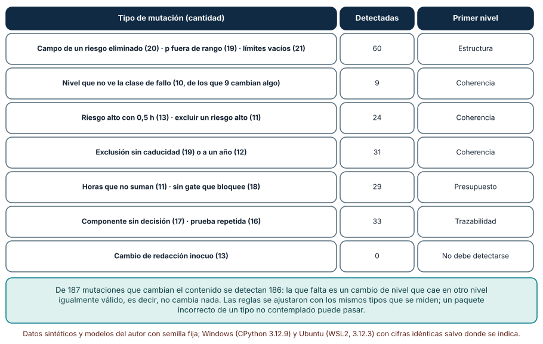

# SE-372 — Proyecto: estrategia ejecutable por riesgo

[← SE-371 — Taller: demostrar que una prueba detecta defectos](https://github.com/vladimiracunadev-create/modern-software-engineering-program/blob/main/classes/part-30-estrategia-y-tecnicas-de-prueba/se-371-taller-demostrar-que-una-prueba-detecta-defectos/README.md) · [↑ Parte 30](https://github.com/vladimiracunadev-create/modern-software-engineering-program/blob/main/classes/part-30-estrategia-y-tecnicas-de-prueba/README.md) · [📚 Índice completo](https://github.com/vladimiracunadev-create/modern-software-engineering-program/blob/main/classes/README.md) · [🌐 Portal](https://vladimiracunadev-create.github.io/modern-software-engineering-program/classes/SE-372.html) · [SE-373 — Modelos de calidad y atributos medibles →](https://github.com/vladimiracunadev-create/modern-software-engineering-program/blob/main/classes/part-31-calidad-rendimiento-y-resiliencia/se-373-modelos-de-calidad-y-atributos-medibles/README.md)

## Punto profesional y fundamento pedagógico

**Punto profesional.** El proyecto integra la parte en un artefacto: una estrategia de pruebas ejecutable para la plataforma de entregas, con riesgos y su reparto de horas, el nivel de prueba de cada clase de fallo, las pruebas que lo sostienen y su demostración, los criterios de bloqueo, las exclusiones con caducidad y los límites. La estrategia no es un documento que se archiva: se valida con un programa, se simula un trimestre y se reajusta tras un incidente.

**Por qué aparece aquí.** Es el cierre de la Parte 30: usa el riesgo de `SE-361`, los niveles de `SE-362` a `SE-366`, los dobles y el entorno de `SE-367` a `SE-370` y la demostración de `SE-371`. La Parte 31 llevará esa estrategia hacia atributos de calidad medibles, rendimiento y resiliencia.

**Error conceptual que debe corregir.** Creer que una estrategia es una lista de buenas prácticas («pirámide de pruebas, cobertura de 80 %, pruebas de regresión»). Una estrategia es un conjunto de decisiones con razones que se pueden contradecir: qué se prueba más, qué se excluye, cuándo se cambia de idea y qué evidencia haría cambiarla.

**Secuencia de aprendizaje.** Antes de leer los resultados, predices cuánto reduce la pérdida de un trimestre repartir 40 horas por riesgo y exposición frente a hacerlo por igual; después simulas 2 000 trimestres, reasignas el presupuesto tras un incidente y validas el paquete de estrategia con 200 mutaciones por niveles. La secuencia usa predicción, explicación propia, contraste y recuperación. [ICAP](https://icap.education.asu.edu/research) distingue participación de construcción de conocimiento; [How People Learn II](https://nap.nationalacademies.org/catalog/24783/how-people-learn-ii-learners-contexts-and-cultures) exige conectar conocimiento previo, contexto y transferencia; la [práctica de recuperación](https://pubmed.ncbi.nlm.nih.gov/16507066/) respalda producir de nuevo la explicación tras una demora; y [Education for Life and Work](https://nap.nationalacademies.org/resource/13398/dbasse_084153.pdf) exige devolución que explique la causa del error.

**Evidencia de aprendizaje.** `estrategia-log.md` con la predicción, el paquete `estrategia/estrategia.json`, el validador y su resultado, la simulación del trimestre, la reasignación tras un incidente y `LIMITES.md` con lo que la estrategia no cubre.

**Límite de la conclusión.** La probabilidad de defecto, el impacto, la dificultad de detección, el reparto de cambios por tamaño y la pérdida por escape son supuestos del autor sobre una plataforma sintética; el simulador es un modelo, no una medición. El validador se ajustó con los mismos tipos de mutación que lo evalúan y su exactitud real es desconocida. No se midió ningún equipo, producto, canal de integración continua ni incidente real.

### Trazabilidad fuente → afirmación

| Fuente primaria u oficial | Afirmación que respalda | Lo que no prueba |
|---|---|---|
| [NIST SP 800-218, Secure Software Development Framework](https://csrc.nist.gov/pubs/sp/800/218/final) | Incluye prácticas de verificación del código y de pruebas como parte del desarrollo seguro. | No define el reparto de esfuerzo. |
| [ISO/IEC 25010:2023](https://www.iso.org/standard/78176.html) | Define los atributos de calidad con los que se clasifican los fallos. | No dice cuánto probar cada uno. |
| [NIST SP 800-30 Rev. 1](https://csrc.nist.gov/pubs/sp/800/30/r1/final) | Describe riesgo como probabilidad e impacto y la documentación de supuestos. | No es una guía de pruebas. |
| [Libro de SRE de Google: Testing for Reliability](https://sre.google/sre-book/testing-reliability/) | Describe cómo distintas pruebas dan confianza en la fiabilidad y qué cubre cada una. | Es la experiencia de una organización. |
| [DORA: automatización de pruebas](https://dora.dev/capabilities/test-automation/) | Describe la capacidad de pruebas automatizadas fiables y su relación con la entrega continua. | No fija la mezcla de niveles. |
| [Martin Fowler, «TestPyramid»](https://martinfowler.com/bliki/TestPyramid.html) | Propone muchas pruebas baratas y pocas caras. | No es una proporción universal. |

## Antes de empezar

Recupera lo aprendido en `SE-371`: una prueba sin demostración es una hipótesis. La pregunta activa es: **¿qué decisiones de esta parte forman una estrategia que otra persona pueda ejecutar, validar y cuestionar, y qué evidencia la haría cambiar?**

## Prerrequisitos

- Haber completado `SE-361` a `SE-371` o poder explicar qué aporta cada una a una estrategia.
- Python 3.11 o posterior con `json`, `random` y `statistics`.
- Poder ejecutar las pruebas de la plataforma de entregas o las de un módulo equivalente.

## Problema auténtico

El director técnico de la plataforma pide «la estrategia de pruebas del próximo trimestre» antes de aprobar un cambio de equipo. El equipo tiene diez componentes, 40 horas de pruebas por trimestre, una integración continua que no debe pasar de diez minutos en cada propuesta de cambio y una lista de incidentes. Una persona entrega un documento de diez páginas con la pirámide de pruebas; otra, una hoja de cálculo con cobertura por módulo. Nadie puede decir qué pasaría si la probabilidad de defecto de la calificación se multiplicara por tres tras un incidente, qué se está dejando sin probar y quién lo aceptó, ni cómo comprobar que el documento coincide con lo que la integración continua ejecuta. Se necesita una estrategia que sea un artefacto validable, con evidencia de que cada prueba detecta lo que dice y con límites escritos.

## Objetivos observables

Al terminar podrás:

1. ensamblar un paquete de estrategia con riesgos, reparto de horas, niveles, pruebas, demostraciones, gates, exclusiones y límites;
2. escribir un validador que compruebe estructura, coherencia de riesgo, presupuesto y trazabilidad, y medirlo con mutaciones;
3. simular un trimestre con varias estrategias y leer pérdida media, percentil 95 y escapes;
4. reasignar el presupuesto tras un incidente y cuantificar lo que cambia;
5. declarar los límites de la estrategia y las condiciones que obligan a revisarla.

## Mapa conceptual


El mapa recorre la parte entera: de los riesgos a las pruebas, de las pruebas a los gates y de los gates a un validador que mantiene el paquete honesto. El retorno cierra el ciclo con un incidente que cambia las estimaciones.

## Temas y por qué importan

| Tema | Por qué cambia una decisión profesional | Evidencia mínima |
|---|---|---|
| Paquete de estrategia | Convierte decisiones en un artefacto verificable. | `estrategia.json` con sus campos |
| Validador por niveles | Detecta incoherencias antes de que se ejecuten pruebas. | Resultado del validador con 200 mutaciones |
| Simulación del trimestre | Muestra pérdida, variabilidad y escapes de una decisión. | Tabla de estrategias con media y percentil 95 |
| Reasignación tras un incidente | Una estrategia debe poder cambiar con razones. | Plan antes y después con la pérdida de cada uno |
| Exclusiones y límites | Lo que no se prueba debe constar. | Exclusiones con caducidad y `LIMITES.md` |

## Conceptos y decisiones

### 1. Paquete de estrategia

El paquete es un archivo estructurado (JSON) con las decisiones: por componente, su probabilidad y su impacto estimados, su clase de fallo, el nivel de prueba que la ve, las horas asignadas, los nombres de las pruebas y la demostración que las respalda; una lista de gates con su umbral y su acción (bloquear o avisar); una lista de exclusiones con razón y caducidad; y los límites. La estructura obliga a que cada riesgo tenga pruebas, cada prueba un riesgo y cada exclusión una fecha, y permite que un programa lo valide.

### 2. Validador por niveles

Un validador comprueba el paquete en capas cada vez más caras: estructura (campos presentes y tipos), coherencia de riesgo (el nivel de prueba puede ver la clase de fallo; un riesgo alto no queda con menos de dos horas ni sin demostración; las exclusiones tienen razón, caducidad menor de 90 días y no afectan a un riesgo alto), y presupuesto y trazabilidad (las horas suman el presupuesto, cada componente aparece como probado o excluido pero no ambos, ninguna prueba sirve a dos riesgos y al menos un gate bloquea). Las capas se miden con mutaciones del paquete, y la medida importa tanto como el validador.

### 3. Simulación del trimestre

Un modelo simple puede responder qué estrategia pierde menos. Sesenta días con cuatro cambios por día, cada cambio cae en un componente con probabilidad proporcional a su tamaño, tiene una probabilidad de defecto \(p/4\) y, si lo tiene, lo detecta la estrategia con probabilidad \(1 - e^{-h/\tau}\) según las horas de ese componente; un defecto detectado cuesta 0,2 unidades y uno que escapa cuesta la mitad de su impacto. El modelo no predice un trimestre: compara estrategias bajo los mismos supuestos y muestra la variabilidad (el percentil 95 importa más que la media cuando un trimestre malo es caro).

### 4. Reasignación tras un incidente

Un incidente cambia las estimaciones: la probabilidad de un componente sube o baja, y el plan debe moverse. La reasignación recalcula el reparto con las estimaciones nuevas y documenta qué componentes ganan y pierden horas. El beneficio de reasignar puede ser pequeño cuando el plan anterior ya era razonable, y aun así conviene hacerlo con razones escritas, porque deja constancia de qué dato cambió la decisión. Los componentes que quedan con pocas horas pasan a la lista de exclusiones con caducidad.

### 5. Exclusiones y límites

Cada decisión de no probar es un riesgo aceptado por alguien en una fecha. Una exclusión sin caducidad se convierte en una omisión; una con caducidad vence y obliga a revisarla. Los límites declaran lo que la estrategia no puede decir: qué clases de fallo no cubre ningún nivel barato, qué supuestos son estimaciones, qué entornos no se probaron y qué evidencia haría cambiar el plan. Un paquete sin límites parece más seguro de lo que es.

### Un trimestre simulado con seis estrategias

Los diez componentes de `SE-361` se simulan con 2 000 trimestres (semilla 372) y 40 horas de pruebas. Las estrategias son: sin pruebas, reparto uniforme, proporcional al tamaño, proporcional a \(p \cdot i\), proporcional a \(p \cdot i \cdot\) cambios (exposición) y marginal con exposición (cada décima de hora al componente con mayor reducción de la pérdida esperada ponderada por su parte de los cambios).

```python
def trimestre(h, rng, comp=COMP, real=None):
    for _ in range(60 * 4):
        j = rng.choices(range(len(comp)), pesos)[0]
        if rng.random() < real[j][1] / 4:
            det = 1 - math.exp(-h[j] / comp[j][4])
            if rng.random() < det: perd += 0.2
            else: perd += real[j][2] * 0.5
```

| Estrategia | Pérdida media | Percentil 95 | Escapes medios |
|---|---:|---:|---:|
| Sin pruebas | 42,41 | 62,00 | 15,69 |
| Reparto uniforme | 24,09 | 39,30 | 8,25 |
| Proporcional al tamaño | 24,17 | 39,00 | 7,90 |
| Proporcional a probabilidad × impacto | 22,78 | 37,20 | 8,72 |
| Por exposición (× cambios) | 21,75 | 35,60 | 8,00 |
| Marginal con exposición | 21,37 | 35,10 | 8,14 |

Tener pruebas reduce la pérdida media de 42,41 a 24,09 con el reparto más pobre; elegir el reparto marginal con exposición la baja a 21,37 (11 %) y el percentil 95 de 39,30 a 35,10 (11 %). Los escapes medios casi no cambian entre estrategias (de 7,9 a 8,7) y la pérdida sí: lo que mejora el reparto por riesgo es cuáles se escapan (los de menor impacto) no cuántos. Esto contradice la intuición de que «menos escapes» es el objetivo: el objetivo es menos pérdida.


**Cómo leer la figura.** Cada fila es una estrategia; las columnas son la pérdida media del trimestre, su percentil 95 y los escapes medios, menos es mejor. **Dónde deja de valer:** los cambios por componente, la probabilidad \(p/4\) por cambio y el costo de un escape son supuestos del autor; con otro reparto de cambios o con defectos correlacionados, las diferencias entre estrategias cambian. La figura compara estrategias bajo los mismos supuestos, no predice un trimestre.

### Reasignar tras un incidente

Un incidente multiplica por tres la probabilidad de defecto de plazos y zonas horarias (de 0,45 a 0,95 con tope) y reduce a la mitad la de notificaciones (de 0,40 a 0,20). Se recalcula el reparto marginal con exposición con las estimaciones nuevas y se compara el plan anterior y el reasignado en la realidad nueva, con el modelo de pérdida y con 2 000 trimestres simulados.

| Qué cambia | Plan anterior | Plan reasignado | Motivo |
|---|---|---|---|
| Notificaciones | 2,3 h | 0,0 h | Probabilidad ×0,5 tras el incidente |
| Plazos y zonas horarias | 4,7 h | 8,4 h | Probabilidad ×3 tras el incidente |
| Pérdida esperada del modelo | 0,706 | 0,678 | −4 % al reasignar |
| Pérdida media simulada | 22,59 | 21,73 | −3,8 % |
| Bajo 2 h: candidatos a «no probar» | Autenticación 0,7 h · búsqueda 0,6 h · administración 1,1 h | | Declarar y caducar |

Reasignar mueve 2,3 horas fuera de notificaciones y 3,7 horas hacia plazos, y mejora poco (3,8 % en la pérdida media simulada), porque el plan anterior ya era razonable. El valor de reasignar es que la decisión queda justificada por un dato nuevo. Tres componentes quedan por debajo de 2 horas; entre ellos la autenticación, de impacto 10: la estrategia debe decidir si impone un piso (se vuelve a `SE-361`) o si la declara exclusión con razón y caducidad.


**Cómo leer la figura.** Cada fila es lo que cambia entre el plan anterior y el reasignado, con su motivo. **Dónde deja de valer:** el incidente y sus factores (×3 y ×0,5) son una construcción del autor; los componentes bajo 2 horas dependen de que no haya un piso de impacto, y una política con piso cambiaría la lista. La figura no dice que reasignar valga poco: dice que, con un plan razonable, la mejora es pequeña y la justificación es el principal beneficio.

### El validador y sus 200 mutaciones

El paquete contiene los nueve componentes probados (con nivel, horas y pruebas), la exclusión de la búsqueda con razón y caducidad a 75 días, dos gates (uno bloquea y otro avisa) y los límites. El validador tiene tres niveles: estructura, coherencia de riesgo y presupuesto y trazabilidad. Se aplican 200 mutaciones de doce tipos y de una inocua (un cambio de redacción en los límites).

```python
if r["p"] * r["impacto"] >= 2.0 and r["horas"] < 2: e.append("riesgo alto con menos de 2 h")
if date.fromisoformat(x["caduca"]) > HOY + timedelta(days=90): e.append("exclusión caduca en más de 90 días")
if abs(sum(r["horas"] for r in p["riesgos"]) - p["presupuesto_horas"]) > 0.15: e.append("las horas no suman el presupuesto")
```

| Tipo de mutación (cantidad) | Detectadas | Primer nivel |
|---|---:|---|
| Campo de un riesgo eliminado (20) · p fuera de rango (19) · límites vacíos (21) | 60 | Estructura |
| Nivel que no ve la clase de fallo (10, de los que 9 cambian algo) | 9 | Coherencia |
| Riesgo alto con 0,5 h (13) · excluir un riesgo alto (11) | 24 | Coherencia |
| Exclusión sin caducidad (19) o a un año (12) | 31 | Coherencia |
| Horas que no suman (11) · sin gate que bloquee (18) | 29 | Presupuesto |
| Componente sin decisión (17) · prueba repetida (16) | 33 | Trazabilidad |
| Cambio de redacción inocuo (13) | 0 | No debe detectarse |

El acumulado por nivel es 60, 124 y 186 de 200. Quedan 14 sin detectar: 13 cambios de redacción que no deben detectarse y un cambio de nivel que cae en otro nivel igualmente válido para esa clase de fallo, que no cambia nada. Todas las mutaciones que cambian el contenido se detectaron, y la estructura sola solo ve un tercio de ellas: las incoherencias de riesgo (un nivel que no ve la clase, un riesgo alto sin horas) y de presupuesto exigen reglas del dominio.



**Cómo leer la figura.** Cada fila agrupa mutaciones del paquete; las columnas dicen cuántas se detectaron y en qué nivel. **Dónde deja de valer:** las reglas se diseñaron con los mismos tipos de mutación que las miden y las cifras de detección son una consecuencia de ese ajuste; un paquete incorrecto de un tipo no contemplado puede pasar los tres niveles. La figura no mide la exactitud real del validador: muestra qué reglas atrapan qué incoherencias.

## Definiciones de trabajo

- **estrategia de pruebas:** conjunto de decisiones sobre qué probar, con qué nivel, con cuánto esfuerzo y qué excluir, con sus razones.
- **gate:** punto de la integración continua que bloquea o avisa según un umbral.
- **exposición:** riesgo ponderado por la parte de los cambios que cae en un componente.
- **escape:** defecto que llega a producción sin ser detectado.
- **exclusión:** decisión de no probar algo, con razón, responsable y fecha de revisión.

Las definiciones son operativas para la plataforma de entregas y deben contrastarse con la documentación primaria enlazada al final.

## Ejemplo mínimo

El fragmento valida una exclusión. Antes de ejecutarlo, predice cuál de las dos pasa.

```python
from datetime import date, timedelta
HOY = date(2026, 11, 15)
def exclusion_valida(x):
    return bool(x.get("razon")) and HOY <= date.fromisoformat(x["caduca"]) <= HOY + timedelta(days=90)
assert exclusion_valida({"razon": "impacto 2 y sustituible", "caduca": "2027-01-15"})
assert not exclusion_valida({"razon": "sin tiempo", "caduca": "2028-01-01"})
```

La segunda cae por caducar más allá de los 90 días permitidos. Registra versión, comando y salida; después elimina la razón y observa el efecto.

## Ejemplo profesional

El equipo de la plataforma versiona `estrategia.json` en el repositorio y lo valida en la integración continua con el programa de `SE-372`. El paquete lista nueve componentes probados con horas asignadas por el reparto marginal con exposición (con un piso de 4 horas para impacto 9 o 10 que añadió el equipo tras discutir la autenticación), tres exclusiones con razón y caducidad a 75 días y dos gates: el rápido (diez minutos, bloquea con pruebas unitarias, de contrato y las de integración por interfaz) y el nocturno (90 minutos, avisa con extremo a extremo, carga ligera y una sesión de exploración trimestral). Cada prueba del paquete tiene una demostración rojo-verde de `SE-371`. Tras un incidente, el equipo reestima las probabilidades, vuelve a calcular el reparto, simula el trimestre y deja en el historial qué horas se movieron y por qué. `LIMITES.md` declara que no se mide rendimiento con usuarios reales, que las estimaciones son del equipo y que la accesibilidad con tecnologías de apoyo se revisa a mano una vez al trimestre.

## Práctica guiada

1. Toma los diez componentes de `SE-361` y escribe sus riesgos, clases de fallo y niveles.
2. Calcula el reparto marginal con exposición y añade un piso de impacto.
3. Escribe `estrategia.json` con riesgos, horas, pruebas, demostraciones, gates, exclusiones y límites.
4. Escribe un validador de tres niveles y comprueba que el paquete íntegro lo supera.
5. Define doce mutaciones del paquete y mide cuáles detecta cada nivel.
6. Simula 2 000 trimestres con tres estrategias y compara pérdida media y percentil 95.
7. Introduce un incidente (probabilidad ×3 en un componente), reasigna, vuelve a simular y escribe `LIMITES.md`.

## Ejercicios

1. **Piso:** añade un piso de 4 horas para impacto 9 o 10 al reparto marginal con exposición y mide cuánto sube la pérdida simulada.
2. **Regla:** añade al validador una regla nueva (por ejemplo, que ningún gate rápido supere 10 minutos) y mide qué mutaciones nuevas detecta.
3. **Escape:** cambia el costo de un escape de la mitad del impacto al impacto completo y observa si cambia el orden de las estrategias.
4. **Límites:** escribe tres límites de tu estrategia que contradigan una afirmación del paquete y decide qué evidencia los resolvería.

## Reto verificable

Entrega `estrategia.json`, el validador con el resultado de sus 200 mutaciones, la simulación del trimestre con tres estrategias, la reasignación tras un incidente y `LIMITES.md`. Se aprueba si otra persona ejecuta el validador sobre el paquete, obtiene el mismo resultado con las mismas semillas, introduce una incoherencia propia y comprueba que se detecta (o descubre que no). No se aprueba por entregar un documento sin validador ni simulación.

## Caso conductor

La plataforma de entregas es el caso conductor de la parte. Esta clase deja el artefacto final: la estrategia de pruebas ejecutable con su validador, su simulación y sus límites. La Parte 31 toma esos riesgos y los convierte en atributos de calidad medibles, en rendimiento y en resiliencia. Cambia después una sola decisión, la caducidad máxima de las exclusiones de 90 a 30 días, y observa cuántas del paquete vencen y qué revisión exigen.

## Preguntas frecuentes

### ¿Cuántas horas deben dedicarse a probar?

Las que el negocio acepte frente a la pérdida esperada: la simulación del trimestre pasó de 42,41 sin pruebas a 21,37 con 40 horas bien repartidas. No hay un porcentaje universal: se discute con la tabla de riesgos y se revisa con los incidentes.

### ¿Qué valor tiene un validador si las reglas se ajustan a las mutaciones?

Atrapa las incoherencias que se pensaron y deja pasar las que no. Su valor es mantener el paquete consistente con sus propias reglas y obligar a escribirlas. Su límite se declara, y cada incidente que revele una incoherencia nueva añade una regla.

### ¿La estrategia sustituye el juicio del equipo?

No: lo hace explícito. Las probabilidades, los impactos y los pisos son decisiones del equipo con su razón, y el paquete permite que otra persona las discuta, las compare con un incidente y las cambie.

### ¿Cada cuánto se revisa?

Con cada incidente relevante, con cada cambio grande de arquitectura y al vencer las exclusiones. Una revisión trimestral fija es el mínimo.

## Fallo controlado y diagnóstico

Reproduce el fallo clásico de la clase: **un paquete que parece completo y deja un componente crítico sin horas**. Aplica la mutación «excluir un riesgo alto» al paquete íntegro y ejecuta el validador solo con la estructura.

Registra síntoma, entrada mínima, hipótesis, observación que descarta cada hipótesis, causa, corrección y prueba de regresión. **Síntoma:** el paquete pasa la comprobación de estructura y el componente de plazos y zonas horarias aparece como exclusión «sin tiempo» con una fecha. **Hipótesis rivales:** (a) el paquete es correcto; (b) el validador de estructura no revisa nada; (c) falta una regla de coherencia de riesgo. **Prueba:** ejecuta el segundo nivel y comprueba que detecta la exclusión de un riesgo alto (11 de 11 mutaciones de este tipo); ejecuta solo el primero y comprueba que no detecta ninguna. **Conclusión:** la estructura valida la forma y no el sentido. **Regresión:** deja los tres niveles en la integración continua, añade el caso al conjunto de mutaciones y escribe en `LIMITES.md` que las reglas de riesgo dependen del umbral \(p \cdot i \ge 2{,}0\). No cambies a la vez el paquete y el validador.

## Errores comunes y cómo corregirlos

| Síntoma | Causa probable | Corrección |
|---|---|---|
| La estrategia es un documento que nadie ejecuta | No hay validador ni vínculo con la integración continua | Paquete estructurado y validado en cada cambio |
| Un riesgo alto queda sin horas o sin nivel que lo vea | Falta de reglas de coherencia | Reglas de riesgo en el validador |
| Las exclusiones nunca se revisan | Sin caducidad | Fecha de caducidad menor de 90 días y revisión |
| El plan no cambia tras un incidente | Las estimaciones no se actualizan | Reestimar, reasignar y registrar la razón |
| Se evalúa la estrategia por escapes | Se ignora el impacto de cada escape | Medir pérdida y percentil 95 |

## Entorno y archivos clave

```text
work/SE-372/
├── README.md
├── estrategia/
│   ├── estrategia.json
│   ├── validador.py
│   └── LIMITES.md
├── simulacion/
│   ├── trimestre.py
│   └── reasignar.py
├── tests/test_validador.py
└── evidence/estrategia-log.md
```

El `README` declara plataforma, versión de Python, semilla (372) y comandos. Los experimentos usan solo la biblioteca estándar (`json`, `random`, `statistics`, `datetime`, `math`) y se ejecutaron con CPython 3.12.9 en Windows 11 y 3.12.3 en Ubuntu bajo WSL2: las salidas fueron idénticas. Si añades una dependencia, fija procedencia y versión.

## Seguridad, ética y accesibilidad

- una estrategia que excluye componentes de seguridad o privacidad sin compensación traslada el riesgo a personas que no lo aceptaron: exige un piso por impacto y una revisión externa;
- los incidentes que alimentan la estrategia pueden contener datos personales: anonimízalos antes de guardarlos en el repositorio;
- documenta qué grupos de usuarios (dispositivos lentos, tecnologías de apoyo, idiomas) no están cubiertos por ninguna prueba;
- las simulaciones no deben usarse para justificar recortes de pruebas sin mostrar sus supuestos y su sensibilidad;
- guarda la historia del paquete: quién cambió qué estimación, cuándo y por qué.

## Puente hacia el trabajo con agentes

Un agente al que se le pide «diseña la estrategia de pruebas del proyecto» entregará un documento genérico con la pirámide, una cobertura objetivo y una lista de herramientas. Pídele en cambio el paquete estructurado con riesgos y fuentes de cada estimación, el reparto de horas con la pérdida simulada de al menos tres criterios, la demostración rojo-verde de cada prueba, las exclusiones con caducidad y un validador con sus mutaciones. Revisa especialmente que declare sus límites, que no fije una cobertura como objetivo y que cada estimación tenga una fuente que se pueda cuestionar.

## Transferencia

Traslada el proyecto a otro sistema (por ejemplo, una aplicación de turnos de un consultorio): estima riesgos, reparte horas, escribe el paquete y el validador, simula un trimestre y reasigna tras un incidente inventado. La transferencia está lograda cuando puedes explicar qué regla del validador cambiarías para el nuevo dominio y por qué, no cuando el paquete se parece.

## Evaluación y evidencia

| Criterio | Evidencia para aprobar |
|---|---|
| comprensión | explicación del paquete como conjunto de decisiones con razones y límites |
| corrección | validador, simulación y reasignación reproducibles con las mismas semillas |
| diseño | paquete con riesgos, horas, niveles, demostraciones, gates, exclusiones y límites |
| diagnóstico | reproducción del fallo «paquete válido en forma con un riesgo alto excluido» con regresión |
| incertidumbre | declaración de que los supuestos, el simulador y las reglas son del autor |
| reproducibilidad | versiones, semilla, comandos, salida y límites declarados |

## Fuentes

- [NIST SP 800-218, Secure Software Development Framework](https://csrc.nist.gov/pubs/sp/800/218/final) — prácticas de verificación; autoridad: NIST.
- [ISO/IEC 25010:2023](https://www.iso.org/standard/78176.html) — atributos de calidad; autoridad: ISO/IEC.
- [NIST SP 800-30 Rev. 1](https://csrc.nist.gov/pubs/sp/800/30/r1/final) — evaluación de riesgos; autoridad: NIST.
- [Libro de SRE de Google: Testing for Reliability](https://sre.google/sre-book/testing-reliability/) — pruebas y fiabilidad; autoridad: Google SRE.
- [DORA: automatización de pruebas](https://dora.dev/capabilities/test-automation/) — capacidad de pruebas automatizadas; autoridad: DORA.
- [Martin Fowler, «TestPyramid»](https://martinfowler.com/bliki/TestPyramid.html) — reparto por nivel; autoridad: autor del texto.

Cada fuente respalda el mecanismo indicado; ninguna demuestra que el 11 % de reducción de pérdida de un reparto por exposición o el 3,8 % de una reasignación se observen en la plataforma. Esa afirmación depende de los datos reales, de los incidentes y de cómo se detectan los defectos.

## Límites y siguiente paso

Se ejecutaron tres experimentos con un simulador, un paquete y un validador escritos por el autor en Windows y Ubuntu (WSL2), con salidas idénticas. La probabilidad de defecto, el impacto, la distribución de los cambios y el costo de un escape son supuestos; las reglas del validador se ajustaron con las mismas mutaciones que lo miden. No se midió ningún equipo, integración continua ni incidente real. La Parte 31 convierte estos riesgos en atributos de calidad medibles y los lleva a carga, percentiles, capacidad y resiliencia.

## Glosario

- **estrategia de pruebas:** conjunto de decisiones sobre qué probar, con qué nivel, con cuánto esfuerzo y qué excluir, con sus razones.
- **gate:** punto de la integración continua que bloquea o avisa según un umbral.
- **exposición:** riesgo ponderado por la parte de los cambios que cae en un componente.
- **escape:** defecto que llega a producción sin ser detectado.
- **exclusión:** decisión de no probar algo, con razón, responsable y fecha de revisión.

---

[← SE-371 — Taller: demostrar que una prueba detecta defectos](https://github.com/vladimiracunadev-create/modern-software-engineering-program/blob/main/classes/part-30-estrategia-y-tecnicas-de-prueba/se-371-taller-demostrar-que-una-prueba-detecta-defectos/README.md) · [↑ Parte 30](https://github.com/vladimiracunadev-create/modern-software-engineering-program/blob/main/classes/part-30-estrategia-y-tecnicas-de-prueba/README.md) · [📚 Índice completo](https://github.com/vladimiracunadev-create/modern-software-engineering-program/blob/main/classes/README.md) · [🌐 Portal](https://vladimiracunadev-create.github.io/modern-software-engineering-program/classes/SE-372.html) · [SE-373 — Modelos de calidad y atributos medibles →](https://github.com/vladimiracunadev-create/modern-software-engineering-program/blob/main/classes/part-31-calidad-rendimiento-y-resiliencia/se-373-modelos-de-calidad-y-atributos-medibles/README.md)
