# Parte 30 — Ingeniería de datos y plataformas de datos

La Parte 28 enseñó a elegir estilos arquitectónicos con escenarios de calidad y a defender la elección con un registro de decisión. Esta parte trata el dato como un producto de ingeniería con su propio ciclo de vida: sale de la base que sirve a la aplicación, llega a una plataforma, se organiza para responder preguntas, se transforma de forma repetible, se vigila, se promete a quienes lo consumen, se rastrea, se almacena en un formato con costo, se gobierna y se paga. El recorrido está pensado para quien debe responder a la pregunta «¿puedo confiar en este número y qué pasa si lo cambio?» con evidencia y no con una captura de pantalla.

## Pregunta rectora

> Para este dato, ¿qué decisión lo mueve del sistema operacional al analítico, qué lo hace repetible y verificable, quién responde por él, qué cuesta conservarlo y qué cambio podría llegar a un informe sin que nada lo detenga?

## Antes del recorrido clase por clase

Esta parte no defiende una herramienta ni una arquitectura de moda. Enseña a leer cada decisión de una plataforma de datos como un **mecanismo con un costo medible y un punto ciego**: qué problema resuelve, qué experimento lo mide, qué no demuestra y qué evidencia permitiría abandonarlo. La primera clase fija la frontera entre lo operacional y lo analítico (`SE-361`). Las siguientes siguen el dato en el orden en que se le hacen preguntas: cómo entra, cómo se organiza, cómo se construye sin duplicar, cómo se sabe que es correcto, cómo se promete y cómo se cambia sin romper, cómo se rastrea, dónde se guarda, cómo se protege y cuánto cuesta. El taller (`SE-371`) pone a prueba todo con ocho defectos sembrados y el proyecto (`SE-372`) lo integra en una plataforma mínima que se puede romper a propósito.

```mermaid
flowchart LR
    A[Operacional frente a analítico] --> B[Ingesta batch y streaming]
    B --> C[Modelado: hechos y dimensiones]
    C --> D[Transformación idempotente y backfills]
    D --> E[Calidad y observabilidad]
    E --> F[Contratos y evolución de esquemas]
    F --> G[Linaje, catálogo y metadatos]
    G --> H[Warehouse, lake, lakehouse y formatos]
    H --> I[Gobierno, privacidad y retención]
    I --> J[Costos y operación]
    J --> K[Taller: pipeline defectuoso]
    K --> L[Proyecto: plataforma gobernada]
    L -->|cambio que el control no ve| E
```

El diagrama se lee de izquierda a derecha y no es un orden de adopción: es el orden en que se explican los costos. El retorno indica que lo que el control de la plataforma no detecta se cubre con otra capa de comprobación, y vuelve a empezar por la calidad.

## Resultados acumulativos

Podrás clasificar una consulta como operacional o analítica por su patrón de acceso, medir cuántos bytes toca y cuándo una lectura larga bloquea una escritura, y reconstruir con un registro de eventos una pregunta sobre el pasado que la tabla de estado no puede responder (`SE-361`); medir cuántos eventos deja fuera cada política de ingesta, qué retraso paga cada una y cuánto infla un conteo la entrega al menos una vez (`SE-362`); declarar la granularidad de un hecho, medir el efecto de sobrescribir una dimensión, provocar y corregir un abanico de uniones y cargar un Data Vault repetible (`SE-363`).

Podrás cargar particiones con tres estrategias y comprobar cuál sobrevive a un fallo y a una repetición, reescribir una ventana histórica y calcular qué recalcular desde un grafo de dependencias (`SE-364`); comparar tres detectores de volumen con incidentes sembrados y construir la matriz de qué comprobación ve cada defecto (`SE-365`); clasificar diez cambios de esquema en los dos sentidos de compatibilidad y ejecutar un renombre en tres pasos (`SE-366`); y medir el linaje de columnas por perturbación frente a lo que predicen tres tipos de linaje (`SE-367`).

Podrás construir un formato columnar mínimo, medir su tamaño y los bytes que lee con y sin orden, mostrar el costo de los archivos pequeños y publicar una compactación con un manifiesto de versiones (`SE-368`); medir qué columnas esconde la clasificación por nombre, revertir un hash sin clave, calcular los grupos pequeños de un agregado y propagar un borrado (`SE-369`); estimar el costo de una consulta, de un refresco y de una ruta crítica (`SE-370`); diagnosticar ocho defectos y corregirlos uno a uno midiendo tras cada paso (`SE-371`); y construir un control de siete reglas, probarlo con diez cambios inyectados y declarar el que no ve (`SE-372`).

## Prerrequisitos enlazados

- [Parte 29 — Datos, persistencia y recuperación](https://github.com/vladimiracunadev-create/modern-software-engineering-program/blob/main/classes/part-29-datos-persistencia-y-recuperacion/): modelado (`SE-349`), transacciones (`SE-351`), índices y patrones de acceso (`SE-353`), migraciones compatibles (`SE-354`), privacidad y retención (`SE-358`) y proyecto de capa de datos (`SE-360`).
- [Parte 31 — Integración, eventos y mensajería](https://github.com/vladimiracunadev-create/modern-software-engineering-program/blob/main/classes/part-31-integracion-eventos-y-mensajeria/): semánticas de entrega (`SE-376`), idempotencia y sagas (`SE-377`), CDC, ETL y ELT (`SE-378`) y compatibilidad de esquemas (`SE-380`).
- [Parte 36 — Calidad, rendimiento y resiliencia](https://github.com/vladimiracunadev-create/modern-software-engineering-program/blob/main/classes/part-36-calidad-rendimiento-y-resiliencia/): modelos de calidad (`SE-433`), latencia y capacidad (`SE-436`) y reintentos (`SE-438`).
- [Parte 38 — Seguridad, privacidad y cumplimiento](https://github.com/vladimiracunadev-create/modern-software-engineering-program/blob/main/classes/part-38-seguridad-privacidad-y-cumplimiento/): secretos (`SE-462`), privacidad por diseño (`SE-463`) y cumplimiento y sus límites (`SE-466`).
- [Parte 41 — Observabilidad, SRE e incidentes](https://github.com/vladimiracunadev-create/modern-software-engineering-program/blob/main/classes/part-41-observabilidad-sre-e-incidentes/): señales (`SE-493`), SLO (`SE-497`), alertas accionables (`SE-498`) y diagnóstico con telemetría incompleta (`SE-503`).
- Python 3.11+ y terminal; los experimentos usan solo la biblioteca estándar (`sqlite3`, `zlib`, `array`, `hmac`, `tempfile`) y escriben únicamente en directorios temporales.

## Bloques y progresión

1. **Del origen al modelo:** las clases 541 a 543 separan lo operacional de lo analítico, miden cómo entra el dato y cómo se organiza para consultarlo sin errores de granularidad.
2. **Repetible y verificable:** las clases 544 a 546 construyen el dato sin duplicar, lo vigilan con comprobaciones y lo prometen con un contrato que sobrevive a los cambios de esquema.
3. **Dónde vive, quién lo ve y cuánto cuesta:** las clases 547 a 550 rastrean de dónde viene, eligen el formato y el lugar, gobiernan la privacidad y la retención y estiman el costo.
4. **Probar e integrar:** las clases 551 y 552 diagnostican un pipeline con ocho defectos sembrados y construyen una plataforma mínima con un control probado con cambios inyectados.

## Evidencia medida y límites

Las figuras y los ejemplos de esta parte usan experimentos ejecutados con CPython 3.12.9 y SQLite 3.45.3 en Windows 11; los recuentos y los resultados de las simulaciones con semilla fija 45 se repiten idénticos, y los tiempos de lectura, de agregación y de refresco varían entre ejecuciones y equipos. **No se invocó ningún modelo de lenguaje, no se ejecutó ninguna herramienta de terceros (Airflow, dbt, Kafka, Spark, Parquet, Iceberg, Delta Lake, OpenLineage, Great Expectations, catálogos o almacenes de datos) y no se evaluó ningún sistema real.** Lo que se ejecutó fueron bases de SQLite, archivos temporales y simulaciones escritas para la clase.

Los experimentos son: una tabla de 200 000 pedidos consultada por clave y por agregación, una prueba de lectura larga contra una escritura con dos modos de diario y una pregunta sobre el pasado respondida con 70 745 cambios de estado (`SE-361`); 10 000 eventos con llegadas tardías y reentregas procesados con cinco marcas de agua y dos lotes (`SE-362`); 20 000 pedidos con una dimensión de clientes con historia, un abanico de uniones y un Data Vault de cuatro tablas (`SE-363`); 30 particiones cargadas con tres estrategias, un backfill de cinco días, un grafo de nueve tareas y una ventana de reproceso sobre 6 000 filas (`SE-364`); una serie de 120 días con tres detectores y una tabla de 5 000 pedidos con seis variantes defectuosas (`SE-365`); un verificador de compatibilidad con diez cambios, 1 000 registros y un renombre en tres pasos (`SE-366`); un pipeline de seis sentencias analizado y perturbado en nueve columnas (`SE-367`); 200 000 pedidos en cuatro formatos, un formato columnar propio, 1 000 archivos pequeños y un manifiesto (`SE-368`); 5 000 usuarios con una clasificación, una reversión de hashes, un k-anonimato y un borrado propagado (`SE-369`); un escalado de bytes a 1 TB con precios inventados, refrescos completos e incrementales y una ruta crítica (`SE-370`); 20 000 pedidos con ocho defectos sembrados y ocho comprobaciones (`SE-371`); y una plataforma de tres conjuntos con un control de siete reglas y diez mutaciones (`SE-372`).

Los parámetros (los volúmenes, las mezclas de retrasos, las tasas de duplicado, los porcentajes de mudanza, los umbrales de calidad, los precios y los factores de escalado, las duraciones de las tareas, los defectos y las mutaciones) son construcciones del autor. Ninguna cifra es una medición de un sistema real ni una tarifa de un proveedor.

Lo que **no se hizo**: no se midió ninguna plataforma de datos, ningún almacén, ninguna factura ni la calidad de datos de ninguna organización; no se evaluó el cumplimiento de ninguna norma de protección de datos, y esta parte no sustituye la asesoría legal; el formato columnar del laboratorio no es Parquet ni se midió Parquet; y el control de siete reglas detecta 9 de 10 mutaciones inyectadas, un resultado que mide la cobertura por familias de defectos y no la tasa de defectos reales. Las afirmaciones sobre herramientas y normas se atribuyen a sus fuentes y se tratan como descripciones; varias son documentación de proyectos sobre sí mismos y se leen como tales.

## Guía razonada clase por clase

*Avisos* deja de ser una aplicación que guarda datos y pasa a ser una organización que debe responder con ellos. Cada clase explica qué decisión de la plataforma de datos atiende, qué experimento la mide, qué no demuestra y qué evidencia permitiría abandonar la conclusión.

### Bloque 1 — Del origen al modelo

#### SE-361 — Del dato operacional al analítico

Una base operacional y una analítica responden a preguntas distintas con patrones de acceso opuestos, y mezclarlas produce dos fallos que se confunden con lentitud: un informe pesado que bloquea a la aplicación y una pregunta sobre el pasado que la base ya no puede responder porque sobrescribió la respuesta. La clase mide los bytes que toca una búsqueda frente a una agregación sobre 200 000 pedidos, prueba una lectura abierta contra una escritura con y sin registro anticipado y reconstruye con eventos una pregunta que la tabla de estado no contesta.

El estudiante entrega un documento con las cinco preguntas analíticas más frecuentes de un sistema suyo, su patrón de acceso, si necesitan historia y qué cambia de significado en cada traspaso. `SE-362` trata cómo llegan los datos a la zona cruda.

#### SE-362 — Ingesta batch y streaming

Lote y flujo son dos modelos de completitud, no dos velocidades: uno espera y cierra, el otro nunca sabe si llegó todo y debe declarar cuánto espera. La clase simula 10 000 eventos con llegadas tardías y reentregas, mide cuántos deja fuera cada marca de agua y cada lote y cuánto infla el conteo contar entregas en lugar de eventos únicos.

El estudiante entrega la política de ingesta de una fuente suya con los percentiles de retraso, la tolerancia, la clave de deduplicación y el destino de lo tardío. `SE-363` organiza lo que llega.

#### SE-363 — Modelado analítico: hechos, dimensiones y granularidad

Un modelo analítico existe para que una pregunta tenga una sola respuesta. La clase mide cuánto cambia un reparto de ventas si una dimensión se sobrescribe frente a si conserva versiones, provoca y corrige un abanico de uniones que triplica un costo de envío y carga un Data Vault cuya repetición no añade filas.

El estudiante entrega la granularidad de cada hecho de un dominio suyo, la política de historia de sus dimensiones y la consulta que detecta un abanico. `SE-364` construye esas tablas sin duplicar ni perder filas.

### Bloque 2 — Repetible y verificable

#### SE-364 — Transformación y orquestación idempotente con backfills

Un pipeline que solo funciona si se ejecuta una vez no es un pipeline. La clase carga 30 particiones con tres estrategias, provoca un fallo a mitad con y sin transacción, corrige cinco días de origen reescribiendo solo esas particiones, calcula qué recalcular en un grafo de nueve tareas y mide cuántos datos tardíos recoge cada ventana de reproceso.

El estudiante entrega el plan de backfill de una tabla suya con la prueba de idempotencia y las tareas que se recalculan. `SE-365` vigila que lo construido sea correcto.

#### SE-365 — Calidad y observabilidad de datos

Un pipeline en verde no prueba que los datos sean correctos. La clase compara tres detectores de volumen con incidentes sembrados en una serie con caída de fin de semana, detecta una deriva del importe que ninguna comprobación de volumen ve y construye la matriz de qué familia de comprobación detecta cada defecto de una tabla.

El estudiante entrega las comprobaciones de un conjunto suyo con su umbral, su dueño, el detector de volumen elegido y la lista de lo que ninguna ve. `SE-366` convierte las expectativas en un contrato.

#### SE-366 — Contratos de datos y evolución de esquemas

Un contrato convierte una costumbre en un acuerdo comprobable, y la compatibilidad depende de quién actualiza primero. La clase clasifica diez cambios de esquema en los dos sentidos, lee 1 000 registros con el esquema nuevo, ejecuta un renombre de golpe y en tres pasos y muestra el cambio de unidad que el verificador aprueba y que rompe el significado.

El estudiante entrega el contrato de un conjunto suyo con la tabla de cambios por sentido y el plan de expandir y contraer de un cambio incompatible. `SE-367` construye el mapa de quién consume qué.

### Bloque 3 — Dónde vive, quién lo ve y cuánto cuesta

#### SE-367 — Linaje, catálogo y metadatos

El linaje responde de dónde sale un número y qué se rompe si cambia una columna, y cada método ve una parte. La clase analiza seis sentencias SQL, perturba nueve columnas de origen y compara lo medido con tres predicciones: el linaje de valores omite 31 cambios que las condiciones sí explican, y el de tablas avisa de todo o de nada.

El estudiante entrega el linaje de columnas de un conjunto suyo con el método de cada arista, la prueba de perturbación y la ficha de catálogo de un activo. `SE-368` pasa a dónde y cómo se guardan los datos.

#### SE-368 — Warehouse, lake, lakehouse y formatos columnares

Almacén, lago y lakehouse son arquitecturas con garantías distintas, y debajo de ellas el formato y el orden deciden los bytes que se leen. La clase construye un formato columnar mínimo, lo compara con CSV, JSON y un binario por filas sobre 200 000 pedidos, mide el efecto del orden y de los archivos pequeños y publica una compactación con un manifiesto de versiones.

El estudiante entrega el formato, la partición, el orden y el tamaño de archivo de una tabla suya con la consulta representativa y sus bytes leídos. `SE-369` trata lo que esos archivos contienen sobre personas.

#### SE-369 — Gobierno, privacidad y retención de datos

Gobernar es un conjunto de mecanismos comprobables sobre el recorrido del dato. La clase mide qué columnas personales escapan a una clasificación por nombre, demuestra que un hash sin clave se revierte con candidatos y un HMAC no, calcula los grupos pequeños de un agregado y propaga un borrado por el linaje encontrando la copia que queda fuera.

El estudiante entrega el inventario de datos personales de un conjunto suyo, su método de seudonimización con la prueba de reversión, el umbral de agregación y el recorrido de borrado. `SE-370` pone precio a todo eso.

#### SE-370 — Costos y operación de plataformas de datos

El costo es una propiedad de cada decisión técnica. La clase escala bytes medidos a una tabla de 1 TB con un precio inventado, compara refrescos completos e incrementales por frecuencia, calcula la ruta crítica de un pipeline de ocho tareas y muestra que acelerar una tarea fuera de ella no mueve la hora de entrega.

El estudiante entrega el costo mensual de tres decisiones de una plataforma suya con la fórmula y la ruta crítica de su pipeline principal. `SE-371` pone a prueba todo lo anterior.

### Bloque 4 — Probar e integrar

#### SE-371 — Taller: reparar un pipeline defectuoso

Los defectos de un pipeline se enmascaran entre sí. El taller entrega un pipeline con ocho defectos sembrados, la verdad de referencia y ocho comprobaciones, y pide diagnosticarlos con método: reproducir, acotar la capa, conciliar y corregir una causa por paso midiendo tras cada una, con el error subiendo en medio de la reparación.

El estudiante entrega el diagnóstico de cada defecto con el antes y el después, la matriz defecto por comprobación y la comprobación nueva para el más difícil de ver. `SE-372` integra el control que debería haberlos detenido.

#### SE-372 — Proyecto: plataforma de datos mínima gobernada

Una plataforma gobernada se distingue de una que lo parece por su control: reglas que comparan lo declarado con lo construido y que se prueban con cambios inyectados. La clase construye tres conjuntos con un registro de metadatos, un control de siete reglas y diez mutaciones, detecta 9 y declara la décima, un cambio de significado que atraviesa todo.

El estudiante entrega su registro de metadatos, las reglas con su evidencia, la matriz de mutaciones, el cambio que su control no ve y el costo estimado. Con esta clase se cierra la parte.

## Resumen operativo del recorrido

| Clase | Núcleo profesional | Aporte acumulativo |
|---|---|---|
| [SE-361](https://github.com/vladimiracunadev-create/modern-software-engineering-program/blob/main/classes/part-30-ingenieria-de-datos-y-plataformas-de-datos/se-361-del-dato-operacional-al-analitico/) | Del dato operacional al analítico | Entrega un documento con las cinco preguntas analíticas más frecuentes de un sistema suyo, su patrón de acceso, si necesitan historia y qué cambia de significado en cada traspaso |
| [SE-362](https://github.com/vladimiracunadev-create/modern-software-engineering-program/blob/main/classes/part-30-ingenieria-de-datos-y-plataformas-de-datos/se-362-ingesta-batch-y-streaming/) | Ingesta batch y streaming | Entrega la política de ingesta de una fuente suya con los percentiles de retraso, la tolerancia, la clave de deduplicación y el destino de lo tardío |
| [SE-363](https://github.com/vladimiracunadev-create/modern-software-engineering-program/blob/main/classes/part-30-ingenieria-de-datos-y-plataformas-de-datos/se-363-modelado-analitico-hechos-dimensiones-y-granularidad/) | Modelado analítico: hechos, dimensiones y granularidad | Entrega la granularidad de cada hecho de un dominio suyo, la política de historia de sus dimensiones y la consulta que detecta un abanico |
| [SE-364](https://github.com/vladimiracunadev-create/modern-software-engineering-program/blob/main/classes/part-30-ingenieria-de-datos-y-plataformas-de-datos/se-364-transformacion-y-orquestacion-idempotente-con-backfills/) | Transformación y orquestación idempotente con backfills | Entrega el plan de backfill de una tabla suya con la prueba de idempotencia y las tareas que se recalculan |
| [SE-365](https://github.com/vladimiracunadev-create/modern-software-engineering-program/blob/main/classes/part-30-ingenieria-de-datos-y-plataformas-de-datos/se-365-calidad-y-observabilidad-de-datos/) | Calidad y observabilidad de datos | Entrega las comprobaciones de un conjunto suyo con su umbral, su dueño, el detector de volumen elegido y la lista de lo que ninguna ve |
| [SE-366](https://github.com/vladimiracunadev-create/modern-software-engineering-program/blob/main/classes/part-30-ingenieria-de-datos-y-plataformas-de-datos/se-366-contratos-de-datos-y-evolucion-de-esquemas/) | Contratos de datos y evolución de esquemas | Entrega el contrato de un conjunto suyo con la tabla de cambios por sentido y el plan de expandir y contraer de un cambio incompatible |
| [SE-367](https://github.com/vladimiracunadev-create/modern-software-engineering-program/blob/main/classes/part-30-ingenieria-de-datos-y-plataformas-de-datos/se-367-linaje-catalogo-y-metadatos/) | Linaje, catálogo y metadatos | Entrega el linaje de columnas de un conjunto suyo con el método de cada arista, la prueba de perturbación y la ficha de catálogo de un activo |
| [SE-368](https://github.com/vladimiracunadev-create/modern-software-engineering-program/blob/main/classes/part-30-ingenieria-de-datos-y-plataformas-de-datos/se-368-warehouse-lake-lakehouse-y-formatos-columnares/) | Warehouse, lake, lakehouse y formatos columnares | Entrega el formato, la partición, el orden y el tamaño de archivo de una tabla suya con la consulta representativa y sus bytes leídos |
| [SE-369](https://github.com/vladimiracunadev-create/modern-software-engineering-program/blob/main/classes/part-30-ingenieria-de-datos-y-plataformas-de-datos/se-369-gobierno-privacidad-y-retencion-de-datos/) | Gobierno, privacidad y retención de datos | Entrega el inventario de datos personales de un conjunto suyo, su método de seudonimización con la prueba de reversión, el umbral de agregación y el recorrido de borrado |
| [SE-370](https://github.com/vladimiracunadev-create/modern-software-engineering-program/blob/main/classes/part-30-ingenieria-de-datos-y-plataformas-de-datos/se-370-costos-y-operacion-de-plataformas-de-datos/) | Costos y operación de plataformas de datos | Entrega el costo mensual de tres decisiones de una plataforma suya con la fórmula y la ruta crítica de su pipeline principal |
| [SE-371](https://github.com/vladimiracunadev-create/modern-software-engineering-program/blob/main/classes/part-30-ingenieria-de-datos-y-plataformas-de-datos/se-371-taller-reparar-un-pipeline-defectuoso/) | Taller: reparar un pipeline defectuoso | Entrega el diagnóstico de cada defecto con el antes y el después, la matriz defecto por comprobación y la comprobación nueva para el más difícil de ver |
| [SE-372](https://github.com/vladimiracunadev-create/modern-software-engineering-program/blob/main/classes/part-30-ingenieria-de-datos-y-plataformas-de-datos/se-372-proyecto-plataforma-de-datos-minima-gobernada/) | Proyecto: plataforma de datos mínima gobernada | Entrega su registro de metadatos, las reglas con su evidencia, la matriz de mutaciones, el cambio que su control no ve y el costo estimado |

## Fuentes

- [Kleppmann, «Designing Data-Intensive Applications»](https://dataintensive.net/), [Kimball Group, «Dimensional Modeling Techniques»](https://www.kimballgroup.com/data-warehouse-business-intelligence-resources/kimball-techniques/dimensional-modeling-techniques/), [Data Vault Alliance](https://datavaultalliance.com/) y [Fowler, «Data Lake»](https://martinfowler.com/bliki/DataLake.html) — procesamiento transaccional y analítico, modelado dimensional y de bóveda, y zona cruda; autoría de Kleppmann, Kimball Group, la comunidad del vault y Fowler.
- [Akidau et al., «The Dataflow Model»](https://www.vldb.org/pvldb/vol8/p1792-Akidau.pdf) y [Apache Kafka, «Message Delivery Semantics»](https://kafka.apache.org/documentation/#semantics) — tiempo del evento, marcas de agua y semánticas de entrega; autoría de los autores del artículo y del proyecto Kafka.
- [Apache Airflow, «DAGs»](https://airflow.apache.org/docs/apache-airflow/stable/core-concepts/dags.html) y [«DAG Runs»](https://airflow.apache.org/docs/apache-airflow/stable/core-concepts/dag-run.html), [dbt, «Incremental models»](https://docs.getdbt.com/docs/build/incremental-models) y [SQLite, «UPSERT»](https://www.sqlite.org/lang_upsert.html) — grafos de tareas, ejecuciones por intervalo, construcción incremental y escritura por clave; autoridad: los proyectos y SQLite.
- [Great Expectations](https://docs.greatexpectations.io/docs/), [Google, «Monitoring Distributed Systems»](https://sre.google/sre-book/monitoring-distributed-systems/) y [ISO/IEC 25010:2023](https://www.iso.org/standard/78176.html) — comprobaciones de calidad de datos, alertas sobre síntomas y vocabulario de calidad; autoridad: el proyecto, Google e ISO.
- [Open Data Contract Standard](https://bitol-io.github.io/open-data-contract-standard/latest/), [Apache Avro, «Schema Resolution»](https://avro.apache.org/docs/current/specification/), [Confluent, «Schema Evolution and Compatibility»](https://docs.confluent.io/platform/current/schema-registry/fundamentals/schema-evolution.html), [Fowler, «ParallelChange»](https://martinfowler.com/bliki/ParallelChange.html) y [SQLite, «ALTER TABLE»](https://www.sqlite.org/lang_altertable.html) — contratos de datos, compatibilidad de esquemas y cambios en pasos; autoría de Bitol, Avro, Confluent, Fowler y SQLite.
- [OpenLineage](https://openlineage.io/docs/) y [DAMA, DMBOK](https://www.dama.org/cpages/body-of-knowledge) — linaje, metadatos y gobierno de datos; autoridad: OpenLineage y DAMA International.
- [Apache Parquet](https://parquet.apache.org/docs/), [Apache Arrow](https://arrow.apache.org/docs/format/Columnar.html), [Armbrust et al., «Lakehouse» (CIDR 2021)](https://www.cidrdb.org/cidr2021/papers/cidr2021_paper17.pdf), [Apache Iceberg](https://iceberg.apache.org/spec/) y [Delta Lake](https://github.com/delta-io/delta/blob/master/PROTOCOL.md) — formatos columnares y capas de tabla con manifiesto; autoría de los proyectos y de los autores del artículo.
- [Reglamento (UE) 2016/679](https://eur-lex.europa.eu/eli/reg/2016/679/oj), [NIST SP 800-188](https://csrc.nist.gov/pubs/sp/800/188/final), [RFC 2104](https://www.rfc-editor.org/rfc/rfc2104) y [FinOps Framework](https://www.finops.org/framework/) — principios de protección de datos, desidentificación, HMAC y gestión financiera de la nube; autoridad: la Unión Europea, NIST, el IETF y la FinOps Foundation.
- Documentación de Python: [`sqlite3`](https://docs.python.org/3/library/sqlite3.html), [`random`](https://docs.python.org/3/library/random.html), [`statistics`](https://docs.python.org/3/library/statistics.html), [`hashlib`](https://docs.python.org/3/library/hashlib.html), [`hmac`](https://docs.python.org/3/library/hmac.html), [`zlib`](https://docs.python.org/3/library/zlib.html), [`array`](https://docs.python.org/3/library/array.html) y [`datetime`](https://docs.python.org/3/library/datetime.html) — herramientas usadas por los experimentos; autoridad: la Python Software Foundation.

Las fuentes se vinculan también dentro de cada clase. Definen vocabulario y describen prácticas; que un diseño convenga a un equipo se demuestra con el caso, la evidencia medida y la revisión de otra persona, no con la autoridad de la fuente. Varias son documentación de proyectos sobre sus propias herramientas y se leen como tales.

## Criterios de aceptación de la parte

- cada clase conecta mecanismo, medida y límite en una conclusión revisable;
- cada medida puede reproducirse desde un checkout limpio con las mismas semillas, salvo las lecturas de reloj y los tamaños de archivo, que declaran por qué varían;
- ninguna afirmación sobre una herramienta, una plataforma, una factura o el efecto real de una decisión se apoya en una simulación o en un modelo de juguete;
- el proyecto final se puede aplicar a un conjunto de datos nuevo por otra persona y declara qué cambio no detecta su control y qué capa lo vería.

[Volver al índice de clases](https://github.com/vladimiracunadev-create/modern-software-engineering-program/blob/main/classes/README.md)
