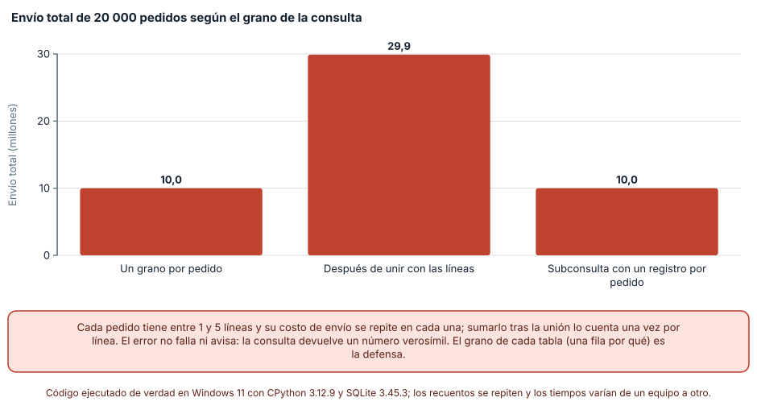

# SE-363 — Modelado analítico: hechos, dimensiones y granularidad

[← SE-362 — Ingesta batch y streaming](https://github.com/vladimiracunadev-create/modern-software-engineering-program/blob/main/classes/part-30-ingenieria-de-datos-y-plataformas-de-datos/se-362-ingesta-batch-y-streaming/README.md) · [↑ Parte 30](https://github.com/vladimiracunadev-create/modern-software-engineering-program/blob/main/classes/part-30-ingenieria-de-datos-y-plataformas-de-datos/README.md) · [📚 Índice completo](https://github.com/vladimiracunadev-create/modern-software-engineering-program/blob/main/classes/README.md) · [🌐 Portal](https://vladimiracunadev-create.github.io/modern-software-engineering-program/classes/SE-363.html) · [SE-364 — Transformación y orquestación idempotente con backfills →](https://github.com/vladimiracunadev-create/modern-software-engineering-program/blob/main/classes/part-30-ingenieria-de-datos-y-plataformas-de-datos/se-364-transformacion-y-orquestacion-idempotente-con-backfills/README.md)

## Punto profesional y fundamento pedagógico

**Punto profesional.** La clase existe para que organices los datos analíticos de modo que las preguntas se respondan correctamente sin que cada analista reinvente las uniones, y para que sepas dónde están las trampas que producen números verosímiles y erróneos. Un modelo dimensional separa lo que se mide (hechos: ventas, entregas, lecturas) de aquello por lo cual se mide (dimensiones: cliente, curso, fecha) y exige declarar la granularidad, es decir, qué es exactamente una fila. Un modelo de bóveda de datos (Data Vault) separa la identidad, las relaciones y los atributos con su historia para cargar de forma repetible e insertar sin actualizar. Ninguno es «el correcto»: son dos respuestas a preguntas distintas (consultar con claridad frente a integrar con trazabilidad), y la clase las mide sobre una base real de SQLite.

**Por qué aparece aquí.** Sigue a `SE-362` porque, una vez que los datos llegan, hay que darles forma para consumirlos. Reutiliza el modelado conceptual, lógico y físico de [SE-349](https://github.com/vladimiracunadev-create/modern-software-engineering-program/blob/main/classes/part-29-datos-persistencia-y-recuperacion/se-349-modelado-conceptual-logico-y-fisico/README.md) y las claves y restricciones de [SE-352](https://github.com/vladimiracunadev-create/modern-software-engineering-program/blob/main/classes/part-29-datos-persistencia-y-recuperacion/se-352-restricciones-invariantes-y-consistencia/README.md), y prepara `SE-364`, que construye estas tablas con transformaciones repetibles.

**Error conceptual que debe corregir.** Creer que modelar es dibujar tablas con claves. El error silencioso más frecuente de un modelo analítico no es una tabla mal dibujada sino una granularidad no declarada: sumar un atributo del pedido después de unirlo con sus líneas lo cuenta una vez por línea. La segunda corrección: una dimensión que se sobrescribe no «se actualiza», borra el pasado; el mismo cliente que se mudó cambia de ciudad en todas sus ventas antiguas.

**Secuencia de aprendizaje.** Antes de ejecutar, predices cuánto cambia el reparto de ventas por ciudad si la dimensión de clientes se sobrescribe y cuánto infla un costo de envío sumarlo tras unir con las líneas del pedido. Después construyes ambos modelos en SQLite, comparas las dos formas de la dimensión, provocas el abanico de uniones y cargas un Data Vault repetido.

**Evidencia de aprendizaje.** `modelo-analitico.md` con la declaración de granularidad de cada hecho de un dominio tuyo («una fila es un ... por ...»), sus dimensiones, la política de historia de cada dimensión (sobrescribir o conservar versiones) y la consulta de comprobación que detecta un abanico.

**Límite de la conclusión.** Son 20 000 pedidos y 59 809 líneas sintéticos con 1 000 clientes, de los cuales 132 se mudan; los tiempos de las consultas varían entre ejecuciones. No se midió ningún almacén analítico ni el costo de cargar un vault real con miles de satélites, ni se evaluó ninguna herramienta de modelado. No se invocó ningún modelo de lenguaje.

### Trazabilidad fuente → afirmación

| Fuente primaria u oficial | Afirmación que respalda | Lo que no prueba |
|---|---|---|
| [Kimball Group, «Dimensional Modeling Techniques»](https://www.kimballgroup.com/data-warehouse-business-intelligence-resources/kimball-techniques/dimensional-modeling-techniques/) | Define hecho, dimensión, granularidad y los tipos de dimensión de cambio lento (sobrescribir, añadir fila, añadir columna). | No mide el efecto en tu negocio. |
| [Data Vault Alliance](https://datavaultalliance.com/) | Presenta el vault como modelo de hubs, enlaces y satélites para integrar datos con trazabilidad. | Es la comunidad que lo promueve; no compara con otros modelos. |
| [Kleppmann, «Designing Data-Intensive Applications»](https://dataintensive.net/) | Explica la tensión entre normalizar y desnormalizar según el patrón de acceso. | No prescribe un modelo. |
| [SQLite, «CREATE TABLE»](https://www.sqlite.org/lang_createtable.html) | Documenta claves primarias y restricciones que usa el laboratorio. | No valida el diseño. |
| [Python: `hashlib`](https://docs.python.org/3/library/hashlib.html) | Documenta el cálculo de las claves hash del vault. | No justifica un algoritmo para seguridad. |

## Antes de empezar

Recupera lo aprendido en `SE-362`: lo que llega tiene dos relojes y puede venir repetido. La pregunta activa es: **cuando se suma el importe de un pedido en tu sistema, ¿sabes si cada fila de la tabla es un pedido, una línea o un pago?**

## Prerrequisitos

- Haber completado `SE-361` y `SE-362`.
- Conocer claves primarias y foráneas ([SE-349](https://github.com/vladimiracunadev-create/modern-software-engineering-program/blob/main/classes/part-29-datos-persistencia-y-recuperacion/se-349-modelado-conceptual-logico-y-fisico/README.md), [SE-352](https://github.com/vladimiracunadev-create/modern-software-engineering-program/blob/main/classes/part-29-datos-persistencia-y-recuperacion/se-352-restricciones-invariantes-y-consistencia/README.md)).
- SQL con `JOIN` y `GROUP BY`.
- Python 3.11 o posterior; el laboratorio usa `sqlite3` y `hashlib`.

## Problema auténtico

Dos informes de *Avisos* muestran números distintos para «ventas por ciudad» y los dos son «correctos». El informe de finanzas dice que Temuco vendió 144,8 millones; el de marketing, que vendió 147,5. Los dos usan la misma tabla de pedidos y la misma de clientes. Finanzas une con la ciudad actual del cliente; marketing, con la ciudad que tenía cuando compró. Un tercer informe suma el costo de envío por mes y da casi el triple del real.

Nadie programó mal. Cada uno respondió una pregunta ligeramente distinta sin saberlo: no se había declarado qué es una fila de cada tabla ni qué le ocurre a una dimensión cuando cambia. El modelo analítico existe para que esas decisiones estén escritas y para que una pregunta tenga una sola respuesta.

## Objetivos observables

Al terminar podrás:

1. declarar la granularidad de un hecho con la frase «una fila es un ... por ...» y detectar una consulta que la viola;
2. medir cuánto cambia un reparto cuando una dimensión se sobrescribe frente a cuando conserva versiones con vigencia;
3. provocar el abanico de uniones, medir el error y corregirlo con una agregación previa al grano correcto;
4. construir hub, enlace y satélite con claves hash y comprobar que una carga repetida no añade filas;
5. decidir entre estrella y bóveda por la pregunta que debe responder el modelo, y no por la moda.

## Mapa conceptual


El mapa pone la decisión antes de las tablas: la estrella sirve la consulta; el vault sirve la integración y casi siempre necesita una vista de negocio encima para consultarse.

## Temas y por qué importan

| Tema | Por qué cambia una decisión profesional | Evidencia mínima |
|---|---|---|
| Granularidad | Define qué es una fila y qué se puede sumar. | Frase «una fila es un ... por ...» |
| Hechos y dimensiones | Separan lo que se mide de aquello por lo que se mide. | Tabla de hechos con claves a dimensiones |
| Dimensión con historia | Sobrescribir reparte el pasado con datos de hoy. | Reparto con ciudad actual y con ciudad de la fecha |
| Abanico de uniones | Suma un atributo de nivel superior varias veces. | Total real frente a total tras la unión |
| Claves sustitutas | Aíslan al modelo de los cambios de la clave de negocio. | Clave de negocio y clave del modelo |
| Data Vault | Carga repetible con trazabilidad completa. | Filas tras cargar dos veces |
| Elegir modelo | La pregunta decide, no la herramienta. | Consultas objetivo y su plan |

## Conceptos y decisiones

### 1. Hechos, dimensiones y la frase de la granularidad

Un hecho es una medición de un evento de negocio: una línea de pedido, una entrega, una lectura. Una dimensión es el contexto con el que se agrupa o filtra: cliente, producto, curso, fecha. La frase que hace de contrato es «una fila de este hecho es un ____ por ____»: una línea de pedido por pedido y por producto. Todo lo que se sume debe pertenecer a ese grano: el importe de la línea sí; el costo de envío del pedido no, porque se repite en cada línea. Declarar el grano antes de diseñar columnas es la regla más barata y más ignorada del modelado.

### 2. Dimensión que se sobrescribe y dimensión con historia

Cuando un cliente se muda, la dimensión puede sobrescribir la ciudad (tipo 1 en la terminología de Kimball) o conservar la fila vieja y añadir una nueva con una vigencia (`valid_from`, `valid_to`; tipo 2). En el laboratorio, 132 de 1 000 clientes se mudaron. Con la ciudad actual, Temuco vendió 144,8 millones; con la ciudad que tenía el cliente en la fecha del pedido, 147,5. Santiago pasó de 141,4 a 138,4. La suma total fue la misma, 595,8 millones, en ambos casos: lo que cambia es el reparto. Ninguna de las dos es «la correcta»: la primera responde cuánto vende hoy cada ciudad con los clientes que tiene hoy; la segunda, cuánto vendió cada ciudad en su momento. El error es no saber cuál se calculó.

### 3. El abanico de uniones

Un pedido tiene un costo de envío; sus entre una y cinco líneas no. Si se une `orders` con `items` y se suma `shipping_fee`, cada pedido cuenta su envío una vez por línea. En el laboratorio, el envío real de 20 000 pedidos suma 10,0 millones; tras la unión sumó 29,9 millones, un 199 % de más; con una subconsulta que deja un registro por pedido, volvió a 10,0. La consulta no falla ni avisa. Las defensas son tres: declarar el grano de cada tabla, agregar cada lado a su grano antes de unir y escribir una prueba de conciliación («el total del hecho coincide con el total de la fuente»).

### 4. Claves sustitutas y claves de negocio

La clave de negocio (el identificador del cliente en el sistema operacional) puede cambiar, repetirse entre sistemas o reutilizarse. Una clave sustituta (un entero o un hash generado por el modelo) aísla las tablas analíticas de esos cambios y permite varias versiones de la misma entidad, una por fila de la dimensión con historia. El costo es que cada carga debe resolver de clave de negocio a clave sustituta, y que los datos huérfanos (un hecho sin dimensión) deben tener una fila especial «desconocido» y no desaparecer en una unión interna.

### 5. Estrella, copo de nieve y tabla ancha

La estrella tiene un hecho central y dimensiones desnormalizadas, con pocas uniones por consulta. El copo de nieve normaliza las dimensiones y ahorra espacio a cambio de más uniones. La tabla ancha precalcula todo en una sola tabla: la consulta es trivial y la tabla se vuelve costosa de mantener y de cambiar. No hay un orden fijo; la elección sigue el patrón de acceso de `SE-361`: las preguntas frecuentes y estables conviene precalcularlas; las exploratorias, no.

### 6. Data Vault: identidad, relación y atributos

El vault parte de tres tipos de tabla. El hub guarda la clave de negocio de una entidad una sola vez, con una clave hash. El enlace guarda una relación entre hubs. El satélite guarda los atributos y su historia, una fila por versión, con una huella (`hashdiff`) de los valores. Todo se carga solo con inserciones. En el laboratorio, tras cargar los días 0, 100 y 250 el vault tenía 1 000 filas en el hub de clientes, 13 672 en el de pedidos y en el enlace, y 1 132 en el satélite de clientes (1 000 versiones iniciales y 132 cambios de ciudad conservados); cargar otra vez el día 250 no añadió ninguna fila, porque la clave primaria y la huella lo impiden.

### 7. Qué compra el vault y qué cuesta

El vault compra trazabilidad completa, cargas repetibles y la posibilidad de integrar fuentes nuevas sin tocar lo existente. Cuesta uniones: la misma pregunta de ventas por ciudad necesitó hub, enlace y satélite frente a una sola unión por dimensión de la estrella, y la consulta no es lo que se ofrece a los analistas. Por eso en la práctica el vault es una capa de integración sobre la cual se construye una vista dimensional (la «capa de negocio»). En el laboratorio, las dos consultas tardaron del mismo orden (entre 100 y 300 ms según la ejecución, con el vault algo más lento en las dos corridas); el costo real del vault no está en una consulta sino en la cantidad de tablas y de cargas que hay que mantener.

### 8. Historia con vigencia: consultar «cómo era entonces»

Una dimensión con vigencia permite la unión por intervalo: `f.day >= d.valid_from AND f.day < d.valid_to`. Es sencilla y propensa a errores en los bordes (intervalos que se solapan o dejan huecos). Una comprobación fija: para cada cliente, los intervalos deben ser contiguos y no solaparse, y exactamente una versión debe estar vigente en cualquier día. Es una prueba de calidad de dato que pertenece al modelo (`SE-365`).

### 9. Cuándo no modelar tanto

Con pocas tablas, pocas preguntas y un solo equipo, un modelo estrella pequeño o incluso vistas sobre la zona intermedia bastan. Un vault para tres tablas es costo puro. La señal para añadir estructura es doble: muchas fuentes que cambian a distinto ritmo (justifica el vault) o muchos consumidores que repiten las mismas uniones y se equivocan (justifica la estrella).

## Ventas por ciudad con dos dimensiones

La primera medida compara el reparto con la dimensión sobrescrita y con la dimensión con historia.


**Cómo leer la figura.** Cada pareja de barras es una ciudad: la dorada, con la ciudad actual del cliente; la verde, con la que tenía el día del pedido. Mira primero Santiago y Temuco, donde la diferencia llega a casi 3 millones. **Dónde deja de valer:** la mudanza de 13,2 % de los clientes y la fecha de la mudanza son supuestos del autor; con menos cambios, la diferencia casi desaparece. Lo que se traslada es que el error aparece solo cuando hay cambios y sin avisar.

## El abanico de uniones

La segunda medida suma un atributo del pedido después de unir con las líneas.



**Cómo leer la figura.** Cada barra es una forma de sumar el mismo atributo; la roja es la que viola el grano. Mira primero que la diferencia es casi el triple: cada pedido tiene unas 3 líneas de media. **Dónde deja de valer:** el factor depende de cuántas líneas tiene cada pedido, y con un pedido de una sola línea el error sería cero; por eso es difícil de ver con datos de prueba pequeños. La defensa es la comprobación de grano, no la sospecha.

## Data Vault sobre Avisos

La tercera figura muestra las tablas del vault y lo que dejó la carga.


**Cómo leer la figura.** Cada caja es una tabla con las filas que contenía al final; la caja de la carga repetida dice que el segundo intento no añadió nada. Mira primero que el satélite tiene más filas que el hub: ahí vive la historia. **Dónde deja de valer:** el vault del laboratorio es mínimo (un satélite por hub); uno real tiene decenas de satélites por fuente y una capa de consulta que el laboratorio no construye, y su costo de carga y de consulta no se midió.

## Definiciones de trabajo

- **[Hecho](../../../glosario/entradas/h/hecho.md):** medición de un evento de negocio con su granularidad.
- **[Dimensión](../../../glosario/entradas/d/dimension.md):** contexto con el que se agrupa o filtra un hecho.
- **[Granularidad](../../../glosario/entradas/g/granularidad.md):** qué es exactamente una fila de una tabla.
- **[Dimensión de cambio lento](../../../glosario/entradas/d/dimension-de-cambio-lento.md):** dimensión cuyos atributos cambian con el tiempo y cuya política de historia debe decidirse.
- **[Clave sustituta](../../../glosario/entradas/c/clave-sustituta.md):** identificador generado por el modelo, distinto de la clave de negocio.
- **[Hub, enlace y satélite](../../../glosario/entradas/h/hub-enlace-y-satelite.md):** tablas de identidad, de relación y de atributos con historia de un Data Vault.
- **[Abanico de uniones](../../../glosario/entradas/a/abanico-de-uniones.md):** error por unir tablas de distinto grano y sumar el lado «uno».

## Ejemplo mínimo

El abanico de uniones en diez líneas:

```python
import sqlite3

con = sqlite3.connect(":memory:")
con.executescript("""
CREATE TABLE orders(order_id INT PRIMARY KEY, shipping_fee INT);
CREATE TABLE items(order_id INT, line INT, price INT);
INSERT INTO orders VALUES (1, 500), (2, 500);
INSERT INTO items VALUES (1, 1, 100), (1, 2, 200), (1, 3, 300), (2, 1, 400);
""")
print(con.execute("SELECT SUM(shipping_fee) FROM orders").fetchone())                              # (1000,)
print(con.execute("SELECT SUM(o.shipping_fee) FROM orders o JOIN items i USING(order_id)").fetchone())   # (2000,)
print(con.execute("""SELECT SUM(o.shipping_fee) FROM orders o
                    WHERE EXISTS (SELECT 1 FROM items i WHERE i.order_id = o.order_id)""").fetchone())   # (1000,)
```

El pedido 1 tiene tres líneas y cuenta tres veces; el segundo resultado es el doble del real. El tercero, que no une, vuelve a dar 1 000.

## Ejemplo profesional

*Escenario ilustrativo: las cifras y los resultados que aparecen en este ejemplo son supuestos de la narración, no mediciones.*

El equipo de *Avisos* modela los avisos leídos. Escribe la frase «una fila es una lectura de un aviso por un estudiante en un instante», sus dimensiones (estudiante, aviso, curso, fecha) y decide que la dimensión de estudiante conserva historia porque los estudiantes cambian de curso a mitad de año. Añade una prueba: la suma de lecturas del hecho debe coincidir con la cuenta de eventos de la zona intermedia cada día. A la tercera semana la prueba falla un día con un 8 % de diferencia; la causa es una unión con la dimensión de curso que no filtraba por vigencia y duplicaba las lecturas de quienes cambiaron de curso ese día. Se corrige la unión, se añade una comprobación de vigencias contiguas y se documenta la regla en el contrato del modelo.

## Práctica guiada

1. Escribe la frase de granularidad de las dos tablas de hechos más usadas de tu sistema.
2. Ejecuta `python scripts/experiments_part30_a.py 543` y reproduce la tabla de ventas por ciudad.
3. Cambia la fracción de clientes que se mudan de 15 % a 40 % y repite; mide cómo crece la diferencia entre las dos columnas.
4. Escribe la consulta de comprobación de grano para un hecho tuyo (por ejemplo, que el total del hecho coincida con el de la fuente).
5. Escribe la consulta que detecta intervalos de vigencia solapados o con huecos en una dimensión con historia.

## Ejercicios

1. **Básico.** Explica por qué las dos columnas de ventas por ciudad suman lo mismo y aun así no son equivalentes.
2. **Intermedio.** Diseña la dimensión de curso de *Avisos* para que un estudiante pueda cambiar de curso durante el año, y escribe la unión que no duplica lecturas.
3. **Avanzado.** Argumenta, con el costo de las uniones y la frecuencia de cambio de fuentes, si un sistema con cuatro fuentes y doce consultas estables necesita un vault o le basta la estrella.

## Reto verificable

Entrega `modelo-analitico.md` con la granularidad de cada hecho, las dimensiones y su política de historia, y la consulta de comprobación que detectaría un abanico. Es válido si otra persona puede introducir una unión incorrecta en tu modelo y la comprobación la detecta.

## Caso conductor

*Avisos* publica un hecho de lecturas con grano declarado y una dimensión de estudiante con historia, y una prueba de conciliación. `SE-364` construye esas tablas con transformaciones que se pueden repetir sin duplicar ni perder filas.

## Preguntas frecuentes

### ¿Estrella o vault?

Si hay pocas fuentes y las preguntas son claras, estrella. Si hay muchas fuentes que cambian a ritmos distintos y se necesita trazabilidad completa, un vault como capa de integración con una estrella encima. No son excluyentes.

### ¿Siempre hay que guardar historia en las dimensiones?

No. Guárdala cuando una pregunta del negocio dependa de cómo eran las cosas entonces. Si nadie la hará, sobrescribir es más simple y más barato. Decídelo por dimensión y escríbelo.

### ¿Cómo evito el abanico en la práctica?

Declara el grano de cada tabla, agrega cada lado a su grano antes de unir y concilia los totales contra la fuente. Las pruebas con datos de un solo elemento por grupo no lo detectan; prueba con datos que tengan varias filas por clave.

### ¿Por qué usar claves hash en el vault?

Porque se calculan de la clave de negocio sin consultar una tabla, de modo que las cargas pueden ejecutarse en paralelo y repetirse. El costo es que la elección de la función y de la normalización de la entrada (mayúsculas, espacios) debe ser idéntica en todas las cargas.

## Fallo controlado y diagnóstico

**Fallo.** El informe mensual de envíos de *Avisos* muestra 29,9 millones y contabilidad reporta 10,0 millones pagados al transportista.

**Diagnóstico paso a paso.** (1) Se compara el total del informe con el de la fuente: 29,9 frente a 10,0. (2) Se calcula el cociente, casi tres, y se compara con el promedio de líneas por pedido, 3. (3) Se revisa la consulta: une pedidos con líneas y suma `shipping_fee`. (4) Se confirma el abanico ejecutando la misma suma sobre una subconsulta con un registro por pedido: da 10,0.

**Corrección.** Se mueve el costo de envío a un hecho propio con grano de un pedido, se añade la prueba de conciliación de totales contra la fuente y se documenta en el modelo qué columnas pertenecen a cada grano. La lección es que un total verosímil no es un total correcto: sin una comprobación contra la fuente, el error vive meses.

## Errores comunes y cómo corregirlos

- **No declarar la granularidad.** Corrige con la frase «una fila es un ... por ...» antes de las columnas.
- **Sumar atributos de un nivel superior tras unir.** Corrige agregando al grano antes de unir.
- **Sobrescribir una dimensión sin decidirlo.** Corrige escribiendo la política de historia por dimensión.
- **Unir por intervalo sin probar los bordes.** Corrige con la comprobación de vigencias contiguas.
- **Eliminar hechos huérfanos con una unión interna.** Corrige con una fila «desconocido» y una prueba de conteo.
- **Construir un vault pequeño por prestigio.** Corrige con el criterio de fuentes y consumidores.

## Entorno y archivos clave

- `scripts/experiments_part30_a.py`: función `e543` con las dimensiones, el abanico y el vault; se ejecuta con `python scripts/experiments_part30_a.py 543`.
- `scripts/figures_part30_a.py`: las tres figuras de la clase.
- Solo la biblioteca estándar de Python 3.11 o posterior; semilla 45; tarda unos segundos.

## Seguridad, ética y accesibilidad

Los datos del laboratorio son sintéticos. Una dimensión con historia conserva el rastro de dónde vivió una persona y cuándo; es un dato personal y su retención debe decidirse (`SE-369`). Las claves hash del vault no son anonimización: quien conozca los candidatos puede recalcularlas. Las figuras llevan texto alternativo completo y no dependen solo del color.

## Puente hacia el trabajo con agentes

Un agente que escribe consultas analíticas sobre tu modelo necesita saber el grano de cada tabla. Exige que declare el grano antes de sumar y que ejecute la comprobación de conciliación; si propone unir un hecho con una tabla de otro grano, pídele que agregue primero. Un agente no debe «arreglar» un total que no cuadra cambiando la consulta hasta que coincida: debe explicar por qué difiere.

## Transferencia

Elige dos informes de tu organización que debieran dar el mismo número y no lo dan. Averigua la granularidad de cada tabla que usan y la política de historia de las dimensiones, y di cuál de las dos respuestas responde cuál pregunta.

## Evaluación y evidencia

| Criterio | Evidencia aceptable | Rechazo |
|---|---|---|
| Granularidad | Frase por tabla de hechos | «La tabla de ventas» |
| Dimensiones | Política de historia por dimensión | Sobrescribir por omisión |
| Abanico | Conciliación de totales con la fuente | Revisión visual |
| Vigencias | Comprobación de intervalos contiguos | Suponer que no se solapan |
| Elección de modelo | Preguntas objetivo y consultas | «Es el estándar» |

## Fuentes

- Kimball Group. [«Dimensional Modeling Techniques»](https://www.kimballgroup.com/data-warehouse-business-intelligence-resources/kimball-techniques/dimensional-modeling-techniques/).
- Data Vault Alliance. [Sitio de la comunidad](https://datavaultalliance.com/).
- Kleppmann, M. [«Designing Data-Intensive Applications»](https://dataintensive.net/).
- SQLite. [«CREATE TABLE»](https://www.sqlite.org/lang_createtable.html).
- Python Software Foundation. [`hashlib`](https://docs.python.org/3/library/hashlib.html).

## Límites y siguiente paso

Los 20 000 pedidos, las 132 mudanzas y las líneas por pedido son construcciones del autor; el vault es mínimo y no incluye la capa de negocio ni cargas paralelas. No se midió ningún almacén, ninguna herramienta de modelado ni el costo de mantener un vault real. El siguiente paso, `SE-364`, construye estas tablas con transformaciones idempotentes y cubre los reprocesos.

## Glosario

| Término | Definición breve |
|---|---|
| Granularidad | Qué es una fila de una tabla |
| Hecho | Medición de un evento |
| Dimensión | Contexto de agrupación |
| Tipo 2 | Dimensión con filas de vigencia |
| Abanico de uniones | Suma repetida por unir distintos grados |
| Satélite | Atributos con historia en un vault |

Conceptos de esta clase en el [glosario del programa](../../../glosario/README.md): [Abanico de uniones](../../../glosario/entradas/a/abanico-de-uniones.md) · [Clave sustituta](../../../glosario/entradas/c/clave-sustituta.md) · [Dimensión](../../../glosario/entradas/d/dimension.md) · [Dimensión de cambio lento](../../../glosario/entradas/d/dimension-de-cambio-lento.md) · [Granularidad](../../../glosario/entradas/g/granularidad.md) · [Hecho](../../../glosario/entradas/h/hecho.md) · [Hub, enlace y satélite](../../../glosario/entradas/h/hub-enlace-y-satelite.md).

---

[← SE-362 — Ingesta batch y streaming](https://github.com/vladimiracunadev-create/modern-software-engineering-program/blob/main/classes/part-30-ingenieria-de-datos-y-plataformas-de-datos/se-362-ingesta-batch-y-streaming/README.md) · [↑ Parte 30](https://github.com/vladimiracunadev-create/modern-software-engineering-program/blob/main/classes/part-30-ingenieria-de-datos-y-plataformas-de-datos/README.md) · [📚 Índice completo](https://github.com/vladimiracunadev-create/modern-software-engineering-program/blob/main/classes/README.md) · [🌐 Portal](https://vladimiracunadev-create.github.io/modern-software-engineering-program/classes/SE-363.html) · [SE-364 — Transformación y orquestación idempotente con backfills →](https://github.com/vladimiracunadev-create/modern-software-engineering-program/blob/main/classes/part-30-ingenieria-de-datos-y-plataformas-de-datos/se-364-transformacion-y-orquestacion-idempotente-con-backfills/README.md)
