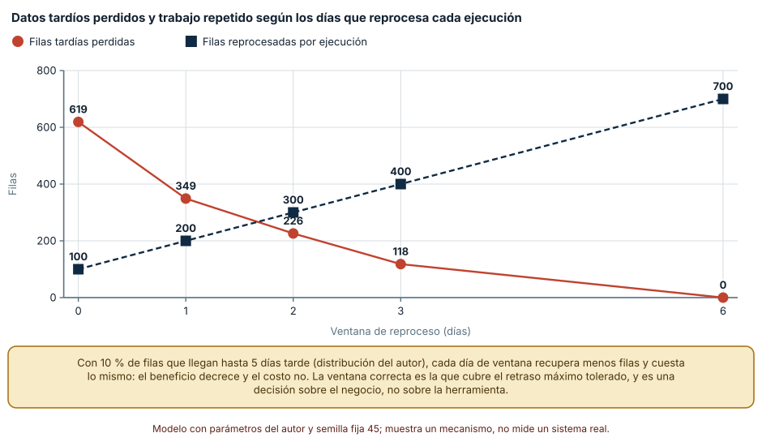

# SE-364 — Transformación y orquestación idempotente con backfills

[← SE-363 — Modelado analítico: hechos, dimensiones y granularidad](https://github.com/vladimiracunadev-create/modern-software-engineering-program/blob/main/classes/part-30-ingenieria-de-datos-y-plataformas-de-datos/se-363-modelado-analitico-hechos-dimensiones-y-granularidad/README.md) · [↑ Parte 30](https://github.com/vladimiracunadev-create/modern-software-engineering-program/blob/main/classes/part-30-ingenieria-de-datos-y-plataformas-de-datos/README.md) · [📚 Índice completo](https://github.com/vladimiracunadev-create/modern-software-engineering-program/blob/main/classes/README.md) · [🌐 Portal](https://vladimiracunadev-create.github.io/modern-software-engineering-program/classes/SE-364.html) · [SE-365 — Calidad y observabilidad de datos →](https://github.com/vladimiracunadev-create/modern-software-engineering-program/blob/main/classes/part-30-ingenieria-de-datos-y-plataformas-de-datos/se-365-calidad-y-observabilidad-de-datos/README.md)

## Punto profesional y fundamento pedagógico

**Punto profesional.** La clase existe para que construyas transformaciones de datos que se puedan ejecutar de nuevo sin miedo: tras un fallo a mitad, tras un reintento automático, tras corregir un dato de origen o tras descubrir un error de hace un mes. Un pipeline que solo funciona si se ejecuta exactamente una vez, en orden y sin interrupciones no es un pipeline: es un guion. La propiedad que los separa es la idempotencia (ejecutar dos veces deja lo mismo que ejecutar una), y sobre ella se apoya todo lo demás: reintentos, reprocesos históricos (backfills) y orquestación por dependencias. La clase mide qué le ocurre a seis combinaciones de estrategia de carga y de escenario de fallo, reescribe una ventana histórica y calcula qué hay que recalcular cuando cambia un dato crudo.

**Por qué aparece aquí.** Sigue a `SE-363` porque ahora hay que construir esas tablas de forma repetible. Reutiliza la idempotencia de [SE-377](https://github.com/vladimiracunadev-create/modern-software-engineering-program/blob/main/classes/part-31-integracion-eventos-y-mensajeria/se-377-outbox-inbox-sagas-y-compensacion/README.md) y [SE-384](https://github.com/vladimiracunadev-create/modern-software-engineering-program/blob/main/classes/part-31-integracion-eventos-y-mensajeria/se-384-proyecto-flujo-integrado-tolerante-a-reintentos/README.md), las transacciones de [SE-351](https://github.com/vladimiracunadev-create/modern-software-engineering-program/blob/main/classes/part-29-datos-persistencia-y-recuperacion/se-351-transacciones-aislamiento-y-concurrencia/README.md) y los reintentos de [SE-438](https://github.com/vladimiracunadev-create/modern-software-engineering-program/blob/main/classes/part-36-calidad-rendimiento-y-resiliencia/se-438-timeouts-retries-backoff-y-jitter/README.md). Prepara `SE-365`, que vigila que lo construido siga siendo correcto.

**Error conceptual que debe corregir.** Creer que idempotencia es «no fallar». Un pipeline idempotente falla igual que otro; lo que cambia es que reintentar es seguro. La segunda corrección: un reintento automático sobre una carga que añade filas sin condición no es resiliencia, es una fábrica de duplicados.

**Secuencia de aprendizaje.** Antes de ejecutar, predices qué estrategia (añadir, borrar e insertar la partición, fusionar por clave) sobrevive a un fallo a mitad con y sin transacción y a ejecutar todo dos veces. Después cargas 30 particiones con cada estrategia, provocas un fallo el día 17, corriges cinco días de origen y reescribes solo esos, y calculas qué recalcular en un grafo de nueve tareas.

**Evidencia de aprendizaje.** `plan-de-backfill.md` con una tabla tuya, su estrategia de carga y por qué es idempotente, qué partición se reescribe ante una corrección de origen, qué tareas posteriores se recalculan y cuánto datos tardíos se tolera con la ventana de reproceso elegida.

**Límite de la conclusión.** Son 30 particiones de 40 a 79 filas sintéticas y un grafo de nueve tareas de juguete; el reproceso de datos tardíos usa 6 000 filas con retrasos inventados. No se ejecutó ningún orquestador (Airflow, dbt ni otros) ni se midió ninguna carga con millones de filas. No se invocó ningún modelo de lenguaje.

### Trazabilidad fuente → afirmación

| Fuente primaria u oficial | Afirmación que respalda | Lo que no prueba |
|---|---|---|
| [Apache Airflow, «DAGs»](https://airflow.apache.org/docs/apache-airflow/stable/core-concepts/dags.html) | Describe un flujo como un grafo acíclico dirigido de tareas con dependencias. | Es la documentación de una herramienta concreta. |
| [Apache Airflow, «DAG Runs»](https://airflow.apache.org/docs/apache-airflow/stable/core-concepts/dag-run.html) | Documenta las ejecuciones por intervalo de datos y el relleno histórico (backfill) de ejecuciones pasadas. | No dice cómo diseñar tareas idempotentes. |
| [dbt, «Incremental models»](https://docs.getdbt.com/docs/build/incremental-models) | Explica la construcción incremental de tablas con una clave única y una condición de filas nuevas. | No garantiza idempotencia si la lógica no la tiene. |
| [SQLite, «UPSERT»](https://www.sqlite.org/lang_upsert.html) | Documenta la escritura por clave con resolución de conflictos. | No describe otros motores. |
| [Kleppmann, «Designing Data-Intensive Applications»](https://dataintensive.net/) | Trata el procesamiento por lotes, las salidas derivadas y la tolerancia a fallos. | No prescribe una estrategia. |

## Antes de empezar

Recupera lo aprendido en `SE-363`: una tabla tiene un grano declarado. La pregunta activa es: **si el trabajo que construye tu tabla principal se ejecutara dos veces seguidas por error, ¿cuántas filas tendría?**

## Prerrequisitos

- Haber completado `SE-361` a `SE-363`.
- Conocer transacciones ([SE-351](https://github.com/vladimiracunadev-create/modern-software-engineering-program/blob/main/classes/part-29-datos-persistencia-y-recuperacion/se-351-transacciones-aislamiento-y-concurrencia/README.md)) e idempotencia en mensajería ([SE-377](https://github.com/vladimiracunadev-create/modern-software-engineering-program/blob/main/classes/part-31-integracion-eventos-y-mensajeria/se-377-outbox-inbox-sagas-y-compensacion/README.md)).
- Saber leer un grafo de dependencias.
- Python 3.11 o posterior; el laboratorio usa `sqlite3`.

## Problema auténtico

El trabajo nocturno de *Avisos* carga la tabla de entregas del día. Una noche falla a mitad por un tiempo de espera de la red; el orquestador reintenta y completa. A la mañana siguiente, el informe muestra 37 entregas de más para el día. Más tarde, el equipo de la aplicación descubre que durante cinco días el campo de importe llegó 100 unidades más bajo de lo debido; hay que volver a calcular esos cinco días y todo lo que depende de ellos, sin tocar los demás. Un tercer problema: algunas entregas llegan con dos días de retraso y el trabajo diario, que mira solo «lo de ayer», nunca las ve.

Los tres problemas tienen la misma raíz: el trabajo se escribió para ejecutarse una vez. La corrección no es agregar más alertas sino cambiar la forma en que el trabajo escribe.

## Objetivos observables

Al terminar podrás:

1. definir idempotencia y comprobarla ejecutando una carga dos veces y comparando el resultado;
2. comparar tres estrategias de carga (añadir, reemplazar la partición, fusionar por clave) ante un fallo a mitad con y sin transacción;
3. reescribir una ventana histórica tras una corrección de origen y medir cuántas filas se tocan;
4. calcular, desde un grafo de dependencias, el orden de ejecución y el conjunto de tareas a recalcular;
5. elegir una ventana de reproceso para datos tardíos y justificar su costo.

## Mapa conceptual


El mapa conecta tres cosas que suelen tratarse por separado. La estrategia de carga decide si el reintento es seguro; el reintento seguro es lo que permite el backfill; y el grafo de dependencias dice hasta dónde se propaga.

## Temas y por qué importan

| Tema | Por qué cambia una decisión profesional | Evidencia mínima |
|---|---|---|
| Idempotencia | Hace seguro el reintento y el reproceso. | Resultado de ejecutar dos veces |
| Estrategia de carga | Añadir no es idempotente; reemplazar y fusionar sí. | Filas por estrategia y escenario |
| Transacción | Evita cargas a medias. | Fallo a mitad con y sin transacción |
| Partición | Es la unidad de reescritura. | Filas reescritas frente a total |
| Backfill | Corrige el pasado sin tocar lo demás. | Resultado coincide con la fuente corregida |
| Grafo de dependencias | Dice qué recalcular y en qué orden. | Tareas afectadas por cambio |
| Datos tardíos | La ventana de reproceso los recoge a un costo. | Filas perdidas frente a reprocesadas |

## Conceptos y decisiones

### 1. Idempotencia: la propiedad que lo habilita todo

Una operación es idempotente si aplicarla varias veces produce el mismo estado que aplicarla una. En datos, la prueba es operativa: ejecuta el trabajo, anota el resultado (filas y suma de control), ejecútalo otra vez con la misma entrada y compara. Si cambia, no es idempotente. Es una propiedad del trabajo completo y no de cada sentencia: un `INSERT` solo no lo es, y un `DELETE` de la partición seguido de un `INSERT` dentro de una transacción sí lo es.

### 2. Tres estrategias de carga

Añadir (`INSERT` sin más) es la más simple y es incorrecta ante cualquier repetición. Reemplazar la partición (borrar las filas del día y volver a insertarlas) es idempotente si el borrado y la inserción son atómicos y si la partición se define por la misma clave que el origen. Fusionar por clave (`UPSERT` o `MERGE`: inserta si no existe, actualiza si existe) es idempotente si la clave identifica de verdad la fila. Cada una tiene un costo: reemplazar reescribe toda la partición aunque cambie una fila; fusionar necesita una clave única estable y un índice sobre ella. La elección depende de qué sea más barato en el almacenamiento destino.

### 3. Qué mide el laboratorio

El laboratorio carga 30 particiones diarias (1 790 filas) con cada estrategia. Con ejecución limpia, las tres dan 1 790 filas. Con un fallo a mitad de la partición 17 y un reintento: el añadir con transacción da 1 790 (la transacción deshizo la media carga antes del reintento); el añadir sin transacción da 1 827, 37 filas de más, las que se alcanzaron a insertar antes del fallo; reemplazar y fusionar sin transacción dan 1 790 (el reintento limpia o sobrescribe lo parcial). Al ejecutar los 30 días dos veces, añadir da 3 580 y las otras dos dan 1 790. La lección es doble: la transacción protege contra la carga parcial, y la estrategia idempotente protege contra la repetición. No son lo mismo y se combinan.

### 4. Transacciones y atomicidad de la partición

Cargar una partición debe ser todo o nada: o está la partición completa o no está. En una base transaccional se logra con una transacción que envuelve borrado e inserción. En un almacén de objetos o un lago, donde no hay transacciones de varias filas, se logra escribiendo la partición a una ubicación temporal y publicándola con una operación atómica (un renombrado, o un cambio de puntero en un manifiesto como el de `SE-368`). Lo que no se debe hacer es dejar que un consumidor lea una partición mientras se reescribe: lee la mitad.

### 5. Backfill: reescribir el pasado sin romper el presente

Cuando se corrige un dato de origen o un error de transformación, hay que volver a calcular las particiones afectadas. Un backfill es la ejecución del mismo trabajo sobre un intervalo pasado. En el laboratorio, cinco días de origen se corrigieron (+100 en el importe); reescribir esas cinco particiones tocó 248 filas de 1 790 (13,9 %) y dejó la suma igual a la de la fuente corregida. Dos condiciones lo hacen seguro: que el trabajo sea idempotente por partición y que reciba la fecha como parámetro y no la lea del reloj. Un trabajo que usa «hoy» en lugar de la fecha de la partición produce resultados distintos al ejecutarlo en otro momento, y el backfill no reproduce el pasado.

### 6. Determinismo: el trabajo no debe depender de cuándo se ejecuta

Además de la fecha, hay otras entradas ocultas: el orden de las filas sin `ORDER BY`, el generador de números aleatorios sin semilla, una función de «ahora», una tabla de referencia que ha cambiado desde entonces. Un backfill reproduce el pasado solo si el trabajo es una función de sus entradas declaradas. Cuando depende de una dimensión que cambia, lo que se reprocesa debe usar la versión que regía entonces (la política de historia de `SE-363`); de lo contrario, el reproceso «arregla» el pasado con datos de hoy.

### 7. El grafo de dependencias dice qué recalcular

Las tareas forman un grafo acíclico dirigido: cada tarea depende de otras. El laboratorio tiene nueve tareas (dos crudas, dos intermedias, una dimensión, un hecho, dos marts y un informe). Un orden topológico válido es: `raw_customers`, `raw_orders`, `stg_customers`, `dim_customer`, `stg_orders`, `fact_sales`, `mart_city`, `mart_daily`, `report_exec`. Si cambia `raw_orders` hay que recalcular 5 tareas; si cambia `raw_customers`, 6; si cambia `fact_sales`, 3. Sin el grafo, la corrección se propaga a mano y se olvida un mart. Un ciclo no tiene orden y se rechaza: un orquestador que lo acepta no termina.

### 8. Datos tardíos y la ventana de reproceso

Una carga incremental diaria que mira solo la partición de ayer no ve las filas que llegan dos días tarde. La solución más simple es reprocesar una ventana de N días en cada ejecución. En el laboratorio, con 10 % de filas que llegan 1 a 5 días tarde sobre 6 000 filas: con ventana de 0 días se pierden 619 filas tardías; con 1 día, 349; con 2, 226; con 3, 118; con 6, 0. El costo sube lineal (100 filas reprocesadas con ventana 0, 700 con ventana 6), el beneficio decrece. La ventana correcta cubre el retraso máximo que el negocio tolera, y no un número redondo.

### 9. Orquestación: cuándo ejecutar, no cómo calcular

Un orquestador programa tareas, respeta dependencias, reintenta y registra. No vuelve idempotente a una tarea que no lo es. Lo que sí aporta es el vocabulario de ejecuciones por intervalo de datos (cada ejecución corresponde a una partición) y los reintentos con límite. Las decisiones que quedan en la tarea son suyas: cómo escribe, qué clave usa, qué fecha recibe. Un flujo con reintentos automáticos sobre tareas no idempotentes convierte cada fallo transitorio en una corrupción.

## Estrategias de carga ante fallos y repeticiones

La primera medida compara las seis combinaciones de estrategia y escenario.


**Cómo leer la figura.** Cada barra es una combinación y su longitud las filas de más sobre las 1 790 correctas. Mira primero la última barra, tan larga que las demás parecen cero, y la tercera, pequeña pero real: 37 filas de más que ningún conteo grueso notaría. **Dónde deja de valer:** el fallo se simula en una sola partición con una excepción; un fallo real puede ocurrir tras confirmar y antes de avisar al orquestador, y eso exige además guardar qué se confirmó. Con millones de filas, borrar e insertar una partición puede ser mucho más caro que fusionar.

## Ventana de reproceso

La segunda medida muestra lo que cuesta recoger datos tardíos.



**Cómo leer la figura.** El eje horizontal son los días de la ventana; la línea roja, lo que se pierde, y la azul, lo que cuesta cada ejecución. Mira primero que la roja cae cada vez menos por día añadido mientras la azul crece en línea recta. **Dónde deja de valer:** la distribución de los retrasos es del autor y 100 filas por día es un número de modelo; con retrasos más largos o más cortos, el punto donde la pérdida llega a cero cambia. La decisión es sobre el retraso máximo que se tolera, y no sobre la herramienta.

## Dependencias entre tareas

La tercera figura muestra el grafo y qué se recalcula.


**Cómo leer la figura.** Cada caja es una tarea y la nota dice cuántas hay detrás de ella. Mira primero que cambiar un dato crudo de clientes alcanza más tareas que uno de pedidos, aunque los pedidos sean el dato mayor. **Dónde deja de valer:** el grafo de nueve tareas es de juguete y sin tareas condicionales ni dinámicas; en uno real las dependencias de datos y las de orden de ejecución difieren y deben distinguirse.

## Definiciones de trabajo

- **[Idempotencia](../../../glosario/entradas/i/idempotencia.md):** ejecutar varias veces deja el mismo estado que ejecutar una.
- **[Partición](../../../glosario/entradas/p/particion.md):** subconjunto de una tabla, normalmente por fecha, que se escribe y se reescribe como unidad.
- **[Backfill](../../../glosario/entradas/b/backfill.md):** ejecución del trabajo sobre un intervalo pasado.
- **[Fusión por clave](../../../glosario/entradas/f/fusion-por-clave.md):** inserta si no existe la clave y actualiza si existe.
- **[Orden topológico](../../../glosario/entradas/o/orden-topologico.md):** orden de ejecución que respeta todas las dependencias.
- **[Ventana de reproceso](../../../glosario/entradas/v/ventana-de-reproceso.md):** número de días anteriores que se vuelven a calcular en cada ejecución.
- **[Determinismo](../../../glosario/entradas/d/determinismo.md):** el resultado depende solo de las entradas declaradas.

## Ejemplo mínimo

Dos formas de cargar el mismo día, con una repetición:

```python
import sqlite3

con = sqlite3.connect(":memory:", isolation_level=None)
con.execute("CREATE TABLE fact(day INT, key INT, amount INT)")
origen = {1: [(1, 100), (2, 200)]}

def cargar_append(dia):
    for k, a in origen[dia]:
        con.execute("INSERT INTO fact VALUES(?,?,?)", (dia, k, a))

def cargar_reemplazo(dia):
    con.execute("BEGIN")
    con.execute("DELETE FROM fact WHERE day=?", (dia,))
    for k, a in origen[dia]:
        con.execute("INSERT INTO fact VALUES(?,?,?)", (dia, k, a))
    con.execute("COMMIT")

cargar_append(1); cargar_append(1)
print(con.execute("SELECT COUNT(*) FROM fact").fetchone())   # (4,)
con.execute("DELETE FROM fact")
cargar_reemplazo(1); cargar_reemplazo(1)
print(con.execute("SELECT COUNT(*) FROM fact").fetchone())   # (2,)
```

El primero deja cuatro filas; el segundo, dos. La prueba de idempotencia es ejecutar dos veces y comparar con una.

## Ejemplo profesional

*Escenario ilustrativo: las cifras y los resultados que aparecen en este ejemplo son supuestos de la narración, no mediciones.*

El equipo de *Avisos* revisa su trabajo de lecturas diarias. Descubre que usa `date('now')` para decidir qué partición carga y que añade filas sin condición. Lo reescribe en tres cambios: recibe la fecha de la partición como parámetro, borra e inserta la partición dentro de una transacción y reprocesa los tres días anteriores en cada ejecución para recoger lecturas tardías. Añade una prueba que ejecuta el trabajo dos veces sobre una partición de ejemplo y compara filas y suma de control. Con esa base, el siguiente error de origen (un campo mal convertido durante cuatro días) se corrige con un backfill de cuatro particiones y los tres marts que dependen de ellas, y la corrección tarda una tarde en lugar de una semana de reconciliaciones manuales.

## Práctica guiada

1. Toma un trabajo de carga de tu sistema y ejecútalo dos veces sobre una partición de prueba; compara filas y suma de control.
2. Ejecuta `python scripts/experiments_part30_a.py 544` y reproduce la tabla de estrategias.
3. Provoca un fallo en otra partición (cámbialo en el experimento) y verifica el resultado con y sin transacción.
4. Dibuja el grafo de dependencias de un conjunto de tablas tuyo y lista qué se recalcula si cambia cada tabla cruda.
5. Mide, con una muestra de tus datos, cuántas filas llegan tarde y calcula el costo de una ventana de 1, 3 y 7 días.

## Ejercicios

1. **Básico.** Explica por qué añadir con transacción da 1 790 tras un fallo y reintento, pero 3 580 si se ejecutan los 30 días dos veces.
2. **Intermedio.** Reescribe la carga de la partición con fusión por clave y demuestra con una prueba que ejecutarla tres veces deja el mismo estado.
3. **Avanzado.** Un trabajo usa la fecha actual dentro de la transformación. Explica qué falla al hacer un backfill de hace un mes y rediseña el trabajo para que sea determinista.

## Reto verificable

Entrega `plan-de-backfill.md` con la tabla elegida, su estrategia de carga y la prueba de idempotencia ejecutada dos veces, la lista de tareas que se recalculan si se corrige una partición de origen y la ventana de reproceso con su justificación. Es válido si otra persona ejecuta tu prueba, obtiene el mismo resultado y puede calcular las tareas afectadas desde tu grafo.

## Caso conductor

*Avisos* carga lecturas con borrado e inserción por partición en una transacción, recibe la fecha como parámetro y reprocesa una ventana. `SE-365` añade las comprobaciones que dicen si lo cargado es correcto y no solo repetible.

## Preguntas frecuentes

### ¿Fusionar por clave es mejor que reemplazar la partición?

No necesariamente. Fusionar toca solo las filas que cambian y exige una clave única estable; reemplazar es más simple y robusto frente a claves mal definidas, pero reescribe más. En un lago sin transacciones de fila, reemplazar particiones suele ser la opción realista.

### ¿Qué hago si el trabajo no puede ser idempotente?

Hazlo idempotente por un contenedor: escribe en un lugar temporal con un identificador de ejecución y publica con una operación atómica; o registra las ejecuciones completadas y rechaza las repetidas. Si no hay manera, el reintento automático debe estar desactivado y el fallo debe notificar a una persona.

### ¿El orquestador no se encarga de esto?

Se encarga de cuándo y en qué orden, de los reintentos y del registro. No hace que una tarea sea idempotente ni determinista; eso es del código de la tarea.

### ¿Cuánto retroceder en un backfill?

Hasta donde llegue el error de origen o de transformación, más lo que dependa de eso. Calcúlalo con el grafo y con la fecha en que empezó el defecto, y verifica con la conciliación contra la fuente.

## Fallo controlado y diagnóstico

**Fallo.** Tras un reintento automático, el informe diario muestra 37 entregas de más para el día 17.

**Diagnóstico paso a paso.** (1) Se compara el conteo de la partición con el de la fuente: 37 filas de más. (2) Se revisa el registro del trabajo: falló a mitad de la partición y el orquestador reintentó. (3) Se comprueba la estrategia: añadir sin transacción. (4) Se confirma ejecutando el trabajo dos veces sobre una partición de prueba: duplica.

**Corrección.** Se cambia a borrar e insertar la partición dentro de una transacción, se añade una prueba de idempotencia al repositorio que ejecuta el trabajo dos veces y compara, y se limpia la partición afectada con un backfill de ese día. La lección es que el reintento automático amplifica la propiedad que el trabajo tenga: si no es idempotente, amplifica el error.

## Errores comunes y cómo corregirlos

- **Cargar con `INSERT` sin condición.** Corrige con reemplazo de partición o fusión por clave.
- **Reemplazar la partición sin transacción.** Un lector ve la mitad. Corrige con transacción o con publicación atómica.
- **Usar «hoy» dentro del trabajo.** El backfill no reproduce el pasado. Corrige pasando la fecha como parámetro.
- **No probar la repetición.** Corrige con una prueba de ejecutar dos veces.
- **Recalcular a mano lo dependiente.** Corrige con el grafo de dependencias.
- **Elegir la ventana de reproceso por costumbre.** Corrige midiendo el retraso real de las filas.

## Entorno y archivos clave

- `scripts/experiments_part30_a.py`: función `e544` con las estrategias de carga, el backfill, el grafo y la ventana de reproceso; se ejecuta con `python scripts/experiments_part30_a.py 544`.
- `scripts/figures_part30_a.py`: las tres figuras de la clase.
- Solo la biblioteca estándar de Python 3.11 o posterior; semilla 45.

## Seguridad, ética y accesibilidad

Los datos del laboratorio son sintéticos. Un backfill reescribe datos históricos: debe quedar registro de quién lo ejecutó, qué particiones tocó y qué cambió, porque una corrección masiva sin rastro es indistinguible de una manipulación. Si los datos tienen retención o derecho de borrado (`SE-369`), un backfill no debe resucitar lo que se borró. Las figuras llevan texto alternativo completo y no dependen solo del color.

## Puente hacia el trabajo con agentes

Un agente que propone «reejecutar el trabajo» o «arreglar los datos con una consulta» debe declarar si la operación es idempotente, qué particiones toca y cómo se verifica. Exige que ejecute primero la prueba de idempotencia en una copia y que muestre el recuento antes y después. No le permitas lanzar un backfill sobre producción sin una persona que apruebe el intervalo.

## Transferencia

Elige una tabla que se cargue periódicamente en tu organización. Ejecuta su trabajo dos veces sobre una partición de prueba, anota si cambia el resultado y escribe, con el grafo de dependencias, qué habría que recalcular si se corrigiera el dato de hace tres semanas.

## Evaluación y evidencia

| Criterio | Evidencia aceptable | Rechazo |
|---|---|---|
| Idempotencia | Prueba de ejecutar dos veces con filas y suma | «Nunca se ejecuta dos veces» |
| Atomicidad | Transacción o publicación atómica | Reemplazo visible a medias |
| Backfill | Particiones reescritas y conciliación con la fuente | Reescribir «todo» |
| Dependencias | Grafo con tareas a recalcular | Lista de memoria |
| Tardíos | Ventana medida con el retraso real | Número redondo |

## Fuentes

- Apache Airflow. [«DAGs»](https://airflow.apache.org/docs/apache-airflow/stable/core-concepts/dags.html) y [«DAG Runs»](https://airflow.apache.org/docs/apache-airflow/stable/core-concepts/dag-run.html).
- dbt Labs. [«Incremental models»](https://docs.getdbt.com/docs/build/incremental-models).
- SQLite. [«UPSERT»](https://www.sqlite.org/lang_upsert.html).
- Kleppmann, M. [«Designing Data-Intensive Applications»](https://dataintensive.net/).

## Límites y siguiente paso

Las particiones, el fallo y los retrasos son construcciones del autor; no se ejecutó ningún orquestador ni se midió una carga con millones de filas, y el tiempo de reemplazar una partición grande no se midió. El resultado «reemplazar y fusionar son idempotentes» vale con transacción o con una clave bien definida, y se comprobó solo para esos casos. El siguiente paso, `SE-365`, estudia cómo saber que lo cargado es correcto, con comprobaciones de volumen, unicidad, nulos, frescura y distribución.

## Glosario

| Término | Definición breve |
|---|---|
| Idempotencia | Repetir no cambia el resultado |
| Backfill | Reprocesar un intervalo pasado |
| Partición | Unidad de escritura, normalmente por fecha |
| Orden topológico | Orden que respeta las dependencias |
| Ventana de reproceso | Días que se recalculan en cada ejecución |
| Determinismo | Resultado según las entradas declaradas |

Conceptos de esta clase en el [glosario del programa](../../../glosario/README.md): [Backfill](../../../glosario/entradas/b/backfill.md) · [Dato tardío](../../../glosario/entradas/d/dato-tardio.md) · [Determinismo](../../../glosario/entradas/d/determinismo.md) · [Fusión por clave](../../../glosario/entradas/f/fusion-por-clave.md) · [Grafo de dependencias](../../../glosario/entradas/g/grafo-de-dependencias.md) · [Idempotencia](../../../glosario/entradas/i/idempotencia.md) · [Orden topológico](../../../glosario/entradas/o/orden-topologico.md) · [Partición](../../../glosario/entradas/p/particion.md) · [Transacción](../../../glosario/entradas/t/transaccion.md) · [Ventana de reproceso](../../../glosario/entradas/v/ventana-de-reproceso.md).

---

[← SE-363 — Modelado analítico: hechos, dimensiones y granularidad](https://github.com/vladimiracunadev-create/modern-software-engineering-program/blob/main/classes/part-30-ingenieria-de-datos-y-plataformas-de-datos/se-363-modelado-analitico-hechos-dimensiones-y-granularidad/README.md) · [↑ Parte 30](https://github.com/vladimiracunadev-create/modern-software-engineering-program/blob/main/classes/part-30-ingenieria-de-datos-y-plataformas-de-datos/README.md) · [📚 Índice completo](https://github.com/vladimiracunadev-create/modern-software-engineering-program/blob/main/classes/README.md) · [🌐 Portal](https://vladimiracunadev-create.github.io/modern-software-engineering-program/classes/SE-364.html) · [SE-365 — Calidad y observabilidad de datos →](https://github.com/vladimiracunadev-create/modern-software-engineering-program/blob/main/classes/part-30-ingenieria-de-datos-y-plataformas-de-datos/se-365-calidad-y-observabilidad-de-datos/README.md)
