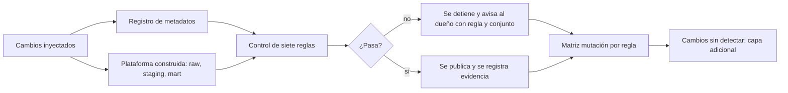
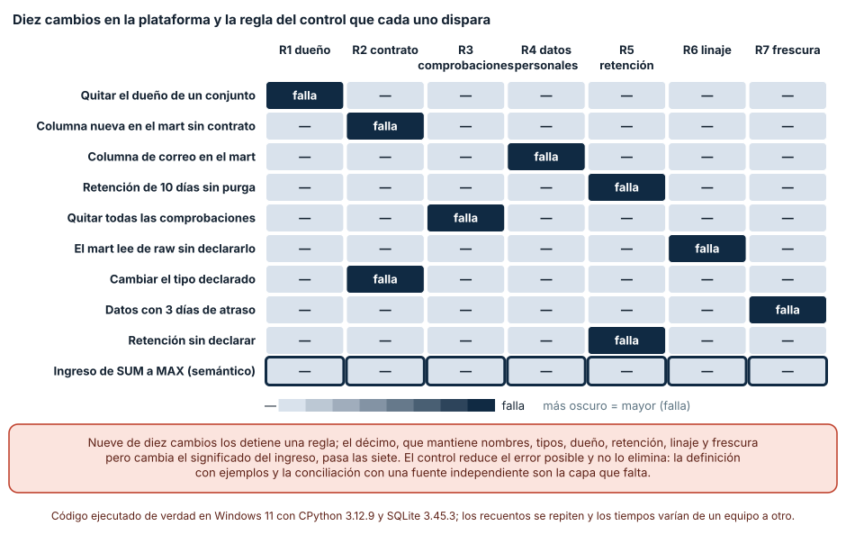
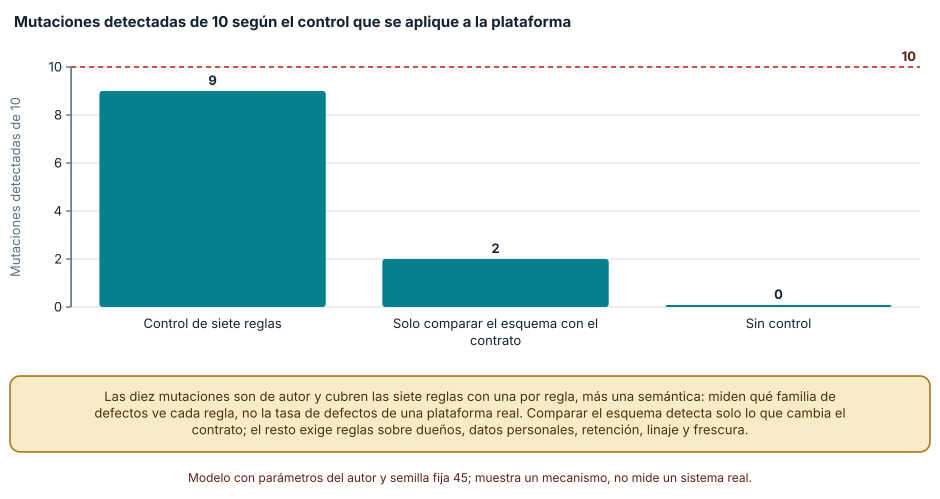

# SE-372 — Proyecto: plataforma de datos mínima gobernada

[← SE-371 — Taller: reparar un pipeline defectuoso](https://github.com/vladimiracunadev-create/modern-software-engineering-program/blob/main/classes/part-30-ingenieria-de-datos-y-plataformas-de-datos/se-371-taller-reparar-un-pipeline-defectuoso/README.md) · [↑ Parte 30](https://github.com/vladimiracunadev-create/modern-software-engineering-program/blob/main/classes/part-30-ingenieria-de-datos-y-plataformas-de-datos/README.md) · [📚 Índice completo](https://github.com/vladimiracunadev-create/modern-software-engineering-program/blob/main/classes/README.md) · [🌐 Portal](https://vladimiracunadev-create.github.io/modern-software-engineering-program/classes/SE-372.html) · [SE-373 — Integración síncrona y asíncrona →](https://github.com/vladimiracunadev-create/modern-software-engineering-program/blob/main/classes/part-31-integracion-eventos-y-mensajeria/se-373-integracion-sincrona-y-asincrona/README.md)

## Punto profesional y fundamento pedagógico

**Punto profesional.** El proyecto existe para que integres todo lo de la parte en una plataforma pequeña que se pueda ejecutar, auditar y romper a propósito: tres capas de datos (cruda, intermedia y analítica), un registro de metadatos con dueño, contrato, comprobaciones, retención y dependencias de cada conjunto, y un control de siete reglas que decide si algo se publica. El resultado no es un conjunto de herramientas sino evidencia: qué reglas existen, qué detecta cada una, cuántos cambios malos detiene de diez que se le inyectan y qué defecto atraviesa el control sin que ninguna regla lo vea. Esa última parte es la que distingue una plataforma gobernada de una que solo parece gobernada.

**Por qué aparece aquí.** Cierra la parte. Reúne la separación de lo operacional y lo analítico de `SE-361`, la ingesta de `SE-362`, el modelo de `SE-363`, la carga repetible de `SE-364`, las comprobaciones de `SE-365`, el contrato de `SE-366`, el linaje de `SE-367`, el formato de `SE-368`, la privacidad y retención de `SE-369`, el costo de `SE-370` y el método de `SE-371`. Aplica además el cierre de proyecto de [SE-360](https://github.com/vladimiracunadev-create/modern-software-engineering-program/blob/main/classes/part-29-datos-persistencia-y-recuperacion/se-360-proyecto-capa-de-datos-recuperable/README.md) y de [SE-504](https://github.com/vladimiracunadev-create/modern-software-engineering-program/blob/main/classes/part-41-observabilidad-sre-e-incidentes/se-504-proyecto-operacion-observable-y-recuperable/README.md).

**Error conceptual que debe corregir.** Creer que gobernar es documentar. Un control que no se ejecuta contra lo construido es un papel, y un registro que no se verifica envejece. La segunda corrección: nueve de diez cambios detenidos no significa que el control sea bueno; significa que detiene las familias que se pensaron, y la décima, una que cambia el significado y conserva todo lo demás, pasó.

**Secuencia de aprendizaje.** Antes de ejecutar, predices cuántos de diez cambios detiene un control de siete reglas y cuántos uno que solo compara el esquema con el contrato. Después construyes la plataforma de tres conjuntos, ejecutas el control sobre la versión limpia (debe pasar), le inyectas diez cambios (uno por regla y uno semántico) y registras qué regla dispara cada uno.

**Evidencia de aprendizaje.** `plataforma-de-datos-gobernada.md` con el registro de metadatos de tus conjuntos, las siete reglas con su evidencia, la matriz de diez mutaciones y reglas, el cambio que el control no ve con la capa que lo vería, y el costo mensual estimado de la plataforma con la fórmula de `SE-370`.

**Límite de la conclusión.** La plataforma tiene tres conjuntos en SQLite, 5 000 pedidos sintéticos y siete reglas; las diez mutaciones son del autor y cubren cada regla una vez más una semántica. Los resultados (9 de 10 y 2 de 10) miden qué familia de defectos ve cada regla, no la tasa de defectos de ninguna plataforma real. No se evaluó ninguna herramienta ni se midió el costo de operar una plataforma. No se invocó ningún modelo de lenguaje.

### Trazabilidad fuente → afirmación

| Fuente primaria u oficial | Afirmación que respalda | Lo que no prueba |
|---|---|---|
| [DAMA International, DMBOK](https://www.dama.org/cpages/body-of-knowledge) | Sitúa el gobierno, la calidad, los metadatos y el ciclo de vida como funciones de la gestión de datos. | Es una guía de prácticas. |
| [Open Data Contract Standard](https://bitol-io.github.io/open-data-contract-standard/latest/) | Muestra qué declara un contrato: esquema, calidad, propietarios y acuerdos. | No es un control ejecutable. |
| [OpenLineage, documentación](https://openlineage.io/docs/) | Describe cómo capturar el linaje en ejecución para verificar entradas y salidas declaradas. | Es una especificación abierta. |
| [Reglamento (UE) 2016/679](https://eur-lex.europa.eu/eli/reg/2016/679/oj) | Establece principios de minimización y de limitación del plazo de conservación que las reglas de privacidad y retención traducen. | No dice cómo implementarlos ni prueba cumplimiento. |
| [FinOps Foundation, «FinOps Framework»](https://www.finops.org/framework/) | Respalda atribuir el costo a dueños como práctica de ingeniería. | No da cifras. |
| [Great Expectations, documentación](https://docs.greatexpectations.io/docs/) | Describe expectativas como comprobaciones declarativas. | Es una herramienta concreta. |

## Antes de empezar

Recupera lo aprendido en `SE-371`: cada defecto lo ve alguna comprobación y ninguna las ve todas. La pregunta activa es: **¿qué cambio podría ocurrir hoy en tu plataforma y llegar a un informe sin que ningún control lo detenga?**

## Prerrequisitos

- Haber completado `SE-361` a `SE-371`.
- Conocer el cierre de proyecto de [SE-360](https://github.com/vladimiracunadev-create/modern-software-engineering-program/blob/main/classes/part-29-datos-persistencia-y-recuperacion/se-360-proyecto-capa-de-datos-recuperable/README.md).
- SQL, `sqlite3` y expresiones regulares básicas.
- Python 3.11 o posterior; el laboratorio usa `sqlite3` y `re`.

## Problema auténtico

La dirección de *Avisos* quiere que los informes ejecutivos salgan de una plataforma de datos con garantías: que cada conjunto tenga un dueño, que lo que se publica cumpla su contrato, que no se exponga ningún dato personal, que se purgue lo que vence, que las dependencias estén declaradas y que los datos estén frescos. Hoy hay tres capas y ninguna regla escrita. Cada cambio pasa «porque el analista lo revisó».

El proyecto consiste en construir la versión mínima de esa plataforma, hacerla ejecutable y ponerla a prueba con cambios malos inyectados, para saber qué detiene y qué no.

## Objetivos observables

Al terminar podrás:

1. diseñar un registro de metadatos con dueño, contrato, comprobaciones, retención, datos personales y dependencias por conjunto;
2. implementar siete reglas que lo comparen con lo construido y fallen con un mensaje que nombre el conjunto y la regla;
3. inyectar diez cambios (uno por regla y uno semántico) y registrar qué regla detiene cada uno;
4. comparar el control completo con uno que solo compara el esquema y explicar la diferencia en términos de familias de defectos;
5. declarar el cambio que ninguna regla detecta y la capa adicional (definición con ejemplos, conciliación independiente) que lo vería.

## Mapa conceptual



El control compara dos cosas, lo declarado en el registro y lo construido, y la matriz de mutaciones prueba el control mismo. El cambio sin detectar es el resultado más valioso del proyecto.

## Temas y por qué importan

| Tema | Por qué cambia una decisión profesional | Evidencia mínima |
|---|---|---|
| Registro de metadatos | Es la declaración contra la que se verifica. | Archivo versionado por conjunto |
| Reglas comprobables | Cada regla es una consulta o una comparación. | Siete reglas con su evidencia |
| Mutaciones | Prueban el control con defectos conocidos. | Matriz mutación por regla |
| Cobertura | Dice qué familia ve cada regla. | Detectadas de diez |
| Punto ciego | Lo que el control no ve exige otra capa. | Cambio sin detectar documentado |
| Costo | La plataforma debe tener un costo estimado. | Fórmula de la clase de costos |
| Evidencia | Una publicación sin evidencia no es auditable. | Informe por ejecución |

## Conceptos y decisiones

### 1. La plataforma mínima

Tres conjuntos: `raw_orders` (cruda, con correo declarado como dato personal y retención de 400 días), `stg_orders` (intermedia: identificador, un seudónimo en lugar del correo, importe y día) y `mart_daily` (analítica: día, pedidos e ingreso, retención de 1 000 días). Cada uno tiene dueño, contrato de columnas con tipos, comprobaciones (unicidad de la clave y al menos una fila), conjuntos de entrada declarados y una edad máxima de un día. Son 5 000 pedidos de 31 días construidos con la semilla 45. Es pequeña a propósito: lo que importa es que cada regla se pueda ejecutar y romper.

### 2. El registro de metadatos

Un registro por conjunto con campos obligatorios: `owner`, `layer`, `columns` (nombre y tipo), `pii` (columnas con datos personales), `retention_days`, `checks`, `inputs` y `max_age_days`. Se guarda como código junto al del pipeline, de modo que un cambio al registro pasa por la misma revisión que un cambio al código. Es la «lista de lo que debería ser» y el control la contrasta con «lo que es». Un registro sin control es un wiki; un control sin registro no sabe qué comparar.

### 3. Las siete reglas

R1 dueño: todo conjunto tiene dueño nombrado. R2 contrato: las columnas y tipos reales coinciden con las declaradas. R3 comprobaciones: cada conjunto declara comprobaciones y todas pasan sobre los datos. R4 datos personales: ningún conjunto de la capa analítica expone columnas marcadas como personales (ni columnas con nombre de correo o teléfono). R5 retención: cada conjunto declara retención y no contiene filas más antiguas que ese plazo. R6 linaje declarado: las entradas declaradas son las que aparecen en el SQL que construye el conjunto. R7 frescura: el dato más nuevo tiene menos edad que la máxima declarada. Cada regla es una consulta o una comparación sobre la plataforma construida.

### 4. Inyectar defectos para probar el control

Un control se prueba como un detector de `SE-365`: con incidentes sembrados. Las diez mutaciones del proyecto son: quitar el dueño; añadir una columna al mart sin actualizar el contrato; exponer una columna de correo en el mart (actualizando el contrato, para que R2 no la vea); declarar una retención de 10 días sin purga; quitar todas las comprobaciones de un conjunto; hacer que el mart lea de la capa cruda sin declararlo; cambiar el tipo declarado de una columna; cargar datos con tres días de atraso; dejar sin declarar la retención de un conjunto; y cambiar el ingreso de `SUM` a `MAX`.

### 5. Qué detectó cada regla

La plataforma limpia pasó las siete reglas. De las diez mutaciones, nueve dispararon exactamente una regla: el dueño quitado, R1; la columna sin contrato, R2; el correo en el mart, R4; la retención de 10 días sin purga, R5; las comprobaciones quitadas, R3; el mart que lee de la capa cruda, R6; el tipo cambiado, R2; los datos atrasados, R7; la retención sin declarar, R5. La décima, el ingreso con `MAX`, no disparó ninguna: mantiene nombres, tipos, dueño, retención, linaje y frescura, y no rompe la unicidad ni el conteo. Un control que solo compara el esquema con el contrato (R2) detecta 2 de las 10: la columna sin contrato y el tipo cambiado.

### 6. Lo que el control no ve y qué lo vería

El cambio semántico atraviesa todo porque ninguna regla describe el significado. Lo detectarían dos capas distintas. Una es la conciliación con una fuente independiente: el ingreso diario del mart contra el de facturación; una diferencia sistemática lo delata el primer día. La otra es la definición del campo con ejemplos y una prueba que los ejecute: «el ingreso del día es la suma de los importes de los pedidos no cancelados; un día con tres pedidos de 100, 200 y 300 debe dar 600». Ninguna de las dos pertenece al control de metadatos: son comprobaciones de dato, y por eso la plataforma gobernada declara que su control reduce el error posible y no lo elimina.

### 7. Qué falla cuando una regla se rompe, y a quién avisa

Cada regla devuelve un mensaje con el nombre de la regla, el conjunto y el valor observado frente al esperado, y se dirige al dueño declarado en el registro. Un control que dice «falló la gobernanza» no es accionable ([SE-498](https://github.com/vladimiracunadev-create/modern-software-engineering-program/blob/main/classes/part-41-observabilidad-sre-e-incidentes/se-498-alertas-accionables-y-fatiga/README.md)). La política de acción también se declara: R1, R3 y R4 detienen la publicación; R7 la publica con una marca de frescura; R5 abre un trabajo de purga. Se escribe en el registro, no en la cabeza de quien configuró el control.

### 8. Costo y operación de la plataforma

La plataforma tiene un costo que se estima con las fórmulas de `SE-370`: bytes leídos por consulta frecuente, frecuencia de refresco de cada conjunto, TB-mes por retención y duración del camino crítico. El registro de metadatos añade un campo de presupuesto por conjunto y el control, una regla futura: si la proyección mensual de un dueño supera su presupuesto, avisa. No se implementa aquí para no mezclar un parámetro inventado con una regla de gobierno; se declara como extensión.

### 9. Evidencia por ejecución

Cada ejecución del control produce un informe con la fecha, las reglas evaluadas, el resultado por conjunto, las mutaciones conocidas que se ejecutaron como prueba del control y las diferencias con la ejecución anterior. Es el artefacto que permite a otra persona auditar la plataforma sin preguntarle a quien la construyó. Sin él, «pasó el control» es una afirmación sin evidencia.

### 10. Qué haría falta para pasar de mínima a real

Más conjuntos (el control debe escalar a cientos), un catálogo que mantenga el registro, linaje capturado en ejecución y no solo analizado en texto, seudonimización con clave gestionada (`SE-369`), compactación y manifiesto de versiones (`SE-368`), un orquestador que ejecute el control antes de publicar, alertas con dueño y un proceso de revisión de las excepciones. La plataforma mínima no tiene nada de eso y por eso no se afirma que sea una plataforma de producción.

## Arquitectura de la plataforma

La primera figura muestra las tres capas, el registro y el control.


**Cómo leer la figura.** La fila superior es el camino del dato y la inferior lo que lo gobierna: el registro declara, el control compara y el informe deja evidencia. Mira primero que el control se ejecuta antes de publicar y no después. **Dónde deja de valer:** son tres conjuntos y una sola fuente; con decenas de fuentes, el registro se parte por dominio y el control se ejecuta por conjunto en paralelo, con reglas globales y reglas locales.

## Diez cambios y siete reglas

La segunda figura es la matriz de mutaciones.



**Cómo leer la figura.** Cada fila es un cambio inyectado y cada columna una regla; una celda oscura dice que esa regla falla. Mira primero la última fila, resaltada: ninguna regla la ve. **Dónde deja de valer:** las mutaciones se inyectan de a una y cada una está escrita para disparar la regla que le corresponde; un cambio real tiene efectos mezclados. La matriz mide la cobertura de familias de defectos, no la tasa de defectos de una plataforma.

## Cobertura del control

La tercera figura compara tres niveles de control.



**Cómo leer la figura.** Cada barra es un nivel de control y su altura las mutaciones que detiene de diez, con la línea de referencia en 10. Mira primero la distancia entre la segunda y la tercera: comparar solo el esquema ya detecta algo, y la distancia hacia la primera es lo que añaden las reglas sobre dueños, datos personales, retención, linaje y frescura. **Dónde deja de valer:** las diez mutaciones son de autor y cubren las siete reglas por diseño; contra defectos que nadie pensó, la cobertura es desconocida.

## Definiciones de trabajo

- **Plataforma de datos gobernada:** plataforma donde cada conjunto tiene dueño, contrato, comprobaciones, retención y dependencias verificables.
- **Registro de metadatos:** declaración versionada de lo que debería ser cada conjunto.
- **Control (gate):** conjunto de reglas que decide si algo se publica.
- **Mutación:** cambio malo inyectado deliberadamente para probar el control.
- **Cobertura:** mutaciones detectadas sobre mutaciones inyectadas.
- **Punto ciego:** familia de cambios que ninguna regla detecta.
- **Evidencia de ejecución:** informe que permite auditar una ejecución del control.

## Ejemplo mínimo

Una regla de gobierno, la de retención, como una función:

```python
import sqlite3

def regla_retencion(con, conjunto, retencion_dias, hoy):
    """R5: el conjunto declara retención y no contiene filas más antiguas."""
    if retencion_dias is None:
        return f"R5 {conjunto}: retención sin declarar"
    viejas = con.execute(f"SELECT COUNT(*) FROM {conjunto} WHERE day < ?", (hoy - retencion_dias,)).fetchone()[0]
    if viejas:
        return f"R5 {conjunto}: {viejas} filas más antiguas que {retencion_dias} días"
    return None

con = sqlite3.connect(":memory:")
con.execute("CREATE TABLE raw_orders(day INT)")
con.executemany("INSERT INTO raw_orders VALUES(?)", [(d,) for d in range(0, 31)])
print(regla_retencion(con, "raw_orders", 400, 30))    # None: cumple
print(regla_retencion(con, "raw_orders", 10, 30))     # R5 raw_orders: 20 filas más antiguas que 10 días
print(regla_retencion(con, "raw_orders", None, 30))   # R5 raw_orders: retención sin declarar
```

La regla nombra la regla, el conjunto y el valor observado. Así el aviso al dueño dice qué hacer.

## Ejemplo profesional

*Escenario ilustrativo: las cifras y los resultados que aparecen en este ejemplo son supuestos de la narración, no mediciones.*

El equipo de *Avisos* convierte el proyecto en una práctica. Mantiene el registro de metadatos junto al código del pipeline y ejecuta el control en cada cambio y antes de cada publicación. Cada trimestre ejecuta las diez mutaciones como prueba del propio control: si un cambio de reglas deja de detectar alguna, la prueba falla y el cambio no entra. Un día añade una undécima mutación inspirada en un incidente real (un `JOIN` que duplicó filas) y ve que ninguna regla la detecta; añade entonces una regla de conciliación de filas contra la capa anterior y la matriz pasa a 11 de 11. El cambio semántico sigue sin detectarse y el equipo lo documenta como riesgo aceptado con una conciliación semanal de ingresos contra facturación, a cargo de finanzas, como capa independiente.

## Práctica guiada

1. Escribe el registro de metadatos de tres conjuntos de un sistema tuyo con todos los campos.
2. Ejecuta `python scripts/experiments_part30_c.py 552` y reproduce la matriz de mutaciones.
3. Inyecta una undécima mutación de tu dominio y observa si el control la detecta.
4. Añade una regla nueva (por ejemplo, conciliación de filas entre capas) y vuelve a ejecutar las diez mutaciones.
5. Escribe el informe de evidencia de una ejecución con reglas, resultados y diferencias.

## Ejercicios

1. **Básico.** Explica por qué una mutación semántica pasa las siete reglas y qué capa la vería.
2. **Intermedio.** Añade una regla de presupuesto por conjunto y una mutación que la dispare; decide si detiene o avisa.
3. **Avanzado.** Diseña cómo ejecutar el control sobre 300 conjuntos sin que tarde más que el pipeline y cómo versionar excepciones aprobadas.

## Reto verificable

Entrega `plataforma-de-datos-gobernada.md` con el registro de metadatos de al menos tres conjuntos, las siete reglas con su evidencia, la matriz de al menos ocho mutaciones y reglas, el cambio que el control no ve con la capa que lo vería, y el costo mensual estimado con su fórmula. Es válido si otra persona ejecuta tus mutaciones, obtiene la misma matriz y puede inyectar un cambio que tu control no ve.

## Caso conductor

*Avisos* cierra la parte con una plataforma mínima que se puede auditar y romper. Los datos que produce alimentan, en la [Parte 50](../../part-50-machine-learning-en-produccion-y-mlops/README.md), los sistemas de aprendizaje automático, y ahí los contratos, el linaje y la privacidad dejan de ser opcionales.

## Preguntas frecuentes

### ¿Basta con un control de metadatos para gobernar los datos?

No. Cubre dueño, contrato, datos personales, retención, linaje y frescura. No cubre el significado de los números ni los defectos de lógica; para eso hay conciliaciones, definiciones con ejemplos y revisión.

### ¿Quién mantiene el registro?

Cada dueño el de sus conjuntos, con revisión de un equipo de plataforma que mantiene las reglas. Un registro mantenido por un solo equipo central envejece.

### ¿Cuántas reglas necesito?

Las que correspondan a las familias de defectos que quieres detener, probadas con mutaciones. Más reglas sin dueño ni mutación que las pruebe son ruido.

### ¿Qué hago con las excepciones?

Se registran con dueño, razón y fecha de vencimiento en el propio registro. Una excepción sin vencimiento es una regla desactivada.

## Fallo controlado y diagnóstico

**Fallo.** Un informe ejecutivo muestra un ingreso diario menor que el de facturación, y el control pasó en verde.

**Diagnóstico paso a paso.** (1) Se concilia el ingreso del mart con el de facturación: difiere cada día. (2) Se revisan las siete reglas: todas pasan. (3) Se inspecciona el SQL del mart: usa `MAX(amount)` en lugar de `SUM(amount)`. (4) Se ejecuta la mutación semántica del proyecto: reproduce exactamente el síntoma.

**Corrección.** Se corrige el SQL, se añade al contrato del mart la definición del ingreso con un ejemplo y una prueba que lo ejecuta, y se programa la conciliación semanal contra facturación como una comprobación del propio mart. La lección es que un control de gobierno puede pasar mientras el número es incorrecto, y que la defensa es una capa que compare contra el mundo, no contra el registro.

## Errores comunes y cómo corregirlos

- **Documentar sin verificar.** Corrige con reglas ejecutables contra lo construido.
- **Probar el control solo con casos felices.** Corrige con mutaciones.
- **Reglas sin dueño ni acción.** Corrige con un mensaje accionable y una política.
- **Excepciones sin vencimiento.** Corrige con fecha y revisión.
- **Creer que el control cubre el significado.** Corrige añadiendo conciliación independiente y definiciones con ejemplos.
- **Aumentar reglas sin medir cobertura.** Corrige con la matriz y la mutación nueva.

## Entorno y archivos clave

- `scripts/experiments_part30_c.py`: función `e552` con la plataforma de tres conjuntos, el registro, las siete reglas y las diez mutaciones; se ejecuta con `python scripts/experiments_part30_c.py 552`.
- `scripts/figures_part30_b.py`: las tres figuras de la clase.
- Solo la biblioteca estándar de Python 3.11 o posterior; semilla 45; tarda unos segundos.

## Seguridad, ética y accesibilidad

Los datos del proyecto son sintéticos y los correos usan un dominio reservado para ejemplos. Un registro de metadatos con datos sensibles (qué columnas son personales, quién accede) es información delicada: protégelo como el dato. Las reglas de privacidad no sustituyen a la evaluación legal ([SE-466](https://github.com/vladimiracunadev-create/modern-software-engineering-program/blob/main/classes/part-38-seguridad-privacidad-y-cumplimiento/se-466-cumplimiento-evidencia-y-limites-legales/README.md)). Las figuras llevan texto alternativo completo y no dependen solo del color.

## Puente hacia el trabajo con agentes

Un agente que construye o modifica conjuntos de datos debe tratar el registro y el control como restricciones que no puede cambiar para que su propio trabajo pase. Exige que, antes de proponer un cambio, ejecute el control y las mutaciones relevantes y muestre la matriz; que cada cambio nombre al dueño que lo aprueba; y que no tenga permiso de editar las reglas ni el registro de los conjuntos que produce. Un agente que «arregla» el control para que pase debe detenerse y avisar.

## Transferencia

Elige tres conjuntos de datos de tu organización y escribe su registro. Implementa dos reglas de las siete sobre ellos, inyecta tres mutaciones y compara con lo que tu equipo detectaría hoy. Anota el cambio que ninguna regla ve y quién lo detectaría.

## Evaluación y evidencia

| Criterio | Evidencia aceptable | Rechazo |
|---|---|---|
| Registro | Campos obligatorios por conjunto, versionado | Documento sin verificación |
| Reglas | Siete reglas con evidencia ejecutable | Lista de buenas intenciones |
| Mutaciones | Matriz de al menos ocho mutaciones | Solo casos felices |
| Punto ciego | Cambio sin detectar y capa que lo vería | «Cubrimos todo» |
| Costo | Fórmula y parámetros | Sin estimación |

## Fuentes

- DAMA International. [DMBOK](https://www.dama.org/cpages/body-of-knowledge).
- Bitol. [Open Data Contract Standard](https://bitol-io.github.io/open-data-contract-standard/latest/).
- OpenLineage. [Documentación](https://openlineage.io/docs/).
- Parlamento Europeo y Consejo. [Reglamento (UE) 2016/679](https://eur-lex.europa.eu/eli/reg/2016/679/oj).
- FinOps Foundation. [«FinOps Framework»](https://www.finops.org/framework/).
- Great Expectations. [Documentación](https://docs.greatexpectations.io/docs/).

## Límites y siguiente paso

Los tres conjuntos, las siete reglas y las diez mutaciones son construcciones del autor, y la matriz mide qué familia de defectos ve cada regla, no la tasa de defectos de ninguna plataforma; el control solo corre sobre SQLite y no cubre catálogo, captura de linaje en ejecución, claves gestionadas ni costo. Que el control detecte 9 de 10 no dice que detecte 9 de 10 de los defectos reales. No se evaluó ninguna herramienta. Con esta clase se cierra la [Parte 30](../README.md): lo que sigue en el programa, empezando por la [Parte 50](../../part-50-machine-learning-en-produccion-y-mlops/README.md), usa estos datos para entrenar y servir modelos, donde la calidad, el linaje y la privacidad de lo que entra determinan lo que sale.

## Glosario

| Término | Definición breve |
|---|---|
| Registro de metadatos | Lo que debería ser cada conjunto |
| Control | Reglas que deciden si se publica |
| Mutación | Cambio malo inyectado para probar el control |
| Cobertura | Detectadas sobre inyectadas |
| Punto ciego | Lo que ninguna regla ve |
| Evidencia de ejecución | Informe que permite auditar una corrida |

---

[← SE-371 — Taller: reparar un pipeline defectuoso](https://github.com/vladimiracunadev-create/modern-software-engineering-program/blob/main/classes/part-30-ingenieria-de-datos-y-plataformas-de-datos/se-371-taller-reparar-un-pipeline-defectuoso/README.md) · [↑ Parte 30](https://github.com/vladimiracunadev-create/modern-software-engineering-program/blob/main/classes/part-30-ingenieria-de-datos-y-plataformas-de-datos/README.md) · [📚 Índice completo](https://github.com/vladimiracunadev-create/modern-software-engineering-program/blob/main/classes/README.md) · [🌐 Portal](https://vladimiracunadev-create.github.io/modern-software-engineering-program/classes/SE-372.html) · [SE-373 — Integración síncrona y asíncrona →](https://github.com/vladimiracunadev-create/modern-software-engineering-program/blob/main/classes/part-31-integracion-eventos-y-mensajeria/se-373-integracion-sincrona-y-asincrona/README.md)
