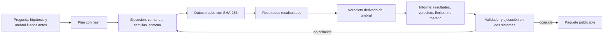

# SE-384 — Proyecto: informe reproducible de calidad

[← SE-383 — Taller: someter un sistema a presión controlada](https://github.com/vladimiracunadev-create/modern-software-engineering-program/blob/main/classes/part-31-calidad-rendimiento-y-resiliencia/se-383-taller-someter-un-sistema-a-presion-controlada/README.md) · [↑ Parte 31](https://github.com/vladimiracunadev-create/modern-software-engineering-program/blob/main/classes/part-31-calidad-rendimiento-y-resiliencia/README.md) · [📚 Índice completo](https://github.com/vladimiracunadev-create/modern-software-engineering-program/blob/main/classes/README.md) · [🌐 Portal](https://vladimiracunadev-create.github.io/modern-software-engineering-program/classes/SE-384.html) · [SE-385 — Principios de seguridad y modelos de amenaza →](https://github.com/vladimiracunadev-create/modern-software-engineering-program/blob/main/classes/part-32-seguridad-privacidad-y-cumplimiento/se-385-principios-de-seguridad-y-modelos-de-amenaza/README.md)

## Punto profesional y fundamento pedagógico

**Punto profesional.** El proyecto existe para que entregues un informe de calidad que otra persona pueda volver a ejecutar, auditar y refutar: la pregunta, la hipótesis y el umbral fijados antes; el entorno y las semillas; los datos crudos con su huella; los resultados recalculados desde esos datos; el veredicto derivado del umbral; y una lista honesta de lo que no se midió. La habilidad no es redactar conclusiones sino construir un paquete en el que la conclusión no pueda sostenerse sin la evidencia, ni la evidencia sin su procedencia.

**Por qué aparece aquí.** Cierra la **Parte 31** después de **Taller: someter un sistema a presión controlada**: las once clases anteriores produjeron mediciones, modelos y experimentos; el proyecto los convierte en un solo artefacto revisable. Es también el primer proyecto del programa que se evalúa por su reproducibilidad entre sistemas: el informe se ejecuta en Windows y en Ubuntu y los artefactos deben coincidir o declarar por qué no. El caso conductor es el informe de calidad de la API de entregas.

**Error conceptual que debe corregir.** Creer que un informe con números, gráficos y un veredicto es evidencia: sin datos crudos con huella, sin umbral fijado de antemano y sin la selección de resultados declarada, el mismo informe puede declarar una mejora inexistente en casi todos los casos, y un validador que solo comprueba coherencia no distingue una elección de un olvido.

**Secuencia de aprendizaje.** Antes de leer los resultados, predices cuántas de doce mutaciones de un paquete de informe detecta un validador y cuántos informes de dos versiones idénticas declararían una mejora si se elige la mejor de varias métricas y repeticiones; después ejecutas el validador sobre 240 mutaciones, mides la reproducibilidad de ocho artefactos entre dos ejecuciones y entre Windows y Ubuntu, y simulas la selección de resultados favorables. La secuencia usa predicción, explicación propia, contraste y recuperación. [ICAP](https://icap.education.asu.edu/research) distingue participación de construcción de conocimiento; [How People Learn II](https://nap.nationalacademies.org/catalog/24783/how-people-learn-ii-learners-contexts-and-cultures) respalda diseñar la práctica con contextos reales y retroalimentación.

**Evidencia de aprendizaje.** El paquete `informe-calidad/` descrito más abajo, con `manifiesto.json`, datos crudos con SHA-256, scripts, un validador, `LIMITES.md` y una ejecución en dos sistemas, más `proyecto-log.md` con la predicción y el análisis de qué mutaciones escapan.

**Límite de la conclusión.** El validador y las mutaciones son construcciones del autor (el validador se escribió conociendo las mutaciones que lo evalúan); los datos del paquete son sintéticos con semilla fija; la reproducibilidad se midió entre dos ejecuciones y entre Windows 11 (CPython 3.12.9) y Ubuntu bajo WSL2 (3.12.3) en un solo equipo, y no entre otros sistemas, otras versiones ni compiladores. No se midió ninguna API real y el informe no certifica la calidad de ningún sistema.

### Trazabilidad fuente → afirmación

| Fuente primaria u oficial | Afirmación que respalda | Lo que no prueba |
|---|---|---|
| [Peng, «Reproducible research in computational science» (Science, 2011)](https://doi.org/10.1126/science.1213847) | Propone un espectro de reproducibilidad que va de la publicación sola a la replicación completa con código y datos enlazados. | No dice qué nivel exige un informe de calidad de software. |
| [Simmons, Nelson y Simonsohn, «False-positive psychology» (2011)](https://doi.org/10.1177/0956797611417632) | Muestra que la flexibilidad al analizar (qué métricas, cuántas observaciones, qué se excluye) eleva la tasa de falsos positivos muy por encima del nivel nominal. | No es un estudio de mediciones de rendimiento; el mecanismo se traslada, no la cifra. |
| [Reproducible Builds: documentación](https://reproducible-builds.org/docs/) | Describe cómo lograr que un mismo origen produzca artefactos idénticos byte a byte y qué fuentes de variación (fechas, rutas, orden) hay que controlar. | No garantiza que la misma técnica resuelva el informe de calidad. |
| [Python: hashlib](https://docs.python.org/3/library/hashlib.html) | Documenta las funciones de huella (SHA-256) usadas para comprobar la integridad de los datos del paquete. | No prueba que los datos sean los correctos, solo que no cambiaron. |
| [Python: csv](https://docs.python.org/3/library/csv.html) | Indica que los archivos deben abrirse con `newline=''` para que el módulo controle los saltos de línea. | No cubre otras bibliotecas de CSV. |

## Antes de empezar

Recupera lo aprendido en toda la Parte 31: escenarios con medida (`SE-373`), compuertas (`SE-374`), carga (`SE-375`, `SE-376`), mediciones con protocolo (`SE-377`), reintentos, interruptores y recuperación (`SE-378` a `SE-380`), compatibilidad y presupuestos (`SE-381`, `SE-382`) y el experimento de presión (`SE-383`). La pregunta activa es: **¿qué paquete mínimo permite a alguien que no estuvo aquí repetir mis mediciones, obtener lo mismo y decir qué no puedo afirmar?**

## Prerrequisitos

- Haber completado `SE-383` o poder explicar qué es una hipótesis de estado estable y un criterio de aborto.
- Python 3.11 o posterior; el proyecto usa solo la biblioteca estándar (`hashlib`, `json`, `csv`, `random`, `statistics`, `subprocess`).
- Acceso a dos sistemas (por ejemplo, Windows y Ubuntu bajo WSL2) o la disposición de declarar que solo se probó uno.

## Problema auténtico

La plataforma presentó al colegio un informe de calidad de la API de entregas: un PDF con tres gráficos y la frase «la nueva versión es un 12 % más rápida y cumple todos los objetivos». Cuando el colegio pidió reproducirlo, el equipo no pudo: el script leía rutas de un equipo, los datos de las mediciones estaban en una hoja de cálculo editada a mano, el umbral de «cumple» se había ajustado después de ver los resultados y de las diez métricas calculadas solo se informaba la que mejor salía. Al reconstruirlo con el protocolo de `SE-377` la mejora desapareció: dos copias idénticas del programa «mejoraban» más del 5 % en uno de cada cuatro informes con solo elegir la mejor de cinco repeticiones. El proyecto construye el informe de modo que esos cuatro defectos (rutas, datos sin huella, umbral posterior, selección) estén impedidos o, al menos, a la vista.

## Objetivos observables

Al terminar podrás:

1. diseñar un paquete de informe con manifiesto, datos crudos con huella, plan fijado de antemano, scripts, validador y límites;
2. implementar un validador que recalcule hashes, resultados y veredictos y clasificar qué mutaciones detecta y cuáles no;
3. medir qué artefactos del canal son idénticos entre dos ejecuciones y entre dos sistemas y corregir los que difieren por el modo de escritura;
4. estimar con una simulación cuántos informes declararían una mejora inexistente según cómo se elija el resultado;
5. redactar `LIMITES.md` que separe lo medido, lo inferido y lo supuesto y diga qué no se midió.

## Mapa conceptual



El mapa pone el **plan con hash** antes de los datos y el **validador** al final. La flecha de retorno es la mitad del valor del proyecto: un paquete que no se puede volver a ejecutar con el mismo resultado se corrige o declara qué no es reproducible.

## Temas y por qué importan

| Tema | Por qué cambia una decisión profesional | Evidencia mínima |
|---|---|---|
| Paquete y manifiesto | Un informe es útil si alguien puede rehacerlo. | Predicción, traza causal y contraejemplo de **Paquete y manifiesto** en `proyecto-log.md` |
| Plan fijado de antemano | Un umbral posterior convierte la evidencia en justificación. | Predicción, traza causal y contraejemplo de **Plan fijado de antemano** en `proyecto-log.md` |
| Validación del paquete | Un validador ve contradicciones, no elecciones. | Predicción, traza causal y contraejemplo de **Validación del paquete** en `proyecto-log.md` |
| Reproducibilidad entre sistemas | Los bytes de los artefactos dependen del modo de escritura y del entorno. | Predicción, traza causal y contraejemplo de **Reproducibilidad entre sistemas** en `proyecto-log.md` |
| Selección de resultados | Elegir entre muchas métricas y repeticiones fabrica diferencias. | Predicción, traza causal y contraejemplo de **Selección de resultados** en `proyecto-log.md` |

## Conceptos y decisiones

### 1. Paquete y manifiesto

El **paquete** es la carpeta que contiene todo lo necesario para repetir y auditar el informe. Su centro es un **manifiesto** (un JSON) con la pregunta, la hipótesis, el umbral con su operador y su valor, el hash del plan, el entorno (sistema, versión de Python, número de CPU, commit del código), las semillas, el comando exacto, los datos (archivo, hash SHA-256, número de filas), los resultados calculados, el veredicto, los límites y la lista de lo no medido. Cada campo evita una discusión futura: sin el comando no se sabe cómo se produjo; sin el hash no se sabe si los datos cambiaron; sin la lista de lo no medido el informe parece cubrir más de lo que cubre. El manifiesto no sustituye al informe en prosa: lo hace comprobable.

### 2. Plan fijado de antemano

La pregunta, la hipótesis y el umbral se escriben **antes** de ver los datos y se les calcula un hash que queda registrado (por ejemplo, en un commit con fecha). Si el umbral se ajusta después, el hash cambia y el validador lo ve, a menos que se recalcule también el hash del plan: por eso el registro del plan debe estar fuera del control de quien analiza (un commit anterior, un sistema de issues, un correo con fecha). El plan incluye el estadístico, el número de repeticiones, la ventana y el criterio de exclusión de datos, y declara qué análisis son confirmatorios (los del plan) y cuáles exploratorios (los demás): los exploratorios pueden sugerir nuevas hipótesis y no se reportan como confirmación.

### 3. Validación del paquete

Un **validador** recorre el paquete y comprueba lo que se puede comprobar de forma automática: que estén los campos, que la huella de los datos coincida con el archivo, que el número de filas sea el declarado, que los resultados se recalculen desde los datos con el mismo estadístico, que el veredicto se derive del umbral, que los límites tengan contenido y que el plan no haya cambiado. Es la parte automatizable de la revisión. Tiene un límite estructural: detecta contradicciones del paquete consigo mismo y no distingue un paquete coherente y engañoso de uno coherente y honesto. Si alguien reemplaza los datos y recalcula todo, el validador lo aprueba; si conserva solo la mitad rápida de las mediciones y recalcula, también. La defensa de esos casos está fuera del paquete: un plan registrado de antemano, una revisión con otra persona y la publicación de todas las ejecuciones.

### 4. Reproducibilidad entre sistemas

Un artefacto es **reproducible** si el mismo código y los mismos datos producen el mismo resultado, en sentido numérico o byte a byte. Los números de un experimento con semilla fija suelen coincidir entre sistemas. Los bytes de los archivos que se escriben, no siempre: la codificación por defecto, el fin de línea de los archivos de texto, el terminador de línea del módulo `csv` (que escribe `\r\n`, y en Windows el modo texto lo convierte en `\r\r\n`), el orden de iteración de un conjunto de cadenas (aleatorizado por proceso), la hora y el nombre del sistema varían. Algunas variaciones son defectos de escritura y se corrigen (abrir con `newline=""` y `encoding="utf-8"`, fijar el terminador); otras son legítimas (el reloj) y se excluyen del hash o se declaran. La regla es separar lo determinista de lo medido con reloj y comprobar el primero en los dos sistemas.

### 5. Selección de resultados

Un informe que calcula diez métricas y comunica la mejor, o repite una medición cinco veces y comunica la mejor repetición, está seleccionando entre muchos resultados posibles, y esa flexibilidad infla la tasa de falsos positivos. No hace falta mala fe: cada decisión parece razonable por separado (descartar una repetición «con ruido», priorizar el percentil que más se mueve). El efecto es medible con una prueba A/A: con dos copias idénticas, la proporción de informes que declaran una mejora de al menos el 5 % pasa del 0,1 % con un procedimiento fijado a más del 59 % si se elige la mejor de seis métricas y a más del 96 % si se combinan métricas y repeticiones. La defensa es fijar de antemano la métrica y las repeticiones, publicar todas las ejecuciones y las exclusiones, y tratar las comparaciones adicionales como exploratorias.

### Un validador frente a 240 mutaciones

Se construye un paquete base con 500 latencias sintéticas, su hash, los percentiles recalculados, el veredicto «cumple» (p95 ≤ 300 ms) y el hash del plan. El validador comprueba los campos, el hash de los datos, el número de filas, los percentiles, el veredicto, el contenido mínimo de los límites (al menos 20 caracteres), el entorno y el hash del plan. Se aplican 12 operadores de mutación 20 veces cada uno.

```python
def valida(man, raw):
    if sha(raw) != man["datos"]["sha256"]: f.append("hash de datos")
    for k, p in (("p50", 50), ("p95", 95), ("p99", 99)):
        if abs(pct(filas, p) - man["resultados"][k]) > 0.05: f.append("resultado " + k)
    if esperado != man["veredicto"]: f.append("veredicto incoherente")
```

| Mutación detectada | Detectadas | Mutación no detectada | Detectadas |
|---|---:|---|---:|
| Quitar un campo obligatorio | 20 de 20 | Cambiar umbral y plan a la vez | 0 de 20 |
| Alterar una fila de los datos | 20 de 20 | Reemplazar datos, hash y resultados | 0 de 20 |
| Alterar un resultado un 10 % | 20 de 20 | Conservar solo la mitad más rápida | 0 de 20 |
| Invertir el veredicto | 20 de 20 | Un límite genérico pero extenso | 0 de 20 |
| Vaciar los límites («n/a») | 20 de 20 | Borrar lo no medido («nada») | 0 de 20 |
| Dejar el entorno incompleto | 20 de 20 | | |
| Cambiar el umbral sin el plan | 20 de 20 | | |

Detecta 140 de 240 (58 %). Las 100 que se escapan son coherentes: el paquete no se contradice. Reemplazar los datos con su hash y sus resultados, o cambiar el umbral y recalcular el hash del plan, deja un paquete internamente perfecto. El validador impide el olvido y el descuido; no impide la elección.


**Cómo leer la figura.** Cada fila empareja un operador detectado (izquierda) con uno no detectado (derecha). **Dónde deja de valer:** el validador y los operadores son del autor y se escribieron juntos, de modo que el 58 % no es una tasa de detección estimable; muestra la frontera entre contradicción y elección. La regla del contenido mínimo de los límites (20 caracteres) detecta «n/a» y no un límite genérico extenso: una frase vacía de sentido pasa cualquier regla de longitud.

### Ocho artefactos, dos ejecuciones, dos sistemas

Un programa genera ocho artefactos a partir de 1 000 latencias con semilla fija y calcula el SHA-256 de cada uno. Se ejecuta dos veces en cada sistema (en procesos nuevos) y se comparan los hashes entre ejecuciones y entre Windows 11 y Ubuntu bajo WSL2.

```python
with open("correcto.csv", "w", newline="", encoding="utf-8") as f:
    wr = csv.writer(f, lineterminator="\n")           # terminador explicito, sin traduccion
with open("ingenuo.csv", "w") as f: f.write(buf.getvalue())     # modo texto: en Windows, \r\n pasa a \r\r\n
```

| Artefacto | Igual entre dos ejecuciones | Igual entre Windows y Ubuntu |
|---|---|---|
| `resultados.json` (estadísticos con semilla fija) | Sí | Sí |
| `correcto.csv` (`newline=""`, terminador explícito) | Sí | Sí |
| `informe_correcto.md` (UTF-8 y `\n` explícitos) | Sí | Sí |
| `ingenuo.csv` (modo texto sin `newline=""`) | Sí | No: `\r\r\n` frente a `\r\n` |
| `informe_ingenuo.md` (modo texto sin `encoding`) | Sí | No: cp1252 y `\r\n` frente a UTF-8 y `\n` |
| `tiempos.json` (reloj de pared) | No | No |
| Orden de un conjunto de cadenas (`set`) | No | No |
| `entorno.json` (nombre del sistema) | Sí | No, por diseño |

Seis de los ocho artefactos coinciden entre dos ejecuciones del mismo sistema y solo tres lo hacen entre sistemas. Los dos defectos de escritura (`ingenuo.csv` e `informe_ingenuo.md`) se corrigen sin tocar los datos: el informe escrito de forma explícita en Windows tiene el mismo hash que el que se escribe en Ubuntu. Los dos no deterministas (el reloj y el orden de un conjunto, aleatorizado por el valor de hash de las cadenas de cada proceso) no se corrigen sino que se excluyen del hash, se ordenan antes de escribirlos o se declaran como medidos.


**Cómo leer la figura.** Cada fila es un artefacto; las dos columnas distinguen la variación entre ejecuciones de la variación entre sistemas. **Dónde deja de valer:** son dos sistemas en un equipo y una versión de Python en cada uno; otras versiones, otros sistemas de archivos o una configuración regional distinta podrían cambiar el resultado, y la reproducibilidad byte a byte de un informe con gráficos binarios exige controlar además fechas incrustadas y versiones de bibliotecas.

### Seleccionar el mejor resultado

Se comparan 4 000 pares de versiones idénticas del mismo programa con el mismo ruido de `SE-377` (4 % lognormal y 8 % de interferencias). Se cuenta el porcentaje de informes que declaran una mejora de al menos el 5 % según cómo se elija el resultado informado.

```python
mejor_metrica = any(mejora(ma[k], mb[k]) >= 0.05 for k in ma)                  # seis metricas: media, mediana, p90, p95, p99, minimo
mejor5 = mejora(base_a, min(runs_b)) >= 0.05                                  # la mejor de cinco repeticiones de B
```

| Cómo se elige el resultado que se informa | Informes con «mejora» ≥ 5 % |
|---|---:|
| Mediana de 30 contra mediana de 30, una métrica, una vez | 0,1 % |
| La mejor de 5 repeticiones de B contra una corrida de A | 23,1 % |
| La mejor de 6 métricas, 30 contra 30 | 59,1 % |
| La mejor de 6 métricas y la mejor de 5 repeticiones de B | 96,4 % |

Dos programas idénticos producen un informe de mejora en el 96,4 % de los casos si se combinan las dos elecciones. Ninguna decisión es fraudulenta aislada (descartar una repetición «con ruido», priorizar la métrica que se mueve) y el resultado conjunto es casi seguro un falso positivo. Esto no lo detecta el validador de la figura anterior: cada paquete es coherente.


**Cómo leer la figura.** Cada fila es un procedimiento para elegir qué se informa; el valor es la proporción de falsos positivos. **Dónde deja de valer:** el ruido es el supuesto del autor de `SE-377`, las seis métricas están correlacionadas (el efecto real de elegir una entre seis es menor que con seis independientes, aunque aquí ya está incluido) y un procedimiento fijado de antemano con otro estadístico daría otra tasa; lo que se sostiene es el orden de magnitud y su causa.

## Definiciones de trabajo

- **paquete de informe:** carpeta con el manifiesto, los datos crudos con su huella, los scripts, el validador y los límites necesarios para repetir y auditar un informe.
- **manifiesto:** archivo estructurado que describe la pregunta, el plan, el entorno, los datos, los resultados, el veredicto y los límites de un informe.
- **huella (hash):** resumen criptográfico de un archivo, como SHA-256, que cambia si el contenido cambia.
- **análisis confirmatorio y exploratorio:** el primero está fijado en el plan antes de ver los datos; el segundo se decide después y solo sugiere hipótesis.
- **reproducibilidad:** capacidad de obtener el mismo resultado con el mismo código y los mismos datos.

Las definiciones son operativas para el informe de calidad de la API de entregas. No convierten términos con una historia más amplia en sinónimos y deben contrastarse con la documentación primaria enlazada al final.

## Ejemplo mínimo

El fragmento calcula la huella de un archivo y muestra que un cambio de un carácter la altera. Antes de ejecutarlo, predice si los dos hashes comparten algún prefijo largo.

```python
import hashlib
a = hashlib.sha256(b"latencia_ms\n120.5\n").hexdigest()
b = hashlib.sha256(b"latencia_ms\n120.6\n").hexdigest()
print(a[:12], b[:12], a == b)
```

Los dos hashes no comparten un prefijo reconocible y la comparación es falsa: cualquier cambio en los datos cambia la huella por completo. Registra versión de Python, comando y salida; después guarda la huella en un manifiesto y escribe una función que falle si el archivo cambia.

## Ejemplo profesional

El proyecto entrega el paquete `informe-calidad/` con esta estructura: el plan (pregunta, hipótesis «p95 ≤ 300 ms con 200 usuarios simulados», umbral, estadístico, 30 repeticiones, criterio de exclusión) en un commit anterior a la ejecución; `ejecutar.py`, que corre la medición con semilla fija y escribe los datos con `newline=""` y `encoding="utf-8"`; `datos/raw.csv` con su SHA-256; `manifiesto.json` generado por el script; `validar.py`, que recalcula hash, resultados y veredicto y comprueba el plan; y `LIMITES.md`, que declara qué se midió (latencias de un modelo, con semilla), qué se infirió (la capacidad) y qué no se midió (ninguna API real, ningún usuario, el tiempo de reloj, la accesibilidad). Una segunda persona ejecuta el paquete en otro sistema y compara los hashes de los artefactos deterministas; el reloj queda fuera del hash y declarado. El informe en prosa enumera las ejecuciones, incluidas las descartadas con su motivo, y marca como exploratorio todo lo que no estaba en el plan. Compara con el PDF del problema: ahora cada afirmación tiene un camino de vuelta a un dato.

## Práctica guiada

1. Escribe el plan (pregunta, hipótesis, umbral, estadístico, repeticiones, exclusiones) y registra su hash antes de medir.
2. Predice cuántas de doce mutaciones detectará tu validador y cuáles se escaparán, y escríbelo antes de medir.
3. Genera los datos con semilla fija, guarda el CSV con `newline=""` y calcula su SHA-256.
4. Escribe el manifiesto con el script y el validador que recalcula hash, percentiles y veredicto.
5. Ejecuta el validador sobre las mutaciones de la clase y completa la tabla de detectadas y no detectadas.
6. Ejecuta el paquete dos veces en dos sistemas y compara los hashes de los ocho artefactos; corrige los defectos de escritura.
7. Entrega `proyecto-log.md`, `LIMITES.md` y el paquete; pide a otra persona que lo ejecute y que busque una mutación que tu validador acepte y que ella consideraría engañosa.

## Ejercicios

1. **Validador:** añade una regla que detecte la mutación «límite genérico» sin descartar los límites legítimos y explica qué falsos positivos introduce.
2. **Plan:** diseña dónde se registra el hash del plan para que quien analiza no pueda modificarlo sin que se note.
3. **Reproducibilidad:** escribe una prueba que ejecute dos veces el canal y falle si algún artefacto declarado como determinista cambia de hash.
4. **Selección:** estima con la simulación cuántas métricas y repeticiones permiten llegar al 50 % de informes con mejora falsa y escribe el límite que tu equipo se pone.

## Reto verificable

Entrega el paquete `informe-calidad/` y `proyecto-log.md` con la predicción, las tres tablas de resultados, el análisis de qué mutaciones escapan y la ejecución en dos sistemas. Se aprueba si otra persona ejecuta el paquete desde un checkout limpio, obtiene los mismos hashes en los artefactos deterministas, el validador pasa y puede decir qué parte de la conclusión no está respaldada por los datos y por qué. No se aprueba por entregar un informe en prosa sin datos crudos, por un umbral fijado después de ver los resultados ni por declarar que el paquete «garantiza» la calidad del sistema.

## Caso conductor

El informe de calidad de la API de entregas cierra el caso conductor de la Parte 31. Este proyecto deja el último artefacto: un paquete que reúne los escenarios de `SE-373`, las compuertas de `SE-374`, las pruebas de `SE-375` y `SE-376`, el protocolo de `SE-377`, las políticas de `SE-378` a `SE-380`, la matriz de `SE-381`, los presupuestos de `SE-382` y el experimento de `SE-383`. La Parte 32 lleva la mirada a la seguridad, la privacidad y el cumplimiento, donde el mismo paquete se somete a otras preguntas. Cambia después un solo dato, el número de métricas que informas, y observa cómo cambia la tasa de mejoras falsas.

## Preguntas frecuentes

### ¿Basta con publicar el código y los datos?

Es necesario y no suficiente. Sin el entorno, las semillas, el comando exacto y el plan fijado de antemano, otra persona puede ejecutar el código y no saber si repite el mismo análisis. El manifiesto reúne esa información y el validador comprueba que no se haya contradicho.

### ¿Qué hago con los resultados descartados?

Se publican con el motivo. Descartar una ejecución antes de verla con un criterio escrito en el plan es legítimo; descartarla después porque «salió rara» es una elección que hay que declarar y que, si afecta a la conclusión, la invalida. Lo importante es que quien lee pueda ver qué se descartó y decidir.

### ¿Un validador automático sustituye la revisión de otra persona?

No. Detecta lo que se puede comprobar de forma mecánica (campos, huellas, recálculos) y deja fuera lo que depende de juicio (si el umbral era razonable, si los datos representan lo que se dice). La revisión humana y el plan registrado de antemano cubren lo que el validador no puede.

### ¿Por qué usar datos sintéticos en un proyecto de calidad?

Porque permiten fijar semillas, compartir el paquete sin exponer a personas y ejecutar el canal en cualquier equipo. El costo es que no hay nada que decir sobre el sistema real; el informe debe declararlo y presentarse como una demostración del método, no como una certificación.

## Fallo controlado y diagnóstico

Reproduce el fallo clásico del proyecto: **un informe que declara una mejora que desaparece al aplicar el procedimiento fijado de antemano**. Calcula las diez métricas y selecciona la mejor.

Registra síntoma, entrada mínima, hipótesis, observación que descarta cada hipótesis, causa, corrección y prueba de regresión. **Síntoma:** el informe dice «la nueva versión es un 12 % más rápida» y, al repetirlo con el plan, la diferencia es del 0,8 %. **Hipótesis rivales:** (a) el equipo de la segunda medición usó otro entorno; (b) los datos cambiaron; (c) el primer informe eligió la mejor entre varias métricas y repeticiones. **Prueba:** recalcula el informe con el hash de los datos y el plan registrado; si la métrica y las repeticiones del plan dan 0,8 % y la mejora del 12 % corresponde a la mejor de varias, la causa es la selección. **Conclusión:** la mejora era un artefacto del procedimiento. **Regresión:** fija en el plan la métrica y las repeticiones, añade al validador la comprobación de que el informe reporta la métrica del plan y una prueba A/A que falle si el procedimiento declara una mejora entre copias idénticas más del 1 % de las veces. No cambies a la vez el plan y los datos.

## Errores comunes y cómo corregirlos

| Síntoma | Causa probable | Corrección |
|---|---|---|
| Otra persona no puede reproducir el informe | Falta el entorno, el comando o las semillas | Manifiesto con entorno, comando y semillas, y ejecución en un sistema limpio |
| Los hashes difieren entre Windows y Ubuntu | Escritura en modo texto sin `newline` ni `encoding` | Abrir con `newline=""` y `encoding="utf-8"` y fijar terminadores |
| El veredicto cambia con el umbral | Umbral fijado después de ver los datos | Plan con hash registrado antes de la ejecución |
| La mejora desaparece al repetir | Selección entre métricas o repeticiones | Fijar métrica y repeticiones y publicar todas las ejecuciones |
| El validador aprueba un paquete engañoso | El validador solo ve contradicciones | Revisión por otra persona y plan registrado fuera del control del analista |

## Entorno y archivos clave

```text
informe-calidad/
├── README.md
├── plan/plan.json
├── manifiesto.json
├── datos/raw.csv
├── ejecutar.py
├── validar.py
├── LIMITES.md
├── tests/test_paquete.py
└── evidence/proyecto-log.md
```

El `README` declara plataforma, versión de Python, semillas, comandos y el estado del equipo. El proyecto usa solo la biblioteca estándar (`hashlib`, `json`, `csv`, `random`, `statistics`, `subprocess`) y se ejecutó con CPython 3.12.9 en Windows 11 y 3.12.3 en Ubuntu bajo WSL2: los artefactos deterministas coincidieron salvo los dos escritos en modo texto, que se corrigen; la simulación de selección tarda unos segundos. Si añades una dependencia, fija procedencia y versión.

## Seguridad, ética y accesibilidad

- un informe de calidad puede influir en decisiones sobre personas (qué colegio contrata, qué plazo se mantiene): declarar sus límites es una obligación ética, no una cortesía;
- los datos crudos no deben contener datos personales: usa datos sintéticos o anonimizados y revisa el paquete antes de publicarlo, incluida la ruta de un equipo o un nombre de usuario en el entorno;
- los hashes prueban integridad, no autoría ni corrección: no los presentes como una firma;
- el informe y sus tablas deben tener texto alternativo y poder recorrerse con lector de pantalla;
- respeta las licencias de los datos y de las herramientas que uses y atribuye lo adaptado.

## Puente hacia el trabajo con agentes

Un agente al que se le pide «genera el informe de calidad» ejecutará una medición, elegirá las métricas que mejor se vean, redactará un resumen con un veredicto y no dejará datos crudos ni plan. Pídele en cambio que escriba el plan y su hash antes de medir, que guarde los datos crudos con huella, que genere el manifiesto con un script, que ejecute el validador y que enumere las ejecuciones y las métricas que calculó, incluidas las no informadas. Revisa especialmente si el agente eligió qué métrica informar después de ver los resultados y si el paquete se ejecutó en un segundo sistema: son los dos defectos que este proyecto mostró sin aviso.

## Transferencia

Traslada el proyecto a otro dominio (por ejemplo, un informe de accesibilidad de una aplicación móvil o una comparación de dos bibliotecas): cambia la pregunta y los datos y conserva el procedimiento de fijar el plan antes, guardar datos crudos con huella, recalcular el veredicto, validar el paquete y ejecutarlo en dos entornos. La transferencia está lograda cuando puedes decir qué parte de tu conclusión podría ser una elección y no un hallazgo, no cuando el paquete pasa el validador.

## Evaluación y evidencia

| Criterio | Evidencia para aprobar |
|---|---|
| comprensión | explicación de qué comprueba y qué no un validador y de por qué la selección infla los falsos positivos |
| corrección | tablas del validador, de la reproducibilidad y de la selección reproducibles con las mismas semillas |
| diseño | paquete con plan registrado, manifiesto, datos con huella, validador y `LIMITES.md` |
| diagnóstico | reproducción del fallo «mejora que desaparece con el plan» con regresión |
| incertidumbre | declaración de que datos, ruido y mutaciones son sintéticos o del autor y de qué sistemas se probaron |
| reproducibilidad | ejecución en dos sistemas con los hashes de los artefactos deterministas comparados |

## Fuentes

- [Peng, «Reproducible research in computational science»](https://doi.org/10.1126/science.1213847) — espectro de reproducibilidad; autoridad: Science, 2011.
- [Simmons, Nelson y Simonsohn, «False-positive psychology»](https://doi.org/10.1177/0956797611417632) — flexibilidad analítica y falsos positivos; autoridad: Psychological Science, 2011.
- [Reproducible Builds](https://reproducible-builds.org/docs/) — artefactos idénticos byte a byte y fuentes de variación; autoridad: proyecto Reproducible Builds.
- [Python: hashlib](https://docs.python.org/3/library/hashlib.html) — huellas SHA-256; autoridad: documentación de Python.
- [Python: csv](https://docs.python.org/3/library/csv.html) — `newline=''` y terminadores; autoridad: documentación de Python.

Cada fuente respalda el mecanismo indicado; ninguna demuestra que el 58 % de detección, el 96,4 % de mejoras falsas o los tres artefactos coincidentes se observen en otro paquete. Esa afirmación depende del validador, del ruido y de los sistemas.

## Límites y siguiente paso

Se ejecutaron los tres experimentos en Windows y Ubuntu (WSL2), con resultados idénticos en el validador y la selección y diferencias esperables en los artefactos que dependen del sistema. No se midió ninguna API real; los datos, el ruido, el validador y las doce mutaciones son construcciones del autor (el validador se escribió conociendo las mutaciones), la reproducibilidad se midió en dos sistemas de un equipo y con una versión de Python en cada uno, y el informe no certifica la calidad de ningún sistema. La Parte 32 continúa con seguridad, privacidad y cumplimiento.

## Glosario

- **paquete de informe:** carpeta con el manifiesto, los datos crudos con su huella, los scripts, el validador y los límites necesarios para repetir y auditar un informe.
- **manifiesto:** archivo estructurado que describe la pregunta, el plan, el entorno, los datos, los resultados, el veredicto y los límites de un informe.
- **huella (hash):** resumen criptográfico de un archivo, como SHA-256, que cambia si el contenido cambia.
- **análisis confirmatorio y exploratorio:** el primero está fijado en el plan antes de ver los datos; el segundo se decide después y solo sugiere hipótesis.
- **reproducibilidad:** capacidad de obtener el mismo resultado con el mismo código y los mismos datos.

---

[← SE-383 — Taller: someter un sistema a presión controlada](https://github.com/vladimiracunadev-create/modern-software-engineering-program/blob/main/classes/part-31-calidad-rendimiento-y-resiliencia/se-383-taller-someter-un-sistema-a-presion-controlada/README.md) · [↑ Parte 31](https://github.com/vladimiracunadev-create/modern-software-engineering-program/blob/main/classes/part-31-calidad-rendimiento-y-resiliencia/README.md) · [📚 Índice completo](https://github.com/vladimiracunadev-create/modern-software-engineering-program/blob/main/classes/README.md) · [🌐 Portal](https://vladimiracunadev-create.github.io/modern-software-engineering-program/classes/SE-384.html) · [SE-385 — Principios de seguridad y modelos de amenaza →](https://github.com/vladimiracunadev-create/modern-software-engineering-program/blob/main/classes/part-32-seguridad-privacidad-y-cumplimiento/se-385-principios-de-seguridad-y-modelos-de-amenaza/README.md)
