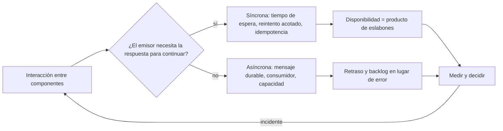
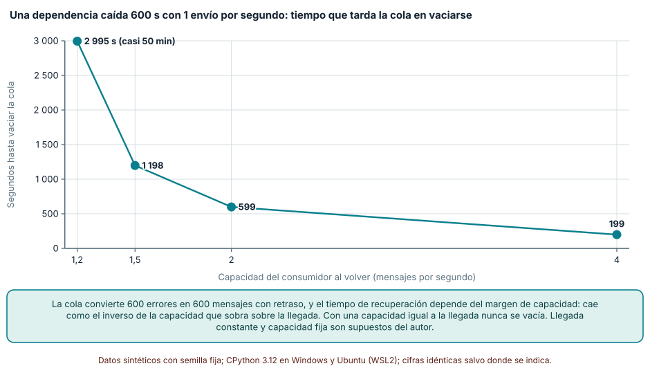

# SE-373 — Integración síncrona y asíncrona

[← SE-372 — Proyecto: plataforma de datos mínima gobernada](https://github.com/vladimiracunadev-create/modern-software-engineering-program/blob/main/classes/part-30-ingenieria-de-datos-y-plataformas-de-datos/se-372-proyecto-plataforma-de-datos-minima-gobernada/README.md) · [↑ Parte 31](https://github.com/vladimiracunadev-create/modern-software-engineering-program/blob/main/classes/part-31-integracion-eventos-y-mensajeria/README.md) · [📚 Índice completo](https://github.com/vladimiracunadev-create/modern-software-engineering-program/blob/main/classes/README.md) · [🌐 Portal](https://vladimiracunadev-create.github.io/modern-software-engineering-program/classes/SE-373.html) · [SE-374 — Mensajes, eventos, comandos y documentos →](https://github.com/vladimiracunadev-create/modern-software-engineering-program/blob/main/classes/part-31-integracion-eventos-y-mensajeria/se-374-mensajes-eventos-comandos-y-documentos/README.md)

## Punto profesional y fundamento pedagógico

**Punto profesional.** La clase existe para que elijas entre esperar la respuesta de otro componente y dejarle un mensaje con criterios medibles, en lugar de por costumbre o por moda: cuánto baja la disponibilidad cuando una petición cruza varias dependencias, cuánta carga añaden los reintentos apilados y cuánto tarda en recuperarse una cola después de una caída.

**Por qué aparece aquí.** Abre la **[Parte 31](../README.md)** después de **Proyecto: capa de datos recuperable**: la [Parte 29](../../part-29-datos-persistencia-y-recuperacion/README.md) dejó datos correctos dentro de un servicio; ahora la plataforma de entregas de tareas tiene que hablar con el calificador automático, el servicio de avisos y la analítica sin que un fallo de uno derribe a los demás. El caso conductor de la parte es ese flujo: una entrega llega, se califica, se avisa al estudiante y se registra para análisis.

**Error conceptual que debe corregir.** Creer que «asíncrono» es sinónimo de «más rápido» o «más fiable». Una cola no elimina el fallo, lo traslada: cambia errores inmediatos por retraso y cambia una pregunta (¿respondió?) por otra (¿se procesó, cuándo y cuántas veces?).

**Secuencia de aprendizaje.** Antes de leer los resultados, predices qué porcentaje de peticiones completa una cadena de cinco dependencias que fallan el 1 % cada una, cuántas llamadas recibe un servicio caído cuando tres capas reintentan dos veces y cuánto tarda en vaciarse una cola con poco margen de capacidad; después mides las tres cosas y comparas con tu predicción. La secuencia usa predicción, explicación propia, contraste y recuperación. [ICAP](https://icap.education.asu.edu/research) distingue participación de construcción de conocimiento; [How People Learn II](https://nap.nationalacademies.org/catalog/24783/how-people-learn-ii-learners-contexts-and-cultures) exige conectar conocimiento previo, contexto y transferencia; la [práctica de recuperación](https://pubmed.ncbi.nlm.nih.gov/16507066/) respalda producir de nuevo la explicación tras una demora; y [Education for Life and Work](https://nap.nationalacademies.org/resource/13398/dbasse_084153.pdf) exige devolución que explique la causa del error.

**Evidencia de aprendizaje.** `integracion-log.md` con las tres predicciones, las tres figuras reproducidas, una tabla de decisión síncrono/asíncrono para cuatro interacciones de la plataforma, la política de tiempos de espera y reintentos de una de ellas y una nota que diga qué garantía pierde el usuario al pasar a una cola.

**Límite de la conclusión.** Las tasas de fallo (1 % por llamada), la llegada constante de un envío por segundo y la caída de 600 s son supuestos del autor, y todo se simula en un solo proceso de Python: no hay red, latencia de reloj, servidor ni corredor de mensajes reales. Las cifras muestran mecanismos, no la disponibilidad de ningún sistema.

### Trazabilidad fuente → afirmación

| Fuente primaria u oficial | Afirmación que respalda | Lo que no prueba |
|---|---|---|
| [Hohpe y Woolf, «Enterprise Integration Patterns»](https://www.enterpriseintegrationpatterns.com/) | Describe la mensajería asíncrona como alternativa a la invocación remota y cataloga patrones como el receptor idempotente. | No dice cuándo conviene una cola en la plataforma de entregas ni cuánto cuesta. |
| [RFC 9110: semántica de HTTP](https://www.rfc-editor.org/rfc/rfc9110) | Define métodos seguros e idempotentes y explica que solo los idempotentes pueden reintentarse automáticamente sin riesgo para el cliente. | No garantiza que un servidor concreto implemente un `POST` de forma idempotente. |
| [AWS Builders' Library: tiempos de espera, reintentos y retroceso con jitter](https://aws.amazon.com/builders-library/timeouts-retries-and-backoff-with-jitter/) | Explica que reintentar en varias capas amplifica la carga y propone retroceso exponencial con aleatoriedad. | No mide la plataforma de entregas ni fija valores universales. |
| [Google SRE: cómo evitar fallos en cascada](https://sre.google/sre-book/addressing-cascading-failures/) | Presenta los reintentos sin límite como causa de fallos en cascada y propone limitar reintentos por petición y por cliente. | No prescribe un presupuesto del 10 %: ese valor es un supuesto de esta clase. |
| [Helland, «Life beyond distributed transactions»](https://www.cidrdb.org/cidr2007/papers/cidr07p15.pdf) | Argumenta que entre entidades que no comparten transacción hay que diseñar para mensajes repetidos y retrasados. | No evalúa ninguna tecnología actual de colas. |

## Antes de empezar

Recupera lo aprendido en la [Parte 20](../../part-20-backend-apis-y-procesamiento-asincrono/README.md) sobre idempotencia y trabajo asíncrono y en la [Parte 29](../../part-29-datos-persistencia-y-recuperacion/README.md) sobre consistencia de datos: dentro de un servicio una transacción protege la invariante; entre servicios no hay transacción compartida. La pregunta activa es: **¿qué debe saber el usuario ahora mismo, qué puede enterarse después y qué le cuesta a cada servicio que el otro esté caído?**

## Prerrequisitos

- Haber completado `SE-360` o poder explicar cómo la plataforma guarda y recupera sus datos.
- Python 3.11 o posterior; los experimentos usan solo la biblioteca estándar y generadores con semilla fija.
- Calcular probabilidades sencillas (producto de probabilidades independientes) y leer un bucle de reintentos.

## Problema auténtico

La plataforma recibe una entrega y, en la misma petición HTTP, llama al calificador, que llama al servicio de archivos y al de avisos, y devuelve «listo» al estudiante. Un lunes el servicio de avisos se vuelve lento: cada petición espera 30 s, los hilos del servidor se agotan y los estudiantes que solo querían subir un archivo ven errores aunque el calificador y el almacenamiento funcionan. El equipo añade reintentos en el navegador, en la pasarela y en el cliente HTTP interno, y el servicio de avisos, que ya estaba enfermo, recibe un múltiplo del tráfico normal. Después alguien propone «poner una cola» y pregunta si eso arregla todo. La respuesta depende de qué parte del problema era de acoplamiento temporal, qué parte era de reintentos sin control y qué garantías debe seguir dando la entrega.

## Objetivos observables

Al terminar podrás:

1. calcular cómo cae la disponibilidad de una petición síncrona con el número de dependencias y contrastarlo con una simulación;
2. medir la amplificación de carga de reintentos apilados y comparar un reintento fijo con un presupuesto de reintentos;
3. simular una caída y obtener el tamaño de la cola y el tiempo de recuperación según el margen de capacidad;
4. decidir con criterios explícitos qué interacciones de la plataforma deben ser síncronas y cuáles asíncronas;
5. escribir una política de tiempo de espera, reintento e idempotencia para una llamada y justificarla.

## Mapa conceptual



El mapa separa la pregunta de **contrato** (¿qué necesita saber quien llama?) de las de **mecanismo** (tiempos de espera, reintentos, colas). Las dos ramas terminan en una medición porque ninguna es mejor en abstracto.

## Temas y por qué importan

| Tema | Por qué cambia una decisión profesional | Evidencia mínima |
|---|---|---|
| Tipos de acoplamiento | Decide qué fallo de un componente se propaga a otro y cuál no. | Predicción, traza causal y contraejemplo de **Tipos de acoplamiento** en `integracion-log.md` |
| Disponibilidad en cadena | Cada dependencia síncrona multiplica una probabilidad de fallo. | Predicción, traza causal y contraejemplo de **Disponibilidad en cadena** en `integracion-log.md` |
| Tiempos de espera y reintentos | Un reintento mal ubicado convierte un fallo parcial en una caída total. | Predicción, traza causal y contraejemplo de **Tiempos de espera y reintentos** en `integracion-log.md` |
| Colas y contrapresión | Una cola aplaza el fallo y exige capacidad de recuperación. | Predicción, traza causal y contraejemplo de **Colas y contrapresión** en `integracion-log.md` |
| Contrato de respuesta | Lo que el usuario puede saber «ahora» define qué puede ser asíncrono. | Predicción, traza causal y contraejemplo de **Contrato de respuesta** en `integracion-log.md` |

## Conceptos y decisiones

### 1. Tipos de acoplamiento

Dos componentes están **acoplados en el tiempo** cuando uno solo puede avanzar si el otro está vivo en ese instante; en el espacio cuando uno necesita conocer la dirección del otro; y en el formato cuando ambos comparten el mismo esquema de datos. Una llamada síncrona los suma los tres. Una cola elimina el acoplamiento temporal (el receptor puede estar caído cuando el emisor escribe) y el de ubicación (el emisor conoce una cola, no un servidor), pero conserva el de formato: el mensaje sigue teniendo un esquema que ambos deben entender (`SE-380`). Reducir un acoplamiento no los reduce todos, y por eso «desacoplar» sin decir de cuál es una afirmación vacía.

### 2. Disponibilidad en cadena

Si una petición necesita que k dependencias respondan y cada una falla con probabilidad p de forma independiente, la probabilidad de éxito es (1−p)^k. Con p = 1 % y cinco dependencias el éxito baja a 95,1 %: una cadena de eslabones muy fiables es menos fiable que cada eslabón. La independencia es una hipótesis optimista; fallos correlacionados (un mismo despliegue, una misma red) empeoran el resultado. Lo útil del modelo es la dirección: cada dependencia síncrona añadida a la ruta crítica tiene un precio de disponibilidad, aunque el código sea correcto. Por eso conviene preguntar cuáles de esas dependencias son necesarias para responder **ahora**.

### 3. Tiempos de espera y reintentos

Un tiempo de espera es una decisión sobre cuánto vale esperar: sin él, un servicio lento retiene hilos y conexiones hasta agotarlos. Un reintento es una apuesta de que el fallo fue transitorio, y es seguro solo si repetir la operación no cambia el resultado: los métodos idempotentes de HTTP (`GET`, `PUT`, `DELETE`) lo son por definición del protocolo; un `POST` que crea una entrega no lo es salvo que el servidor reconozca una clave de idempotencia. El problema aparece al apilar capas: cada una reintenta sin saber que las otras también, y la carga se multiplica (3 intentos en 3 capas son 27 llamadas). El remedio es reintentar en **una** capa, con retroceso exponencial, aleatoriedad y un presupuesto que limite la fracción de llamadas que pueden ser reintentos.

### 4. Colas y contrapresión

Una cola absorbe una diferencia temporal entre la llegada y el procesamiento. Mientras el consumidor está caído, el backlog crece a la tasa de llegada; cuando vuelve, se vacía a la diferencia entre su capacidad y la llegada. Si la capacidad es igual a la llegada, **no se vacía nunca**; si la supera por poco, tarda mucho. La cola necesita además un límite o una señal de contrapresión: sin ellos, una caída larga produce un backlog que supera la memoria o la utilidad de los mensajes (una nota que llega tres horas tarde puede ya no importar). Decidir qué hacer cuando la cola se llena (rechazar, descartar los más viejos, degradar) es parte del diseño.

### 5. Contrato de respuesta

Lo que se puede hacer asíncrono lo define lo que el usuario necesita ver ahora. «Entrega recibida» exige persistir y devolver un identificador; «calificación publicada» puede llegar después y la interfaz debe decir «en proceso» en lugar de fingir un resultado. Cuando la respuesta final llega por otro camino (consulta posterior, notificación), el contrato incluye un estado intermedio observable y una forma de saber que algo se perdió. Pasar a asíncrono sin rediseñar ese contrato produce interfaces que muestran éxito mientras el trabajo real falló sin avisar.

### Una cadena de dependencias que no perdona

Se simulan 200 000 peticiones con semilla fija; cada llamada a una dependencia falla con probabilidad 0,01. La variante síncrona exige que respondan las k dependencias; la asíncrona acepta el mensaje en una cola (que también falla el 1 %) y cada dependencia lo procesa con hasta tres intentos.

```python
r = random.Random(325)
sync_ok = sum(all(r.random() >= p for _ in range(k)) for _ in range(N))
async_ok = sum(r.random() >= p and all(any(r.random() >= p for _ in range(3)) for _ in range(k)) for _ in range(N))
```

| Dependencias | Síncrona medida | Esperado 0,99^k | Cola y 3 intentos |
|---:|---:|---:|---:|
| 1 | 99,02 % | 99,00 % | 98,99 % |
| 3 | 96,99 % | 97,03 % | 98,99 % |
| 5 | 95,20 % | 95,10 % | 98,93 % |

La medida síncrona coincide con el producto de probabilidades dentro del ruido de la muestra. La cola no sube el éxito por encima de 99 %: el límite es su propio 1 % de fallo al aceptar el mensaje. Lo que cambia es que el resto de las dependencias deja de restar y el fallo se convierte en demora: con tres intentos cada una, el 0,0001 % que no llega a completarse queda como un caso para revisar, no como un error del usuario.


**Cómo leer la figura.** El eje horizontal es el número k de dependencias en la cadena y el vertical, el porcentaje de peticiones que terminan bien (el eje no empieza en cero para separar las curvas). La línea coral es lo medido en síncrono, la azul oscura el producto teórico 0,99^k y la verde azulada la variante con cola; mira primero cómo las dos primeras casi se superponen y bajan con cada eslabón, y cómo la tercera se queda plana. **Dónde deja de valer:** los fallos aquí son independientes y de un 1 % uniforme; en un sistema real las dependencias comparten red y despliegues y el éxito conjunto cae más rápido, y además la cola es otra dependencia con sus propios fallos y su propio coste de operación. La figura no dice que una cola mejore la disponibilidad percibida: dice que mueve dónde se paga el fallo.

### Reintentos que se multiplican por capas

Se simula un servicio que falla con probabilidad q y un cliente que atraviesa una o tres capas, cada una con dos reintentos (tres intentos por capa). Se cuenta cuántas llamadas recibe el servicio por petición del usuario y cuántas terminan bien. Una variante añade un presupuesto: cada capa solo puede reintentar si tiene una ficha, y recibe 0,1 fichas por petición.

```python
def call(layer):
    if layer == layers:                # el servicio
        calls += 1; return r.random() >= q
    attempts = 0
    while True:
        attempts += 1
        if call(layer + 1): return True
        if attempts > retries or (budget and tokens[layer] < 1): return False
        if budget: tokens[layer] -= 1
```

| Fallo del servicio | Política | Llamadas por petición | Terminan bien |
|---:|---|---:|---:|
| 100 % (caído) | 1 capa, 2 reintentos | 3,00 | 0 % |
| 100 % (caído) | 3 capas, 2 reintentos cada una | 27,00 | 0 % |
| 100 % (caído) | 3 capas con presupuesto del 10 % | 1,30 | 0 % |
| 50 % | 3 capas, 2 reintentos cada una | 2,01 | 100 % |
| 50 % | 3 capas con presupuesto del 10 % | 1,30 | 64,8 % |

Con el servicio caído, tres capas con dos reintentos lo golpean 27 veces por petición; el presupuesto baja la cifra a 1,3. Pero con un fallo del 50 % el presupuesto cuesta éxitos: 64,8 % frente a 100 %, porque cuando se agotan las fichas se renuncia a reintentos que habrían funcionado. Es el compromiso real: proteger al servicio enfermo o insistir para completar la operación. Ninguna cifra es «la correcta».


**Cómo leer la figura.** Cada barra es una combinación de fallo del servicio y política de reintentos, y su longitud es la carga que recibe el servicio por petición del usuario, con una llamada como mínimo. Mira primero la barra de 27 llamadas del servicio caído con tres capas y compárala con las de 1,30 que usan presupuesto; la nota recoge el costo en éxitos, que baja de 100 % a 64,8 % con 50 % de fallo. **Dónde deja de valer:** no hay latencias ni esperas: un reintento con retroceso espacia la carga en el tiempo, y aquí solo se cuenta cuántas llamadas hay, no cuándo llegan. El presupuesto del 10 % y la recarga de 0,1 fichas por petición son una elección del autor; el libro de SRE de Google habla de un presupuesto sin fijar este valor.

### La cola después de una caída

Un servicio recibe un envío por segundo durante 9 000 s; el consumidor cae entre el segundo 600 y el 1 200. Se mide el backlog al volver y cuánto tarda en vaciarse para cuatro capacidades de recuperación.

```python
for t in range(9000):
    backlog += 1
    if not (600 <= t < 1200):
        backlog = max(0, backlog - capacity)
```

| Capacidad al volver | Errores si fuese síncrona | Mensajes al volver | Tiempo hasta vaciar |
|---:|---:|---:|---:|
| 1,2 por segundo | 600 | 600 | 2 995 s |
| 1,5 por segundo | 600 | 600 | 1 198 s |
| 2,0 por segundo | 600 | 600 | 599 s |
| 4,0 por segundo | 600 | 600 | 199 s |

Los 600 errores de la versión síncrona son 600 mensajes con retraso en la versión asíncrona, pero el tiempo de recuperación depende de la **holgura**: con 1,2 mensajes por segundo la cola tarda casi 50 minutos en volver a cero; con 4 por segundo, poco más de 3 minutos. Un consumidor dimensionado exactamente para la carga normal no se recupera de ninguna caída.



**Cómo leer la figura.** El eje horizontal es la capacidad del consumidor al volver y el vertical, los segundos hasta vaciar la cola; cada marcador es una capacidad medida. Mira cómo la curva se desploma al pasar de 1,2 a 2 mensajes por segundo: el margen sobre la llegada (un mensaje por segundo) manda en el tiempo de recuperación. **Dónde deja de valer:** la llegada es constante y no hay picos, los mensajes no caducan y el procesamiento es de duración fija. En un sistema real los picos de entrega (el cierre de una tarea) coinciden con las caídas, y un mensaje viejo puede perder valor antes de procesarse.

## Definiciones de trabajo

- **acoplamiento temporal:** dependencia de que dos componentes estén disponibles al mismo tiempo para completar una operación.
- **disponibilidad en cadena:** probabilidad de que una operación termine bien cuando necesita que varias dependencias respondan; con fallos independientes es el producto de las de cada una.
- **amplificación de reintentos:** multiplicación de la carga sobre un servicio cuando varias capas reintentan sin coordinarse.
- **backlog:** conjunto de mensajes aceptados y no procesados; crece a la diferencia entre llegada y capacidad.
- **presupuesto de reintentos:** límite a la fracción de llamadas que pueden ser reintentos, para que insistir no empeore el fallo.

Las definiciones son operativas para la plataforma de entregas. No convierten términos con una historia más amplia en sinónimos y deben contrastarse con la documentación primaria enlazada al final.

## Ejemplo mínimo

El fragmento calcula la disponibilidad de una cadena síncrona. Antes de ejecutarlo, predice el porcentaje de éxito con cuatro dependencias que fallan el 2 % cada una.

```python
import random
r = random.Random(7)
N, p, k = 100_000, 0.02, 4
ok = sum(all(r.random() >= p for _ in range(k)) for _ in range(N))
print(f"{ok / N:.4f}", f"{(1 - p) ** k:.4f}")
```

El resultado debe rondar 0,9224. Registra versión de Python, semilla y salida; después cambia `k` a 8 y comprueba que el éxito baja a 85 %, no a 92 %.

## Ejemplo profesional

El equipo de la plataforma revisa cuatro interacciones y las clasifica con la pregunta «¿qué necesita saber el estudiante ahora?». **Recibir la entrega:** síncrona, con almacenamiento duradero y una clave de idempotencia generada por el cliente, porque el estudiante debe saber que su archivo llegó. **Calificación automática:** asíncrona, por una cola con límite de edad de 24 horas y un estado «en proceso» visible. **Aviso por correo:** asíncrona y con reintentos acotados; si falla, la entrega no cambia. **Registro para analítica:** asíncrona y descartable: perder diez eventos no afecta a nadie. Para cada llamada síncrona restante escriben el tiempo de espera (2 s para el almacenamiento), el número de reintentos (uno, solo en la pasarela), el presupuesto (10 %) y la respuesta degradada cuando el servicio no está (devolver «recibida, se procesará»). Compara con el diseño inicial: la ruta crítica pasó de cuatro dependencias a una, y los tres servicios restantes pueden fallar sin que el estudiante vea un error.

## Práctica guiada

1. Dibuja la ruta de una entrega con sus dependencias y marca cuáles son necesarias para responder al estudiante.
2. Predice la disponibilidad de la ruta actual con fallos del 1 % y escribe el número antes de medir.
3. Ejecuta la simulación de cadena con k de 1 a 5 y compara con 0,99^k.
4. Simula uno, dos y tres niveles de reintentos con el servicio caído y calcula la amplificación; añade un presupuesto y observa qué se pierde con fallos parciales.
5. Simula una caída de 600 s con cuatro capacidades de recuperación y calcula el tiempo de vaciado antes de ejecutar.
6. Escribe para cada interacción qué ve el usuario si el servicio de destino está caído.
7. Entrega `integracion-log.md` y pide a otra persona que encuentre una interacción cuyo contrato de respuesta no queda claro.

## Ejercicios

1. **Disponibilidad:** una ruta pasa por seis dependencias del 99,5 %; calcula el éxito y cuántas pueden pasar a asíncronas para llegar al 99 %.
2. **Reintentos:** dos capas con tres intentos cada una; calcula las llamadas máximas por petición y diseña una política que las baje a la mitad sin quitar los reintentos.
3. **Cola:** llega 1 mensaje por segundo, el consumidor procesa 1,25 y cae 10 minutos; calcula el tiempo de vaciado y a partir de qué capacidad es menor de 5 minutos.
4. **Contrato:** elige una acción de la plataforma (por ejemplo, devolver una calificación revisada) y escribe qué estado intermedio verá el usuario si se hace asíncrona.

## Reto verificable

Entrega `integracion-log.md` con las tres predicciones, las tablas reproducidas con las mismas semillas, la clasificación de las cuatro interacciones con su contrato de respuesta y la política de tiempo de espera, reintento y presupuesto de una llamada síncrona. Se aprueba si otra persona ejecuta el código desde un checkout limpio, obtiene 95,20 % para cinco dependencias, 27,00 llamadas para tres capas con el servicio caído y 2 995 s para la capacidad 1,2, y puede decir qué interacción no debería pasar a asíncrona. No se aprueba por afirmar que «la cola lo resuelve» sin calcular el vaciado ni por añadir reintentos en todas las capas.

## Caso conductor

El flujo de entrega, calificación, aviso y registro de la plataforma es el caso conductor de la [Parte 31](../README.md). Esta clase deja el primer artefacto: la clasificación de interacciones y la política de una llamada síncrona. `SE-374` pregunta qué viaja en el mensaje cuando se elige la ruta asíncrona. Cambia después una sola decisión, el número de dependencias en la ruta crítica, y observa qué política de reintentos deja de ser necesaria.

## Preguntas frecuentes

### ¿Una cola siempre mejora la disponibilidad?

No. Mejora la disponibilidad **del emisor** frente a la caída de un receptor, pero añade un componente que también falla y exige operar el backlog. La clase mide que el límite de éxito pasa a ser el de la propia cola; lo que gana el usuario es no ver errores por fallos de otros servicios, a cambio de resultados con retraso.

### ¿Por qué no reintentar siempre hasta que funcione?

Porque un servicio sobrecargado necesita menos carga para recuperarse, no más. Cada reintento adicional es una petición nueva que compite con las legítimas. Con tres capas y dos reintentos cada una la carga se multiplica por 27; reintentar sin límite es una forma habitual de convertir un fallo parcial en una caída.

### ¿Un `POST` se puede reintentar?

Solo si el servidor lo trata de forma idempotente, por ejemplo con una clave que el cliente genera y envía en un encabezado y que el servidor recuerda. El protocolo HTTP define idempotentes a `PUT` y `DELETE`, no a `POST`. Sin esa clave, un reintento tras un tiempo de espera puede crear dos entregas.

### ¿Cuándo es mejor quedarse síncrono?

Cuando el usuario necesita el resultado para continuar, la operación es corta, la dependencia es fiable y el costo de operar una cola superaría el beneficio. Una consulta de lectura simple casi nunca gana nada con una cola.

## Fallo controlado y diagnóstico

Reproduce el fallo clásico de la clase: **la tormenta de reintentos que remata a un servicio enfermo**. Simula el servicio de avisos con fallo del 50 % y tres capas con dos reintentos cada una, y después con el servicio al 100 %.

Registra síntoma, entrada mínima, hipótesis, observación que descarta cada hipótesis, causa, corrección y prueba de regresión. **Síntoma:** el servicio de avisos, que tenía fallos ocasionales, queda caído y la carga que recibe es varias veces la normal. **Hipótesis rivales:** (a) un pico de entregas legítimas; (b) un error del propio servicio de avisos; (c) reintentos apilados. **Prueba:** compara las llamadas que recibe el servicio con las peticiones de usuarios en el mismo intervalo; si la razón es cercana a 3 o a 27, la causa son los reintentos. **Conclusión:** tres capas reintentan sin coordinarse. **Regresión:** deja el reintento en una sola capa, con retroceso y presupuesto, y añade una prueba que, con el servicio caído, compruebe que la razón de llamadas es menor que 2. No cambies a la vez los reintentos y la capacidad del servicio.

## Errores comunes y cómo corregirlos

| Síntoma | Causa probable | Corrección |
|---|---|---|
| Los estudiantes ven errores aunque el calificador funciona | La entrega depende de un servicio secundario en la ruta síncrona | Sacar la dependencia de la ruta crítica o degradar su respuesta |
| El servicio enfermo no se recupera | Reintentos en varias capas multiplican la carga | Reintentar en una capa, con retroceso, aleatoriedad y presupuesto |
| Una entrega aparece duplicada tras un tiempo de espera | `POST` reintentado sin clave de idempotencia | Clave generada por el cliente y recordada por el servidor |
| La cola nunca se vacía después de una caída | Capacidad igual a la llegada media | Dimensionar con holgura para recuperar el backlog en un tiempo objetivo |
| El usuario ve «éxito» pero el trabajo falló | Se pasó a asíncrono sin estado intermedio ni forma de saber que falló | Estado visible («en proceso», «fallido») y alarma de mensajes viejos |

## Entorno y archivos clave

```text
work/SE-373/
├── README.md
├── integracion/
│   ├── cadena.py
│   ├── reintentos.py
│   └── cola.py
├── tests/test_integracion.py
└── evidence/integracion-log.md
```

El `README` declara plataforma, versión de Python, semillas y comandos. El código completo de los tres experimentos está en `scripts/experiments_part31_a.py` (funciones `e325_cadena`, `e325_reintentos` y `e325_caida`) y se ejecuta con `python scripts/experiments_part31_a.py`. Solo usa la biblioteca estándar y se ejecutó con CPython 3.12.9 en Windows 11 y 3.12.3 en Ubuntu bajo WSL2: las salidas fueron idénticas. Si añades una dependencia, fija procedencia y versión.

## Seguridad, ética y accesibilidad

- una cola guarda mensajes con datos de estudiantes: decide quién puede leerla, cuánto dura la retención y si el mensaje lleva datos o solo identificadores (`SE-374`);
- los reintentos automáticos pueden duplicar efectos con consecuencias para personas (dos cobros, dos avisos): exige idempotencia antes de activar reintentos;
- un estado «en proceso» debe ser comprensible y accesible, no solo un indicador de color, y debe decir cuándo esperar una respuesta;
- los tiempos de espera largos perjudican más a quien tiene conexiones lentas: no los fijes pensando solo en la red del equipo;
- todos los datos de ensayo son sintéticos; no uses entregas reales para probar caídas.

## Puente hacia el trabajo con agentes

Un agente al que se le pide «añade resiliencia a las llamadas entre servicios» suele envolver cada llamada en su propio reintento, a veces con un decorador común, y deja la cadena con reintentos en cada capa. Pídele en cambio que enumere las capas por las que pasa la petición, que decida en cuál se reintenta, que indique tiempo de espera, retroceso con aleatoriedad y presupuesto, y que incluya una prueba que cuente las llamadas al servicio con éste caído. Revisa especialmente si reintenta operaciones no idempotentes y si pasa tareas a una cola sin definir qué ve el usuario mientras tanto: son los dos defectos que esta clase mostró sin aviso.

## Transferencia

Traslada el análisis a otro dominio (por ejemplo, un comercio con reservas, pagos y envíos): cambia las dependencias y conserva el procedimiento de preguntar qué necesita saber el usuario ahora, calcular la disponibilidad de la ruta crítica, ubicar los reintentos en una sola capa y dimensionar la cola con holgura de recuperación. La transferencia está lograda cuando puedes justificar por qué una operación se queda síncrona, no cuando todo termina detrás de una cola.

## Evaluación y evidencia

| Criterio | Evidencia para aprobar |
|---|---|
| comprensión | explicación de los tres tipos de acoplamiento y de qué elimina una cola |
| corrección | disponibilidad, amplificación y tiempo de vaciado reproducibles con las mismas semillas |
| diseño | clasificación de cuatro interacciones con contrato de respuesta y política de una llamada |
| diagnóstico | reproducción de la tormenta de reintentos con regresión |
| incertidumbre | declaración de que no hay red, relojes ni corredor reales y de que las tasas son supuestos |
| reproducibilidad | versiones, comandos, salida y límites declarados |

## Fuentes

- [Hohpe y Woolf, «Enterprise Integration Patterns»](https://www.enterpriseintegrationpatterns.com/) — catálogo de patrones de mensajería frente a invocación remota; autoridad: autores del libro.
- [RFC 9110: semántica de HTTP](https://www.rfc-editor.org/rfc/rfc9110) — métodos seguros e idempotentes y reintentos automáticos; autoridad: IETF.
- [AWS Builders' Library: timeouts, retries and backoff with jitter](https://aws.amazon.com/builders-library/timeouts-retries-and-backoff-with-jitter/) — amplificación de reintentos y retroceso con aleatoriedad; autoridad: Amazon Web Services.
- [Google SRE: addressing cascading failures](https://sre.google/sre-book/addressing-cascading-failures/) — reintentos y fallos en cascada; autoridad: Google.
- [Helland, «Life beyond distributed transactions»](https://www.cidrdb.org/cidr2007/papers/cidr07p15.pdf) — diseño con mensajes entre entidades sin transacción compartida; autoridad: artículo del autor (CIDR 2007).

Cada fuente respalda el mecanismo indicado; ninguna demuestra que el 95,20 %, el factor 27 o los 2 995 s se observen en una plataforma educativa real. Esa afirmación depende de la red, del patrón de carga y de la correlación de fallos de cada despliegue.

## Límites y siguiente paso

Se ejecutaron tres experimentos con datos sintéticos en Windows y Ubuntu (WSL2) con resultados idénticos. No se usó red, servidor, corredor de mensajes ni medición de latencia: las tasas de fallo, la llegada constante, la caída de 600 s y el presupuesto de reintentos son construcciones del autor, y los resultados no se extrapolan a otros sistemas ni a cargas de producción. La siguiente clase pregunta qué debe viajar dentro del mensaje: una orden, un hecho, un documento.

## Glosario

- **acoplamiento temporal:** dependencia de que dos componentes estén disponibles al mismo tiempo para completar una operación.
- **disponibilidad en cadena:** probabilidad de que una operación termine bien cuando necesita que varias dependencias respondan; con fallos independientes es el producto de las de cada una.
- **amplificación de reintentos:** multiplicación de la carga sobre un servicio cuando varias capas reintentan sin coordinarse.
- **backlog:** conjunto de mensajes aceptados y no procesados; crece a la diferencia entre llegada y capacidad.
- **presupuesto de reintentos:** límite a la fracción de llamadas que pueden ser reintentos, para que insistir no empeore el fallo.

---

[← SE-372 — Proyecto: plataforma de datos mínima gobernada](https://github.com/vladimiracunadev-create/modern-software-engineering-program/blob/main/classes/part-30-ingenieria-de-datos-y-plataformas-de-datos/se-372-proyecto-plataforma-de-datos-minima-gobernada/README.md) · [↑ Parte 31](https://github.com/vladimiracunadev-create/modern-software-engineering-program/blob/main/classes/part-31-integracion-eventos-y-mensajeria/README.md) · [📚 Índice completo](https://github.com/vladimiracunadev-create/modern-software-engineering-program/blob/main/classes/README.md) · [🌐 Portal](https://vladimiracunadev-create.github.io/modern-software-engineering-program/classes/SE-373.html) · [SE-374 — Mensajes, eventos, comandos y documentos →](https://github.com/vladimiracunadev-create/modern-software-engineering-program/blob/main/classes/part-31-integracion-eventos-y-mensajeria/se-374-mensajes-eventos-comandos-y-documentos/README.md)
