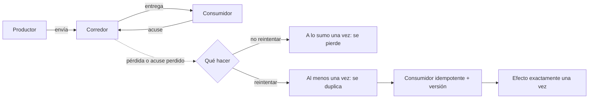

# SE-376 — Entrega, orden, duplicación y semánticas

[← SE-375 — Brokers, colas, topics y logs distribuidos](https://github.com/vladimiracunadev-create/modern-software-engineering-program/blob/main/classes/part-31-integracion-eventos-y-mensajeria/se-375-brokers-colas-topics-y-logs-distribuidos/README.md) · [↑ Parte 31](https://github.com/vladimiracunadev-create/modern-software-engineering-program/blob/main/classes/part-31-integracion-eventos-y-mensajeria/README.md) · [📚 Índice completo](https://github.com/vladimiracunadev-create/modern-software-engineering-program/blob/main/classes/README.md) · [🌐 Portal](https://vladimiracunadev-create.github.io/modern-software-engineering-program/classes/SE-376.html) · [SE-377 — Outbox, inbox, sagas y compensación →](https://github.com/vladimiracunadev-create/modern-software-engineering-program/blob/main/classes/part-31-integracion-eventos-y-mensajeria/se-377-outbox-inbox-sagas-y-compensacion/README.md)

## Punto profesional y fundamento pedagógico

**Punto profesional.** La clase existe para que dejes de pedir «exactamente una vez» como si fuera una propiedad del transporte y lo trates como una propiedad del **efecto**: aprenderás a medir cuántos mensajes se pierden o se duplican bajo cada semántica de entrega, cuántos estados finales equivocados produce el desorden y qué ventana de deduplicación basta, antes de que un consumidor dependa de una garantía que el corredor no da.

**Por qué aparece aquí.** Sigue a **Brokers, colas, topics y logs distribuidos**: ya se eligió por dónde viaja cada mensaje; falta saber qué le puede pasar en el camino y qué debe hacer el consumidor. En la plataforma de entregas, un aviso duplicado molesta, una calificación duplicada cambia una nota y una calificación aplicada en desorden deja el valor equivocado sin error visible.

**Error conceptual que debe corregir.** Creer que «exactamente una vez» existe entre procesos que pueden fallar y perder acuses, o que el orden de llegada es el orden de los hechos. Entre dos procesos y una red solo se puede elegir entre perder y duplicar; el efecto exactamente una vez se construye en el receptor con idempotencia y comparación de versiones.

**Secuencia de aprendizaje.** Antes de leer los resultados, predices cuántos mensajes se pierden si se acusa antes de procesar, cuántos efectos se duplican si se reintenta hasta recibir el acuse y cuántos estados finales quedan mal cuando los mensajes llegan hasta 10 posiciones tarde; después mides los tres casos y comparas con tu predicción. La secuencia usa predicción, explicación propia, contraste y recuperación. [ICAP](https://icap.education.asu.edu/research) distingue participación de construcción de conocimiento; [How People Learn II](https://nap.nationalacademies.org/catalog/24783/how-people-learn-ii-learners-contexts-and-cultures) exige conectar conocimiento previo, contexto y transferencia; la [práctica de recuperación](https://pubmed.ncbi.nlm.nih.gov/16507066/) respalda producir de nuevo la explicación tras una demora; y [Education for Life and Work](https://nap.nationalacademies.org/resource/13398/dbasse_084153.pdf) exige devolución que explique la causa del error.

**Evidencia de aprendizaje.** `semanticas-log.md` con las predicciones, las tres figuras reproducidas, una tabla que asigne a cada consumidor de la plataforma su semántica de entrega, su guarda de orden y su ventana de deduplicación, y una nota que diga qué efecto se vuelve a producir si el mensaje se reentrega.

**Límite de la conclusión.** Las tasas (2 % de pérdida, 5 % de acuses perdidos, 2 % de caídas), el desplazamiento máximo de los mensajes y la distribución de las reentregas (exponencial con media de 60 s y una cola del 1 % hasta seis horas) son supuestos del autor; la red, los acuses y las caídas son un modelo. Solo la tabla de mensajes vistos usa un motor real (SQLite). No se midió ningún corredor: los resultados muestran mecanismos, no la garantía de un producto.

### Trazabilidad fuente → afirmación

| Fuente primaria u oficial | Afirmación que respalda | Lo que no prueba |
|---|---|---|
| [Apache Kafka: semántica de entrega](https://kafka.apache.org/documentation/#semantics) | Distingue a lo sumo una vez, al menos una vez y exactamente una vez, y explica que lo último exige cooperación entre productor, corredor y consumidor. | No garantiza el efecto exactamente una vez en sistemas externos al corredor. |
| [Amazon SQS: colas estándar](https://docs.aws.amazon.com/AWSSimpleQueueService/latest/SQSDeveloperGuide/standard-queues.html) | Documenta una cola con entrega al menos una vez y orden de mejor esfuerzo, por lo que el consumidor debe tolerar duplicados y desorden. | No describe otras colas ni mide la frecuencia de duplicados. |
| [EIP: Idempotent Receiver](https://www.enterpriseintegrationpatterns.com/patterns/messaging/IdempotentReceiver.html) | Describe un receptor que tolera recibir el mismo mensaje varias veces sin repetir su efecto. | No indica cómo guardar los mensajes vistos ni durante cuánto tiempo. |
| [Lamport, «Time, clocks, and the ordering of events in a distributed system» (1978)](https://dl.acm.org/doi/10.1145/359545.359563) | Formaliza que el orden entre eventos de procesos distintos se define por causalidad y no por relojes. | No propone un esquema de versiones para la plataforma de entregas. |
| [Stripe: peticiones idempotentes](https://docs.stripe.com/api/idempotent_requests) | Muestra una clave de idempotencia enviada por el cliente que el servidor recuerda para devolver el mismo resultado a un reintento. | No fija la duración de la ventana para otro servicio. |

## Antes de empezar

Recupera lo aprendido en `SE-373` (los reintentos son necesarios y peligrosos) y en `SE-375` (cada estructura entrega un mensaje de forma distinta). Recupera de la Parte 29 la idea de transacción: guardar la clave de un mensaje visto y el efecto en una sola unidad evita estados intermedios. La pregunta activa es: **si este mensaje llega dos veces, o tarde, ¿qué estado final queda y quién lo sabría?**

## Prerrequisitos

- Haber completado `SE-375` o poder explicar la diferencia entre cola, tópico y log.
- Python 3.11 o posterior con el módulo `sqlite3`; el resto usa solo la biblioteca estándar y generadores con semilla fija.
- Leer una transacción con `INSERT OR IGNORE` y entender una comparación de enteros como versión.

## Problema auténtico

El servicio de calificación recibe `CalificacionPublicada` y actualiza la nota del estudiante. Durante una actualización del corredor, algunos acuses se pierden y el corredor reentrega: unas 30 notas se registran dos veces y el promedio del curso sube. Para corregirlo el equipo cambia a «acusar antes de procesar»; ya no hay duplicados, pero una caída del proceso deja 40 notas sin aplicar y nadie lo nota hasta que un estudiante reclama. Más tarde un corrector sube la nota de 5,0 a 6,0 y vuelve a 5,5: los dos mensajes llegan invertidos y la nota final queda en 6,0. El equipo descubre que tiene tres problemas distintos, la duplicación, la pérdida y el orden, y que arreglar uno con una herramienta pensada para otro empeora los demás.

## Objetivos observables

Al terminar podrás:

1. enunciar las tres semánticas de entrega y medir cuántos mensajes pierde o duplica cada una bajo fallos inyectados;
2. mostrar con una simulación que un consumidor idempotente produce el efecto exactamente una vez sobre una entrega al menos una vez;
3. medir cuántos estados finales quedan equivocados al aplicar mensajes en orden de llegada y cómo lo evita una guarda de versión;
4. calcular qué duplicados deja pasar una ventana de deduplicación de un tamaño dado frente a reentregas con cola larga;
5. escribir la tabla de garantías de cada consumidor de la plataforma con semántica, guarda y ventana.

## Mapa conceptual



El mapa separa la **entrega**, que el transporte decide entre perder y duplicar, del **efecto**, que el consumidor controla. El camino punteado es el momento en que el emisor no sabe si el mensaje llegó.

## Temas y por qué importan

| Tema | Por qué cambia una decisión profesional | Evidencia mínima |
|---|---|---|
| Semánticas de entrega | Elegir perder o duplicar es una decisión de negocio, no de transporte. | Predicción, traza causal y contraejemplo de **Semánticas de entrega** en `semanticas-log.md` |
| Exactamente una vez | Es una propiedad del efecto, construida en el receptor. | Predicción, traza causal y contraejemplo de **Exactamente una vez** en `semanticas-log.md` |
| Orden y causalidad | El orden de llegada no es el de los hechos. | Predicción, traza causal y contraejemplo de **Orden y causalidad** en `semanticas-log.md` |
| Deduplicación y ventanas | Recordar todos los identificadores no escala; recordar pocos deja pasar duplicados. | Predicción, traza causal y contraejemplo de **Deduplicación y ventanas** en `semanticas-log.md` |
| Idempotencia del efecto | Hay operaciones que ya son idempotentes y otras que necesitan una clave. | Predicción, traza causal y contraejemplo de **Idempotencia del efecto** en `semanticas-log.md` |

## Conceptos y decisiones

### 1. Semánticas de entrega

**A lo sumo una vez**: el emisor envía y no reintenta; si el mensaje o el consumidor fallan, el mensaje se pierde, y nunca se duplica. **Al menos una vez**: el emisor reintenta hasta recibir un acuse; no se pierde, pero si se perdió el acuse y no el mensaje, el consumidor lo procesa de nuevo. Que el consumidor acuse **antes** o **después** de procesar define de qué lado cae un fallo del propio consumidor: acusar antes pierde el trabajo si cae, acusar después lo repite. No hay una tercera opción en el transporte: el emisor no puede distinguir «el mensaje no llegó» de «llegó y el acuse se perdió».

### 2. Exactamente una vez

Los productos que prometen «exactamente una vez» lo hacen dentro de un perímetro: combinan identificadores de productor, transacciones del corredor y lectura-proceso-escritura atómica dentro de su propio almacén. Fuera de ese perímetro (un correo enviado, una nota escrita en otra base) la promesa se rompe, porque el efecto externo no participa en la transacción. La forma práctica de lograrlo es **entrega al menos una vez más consumidor idempotente**: el receptor reconoce un mensaje ya aplicado y no repite el efecto. Es un truco del receptor, no una propiedad del canal.

### 3. Orden y causalidad

Los mensajes de un mismo productor pueden llegar permutados por reintentos, particiones o rutas distintas. Lamport mostró que, entre procesos, el orden significativo es la **causalidad** (un hecho que puede haber influido en otro) y que los relojes físicos no lo capturan. En la práctica se resuelve con una **versión o secuencia por entidad** asignada donde se serializan los cambios (la base de datos de origen) y una regla del receptor: aplicar solo si la versión del mensaje es mayor que la guardada. Esa regla no reordena, pero hace que el estado final sea el mismo, llegue como llegue. No sirve si importan los valores intermedios.

### 4. Deduplicación y ventanas

Un receptor idempotente recuerda los identificadores de los mensajes aplicados. Recordarlos para siempre crece sin límite; por eso se usa una **ventana**: se olvida lo anterior a cierto tiempo. La ventana es una apuesta sobre cuánto puede tardar una reentrega, y las reentregas tienen cola larga: la mayoría llega en segundos y unas pocas tras horas (un consumidor caído durante una mañana). Una ventana que cubre «casi todo» deja pasar exactamente los duplicados más difíciles de explicar. La alternativa es una clave de negocio con restricción de unicidad permanente, que no depende del tiempo.

### 5. Idempotencia del efecto

Algunas operaciones son **naturalmente idempotentes**: «poner la nota en 6,0» repetida da el mismo estado, mientras «sumar 0,5 a la nota» no. Convertir una operación no idempotente en idempotente significa cambiar su forma (de incremento a valor final), añadir una clave que el receptor recuerda o condicionarla a una versión. El cliente que reintenta debe reutilizar la misma clave; si genera una nueva en cada intento, la defensa no funciona (`SE-383` lo muestra). Elegir la forma idempotente del efecto es más robusto que confiar en que el canal no duplique.

### Tres semánticas bajo fallos inyectados

Se envían 20 000 mensajes con semilla fija. Cada envío se pierde en la red con probabilidad 0,02; si llega, el consumidor se cae con probabilidad 0,02 y, tras procesar, el acuse se pierde con probabilidad 0,05. En «a lo sumo una vez» el consumidor acusa antes de procesar y el emisor no reintenta; en «al menos una vez» acusa después y el emisor reintenta hasta recibir el acuse; la variante idempotente guarda el identificador y el efecto en una sola transacción de SQLite.

```python
con.execute("begin")
cur = con.execute("insert or ignore into done values(?)", (m,))
if cur.rowcount:
    con.execute("insert into efecto values(?)", (m,))
con.execute("commit")                      # la clave y el efecto, juntos
```

| Semántica | Mensajes perdidos | Efectos duplicados | Efectos totales |
|---|---:|---:|---:|
| A lo sumo una vez | 743 | 0 | 19 257 |
| Al menos una vez | 0 | 1 476 | 21 476 |
| Al menos una vez + consumidor idempotente | 0 | 0 | 20 000 |

El 3,7 % perdido en la primera fila viene de la red (2 %) y de las caídas tras acusar (2 %). La segunda no pierde nada, pero 1 476 efectos son repeticiones (7,4 %): cada intento puede terminar en caída o acuse perdido. La tercera no pierde ni duplica porque el efecto se aplica una sola vez por identificador; el transporte sigue entregando más de una vez, lo que cambió fue el receptor.


**Cómo leer la figura.** Cada grupo es una semántica de entrega; la barra coral cuenta los mensajes perdidos y la dorada, los efectos duplicados. Mira cómo los dos primeros grupos intercambian un defecto por el otro y cómo el tercero no tiene barras: el consumidor idempotente cambia el resultado sin tocar el canal. **Dónde deja de valer:** las probabilidades son del autor y los fallos son independientes; un corredor real también reordena, retiene y reentrega por tiempos de visibilidad. La tabla de mensajes vistos es real (SQLite en memoria), lo demás es un modelo. No prueba que un producto concreto «sea exactamente una vez»: prueba que el receptor idempotente cambia el resultado sin tocar el canal.

### Mensajes que llegan en otro orden

Se generan 500 entradas con 10 versiones cada una (5 000 mensajes). Cada mensaje se retrasa un número aleatorio de posiciones entre 0 y k. Se comparan dos receptores: el que aplica siempre el último que llega y el que aplica un mensaje solo si su versión es mayor que la guardada. Se cuenta cuántas entradas terminan con una versión final distinta de 10.

```python
llegada = sorted(range(len(msgs)), key=lambda i: i + r.uniform(0, k))
a[e] = v                                  # último que llega
if v > b.get(e, 0): b[e] = v              # solo si la versión es mayor
```

| Desplazamiento máximo (posiciones) | Orden de llegada | Guarda de versión |
|---:|---:|---:|
| 0 | 0 | 0 |
| 3 | 135 | 0 |
| 10 | 308 | 0 |
| 50 | 416 | 0 |

Con un desplazamiento de solo 3 posiciones, 135 de las 500 entradas (27 %) terminan con un valor viejo; con 50 son 416 (83 %). La guarda de versión deja cero en todos los casos porque convierte un problema de orden en la comparación de dos enteros. El estado final es correcto aunque se hayan aplicado los mensajes desordenados; las transiciones intermedias, en cambio, no se reconstruyen.


**Cómo leer la figura.** El eje horizontal es el desplazamiento máximo de un mensaje en posiciones y el vertical, las entradas de 500 con valor final equivocado; la línea coral aplica los mensajes en orden de llegada y la verde azulada solo si la versión es mayor. Mira cómo la primera sube con el desorden y se aplana cerca de 416 mientras la segunda se queda en cero. **Dónde deja de valer:** la guarda necesita que alguien asigne versiones monótonas por entidad; si las versiones se generan en procesos distintos sin coordinación, dos mensajes pueden tener la misma o una menor que no refleja la causalidad. Y si el receptor necesita la secuencia completa de cambios (una auditoría), descartar los intermedios no es aceptable.

### Cuánto tiempo recordar los identificadores

Se simula un día de tráfico a 5 mensajes por segundo (432 000 mensajes). El 20 % se reentrega una vez; el retardo de la reentrega es exponencial con media de 60 s y, para el 1 % de ellas, uniforme entre 1 y 6 horas (una caída larga del consumidor). El receptor recuerda cada identificador durante una ventana W; se cuenta cuántas reentregas llegan cuando ya se olvidó el identificador.

```python
d = r.expovariate(1 / 60)
if r.random() < 0.01: d = r.uniform(3600, 21600)
pasa = (t_reentrega - t_original) > W        # el identificador ya se olvidó
```

| Ventana | Duplicados que pasan (de 86 590) | Identificadores guardados |
|---:|---:|---:|
| 10 s | 73 414 | 50 |
| 60 s | 32 388 | 300 |
| 5 min | 1 521 | 1 500 |
| 1 h | 921 | 18 000 |
| 24 h | 0 | 432 000 |

Una ventana de 5 minutos parece generosa para una media de 60 s y aun así deja pasar 1 521 duplicados. Ampliar a una hora reduce el resto a 921, casi todos de la cola larga, y solo la ventana de un día cierra el hueco a cambio de recordar 432 000 identificadores. La relación entre ventana y duplicados no es proporcional: los últimos cientos son los más caros de eliminar.


**Cómo leer la figura.** El eje horizontal es la memoria que cuesta la ventana (identificadores guardados, en escala logarítmica) y el vertical, los duplicados que aún pasan; cada marcador lleva el tamaño de su ventana. Mira cómo comprar memoria baja los duplicados con rendimientos decrecientes y cómo la hora de ventana se queda en 921 por la cola larga de las reentregas. **Dónde deja de valer:** la distribución de reentregas es una invención del autor; con medidas reales de reentregas la ventana adecuada sería otra. Los identificadores se supusieron de tamaño uniforme y la memoria se midió en cuenta, no en bytes. Una clave de negocio única en la base de datos evita la apuesta, a costa de guardar la clave mientras viva la entidad.

## Definiciones de trabajo

- **a lo sumo una vez:** semántica en la que cada mensaje se entrega cero o una vez; puede perderse y no se duplica.
- **al menos una vez:** semántica en la que cada mensaje se entrega una o más veces; no se pierde, pero puede duplicarse.
- **consumidor idempotente:** receptor que, ante un mensaje repetido, no repite el efecto.
- **guarda de versión:** regla que aplica un mensaje solo si su versión es mayor que la ya aplicada a esa entidad.
- **ventana de deduplicación:** periodo durante el cual el receptor recuerda los identificadores de los mensajes aplicados.

Las definiciones son operativas para la plataforma de entregas. No convierten términos con una historia más amplia en sinónimos y deben contrastarse con la documentación primaria enlazada al final.

## Ejemplo mínimo

El fragmento aplica dos veces el mismo mensaje con y sin deduplicación. Antes de ejecutarlo, predice el valor de `suma` en ambos casos.

```python
vistos, suma, suma2 = set(), 0, 0
for m in [("id1", 5), ("id1", 5)]:
    suma2 += m[1]                          # sin deduplicar
    if m[0] in vistos: continue
    vistos.add(m[0]); suma += m[1]
print(suma, suma2)
```

El resultado es `5 10`. Registra versión de Python y salida; después cambia el mensaje a «poner el valor en 5» en lugar de «sumar 5» y comprueba que ya no hace falta recordar nada.

## Ejemplo profesional

El equipo de la plataforma documenta tres consumidores. **Registro de calificaciones:** al menos una vez, acuse tras procesar, tabla `vistos` con clave del mensaje en la misma transacción que el efecto, guarda por versión de la entrega y ventana ilimitada mientras la entrega exista. **Aviso por correo:** al menos una vez con ventana de deduplicación de 24 horas, aceptando que una reentrega más tardía enviará un segundo correo, y guarda del estado «avisado» en la propia entrega. **Estadísticas de uso:** a lo sumo una vez, con la regla de que perder el 0,1 % es aceptable. Para cada consumidor escriben qué ocurre si cae a mitad, si el mensaje llega dos veces y si llega después de uno más nuevo. Antes de dar por buena la ventana de 24 horas miden con el registro de un mes cuántas reentregas pasaron de 24 horas, y las dejan en la bitácora. Compara con el diseño inicial: el promedio ya no se altera por reentregas y la corrección de una nota deja de depender del orden de llegada.

## Práctica guiada

1. Dibuja el camino de un mensaje de calificación y marca dónde puede perderse el mensaje, el acuse y el proceso.
2. Predice cuántos mensajes se pierden con «acusar antes» y cuántos efectos se duplican con «acusar después».
3. Reproduce la tabla de semánticas con las mismas semillas y compara con tu predicción.
4. Aplica los 5 000 mensajes de las 500 entradas en orden de llegada y con guarda de versión con k = 3, 10 y 50.
5. Simula las reentregas con cola larga y calcula los duplicados que pasan con cada ventana.
6. Cambia «sumar 0,5» por «poner la nota en 6,5» y comprueba qué defensa ya no hace falta.
7. Entrega `semanticas-log.md` y pide a otra persona que encuentre el consumidor cuyo efecto no es idempotente.

## Ejercicios

1. **Probabilidad:** con acuse perdido 5 % y caída 2 %, calcula la probabilidad de que un mensaje se procese al menos dos veces y compárala con el 7,4 % medido.
2. **Versiones:** dos servicios asignan versiones a la misma entrega sin coordinarse; construye un caso en que la guarda de versión acepta el mensaje equivocado.
3. **Ventana:** el consumidor de avisos estuvo caído 6 horas; calcula qué ventana habría evitado los correos duplicados y qué costo de memoria tiene a 5 mensajes por segundo.
4. **Forma del efecto:** reescribe «descontar un cupo al inscribir» para que sea idempotente sin tabla de vistos y razona qué estado nuevo necesita.

## Reto verificable

Entrega `semanticas-log.md` con las predicciones, las tres tablas reproducidas con las mismas semillas, la tabla de garantías de los consumidores de la plataforma y la justificación de cada ventana. Se aprueba si otra persona ejecuta el código desde un checkout limpio, obtiene 743 mensajes perdidos, 1 476 duplicados y 308 entradas equivocadas con k = 10, y puede decir qué estado queda si se aplica un mensaje viejo después de uno nuevo. No se aprueba por afirmar que el corredor «garantiza exactamente una vez» ni por una ventana de deduplicación sin medir las reentregas.

## Caso conductor

El flujo de entrega, calificación, aviso y registro de la plataforma es el caso conductor de la Parte 31. Esta clase deja el cuarto artefacto: la tabla de garantías de cada consumidor. `SE-377` pregunta cómo publicar el mensaje de forma atómica con el cambio en la base de datos y cómo coordinar pasos entre servicios. Cambia después una sola decisión, el orden de acuse y proceso del registro de calificaciones, y observa qué defecto aparece y cuál desaparece.

## Preguntas frecuentes

### ¿Existe realmente «exactamente una vez»?

Como propiedad del transporte entre procesos que pueden fallar, no. Existe como propiedad del efecto, lograda con entrega al menos una vez e idempotencia en el receptor, y existe dentro del perímetro de un sistema que controla transacciones de lectura y escritura. Cuando el efecto sale de ese perímetro, hay que garantizarlo con claves.

### ¿Por qué no acusar siempre después de procesar y listo?

Porque acusar después garantiza que no se pierde pero acepta repetir, y repetir tiene un costo si el efecto no es idempotente. La opción correcta depende del efecto: para un contador de visitas, perder alguno es mejor que duplicar; para una calificación, duplicar es peor que perder, siempre que se detecte.

### ¿Un reloj sincronizado resuelve el orden?

No del todo. Dos procesos pueden marcar el mismo instante con resolución insuficiente, los relojes derivan y un retraso de red puede invertir mensajes. Una versión monótona por entidad, asignada en el punto donde se serializan los cambios, es más robusta que cualquier marca de tiempo.

### ¿Cuánto debe durar la ventana de deduplicación?

Lo que la reentrega más tardía razonable más un margen, medido con datos reales de reentregas. Si no puede medirse, es preferible una clave de negocio con restricción de unicidad que no caduca.

## Fallo controlado y diagnóstico

Reproduce el fallo clásico de la clase: **una corrección de nota que se pierde por llegar invertida**. Envía los mensajes «nota 5,0» y «nota 6,0» y luego «nota 5,5» (versiones 1, 2 y 3) con el último adelantado al segundo.

Registra síntoma, entrada mínima, hipótesis, observación que descarta cada hipótesis, causa, corrección y prueba de regresión. **Síntoma:** la nota final de un estudiante es 6,0 y la corrección a 5,5 «no se aplicó». **Hipótesis rivales:** (a) el mensaje de corrección se perdió; (b) el consumidor lo procesó pero lo rechazó por un error; (c) el consumidor lo aplicó antes que el 6,0 y el 6,0 lo sobrescribió. **Prueba:** registra el orden de aplicación con la versión de cada mensaje; si el 5,5 (versión 3) aparece antes que el 6,0 (versión 2), la causa es el desorden. **Conclusión:** el receptor aplica el último que llega. **Regresión:** aplicar solo si la versión es mayor que la guardada, y una prueba que entregue las tres permutaciones y compruebe que el resultado es siempre 5,5. No cambies a la vez la guarda y el corredor.

## Errores comunes y cómo corregirlos

| Síntoma | Causa probable | Corrección |
|---|---|---|
| Notas o avisos duplicados tras un incidente | Entrega al menos una vez con efecto no idempotente | Clave de mensaje o forma idempotente del efecto en una transacción |
| Mensajes que nunca se aplicaron | Se acusó antes de procesar y el proceso cayó | Acusar después de procesar y hacer el efecto idempotente |
| El estado final depende del orden de llegada | Se aplica el último mensaje recibido | Versión por entidad y guarda de versión |
| Duplicados que reaparecen tras horas | Ventana de deduplicación menor que la reentrega más tardía | Medir reentregas o usar una clave de negocio única |
| La defensa de idempotencia no detecta el reintento | El cliente genera una clave nueva en cada intento | Reutilizar la misma clave en todos los reintentos de una operación |

## Entorno y archivos clave

```text
work/SE-376/
├── README.md
├── entrega/
│   ├── semanticas.py
│   ├── orden.py
│   └── ventana.py
├── tests/test_entrega.py
└── evidence/semanticas-log.md
```

El `README` declara plataforma, versión de Python y de SQLite, semillas y comandos. El código de los tres experimentos está en `scripts/experiments_part31_a.py` (funciones `e328_semanticas`, `e328_orden` y `e328_ventana`) y se ejecuta con `python scripts/experiments_part31_a.py`. Solo usa la biblioteca estándar y se ejecutó con CPython 3.12.9 en Windows 11 (SQLite 3.45.3) y 3.12.3 en Ubuntu bajo WSL2 (SQLite 3.45.1): las salidas fueron idénticas. Si añades una dependencia, fija procedencia y versión.

## Seguridad, ética y accesibilidad

- un efecto repetido sobre personas (dos cobros, dos sanciones, dos avisos) es un daño aunque el sistema «funcione»: exige idempotencia antes de activar reintentos;
- una tabla de mensajes vistos guarda identificadores que pueden enlazarse con personas: fija su retención y su acceso (`SE-358`);
- una nota aplicada fuera de orden afecta a una persona sin que nadie lo vea: conserva un historial de versiones que permita explicar por qué la nota es la que es;
- los avisos duplicados pueden saturar a quien usa lectores de pantalla o conexiones limitadas: la deduplicación es también accesibilidad;
- los datos de ensayo son sintéticos y no deben incluir calificaciones reales.

## Puente hacia el trabajo con agentes

Un agente al que se le pide «haz que el consumidor sea fiable» suele añadir reintentos y un `try/except` que acusa siempre, o declara «exactamente una vez» sin mostrar qué tabla de vistos lo respalda. Pídele en cambio que declare la semántica (cuándo acusa), que muestre la clave de idempotencia y que la guarde en la misma transacción que el efecto, que añada la guarda de versión y que escriba una prueba que entregue cada mensaje dos veces y en orden inverso. Revisa especialmente si la clave y el efecto se confirman por separado y si la clave del reintento se regenera: son los dos defectos que esta clase mostró sin aviso.

## Transferencia

Traslada el análisis a otro dominio (por ejemplo, un sistema de reservas con pagos y confirmaciones): cambia los efectos y conserva el procedimiento de elegir perder o duplicar por efecto, buscar la forma idempotente, asignar versión por entidad y medir la ventana con reentregas reales. La transferencia está lograda cuando puedes explicar por qué un efecto tolera duplicados y otro no, no cuando todos los consumidores llevan la misma tabla de vistos.

## Evaluación y evidencia

| Criterio | Evidencia para aprobar |
|---|---|
| comprensión | explicación de las tres semánticas y de por qué exactamente una vez es una propiedad del efecto |
| corrección | tablas de pérdidas, orden y ventana reproducibles con las mismas semillas |
| diseño | tabla de garantías por consumidor con semántica, guarda y ventana |
| diagnóstico | reproducción de la corrección invertida con regresión |
| incertidumbre | declaración de que las tasas y las reentregas son supuestos y no se midió un corredor |
| reproducibilidad | versiones, comandos, salida y límites declarados |

## Fuentes

- [Apache Kafka: semántica de entrega](https://kafka.apache.org/documentation/#semantics) — a lo sumo, al menos y exactamente una vez; autoridad: proyecto Apache Kafka.
- [Amazon SQS: colas estándar](https://docs.aws.amazon.com/AWSSimpleQueueService/latest/SQSDeveloperGuide/standard-queues.html) — entrega al menos una vez y orden de mejor esfuerzo; autoridad: Amazon Web Services.
- [EIP: Idempotent Receiver](https://www.enterpriseintegrationpatterns.com/patterns/messaging/IdempotentReceiver.html) — receptor que tolera mensajes repetidos; autoridad: autores del libro.
- [Lamport, «Time, clocks, and the ordering of events in a distributed system»](https://dl.acm.org/doi/10.1145/359545.359563) — orden causal entre procesos; autoridad: artículo original (Communications of the ACM, 1978; metadatos verificados con Crossref, el editor bloquea las peticiones automáticas).
- [Stripe: peticiones idempotentes](https://docs.stripe.com/api/idempotent_requests) — clave de idempotencia reutilizada en los reintentos; autoridad: documentación oficial de Stripe.

Cada fuente respalda el mecanismo indicado; ninguna demuestra que los 743 mensajes perdidos, los 1 476 duplicados o los 1 521 identificadores olvidados se observen en una plataforma real. Esa afirmación depende de las tasas de fallo, del corredor y de la distribución de las reentregas.

## Límites y siguiente paso

Se ejecutaron tres experimentos con datos sintéticos en Windows y Ubuntu (WSL2) con resultados idénticos. No se usó ningún corredor real ni red: las tasas de pérdida, los acuses, las caídas, el desplazamiento de los mensajes y la distribución de las reentregas son construcciones del autor, y los resultados no se extrapolan a ningún producto. Solo el registro de mensajes vistos usa un motor real. La siguiente clase pregunta cómo publicar un mensaje de forma atómica con el cambio en la base de datos y cómo coordinar varios pasos con compensaciones.

## Glosario

- **a lo sumo una vez:** semántica en la que cada mensaje se entrega cero o una vez; puede perderse y no se duplica.
- **al menos una vez:** semántica en la que cada mensaje se entrega una o más veces; no se pierde, pero puede duplicarse.
- **consumidor idempotente:** receptor que, ante un mensaje repetido, no repite el efecto.
- **guarda de versión:** regla que aplica un mensaje solo si su versión es mayor que la ya aplicada a esa entidad.
- **ventana de deduplicación:** periodo durante el cual el receptor recuerda los identificadores de los mensajes aplicados.

---

[← SE-375 — Brokers, colas, topics y logs distribuidos](https://github.com/vladimiracunadev-create/modern-software-engineering-program/blob/main/classes/part-31-integracion-eventos-y-mensajeria/se-375-brokers-colas-topics-y-logs-distribuidos/README.md) · [↑ Parte 31](https://github.com/vladimiracunadev-create/modern-software-engineering-program/blob/main/classes/part-31-integracion-eventos-y-mensajeria/README.md) · [📚 Índice completo](https://github.com/vladimiracunadev-create/modern-software-engineering-program/blob/main/classes/README.md) · [🌐 Portal](https://vladimiracunadev-create.github.io/modern-software-engineering-program/classes/SE-376.html) · [SE-377 — Outbox, inbox, sagas y compensación →](https://github.com/vladimiracunadev-create/modern-software-engineering-program/blob/main/classes/part-31-integracion-eventos-y-mensajeria/se-377-outbox-inbox-sagas-y-compensacion/README.md)
