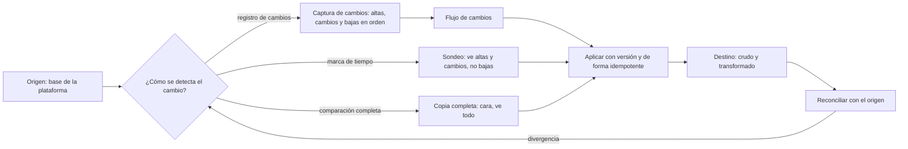
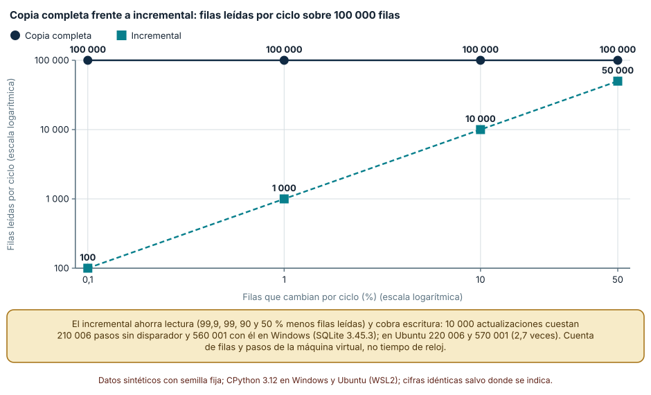
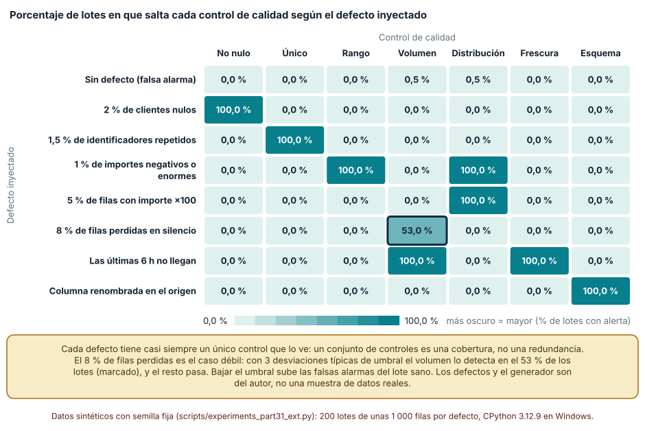

# SE-378 — CDC, ETL, ELT y sincronización

[← SE-377 — Outbox, inbox, sagas y compensación](https://github.com/vladimiracunadev-create/modern-software-engineering-program/blob/main/classes/part-31-integracion-eventos-y-mensajeria/se-377-outbox-inbox-sagas-y-compensacion/README.md) · [↑ Parte 31](https://github.com/vladimiracunadev-create/modern-software-engineering-program/blob/main/classes/part-31-integracion-eventos-y-mensajeria/README.md) · [📚 Índice completo](https://github.com/vladimiracunadev-create/modern-software-engineering-program/blob/main/classes/README.md) · [🌐 Portal](https://vladimiracunadev-create.github.io/modern-software-engineering-program/classes/SE-378.html) · [SE-379 — Webhooks, polling y suscripciones →](https://github.com/vladimiracunadev-create/modern-software-engineering-program/blob/main/classes/part-31-integracion-eventos-y-mensajeria/se-379-webhooks-polling-y-suscripciones/README.md)

## Punto profesional y fundamento pedagógico

**Punto profesional.** La clase existe para que eligas cómo se entera una segunda base de lo que cambió en la primera con criterios medibles y no por costumbre: aprenderás a contar qué filas faltan, cuáles están viejas y cuáles sobran en una réplica según el método de detección, cuánto lee y cuánto escribe cada enfoque, y qué aplica o rompe un flujo de cambios que llega repetido y fuera de orden.

**Por qué aparece aquí.** Sigue a **Outbox, inbox, sagas y compensación**: allí el servicio publicaba mensajes de negocio; aquí se pregunta cómo llevar el **estado** de una base a otra (el portal de reportes, la analítica, un índice de búsqueda) sin que el reporte semanal contradiga a la plataforma. En el flujo de la plataforma de entregas, la analítica necesita las entregas, sus notas y también sus borrados.

**Error conceptual que debe corregir.** Creer que sincronizar es «copiar lo que cambió desde la última vez». Un sondeo por marca de tiempo no ve un borrado, pierde las filas modificadas en el mismo instante que la última marca y trata el orden de llegada como el orden de los hechos; sincronizar bien es elegir un mecanismo que capture altas, cambios y bajas, en orden, y aplicarlos de forma idempotente.

**Secuencia de aprendizaje.** Antes de leer los resultados, predices cuántas filas borradas siguen en la réplica tras sondear por marca de tiempo, cuánto más escribe el origen cuando un disparador registra cada cambio y cuántas claves quedan mal si los cambios se aplican tal como llegan con un 10 % de repetidos tardíos; después mides las tres cosas y comparas con tu predicción. La secuencia usa predicción, explicación propia, contraste y recuperación. [ICAP](https://icap.education.asu.edu/research) distingue participación de construcción de conocimiento; [How People Learn II](https://nap.nationalacademies.org/catalog/24783/how-people-learn-ii-learners-contexts-and-cultures) exige conectar conocimiento previo, contexto y transferencia; la [práctica de recuperación](https://pubmed.ncbi.nlm.nih.gov/16507066/) respalda producir de nuevo la explicación tras una demora; y [Education for Life and Work](https://nap.nationalacademies.org/resource/13398/dbasse_084153.pdf) exige devolución que explique la causa del error.

**Evidencia de aprendizaje.** `sincronizacion-log.md` con las predicciones, las tres figuras reproducidas, una tabla de decisión del mecanismo de sincronización para tres destinos de la plataforma (portal, analítica, búsqueda), el procedimiento de arranque y reconciliación y una nota que diga qué divergencia no detectaría cada mecanismo.

**Límite de la conclusión.** El origen y la réplica son bases SQLite en memoria con datos sintéticos; el ritmo de cinco operaciones por segundo, la resolución de un segundo, el sondeo cada 47 operaciones y los porcentajes de reordenado y duplicado son supuestos del autor. No se usó ningún motor con registro lógico de cambios (PostgreSQL, MySQL), ningún conector real ni almacén analítico: se midieron mecanismos, no el rendimiento ni los retrasos de un producto.

### Trazabilidad fuente → afirmación

| Fuente primaria u oficial | Afirmación que respalda | Lo que no prueba |
|---|---|---|
| [PostgreSQL: decodificación lógica](https://www.postgresql.org/docs/current/logicaldecoding.html) | Describe cómo extraer los cambios de la base a partir de su registro de escritura anticipada, en el orden en que se confirmaron. | No garantiza que los consumidores apliquen los cambios correctamente ni mide su costo. |
| [Debezium: conector de PostgreSQL](https://debezium.io/documentation/reference/stable/connectors/postgresql.html) | Documenta el flujo de captura de cambios con una instantánea inicial seguida de los cambios del registro, con entrega al menos una vez. | No describe cómo se comporta la plataforma de entregas ni sus tasas de cambio. |
| [SQLite: CREATE TRIGGER](https://www.sqlite.org/lang_createtrigger.html) | Define disparadores que se ejecutan en la misma transacción que el cambio que los provoca. | No compara disparadores con captura sobre el registro del motor. |
| [Microsoft: ETL y ELT](https://learn.microsoft.com/en-us/azure/architecture/data-guide/relational-data/etl) | Distingue transformar antes de cargar (ETL) y cargar los datos crudos para transformar en el destino (ELT). | No decide cuál conviene a la analítica de la plataforma. |
| [Kleppmann, «Designing Data-Intensive Applications»](https://dataintensive.net/) | Trata la captura de cambios como forma de mantener sistemas derivados coherentes con el sistema de registro. | No es una especificación de ningún producto. |

## Antes de empezar

Recupera lo aprendido en `SE-376` sobre orden y versiones y en `SE-377` sobre outbox: el outbox publica **eventos de negocio** elegidos por el servicio; la captura de cambios publica **cambios de filas** tal como ocurrieron en la base. Recupera de la Parte 29 qué es una réplica y su retraso. La pregunta activa es: **si el destino se queda atrás o se equivoca, ¿cómo lo sabría y cómo lo corregiría?**

## Prerrequisitos

- Haber completado `SE-377` o poder explicar qué resuelve un outbox.
- Python 3.11 o posterior con el módulo `sqlite3`; el resto usa solo la biblioteca estándar y generadores con semilla fija.
- Leer sentencias `INSERT`, `UPDATE`, `DELETE` y un disparador de SQLite, y entender qué es una marca de tiempo.

## Problema auténtico

El equipo de analítica copia cada noche las entregas a su propia base con una consulta: «traer las filas con `modificado_en` posterior a la última copia». Funciona hasta que los números de notas dejan de cuadrar con el portal: faltan entregas que se modificaron en el mismo segundo de la última lectura, y hay entregas **que ya no existen** en la plataforma y siguen contando en las estadísticas. Para arreglarlo, alguien activa una copia completa cada noche y el origen empieza a tardar más en responder durante el horario de uso. Otro propone transformar los datos antes de cargarlos y, cuando se corrige la regla de cálculo del promedio, descubre que los datos crudos ya no están. Cada problema pertenece a una decisión distinta: cómo detectar el cambio, cuánto copiar y dónde transformar.

## Objetivos observables

Al terminar podrás:

1. medir cuántas filas faltan, están viejas o sobran en una réplica según el método de detección de cambios;
2. comparar la lectura que ahorra una copia incremental con el costo de escritura que añade registrar los cambios;
3. mostrar que aplicar cambios con versión produce la misma réplica aunque lleguen repetidos y desordenados;
4. decidir con criterios entre ETL y ELT y entre captura por disparadores y por registro de la base;
5. escribir un procedimiento de arranque (instantánea y cambios) y de reconciliación entre origen y destino.

## Mapa conceptual



El mapa separa **detectar** de **aplicar**. Los tres métodos de detección alimentan el mismo paso de aplicación, y la reconciliación vuelve al origen para encontrar lo que ninguno vio.

## Temas y por qué importan

| Tema | Por qué cambia una decisión profesional | Evidencia mínima |
|---|---|---|
| Consistencia eventual | Define cuánta diferencia entre origen y destino es aceptable y por cuánto tiempo. | Predicción, traza causal y contraejemplo de **Consistencia eventual** en `sincronizacion-log.md` |
| Detección de cambios | Un método que no ve las bajas deja filas fantasma. | Predicción, traza causal y contraejemplo de **Detección de cambios** en `sincronizacion-log.md` |
| Captura de cambios | Trae altas, cambios y bajas en orden, a costa de operar el mecanismo. | Predicción, traza causal y contraejemplo de **Captura de cambios** en `sincronizacion-log.md` |
| ETL y ELT | Decide si el dato crudo sobrevive para recalcular. | Predicción, traza causal y contraejemplo de **ETL y ELT** en `sincronizacion-log.md` |
| Reconciliación | Es la única defensa contra lo que ningún mecanismo ve. | Predicción, traza causal y contraejemplo de **Reconciliación** en `sincronizacion-log.md` |

## Conceptos y decisiones

### 1. Consistencia eventual

Sincronizar dos bases significa aceptar que durante un tiempo discrepan: el destino converge hacia el origen, no lo refleja al instante. La pregunta de diseño es cuánta diferencia y durante cuánto tiempo es tolerable para cada destino: un tablero de analítica con una hora de retraso es aceptable; un índice de búsqueda que no encuentra la entrega recién subida durante una hora, probablemente no. También hay que decidir cuál es la **fuente de verdad**: ante una discrepancia, el origen gana y el destino se corrige, nunca al revés. Un destino que acepta escrituras propias sobre los mismos datos convierte la sincronización en un problema de conflictos que esta clase no aborda.

### 2. Detección de cambios

Hay cuatro formas de enterarse. **Comparar todo** (copia completa) ve cualquier diferencia pero lee todo el origen en cada ciclo. **Sondear por marca de tiempo** lee solo las filas modificadas después de la última marca, barato y fácil, con tres huecos: no ve las filas borradas (ya no están), pierde las filas modificadas en el mismo instante que la marca si la comparación es estricta (`>`), y depende de que cada escritura actualice la marca (una que la olvide es invisible). **Columnas de versión** resuelven el orden pero no las bajas. El **registro de cambios** captura cada alta, cambio y baja en el orden de confirmación, y es el único de los cuatro que ve las bajas sin ayuda de una lápida.

### 3. Captura de cambios

La **captura de cambios** (CDC) produce un flujo de eventos de fila: «se insertó la fila X», «se actualizó la fila Y de este valor a este», «se borró la fila Z». Puede hacerse con **disparadores** (cada escritura inserta en una tabla de cambios en la misma transacción) o leyendo el **registro de escritura anticipada** del motor, como hacen la decodificación lógica de PostgreSQL y conectores como Debezium. Los disparadores son simples y se ven en el esquema, pero añaden escritura a cada operación; el registro del motor no toca las operaciones y exige permisos y operación del conector. Un flujo de cambios real empieza con una **instantánea** (el estado en un momento dado) seguida de los cambios posteriores a ese momento, y se entrega al menos una vez: el destino debe aplicar de forma idempotente.

### 4. ETL y ELT

En **ETL** los datos se transforman antes de cargarse al destino, de modo que el destino guarda solo el resultado limpio; en **ELT** se cargan crudos y se transforman dentro del destino. ETL ahorra espacio y mantiene fuera del destino lo que no debe estar (datos personales que no hacen falta), pero cualquier error en la transformación obliga a volver a extraer del origen, que quizá ya cambió. ELT conserva el crudo y permite recalcular tras corregir una regla, pero guarda más y sitúa datos sensibles en más lugares. La decisión depende de cuánto cambian las reglas, de qué datos pueden salir del origen y de quién paga el almacenamiento y la privacidad.

### 5. Reconciliación

Ningún mecanismo es infalible: una lápida olvidada, un conector parado dos días o un esquema que cambió sin aviso dejan divergencias. La **reconciliación** compara periódicamente origen y destino con conteos, sumas de control por rangos o muestras, y reporta las diferencias antes de que las encuentre un usuario. Es también la herramienta de arranque y reparación: cuando se detecta una divergencia, se vuelve a tomar una instantánea del rango afectado. Su costo se acota comparando agregados por rango y descendiendo solo donde difieren.

### Qué ve cada método de detección

Se crea un origen SQLite con 10 000 filas, un destino por método y 2 000 operaciones (20 % altas, 70 % cambios, 10 % bajas) a razón de cinco por segundo, con marca de tiempo de resolución de un segundo. Cada 47 operaciones se sincroniza: con marca `>` (estricto), con marca `>=` y con un registro de cambios alimentado por disparadores. Al final se compara cada destino con el origen (10 195 filas).

```python
src.execute("create trigger tu after update of v on t begin "
            "insert into log(id,op,v) values(new.id,'u',new.v); end")
src.execute("create trigger td after delete on t begin "
            "insert into log(id,op,v) values(old.id,'d',null); end")
filas = src.execute("select id,v,ts from t where ts > ?", (marca,))   # o ts >= ?
```

| Método de detección | Filas faltantes | Filas desactualizadas | Filas que debían borrarse |
|---|---:|---:|---:|
| Marca con mayor estricto (`>`) | 11 | 50 | 194 |
| Marca con mayor o igual (`>=`) | 0 | 0 | 194 |
| Registro de cambios con disparadores | 0 | 0 | 0 |

El mayor estricto pierde 61 filas (11 altas y 50 cambios) que se produjeron en el mismo segundo que la última marca vista; `>=` las recupera a cambio de releer la fila límite en cada ciclo. Ninguno de los dos ve las 194 bajas: esas filas siguen en el destino para siempre. Solo el registro de cambios deja la réplica idéntica al origen.


**Cómo leer la figura.** Cada grupo es un método de detección y cada color, un tipo de divergencia entre la réplica y el origen. Mira primero la barra azul oscura de las filas que debían borrarse: sigue en 194 con los dos sondeos porque una fila borrada no devuelve su marca, y solo el registro de cambios la lleva a cero. **Dónde deja de valer:** la marca solo tiene resolución de un segundo y el sondeo ocurre a mitad de segundo por construcción; con una marca de microsegundos y sin cambios simultáneos el estricto perdería menos, pero seguiría sin ver las bajas. Tampoco se midió el retraso de ningún mecanismo ni se probó captura sobre el registro de un motor real.

### Cuánto ahorra y cuánto cobra la copia incremental

Para un origen de 100 000 filas se compara lo que lee una copia completa por ciclo (todas) con lo que lee una incremental (solo los cambios) para cuatro tasas de cambio. El costo de registrar los cambios se mide como pasos de la máquina virtual de SQLite (`set_progress_handler`) al actualizar 10 000 filas con y sin disparador.

```python
con.set_progress_handler(contar, 1)       # cuenta instrucciones de la máquina virtual
for i in range(10_000):
    con.execute("update t set v=v+1 where id=?", (i,))
```

| Cambios por ciclo | Copia completa lee | Incremental lee | Ahorro de lectura |
|---:|---:|---:|---:|
| 0,1 % (100 filas) | 100 000 | 100 | 99,9 % |
| 1 % (1 000 filas) | 100 000 | 1 000 | 99 % |
| 10 % (10 000 filas) | 100 000 | 10 000 | 90 % |
| 50 % (50 000 filas) | 100 000 | 50 000 | 50 % |

El ahorro de lectura es la diferencia directa de filas; la parte medida es el costo en escritura: 10 000 actualizaciones cuestan 210 006 pasos de la máquina virtual sin disparador y 560 001 con él en Windows (SQLite 3.45.3), 2,7 veces más; en Ubuntu (SQLite 3.45.1) son 220 006 y 570 001, con la misma proporción. El origen paga más por cada escritura para que el ciclo de lectura sea barato. Cuando la mitad de las filas cambia en cada ciclo, la copia completa y la incremental se parecen y el disparador solo añade costo.



**Cómo leer la figura.** El eje horizontal es el porcentaje de filas que cambian por ciclo y el vertical, las filas leídas, ambos en escala logarítmica; la línea azul oscura es la copia completa y la verde azulada la incremental. Mira cómo la brecha entre las dos se estrecha con la tasa de cambios y cuánto separa todavía a 50 %: el ahorro es de 99,9, 99, 90 y 50 por ciento. **Dónde deja de valer:** el ahorro por filas no es tiempo ni bytes (filas anchas, índices y red cambian la relación) y los pasos de la máquina virtual de SQLite no son milisegundos; un registro de cambios del motor no añade escritura en las operaciones del mismo modo que un disparador. Ni el costo de operar el conector ni el de la instantánea inicial están incluidos.

### Aplicar cambios repetidos y desordenados

Se genera una historia de 5 000 eventos sobre 50 claves (cada uno con su versión, el 10 % son borrados). Los eventos llegan en cuatro condiciones: en orden, retrasados hasta 20 posiciones, con un 10 % repetido más tarde (hasta 60 posiciones) y ambas cosas. Se comparan dos receptores: el que aplica cada evento tal cual llega y el que aplica un evento solo si su versión supera la guardada para esa clave (incluidos los borrados, que dejan su versión como lápida).

```python
if guard and v <= versiones.get(k, 0): continue
versiones[k] = v
if op == "d": estado.pop(k, None)
else: estado[k] = v
```

| Cómo llegan los eventos | Aplicar sin versión | Aplicar solo si la versión es mayor |
|---|---:|---:|
| En orden y sin repetir | 0 | 0 |
| Reordenado hasta 20 posiciones | 4 | 0 |
| 10 % de duplicados tardíos | 3 | 0 |
| Ambos | 6 | 0 |

Los errores son pocos porque cada clave cambia unas cien veces y solo se nota el último estado, pero no son cero y no avisan: 6 de 50 claves terminan con un valor viejo o con una fila que debía estar borrada. La guarda deja 0 porque ignora todo evento más viejo que lo que ya sabe. Un borrado reordenado antes de un alta anterior habría revivido la fila: por eso la versión del borrado se conserva como lápida.


**Cómo leer la figura.** Cada grupo es una condición de llegada de los eventos; la barra coral aplica los eventos tal cual y la verde azulada solo si la versión es mayor. Mira que la guarda de versión no tiene barra en ninguna condición y que las alteraciones se suman cuando se combinan. **Dónde deja de valer:** el destino es un diccionario, las versiones son enteros asignados en el origen y los eventos de cada clave llegan completos; en un sistema real las versiones salen del registro de la base y los esquemas cambian a mitad del flujo. La figura mide el principio, no la tasa de error de un conector.

### Ampliación: calidad de datos y linaje en un pipeline

Una copia correcta de un origen no garantiza datos correctos: reproduce fielmente lo que el origen tenga, incluidos nulos, duplicados y unidades cambiadas. Un **pipeline de datos** es una cadena de activos (tablas, ficheros, vistas) donde cada uno se deriva de los anteriores, y dos propiedades se vuelven operativas cuando esa cadena crece: la **calidad** (¿este lote cumple lo que sus consumidores suponen?) y el **linaje** (¿de qué depende cada activo y qué depende de él?). Esta clase ya trata cómo mover y reconciliar cambios; esta ampliación trata cómo saber que lo movido es utilizable y a quién avisar cuando no lo es. La Parte 30 del programa, de ingeniería de datos y todavía no publicada al redactar esta ampliación, retoma el tema con almacenes, modelado analítico y gobierno; aquí solo se fija la base.

**Mecanismo: un control es una aserción sobre un lote, y cada aserción ve una dimensión.** Los controles habituales son el de **no nulo** (un campo obligatorio no viene vacío), el de **unicidad** (una clave no se repite), el de **rango** (un valor entra en lo plausible), el de **volumen** (el número de filas no se aleja de lo histórico), el de **distribución** (la media o la forma de una columna no se desplaza), el de **frescura** (la última marca de tiempo no está demasiado atrasada) y el de **esquema** (las columnas y tipos son los esperados). Herramientas como [Great Expectations](https://greatexpectations.io/) o las [pruebas de dbt](https://docs.getdbt.com/docs/build/data-tests) los expresan como código versionado junto al pipeline. Los de fila (nulo, unicidad, rango) se evalúan sobre cada registro; los de lote (volumen, distribución, frescura) comparan el lote entero con una referencia, y esa referencia y su umbral son parámetros con consecuencia: un umbral estrecho produce falsas alarmas y uno ancho deja pasar defectos.

**Causa: los defectos de datos son silenciosos.** Un servicio con error devuelve un fallo; un pipeline con un defecto devuelve cifras plausibles. Una columna cuyo importe pasó de euros a céntimos no rompe ninguna consulta: sube el ingreso del día un 495 % y alguien lo descubre en un tablero. Por eso los controles se diseñan a partir de los defectos que se quieren poder ver, no de los que se saben escribir.

**Experimento reproducible.** `scripts/experiments_part31_ext.py` genera, con semilla 330, lotes de unas 1 000 filas de pedidos (importe lognormal, marcas de tiempo en 24 h), inyecta un defecto por lote y mide en qué porcentaje de 200 lotes salta cada control. El volumen y la media del importe se comparan con 50 lotes sanos distintos, con un umbral de 3 desviaciones típicas; la frescura exige que la última marca esté a menos de 2 h del cierre del lote.

| Defecto inyectado | No nulo | Único | Rango | Volumen | Distribución | Frescura | Esquema |
|---|---:|---:|---:|---:|---:|---:|---:|
| Ninguno (falsa alarma) | 0 % | 0 % | 0 % | 0,5 % | 0,5 % | 0 % | 0 % |
| 2 % de claves de cliente nulas | 100 % | 0 % | 0 % | 0 % | 0 % | 0 % | 0 % |
| 1,5 % de identificadores repetidos | 0 % | 100 % | 0 % | 0 % | 0 % | 0 % | 0 % |
| 1 % de importes negativos o enormes | 0 % | 0 % | 100 % | 0 % | 100 % | 0 % | 0 % |
| 5 % de filas con importe ×100 | 0 % | 0 % | 0 % | 0 % | 100 % | 0 % | 0 % |
| 8 % de filas perdidas en silencio | 0 % | 0 % | 0 % | 53 % | 0 % | 0 % | 0 % |
| Las últimas 6 h no llegan | 0 % | 0 % | 0 % | 100 % | 0 % | 100 % | 0 % |
| Columna renombrada en el origen | 0 % | 0 % | 0 % | 0 % | 0 % | 0 % | 100 % |



**Cómo leer la figura.** Cada fila es un defecto y cada columna un control; el tono es el porcentaje de lotes con alerta. Mira que casi cada fila tiene una sola celda oscura: los controles no son redundantes, son cobertura, y quitar uno deja un defecto sin dueño. La celda marcada es la débil: perder el 8 % de las filas supera el umbral de volumen solo la mitad de las veces. **Dónde deja de valer:** los defectos, sus tasas y el generador son del autor; en datos reales las distribuciones tienen estacionalidad (un lunes no se parece a un domingo) y un umbral fijo de 3 desviaciones se vuelve inadecuado sin una referencia por día de la semana; que un control salte no dice cuál es la causa.

**Linaje: de qué depende cada activo.** El **linaje** es el registro de qué entradas produjeron cada activo. Se captura de dos formas: declarado (el equipo describe las dependencias) o extraído (se lee de las consultas o de los eventos de ejecución, como hace el estándar abierto [OpenLineage](https://openlineage.io/)). Puede ser **de tabla** (el activo B se deriva del A) o **de columna** (la columna `ingreso` de B se deriva de `importe` y `tasa`). La diferencia importa cuando algo cambia: con linaje de tabla, cualquier cambio en el origen señala a todo lo que está aguas abajo; con linaje de columna, solo a lo que usa esa columna. El experimento usa un grafo de 9 activos derivados de 3 orígenes:

| Cambio en el origen | Activos marcados con linaje de tabla | Activos marcados con linaje de columna |
|---|---:|---:|
| `raw_orders.importe` | 7 | 6 |
| `raw_orders.fecha` | 7 | 4 |
| `raw_customers.email` | 4 | 1 |
| `raw_fx.tasa` | 6 | 5 |

Con linaje de tabla, cambiar el correo de clientes alerta a 4 activos cuando solo 1 lo usa; con linaje de columna se avisa a quien corresponde y el resto no aprende a ignorar las alertas. El coste es que el linaje de columna exige analizar las consultas, y las expresiones dinámicas o las funciones opacas lo dejan incompleto: un linaje que omite una dependencia es peor que uno sobrado, porque da seguridad que no existe.

**Límite y decisión.** El experimento no mide una plataforma real ni el coste de mantener los controles. La decisión práctica: partir de los defectos que dañarían a los consumidores, elegir el control que ve cada uno y comprobar con un lote inyectado que salta (la prueba negativa de la seguridad aplicada a datos); poner las alertas en el activo que genera el defecto, no en el tablero donde se descubre; y registrar el linaje al menos de columna en los activos que alimentan decisiones. Los almacenes, los contratos de datos y el gobierno del dato quedan para la Parte 30.

## Definiciones de trabajo

- **captura de cambios (CDC):** mecanismo que produce un flujo ordenado de altas, cambios y bajas de filas de una base de datos.
- **instantánea:** copia consistente del estado en un momento dado, punto de partida de un flujo de cambios.
- **ETL:** modelo en el que los datos se extraen, se transforman y luego se cargan al destino.
- **ELT:** modelo en el que los datos se extraen, se cargan crudos y se transforman dentro del destino.
- **lápida:** registro de que una clave fue borrada, con su versión, que impide que un cambio anterior la reviva.

Las definiciones son operativas para la plataforma de entregas. No convierten términos con una historia más amplia en sinónimos y deben contrastarse con la documentación primaria enlazada al final.

## Ejemplo mínimo

El fragmento muestra que sondear por marca no ve un borrado. Antes de ejecutarlo, predice qué contiene el destino al final.

```python
import sqlite3
o = sqlite3.connect(":memory:"); o.execute("create table t(id int primary key, ts int)")
o.executemany("insert into t values(?,?)", [(1, 1), (2, 1)])
destino = {i for (i,) in o.execute("select id from t where ts > 0")}
o.execute("delete from t where id = 2")
destino |= {i for (i,) in o.execute("select id from t where ts > 0")}
print(sorted(destino), [i for (i,) in o.execute("select id from t")])
```

El destino conserva `[1, 2]` y el origen `[1]`. Registra versión de Python y de SQLite y salida; después añade un disparador de borrado que escriba en una tabla de cambios y aplícalo al destino.

## Ejemplo profesional

El equipo de la plataforma decide por destino. **Portal de reportes:** consulta una vista del propio origen, sin copia, porque tolera la carga y necesita el valor actual. **Analítica:** captura de cambios sobre el registro de la base con instantánea inicial, carga cruda (ELT) en una zona sin datos de contacto y transformación posterior, con la versión de cada fila como guarda; el flujo se aplica de forma idempotente y se descarta cualquier cambio con versión menor. **Búsqueda de entregas:** los eventos de negocio del outbox de `SE-377`, porque solo le interesan los cambios con significado de negocio. Cada día una tarea de reconciliación compara el conteo y la suma de control de las notas por curso entre origen y analítica, y reporta cualquier diferencia con el rango afectado. Antes de activar el flujo, miden en un entorno de ensayo cuánto escribe el origen más con el mecanismo elegido y lo dejan registrado. Compara con la copia nocturna: ya no hay filas fantasma por bajas, el recálculo de promedios no exige volver a extraer y el retraso del tablero se mide en minutos.

## Práctica guiada

1. Dibuja el origen y los tres destinos de la plataforma y escribe qué retraso tolera cada uno.
2. Predice cuántas filas borradas quedan en un destino sincronizado por marca de tiempo y escribe el número.
3. Reproduce la tabla de detección con las mismas semillas y compara con tu predicción.
4. Mide los pasos de la máquina virtual de 10 000 actualizaciones con y sin disparador en tu equipo.
5. Aplica 5 000 eventos desordenados y repetidos con y sin guarda de versión.
6. Escribe el procedimiento de arranque (instantánea, punto de corte, cambios posteriores) y el de reconciliación por rangos.
7. Entrega `sincronizacion-log.md` y pide a otra persona que busque una divergencia que tu reconciliación no detectaría.

## Ejercicios

1. **Detección:** una tabla tiene `modificado_en` pero un proceso antiguo actualiza notas con SQL directo sin tocarlo; explica qué filas serían invisibles y cómo lo detectarías.
2. **Costo:** con 200 000 filas y un 4 % de cambios por ciclo, calcula el ahorro de lectura y estima cuántos ciclos al día compensan un disparador que triplica el costo de escritura.
3. **ETL o ELT:** el informe pasa a calcular el promedio ponderado con una regla nueva; razona qué ocurre con cada modelo y qué dato personal habría en el destino con ELT.
4. **Reconciliación:** diseña una comparación por rangos de identificador con suma de control para 1 000 000 de filas y calcula cuántas consultas hacen falta si difieren 3 filas.

## Reto verificable

Entrega `sincronizacion-log.md` con las predicciones, las tres tablas reproducidas con las mismas semillas, la decisión por destino, el procedimiento de arranque y la reconciliación. Se aprueba si otra persona ejecuta el código desde un checkout limpio, obtiene 194 filas que debían borrarse con la marca de tiempo, 0 con el registro de cambios y 6 claves erróneas sin guarda de versión, y puede decir qué divergencia no vería tu reconciliación. No se aprueba por afirmar que «la copia es incremental» sin contar las bajas ni por una reconciliación que solo compara conteos.

## Caso conductor

El flujo de entrega, calificación, aviso y registro de la plataforma es el caso conductor de la Parte 31. Esta clase deja el sexto artefacto: el mecanismo de sincronización de cada destino con su procedimiento de arranque y reconciliación. `SE-379` pregunta cómo avisarse entre sistemas de organizaciones distintas: webhooks, sondeo y suscripciones. Cambia después una sola decisión, la marca `>` por `>=`, y observa qué divergencia desaparece y cuál queda.

## Preguntas frecuentes

### ¿CDC y outbox son lo mismo?

No. El outbox publica eventos de negocio que el servicio decide; la captura de cambios publica cambios de filas tal como ocurren en la base. Se pueden combinar: algunos conectores leen la tabla outbox desde el registro de la base. La captura es genérica y expone el esquema interno; el outbox expone un contrato elegido.

### ¿Cuándo basta con una copia completa?

Cuando el volumen es pequeño, el origen aguanta la lectura y la tolerancia al retraso es de horas. Su gran ventaja es la simplicidad y que ve cualquier diferencia, incluidas las bajas. Pasa a ser un problema cuando la lectura compite con el uso normal.

### ¿Los disparadores son una mala idea?

No necesariamente: son sencillos, se prueban y viven con el esquema. Su costo es la escritura adicional en cada operación y que alguien puede deshabilitarlos o saltárselos. Para volúmenes altos o bases con muchos escritores suele preferirse leer el registro del motor.

### ¿Qué hago con un esquema que cambia en el origen?

Una columna nueva debe llegar al destino de forma compatible (`SE-380`); una columna eliminada o de tipo distinto puede romper la carga. La reconciliación detecta la deriva y un ensayo de la migración contra el flujo de cambios debería formar parte de su procedimiento (`SE-354`).

## Fallo controlado y diagnóstico

Reproduce el fallo clásico de la clase: **filas fantasma por sincronizar solo altas y cambios**. Sincroniza el destino por marca de tiempo y borra filas en el origen.

Registra síntoma, entrada mínima, hipótesis, observación que descarta cada hipótesis, causa, corrección y prueba de regresión. **Síntoma:** el total de entregas de analítica supera al de la plataforma y no se reconoce qué entregas sobran. **Hipótesis rivales:** (a) entregas duplicadas por una carga repetida; (b) entregas de otro curso mal asignadas; (c) entregas borradas en el origen que el destino nunca eliminó. **Prueba:** busca en el destino identificadores que no existan en el origen; si todos los sobrantes tienen un identificador ausente en el origen, la causa es la falta de bajas. **Conclusión:** el sondeo por marca no puede ver los borrados. **Regresión:** pasar a registro de cambios o a lápidas, aplicar bajas en el destino y una prueba que borre filas y compruebe que el destino queda igual al origen. No cambies a la vez el mecanismo y la reconciliación.

## Errores comunes y cómo corregirlos

| Síntoma | Causa probable | Corrección |
|---|---|---|
| El destino tiene filas que ya no existen en el origen | La detección por marca no ve las bajas | Registro de cambios o lápidas con borrado lógico |
| Faltan filas modificadas en el último segundo | Comparación estricta con la última marca | Comparar con mayor o igual y aplicar de forma idempotente |
| El origen tarda más al escribir | Un disparador por cada operación | Medir el costo; leer el registro del motor si es alto |
| Un cambio antiguo reaparece en el destino | Se aplicó fuera de orden sin guarda | Versión por fila y regla de aplicar solo si es mayor |
| No se puede recalcular tras corregir una regla | ETL sin conservar el dato crudo | ELT, o conservar el dato crudo en una zona controlada |

## Entorno y archivos clave

```text
work/SE-378/
├── README.md
├── sincronizacion/
│   ├── deteccion.py
│   ├── costo.py
│   └── aplicar.py
├── tests/test_sincronizacion.py
└── evidence/sincronizacion-log.md
```

El `README` declara plataforma, versión de Python y de SQLite, semillas y comandos. El código de los tres experimentos está en `scripts/experiments_part31_a.py` (funciones `e330_cambios`, `e330_costo` y `e330_orden`) y se ejecuta con `python scripts/experiments_part31_a.py`. Solo usa la biblioteca estándar y se ejecutó con CPython 3.12.9 en Windows 11 (SQLite 3.45.3) y 3.12.3 en Ubuntu bajo WSL2 (SQLite 3.45.1): las salidas fueron idénticas salvo los pasos de la máquina virtual de SQLite, que difirieron un 5 % o menos entre las dos versiones del motor con la misma proporción. Si añades una dependencia, fija procedencia y versión.

## Seguridad, ética y accesibilidad

- el destino de la sincronización suele tener un perfil de acceso más amplio (analistas, herramientas): copia solo los campos necesarios y no lleves datos de contacto si no hacen falta;
- un borrado en el origen (por una solicitud de supresión) debe llegar al destino y a sus copias crudas: la sincronización de bajas es un requisito de privacidad (`SE-358`);
- una divergencia en notas o estados que alimenta informes puede afectar decisiones sobre personas: reconcilia antes de publicar cifras;
- documenta el flujo de datos con una descripción en texto además del diagrama, para que cualquiera pueda revisarlo;
- los datos de ensayo son sintéticos; no uses una copia real de la plataforma para probar la captura.

## Puente hacia el trabajo con agentes

Un agente al que se le pide «sincroniza estas dos bases» suele escribir una consulta por `updated_at` con comparación estricta y un `upsert`, sin tratar los borrados, el empate de marcas ni el orden. Pídele en cambio que enumere los tipos de cambio (alta, cambio, baja), que justifique el mecanismo de detección, que aplique con una guarda de versión y que incluya una prueba que borre filas, repita eventos y los desordene. Revisa especialmente si trata las bajas y si la comparación de marcas es estricta: son los dos defectos que esta clase mostró sin aviso.

## Transferencia

Traslada el análisis a otro dominio (por ejemplo, un inventario con un almacén y una tienda en línea): cambia las tablas y conserva el procedimiento de preguntar si el método ve las bajas, medir el costo de registrar cambios, aplicar con versión y reconciliar por rangos. La transferencia está lograda cuando puedes decir qué divergencia deja pasar tu mecanismo, no cuando el destino «parece igual».

## Evaluación y evidencia

| Criterio | Evidencia para aprobar |
|---|---|
| comprensión | explicación de por qué la marca de tiempo no ve bajas y qué ve la captura de cambios |
| corrección | tablas de detección, costo y orden reproducibles con las mismas semillas |
| diseño | decisión por destino, arranque y reconciliación documentados |
| diagnóstico | reproducción de las filas fantasma con regresión |
| incertidumbre | declaración de que son bases en memoria y de que las tasas son supuestos |
| reproducibilidad | versiones, comandos, salida y límites declarados |

## Fuentes

- [PostgreSQL: decodificación lógica](https://www.postgresql.org/docs/current/logicaldecoding.html) — extracción de cambios desde el registro de escritura anticipada; autoridad: documentación oficial de PostgreSQL.
- [Debezium: conector de PostgreSQL](https://debezium.io/documentation/reference/stable/connectors/postgresql.html) — instantánea y flujo de cambios con entrega al menos una vez; autoridad: proyecto Debezium.
- [SQLite: CREATE TRIGGER](https://www.sqlite.org/lang_createtrigger.html) — disparadores en la misma transacción; autoridad: documentación oficial de SQLite.
- [Microsoft: ETL y ELT](https://learn.microsoft.com/en-us/azure/architecture/data-guide/relational-data/etl) — transformar antes o después de cargar; autoridad: documentación de Microsoft.
- [Kleppmann, «Designing Data-Intensive Applications»](https://dataintensive.net/) — captura de cambios y sistemas derivados; autoridad: autor del libro.

Cada fuente respalda el mecanismo indicado; ninguna demuestra que las 194 bajas perdidas, el factor 2,7 de escritura o las 6 claves erróneas se observen en una plataforma real. Esa afirmación depende del motor, de la tasa de cambios y del mecanismo de captura de cada despliegue.

- [Great Expectations](https://greatexpectations.io/) y [dbt: pruebas de datos](https://docs.getdbt.com/docs/build/data-tests) — controles de calidad expresados como aserciones versionadas sobre un lote o una tabla; autoridad: documentación de los proyectos.
- [OpenLineage](https://openlineage.io/) — estándar abierto para registrar eventos de linaje de trabajos y conjuntos de datos; autoridad: proyecto OpenLineage (Linux Foundation AI & Data).

## Límites y siguiente paso

Se ejecutaron tres experimentos con datos sintéticos en Windows y Ubuntu (WSL2) con resultados idénticos salvo los pasos de la máquina virtual. No se usó ningún motor con registro lógico, conector, almacén analítico ni red: el ritmo de operaciones, la resolución de la marca, los porcentajes de reordenado y duplicado y las tasas de cambio son construcciones del autor, y los resultados no se extrapolan a ningún producto. La siguiente clase pregunta cómo se avisan sistemas de organizaciones distintas: webhooks, sondeo y suscripciones. La ampliación sobre calidad y linaje usa un generador sintético con semilla 330 y un grafo de nueve activos escrito por el autor, ejecutados con CPython 3.12.9 en Windows; no se ejecutó Great Expectations, dbt ni OpenLineage.

## Glosario

- **captura de cambios (CDC):** mecanismo que produce un flujo ordenado de altas, cambios y bajas de filas de una base de datos.
- **instantánea:** copia consistente del estado en un momento dado, punto de partida de un flujo de cambios.
- **ETL:** modelo en el que los datos se extraen, se transforman y luego se cargan al destino.
- **ELT:** modelo en el que los datos se extraen, se cargan crudos y se transforman dentro del destino.
- **lápida:** registro de que una clave fue borrada, con su versión, que impide que un cambio anterior la reviva.

---

[← SE-377 — Outbox, inbox, sagas y compensación](https://github.com/vladimiracunadev-create/modern-software-engineering-program/blob/main/classes/part-31-integracion-eventos-y-mensajeria/se-377-outbox-inbox-sagas-y-compensacion/README.md) · [↑ Parte 31](https://github.com/vladimiracunadev-create/modern-software-engineering-program/blob/main/classes/part-31-integracion-eventos-y-mensajeria/README.md) · [📚 Índice completo](https://github.com/vladimiracunadev-create/modern-software-engineering-program/blob/main/classes/README.md) · [🌐 Portal](https://vladimiracunadev-create.github.io/modern-software-engineering-program/classes/SE-378.html) · [SE-379 — Webhooks, polling y suscripciones →](https://github.com/vladimiracunadev-create/modern-software-engineering-program/blob/main/classes/part-31-integracion-eventos-y-mensajeria/se-379-webhooks-polling-y-suscripciones/README.md)
