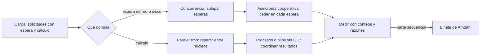
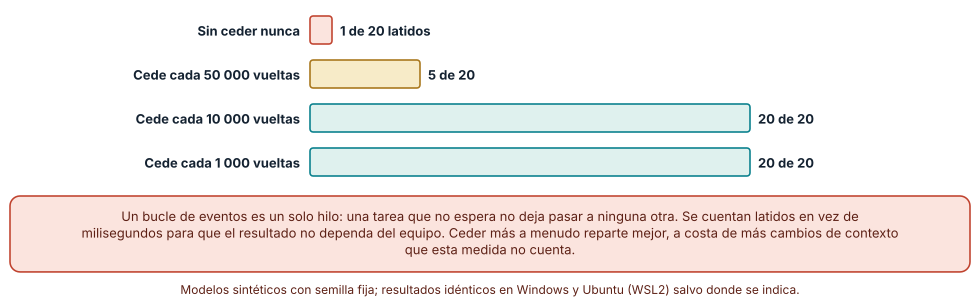
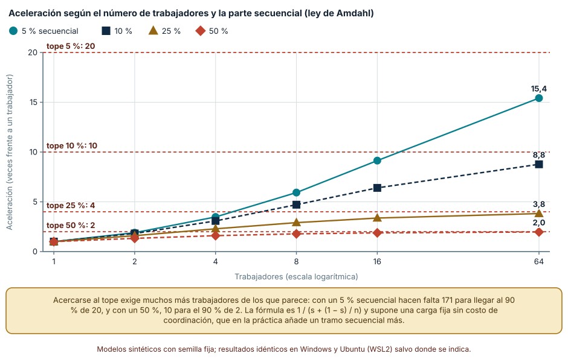

# SE-385 — Concurrencia, paralelismo y asincronía

[← SE-384 — Proyecto: flujo integrado tolerante a reintentos](https://github.com/vladimiracunadev-create/modern-software-engineering-program/blob/main/classes/part-31-integracion-eventos-y-mensajeria/se-384-proyecto-flujo-integrado-tolerante-a-reintentos/README.md) · [↑ Parte 32](https://github.com/vladimiracunadev-create/modern-software-engineering-program/blob/main/classes/part-32-concurrencia-y-sistemas-distribuidos/README.md) · [📚 Índice completo](https://github.com/vladimiracunadev-create/modern-software-engineering-program/blob/main/classes/README.md) · [🌐 Portal](https://vladimiracunadev-create.github.io/modern-software-engineering-program/classes/SE-385.html) · [SE-386 — Memoria compartida, locks y condiciones de carrera →](https://github.com/vladimiracunadev-create/modern-software-engineering-program/blob/main/classes/part-32-concurrencia-y-sistemas-distribuidos/se-386-memoria-compartida-locks-y-condiciones-de-carrera/README.md)

## Punto profesional y fundamento pedagógico

**Punto profesional.** La clase existe para que distingas tres ideas que se usan como sinónimos y resuelven problemas distintos: la concurrencia (varias cosas en curso a la vez), el paralelismo (varias cosas ejecutándose a la vez en hardware distinto) y la asincronía (un modo de escribir programas que esperan sin ocupar un hilo), y para que decidas cuál necesita un servicio antes de pagar su costo en complejidad.

**Por qué aparece aquí.** Abre la **Parte 32** después de **Proyecto: flujo integrado tolerante a reintentos**: la Parte 31 hizo que los servicios de la plataforma de entregas se hablen por mensajes y toleren reintentos; ahora hay que entender qué ocurre dentro de cada proceso y entre procesos cuando muchas solicitudes llegan a la vez. El caso conductor de la parte es el cierre de plazo de una tarea: cientos de estudiantes entregan en los últimos minutos y el servicio de entregas debe seguir correcto, rápido y diagnosticable.

**Error conceptual que debe corregir.** Creer que «más hilos» o «async» acelera cualquier cosa: solapar esperas ayuda cuando hay espera, repartir cálculo ayuda cuando hay cálculo, y ninguna de las dos cosas ayuda a la parte del trabajo que debe ejecutarse en orden.

**Secuencia de aprendizaje.** Antes de leer los resultados, predices cuánto tarda atender 200 solicitudes de 10 ms de CPU y 90 ms de espera de forma secuencial, concurrente y paralela; después cuentas cuántos latidos de salud alcanza a emitir un servicio mientras otra tarea calcula sin ceder el turno, y calculas cuántos trabajadores harían falta para acercarse al límite de aceleración con un 5 % de trabajo secuencial. La secuencia usa predicción, explicación propia, contraste y recuperación. [ICAP](https://icap.education.asu.edu/research) distingue participación de construcción de conocimiento; [How People Learn II](https://nap.nationalacademies.org/catalog/24783/how-people-learn-ii-learners-contexts-and-cultures) exige conectar conocimiento previo, contexto y transferencia; la [práctica de recuperación](https://pubmed.ncbi.nlm.nih.gov/16507066/) respalda producir de nuevo la explicación tras una demora; y [Education for Life and Work](https://nap.nationalacademies.org/resource/13398/dbasse_084153.pdf) exige devolución que explique la causa del error.

**Evidencia de aprendizaje.** `concurrencia-log.md` con la predicción, las tres figuras reproducidas, una clasificación de las tareas del servicio de entregas en «espera» y «cálculo», y una nota que diga cuál de las tres técnicas (asincronía, hilos, procesos) aplicarías a cada una y por qué.

**Límite de la conclusión.** Los tiempos son de un planificador en tiempo virtual escrito por el autor y los latidos son un conteo de turnos de un bucle de eventos real; no se midió ningún servidor, ningún sistema operativo ni la escalabilidad real de hilos y procesos de CPython. Las cifras muestran mecanismos, no rendimiento de producción.

### Trazabilidad fuente → afirmación

| Fuente primaria u oficial | Afirmación que respalda | Lo que no prueba |
|---|---|---|
| [Python: asyncio](https://docs.python.org/3/library/asyncio.html) | Describe el bucle de eventos de un solo hilo y las corrutinas que ceden el control con `await`. | No mide cuánto rinde un servicio concreto con asyncio. |
| [Python: modo de depuración y bloqueos de asyncio](https://docs.python.org/3/library/asyncio-dev.html) | Advierte que el código bloqueante dentro del bucle retrasa a todas las demás tareas y explica cómo detectarlo. | No cuantifica el retraso en un programa real. |
| [Python: glosario, bloqueo global del intérprete](https://docs.python.org/3/glossary.html) | Define el GIL: solo un hilo ejecuta bytecode de Python a la vez en el intérprete estándar. | No dice cuánto afecta a una carga concreta ni cubre otras implementaciones. |
| [Amdahl, «Validity of the single processor approach to achieving large scale computing capabilities» (1967)](https://doi.org/10.1145/1465482.1465560) | Origen del argumento de que la parte secuencial limita la aceleración alcanzable con más procesadores. | No incluye el costo de coordinar a los trabajadores. |
| [Pike, «Concurrency is not parallelism»](https://go.dev/blog/waza-talk) | Formula la distinción entre estructurar un programa en partes independientes y ejecutarlas a la vez. | Es una charla divulgativa; no demuestra los números de esta clase. |

## Antes de empezar

Recupera lo aprendido en la Parte 31 sobre reintentos y mensajería: un mensaje puede llegar dos veces y una operación puede quedarse a medias. La pregunta activa es: **¿qué trabajo del servicio de entregas espera, qué trabajo calcula y qué parte debe ocurrir en orden?** Sin esa clasificación, añadir hilos o `async` es adivinar.

## Prerrequisitos

- Haber completado `SE-384` o poder explicar qué garantías de reintento ofrecía el flujo integrado.
- Python 3.11 o posterior; los experimentos usan solo la biblioteca estándar (`asyncio`, `heapq`).
- Leer funciones `async def`, `await` y bucles `for` en Python.

## Problema auténtico

El plazo de una tarea termina a las 23:59 y entre las 23:50 y las 23:59 llegan trescientas entregas. Cada una guarda un archivo, consulta el estado del curso en otro servicio y envía un acuse. El equipo instaló primero un servidor que atiende una solicitud por vez: a las 23:57 la cola ya tiene dos minutos de retraso. Alguien propuso «usar async» y otra persona «subir a cuatro hilos»; ambas propuestas se discutieron con argumentos de fe. Además, cuando se introdujo un cálculo de similitud para detectar copias, la comprobación de salud del balanceador empezó a fallar aunque el servicio estaba «arriba»: el cálculo no cedía nunca el turno. La clase convierte la discusión en mediciones sobre un modelo explícito.

## Objetivos observables

Al terminar podrás:

1. distinguir concurrencia, paralelismo y asincronía con un ejemplo y un contraejemplo de la plataforma;
2. predecir cuánto cambia el tiempo total de un lote de solicitudes según la parte de espera y la de cálculo, y según los núcleos;
3. explicar por qué una tarea que no cede el turno detiene a todas las demás en un bucle de eventos y repartir el cálculo en trozos;
4. calcular el límite de aceleración de una carga con una parte secuencial y cuántos trabajadores justifican;
5. decidir, para cada tarea de un servicio, si necesita asincronía, hilos o procesos, y qué evidencia lo demuestra.

## Mapa conceptual



El mapa parte de lo que domina la carga. La espera se resuelve con **concurrencia**: mientras una solicitud espera, otra avanza. El cálculo se resuelve con **paralelismo**: más núcleos hacen más cálculo. La **asincronía cooperativa** es una forma de lograr concurrencia con un solo hilo, a cambio de que cada tarea ceda el control. Y todo acaba chocando con la parte que no puede dividirse.

## Temas y por qué importan

| Tema | Por qué cambia una decisión profesional | Evidencia mínima |
|---|---|---|
| Concurrencia y paralelismo | Elegir mal significa pagar complejidad sin ganar tiempo. | Predicción, traza causal y contraejemplo de **Concurrencia y paralelismo** en `concurrencia-log.md` |
| Espera frente a cálculo | La misma herramienta ayuda a una y no a la otra. | Predicción, traza causal y contraejemplo de **Espera frente a cálculo** en `concurrencia-log.md` |
| Asincronía cooperativa | Una sola tarea que no cede detiene el servicio entero. | Predicción, traza causal y contraejemplo de **Asincronía cooperativa** en `concurrencia-log.md` |
| Hilos, procesos y el GIL | Determina si el cálculo se reparte y cuánto cuesta comunicarlo. | Predicción, traza causal y contraejemplo de **Hilos, procesos y el GIL** en `concurrencia-log.md` |
| Límite de Amdahl | Acota cuánto se puede ganar antes de escribir una línea. | Predicción, traza causal y contraejemplo de **Límite de Amdahl** en `concurrencia-log.md` |

## Conceptos y decisiones

### 1. Concurrencia y paralelismo

La **concurrencia** es una propiedad de la estructura de un programa: varias tareas están en curso, cada una puede avanzar sin esperar a que otra termine. El **paralelismo** es una propiedad de la ejecución: dos tareas avanzan en el mismo instante porque hay dos unidades de cálculo. Un programa puede ser concurrente sin ser paralelo (un solo núcleo que alterna entre tareas) y puede ser paralelo sin ser concurrente en sentido interesante (cuatro núcleos que ejecutan cuatro copias independientes de lo mismo). La distinción importa porque cada una tiene un costo distinto: la concurrencia exige razonar sobre intercalaciones y estado compartido (`SE-386`), el paralelismo exige repartir datos y reunir resultados. Pike lo resume como estructurar frente a ejecutar; la clase lo vuelve medible: un mismo lote de solicitudes se ejecuta en cuatro modelos y se compara el tiempo.

### 2. Espera frente a cálculo

Una solicitud de la plataforma pasa tiempo esperando (red, disco, otro servicio) y tiempo calculando (validar, comprimir, comparar). Mientras espera no usa el procesador; solaparla con otras solicitudes es casi gratis. Mientras calcula ocupa un núcleo; solaparla con otra no ayuda, solo repartirla entre núcleos. La proporción decide todo: con 10 ms de cálculo y 90 de espera, un núcleo bien aprovechado puede atender casi diez veces más solicitudes que uno que espera bloqueado; con 100 ms de cálculo y nada de espera, solo más núcleos ayudan. Un servicio real mezcla ambas cosas y cambia con la hora y la carga, por eso la primera tarea técnica es medir cuánto de cada solicitud es espera.

### 3. Asincronía cooperativa

En `asyncio` un solo hilo ejecuta un bucle de eventos; cada corrutina corre hasta el siguiente `await` y entrega el control al bucle, que elige otra lista para continuar. Es concurrencia sin intercalaciones arbitrarias: dos corrutinas solo se alternan en puntos de `await`, lo que elimina muchas carreras de la clase siguiente. El precio es la **cooperación**: si una corrutina calcula durante cuatrocientos milisegundos sin `await`, las demás, incluido el latido de salud, esperan. La asincronía no hace el cálculo más rápido ni usa más núcleos; hace barata la espera. Por eso conviene para servicios con mucha entrada y salida y por eso un cálculo pesado dentro del bucle es un defecto que no falla una prueba pequeña y sí falla en producción.

### 4. Hilos, procesos y el GIL

Un hilo comparte la memoria del proceso; un proceso tiene la suya y se comunica copiando o compartiendo explícitamente. En el CPython estándar, el bloqueo global del intérprete (GIL) permite que un solo hilo ejecute bytecode de Python a la vez: los hilos sirven para solapar esperas de entrada y salida (el GIL se libera al esperar) y no aceleran un cálculo de Python puro. Para repartir cálculo entre núcleos se usan procesos (`multiprocessing`, `concurrent.futures.ProcessPoolExecutor`), pagando el costo de iniciarlos y de serializar los datos que viajan entre ellos, o bibliotecas que liberan el GIL en código nativo. Esta clase no mide esos costos porque dependen del equipo y de la versión; la documentación de Python es la referencia y la medición de tu carga, la evidencia. Lo que sí queda claro es la regla de decisión: espera, asincronía o hilos; cálculo, procesos o código nativo.

### 5. Límite de Amdahl

Si una fracción *s* del trabajo es secuencial, repartir el resto entre *n* trabajadores da una aceleración de `1 / (s + (1 − s) / n)`. Con *n* tendiendo a infinito el tope es `1 / s`: con un 5 % secuencial, 20 veces, no más. La fórmula supone una carga de tamaño fijo y trabajadores sin costo de coordinación; en la práctica coordinar añade un tramo secuencial, y por eso el límite real es más bajo. Su valor profesional es de decisión previa: antes de comprar núcleos o reescribir en paralelo, mide qué parte de la solicitud no puede dividirse (escribir en una cola única, serializar con un cerrojo, esperar a un servicio único) porque ella fija el tope.

### Tres modelos de ejecución para un mismo lote

Se simulan 200 solicitudes con un planificador en tiempo virtual. Cada solicitud tiene una parte de CPU y una de espera; el modelo secuencial las ejecuta una tras otra, el concurrente solapa las esperas sobre uno o cuatro núcleos y el paralelo con espera bloqueante ocupa un núcleo también mientras espera.

```python
def makespan(n, cpu, wait, cores, mode):
    if mode == "seq":
        return n * (cpu + wait)
    free = [0.0] * cores; heapq.heapify(free); end = 0.0
    for _ in range(n):
        t = heapq.heappop(free)
        busy = cpu if mode == "conc" else cpu + wait   # bloquear ocupa el núcleo durante la espera
        heapq.heappush(free, t + busy); end = max(end, t + cpu + wait)
    return end
```

| Modelo | 10 ms CPU + 90 de espera | 90 + 10 | 100 + 0 |
|---|---:|---:|---:|
| Secuencial | 20 000 ms | 20 000 ms | 20 000 ms |
| Concurrente, un núcleo | 2 090 (×9,57) | 18 010 (×1,11) | 20 000 (×1,00) |
| Paralelo de 4 núcleos con espera bloqueante | 5 000 (×4,00) | 5 000 (×4,00) | 5 000 (×4,00) |
| Concurrente y 4 núcleos | 590 (×33,90) | 4 510 (×4,43) | 5 000 (×4,00) |

Para un servicio dominado por la espera, un solo núcleo concurrente supera a cuatro núcleos que bloquean; para uno dominado por cálculo, la concurrencia no aporta nada y solo importan los núcleos. Combinados, ganan siempre, pero la ganancia extra de la combinación depende de la proporción.


**Cómo leer la figura.** Cada grupo de barras es una proporción entre cálculo y espera y cada color un modelo de ejecución; la altura es el tiempo total en escala logarítmica (cada marca es diez veces la anterior), de modo que una barra a la mitad de otra se lee como un factor, no como una resta. Mira primero la barra gris, el modelo secuencial, y compara cuánto baja cada color en cada grupo: la concurrencia de un núcleo cae mucho en el primer grupo y nada en el último, el paralelismo cae igual en los tres y la combinación gana en el primero. **Dónde deja de valer:** el planificador es un modelo del autor: no incluye el costo de cambiar de contexto, de coordinar ni de la memoria compartida, y supone que las esperas se solapan sin límite (en un servicio real hay un tope de conexiones). Sirve para decidir *qué tipo* de ayuda necesita la carga, no para predecir milisegundos.

### El bucle que no cede el turno

Dos tareas comparten el bucle de eventos de `asyncio`: un latido de salud que emite 20 veces y cede, y un cálculo de 200 000 vueltas. Se cuenta cuántos latidos se alcanzan a emitir antes de que el cálculo termine, según cada cuántas vueltas el cálculo cede el turno con `await asyncio.sleep(0)`.

```python
async def work():
    total = 0
    for i in range(200_000):
        total += i * i
        if chunk and i % chunk == 0:
            await asyncio.sleep(0)      # cede el turno al resto de tareas
    log.append("W")
```

| El cálculo cede cada… | Latidos emitidos antes de que termine |
|---|---:|
| nunca | 1 de 20 |
| 50 000 vueltas | 5 de 20 |
| 10 000 vueltas | 20 de 20 |
| 1 000 vueltas | 20 de 20 |

Sin ceder, el latido solo alcanza a salir una vez antes del cálculo completo: durante todo ese tramo el servicio parece muerto aunque está ocupado. Ceder cada 10 000 vueltas ya reparte el turno de forma equitativa; ceder más a menudo no mejora este indicador y añade cambios de contexto que el conteo no mide.



**Cómo leer la figura.** Cada barra es una configuración del cálculo y su longitud los latidos emitidos de 20 posibles. **Dónde deja de valer:** se cuentan turnos del bucle y no milisegundos, a propósito, para que el resultado no dependa del equipo; en un servicio real el retraso del latido es el tiempo de cálculo sin ceder, que puede ser de segundos. La solución de trocear no sirve para un único cálculo indivisible de una función nativa: ahí el cálculo va a un proceso o a un hilo aparte.

### Cuántos trabajadores justifica una parte secuencial

Se calcula la ley de Amdahl para cuatro fracciones secuenciales y cinco tamaños de grupo, y cuántos trabajadores harían falta para alcanzar el 90 % del tope.

```python
for s in (0.05, 0.10, 0.25, 0.50):
    row = [1 / (s + (1 - s) / n) for n in (2, 4, 8, 16, 64)]
    need = next(n for n in range(1, 10_000) if 1 / (s + (1 - s) / n) >= 0.9 / s)
```

| Parte secuencial | 2 | 4 | 8 | 16 | 64 | Tope | Trabajadores para el 90 % del tope |
|---|---:|---:|---:|---:|---:|---:|---:|
| 5 % | 1,90 | 3,48 | 5,93 | 9,14 | 15,42 | 20 | 171 |
| 10 % | 1,82 | 3,08 | 4,71 | 6,40 | 8,77 | 10 | 81 |
| 25 % | 1,60 | 2,29 | 2,91 | 3,37 | 3,82 | 4 | 28 |
| 50 % | 1,33 | 1,60 | 1,78 | 1,88 | 1,97 | 2 | 10 |

Pasar de 8 a 64 trabajadores con un 25 % secuencial mejora la aceleración de 2,91 a 3,82: ocho veces el hardware para un 31 % más de velocidad. La decisión útil no es «paralelizar» sino «reducir la parte secuencial»: bajar del 25 % al 10 % vale más que quintuplicar los núcleos.



**Cómo leer la figura.** El eje horizontal es el número de trabajadores (escala logarítmica) y el vertical la aceleración frente a un solo trabajador; cada línea es una fracción secuencial y la línea punteada horizontal de su color es su tope teórico. Mira cómo cada curva sube y se aplana contra su tope: cuanto mayor la parte secuencial, antes se aplana y más bajo queda el techo. **Dónde deja de valer:** la fórmula supone una carga fija y coordinación gratuita. Si la carga crece con los trabajadores (más estudiantes con más servidores) el razonamiento correcto es otro, el de Gustafson, que esta clase no desarrolla; y la coordinación real (cerrojos, copias, esperas de red) se comporta como un tramo secuencial adicional.

## Definiciones de trabajo

- **concurrencia:** propiedad de un programa en el que varias tareas están en curso y pueden avanzar de forma independiente, haya o no ejecución simultánea.
- **paralelismo:** ejecución simultánea de varias tareas en unidades de cálculo distintas.
- **corrutina:** función que puede suspenderse en un `await` y reanudarse después, gestionada por un bucle de eventos.
- **GIL (bloqueo global del intérprete):** mecanismo del CPython estándar que permite ejecutar bytecode de Python en un solo hilo a la vez.
- **ley de Amdahl:** relación que acota la aceleración de una carga por la fracción que no puede dividirse.

Las definiciones son operativas para la plataforma de entregas. No convierten términos con una historia más amplia en sinónimos y deben contrastarse con la documentación primaria enlazada al final.

## Ejemplo mínimo

El fragmento muestra que una tarea que no cede el turno bloquea a otra. Antes de ejecutarlo, predice qué orden tendrá la lista `log`.

```python
import asyncio
log = []
async def vecina():
    log.append("vecina"); await asyncio.sleep(0); log.append("vecina2")
async def egoista():
    log.append("egoista"); sum(i for i in range(10**6)); log.append("egoista2")
async def main():
    await asyncio.gather(egoista(), vecina())
asyncio.run(main())
assert log == ["egoista", "egoista2", "vecina", "vecina2"]
```

`vecina` no corre hasta que `egoista` termina, porque `egoista` nunca cede. Registra versión de Python, comando y salida; después añade `await asyncio.sleep(0)` dentro del cálculo y observa que las líneas se intercalan.

## Ejemplo profesional

El equipo del servicio de entregas clasifica sus tareas en una tabla antes de tocar el código: guardar el archivo (espera de disco), consultar el estado del curso (espera de red), calcular la similitud contra entregas anteriores (cálculo de 300 ms) y enviar el acuse (espera de red). Las tres esperas pasan a corrutinas con un límite de 50 conexiones simultáneas. El cálculo de similitud no se trocea dentro del bucle: se envía a un grupo de procesos de tamaño igual al número de núcleos menos uno, y el servicio sigue respondiendo mientras tanto. El latido de salud sale de una tarea propia que no comparte código con el cálculo. Cada decisión queda en `concurrencia-log.md` con la medida que la respalda; el equipo declara además qué no midió: el costo de enviar cada entrega a un proceso.

## Práctica guiada

1. Lista las tareas del servicio de entregas y clasifícalas en «espera de red», «espera de disco» y «cálculo», con una estimación de milisegundos.
2. Predice el tiempo total de 200 solicitudes de 10 ms de CPU y 90 de espera en modo secuencial, concurrente y paralelo bloqueante; escribe los números.
3. Ejecuta el planificador en tiempo virtual y compara con tu predicción; explica la diferencia mayor.
4. Reproduce el bucle que no cede y mide los latidos con trozos de 50 000, 10 000 y 1 000 vueltas.
5. Calcula la ley de Amdahl para el servicio con la fracción secuencial que estimaste y decide cuántos núcleos justifica.
6. Redacta la regla de decisión para tu servicio: qué va a corrutinas, qué a hilos y qué a procesos.
7. Entrega `concurrencia-log.md` y pide a otra persona que encuentre la tarea que clasificó mal.

## Ejercicios

1. **Predicción:** con 50 ms de CPU y 50 de espera, ¿qué factor da el modelo concurrente de un núcleo? Calcula primero y comprueba con el código.
2. **Contraejemplo:** diseña una carga en la que cuatro hilos que esperan sean más lentos que una sola corrutina y explica por qué.
3. **Límite:** si el 15 % de una solicitud es una escritura serializada, ¿cuál es el tope de aceleración? ¿Cuántos trabajadores dan el 80 % del tope?
4. **Diagnóstico:** el latido de salud falla solo cuando llega una entrega con un archivo de más de 20 MB. Formula tres hipótesis y la observación que descarta cada una.

## Reto verificable

Entrega `concurrencia-log.md` con la predicción, las tres tablas de resultados, la clasificación de tareas y la regla de decisión. Se aprueba si otra persona ejecuta el código desde un checkout limpio, obtiene los mismos números y puede decir qué tarea del servicio iría a un proceso y por qué. No se aprueba por afirmar que «async es más rápido» sin separar espera de cálculo ni por dar un tiempo medido en un equipo sin declarar la proporción.

## Caso conductor

La plataforma de entregas en el cierre de plazo es el caso conductor de la Parte 32. Esta clase deja el primer artefacto: la clasificación de tareas por espera y cálculo y la regla de decisión. `SE-386` mostrará qué ocurre cuando dos de esas tareas concurrentes escriben el mismo dato. Cambia después una sola proporción, la de espera, y observa qué decisión de la regla se invierte.

## Preguntas frecuentes

### ¿Async es más rápido que los hilos?

No en sí mismo. Ambos solapan esperas; la ventaja de `async` es el costo por tarea: miles de corrutinas caben donde miles de hilos serían caros, y no hay intercalaciones arbitrarias entre `await`. Para cálculo de Python puro ninguno acelera.

### ¿Por qué los hilos de Python «no sirven»?

Sirven para esperar entrada y salida, porque el GIL se libera mientras se espera. No aceleran un cálculo de Python puro porque solo un hilo ejecuta bytecode a la vez. La documentación del glosario define el GIL y las versiones recientes de Python trabajan en variantes sin él, por lo que conviene verificar la versión que usas.

### ¿Más núcleos siempre significan más rendimiento?

Solo para la parte divisible y solo si el costo de repartir es menor que la ganancia. Con un 25 % secuencial, 64 núcleos dan menos de 4 veces; con coordinación costosa, pueden dar menos que 8.

### ¿Cómo sé si mi servicio está limitado por espera o por cálculo?

Mide el tiempo de reloj de pared frente al tiempo de CPU de una solicitud: si el segundo es una fracción pequeña del primero, domina la espera. Un perfilador por corrutina o los avisos del modo de depuración de `asyncio` señalan los bloqueos del bucle.

## Fallo controlado y diagnóstico

Reproduce el fallo clásico de la clase: **un cálculo sin `await` detiene el bucle de eventos y el balanceador declara muerto un servicio sano**. Ejecuta el cálculo de 200 000 vueltas sin ceder junto a un latido de 20 emisiones.

Registra síntoma, entrada mínima, hipótesis, observación que descarta cada hipótesis, causa, corrección y prueba de regresión. **Síntoma:** la comprobación de salud falla durante unos segundos tras llegar ciertas entregas y se recupera sola. **Hipótesis rivales:** (a) red inestable entre el balanceador y el servicio; (b) falta de memoria que reinicia el proceso; (c) una tarea que ocupa el bucle de eventos sin ceder. **Prueba:** registra los instantes de los latidos y de inicio y fin del cálculo; si los latidos se detienen exactamente mientras dura el cálculo y reaparecen al terminar, la causa es el bucle ocupado. **Conclusión:** el cálculo no cede el turno. **Regresión:** mueve el cálculo a un proceso o trocéalo con `await`, añade una prueba que lance el cálculo y compruebe que el latido emite al menos una vez cada 10 000 vueltas, y activa el modo de depuración en pruebas para que avise de tareas que bloquean. No arregles a la vez el cálculo y la configuración del balanceador.

## Errores comunes y cómo corregirlos

| Síntoma | Causa probable | Corrección |
|---|---|---|
| El servicio «async» no mejora con carga de cálculo | El cálculo corre dentro del bucle de eventos | Enviarlo a un proceso o a un ejecutor |
| El latido de salud se detiene a ratos | Una corrutina calcula sin `await` | Trocear con `await` o sacar el cálculo del bucle |
| Cuatro hilos no aceleran un cálculo de Python | El GIL permite un solo hilo de bytecode | Usar procesos o código nativo que libere el GIL |
| Se añadieron 64 núcleos y la ganancia es mínima | Una fracción secuencial fija el tope | Medir la fracción y reducirla antes de repartir |
| Las pruebas de carga pasan y producción se atasca | La prueba no tenía la proporción de espera real | Medir espera y cálculo con datos del servicio |

## Entorno y archivos clave

```text
work/SE-385/
├── README.md
├── modelo/
│   ├── planificador.py
│   ├── bucle_que_no_cede.py
│   └── amdahl.py
├── tests/test_concurrencia.py
└── evidence/concurrencia-log.md
```

El `README` declara plataforma, versión de Python, semillas (este experimento no usa aleatoriedad) y comandos. Los experimentos usan solo la biblioteca estándar (`asyncio`, `heapq`) y se ejecutaron con CPython 3.12.9 en Windows 11 y 3.12.3 en Ubuntu bajo WSL2: las salidas fueron idénticas. Si añades una dependencia, fija procedencia y versión.

## Seguridad, ética y accesibilidad

- una cola sin límite o un grupo de hilos sin tope son una vía de agotamiento de recursos: define un límite de conexiones y de tareas pendientes;
- un cálculo costoso expuesto a entradas de personas externas puede usarse para ocupar el servicio; limita tamaño y tiempo;
- los datos de las entregas son de estudiantes: los ejemplos usan solo nombres y archivos sintéticos;
- documenta la clasificación de tareas en una tabla de texto que un lector de pantalla pueda recorrer, además del diagrama;
- respeta las licencias de las charlas y artículos citados y atribuye lo adaptado.

## Puente hacia el trabajo con agentes

Un agente al que se le pide «hazlo concurrente para que aguante el cierre de plazo» tenderá a envolver todo en `async` o a añadir un grupo de hilos sin preguntar qué espera y qué calcula. Pídele en cambio que clasifique cada tarea en espera o cálculo, que declare cuál es la fracción secuencial y que incluya una prueba que compruebe que el latido de salud sigue emitiendo mientras corre el cálculo más pesado. Revisa especialmente si dejó un cálculo dentro del bucle de eventos y si añadió un límite de tareas: son los dos defectos que esta clase mostró sin aviso.

## Transferencia

Traslada el análisis a otro dominio (por ejemplo, un servicio de reportes que consulta tres bases y genera un PDF): cambia las tareas y conserva el procedimiento de clasificar espera y cálculo, elegir el modelo, medir con conteos y calcular el tope de aceleración. La transferencia está lograda cuando puedes explicar qué se solapa, qué se reparte y qué no se puede dividir, no cuando el código se parece.

## Evaluación y evidencia

| Criterio | Evidencia para aprobar |
|---|---|
| comprensión | explicación de concurrencia, paralelismo y asincronía con ejemplos de la plataforma |
| corrección | tiempos virtuales, latidos y tabla de Amdahl reproducibles |
| diseño | clasificación de tareas y regla de decisión justificada |
| diagnóstico | reproducción del fallo «bucle bloqueado» con regresión |
| incertidumbre | declaración de que no se midió escalabilidad real de hilos ni procesos |
| reproducibilidad | versiones, comandos, salida y límites declarados |

## Fuentes

- [Python: asyncio](https://docs.python.org/3/library/asyncio.html) — bucle de eventos y corrutinas; autoridad: documentación de Python.
- [Python: desarrollo con asyncio](https://docs.python.org/3/library/asyncio-dev.html) — modo de depuración y código bloqueante; autoridad: documentación de Python.
- [Python: glosario](https://docs.python.org/3/glossary.html) — definición del bloqueo global del intérprete; autoridad: documentación de Python.
- [Python: concurrent.futures](https://docs.python.org/3/library/concurrent.futures.html) — ejecutores de hilos y procesos; autoridad: documentación de Python.
- [Amdahl, «Validity of the single processor approach…»](https://doi.org/10.1145/1465482.1465560) — límite de aceleración; autoridad: artículo original (1967).
- [Pike, «Concurrency is not parallelism»](https://go.dev/blog/waza-talk) — distinción entre estructura y ejecución; autoridad: autor de la charla.

Cada fuente respalda el mecanismo indicado; ninguna demuestra que los 2 090 ms, los cinco latidos o el factor 15,42 se observen en un servicio real de una plataforma educativa. Esa afirmación depende de la proporción de espera, de la versión de Python y del hardware.

## Límites y siguiente paso

Se ejecutaron tres experimentos deterministas en Windows y Ubuntu (WSL2) con resultados idénticos. No se midió ningún servidor, ningún sistema operativo ni la escalabilidad real de hilos y procesos: el planificador, la proporción de espera y el cálculo de 200 000 vueltas son construcciones del autor, y los resultados no se extrapolan a una carga de producción. La siguiente clase baja un nivel: qué pasa cuando dos de esas tareas concurrentes tocan el mismo dato.

## Glosario

- **concurrencia:** propiedad de un programa en el que varias tareas están en curso y pueden avanzar de forma independiente, haya o no ejecución simultánea.
- **paralelismo:** ejecución simultánea de varias tareas en unidades de cálculo distintas.
- **corrutina:** función que puede suspenderse en un `await` y reanudarse después, gestionada por un bucle de eventos.
- **GIL (bloqueo global del intérprete):** mecanismo del CPython estándar que permite ejecutar bytecode de Python en un solo hilo a la vez.
- **ley de Amdahl:** relación que acota la aceleración de una carga por la fracción que no puede dividirse.

---

[← SE-384 — Proyecto: flujo integrado tolerante a reintentos](https://github.com/vladimiracunadev-create/modern-software-engineering-program/blob/main/classes/part-31-integracion-eventos-y-mensajeria/se-384-proyecto-flujo-integrado-tolerante-a-reintentos/README.md) · [↑ Parte 32](https://github.com/vladimiracunadev-create/modern-software-engineering-program/blob/main/classes/part-32-concurrencia-y-sistemas-distribuidos/README.md) · [📚 Índice completo](https://github.com/vladimiracunadev-create/modern-software-engineering-program/blob/main/classes/README.md) · [🌐 Portal](https://vladimiracunadev-create.github.io/modern-software-engineering-program/classes/SE-385.html) · [SE-386 — Memoria compartida, locks y condiciones de carrera →](https://github.com/vladimiracunadev-create/modern-software-engineering-program/blob/main/classes/part-32-concurrencia-y-sistemas-distribuidos/se-386-memoria-compartida-locks-y-condiciones-de-carrera/README.md)
