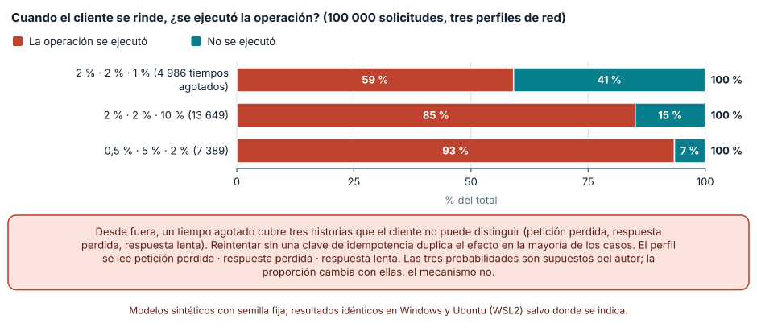
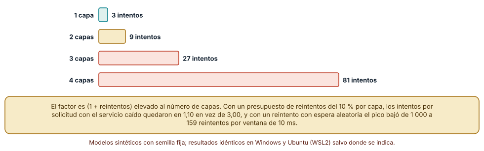
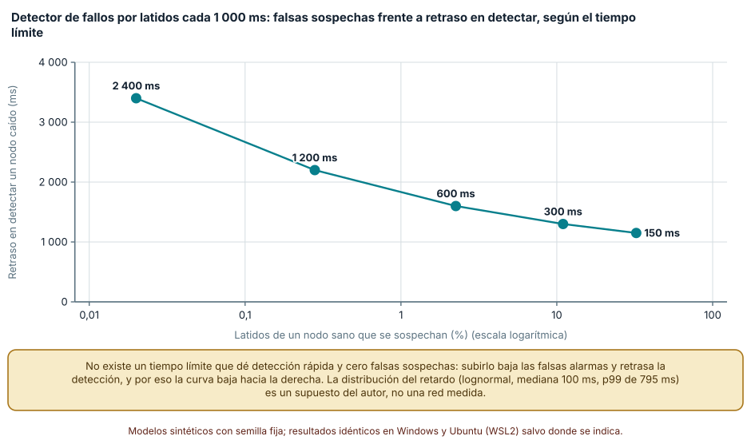

# SE-389 — Fallos parciales y modelos de red

[← SE-388 — Tiempo, relojes y orden parcial](https://github.com/vladimiracunadev-create/modern-software-engineering-program/blob/main/classes/part-32-concurrencia-y-sistemas-distribuidos/se-388-tiempo-relojes-y-orden-parcial/README.md) · [↑ Parte 32](https://github.com/vladimiracunadev-create/modern-software-engineering-program/blob/main/classes/part-32-concurrencia-y-sistemas-distribuidos/README.md) · [📚 Índice completo](https://github.com/vladimiracunadev-create/modern-software-engineering-program/blob/main/classes/README.md) · [🌐 Portal](https://vladimiracunadev-create.github.io/modern-software-engineering-program/classes/SE-389.html) · [SE-390 — Consistencia, disponibilidad y particiones →](https://github.com/vladimiracunadev-create/modern-software-engineering-program/blob/main/classes/part-32-concurrencia-y-sistemas-distribuidos/se-390-consistencia-disponibilidad-y-particiones/README.md)

## Punto profesional y fundamento pedagógico

**Punto profesional.** La clase existe para que dejes de leer un tiempo agotado como un «no funcionó» y aprendas a razonar con la incertidumbre que introduce una red: una operación pudo ejecutarse, perderse o estar en camino, y desde fuera no se distingue. De ahí salen decisiones concretas: cuánto reintentar, quién reintenta, cómo evitar que los reintentos tumben al servicio que ya sufre y cuánta espera es sensata para declarar que un nodo falló.

**Por qué aparece aquí.** Sigue a **Tiempo, relojes y orden parcial**: allí faltaba un reloj común; aquí falta la certeza de que un mensaje llegó. En el caso conductor, el servicio de entregas llama al servicio de calificaciones y, a veces, la llamada no responde: el estudiante ya entregó, ¿se registró la entrega o no?

**Error conceptual que debe corregir.** Creer que una llamada que no responde «falló»: puede haberse ejecutado por completo y haberse perdido la respuesta, y reintentarla sin cuidado duplica el efecto.

**Secuencia de aprendizaje.** Antes de leer los resultados, predices qué fracción de los tiempos agotados corresponde a operaciones que sí se ejecutaron; después calculas cuántos intentos recibe el servicio final cuando cada capa reintenta, y mides cuántas falsas sospechas y cuánto retraso de detección da cada tiempo límite de un detector de fallos. La secuencia usa predicción, explicación propia, contraste y recuperación. [ICAP](https://icap.education.asu.edu/research) distingue participación de construcción de conocimiento; [How People Learn II](https://nap.nationalacademies.org/catalog/24783/how-people-learn-ii-learners-contexts-and-cultures) exige conectar conocimiento previo, contexto y transferencia; la [práctica de recuperación](https://pubmed.ncbi.nlm.nih.gov/16507066/) respalda producir de nuevo la explicación tras una demora; y [Education for Life and Work](https://nap.nationalacademies.org/resource/13398/dbasse_084153.pdf) exige devolución que explique la causa del error.

**Evidencia de aprendizaje.** `fallos-log.md` con la predicción, las tres figuras reproducidas, el modelo de fallos que asume el servicio de entregas, la política de reintentos (quién, cuántas veces, con qué presupuesto) y la regla de detección de nodos caídos con su tiempo límite justificado.

**Límite de la conclusión.** Las probabilidades de pérdida, de lentitud y la distribución lognormal del retardo son supuestos del autor con semilla fija; no se midió ninguna red, servicio ni tiempo de respuesta real. Las cifras muestran la forma del problema, no su tamaño en producción.

### Trazabilidad fuente → afirmación

| Fuente primaria u oficial | Afirmación que respalda | Lo que no prueba |
|---|---|---|
| [Fischer, Lynch y Paterson, «Impossibility of distributed consensus with one faulty process» (1985)](https://doi.org/10.1145/3149.214121) | En un sistema asíncrono no se puede distinguir un proceso muy lento de uno caído, lo que impide cierto tipo de acuerdo determinista. | No dice cómo se comportan las redes reales con tiempos de respuesta acotados en la práctica. |
| [Chandra y Toueg, «Unreliable failure detectors for reliable distributed systems» (1996)](https://doi.org/10.1145/226643.226647) | Formaliza los detectores de fallos que se equivocan y las propiedades de completitud y exactitud que ofrecen. | No indica qué tiempo límite usar en un servicio concreto. |
| [AWS Builders' Library: timeouts, reintentos y retroceso con jitter](https://aws.amazon.com/builders-library/timeouts-retries-and-backoff-with-jitter/) | Describe la amplificación de los reintentos, el retroceso exponencial y el jitter para evitar sincronizar a los clientes. | Es la experiencia de una empresa; no mide el sistema de esta plataforma. |
| [Google SRE: cómo abordar fallos en cascada](https://sre.google/sre-book/addressing-cascading-failures/) | Explica cómo los reintentos y la sobrecarga propagan un fallo local a todo el sistema y qué mitigaciones existen. | No cuantifica los factores de esta clase. |
| [Kleppmann, «Designing Data-Intensive Applications»](https://dataintensive.net/) | Presenta los fallos parciales y los modelos de sistema (síncrono, asíncrono, parcialmente síncrono) y los tipos de fallo de nodos. | No mide la frecuencia de los fallos en ningún sistema. |

## Antes de empezar

Recupera lo aprendido en `SE-388`: sin reloj común, el orden es parcial. La pregunta activa es: **cuando una llamada no responde, ¿qué pudo haber pasado, qué puede hacer el cliente sin saberlo y qué le pasa al servicio de abajo si todos reintentan?**

## Prerrequisitos

- Haber completado `SE-388` o poder explicar la diferencia entre medir y ordenar con relojes.
- Python 3.11 o posterior; los experimentos usan solo la biblioteca estándar (`random`, `statistics`).
- Haber visto en la [Parte 31](../../part-31-integracion-eventos-y-mensajeria/README.md) (`SE-384`) un flujo tolerante a reintentos.

## Problema auténtico

El servicio de entregas llamaba al de calificaciones para registrar una entrega y, si no obtenía respuesta en dos segundos, mostraba al estudiante «no se pudo entregar, inténtalo de nuevo». Los estudiantes reintentaban y a veces aparecían dos entregas. Alguien añadió reintentos automáticos en el cliente, en el servicio de entregas y en el servicio de calificaciones: tres capas, tres reintentos cada una. Un jueves, una base de datos lenta durante cinco minutos produjo un tráfico veintisiete veces mayor sobre ella, que acabó de tumbarla. Ni el equipo ni los registros podían decir si la entrega original se había guardado o no cuando la respuesta no llegó: la información simplemente no existía en el cliente. La clase pone números a esa incertidumbre.

## Objetivos observables

Al terminar podrás:

1. distinguir un fallo parcial de un fallo total y los tipos de fallo (parada, omisión, bizantino) con un ejemplo;
2. enumerar las historias que se esconden tras un tiempo agotado y estimar qué fracción corresponde a una operación ejecutada;
3. calcular cuántos intentos recibe el servicio final por cada solicitud cuando varias capas reintentan, y cómo lo reducen un presupuesto y un jitter;
4. relacionar el tiempo límite de un detector de fallos con sus falsas sospechas y su retraso de detección;
5. escribir el modelo de fallos que asume un servicio y las decisiones que se derivan de él.

## Mapa conceptual


El mapa muestra que el tiempo agotado es un punto de bifurcación sin información. El reintento es la reacción natural y, sin clave de idempotencia, presupuesto ni jitter, es también el origen de dos defectos: el efecto duplicado y la amplificación de carga.

## Temas y por qué importan

| Tema | Por qué cambia una decisión profesional | Evidencia mínima |
|---|---|---|
| Fallos parciales | La parte que falla no avisa y el resto sigue. | Predicción, traza causal y contraejemplo de **Fallos parciales** en `fallos-log.md` |
| Modelos de fallo y de sistema | Decide qué garantías se pueden prometer. | Predicción, traza causal y contraejemplo de **Modelos de fallo y de sistema** en `fallos-log.md` |
| Tiempo agotado ambiguo | Hace imposible saber si la operación ocurrió. | Predicción, traza causal y contraejemplo de **Tiempo agotado ambiguo** en `fallos-log.md` |
| Reintentos y amplificación | Un reintento ingenuo multiplica la carga sobre el que ya falla. | Predicción, traza causal y contraejemplo de **Reintentos y amplificación** en `fallos-log.md` |
| Detectores de fallos | Todo tiempo límite elige entre rapidez y falsas alarmas. | Predicción, traza causal y contraejemplo de **Detectores de fallos** en `fallos-log.md` |

## Conceptos y decisiones

### 1. Fallos parciales

En un programa de un solo proceso, o funciona o se cae. En un sistema distribuido, una parte puede fallar mientras el resto sigue: un servicio no responde, un enlace pierde mensajes, un disco es lento. Lo esencial es que el fallo no se anuncia: se infiere a partir de una respuesta que no llegó. Y quien infiere puede equivocarse, porque un nodo lento y un nodo caído son indistinguibles desde fuera hasta que pasa suficiente tiempo. Por eso el diseño de un sistema distribuido empieza por aceptar que algunas llamadas tendrán resultado desconocido y por decidir, para cada operación, qué se hace entonces.

### 2. Modelos de fallo y de sistema

Un **modelo de fallos** declara qué pueden hacer mal los nodos: *parada* (dejan de funcionar y no vuelven), *parada y recuperación* (vuelven con o sin memoria de lo ocurrido), *omisión* (pierden mensajes), *bizantino* (actúan de forma arbitraria o maliciosa). Un **modelo de sistema** declara el comportamiento del tiempo: *síncrono* (hay cotas conocidas de retardo y de velocidad), *asíncrono* (no hay cotas) o *parcialmente síncrono* (hay cotas, pero no se conocen o solo valen tras un tiempo). Las garantías que se pueden ofrecer dependen del modelo: en el asíncrono, un nodo muy lento no se distingue de uno caído; en el síncrono sí, a cambio de suponer cotas que una red real no garantiza. Los servicios reales operan en el parcialmente síncrono y por eso necesitan tiempos límite.

### 3. Tiempo agotado ambiguo

Cuando el cliente no recibe respuesta caben tres historias: la petición se perdió y no se ejecutó; se ejecutó y la respuesta se perdió; o se ejecutó y la respuesta llegará tarde. Desde fuera son idénticas. Lo que sí se puede es repartir la incertidumbre: con pérdidas simétricas, más de la mitad de los tiempos agotados corresponde a una operación ya ejecutada. La consecuencia es de diseño: reintentar solo es seguro si la operación es idempotente o va con una clave que permita al servidor reconocer el duplicado (`SE-392`), y si no lo es, el cliente debe consultar el estado en lugar de repetir.

### 4. Reintentos y amplificación

Un reintento es una apuesta: gana si el fallo fue transitorio y pierde si el servicio estaba sobrecargado, porque le añade carga justo cuando le falta capacidad. Cuando varias capas reintentan, los factores se multiplican: con dos reintentos por capa, el servicio final recibe tres intentos si hay una capa, nueve con dos, veintisiete con tres. Los mitigantes son tres. Un **presupuesto de reintentos** limita la fracción de tráfico que puede ser reintento (por ejemplo, el 10 %). El **retroceso exponencial con jitter** dispersa los reintentos en el tiempo en vez de sincronizar a todos los clientes. Y reintentar **en una sola capa**, la más cercana al usuario, evita la multiplicación.

### 5. Detectores de fallos

Un **detector de fallos** decide si un nodo ha fallado a partir de los latidos que recibe. Con un tiempo límite de *T*, el nodo se sospecha si pasa *T* sin latido. Un *T* corto detecta rápido y se equivoca a menudo con nodos sanos pero lentos; un *T* largo casi no se equivoca y tarda en detectar el fallo real. Ningún valor da las dos cosas, y de ahí la formalización de Chandra y Toueg: los detectores son *no fiables* y los algoritmos que los usan deben tolerar sospechas erróneas. El tiempo límite correcto sale de la distribución del retardo de la red (su cola, no su mediana) y del coste de una falsa alarma frente al de una detección tardía.

### Qué significa un tiempo agotado

Se simulan 100 000 llamadas con tres perfiles de red. Cada llamada puede perder la petición, perder la respuesta tras ejecutarse o tener una respuesta tardía. Se cuentan los tiempos agotados y, de ellos, cuántos corresponden a una operación que sí se ejecutó.

```python
if r.random() < p_req_lost:               cats["peticion perdida"] += 1
elif r.random() < p_resp_lost:            cats["ejecutada, respuesta perdida"] += 1
elif r.random() < p_slow:                 cats["ejecutada, respuesta tardia"] += 1
else:                                     ok += 1
```

| Petición perdida · respuesta perdida · respuesta lenta | Tiempos agotados | La operación se ejecutó | No se ejecutó |
|---|---:|---:|---:|
| 2 % · 2 % · 1 % | 4 986 | 2 946 (59,1 %) | 2 040 |
| 2 % · 2 % · 10 % | 13 649 | 11 609 (85,1 %) | 2 040 |
| 0,5 % · 5 % · 2 % | 7 389 | 6 904 (93,4 %) | 485 |

En los tres perfiles, la mayoría de los tiempos agotados corresponde a operaciones ejecutadas. Cuanta más lentitud y menos pérdida de peticiones, más cerca de 100 %. Un cliente que reintenta sin clave duplica el efecto en la mayoría de los casos, y un cliente que muestra «no se pudo» engaña a la persona.



**Cómo leer la figura.** Cada barra es un perfil de pérdida y lentitud (petición perdida, respuesta perdida, respuesta lenta) y se divide entre los tiempos agotados en que la operación sí se ejecutó (coral) y en los que no (verde); entre paréntesis está el total de tiempos agotados. Mira que el coral domina en los tres perfiles. **Dónde deja de valer:** las probabilidades son supuestos del autor, y el modelo trata los tres sucesos como excluyentes e independientes; en una red real la pérdida llega en ráfagas y se correlaciona con la carga. El resultado transferible es cualitativo: sin más información, la mayoría de los silencios son operaciones hechas.

### Cuántas veces llega el mismo golpe

Se calcula cuántos intentos recibe el servicio final por cada solicitud del usuario cuando cada capa reintenta dos veces y el servicio falla siempre. Aparte, se simula un presupuesto de reintentos del 10 % por capa con distintas tasas de fallo del servicio y se compara un retroceso sin jitter con uno con jitter completo, para 1 000 clientes que fallaron a la vez.

```python
def calls_down(retries_per_layer, layers):
    n = 1
    for _ in range(layers):
        n *= (1 + retries_per_layer)
    return n
```

| Capas que reintentan | Intentos que recibe el servicio final |
|---:|---:|
| 1 | 3 |
| 2 | 9 |
| 3 | 27 |
| 4 | 81 |

Con presupuesto del 10 %, los intentos por solicitud con el servicio caído quedaron en 1,10 en lugar de 3,00 (y en 1,10 con fallo del 50 %, frente a 1,75). Con 1 000 clientes que reintentan a 100, 200 y 400 ms, el pico fue de 1 000 reintentos en una ventana de 10 ms sin jitter y de 159 con jitter completo, repartidos en 69 ventanas en vez de 3.



**Cómo leer la figura.** Cada barra es un número de capas; su longitud, los intentos sobre el servicio final. **Dónde deja de valer:** el factor supone que cada capa agota sus reintentos, que sucede cuando el servicio falla siempre; con fallos intermitentes el factor es menor. El presupuesto del 10 %, el retroceso de 100 ms duplicado y el jitter completo son parámetros del autor; el factor multiplicativo, en cambio, es aritmética.

### Un tiempo límite elige entre rapidez y falsas alarmas

Un nodo sano envía un latido por segundo; el retardo de red sigue una distribución lognormal (mediana 100 ms, p99 795 ms). Para cinco tiempos límite se mide qué fracción de los latidos de un nodo sano llega más tarde que el límite (falsa sospecha) y cuánto tardaría en detectarse un nodo realmente caído.

```python
delay = r.lognormvariate(4.6, 0.9)        # ms; mediana ≈ 100 ms
if delay > timeout: false_sus += 1
```

| Tiempo límite | Latidos de un nodo sano sospechosos | Detección de un nodo caído |
|---:|---:|---:|
| 150 ms | 32,34 % | 1 150 ms |
| 300 ms | 10,97 % | 1 300 ms |
| 600 ms | 2,25 % | 1 600 ms |
| 1 200 ms | 0,28 % | 2 200 ms |
| 2 400 ms | 0,02 % | 3 400 ms |

Un límite de 150 ms, cercano a la mediana, convierte casi un tercio de los latidos en sospechas. Con 600 ms quedan en el 2,25 %; con 2 400 ms, casi ninguna, pero el fallo real se nota 3,4 s después del último latido. La cola de la distribución, no la mediana, fija el límite razonable.



**Cómo leer la figura.** El eje horizontal es el porcentaje de latidos de un nodo sano que se sospechan, en escala logarítmica, y el vertical el retraso en detectar un nodo caído; cada punto es un tiempo límite. Mira que la curva baja hacia la derecha: cada paso que reduce las falsas sospechas añade retraso en detectar, y no hay un punto en la esquina de abajo a la derecha. **Dónde deja de valer:** la distribución lognormal es un supuesto del autor y no una red medida; en la práctica el retardo cambia con la carga, de modo que un límite fijo falla cuando la red se degrada. Los detectores adaptativos (como los que estiman la distribución del retardo) existen justamente por eso y esta clase no los mide.

## Definiciones de trabajo

- **[fallo parcial](../../../glosario/entradas/f/fallo-parcial.md):** fallo de una parte de un sistema mientras el resto sigue funcionando.
- **[modelo de fallos](../../../glosario/entradas/m/modelo-de-fallos.md):** declaración de qué tipos de falla pueden tener los nodos (parada, omisión, bizantino).
- **[tiempo agotado ambiguo](../../../glosario/entradas/t/tiempo-agotado-ambiguo.md):** ausencia de respuesta que no permite saber si la operación se ejecutó.
- **[presupuesto de reintentos](../../../glosario/entradas/p/presupuesto-de-reintentos.md):** límite de la fracción de tráfico que puede ser reintento.
- **[detector de fallos](../../../glosario/entradas/d/detector-de-fallos.md):** componente que sospecha que un nodo ha fallado según los latidos que recibe, y que puede equivocarse.

Las definiciones son operativas para la plataforma de entregas. No convierten términos con una historia más amplia en sinónimos y deben contrastarse con la documentación primaria enlazada al final.

## Ejemplo mínimo

El fragmento muestra la amplificación multiplicativa de los reintentos. Antes de ejecutarlo, predice cuántos intentos recibe el servicio final.

```python
def intentos(capas, reintentos):
    return (1 + reintentos) ** capas
assert intentos(3, 2) == 27
```

Con tres capas y dos reintentos por capa, cada solicitud del usuario se convierte en 27 intentos. Registra versión de Python y salida; después fija a cero los reintentos de las capas intermedias y comprueba que el servicio final recibe 3.

## Ejemplo profesional

El equipo de entregas escribe su modelo de fallos en media página: los servicios pueden pararse y recuperarse, los mensajes pueden perderse o retrasarse, no hay nodos bizantinos y el sistema es parcialmente síncrono con una cota de red razonable pero no garantizada. De ahí salen tres decisiones. El registro de una entrega lleva una clave de idempotencia generada por el cliente (`SE-392`), de modo que reintentar es seguro. Solo reintenta la capa más cercana al usuario, con un máximo de dos reintentos, retroceso exponencial con jitter completo y un presupuesto del 10 % por servicio. El detector de fallos que decide si un nodo de calificaciones está caído usa un límite de 1 200 ms, justificado por el percentil 99 del retardo medido, con la advertencia de que una sospecha no apaga el nodo sino que lo saca del reparto hasta el siguiente latido. Cada decisión queda en `fallos-log.md` con la medida que la respalda y lo que no se midió.

## Práctica guiada

1. Escribe el modelo de fallos y de sistema del servicio de entregas en media página.
2. Predice qué fracción de los tiempos agotados corresponde a operaciones ejecutadas para tus propias probabilidades.
3. Simula 100 000 llamadas con las tres historias y compara con tu predicción.
4. Calcula los intentos que recibe el servicio final con una, dos, tres y cuatro capas que reintentan.
5. Simula el presupuesto de reintentos del 10 % y el jitter completo con 1 000 clientes sincronizados.
6. Simula un detector de fallos con cinco tiempos límite y elige uno con una justificación basada en la cola de la distribución.
7. Entrega `fallos-log.md` y pide a otra persona que encuentre un reintento sin clave de idempotencia.

## Ejercicios

1. **Cálculo:** si cada capa hace tres reintentos (cuatro intentos) y hay dos capas, ¿cuántos intentos recibe el servicio final?
2. **Dimensionamiento:** un servicio atiende 1 000 solicitudes por segundo con una capacidad de 1 200; ¿cuántos reintentos por segundo puede absorber antes de saturarse y qué presupuesto equivale?
3. **Contraejemplo:** describe una operación en que reintentar es seguro sin clave de idempotencia y otra en que no lo es.
4. **Diagnóstico:** la tasa de errores sube justo después de añadir reintentos. Formula tres hipótesis y la observación que descarta cada una.

## Reto verificable

Entrega `fallos-log.md` con la predicción, las tres tablas, el modelo de fallos, la política de reintentos y el tiempo límite del detector con su justificación. Se aprueba si otra persona ejecuta el código desde un checkout limpio, obtiene los mismos conteos con las mismas semillas y puede decir qué capa reintenta y con qué presupuesto. No se aprueba por afirmar que «el reintento hace el sistema más fiable» sin cuantificar la amplificación ni por dejar un cliente mostrando «no se pudo» ante un tiempo agotado.

## Caso conductor

La llamada del servicio de entregas al de calificaciones es el artefacto de esta clase en el caso conductor de la [Parte 32](../README.md). `SE-390` pregunta qué se puede prometer cuando una parte queda aislada: las garantías que quedan al fallar la red. Cambia después una sola decisión, el número de capas que reintentan, y observa qué otra (la carga sobre el servicio final) se ve afectada.

## Preguntas frecuentes

### ¿Un tiempo agotado es un error?

Es un resultado desconocido. Tratarlo como error y mostrar «no se pudo» miente cuando la operación se ejecutó. Lo honesto es «no sabemos» y consultar el estado o reintentar con una clave.

### ¿Por qué no reintentar siempre?

Porque los reintentos añaden carga justo cuando falta capacidad y, si la operación no es idempotente, duplican el efecto. Se reintenta con un límite, con jitter, en una sola capa y con una clave.

### ¿Qué tiempo límite pongo?

Uno basado en la cola de la distribución del retardo (por ejemplo, un percentil alto) y en el costo de equivocarse en cada dirección. Una mediana no sirve: deja la mayoría de los latidos como sospechosos.

### ¿Un fallo bizantino es relevante para una plataforma educativa?

Rara vez entre los propios servicios; sí para entradas de personas externas, que pueden enviar datos arbitrarios o maliciosos. La validación y la seguridad cubren ese campo, no los protocolos de acuerdo.

## Fallo controlado y diagnóstico

Reproduce el fallo clásico de la clase: **tratar un tiempo agotado como una operación fallida y reintentarla sin cuidado**. Simula 100 000 llamadas con el primer perfil y repite la operación en cada tiempo agotado sin clave.

Registra síntoma, entrada mínima, hipótesis, observación que descarta cada hipótesis, causa, corrección y prueba de regresión. **Síntoma:** algunas entregas aparecen dos veces tras una lentitud de la red. **Hipótesis rivales:** (a) el estudiante pulsó dos veces; (b) la base duplicó el registro por un error propio; (c) el cliente reintentó una operación que sí se había ejecutado. **Prueba:** compara los identificadores de petición de los dos registros y sus instantes; si los dos llegan con el mismo identificador de intención y el segundo después de un tiempo agotado, la causa es el reintento. **Conclusión:** la operación no es idempotente y el cliente la repitió. **Regresión:** añade una clave de idempotencia generada en el primer intento, haz que el servidor devuelva el resultado guardado al repetirla y añade una prueba que simule la pérdida de la respuesta. No cambies a la vez el cliente y el servidor.

## Errores comunes y cómo corregirlos

| Síntoma | Causa probable | Corrección |
|---|---|---|
| Registros duplicados tras una lentitud | Reintento de una operación ya ejecutada | Clave de idempotencia o consulta del estado |
| El servicio de abajo cae cuando el de arriba se recupera | Reintentos multiplicados por varias capas | Reintentar en una sola capa con presupuesto |
| Picos periódicos de tráfico | Reintentos sincronizados sin jitter | Retroceso exponencial con jitter |
| Nodos sanos sacados del reparto una y otra vez | Tiempo límite cercano a la mediana | Fijarlo según la cola del retardo |
| El cliente muestra «error» y la operación se hizo | Se lee el tiempo agotado como fallo | Mostrar «pendiente» y consultar el estado |

## Entorno y archivos clave

```text
work/SE-389/
├── README.md
├── modelo/
│   ├── tiempo_agotado.py
│   ├── reintentos.py
│   └── detector.py
├── tests/test_fallos.py
└── evidence/fallos-log.md
```

El `README` declara plataforma, versión de Python, semillas (341, 3412, 3413 y 3414) y comandos. Los experimentos usan solo la biblioteca estándar (`random`, `statistics`) y se ejecutaron con CPython 3.12.9 en Windows 11 y 3.12.3 en Ubuntu bajo WSL2: las salidas fueron idénticas. Si añades una dependencia, fija procedencia y versión.

## Seguridad, ética y accesibilidad

- una red que reintenta sin límite es un amplificador de ataques de denegación de servicio: un atacante que provoque fallos multiplica su efecto;
- mostrar «no se pudo entregar» cuando sí se entregó puede hacer que un estudiante vuelva a entregar o crea que perdió el plazo: el mensaje debe decir lo que se sabe;
- los registros de intentos y fallos pueden contener datos de personas: no guardes cuerpos completos;
- documenta el modelo de fallos y la política de reintentos en texto, no solo en un diagrama;
- respeta las licencias de los artículos citados y atribuye lo adaptado.

## Puente hacia el trabajo con agentes

Un agente al que se le pide «haz el cliente más robusto» añadirá un bucle de reintentos con una espera fija, en cada capa que toque, y tratará cualquier excepción de tiempo como fallo. Pídele en cambio que declare el modelo de fallos, que reintente en una sola capa con retroceso exponencial con jitter y un presupuesto, que genere una clave de idempotencia antes del primer intento y que muestre el estado «pendiente» ante un tiempo agotado. Revisa especialmente si hay reintentos en más de una capa y si el reintento puede repetir un efecto: son los dos defectos que esta clase mostró sin aviso.

## Transferencia

Traslada el análisis a otro dominio (por ejemplo, un servicio de pagos de una tienda): cambia las operaciones y conserva el procedimiento de declarar el modelo de fallos, repartir la incertidumbre del tiempo agotado, limitar la amplificación y elegir el límite de un detector con la cola del retardo. La transferencia está lograda cuando puedes explicar qué se sabe y qué no se sabe tras un silencio, no cuando el cliente tiene reintentos.

## Evaluación y evidencia

| Criterio | Evidencia para aprobar |
|---|---|
| comprensión | explicación de las tres historias de un tiempo agotado con ejemplos de la plataforma |
| corrección | conteos de tiempos agotados, amplificación y sospechas reproducibles |
| diseño | modelo de fallos, política de reintentos y límite del detector justificado |
| diagnóstico | reproducción del reintento duplicado con regresión por clave |
| incertidumbre | declaración de que las probabilidades y la distribución son supuestos |
| reproducibilidad | versiones, comandos, salida y límites declarados |

## Fuentes

- [Fischer, Lynch y Paterson, «Impossibility of distributed consensus with one faulty process»](https://doi.org/10.1145/3149.214121) — indistinguibilidad de un nodo lento y uno caído; autoridad: artículo original (1985).
- [Chandra y Toueg, «Unreliable failure detectors…»](https://doi.org/10.1145/226643.226647) — detectores de fallos no fiables; autoridad: artículo original (1996).
- [AWS Builders' Library: timeouts, reintentos y retroceso con jitter](https://aws.amazon.com/builders-library/timeouts-retries-and-backoff-with-jitter/) — amplificación y jitter; autoridad: Amazon Web Services.
- [Google SRE: fallos en cascada](https://sre.google/sre-book/addressing-cascading-failures/) — propagación de la sobrecarga; autoridad: Google.
- [Kleppmann, «Designing Data-Intensive Applications»](https://dataintensive.net/) — modelos de fallo y de sistema; autoridad: autor del libro.

Cada fuente respalda el mecanismo indicado; ninguna demuestra que el 59,1 %, el factor 27 o el 32,34 % de falsas sospechas se observen en un servicio real. Esa afirmación depende de la red, de la carga y de la distribución del retardo.

## Límites y siguiente paso

Se ejecutaron tres experimentos con semillas fijas en Windows y Ubuntu (WSL2) con resultados idénticos. No se midió ninguna red, servicio ni tiempo de respuesta reales: las probabilidades, la distribución lognormal y los parámetros de los reintentos son construcciones del autor, y no se evaluaron detectores adaptativos. La siguiente clase usa estas incertidumbres para preguntar qué garantías se pueden mantener cuando la red se parte.

## Glosario

- **[fallo parcial](../../../glosario/entradas/f/fallo-parcial.md):** fallo de una parte de un sistema mientras el resto sigue funcionando.
- **[modelo de fallos](../../../glosario/entradas/m/modelo-de-fallos.md):** declaración de qué tipos de falla pueden tener los nodos (parada, omisión, bizantino).
- **[tiempo agotado ambiguo](../../../glosario/entradas/t/tiempo-agotado-ambiguo.md):** ausencia de respuesta que no permite saber si la operación se ejecutó.
- **[presupuesto de reintentos](../../../glosario/entradas/p/presupuesto-de-reintentos.md):** límite de la fracción de tráfico que puede ser reintento.
- **[detector de fallos](../../../glosario/entradas/d/detector-de-fallos.md):** componente que sospecha que un nodo ha fallado según los latidos que recibe, y que puede equivocarse.

Conceptos de esta clase en el [glosario del programa](../../../glosario/README.md): [Detector de fallos](../../../glosario/entradas/d/detector-de-fallos.md) · [Fallo parcial](../../../glosario/entradas/f/fallo-parcial.md) · [Modelo de fallos](../../../glosario/entradas/m/modelo-de-fallos.md) · [Presupuesto de reintentos](../../../glosario/entradas/p/presupuesto-de-reintentos.md) · [Tiempo agotado ambiguo](../../../glosario/entradas/t/tiempo-agotado-ambiguo.md).

---

[← SE-388 — Tiempo, relojes y orden parcial](https://github.com/vladimiracunadev-create/modern-software-engineering-program/blob/main/classes/part-32-concurrencia-y-sistemas-distribuidos/se-388-tiempo-relojes-y-orden-parcial/README.md) · [↑ Parte 32](https://github.com/vladimiracunadev-create/modern-software-engineering-program/blob/main/classes/part-32-concurrencia-y-sistemas-distribuidos/README.md) · [📚 Índice completo](https://github.com/vladimiracunadev-create/modern-software-engineering-program/blob/main/classes/README.md) · [🌐 Portal](https://vladimiracunadev-create.github.io/modern-software-engineering-program/classes/SE-389.html) · [SE-390 — Consistencia, disponibilidad y particiones →](https://github.com/vladimiracunadev-create/modern-software-engineering-program/blob/main/classes/part-32-concurrencia-y-sistemas-distribuidos/se-390-consistencia-disponibilidad-y-particiones/README.md)
