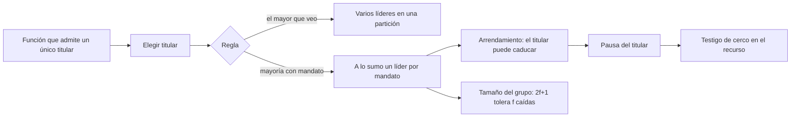
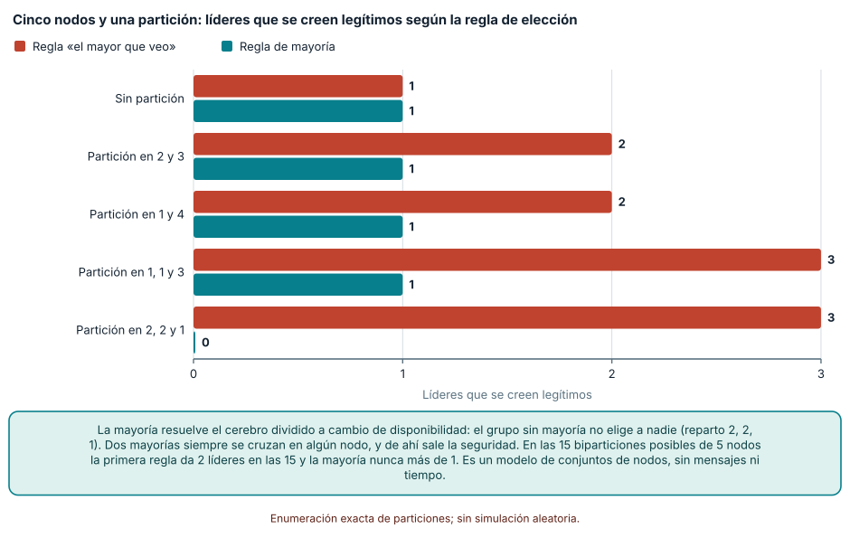
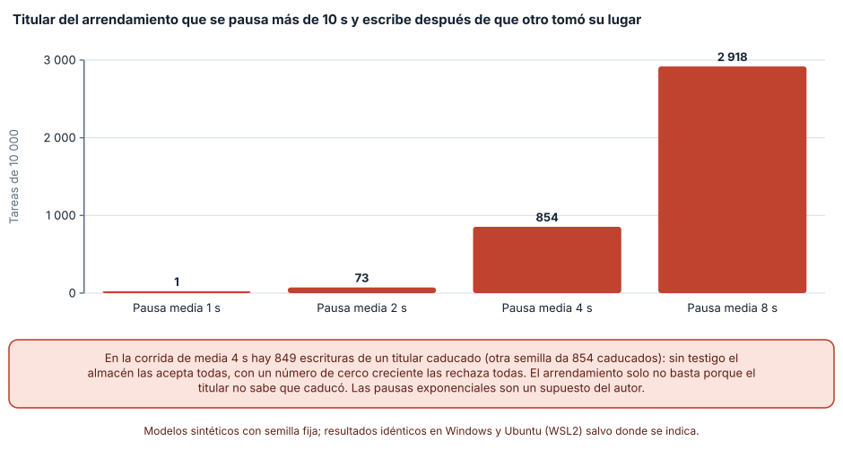
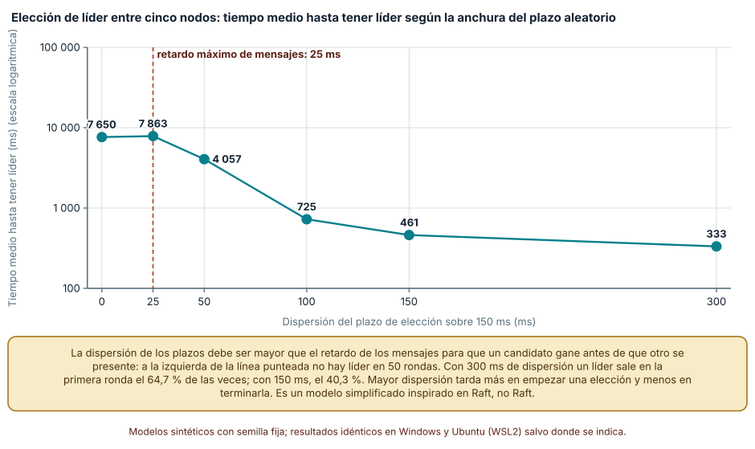

# SE-391 — Consenso, elección y coordinación

[← SE-390 — Consistencia, disponibilidad y particiones](https://github.com/vladimiracunadev-create/modern-software-engineering-program/blob/main/classes/part-32-concurrencia-y-sistemas-distribuidos/se-390-consistencia-disponibilidad-y-particiones/README.md) · [↑ Parte 32](https://github.com/vladimiracunadev-create/modern-software-engineering-program/blob/main/classes/part-32-concurrencia-y-sistemas-distribuidos/README.md) · [📚 Índice completo](https://github.com/vladimiracunadev-create/modern-software-engineering-program/blob/main/classes/README.md) · [🌐 Portal](https://vladimiracunadev-create.github.io/modern-software-engineering-program/classes/SE-391.html) · [SE-392 — Idempotencia y procesamiento distribuido →](https://github.com/vladimiracunadev-create/modern-software-engineering-program/blob/main/classes/part-32-concurrencia-y-sistemas-distribuidos/se-392-idempotencia-y-procesamiento-distribuido/README.md)

## Punto profesional y fundamento pedagógico

**Punto profesional.** La clase existe para que sepas cuándo un sistema necesita que varios nodos se pongan de acuerdo sobre un único valor o un único líder, qué hace que ese acuerdo sea seguro (mayorías que se cruzan, mandatos crecientes, testigos de cerco) y qué parte conviene delegar en un servicio de coordinación en lugar de implementarla a mano con relojes y tiempos límite.

**Por qué aparece aquí.** Sigue a **Consistencia, disponibilidad y particiones**: allí se aceptó divergir o se rechazó; aquí hay datos y funciones que no admiten dos verdades, como «quién es el único que corrige hoy los envíos» o «qué nodo posee el cupo de esta tutoría». En el caso conductor, un trabajo programado que cierra el plazo y publica notas debe ejecutarlo un solo nodo, aunque haya tres.

**Error conceptual que debe corregir.** Creer que «el nodo con el identificador mayor que veo vivo es el líder» o que «un arrendamiento con tiempo de expiración basta para ser el único titular»: ambas reglas producen dos líderes o un titular caducado que escribe.

**Secuencia de aprendizaje.** Antes de leer los resultados, predices cuántos líderes produce una partición de cinco nodos con una regla ingenua y con una de mayoría; después mides cuántas escrituras de un titular caducado acepta un almacén con y sin testigo de cerco, y cuántas rondas necesita una elección con plazos aleatorios según su dispersión. La secuencia usa predicción, explicación propia, contraste y recuperación. [ICAP](https://icap.education.asu.edu/research) distingue participación de construcción de conocimiento; [How People Learn II](https://nap.nationalacademies.org/catalog/24783/how-people-learn-ii-learners-contexts-and-cultures) exige conectar conocimiento previo, contexto y transferencia; la [práctica de recuperación](https://pubmed.ncbi.nlm.nih.gov/16507066/) respalda producir de nuevo la explicación tras una demora; y [Education for Life and Work](https://nap.nationalacademies.org/resource/13398/dbasse_084153.pdf) exige devolución que explique la causa del error.

**Evidencia de aprendizaje.** `consenso-log.md` con la predicción, las tres figuras reproducidas, la decisión de qué funciones requieren un único líder o titular, el mecanismo elegido (servicio de coordinación, mayoría con mandato) y la regla de cerco aplicada a cada recurso compartido.

**Límite de la conclusión.** Los modelos son enumeraciones y simulaciones del autor con semilla fija: no se ejecutó Raft, Paxos ni ningún servicio de coordinación, y las pausas, los retardos de 5 a 25 ms y los plazos de 150 ms en adelante son supuestos. El modelo de elección es una simplificación inspirada en Raft, no una implementación.

### Trazabilidad fuente → afirmación

| Fuente primaria u oficial | Afirmación que respalda | Lo que no prueba |
|---|---|---|
| [Lamport, «The part-time parliament» (1998)](https://doi.org/10.1145/279227.279229) | Presenta Paxos, un protocolo de consenso tolerante a fallos de parada con mayorías. | No describe cómo operar un servicio concreto basado en él. |
| [Ongaro y Ousterhout, «In search of an understandable consensus algorithm» (Raft)](https://raft.github.io/raft.pdf) | Describe la elección de líder con mandatos, plazos aleatorios y mayorías, y el registro replicado. | No mide el desempeño en la plataforma ni cubre todos los modos de fallo. |
| [Fischer, Lynch y Paterson (1985)](https://doi.org/10.1145/3149.214121) | Demuestra que en un sistema asíncrono ningún protocolo determinista garantiza consenso si un proceso puede fallar. | No impide los protocolos prácticos que usan tiempos límite o aleatoriedad. |
| [Kleppmann, «How to do distributed locking»](https://martin.kleppmann.com/2016/02/08/how-to-do-distributed-locking.html) | Explica por qué un cerrojo con expiración necesita un testigo de cerco creciente para ser seguro. | No evalúa un producto concreto de cerrojos distribuidos. |
| [Burrows, «The Chubby lock service for loosely-coupled distributed systems»](https://research.google/pubs/the-chubby-lock-service-for-loosely-coupled-distributed-systems/) | Muestra el uso de un servicio de coordinación pequeño, con consenso, para elegir líderes y guardar metadatos. | Es la experiencia de una empresa; no mide el sistema de esta plataforma. |

## Antes de empezar

Recupera lo aprendido en `SE-390`: durante una partición un lado debe rechazar o divergir. La pregunta activa es: **¿qué funciones no admiten dos titulares a la vez, quién decide quién es el titular y cómo se impide que uno caducado siga actuando?**

## Prerrequisitos

- Haber completado `SE-390` o poder explicar qué se rechaza y qué se acepta durante una partición.
- Python 3.11 o posterior; los experimentos usan solo la biblioteca estándar (`random`, `collections`).
- Entender qué es una mayoría absoluta y por qué dos mayorías se cruzan.

## Problema auténtico

El cierre de cada plazo lanza un trabajo que publica las calificaciones. Para que no se ejecute tres veces, el equipo hizo que «el servidor con el identificador mayor entre los vivos» fuera el único que lo ejecutara. Una noche, un corte entre dos centros de datos dejó a cada lado creyéndose el mayor de los que veía: se publicaron las notas dos veces, con datos distintos. Se sustituyó la regla por un cerrojo con expiración de diez segundos en una base de datos compartida. Semanas después, el servidor titular sufrió una pausa de recolección de memoria de doce segundos justo antes de escribir; el cerrojo había caducado, otro servidor lo tomó y escribió, y al despertar el primero escribió encima. Ninguna de las dos reglas era absurda: las dos olvidaban qué pasa cuando el que cree mandar ya no manda.

## Objetivos observables

Al terminar podrás:

1. explicar qué es el consenso y qué dice el resultado de Fischer, Lynch y Paterson sobre sus límites;
2. mostrar con una enumeración por qué una regla de mayoría nunca produce dos líderes y una regla ingenua sí;
3. medir cuántas escrituras de un titular caducado acepta un almacén con y sin testigo de cerco;
4. relacionar la dispersión de los plazos de elección con las rondas necesarias para elegir líder;
5. decidir qué funciones de la plataforma requieren un único titular y qué mecanismo las protege.

## Mapa conceptual



El mapa muestra que elegir es solo el primer paso. Un líder elegido por mayoría puede perder el mandato sin enterarse, y el recurso que protege debe poder rechazarlo: de ahí el testigo de cerco. El tamaño del grupo fija cuántas caídas se toleran.

## Temas y por qué importan

| Tema | Por qué cambia una decisión profesional | Evidencia mínima |
|---|---|---|
| Consenso y sus límites | Fija qué puede prometer un protocolo de acuerdo. | Predicción, traza causal y contraejemplo de **Consenso y sus límites** en `consenso-log.md` |
| Elección de líder y mayorías | Impide dos líderes en una partición. | Predicción, traza causal y contraejemplo de **Elección de líder y mayorías** en `consenso-log.md` |
| Mandatos y plazos de elección | Hacen que la elección termine en pocas rondas. | Predicción, traza causal y contraejemplo de **Mandatos y plazos de elección** en `consenso-log.md` |
| Arrendamientos y testigos de cerco | Protegen el recurso del titular caducado. | Predicción, traza causal y contraejemplo de **Arrendamientos y testigos de cerco** en `consenso-log.md` |
| Servicios de coordinación y tamaño del grupo | Evitan reimplementar lo difícil y fijan cuántas caídas se toleran. | Predicción, traza causal y contraejemplo de **Servicios de coordinación y tamaño del grupo** en `consenso-log.md` |

## Conceptos y decisiones

### 1. Consenso y sus límites

El **consenso** exige que un conjunto de nodos decida un valor con tres propiedades: acuerdo (todos los que deciden eligen el mismo), validez (el valor decidido fue propuesto por alguien) y terminación (los nodos correctos terminan por decidir). Fischer, Lynch y Paterson demostraron que, en un sistema asíncrono, no existe un protocolo determinista que garantice las tres si un solo proceso puede fallar: no se distingue un nodo lento de uno caído. Los protocolos prácticos esquivan el límite renunciando a la terminación en el peor caso: Paxos y Raft nunca violan el acuerdo, pero pueden no avanzar durante periodos de inestabilidad, y confían en tiempos límite y aleatoriedad para avanzar casi siempre. La seguridad (nunca dos valores) no depende del tiempo; la vivacidad (terminar) sí.

### 2. Elección de líder y mayorías

Una regla local como «soy líder si tengo el identificador mayor entre los nodos que veo» es insegura: en una partición cada lado tiene su mayor y habrá un líder por lado. La regla segura exige una **mayoría absoluta**: se es líder solo si más de la mitad del grupo total lo reconoce. Dos mayorías absolutas siempre comparten al menos un nodo, y ese nodo no puede votar por dos líderes en el mismo mandato; por eso, a lo sumo uno puede reunir la mayoría. El precio es que un grupo sin mayoría no elige a nadie: se pierde disponibilidad para conservar la unicidad, exactamente la decisión de `SE-390`.

### 3. Mandatos y plazos de elección

En Raft, el tiempo se divide en **mandatos** numerados. Cada nodo que no oye a un líder dentro de su plazo de elección se postula para el siguiente mandato y pide votos. Si dos nodos se postulan casi a la vez, los votos se reparten y ninguno alcanza la mayoría: el mandato termina sin líder y hay que repetir. La solución de Raft es aleatorizar el plazo de cada nodo dentro de un intervalo, de modo que casi siempre uno se postule bastante antes que los demás y gane antes de que otros se despierten. La dispersión debe superar el retardo de los mensajes: si no, los plazos no separan lo suficiente a los candidatos.

### 4. Arrendamientos y testigos de cerco

Un **arrendamiento** (*lease*) concede un derecho por un tiempo; al caducar, otro puede obtenerlo. Es útil porque el titular caído libera el derecho sin que nadie tenga que declararlo muerto. Pero el titular puede estar vivo y pausado (recolección de memoria, suspensión de la máquina virtual, red lenta) y actuar cuando ya caducó. Ningún tiempo de expiración lo evita, porque el titular no puede saber cuánto tardó. La defensa es un **testigo de cerco** (*fencing token*): un número creciente que el servicio entrega con cada concesión y que el recurso comprueba en cada escritura, rechazando cualquier número menor que el último visto. Así, la seguridad no depende de que el titular crea estar vigente, sino de que el recurso sepa quién lo está.

### 5. Servicios de coordinación y tamaño del grupo

Implementar consenso es difícil y los errores no se ven en las pruebas. Por eso se delega en un **servicio de coordinación** pequeño (Chubby en Google, y servicios de código abierto equivalentes) que ofrece cerrojos, elección y metadatos sobre un núcleo de consenso, y que se usa desde las aplicaciones como cliente. Su tamaño se elige por tolerancia: un grupo de 2*f* + 1 nodos tolera *f* caídas y mantiene la mayoría; con 3 nodos se tolera 1 caída, con 5, 2, y con 7, 3. Los grupos de tamaño par no ayudan: 4 nodos toleran 1 caída, igual que 3, a cambio de más mensajes.

### Cuántos líderes cree haber cada regla

Se enumeran particiones de un grupo de cinco nodos y se cuenta cuántos grupos se creen con derecho a tener líder: con la regla del identificador mayor que cada uno ve (un líder por grupo visible) y con la regla de mayoría absoluta. Se recorren además las 15 formas de partir el grupo en dos.

```python
def leaders_naive(groups):  return sum(1 for g in groups if g)
def leaders_quorum(groups, n):  return sum(1 for g in groups if len(g) > n // 2)
```

| Situación | Regla «el mayor que veo» | Regla de mayoría |
|---|---:|---:|
| Sin partición | 1 | 1 |
| Partición en 2 y 3 | 2 | 1 |
| Partición en 1 y 4 | 2 | 1 |
| Partición en 1, 1 y 3 | 3 | 1 |
| Partición en 2, 2 y 1 | 3 | 0 |
| Las 15 biparticiones de 5 nodos | 2 en las 15 | nunca más de 1 |

La regla ingenua produce dos o tres líderes en toda partición; la de mayoría produce uno, o ninguno cuando ningún grupo tiene mayoría (2 | 2 | 1). El caso sin líder es el precio de la seguridad: el servicio se detiene en lugar de mentir.



**Cómo leer la figura.** Cada grupo es una forma de partir los cinco nodos y cada color una regla; la longitud es cuántos grupos se creen con un líder. Mira que el coral supera a uno en cuanto hay partición y el verde nunca: la mayoría se paga con un grupo sin líder, no con un líder de más. **Dónde deja de valer:** el modelo enumera conjuntos de nodos y no incluye mensajes, retrasos ni nodos que cambian de grupo durante la elección; un protocolo real debe además garantizar que un líder anterior deje de actuar. La figura muestra por qué la mayoría es necesaria, no que sea suficiente.

### Un titular caducado que escribe

Un titular recibe el testigo 1 y se pausa un tiempo exponencial de media 4 s; su arrendamiento dura 10 s. Si la pausa lo supera, otro titular recibe el testigo 2 y escribe, y luego el primero despierta y escribe. El almacén acepta todo (sin cerco) o rechaza cualquier escritura con un testigo menor que el máximo visto (con cerco). Se repite con 10 000 tareas; aparte se cuentan cuántas superan los 10 s según la media de la pausa.

```python
def write(self, token, who):
    if self.fencing and token < self.max_token:
        return False                      # el recurso rechaza al titular caducado
    self.max_token = max(self.max_token, token); self.log.append((token, who))
    return True
```

| Pausa media del titular | Tareas cuyo arrendamiento caduca antes de escribir |
|---:|---:|
| 1 s | 1 de 10 000 |
| 2 s | 73 de 10 000 |
| 4 s | 854 de 10 000 |
| 8 s | 2 918 de 10 000 |

En la corrida de media 4 s hay 849 escrituras de un titular caducado (otra semilla da 854 caducados): sin cerco el almacén las acepta todas, con cerco las rechaza todas. Con pausa media de 1 s el problema es raro y por eso pasa las pruebas; con 8 s afecta a casi tres de cada diez tareas. Alargar el arrendamiento reduce la frecuencia sin eliminar el defecto.



**Cómo leer la figura.** Cada barra es una pausa media del titular y su altura, cuántas de 10 000 tareas escriben después de que su arrendamiento caducó. Mira cómo el número se multiplica al duplicar la pausa; el efecto del testigo de cerco (aceptar o rechazar esas escrituras) se explica en la nota. **Dónde deja de valer:** la distribución exponencial de pausas es un supuesto del autor; las pausas reales (recolección de memoria, suspensión) tienen colas largas y correlación. El cerco exige que el *recurso* compare testigos: si el recurso es una API externa que no lo hace, el cerco no protege.

### Plazos de elección y rondas

Cinco nodos se postulan tras un plazo de 150 ms más un valor aleatorio uniforme de 0 a *w* ms; los mensajes tardan hasta 25 ms. Un candidato gana si ningún otro se postula en los 25 ms siguientes al primero; si hay empate, se repite la ronda (tope de 50). Se repite 20 000 veces para seis anchuras.

```python
tos = [150 + r.uniform(0, width) for _ in range(n)]
first = min(tos)
cands = [i for i, t in enumerate(tos) if t - first < delay[1]]
if len(cands) == 1: break              # un solo candidato dentro de la ventana de mensajes
```

| Plazo de elección | Rondas medias (tope 50) | Líder en la primera ronda | Tiempo medio hasta tener líder |
|---|---:|---:|---:|
| 150 ms (sin aleatoriedad) | 51,0 (no converge) | 0,0 % | 7 650 ms |
| 150 a 175 ms | 51,0 (no converge) | 0,0 % | 7 863 ms |
| 150 a 200 ms | 25,5 | 3,1 % | 4 057 ms |
| 150 a 250 ms | 4,20 | 24,0 % | 725 ms |
| 150 a 300 ms | 2,49 | 40,3 % | 461 ms |
| 150 a 450 ms | 1,54 | 64,7 % | 333 ms |

Con la misma dispersión que el retardo de los mensajes (25 ms) la elección no converge: los candidatos siempre se pisan. Al ampliar la dispersión a 100 ms o más, converge en pocas rondas y el tiempo total baja pese a que cada ronda espera más. El ajuste depende de la red, y los valores de Raft (150 a 300 ms) son una guía, no una regla.



**Cómo leer la figura.** El eje horizontal es cuánto se ensancha el plazo de elección sobre 150 ms y el vertical el tiempo medio hasta tener líder, en escala logarítmica; la línea punteada vertical marca el retardo máximo de los mensajes (25 ms). Mira cómo el tiempo se desploma cuando la dispersión supera ese retardo. **Dónde deja de valer:** el modelo supone retardos uniformes de hasta 25 ms y trata cualquier empate como fracaso, sin reparto parcial de votos; un protocolo real tiene mandatos que crecen y votos que se pueden repartir. Es un modelo para entender por qué aleatorizar, no un simulador de Raft.

### Ampliación: Raft y Paxos por dentro, y qué rompe cada regla

Esta clase usa la mayoría y el cerco sin abrir los protocolos que las garantizan. Aquí se abre uno. **Paxos** (Lamport, publicado en 1998 y explicado de forma más simple en [«Paxos made simple»](https://lamport.azurewebsites.net/pubs/paxos-simple.pdf)) decide un valor en dos fases: un proponente envía un número de propuesta y los aceptadores prometen no atender propuestas con números menores y devuelven la más alta que hayan aceptado; si una mayoría promete, el proponente propone el valor de esa propuesta más alta (o uno propio si no hay ninguna) y los aceptadores lo aceptan salvo que ya hayan prometido un número mayor. La repetición de ese acuerdo para una secuencia de valores se llama Multi-Paxos. **Raft** ([Ongaro y Ousterhout](https://raft.github.io/raft.pdf)) resuelve el mismo problema, pero organiza el protocolo alrededor de un líder estable y un registro ordenado, de modo que la parte de elegir líder y la de replicar el registro se explican por separado. El número de propuesta de Paxos corresponde, en Raft, al **mandato** (*term*). La comparación detallada está en [Howard y Mortier, «Paxos vs Raft»](https://arxiv.org/abs/2004.05074); lo importante aquí es que ambos se apoyan en lo que ya viste: dos mayorías de un mismo grupo siempre se cruzan en algún nodo.

**Mecanismo en Raft: tres reglas, cada una cierra un camino de pérdida.**

1. **Un voto por mandato.** Un nodo vota como mucho a un candidato en cada mandato, y adopta cualquier mandato mayor que vea. Con eso, en un mismo mandato no puede haber dos líderes con mayoría.
2. **Restricción de elección.** Un nodo solo vota a un candidato cuyo registro esté al menos tan al día como el suyo (se compara el mandato de la última entrada y, si empatan, la longitud). Como una entrada comprometida está en una mayoría y un candidato necesita los votos de otra mayoría, algún votante la tiene, y por la regla no vota a quien no la tenga. Ningún líder elegido carece de una entrada comprometida.
3. **Comprometer solo con réplicas del mandato actual.** Un líder no da por comprometida una entrada de un mandato anterior solo por contar que una mayoría la replicó: una entrada replicada en mayoría puede aun así ser sobrescrita por un líder posterior con un registro más largo de otro mandato. Se compromete una entrada del mandato actual y, con ella, todas las anteriores. Es el caso de la figura 8 del artículo de Raft.

**Causa de este diseño: lo que se pierde no se ve a tiempo.** Quitar la regla 2 no rompe ninguna prueba con un nodo caído: el fallo exige una elección con un nodo desfasado en el momento justo, y entonces un líder sin entradas comprometidas las sobrescribe en los demás. Esa es la razón por la que estos protocolos se verifican con modelos formales (la especificación en TLA+ de Raft está en [raft.tla](https://github.com/ongardie/raft.tla)) y con pruebas de inyección de fallos del estilo de Jepsen, no con una ejecución feliz.

**Experimento reproducible.** `scripts/experiments_part32_ext.py` implementa un modelo reducido de 5 nodos con mandatos, un voto por mandato, mayoría de 3 y entradas comprometidas con mayoría, y lo somete a 20 000 calendarios aleatorios de 70 pasos (semilla 343): elecciones, escrituras en presuntos líderes, replicación, comprobación de compromiso, caídas, recuperaciones y particiones en dos grupos. Hay violación si un líder elegido carece de una entrada ya comprometida o si se compromete una entrada distinta en un índice ya comprometido.

| Variante del modelo | Calendarios con violación de 20 000 | Porcentaje |
|---|---:|---:|
| Reglas completas | 0 | 0 % |
| El voto no compara los registros (se quita la regla 2) | 1 377 | 6,88 % |
| Se compromete contando réplicas de mandatos anteriores (se quita la regla 3) | 11 | 0,06 % |


**Cómo leer la figura.** Cada barra es una variante del modelo y su altura, la fracción de calendarios aleatorios en que se pierde o se contradice una entrada comprometida. Mira dos cosas: que quitar la regla de comparación de registros se nota en uno de cada quince calendarios, y que quitar la de compromiso por mandato casi no se nota (11 de 20 000), pese a ser igual de necesaria. **Dónde deja de valer:** no es Raft (no hay latidos, plazos, mensajes retrasados, reintentos ni reconfiguración, y la reparación de un registro copia el registro entero del líder); los porcentajes dependen de las probabilidades de cada acción, que son del autor; las 0 violaciones de las reglas completas muestran que este modelo no encontró un contraejemplo en 20 000 calendarios, no que el protocolo sea correcto, porque eso se demuestra con la prueba formal.

**Límite y decisión.** El mensaje práctico no es implementar Raft, sino saber qué pedirle a quien lo implemente o lo elige: que cite el artículo, que declare qué reglas cumple y que tenga pruebas con particiones y caídas durante elecciones. Un registro replicado por mayoría que alguien escribió «según Raft» sin la restricción de elección es la versión del 6,88 % de esta ampliación. Para casi todos los productos la decisión correcta sigue siendo delegar en un servicio de coordinación o una base que ya lo implemente, y usarlo con el cerco de la sección anterior.

## Definiciones de trabajo

- **consenso:** acuerdo de un conjunto de nodos sobre un único valor, con acuerdo, validez y terminación.
- **mayoría absoluta:** más de la mitad de los nodos del grupo completo, no de los que se ven.
- **mandato (*term*):** periodo numerado durante el cual a lo sumo un líder puede ejercer.
- **arrendamiento (*lease*):** derecho concedido por un tiempo limitado que caduca solo.
- **testigo de cerco (*fencing token*):** número creciente concedido con cada derecho y comprobado por el recurso para rechazar titulares caducados.

Las definiciones son operativas para la plataforma de entregas. No convierten términos con una historia más amplia en sinónimos y deben contrastarse con la documentación primaria enlazada al final.

## Ejemplo mínimo

El fragmento muestra que dos mayorías absolutas se cruzan. Antes de ejecutarlo, predice si existen dos subconjuntos disjuntos de tres nodos entre cinco.

```python
from itertools import combinations
nodos = range(5)
mayorias = [set(c) for c in combinations(nodos, 3)]
assert all(a & b for a in mayorias for b in mayorias)
```

Todas las parejas de mayorías comparten al menos un nodo, porque 3 + 3 > 5. Registra versión de Python y salida; después repite con cuatro nodos y subconjuntos de dos, y comprueba que existen pares disjuntos.

## Ejemplo profesional

El equipo clasifica las funciones de la plataforma. Publicar notas al cierre del plazo exige un único ejecutor: usa el servicio de coordinación que ya opera la plataforma, con un grupo de cinco nodos (tolera dos caídas), y pide un cerrojo cuya concesión incluye un testigo de cerco. La publicación escribe en la base con el testigo en cada sentencia y la base rechaza cualquier número menor que el último visto; así una pausa de recolección de memoria no puede pisar la publicación del siguiente titular. Las tareas repetibles (enviar un recordatorio) no usan titular: se hacen idempotentes (`SE-392`). El equipo no implementa Raft: mide cuántas tareas superan el arrendamiento con sus pausas reales, ajusta su duración y registra que el cerco es la defensa real. Cada decisión queda en `consenso-log.md` con la medida que la respalda.

## Práctica guiada

1. Lista las funciones de la plataforma que no admiten dos ejecutores y clasifícalas.
2. Predice cuántos líderes produce cada regla en una partición 2 | 3 de cinco nodos.
3. Enumera las 15 biparticiones de cinco nodos y cuenta los líderes de cada regla.
4. Simula 10 000 tareas con pausas exponenciales de media 4 s y arrendamiento de 10 s, con y sin testigo de cerco.
5. Varía la pausa media (1, 2, 4 y 8 s) y registra cuántas tareas superan el arrendamiento.
6. Simula la elección con seis dispersiones de plazo y encuentra la menor que converge.
7. Entrega `consenso-log.md` y pide a otra persona que encuentre un recurso que acepte escrituras sin comprobar el testigo.

## Ejercicios

1. **Tamaño:** ¿cuántos nodos necesitas para tolerar tres caídas con mayoría? ¿Qué ganas con ocho en vez de siete?
2. **Cálculo:** con una pausa media de 3 s y un arrendamiento de 10 s, ¿qué fracción de tareas caduca (distribución exponencial)? Calcula `exp(-10/3)` y compara con la tabla.
3. **Contraejemplo:** describe un recurso para el que el testigo de cerco no sirve (por ejemplo, una API externa) y qué alternativa tienes.
4. **Diagnóstico:** las notas se publican dos veces una vez al mes. Formula tres hipótesis y la observación que descarta cada una.

## Reto verificable

Entrega `consenso-log.md` con la predicción, las tres tablas, la clasificación de funciones con titular único y el mecanismo y testigo por recurso. Se aprueba si otra persona ejecuta el código desde un checkout limpio, obtiene los mismos conteos con las mismas semillas y puede decir qué recurso rechaza al titular caducado. No se aprueba por afirmar que «el cerrojo con expiración garantiza un único ejecutor» sin analizar la pausa del titular ni por proponer escribir Raft en el servicio.

## Caso conductor

El ejecutor único del cierre de plazo es el artefacto de esta clase en el caso conductor de la Parte 32. `SE-392` pregunta qué hacer con lo que aun así se ejecuta dos veces: el procesamiento idempotente. Cambia después una sola decisión, el tamaño del grupo de coordinación, y observa qué otra (cuántas caídas se toleran) se ve afectada.

## Preguntas frecuentes

### ¿Necesito implementar Raft o Paxos?

Casi nunca. Implementarlos bien exige pruebas que cubran fallos y particiones difíciles. Lo habitual es usar un servicio de coordinación o una base que ya lo implementa y aprender qué garantiza y cómo comprobar el cerco.

### ¿Por qué no basta un cerrojo con expiración corta?

Porque la pausa del titular puede ser más larga que cualquier expiración razonable y porque acortarla aumenta los falsos desalojos. El cerco hace seguro el sistema sin depender del tiempo.

### ¿Por qué cinco nodos y no cuatro?

Con cuatro, la mayoría es tres y se tolera una caída, igual que con tres; el cuarto nodo añade mensajes y un punto de fallo sin mejorar la tolerancia. Los grupos impares son más eficientes.

### ¿Un servicio de coordinación elimina las particiones?

No. Un lado sin mayoría no puede elegir ni conceder cerrojos y sus clientes deben tolerarlo: dejar de actuar como titulares cuando no puedan renovar su derecho.

## Fallo controlado y diagnóstico

Reproduce el fallo clásico de la clase: **un titular pausado escribe después de que otro lo reemplazó**. Simula la pausa de un titular con arrendamiento de 10 s y almacén sin comprobación de testigo.

Registra síntoma, entrada mínima, hipótesis, observación que descarta cada hipótesis, causa, corrección y prueba de regresión. **Síntoma:** las notas publicadas una noche se sobrescriben con datos más antiguos a los pocos segundos. **Hipótesis rivales:** (a) dos trabajos programados por un error de configuración; (b) una réplica con datos viejos que repuso lo anterior; (c) un titular caducado que escribió después del nuevo. **Prueba:** registra el testigo de cada escritura y su origen; si la escritura antigua lleva un testigo menor que la nueva y llegó después, la causa es el titular caducado. **Conclusión:** el almacén no comprobaba el testigo. **Regresión:** añade la comprobación en la escritura y una prueba que simule la pausa y compruebe que la escritura caducada se rechaza. No cambies a la vez el cerco y la duración del arrendamiento.

## Errores comunes y cómo corregirlos

| Síntoma | Causa probable | Corrección |
|---|---|---|
| Dos líderes tras un corte de red | Regla local de elección | Mayoría absoluta del grupo completo |
| Un trabajo se ejecuta dos veces | Titular caducado que sigue actuando | Testigo de cerco comprobado por el recurso |
| La elección tarda o no termina | Plazos sin aleatoriedad o con poca dispersión | Aleatorizar con dispersión mayor que el retardo |
| El servicio se detiene sin mayoría | Grupo sin cuórum | Dimensionar el grupo y diseñar el degradado |
| Se prueba el cerrojo y nunca falla | La prueba no provoca pausas largas | Simular la pausa y el reemplazo |

## Entorno y archivos clave

```text
work/SE-391/
├── README.md
├── modelo/
│   ├── lideres.py
│   ├── cerco.py
│   └── eleccion.py
├── tests/test_consenso.py
└── evidence/consenso-log.md
```

El `README` declara plataforma, versión de Python, semillas (343, 3431 y 3432) y comandos. Los experimentos usan solo la biblioteca estándar (`random`, `collections`) y se ejecutaron con CPython 3.12.9 en Windows 11 y 3.12.3 en Ubuntu bajo WSL2: las salidas fueron idénticas. Si añades una dependencia, fija procedencia y versión.

## Seguridad, ética y accesibilidad

- un líder que publica notas dos veces con datos distintos afecta a calificaciones reales: define quién valida el resultado antes de publicarlo;
- un servicio de coordinación es un punto de control del sistema: restringe quién puede tomar cerrojos y audita los cambios de líder;
- un cerco que el recurso no comprueba da una falsa sensación de seguridad: pruébalo con una escritura caducada deliberada;
- documenta la lista de funciones con titular único en texto accesible;
- respeta las licencias de los artículos citados y atribuye lo adaptado.

## Puente hacia el trabajo con agentes

Un agente al que se le pide «asegura que solo un nodo ejecute este trabajo» propondrá un cerrojo con expiración en la base o una elección por identificador mayor, y dará el trabajo por resuelto. Pídele en cambio que identifique qué recurso protege el trabajo, que exija un testigo de cerco comprobado por ese recurso, que use una mayoría del grupo completo si propone elegir líder y que incluya una prueba que pause al titular más allá del arrendamiento. Revisa especialmente si el recurso rechaza testigos antiguos y si la regla de elección depende de lo que cada nodo ve: son los dos defectos que esta clase mostró sin aviso.

## Transferencia

Traslada el análisis a otro dominio (por ejemplo, un servicio de facturación mensual que debe ejecutarse una sola vez): cambia el recurso y conserva el procedimiento de identificar la función con titular único, elegir por mayoría, proteger el recurso con cerco y dimensionar el grupo. La transferencia está lograda cuando puedes explicar qué ocurre si el titular se pausa, no cuando existe un cerrojo.

## Evaluación y evidencia

| Criterio | Evidencia para aprobar |
|---|---|
| comprensión | explicación de por qué la mayoría impide dos líderes y del límite del consenso |
| corrección | conteos de líderes, escrituras caducadas y rondas reproducibles |
| diseño | clasificación de funciones con titular único, cerco por recurso y tamaño del grupo |
| diagnóstico | reproducción del titular caducado con regresión por testigo |
| incertidumbre | declaración de que no se ejecutó ningún protocolo de consenso real |
| reproducibilidad | versiones, comandos, salida y límites declarados |

## Fuentes

- [Lamport, «The part-time parliament»](https://doi.org/10.1145/279227.279229) — Paxos; autoridad: artículo original (1998).
- [Ongaro y Ousterhout, Raft](https://raft.github.io/raft.pdf) — elección con mandatos y plazos aleatorios; autoridad: artículo de los autores.
- [Fischer, Lynch y Paterson, «Impossibility of distributed consensus…»](https://doi.org/10.1145/3149.214121) — límite del consenso asíncrono; autoridad: artículo original (1985).
- [Kleppmann, «How to do distributed locking»](https://martin.kleppmann.com/2016/02/08/how-to-do-distributed-locking.html) — cerrojos con expiración y testigos de cerco; autoridad: autor del texto.
- [Burrows, «The Chubby lock service…»](https://research.google/pubs/the-chubby-lock-service-for-loosely-coupled-distributed-systems/) — servicio de coordinación en producción; autoridad: artículo de Google.
- [Gray y Cheriton, «Leases»](https://doi.org/10.1145/74850.74870) — origen de los arrendamientos; autoridad: artículo original (1989).

Cada fuente respalda el mecanismo indicado; ninguna demuestra que las 849 escrituras caducadas, las 4,20 rondas o los tres líderes se observen en un sistema real. Esa afirmación depende de las pausas, de la red y del protocolo.

- [Lamport, «Paxos made simple» (2001)](https://lamport.azurewebsites.net/pubs/paxos-simple.pdf) — las dos fases de Paxos con números de propuesta; autoridad: autor del protocolo.
- [Howard y Mortier, «Paxos vs Raft: have we reached consensus on distributed consensus?»](https://arxiv.org/abs/2004.05074) — comparación de ambos protocolos; autoridad: artículo de investigación (versión en arXiv).
- [Ongaro, especificación TLA+ de Raft](https://github.com/ongardie/raft.tla) — modelo formal con las reglas de elección y compromiso; autoridad: repositorio del autor de Raft.

## Límites y siguiente paso

Se ejecutaron tres experimentos en Windows y Ubuntu (WSL2) con resultados idénticos. No se ejecutó Raft, Paxos ni ningún servicio de coordinación: las particiones se enumeran como conjuntos, las pausas son exponenciales y el modelo de elección es una simplificación del autor. La siguiente clase trata lo que aun con un titular único puede ejecutarse dos veces: el procesamiento idempotente. La ampliación sobre Raft y Paxos usa un modelo reducido de cinco nodos con 20 000 calendarios aleatorios y semilla 343, ejecutado con CPython 3.12.9 en Windows; no se ejecutó Raft, Paxos ni la especificación TLA+, y cero violaciones de las reglas completas no es una demostración.

## Glosario

- **consenso:** acuerdo de un conjunto de nodos sobre un único valor, con acuerdo, validez y terminación.
- **mayoría absoluta:** más de la mitad de los nodos del grupo completo, no de los que se ven.
- **mandato (*term*):** periodo numerado durante el cual a lo sumo un líder puede ejercer.
- **arrendamiento (*lease*):** derecho concedido por un tiempo limitado que caduca solo.
- **testigo de cerco (*fencing token*):** número creciente concedido con cada derecho y comprobado por el recurso para rechazar titulares caducados.

---

[← SE-390 — Consistencia, disponibilidad y particiones](https://github.com/vladimiracunadev-create/modern-software-engineering-program/blob/main/classes/part-32-concurrencia-y-sistemas-distribuidos/se-390-consistencia-disponibilidad-y-particiones/README.md) · [↑ Parte 32](https://github.com/vladimiracunadev-create/modern-software-engineering-program/blob/main/classes/part-32-concurrencia-y-sistemas-distribuidos/README.md) · [📚 Índice completo](https://github.com/vladimiracunadev-create/modern-software-engineering-program/blob/main/classes/README.md) · [🌐 Portal](https://vladimiracunadev-create.github.io/modern-software-engineering-program/classes/SE-391.html) · [SE-392 — Idempotencia y procesamiento distribuido →](https://github.com/vladimiracunadev-create/modern-software-engineering-program/blob/main/classes/part-32-concurrencia-y-sistemas-distribuidos/se-392-idempotencia-y-procesamiento-distribuido/README.md)
