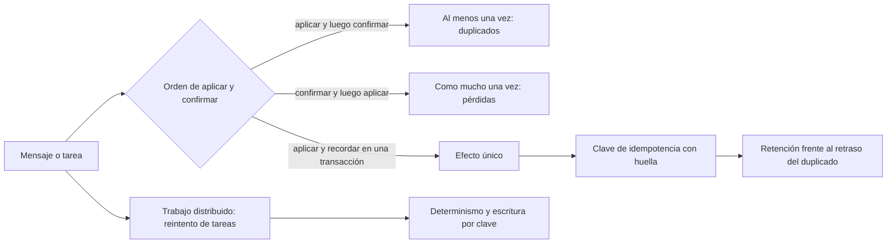
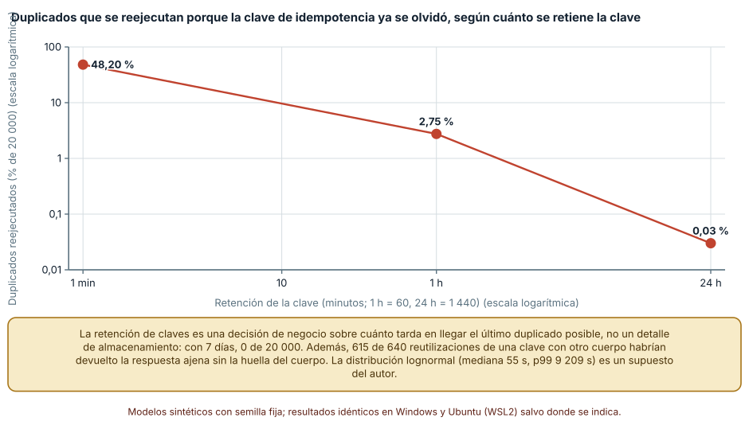

# SE-392 — Idempotencia y procesamiento distribuido

[← SE-391 — Consenso, elección y coordinación](https://github.com/vladimiracunadev-create/modern-software-engineering-program/blob/main/classes/part-32-concurrencia-y-sistemas-distribuidos/se-391-consenso-eleccion-y-coordinacion/README.md) · [↑ Parte 32](https://github.com/vladimiracunadev-create/modern-software-engineering-program/blob/main/classes/part-32-concurrencia-y-sistemas-distribuidos/README.md) · [📚 Índice completo](https://github.com/vladimiracunadev-create/modern-software-engineering-program/blob/main/classes/README.md) · [🌐 Portal](https://vladimiracunadev-create.github.io/modern-software-engineering-program/classes/SE-392.html) · [SE-393 — Replicación, sharding y balanceo →](https://github.com/vladimiracunadev-create/modern-software-engineering-program/blob/main/classes/part-32-concurrencia-y-sistemas-distribuidos/se-393-replicacion-sharding-y-balanceo/README.md)

## Punto profesional y fundamento pedagógico

**Punto profesional.** La clase existe para que sustituyas la promesa imposible de «exactamente una vez» por una que sí puedes cumplir: efecto único sobre el estado, logrado con operaciones idempotentes y con claves que permiten reconocer un duplicado, y para que diseñes el procesamiento por lotes y por mensajes de modo que un reintento sea una repetición inofensiva y no una segunda verdad.

**Por qué aparece aquí.** Sigue a **Consenso, elección y coordinación**: incluso con un único titular y reintentos prudentes, un mensaje puede entregarse dos veces o un trabajo puede repetirse tras un fallo. En el caso conductor, el contador de entregas de un curso y la publicación de un acuse deben resistir que el mismo mensaje llegue más de una vez.

**Error conceptual que debe corregir.** Creer que una cola con «entrega exactamente una vez» elimina los duplicados: lo que garantiza, en el mejor caso, es que se entrega una vez *a la cola*; el consumidor puede aplicar el efecto dos veces si cae entre aplicar y confirmar.

**Secuencia de aprendizaje.** Antes de leer los resultados, predices el total que cuenta un consumidor de 1 000 mensajes cuando cae el 5 % de las veces con tres órdenes distintos de aplicar y confirmar; después mides qué fracción de duplicados escapa a una clave de idempotencia según cuánto tiempo se retiene, y cuántas filas duplicadas deja un trabajo que anexa frente a uno que escribe por clave. La secuencia usa predicción, explicación propia, contraste y recuperación. [ICAP](https://icap.education.asu.edu/research) distingue participación de construcción de conocimiento; [How People Learn II](https://nap.nationalacademies.org/catalog/24783/how-people-learn-ii-learners-contexts-and-cultures) exige conectar conocimiento previo, contexto y transferencia; la [práctica de recuperación](https://pubmed.ncbi.nlm.nih.gov/16507066/) respalda producir de nuevo la explicación tras una demora; y [Education for Life and Work](https://nap.nationalacademies.org/resource/13398/dbasse_084153.pdf) exige devolución que explique la causa del error.

**Evidencia de aprendizaje.** `idempotencia-log.md` con la predicción, las tres figuras reproducidas, la clasificación de las operaciones de la plataforma en naturalmente idempotentes, idempotentes con clave y no repetibles, y la política de retención de claves con su justificación.

**Límite de la conclusión.** El consumidor es un programa de Python con una base SQLite real en memoria y caídas inyectadas en el peor punto con probabilidad del 5 %; el retraso de los duplicados sigue una distribución lognormal elegida por el autor y las tareas del trabajo distribuido son sintéticas. No se midió ninguna cola de mensajes, ningún sistema de procesamiento por lotes ni un servicio de pagos.

### Trazabilidad fuente → afirmación

| Fuente primaria u oficial | Afirmación que respalda | Lo que no prueba |
|---|---|---|
| [Helland, «Idempotence is not a medical condition» (2012)](https://doi.org/10.1145/2181796.2187821) | Explica por qué los sistemas distribuidos deben tolerar mensajes repetidos y cómo diseñar la aplicación para ello. | No mide la frecuencia de duplicados en ningún sistema. |
| [RFC 9110: semántica de HTTP, métodos idempotentes](https://www.rfc-editor.org/rfc/rfc9110) | Define qué métodos HTTP son idempotentes y qué implica repetirlos. | No cubre las operaciones de negocio que un servicio implementa con POST. |
| [Stripe: claves de idempotencia](https://stripe.com/blog/idempotency) | Describe el uso de una clave enviada por el cliente para que el servidor reconozca y no repita una operación. | Es el diseño de una empresa; no prueba que sirva igual en otra plataforma. |
| [IETF: cabecera Idempotency-Key (borrador)](https://datatracker.ietf.org/doc/draft-ietf-httpapi-idempotency-key-header/) | Propone una cabecera estándar para claves de idempotencia y qué hacer si se reutiliza con otro cuerpo. | Es un borrador y puede cambiar; no es un estándar aprobado. |
| [Dean y Ghemawat, «MapReduce» (2008)](https://doi.org/10.1145/1327452.1327492) | Describe el reintento de tareas fallidas y la importancia de que las tareas sean deterministas y su salida atómica. | No describe un sistema moderno de procesamiento por lotes ni mide sus costos. |

## Antes de empezar

Recupera lo aprendido en `SE-391`: un titular único no basta, porque el titular puede caducar o el mensaje repetirse. La pregunta activa es: **si esta operación se ejecuta dos veces, ¿qué cambia? Y si el mensaje llega tarde, ¿cómo lo reconoce el sistema?**

## Prerrequisitos

- Haber completado `SE-391` o poder explicar por qué un reintento puede duplicar un efecto.
- Python 3.11 o posterior con `sqlite3`; el resto, biblioteca estándar (`random`, `hashlib`, `collections`).
- Haber visto en `SE-389` la ambigüedad del tiempo agotado y en `SE-384` el flujo tolerante a reintentos.

## Problema auténtico

El panel de cada curso muestra cuántas entregas ha recibido. Un consumidor de mensajes sumaba uno por cada mensaje «entrega recibida». Tras una semana con la cola reentregando mensajes cuando el consumidor tardaba en confirmar, un curso mostraba 53 entregas más de las que existían. Se cambió el orden: confirmar primero y aplicar después; al caer el consumidor, faltaron 50. Un tercer equipo añadió una tabla de claves vistas, consultada antes de aplicar y escrita después, y aun así aparecieron duplicados en un caso: la clave se guardaba en una transacción y el contador en otra. En paralelo, un trabajo nocturno que generaba un informe por curso anexaba filas a un archivo; los reintentos de las tareas fallidas dejaron filas repetidas, y algunas con valores distintos porque el cálculo usaba la hora. Nadie había decidido qué significaba «una vez».

## Objetivos observables

Al terminar podrás:

1. explicar por qué no hay «exactamente una vez» entre sistemas y qué lo sustituye;
2. comparar las semánticas de al menos una vez, como mucho una vez y efecto único con un experimento sobre una base real;
3. diseñar una clave de idempotencia con huella del cuerpo y una política de retención justificada por el retraso de los duplicados;
4. explicar por qué la salida de un trabajo distribuido debe escribirse por clave y las tareas deben ser deterministas;
5. clasificar las operaciones de la plataforma según su idempotencia y la defensa que requieren.

## Mapa conceptual



El mapa separa dos preguntas. En el **consumo de mensajes**, el defecto está en el orden entre aplicar y confirmar. En el **procesamiento por lotes**, el defecto está en cómo se escribe la salida y en si la tarea produce lo mismo al repetirse. La defensa común es la idempotencia: repetir no cambia el resultado.

## Temas y por qué importan

| Tema | Por qué cambia una decisión profesional | Evidencia mínima |
|---|---|---|
| Semánticas de entrega | Decide si un fallo produce duplicados o pérdidas. | Predicción, traza causal y contraejemplo de **Semánticas de entrega** en `idempotencia-log.md` |
| Operaciones idempotentes | Una repetición inofensiva evita coordinar. | Predicción, traza causal y contraejemplo de **Operaciones idempotentes** en `idempotencia-log.md` |
| Claves de idempotencia | Reconocen el duplicado y detectan la clave reutilizada con otro cuerpo. | Predicción, traza causal y contraejemplo de **Claves de idempotencia** en `idempotencia-log.md` |
| Retención de claves | La clave olvidada deja pasar el duplicado tardío. | Predicción, traza causal y contraejemplo de **Retención de claves** en `idempotencia-log.md` |
| Trabajos distribuidos | Los reintentos de tareas piden determinismo y salida por clave. | Predicción, traza causal y contraejemplo de **Trabajos distribuidos** en `idempotencia-log.md` |

## Conceptos y decisiones

### 1. Semánticas de entrega

Un consumidor ejecuta dos acciones: aplicar el efecto y confirmar a la cola que terminó. Si entre ambas se cae, el resultado depende del orden. **Aplicar y luego confirmar** da *al menos una vez*: tras la caída la cola reentrega y el efecto se repite. **Confirmar y luego aplicar** da *como mucho una vez*: tras la caída la cola cree que terminó y el efecto se pierde. **Exactamente una vez** entre dos sistemas independientes no es alcanzable sin una garantía adicional, porque la caída puede ocurrir entre las dos acciones sin que ninguno de los dos lo note. Lo que se puede lograr es *efecto único* sobre el estado: que la repetición no cambie el resultado.

### 2. Operaciones idempotentes

Una operación es **idempotente** si repetirla produce el mismo estado que ejecutarla una vez. «Fijar la nota del estudiante 17 en 6,0» lo es; «sumar 0,5 a la nota» no. Los métodos PUT y DELETE de HTTP se definen como idempotentes porque describen un estado destino. Convertir una operación no idempotente en idempotente suele consistir en cambiar *qué* se envía: no «incrementa el contador» sino «la entrega 8 301 del curso 12 existe», de modo que contar entregas distintas da lo mismo aunque el mensaje llegue tres veces. Cuando eso no es posible, se añade una clave que permite reconocer la repetición.

### 3. Claves de idempotencia

Una **clave de idempotencia** es un identificador que el cliente genera una vez para una intención y reutiliza en todos los reintentos; el servidor guarda la clave con la huella del cuerpo y el resultado, y si la ve de nuevo devuelve el resultado guardado sin repetir el efecto. Dos detalles la hacen segura. Primero, la **huella del cuerpo**: si llega la misma clave con otro cuerpo, es un error del cliente (reutilizó una clave) y debe rechazarse, no devolver la respuesta de otra petición. Segundo, la **atomicidad**: guardar la clave y aplicar el efecto deben ocurrir en la misma transacción; si se hacen por separado, una caída entre ambas deja un efecto sin clave o una clave sin efecto.

### 4. Retención de claves

El servidor no puede guardar las claves para siempre. La retención define cuánto tiempo se reconoce un duplicado: pasado ese plazo, la misma petición se ejecuta de nuevo. El plazo correcto sale del retraso máximo con el que puede llegar un duplicado legítimo: reintentos de un cliente móvil que recupera conexión horas después, reentregas de una cola con retención larga, un usuario que repite desde otra pestaña. Es una decisión de negocio sobre el último duplicado aceptable, no de almacenamiento, y debe quedar escrita junto con la garantía que se ofrece: «los duplicados dentro de 24 horas no se repiten».

### 5. Trabajos distribuidos

Un trabajo por lotes divide el trabajo en tareas que se reintentan cuando fallan. Para que el reintento sea inofensivo hacen falta dos cosas. Las tareas deben ser **deterministas**: la misma entrada produce la misma salida, sin hora ni aleatoriedad no controlada; si no, los reintentos producen valores distintos para la misma clave. Y la salida debe **escribirse por clave** (sobrescribir el resultado de la tarea 17) o por intercambio atómico de archivos, no por anexión: anexar convierte cada reintento en una fila más. MapReduce hizo explícito el principio: la salida de una tarea fallida se descarta y la repetición produce la misma.

### Tres órdenes para aplicar y confirmar

Un consumidor procesa 1 000 mensajes «contar una entrega» contra una base SQLite en memoria. En cada intento cae con probabilidad del 5 % en el peor punto (después de aplicar o de confirmar, según el orden) y la cola reentrega hasta que el consumidor confirma. Se comparan tres órdenes.

```python
# efecto único: aplicar y recordar la clave en una sola transacción
db.execute("begin")
db.execute("insert into visto values (?)", (msg,))      # falla si ya se vio
db.execute("update cuenta set total=total+1")
db.execute("commit")                                    # la caída ocurre después
```

| Orden de las operaciones | Total contado | Diferencia con 1 000 |
|---|---:|---:|
| Aplicar y luego confirmar (al menos una vez) | 1 053 | +53 duplicados |
| Confirmar y luego aplicar (como mucho una vez) | 950 | −50 perdidos |
| Aplicar y registrar la clave en una transacción | 1 000 | 0 |

Los dos primeros órdenes se equivocan en un 5 % en direcciones opuestas: uno cuenta de más, otro de menos. El tercero da exactamente 1 000 porque la caída posterior al commit provoca una reentrega que la clave vista rechaza. La garantía no está en la cola sino en que aplicar y recordar son una sola operación.


**Cómo leer la figura.** Cada barra es un orden de operaciones del consumidor; verde son las entregas contadas una vez, coral los duplicados de más y dorado las entregas que faltan. Mira que solo la barra de la transacción es entera verde: las otras dos fallan en direcciones opuestas. **Dónde deja de valer:** la caída ocurre solo en el peor punto y con probabilidad fija; un consumidor real cae también en medio de la transacción (que la base deshace) y puede tener varios consumidores a la vez, donde la restricción de unicidad de la clave es lo que impide la doble aplicación. La base es SQLite en memoria, sin concurrencia entre procesos.

### Cuánto tiempo recordar una clave

Se simulan 20 000 solicitudes: el 3 % reutiliza una clave con otro cuerpo, y los duplicados llegan con un retraso lognormal (mediana 55 s, percentil 99 de 9 209 s). Se cuenta, para cuatro políticas de retención, cuántos duplicados legítimos llegan después de que la clave se olvidó y se ejecutan de nuevo. Aparte, una tabla SQLite guarda la clave con la huella del cuerpo.

```python
row = db.execute("select huella, respuesta from claves where k=?", (k,)).fetchone()
if row is None:   db.execute("insert into claves values (?,?,?)", (k, h, resp))
elif row[0] != h: rechazar()               # misma clave, otro cuerpo
```

| Retención de la clave | Duplicados reejecutados |
|---|---:|
| 1 minuto | 9 639 de 20 000 (48,20 %) |
| 1 hora | 550 (2,75 %) |
| 24 horas | 6 (0,03 %) |
| 7 días | 0 |

Con una retención de un minuto casi la mitad de los duplicados se ejecuta otra vez; con una hora, el 2,75 %; con un día, 6 de 20 000. Sin la huella del cuerpo, 615 de las 640 reutilizaciones de claves con otro cuerpo habrían devuelto la respuesta de otra petición.



**Cómo leer la figura.** El eje horizontal es cuánto tiempo se retiene la clave y el vertical el porcentaje de duplicados de 20 000 que se reejecutan, ambos en escala logarítmica. Mira que cada salto de retención baja el porcentaje de forma pronunciada pero no inmediata: la cola larga del retraso obliga a retener mucho más que la mediana. **Dónde deja de valer:** la distribución del retraso es lognormal por elección del autor; los retrasos reales dependen de los clientes y de la cola, y la cola larga es justo lo que fija la retención. Hay que medir el retraso máximo de los duplicados en tu sistema, o decidir qué retraso estás dispuesto a no cubrir.

### Anexar o escribir por clave

Un trabajo de 200 tareas escribe su resultado y cae el 5 % de las veces después de escribir y antes de confirmar, con lo que la tarea se repite. Se compara anexar al archivo de salida con escribir por clave de tarea, con una función determinista (`2 × tarea`) y con una de valor aleatorio.

```python
if output_mode == "anexo":  out_append.append((t, val))     # cada intento deja su fila
else:                       out_key[t] = val                # un intento sobrescribe al anterior
```

| Cómo se escribe | Tarea | Filas | Duplicadas | Claves con valores distintos |
|---|---|---:|---:|---:|
| Anexar | Determinista | 209 | 9 | 0 |
| Anexar | Con valor aleatorio | 214 | 14 | 13 |
| Por clave | Determinista | 200 | 0 | 0 |
| Por clave | Con valor aleatorio | 200 | 0 | 0 |

Anexar deja 9 filas repetidas con una tarea determinista, que al menos son iguales, y 14 con una aleatoria, de las cuales 13 tienen dos valores distintos para la misma tarea: dos verdades en la salida. Escribir por clave deja 200 filas siempre; con una tarea aleatoria conserva el último valor, que es una sola verdad, aunque no la misma que el primer intento.


**Cómo leer la figura.** Cada grupo combina una forma de escribir con un tipo de tarea y cada color es un defecto de la salida. Mira que solo las dos combinaciones de anexar tienen barras: escribir por clave las deja en cero con cualquier tipo de tarea. **Dónde deja de valer:** las 200 tareas, el 5 % de fallos y la función aleatoria son del autor; en un trabajo real los reintentos pueden ejecutarse a la vez en dos máquinas (especulación), lo que exige además un intercambio atómico del resultado. Que el último valor gane no significa que sea correcto: un resultado aleatorio tampoco es reproducible.

## Definiciones de trabajo

- **idempotencia:** propiedad de una operación cuya repetición deja el mismo estado que su ejecución única.
- **efecto único:** garantía de que, aunque un mensaje se procese varias veces, su efecto sobre el estado ocurre una sola vez.
- **clave de idempotencia:** identificador de una intención, generado por el cliente y reutilizado en sus reintentos.
- **huella del cuerpo:** resumen del contenido de una petición, guardado con la clave para detectar su reutilización con otro contenido.
- **tarea determinista:** tarea que produce la misma salida para la misma entrada, sin depender de la hora ni de la aleatoriedad.

Las definiciones son operativas para la plataforma de entregas. No convierten términos con una historia más amplia en sinónimos y deben contrastarse con la documentación primaria enlazada al final.

## Ejemplo mínimo

El fragmento muestra que registrar la clave en la misma transacción evita el doble efecto. Antes de ejecutarlo, predice el total tras procesar dos veces el mismo mensaje.

```python
import sqlite3
db = sqlite3.connect(":memory:", isolation_level=None)
db.execute("create table visto(id int primary key)")
db.execute("create table cuenta(total int)"); db.execute("insert into cuenta values (0)")
def procesar(msg):
    db.execute("begin")
    try:
        db.execute("insert into visto values (?)", (msg,))
        db.execute("update cuenta set total = total + 1")
        db.execute("commit")
    except sqlite3.IntegrityError:
        db.execute("rollback")
procesar(7); procesar(7)
assert db.execute("select total from cuenta").fetchone()[0] == 1
```

El segundo intento viola la unicidad de la clave y se deshace. Registra versión de Python y salida; después quita la tabla `visto` y comprueba que el total pasa a 2.

## Ejemplo profesional

El equipo del panel clasifica las operaciones. «Marcar una entrega como recibida» pasa de «sumar uno» a «insertar la entrega con su identificador», con clave primaria: el contador del panel se calcula contando filas, de modo que un mensaje repetido no cambia nada. «Enviar el acuse por correo» no es idempotente por naturaleza: lleva una clave `acuse-<entrega>` guardada con el resultado en la misma transacción que marca el envío, con una retención de 7 días justificada por el retraso máximo observado de reentregas. La API pública acepta una cabecera de clave, guarda la huella del cuerpo y responde con error si se reutiliza con otro contenido. El informe nocturno escribe un archivo por curso mediante un nombre temporal y un renombrado atómico, y el cálculo recibe como parámetro la fecha del informe en lugar de leer la hora. Cada decisión queda en `idempotencia-log.md` con la medida que la respalda.

## Práctica guiada

1. Clasifica las operaciones de la plataforma en idempotentes, idempotentes con clave y no repetibles.
2. Predice el total que cuenta el consumidor con cada orden de aplicar y confirmar.
3. Implementa los tres órdenes contra SQLite en memoria con caídas del 5 % y compara con tu predicción.
4. Implementa la tabla de claves con huella y comprueba que una clave con otro cuerpo se rechaza.
5. Mide cuántos duplicados escapan con retenciones de 1 minuto, 1 hora, 24 horas y 7 días.
6. Simula el trabajo de 200 tareas con anexión y con escritura por clave, con una tarea determinista y una aleatoria.
7. Entrega `idempotencia-log.md` y pide a otra persona que encuentre una operación que repetida cambie el estado.

## Ejercicios

1. **Transformación:** convierte «restar un cupo» en una operación idempotente sin clave de idempotencia (pista: describe el estado destino).
2. **Retención:** si los duplicados llegan con una cola cuyo percentil 99,9 es de 3 días, ¿qué retención eliges y qué garantía declaras?
3. **Contraejemplo:** describe una situación en que la clave de idempotencia y el efecto se guardan en transacciones distintas y se pierde el efecto.
4. **Diagnóstico:** el panel de un curso muestra más entregas que el listado. Formula tres hipótesis y la observación que descarta cada una.

## Reto verificable

Entrega `idempotencia-log.md` con la predicción, las tres tablas, la clasificación de operaciones y la política de retención de claves con su justificación. Se aprueba si otra persona ejecuta el código desde un checkout limpio, obtiene los mismos totales con las mismas semillas y puede decir qué garantía se ofrece a un duplicado que llega a los 3 días. No se aprueba por declarar «exactamente una vez» ni por una tabla de claves sin huella del cuerpo.

## Caso conductor

El contador de entregas y el acuse son el artefacto de esta clase en el caso conductor de la Parte 32. `SE-393` aborda cómo se reparte y se copia el trabajo entre nodos una vez que cada pieza es repetible. Cambia después una sola decisión, la retención de las claves, y observa qué otra (el almacenamiento de claves) se ve afectada.

## Preguntas frecuentes

### ¿Kafka y otras colas no garantizan «exactamente una vez»?

Algunas ofrecen esa semántica dentro de su propio sistema, con transacciones entre lectura y escritura de sus temas. Fuera de él, cuando el efecto es un correo, un pago o una escritura en otra base, el consumidor sigue necesitando idempotencia. Verifica el alcance exacto de la garantía de tu cola.

### ¿Basta con una tabla de claves vistas?

Solo si registrar la clave y aplicar el efecto ocurren en la misma transacción, y si la clave lleva la huella del cuerpo. Consultar antes y escribir después abre la misma carrera de «comprobar y luego actuar».

### ¿Una operación PUT siempre es idempotente?

Lo es si describe un estado destino. Un PUT que, además, añade una entrada al historial o envía un correo no lo es en sus efectos secundarios. La idempotencia se evalúa sobre todo el efecto.

### ¿Cuánto tiempo debo guardar las claves?

Más que el retraso máximo de los duplicados que quieres cubrir, y menos que lo que el almacén permita. Mide ese retraso y declara la garantía como un plazo, no como un absoluto.

## Fallo controlado y diagnóstico

Reproduce el fallo clásico de la clase: **contar dos veces un mensaje reentregado**. Procesa 1 000 mensajes con el orden «aplicar y luego confirmar» y caídas del 5 %.

Registra síntoma, entrada mínima, hipótesis, observación que descarta cada hipótesis, causa, corrección y prueba de regresión. **Síntoma:** el panel de un curso muestra más entregas que el listado. **Hipótesis rivales:** (a) entregas duplicadas en el origen; (b) un error de suma en el panel; (c) mensajes reentregados que se aplicaron dos veces. **Prueba:** registra el identificador de cada mensaje aplicado; si el mismo identificador aparece dos veces y entre ambas hay una caída o una reentrega, la causa es la reentrega. **Conclusión:** el consumidor aplicó antes de confirmar y no recordaba lo aplicado. **Regresión:** registra la clave del mensaje en la misma transacción que el efecto y añade una prueba que inyecte una caída tras el commit y compruebe que el total no cambia. No cambies a la vez el orden de confirmación y la estructura del contador.

## Errores comunes y cómo corregirlos

| Síntoma | Causa probable | Corrección |
|---|---|---|
| Contadores por encima de lo real | Mensajes reentregados aplicados dos veces | Clave en la misma transacción que el efecto |
| Contadores por debajo de lo real | Confirmar antes de aplicar | Aplicar y recordar, luego confirmar |
| Una clave devuelve la respuesta de otra petición | Falta la huella del cuerpo | Guardar y comparar la huella |
| Duplicados que se ejecutan días después | Retención demasiado corta | Fijarla según el retraso máximo medido |
| Filas repetidas con valores distintos en un informe | Anexar con tareas no deterministas | Escribir por clave y fijar la entrada de la tarea |

## Entorno y archivos clave

```text
work/SE-392/
├── README.md
├── modelo/
│   ├── consumidor.py
│   ├── claves.py
│   └── trabajo.py
├── tests/test_idempotencia.py
└── evidence/idempotencia-log.md
```

El `README` declara plataforma, versión de Python y de SQLite, semillas (344, 3441 y 3442) y comandos. Los experimentos usan solo la biblioteca estándar (`sqlite3`, `random`, `hashlib`, `collections`) y se ejecutaron con CPython 3.12.9 en Windows 11 y 3.12.3 en Ubuntu bajo WSL2: las salidas fueron idénticas. Si añades una dependencia, fija procedencia y versión.

## Seguridad, ética y accesibilidad

- una clave de idempotencia que se puede adivinar o reutilizar entre personas permite ver la respuesta de otra: acótala por cuenta y no la derives de datos previsibles;
- guardar la huella del cuerpo y el resultado conserva datos de personas durante el plazo de retención: aplica la minimización y la caducidad (`SE-358`);
- un acuse duplicado o perdido puede afectar a un plazo real de una persona: documenta qué garantía se ofrece y comunícala;
- documenta la clasificación de operaciones en texto accesible, además del diagrama;
- respeta las licencias de los artículos citados y atribuye lo adaptado.

## Puente hacia el trabajo con agentes

Un agente al que se le pide «haz que el consumidor sea exactamente-una-vez» agregará una tabla de mensajes vistos que consulta antes y escribe después, o confiará en la configuración de la cola. Pídele en cambio que registre la clave y aplique el efecto en una sola transacción, que guarde la huella del cuerpo, que declare la retención y su justificación y que incluya una prueba que inyecte una caída tras el commit. Revisa especialmente si la consulta de la clave y el efecto están en transacciones separadas y si algún `append` recibe resultados de tareas que pueden repetirse: son los dos defectos que esta clase mostró sin aviso.

## Transferencia

Traslada el análisis a otro dominio (por ejemplo, una pasarela que emite facturas): cambia las operaciones y conserva el procedimiento de clasificar la idempotencia, registrar la clave junto al efecto, fijar la retención con el retraso de los duplicados y escribir por clave. La transferencia está lograda cuando puedes explicar qué garantía das a un duplicado tardío, no cuando existe una tabla de claves.

## Evaluación y evidencia

| Criterio | Evidencia para aprobar |
|---|---|
| comprensión | explicación de por qué no hay exactamente una vez y de qué lo sustituye |
| corrección | totales, duplicados tardíos y filas repetidas reproducibles |
| diseño | clasificación de operaciones y política de retención justificada |
| diagnóstico | reproducción del doble conteo con regresión de clave transaccional |
| incertidumbre | declaración de que el retraso de los duplicados es un supuesto |
| reproducibilidad | versiones, comandos, salida y límites declarados |

## Fuentes

- [Helland, «Idempotence is not a medical condition»](https://doi.org/10.1145/2181796.2187821) — diseño de aplicaciones tolerantes a repeticiones; autoridad: artículo de ACM Queue (2012).
- [RFC 9110: semántica de HTTP](https://www.rfc-editor.org/rfc/rfc9110) — métodos idempotentes; autoridad: IETF.
- [Stripe: idempotencia](https://stripe.com/blog/idempotency) — claves enviadas por el cliente; autoridad: Stripe.
- [IETF: cabecera Idempotency-Key](https://datatracker.ietf.org/doc/draft-ietf-httpapi-idempotency-key-header/) — borrador de estandarización; autoridad: IETF (borrador).
- [Dean y Ghemawat, «MapReduce»](https://doi.org/10.1145/1327452.1327492) — reintento de tareas y salida atómica; autoridad: artículo original.
- [Python: sqlite3](https://docs.python.org/3/library/sqlite3.html) — interfaz usada en los experimentos; autoridad: documentación de Python.

Cada fuente respalda el mecanismo indicado; ninguna demuestra que los 53 duplicados, el 48,20 % de reejecuciones o las 13 claves con valores distintos se observen en un sistema real. Esa afirmación depende de la cola, de los clientes y del trabajo.

## Límites y siguiente paso

Se ejecutaron tres experimentos en Windows y Ubuntu (WSL2) con resultados idénticos. No se midió ninguna cola de mensajes, ningún sistema de procesamiento por lotes ni un servicio de pagos: las caídas del 5 %, el retraso lognormal de los duplicados y las 200 tareas son construcciones del autor. La siguiente clase usa estas piezas repetibles para repartirlas: replicación, partición y balanceo.

## Glosario

- **idempotencia:** propiedad de una operación cuya repetición deja el mismo estado que su ejecución única.
- **efecto único:** garantía de que, aunque un mensaje se procese varias veces, su efecto sobre el estado ocurre una sola vez.
- **clave de idempotencia:** identificador de una intención, generado por el cliente y reutilizado en sus reintentos.
- **huella del cuerpo:** resumen del contenido de una petición, guardado con la clave para detectar su reutilización con otro contenido.
- **tarea determinista:** tarea que produce la misma salida para la misma entrada, sin depender de la hora ni de la aleatoriedad.

---

[← SE-391 — Consenso, elección y coordinación](https://github.com/vladimiracunadev-create/modern-software-engineering-program/blob/main/classes/part-32-concurrencia-y-sistemas-distribuidos/se-391-consenso-eleccion-y-coordinacion/README.md) · [↑ Parte 32](https://github.com/vladimiracunadev-create/modern-software-engineering-program/blob/main/classes/part-32-concurrencia-y-sistemas-distribuidos/README.md) · [📚 Índice completo](https://github.com/vladimiracunadev-create/modern-software-engineering-program/blob/main/classes/README.md) · [🌐 Portal](https://vladimiracunadev-create.github.io/modern-software-engineering-program/classes/SE-392.html) · [SE-393 — Replicación, sharding y balanceo →](https://github.com/vladimiracunadev-create/modern-software-engineering-program/blob/main/classes/part-32-concurrencia-y-sistemas-distribuidos/se-393-replicacion-sharding-y-balanceo/README.md)
