# Parte 32 — Seguridad, privacidad y cumplimiento

La Parte 31 enseñó a prometer una calidad medible y a medirla sin engañarse. La pregunta cambia de «¿cumple su promesa?» a «¿qué pasa cuando alguien quiere que no la cumpla?». Esta parte trabaja sobre **la plataforma de entregas de tareas**, un caso sintético, vista desde quien la ataca y desde quien la protege: alterar una nota, leer entregas ajenas, suplantar a un docente. Cada clase convierte una creencia («está cifrado», «tiene límite de intentos», «está anonimizado») en una medida, muestra cómo falla y declara qué no demuestra.

## Pregunta rectora

> ¿Qué evidencia reproducible permite a otra persona comprobar que un control protege lo que dice proteger, y decir en qué entrada deja de hacerlo?

## Antes del recorrido clase por clase

Esta parte no enseña una herramienta de pruebas de intrusión ni un producto de seguridad. Enseña a modelar amenazas buscando el camino más barato, a medir qué cuesta adivinar una contraseña o una sesión, a probar la autorización con una matriz y mutantes, a separar dato de instrucción por intérprete, a usar la criptografía por contrato, a rotar secretos sin caída, a medir cuánto identifica una combinación de atributos, a convertir abusos en pruebas, a operar la respuesta a vulnerabilidades, a construir evidencia con registros que resistan la manipulación, a desenmascarar controles aparentes y a entregar un paquete verificable.

```mermaid
flowchart LR
    A[Principios y modelos de amenaza] --> B[Identidad, autenticación y sesiones]
    B --> C[Autorización y mínimo privilegio]
    C --> D[Validación, codificación e inyección]
    D --> E[Criptografía y claves]
    E --> F[Secretos y ambientes]
    F --> G[Privacidad por diseño]
    G --> H[Secure SDLC y abuso]
    H --> I[Vulnerabilidades y divulgación]
    I --> J[Cumplimiento y evidencia]
    J --> K[Taller: controles aparentes]
    K --> L[Proyecto: producto verificable]
    L -->|hallazgo| A
```

El diagrama se lee de izquierda a derecha y no es un proceso obligatorio; el retorno indica que un hallazgo reabre el modelo de amenazas.

## Resultados acumulativos

Podrás calcular el camino más barato de un grafo de ataque y ver que corregir lo más grave no lo mueve, comparar la coincidencia de revisores con puntajes numéricos y con preguntas verificables y medir cuánto tiempo queda una frontera sin modelar; medir el costo por candidato de funciones de derivación de contraseñas y la fracción rota con y sin sal, comparar defensas frente al relleno de credenciales y recuperar una sesión con semilla predecible; detectar defectos de autorización plantados con cuatro diseños de matriz, comparar identificadores adivinables con la comprobación del dueño y simular la acumulación de permisos;

medir defensas de SQL por contexto contra SQLite real, codificadores por contexto de salida y el orden de decodificación y validación; mostrar el efecto de un nonce repetido, de una comparación que filtra y de la colisión de nonces; evaluar escáneres de secretos, rotar una clave con doble validez y calcular el radio de una credencial filtrada; medir la unicidad tras generalizar, el promedio de consultas con ruido y la reidentificación de seudónimos; medir mutantes de un validador, reglas de `ast` y una expresión regular catastrófica; puntuar con CVSS, comparar estrategias de priorización y dimensionar un triaje; construir un embudo de cobertura, calcular tamaños de muestra y probar un registro encadenado con ancla; romper y reparar cuatro controles aparentes; y validar un paquete de evidencia frente a 210 mutaciones y comparar su huella entre dos sistemas.

## Prerrequisitos enlazados

- [Parte 13 — Especificaciones, contratos y modelos](https://github.com/vladimiracunadev-create/modern-software-engineering-program/blob/main/classes/part-13-especificaciones-contratos-y-modelos/): contratos comprobables.
- [Parte 20 — Backend, APIs y procesamiento asíncrono](https://github.com/vladimiracunadev-create/modern-software-engineering-program/blob/main/classes/part-20-backend-apis-y-procesamiento-asincrono/): sesiones, idempotencia y APIs.
- [Parte 25 — Arquitectura de software y dominio](https://github.com/vladimiracunadev-create/modern-software-engineering-program/blob/main/classes/part-25-arquitectura-de-software-y-dominio/): fronteras y decisiones registradas.
- [Parte 26 — Datos, persistencia y recuperación](https://github.com/vladimiracunadev-create/modern-software-engineering-program/blob/main/classes/part-26-datos-persistencia-y-recuperacion/): datos y copias.
- [Parte 30 — Estrategia y técnicas de prueba](https://github.com/vladimiracunadev-create/modern-software-engineering-program/blob/main/classes/part-30-estrategia-y-tecnicas-de-prueba/): pruebas y mutación.
- [Parte 31 — Calidad, rendimiento y resiliencia](https://github.com/vladimiracunadev-create/modern-software-engineering-program/blob/main/classes/part-31-calidad-rendimiento-y-resiliencia/): medir sin engañarse y paquetes reproducibles.
- Python 3.11+ y terminal; los experimentos usan solo la biblioteca estándar y datos sintéticos.

## Bloques y progresión

1. **Pensar como atacante:** `SE-385` modela amenazas.
2. **Identidad y acceso:** `SE-386` y `SE-387` prueban quién eres y qué puedes hacer.
3. **Entradas y claves:** `SE-388` a `SE-390` separan dato de instrucción, usan la criptografía por contrato y gestionan secretos.
4. **Datos, proceso y respuesta:** `SE-391` a `SE-394` cubren privacidad, desarrollo seguro, vulnerabilidades y evidencia.
5. **Aplicar e integrar:** `SE-395` y `SE-396` rompen controles aparentes y entregan un paquete verificable.

## Evidencia medida y límites

Los experimentos se ejecutaron con CPython 3.12.9 en Windows 11 y se repitieron con CPython 3.12.3 en Ubuntu bajo WSL2. Los datos son **sintéticos**, las semillas están fijadas y las salidas deterministas fueron idénticas en ambos sistemas, cifra por cifra. Hay tres excepciones intencionales: las **lecturas de reloj** (tiempo por hash de `SE-386` y expresión regular de `SE-392`) cambian en cada equipo; y las **sondas de portabilidad** de `SE-396` difieren entre sistemas por diseño.

Los experimentos son: grafo de ataque, coincidencia de revisores y deriva del modelo (`SE-385`); costo de adivinar, relleno de credenciales y sesión predecible (`SE-386`); trece mutantes de autorización, identificadores adivinables y acumulación de permisos (`SE-387`); defensas de SQL, contextos de salida y orden de validación (`SE-388`); nonce repetido, comparación temprana y colisión de nonces (`SE-389`); escáner de secretos, rotación y radio de una fuga (`SE-390`); unicidad, ruido y seudónimos (`SE-391`); mutantes del validador, reglas de `ast` y expresión regular (`SE-392`); puntajes CVSS, priorización y triaje (`SE-393`); embudo de cobertura, muestreo y registro encadenado (`SE-394`); cuatro controles aparentes (`SE-395`); y validador y huella de paquete (`SE-396`).

Los parámetros (costos de aristas, ruido de revisores, distribución de contraseñas, reutilización del 2 %, adopción del 30 %, 13 defectos de autorización, 36 cargas SQL, 60 secretos plantados, 20 instancias, 5 000 estudiantes, 3 000 vulnerabilidades, 6 reportes por semana, 40 requisitos, 5 000 cargas de rutas y 14 mutaciones del paquete) son **supuestos del autor**, no mediciones. Cada clase los lista.

Lo que **no se hizo**: no se atacó ningún sistema, cuenta, servicio ni persona reales ni se usó dato personal real; no se usó ninguna herramienta de pruebas de intrusión, de análisis comercial, gestor de secretos ni servicio de claves; el cifrado de `SE-389` es una construcción didáctica que no debe usarse en producción; no se interpretó ninguna ley (la clase **no** da asesoría legal) ni se evaluó conformidad con ninguna norma; los escáneres, reglas, validadores y mutantes se escribieron conociendo los casos que los evalúan, de modo que sus porcentajes marcan una frontera y no una tasa; no se probó macOS. La parte no tiene laboratorio en `labs/` y su contenido sigue pendiente de revisión humana independiente.

## Guía razonada clase por clase

### Bloque 1 — Pensar como atacante

#### SE-385 — Principios de seguridad y modelos de amenaza

[Abrir la clase SE-385](https://github.com/vladimiracunadev-create/modern-software-engineering-program/blob/main/classes/part-32-seguridad-privacidad-y-cumplimiento/se-385-principios-de-seguridad-y-modelos-de-amenaza/)

El camino más barato decide el riesgo, no el defecto más grave. La clase construye un grafo de ataque, compara dos revisores y simula la deriva del modelo. El estudiante entrega un modelo con fronteras, grafo y política de revisión. `SE-386` pregunta cómo se prueba quién llama.

### Bloque 2 — Identidad y acceso

#### SE-386 — Identidad, autenticación y sesiones

[Abrir la clase SE-386](https://github.com/vladimiracunadev-create/modern-software-engineering-program/blob/main/classes/part-32-seguridad-privacidad-y-cumplimiento/se-386-identidad-autenticacion-y-sesiones/)

El costo por candidato y el origen del identificador deciden. Mide funciones de derivación, cinco defensas contra el relleno y una sesión predecible. Entrega una política de autenticación y sesión. `SE-387` pregunta qué puede hacer quien ya está autenticado.

#### SE-387 — Autorización, recursos y mínimo privilegio

[Abrir la clase SE-387](https://github.com/vladimiracunadev-create/modern-software-engineering-program/blob/main/classes/part-32-seguridad-privacidad-y-cumplimiento/se-387-autorizacion-recursos-y-minimo-privilegio/)

La política es una función de rol, relación y estado. Mide trece mutantes con cuatro matrices, identificadores adivinables y la acumulación de permisos. Entrega la política y su matriz. `SE-388` pregunta qué ocurre si la entrada se interpreta como código.

### Bloque 3 — Entradas y claves

#### SE-388 — Validación, codificación y clases de inyección

[Abrir la clase SE-388](https://github.com/vladimiracunadev-create/modern-software-engineering-program/blob/main/classes/part-32-seguridad-privacidad-y-cumplimiento/se-388-validacion-codificacion-y-clases-de-inyeccion/)

Cada defensa es de un contexto. Mide SQL real por contexto, ocho cargas en cinco contextos de salida y tres órdenes de validación. Entrega el inventario de intérpretes. `SE-389` pasa a la criptografía.

#### SE-389 — Criptografía aplicada y gestión de claves

[Abrir la clase SE-389](https://github.com/vladimiracunadev-create/modern-software-engineering-program/blob/main/classes/part-32-seguridad-privacidad-y-cumplimiento/se-389-criptografia-aplicada-y-gestion-de-claves/)

La seguridad es la del uso. Muestra un nonce repetido, una comparación que filtra y la colisión de nonces. Entrega el contrato de uso y la política de claves. `SE-390` pregunta dónde viven los secretos.

#### SE-390 — Secretos, configuración y separación de ambientes

[Abrir la clase SE-390](https://github.com/vladimiracunadev-create/modern-software-engineering-program/blob/main/classes/part-32-seguridad-privacidad-y-cumplimiento/se-390-secretos-configuracion-y-separacion-de-ambientes/)

Un secreto tiene ciclo de vida y radio. Evalúa escáneres, rotaciones con doble validez y esquemas de credenciales. Entrega el inventario y el protocolo de rotación. `SE-391` pasa a los datos de personas.

### Bloque 4 — Datos, proceso y respuesta

#### SE-391 — Privacidad por diseño y minimización

[Abrir la clase SE-391](https://github.com/vladimiracunadev-create/modern-software-engineering-program/blob/main/classes/part-32-seguridad-privacidad-y-cumplimiento/se-391-privacidad-por-diseno-y-minimizacion/)

El nombre no es el identificador, la combinación lo es. Mide unicidad, promedio de consultas con ruido y reidentificación de seudónimos. Entrega el inventario con finalidad y plazo. `SE-392` pasa al proceso.

#### SE-392 — Secure SDLC, abuso y pruebas negativas

[Abrir la clase SE-392](https://github.com/vladimiracunadev-create/modern-software-engineering-program/blob/main/classes/part-32-seguridad-privacidad-y-cumplimiento/se-392-secure-sdlc-abuso-y-pruebas-negativas/)

Una suite se mide por los defectos que mata. Mide mutantes de un validador, reglas de `ast` y una expresión regular catastrófica. Entrega el catálogo de abusos. `SE-393` pregunta qué hacer ante un hallazgo externo.

#### SE-393 — Vulnerabilidades, divulgación y respuesta

[Abrir la clase SE-393](https://github.com/vladimiracunadev-create/modern-software-engineering-program/blob/main/classes/part-32-seguridad-privacidad-y-cumplimiento/se-393-vulnerabilidades-divulgacion-y-respuesta/)

El puntaje describe, no decide. Mide CVSS con tres lecturas, estrategias de priorización y un triaje con horario. Entrega la política de recepción y respuesta. `SE-394` pregunta cómo demostrarlo.

#### SE-394 — Cumplimiento, evidencia y límites legales

[Abrir la clase SE-394](https://github.com/vladimiracunadev-create/modern-software-engineering-program/blob/main/classes/part-32-seguridad-privacidad-y-cumplimiento/se-394-cumplimiento-evidencia-y-limites-legales/)

«Cubierto» depende de lo que se exija. Mide un embudo de cobertura, tamaños de muestra y un registro encadenado con ancla. Entrega la matriz de trazabilidad. `SE-395` pone a prueba controles que parecen funcionar.

### Bloque 5 — Aplicar e integrar

#### SE-395 — Taller: explotar y reparar un control aparente

[Abrir la clase SE-395](https://github.com/vladimiracunadev-create/modern-software-engineering-program/blob/main/classes/part-32-seguridad-privacidad-y-cumplimiento/se-395-taller-explotar-y-reparar-un-control-aparente/)

Un control que confía en un dato del atacante no controla. Rompe y repara cuatro controles con regresión. `SE-396` los integra.

#### SE-396 — Proyecto: producto con seguridad verificable

[Abrir la clase SE-396](https://github.com/vladimiracunadev-create/modern-software-engineering-program/blob/main/classes/part-32-seguridad-privacidad-y-cumplimiento/se-396-proyecto-producto-con-seguridad-verificable/)

Un paquete completo no es un paquete verdadero. Mide tres validadores frente a 210 mutaciones y la huella entre dos sistemas. Entrega el paquete con `LIMITES.md`. La Parte 33 pasa a build, release y cadena de suministro.

## Fuentes

- [Saltzer y Schroeder](https://doi.org/10.1109/PROC.1975.9939), [Threat Modeling Manifesto](https://www.threatmodelingmanifesto.org/) y [NIST SP 800-30](https://csrc.nist.gov/pubs/sp/800/30/r1/final) — amenazas y riesgo.
- [NIST SP 800-63B-4](https://pages.nist.gov/800-63-4/sp800-63b.html) y [OWASP Password Storage](https://cheatsheetseries.owasp.org/cheatsheets/Password_Storage_Cheat_Sheet.html) — autenticación y contraseñas.
- [OWASP API1:2023](https://owasp.org/API-Security/editions/2023/en/0xa1-broken-object-level-authorization/) y [NIST SP 800-162](https://csrc.nist.gov/pubs/sp/800/162/upd2/final) — autorización.
- [OWASP SQL Injection Prevention](https://cheatsheetseries.owasp.org/cheatsheets/SQL_Injection_Prevention_Cheat_Sheet.html) y [XSS Prevention](https://cheatsheetseries.owasp.org/cheatsheets/Cross_Site_Scripting_Prevention_Cheat_Sheet.html) — inyección.
- [NIST SP 800-38D](https://csrc.nist.gov/pubs/sp/800/38/d/final) y [NIST SP 800-57](https://csrc.nist.gov/pubs/sp/800/57/pt1/r5/final) — criptografía y claves.
- [OWASP Secrets Management](https://cheatsheetseries.owasp.org/cheatsheets/Secrets_Management_Cheat_Sheet.html) — secretos.
- [RGPD](https://eur-lex.europa.eu/eli/reg/2016/679/oj), [Ley 21.719](https://www.bcn.cl/leychile/navegar?idNorma=1209272), [Sweeney](https://doi.org/10.1142/S0218488502001648) y [Dwork y Roth](https://doi.org/10.1561/0400000042) — privacidad.
- [NIST SP 800-218](https://csrc.nist.gov/pubs/sp/800/218/final) y [Jia y Harman](https://doi.org/10.1109/TSE.2010.62) — desarrollo seguro y mutación.
- [FIRST CVSS 3.1](https://www.first.org/cvss/v3.1/specification-document), [CISA KEV](https://www.cisa.gov/known-exploited-vulnerabilities-catalog) y [RFC 9116](https://www.rfc-editor.org/rfc/rfc9116) — vulnerabilidades.
- [NIST SP 800-53](https://csrc.nist.gov/pubs/sp/800/53/r5/upd1/final) y [Schneier y Kelsey](https://doi.org/10.1145/317087.317089) — controles y registros.
- [RFC 8725](https://www.rfc-editor.org/rfc/rfc8725) y [CWE-22](https://cwe.mitre.org/data/definitions/22.html) — controles aparentes.
- [OWASP ASVS](https://owasp.org/www-project-application-security-verification-standard/) y [Reproducible Builds](https://reproducible-builds.org/) — verificación.

Las fuentes se vinculan también dentro de cada clase. Definen vocabulario y mecanismos; la adecuación de las decisiones de seguridad se demuestra con el caso, la evidencia trazable y la revisión de otra persona.

## Criterios de aceptación de la parte

- cada clase conecta mecanismo, medida y límite en una conclusión revisable;
- cada medida puede reproducirse desde un checkout limpio con las mismas semillas, salvo las lecturas de reloj y las sondas, que declaran por qué no;
- ninguna afirmación sobre un sistema, una persona o una norma reales se apoya en una simulación;
- los límites declarados permiten a otra persona decidir qué comprobar antes de confiar.

[Volver al índice de clases](https://github.com/vladimiracunadev-create/modern-software-engineering-program/blob/main/classes/README.md)
