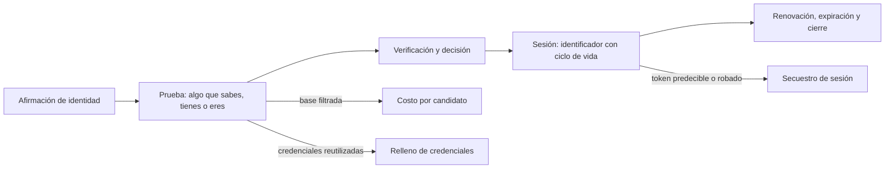
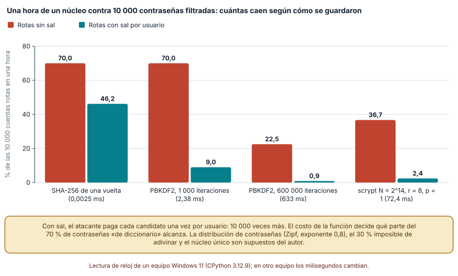
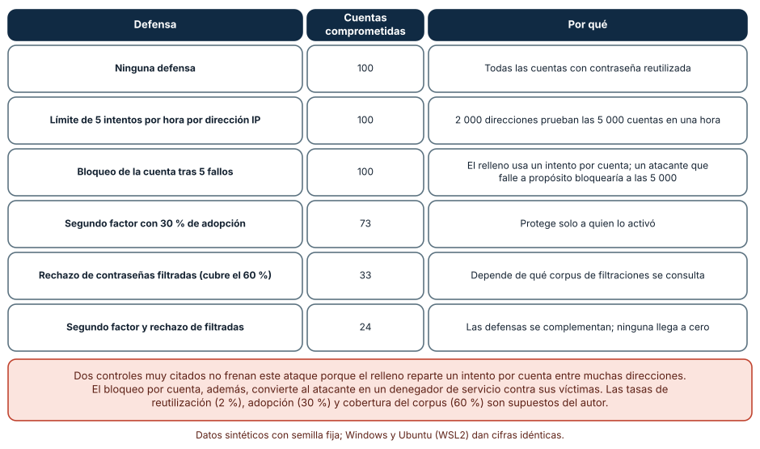
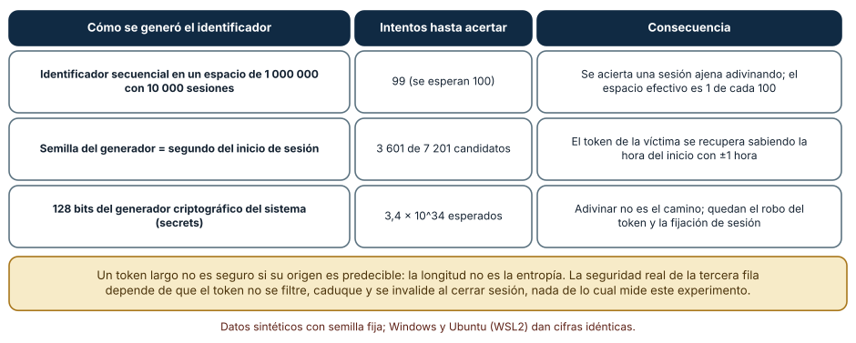

# SE-386 — Identidad, autenticación y sesiones

[← SE-385 — Principios de seguridad y modelos de amenaza](https://github.com/vladimiracunadev-create/modern-software-engineering-program/blob/main/classes/part-32-seguridad-privacidad-y-cumplimiento/se-385-principios-de-seguridad-y-modelos-de-amenaza/README.md) · [↑ Parte 32](https://github.com/vladimiracunadev-create/modern-software-engineering-program/blob/main/classes/part-32-seguridad-privacidad-y-cumplimiento/README.md) · [📚 Índice completo](https://github.com/vladimiracunadev-create/modern-software-engineering-program/blob/main/classes/README.md) · [🌐 Portal](https://vladimiracunadev-create.github.io/modern-software-engineering-program/classes/SE-386.html) · [SE-387 — Autorización, recursos y mínimo privilegio →](https://github.com/vladimiracunadev-create/modern-software-engineering-program/blob/main/classes/part-32-seguridad-privacidad-y-cumplimiento/se-387-autorizacion-recursos-y-minimo-privilegio/README.md)

## Punto profesional y fundamento pedagógico

**Punto profesional.** La clase existe para que puedas decir, con números y no con adjetivos, qué costaría a una persona atacante hacerse pasar por otra en la plataforma: adivinar su contraseña si se filtra la base, reutilizar una contraseña de otro sitio, quedarse con su sesión. La habilidad profesional es elegir y combinar defensas por lo que cada una cambia en ese costo, y reconocer los controles que se ven bien y no frenan el ataque que decían frenar.

**Por qué aparece aquí.** Sigue a **Principios de seguridad y modelos de amenaza**: el modelo señaló que el cruce entre el navegador y la API es la frontera más barata de atravesar, y lo primero que esa frontera pregunta es quién llama. Se estudia antes que la autorización porque no se puede decidir qué puede hacer alguien sin saber, con razonable confianza, quién es. El caso conductor es la **plataforma de entregas de tareas**: iniciar sesión, mantener la sesión y cerrarla.

**Error conceptual que debe corregir.** Creer que una contraseña «con hash» está protegida. El hash protege según su costo, su sal y la distribución de las contraseñas elegidas por las personas: una función rápida con una base filtrada deja caer al 70 % de las cuentas en una hora de un núcleo, y los controles de la puerta de entrada (límites por dirección, bloqueo por cuenta) no frenan al atacante que ya tiene la base ni al que reparte un intento por cuenta.

**Secuencia de aprendizaje.** Antes de mirar el resultado, predices qué fracción de 10 000 cuentas rompe una hora de un núcleo contra una base filtrada según la función con que se guardaron las contraseñas; después mides el tiempo real de cuatro funciones de tu equipo, simulas cinco defensas contra un relleno de credenciales y recuperas una sesión generada con una semilla predecible. La secuencia usa predicción, medición y contraste. [ICAP](https://icap.education.asu.edu/research) distingue participar de construir conocimiento; [How People Learn II](https://nap.nationalacademies.org/catalog/24783/how-people-learn-ii-learners-contexts-and-cultures) respalda diseñar la práctica con contextos reales y retroalimentación.

**Evidencia de aprendizaje.** `identidad-log.md` con la predicción, las mediciones de tiempo por función, la tabla de defensas contra el relleno, la recuperación de la sesión y una nota que separe qué parte es medida de tu equipo, cuál es modelo del autor y cuál es suposición.

**Límite de la conclusión.** Los tiempos de cada función son lecturas del equipo donde se ejecutó (Windows 11 con CPython 3.12.9) y cambian en cada máquina; la distribución de contraseñas, la tasa de reutilización, la adopción del segundo factor y el corpus de filtraciones son supuestos del autor con semilla fija. No se atacó ninguna cuenta real, no se usó ninguna lista de contraseñas filtradas reales ni ningún sistema de autenticación ajeno.

### Trazabilidad fuente → afirmación

| Fuente primaria u oficial | Afirmación que respalda | Lo que no prueba |
|---|---|---|
| [NIST SP 800-63B-4: autenticación](https://pages.nist.gov/800-63-4/sp800-63b.html) | Exige un mínimo de 15 caracteres para contraseñas de un solo factor (8 si forman parte de un segundo factor), prohíbe imponer reglas de composición y cambios periódicos, e indica rechazar contraseñas de una lista de valores comunes o comprometidos. | No fija cuál lista usar ni garantiza que cumplir la letra impida el relleno de credenciales. |
| [OWASP Password Storage Cheat Sheet](https://cheatsheetseries.owasp.org/cheatsheets/Password_Storage_Cheat_Sheet.html) | Recomienda Argon2id como primera opción, scrypt y bcrypt como alternativas y PBKDF2 con al menos 600 000 iteraciones si se exige FIPS; indica sal única por contraseña. | No dice qué parámetros resisten el hardware de un atacante concreto. |
| [RFC 8018 (PBKDF2)](https://www.rfc-editor.org/rfc/rfc8018) y [RFC 7914 (scrypt)](https://www.rfc-editor.org/rfc/rfc7914) | Especifican las funciones de derivación de claves con costo configurable que usan los experimentos. | No recomiendan parámetros actuales. |
| [OWASP Session Management Cheat Sheet](https://cheatsheetseries.owasp.org/cheatsheets/Session_Management_Cheat_Sheet.html) | Exige al menos 64 bits de entropía para el identificador de sesión, renovarlo al cambiar de privilegio y definir expiración por inactividad y absoluta. | No define los plazos exactos de la plataforma. |
| [OWASP: relleno de credenciales](https://owasp.org/www-community/attacks/Credential_stuffing) | Describe el ataque que reutiliza pares usuario-contraseña filtrados de otros sitios. | No mide su tasa de éxito en un sistema real. |
| [W3C WebAuthn Nivel 2](https://www.w3.org/TR/webauthn-2/) | Define credenciales de clave pública ligadas al origen que no se pueden reutilizar en un sitio falso. | No dice cuántas personas lo adoptan ni cómo recuperar una cuenta sin el dispositivo. |

## Antes de empezar

Recupera lo aprendido en `SE-385`: la frontera entre el navegador y la API es la más barata de cruzar. La pregunta activa es: **si se filtra la tabla de usuarios de la plataforma esta noche, ¿qué parte de las cuentas queda comprometida mañana y qué decisión tomada hoy lo cambió?**

## Prerrequisitos

- Haber completado `SE-385` o poder dibujar una frontera de confianza y decir qué cruza.
- Python 3.11 o posterior; los experimentos usan solo la biblioteca estándar (`hashlib`, `random`, `secrets`, `time`).
- Saber qué es un hash, una sal y una cookie.

## Problema auténtico

En un escenario ilustrativo, la plataforma guardaba las contraseñas con SHA-256 y una sal fija para toda la tabla, y limitaba a cinco los intentos por dirección IP. Un respaldo de la base apareció en un foro. En una hora un portátil recuperó las contraseñas de más de la mitad de las cuentas con alguna de las mil contraseñas más repetidas, y esa misma noche un servicio automatizado empezó a probar en la plataforma pares de correo y contraseña de otros sitios desde dos mil direcciones, un intento por cuenta. El límite por dirección no actuó nunca y el bloqueo por cuenta, que se había añadido para frenar el abuso, solo servía para que alguien bloqueara a un docente a propósito el día de las notas. Nada de eso fallaba un ítem de la lista de verificación: había hash, había sal y había límites. La clase enseña a medir cuánto cuesta cada candidato, a distinguir qué defensa actúa sobre qué ataque y a generar y vigilar sesiones sin confiar en que «el token es largo».

## Objetivos observables

Al terminar podrás:

1. distinguir identificación, autenticación y gestión de sesión y decir qué evidencia produce cada una;
2. medir el costo por candidato de varias funciones de derivación de claves en tu equipo y estimar qué fracción de una base filtrada cae en una hora;
3. explicar por qué la sal por usuario multiplica el costo del atacante por el número de cuentas y por qué no frena a quien ataca una sola;
4. comparar defensas frente al relleno de credenciales y decir cuáles no actúan sobre ese ataque;
5. generar identificadores de sesión sin estructura predecible y decidir su ciclo de vida: expiración, renovación y cierre.

## Mapa conceptual



El mapa separa la **afirmación** («soy ana»), la **prueba**, la **decisión** y la **sesión**, que convierte una prueba cara en un identificador barato de presentar. Los tres ataques de la derecha actúan en puntos distintos y no se frenan con el mismo control.

## Temas y por qué importan

| Tema | Por qué cambia una decisión profesional | Evidencia mínima |
|---|---|---|
| Identificación, autenticación y sesión | Cada etapa se ataca y se defiende de manera distinta. | Diagrama de las tres etapas en la plataforma |
| Almacenamiento de contraseñas | Decide qué ocurre cuando se filtra la base, que es el caso en que más importa. | Tiempo por candidato medido y fracción rota en una hora |
| Defensas en la puerta de entrada | Límites y bloqueos actúan sobre ataques concretos y no sobre otros. | Tabla de defensas frente al relleno y la fuerza bruta |
| Segundo factor y credenciales de clave pública | Elimina o reduce el valor de una contraseña robada o reutilizada. | Decisión por tipo de cuenta con su recuperación |
| Sesiones | Un identificador predecible o robado equivale a la contraseña. | Generación con entropía real y política de expiración |

## Conceptos y decisiones

### 1. Identificación, autenticación y sesión

La **identificación** es la afirmación de quién se es («`ana@ejemplo.test`»); la **autenticación** es la prueba de esa afirmación; la **sesión** es el estado que evita repetir la prueba en cada petición. Se atacan distinto. La identificación se enumera (¿existe este correo?) cuando el sistema responde distinto para usuario inexistente y contraseña errónea; la autenticación se ataca adivinando, reutilizando o robando la prueba; la sesión se ataca adivinando, robando o forzando el identificador. Separar las tres etapas permite asignar a cada una su defensa. Una consecuencia práctica: el mensaje de error de acceso debe ser el mismo para ambos casos, y el tiempo de respuesta también, pues una diferencia de 200 ms entre «no existe» y «clave errónea» es una enumeración de cuentas aunque el texto sea idéntico. Y una confusión frecuente: autenticar bien no autoriza nada; qué puede hacer la persona es la pregunta de la clase siguiente.

### 2. Almacenar contraseñas: costo, sal y distribución

Una función de hash criptográfica rápida como SHA-256 se diseñó para ser rápida; un atacante con una base filtrada la aprovecha. Las funciones de derivación de claves de contraseña (PBKDF2, scrypt, bcrypt, Argon2id) añaden un **costo configurable**: iteraciones, o memoria y paralelismo, que encarece cada candidato. La **sal** es un valor aleatorio único por contraseña que se guarda junto al hash; su efecto es doble: dos usuarios con la misma contraseña tienen hashes distintos y el atacante no puede reutilizar una tabla precalculada ni comparar un solo cálculo con toda la tabla, de modo que el costo de probar un candidato contra todos los usuarios se multiplica por el número de usuarios. La sal no frena al atacante que se concentra en una cuenta: contra una sola, probar mil candidatos sigue costando mil cálculos. Lo que lo frena es el costo por cálculo. El otro factor es la distribución de las contraseñas humanas: unas pocas se repiten mucho (una cola larga de popularidad), de modo que la fracción rota crece rápido con los primeros miles de candidatos y se aplana después. OWASP recomienda Argon2id como primera opción, y NIST SP 800-63B-4 pide longitud mínima antes que reglas de composición, prohíbe forzar cambios periódicos y exige comparar las contraseñas elegidas con listas de valores comunes o comprometidos.

### 3. Ataques a la puerta de entrada

Hay tres ataques diferentes que se confunden. La **fuerza bruta** prueba muchas contraseñas contra una cuenta; un bloqueo por cuenta la frena y a la vez crea una arma de denegación de servicio: cualquiera puede bloquear a un docente con cinco intentos fallidos. La **pulverización** (password spraying) prueba una o unas pocas contraseñas comunes contra muchas cuentas, de modo que ninguna cuenta acumula fallos. El **relleno de credenciales** usa pares reales de otros sitios, un intento por cuenta; funciona porque las personas reutilizan contraseñas, y como cada intento es plausible, parece tráfico legítimo. El límite por dirección IP pierde sentido cuando el atacante dispone de miles de direcciones; el bloqueo por cuenta no se activa con un intento. Las defensas que sí actúan son las que cambian el valor de lo robado: un segundo factor (la contraseña filtrada deja de bastar), el rechazo de contraseñas comprometidas al registrarse o cambiarlas, y la detección de patrones (muchas cuentas distintas desde direcciones nuevas con la misma forma de cliente). Ninguna defensa lo resuelve sola.

### 4. Segundo factor y credenciales de clave pública

Un segundo factor añade una prueba que no se obtiene de la misma filtración. Los códigos de un solo uso por mensaje o aplicación elevan el costo y siguen siendo vulnerables al phishing en tiempo real: la persona escribe el código en un sitio falso y el atacante lo reenvía. Las credenciales de clave pública del estándar WebAuthn atan la prueba al **origen**: el navegador firma un desafío solo para el dominio registrado, de modo que un sitio falso no obtiene nada reutilizable. El costo es de recuperación: perder el dispositivo debe tener un camino que no sea más débil que la propia credencial, porque el atacante elegirá el camino de recuperación. Una política razonable para la plataforma distingue por riesgo: docentes y administración con segundo factor obligatorio y preferencia por claves de acceso, estudiantes con segundo factor opcional y rechazo de contraseñas comprometidas.

### 5. Sesiones: identificador, ciclo de vida y cierre

Tras la autenticación el servidor entrega un identificador que, mientras sea válido, vale lo mismo que la contraseña. Debe tener entropía real (OWASP pide al menos 64 bits), generarse con el generador criptográfico del sistema y no derivarse de datos predecibles como la hora, un contador o el nombre. Se renueva en cada cambio de privilegio (inicio de sesión, elevación) para impedir la fijación de sesión, en la que el atacante conoce el identificador antes de que la víctima se autentique. Tiene dos plazos: **inactividad** (minutos para datos de alto valor, decenas para bajo riesgo) y **absoluto** (cuánto puede durar aunque se use). Se invalida en el servidor al cerrar sesión; borrar la cookie del navegador no cierra la sesión si el servidor la sigue aceptando. La cookie lleva los atributos `Secure`, `HttpOnly` y `SameSite`, que reducen su exposición por canales no cifrados, por scripts y por peticiones desde otros sitios, respectivamente. Una sesión robada y válida durante siete días es una contraseña robada con vencimiento: la expiración acota el daño, no lo evita.

### Costo por candidato y fracción rota

Se miden en este equipo cuatro funciones sobre la misma contraseña y se estima qué ocurre en una hora de un núcleo contra 10 000 usuarios. El modelo asume que el 70 % de las personas elige una contraseña de un diccionario de un millón de candidatos con popularidad tipo Zipf (exponente 0,8) y que el 30 % elige una imposible de adivinar. Sin sal, un candidato se prueba contra todos a la vez; con sal por usuario, cada candidato se paga una vez por usuario.

```python
import hashlib, time
t0 = time.perf_counter()
for _ in range(5):
    hashlib.pbkdf2_hmac("sha256", b"correct horse battery", b"0123456789abcdef", 600000)
print((time.perf_counter() - t0) / 5)
```

| Función | ms por hash (Windows) | Rotas sin sal | Rotas con sal por usuario |
|---|---:|---:|---:|
| SHA-256 de una vuelta | 0,0025 | 70,0 % | 46,2 % |
| PBKDF2, 1 000 iteraciones | 2,38 | 70,0 % | 9,0 % |
| PBKDF2, 600 000 iteraciones | 633 | 22,5 % | 0,9 % |
| scrypt (N = 2^14, r = 8, p = 1) | 72,4 | 36,7 % | 2,4 % |

Con hashes sin sal, probar cada candidato una vez sirve para toda la tabla (1 000 cálculos cubren 1 000 candidatos para los 10 000 usuarios); con sal por usuario son 10 000 000 cálculos. La función de 600 000 iteraciones cuesta unos 250 000 veces más que la de una vuelta, y esa es la razón por la que la fracción rota baja de 70 a 22,5 %. Los tiempos son lecturas de un equipo: en Ubuntu bajo WSL2 la misma prueba dio 0,0011 ms, 0,65 ms, 522 ms y 60,3 ms.



**Cómo leer la figura.** Cada grupo es una función de derivación con su costo por hash entre paréntesis; la barra coral son las cuentas rotas sin sal y la verde azulada, con sal por usuario. Mira cuánto baja cada barra al subir el costo de la función y que la sal acorta la barra verde azulada en todos los grupos. **Dónde deja de valer:** un atacante con tarjetas gráficas prueba millones de candidatos por segundo con funciones que no exigen memoria; por eso scrypt y Argon2id piden memoria. El 70 % de contraseñas de diccionario y el exponente 0,8 son supuestos del autor; con contraseñas largas generadas por gestor, la cifra baja a cerca de cero.

### El relleno de credenciales

La plataforma tiene 5 000 cuentas; 100 de ellas (2 %) reutilizan una contraseña que figura en la lista del atacante, que contiene un par por cuenta. El atacante dispone de 2 000 direcciones y envía un intento por par. Se miden seis configuraciones de defensa.

| Defensa | Cuentas comprometidas (de 100) | Observación |
|---|---:|---|
| Ninguna | 100 | todas las que reutilizan |
| Límite de 5 intentos por hora por dirección | 100 | 2 000 direcciones prueban las 5 000 cuentas en una hora |
| Bloqueo de la cuenta tras 5 fallos | 100 | el relleno usa un intento por cuenta; fallando a propósito, el atacante bloquea a las 5 000 |
| Segundo factor (30 % de adopción) | 73 | protege solo a quien lo activó |
| Rechazo de contraseñas filtradas (cubre 60 %) | 33 | depende del corpus consultado |
| Segundo factor y rechazo | 24 | las defensas se complementan |

Los dos controles más habituales de la puerta de entrada no cambian la cifra. Lo que la reduce es lo que actúa sobre el valor de la credencial robada.



**Cómo leer la figura.** Cada barra es una defensa y su longitud, cuántas de las 100 cuentas con contraseña reutilizada se comprometen. Mira que las tres primeras barras son iguales: dos controles muy citados no cambian nada, y solo bajan las defensas que cambian quién puede entrar o con qué contraseña. **Dónde deja de valer:** la reutilización (2 %), la adopción del segundo factor (30 %) y la cobertura del corpus (60 %) son del autor; una plataforma con más reutilización tiene más cuentas en riesgo, y un atacante que además hace phishing en tiempo real elude el segundo factor basado en códigos.

### Adivinar una sesión

Tres esquemas para el identificador, con 10 000 sesiones activas: un contador dentro de un espacio de un millón, una semilla igual al segundo del inicio de sesión y 128 bits del generador criptográfico.

```python
victima = random.Random(1_700_000_123).getrandbits(64)
for ts in range(1_700_000_123 - 3600, 1_700_000_123 + 3601):
    if random.Random(ts).getrandbits(64) == victima:
        break
```

| Esquema | Intentos hasta acertar | Consecuencia |
|---|---:|---|
| Contador en un espacio de 1 000 000 | 99 (se esperan 100) | una sesión ajena se acierta adivinando |
| Semilla = segundo del inicio de sesión | 3 601 de 7 201 candidatos | se recupera el token sabiendo la hora ±1 h |
| 128 bits del generador del sistema | 3,4 × 10^34 esperados | adivinar no es el camino |

El token del segundo esquema es de 64 bits y parece largo; su entropía real es la de la hora, unas 13 bits dentro de una ventana de dos horas. La longitud no es la entropía.



**Cómo leer la figura.** Cada tarjeta es una forma de generar el identificador y a la derecha, cuántos intentos necesita alguien para quedarse con una sesión: coral si es abordable y verde azulado si adivinar deja de ser el camino. Mira que la segunda parece larga y no lo es: su entropía real es la hora del inicio. **Dónde deja de valer:** la tercera fila supone que el token no se filtra: no cubre robo por scripts, cookies sin `HttpOnly`, registros de acceso con el token ni sesiones que no caducan. Esos riesgos requieren las defensas de ciclo de vida de la sección anterior.

### Ampliación: confianza cero y la vida de una credencial robada

Esta clase trata cómo se identifica a una persona y cómo se mantiene su sesión. La **confianza cero** (*zero trust*, definida en [NIST SP 800-207](https://csrc.nist.gov/pubs/sp/800/207/final)) extiende la pregunta a toda llamada, de persona o de máquina: ¿qué identidad verificada hace esta solicitud y qué le permite la política ahora mismo? La clase de nube (SE-353) muestra cómo limita el alcance del atacante en una red de servicios. Esta ampliación mira la otra cara: qué pasa con la identidad misma cuando se roba, y qué diseños de credencial acortan la ventana en que el robo sirve.

**Dos robos que se parecen y no lo son.** Una **copia filtrada** es la credencial como dato: aparece en un registro, un repositorio, una copia de seguridad o un historial de comandos; el atacante tiene el valor, pero no el equipo del dueño. Un **equipo comprometido** es el robo del que la usa: el atacante ejecuta código en el servicio o el equipo legítimo y puede pedir credenciales nuevas mientras la identidad siga válida. Los controles que reducen uno apenas tocan el otro.

**Mecanismos de acortar la ventana.**

- **Vida corta.** Un token de 15 minutos o de una hora caduca solo; una llave estática dura hasta que alguien la rota. Con vida corta, una copia filtrada deja de servir en minutos.
- **Revocación en la renovación.** Si renovar exige que el emisor consulte el estado de la identidad, deshabilitarla impide emitir credenciales nuevas; las ya emitidas caducan al terminar su vida.
- **Credencial atada a la clave del cliente** (*sender-constrained*). El token se emite para una clave que solo posee el cliente legítimo: con TLS mutuo ([RFC 8705](https://datatracker.ietf.org/doc/html/rfc8705)) o con una prueba de posesión por solicitud ([RFC 9449, DPoP](https://www.rfc-editor.org/rfc/rfc9449)). Quien copia el token sin la clave privada no puede usarlo.
- **Evaluación continua.** La política se consulta en cada solicitud, no solo al iniciar sesión; deshabilitar una identidad surte efecto en el tiempo que tarde en propagarse esa decisión.

**Experimento reproducible.** `scripts/experiments_part32_ext.py` simula 20 000 robos por celda (semilla 386) de cada uno de cuatro diseños: A, llave estática que rota cada 90 días y se revoca a mano 4 horas después de detectar el robo; B, token portador de 1 hora sin revocación; C, token portador de 15 minutos que se revoca al renovar; D, token de 1 hora atado a la clave del cliente, con política evaluada en cada solicitud y 1 minuto de propagación. La detección tarda un tiempo lognormal de mediana 6 horas y el 25 % de los robos no se detecta en la ventana de observación de 720 horas. Se mide cuánto tiempo conserva acceso el atacante.

| Diseño | Copia filtrada: media (h) | Copia: más de 1 h | Equipo comprometido: media (h) | Equipo: mediana (h) | Equipo: más de 1 h |
|---|---:|---:|---:|---:|---:|
| A. Llave estática | 159,94 | 100 % | 159,94 | 13,81 | 100 % |
| B. Token portador de 1 h | 0,50 | 0 % | 188,36 | 10,43 | 98,1 % |
| C. Token portador de 15 min revocable | 0,12 | 0 % | 188,08 | 10,04 | 95,8 % |
| D. Token atado a la clave | 0,00 | 0 % | 187,80 | 9,98 | 95,0 % |


**Cómo leer la figura.** Cada diseño tiene dos barras: la dorada es el robo de una copia y la coral, el del equipo comprometido; la longitud es el porcentaje de robos en que el atacante conserva acceso más de una hora. Mira el contraste: las tres alternativas a la llave estática llevan la dorada a cero y la coral casi no se mueve. **Dónde deja de valer:** la detección (mediana de 6 horas, 25 % sin detectar en 30 días) es un supuesto que domina el resultado del equipo comprometido; el modelo no incluye vulnerar al emisor de credenciales, robar la clave privada del cliente ni que el atacante use la identidad robada de forma que parezca normal; y las medias del equipo comprometido (cerca de 188 h) las determina el 25 % sin detectar, por eso la tabla añade la mediana.

**Límite y decisión.** La enseñanza no es que las credenciales de vida corta sean inútiles, sino que resuelven el problema de la copia y no el del equipo comprometido; este se acota con detección rápida (clases de observabilidad y respuesta a incidentes) y con lo que la identidad robada puede alcanzar (microsegmentación y mínimo privilegio, SE-353 y SE-387). La decisión práctica: sustituir llaves estáticas por credenciales de vida corta y atadas a la clave siempre que el cliente pueda guardar una clave; evaluar la política en cada llamada y no solo al iniciar sesión; medir cuánto tarda de verdad una revocación en surtir efecto; y no presentar a la vida corta como protección frente al equipo comprometido.

## Definiciones de trabajo

- **autenticación:** prueba de que quien llama controla la identidad que afirma, mediante algo que sabe, tiene o es.
- **sal:** valor aleatorio único por contraseña, almacenado junto al hash, que impide reutilizar cálculos entre cuentas.
- **relleno de credenciales:** ataque que prueba en un sitio pares usuario-contraseña filtrados de otros sitios, normalmente un intento por cuenta.
- **identificador de sesión:** valor que el servidor reconoce como prueba de una autenticación previa y que vale lo mismo que ella mientras sea válido.
- **fijación de sesión:** ataque en el que el atacante impone a la víctima un identificador conocido antes de que se autentique.

Las definiciones son operativas para la plataforma de entregas. No convierten términos con una historia más amplia en sinónimos y deben contrastarse con la documentación primaria enlazada al final.

## Ejemplo mínimo

El fragmento muestra por qué la sal importa solo cuando se ataca a muchos. Antes de ejecutarlo, predice cuántos cálculos de hash hace falta para probar 1 000 candidatos contra 10 usuarios con y sin sal.

```python
candidatos, usuarios = 1000, 10
print(candidatos, candidatos * usuarios)
```

Sin sal, 1 000 cálculos sirven para los 10 usuarios; con sal por usuario son 10 000. Registra versión de Python, comando y salida; después contra un solo usuario comprueba que ambos números coinciden: la sal no frena al atacante que se concentra en una cuenta.

## Ejemplo profesional

El equipo de la plataforma sustituye SHA-256 por Argon2id con los parámetros de OWASP, migra al iniciar sesión (verifica con el hash antiguo, vuelve a guardar con el nuevo), exige quince caracteres para contraseñas sin segundo factor, rechaza contraseñas presentes en una lista de valores comunes y exige segundo factor a docentes y administración. Mide el tiempo de verificación en su propio entorno y comprueba que con el límite de peticiones del endpoint no se convierte en un punto de denegación: el costo del hash lo paga también el servidor. Responde con el mismo mensaje y tiempo para usuario inexistente que para clave errónea (calcula un hash ficticio). Las sesiones usan el generador criptográfico, se renuevan al iniciar sesión y al elevar privilegio, caducan a los 20 minutos de inactividad y a las 8 horas absolutas y se invalidan en el servidor al cerrar. El resultado se mide por lo que cambia: en el modelo de la clase, el 0,9 % de las cuentas cae en una hora en vez del 70 %.

## Práctica guiada

1. Escribe tu predicción de la fracción de cuentas que cae en una hora según la función.
2. Mide el tiempo por hash de las cuatro funciones en tu equipo y anota sistema operativo, versión de Python y procesador.
3. Calcula con tu medición la fracción rota con y sin sal, y repite con un exponente de 1,2 para ver el efecto de una distribución más concentrada.
4. Simula el relleno de credenciales con las seis configuraciones y verifica que el límite por dirección no cambia la cifra.
5. Genera un identificador de sesión con una semilla igual a la hora y recupéralo desde una ventana de dos horas.
6. Escribe la política de sesión de la plataforma: generación, renovación, plazos, cierre y atributos de cookie.
7. Entrega `identidad-log.md` y pide a otra persona que intente enumerar cuentas con las respuestas del inicio de sesión.

## Ejercicios

1. **Costo:** calcula cuántos candidatos por segundo permite una función que tarda 0,25 s por hash y compáralo con la de 0,0025 ms; explica qué ocurre con la fracción rota.
2. **Sal:** demuestra con números que la sal por usuario no protege a una cuenta atacada individualmente y explica cuál es la defensa en ese caso.
3. **Defensas:** para el relleno de credenciales, ordena cinco defensas por el cambio que producen y justifica por qué el bloqueo por cuenta empeora otro riesgo.
4. **Sesión:** escribe tres formas de generar un identificador, calcula su entropía real y decide cuál cumple los 64 bits que pide OWASP.

## Reto verificable

Entrega `identidad-log.md` con la predicción, la tabla de tiempos de tu equipo, la fracción rota con y sin sal, la tabla de defensas contra el relleno, la recuperación de la sesión predecible y la política de sesión. Se aprueba si otra persona ejecuta el código desde un checkout limpio, obtiene las mismas cifras de los experimentos con semilla (relleno y sesión), tiempos de reloj del mismo orden de magnitud y puede decir qué defensa recomendarías para cada ataque y por qué. No se aprueba por entregar una lista de buenas prácticas sin medir ninguna ni por afirmar que un límite por dirección «previene el relleno».

## Caso conductor

La plataforma de entregas de tareas continúa como caso conductor de la Parte 32. Esta clase deja el segundo artefacto: la política de autenticación y sesión con sus mediciones. `SE-387` preguntará qué puede hacer una persona ya autenticada y por qué un identificador adivinable no es un control. Cambia después un solo dato, la reutilización de contraseñas del 2 % al 10 %, y observa qué defensa pasa a ser decisiva.

## Preguntas frecuentes

### ¿Es suficiente con SHA-256 y una sal?

No, si el hash es rápido. La sal evita reutilizar cálculos entre cuentas; no encarece cada candidato. Con una función rápida un atacante prueba miles de millones de candidatos por segundo con hardware común. La defensa es una función con costo configurable y una contraseña larga.

### ¿Cuántas iteraciones de PBKDF2 hay que usar?

Las que el sistema soporte sin degradar el inicio de sesión: OWASP indica 600 000 para HMAC-SHA-256 cuando se exige FIPS, y recomienda Argon2id si se puede. El número envejece con el hardware: debe revisarse y migrarse al iniciar sesión, no fijarse para siempre.

### ¿Por qué no forzar cambios de contraseña cada 90 días?

Porque produce contraseñas más débiles y predecibles (una versión incrementada de la anterior). NIST SP 800-63B-4 prohíbe exigir cambios periódicos y pide forzar el cambio cuando hay evidencia de compromiso.

### ¿Sirve el segundo factor por mensaje de texto?

Eleva el costo del relleno y deja de proteger frente a intercepción del número, intercambio fraudulento de la tarjeta SIM y phishing en tiempo real. Para cuentas privilegiadas conviene una aplicación o una clave de acceso ligada al origen.

## Fallo controlado y diagnóstico

Reproduce el fallo clásico de la clase: **un control de la puerta de entrada que no actúa sobre el ataque**. Configura un límite de cinco intentos por hora y por dirección y lanza el relleno desde 2 000 direcciones con un intento por cuenta.

Registra síntoma, entrada mínima, hipótesis, observación que descarta cada hipótesis, causa, corrección y prueba de regresión. **Síntoma:** el panel muestra cero bloqueos y cien cuentas fueron comprometidas. **Hipótesis rivales:** (a) el límite está mal configurado; (b) el tráfico no pasa por el limitador; (c) el ataque no excede el límite en ninguna dirección. **Prueba:** cuenta intentos por dirección y por cuenta; si cada dirección hace 2,5 intentos y cada cuenta recibe uno, la causa es que el ataque nunca rebasa el umbral que mide el control. **Conclusión:** el límite funciona como se diseñó y mide la variable equivocada para este ataque. **Regresión:** añade una prueba que simule el relleno distribuido y exija que al menos una defensa (segundo factor o rechazo de contraseñas filtradas) lo reduzca; registra el número de cuentas comprometidas como métrica. No cambies a la vez el límite y el corpus.

## Errores comunes y cómo corregirlos

| Síntoma | Causa probable | Corrección |
|---|---|---|
| Una filtración rompe la mayoría de las cuentas | Hash rápido o sal única global | Argon2id, scrypt o PBKDF2 con costo alto y sal por usuario |
| El límite por IP no frena el relleno | El ataque reparte un intento por cuenta y cuenta con miles de direcciones | Segundo factor y rechazo de contraseñas comprometidas |
| Bloquean a un docente a propósito | Bloqueo por cuenta sin retraso progresivo | Retrasos crecientes y alerta, no bloqueo indefinido |
| El error revela si el usuario existe | Mensajes o tiempos distintos | Misma respuesta y mismo tiempo en ambos casos |
| Una sesión robada vale semanas | Sin expiración ni invalidación en el servidor | Plazos de inactividad y absoluto, invalidar al cerrar y al cambiar la contraseña |

## Entorno y archivos clave

```text
work/SE-386/
├── README.md
├── identidad/
│   ├── hash_costo.py
│   ├── relleno.py
│   └── sesion.py
├── tests/test_identidad.py
└── evidence/identidad-log.md
```

El `README` declara plataforma, versión de Python, semillas y comandos. Los experimentos usan solo la biblioteca estándar (`hashlib`, `random`, `secrets`, `time`) y se ejecutaron con CPython 3.12.9 en Windows 11 y 3.12.3 en Ubuntu bajo WSL2: las cifras con semilla fueron idénticas y los tiempos de reloj difirieron. Si añades una dependencia, fija procedencia y versión.

## Seguridad, ética y accesibilidad

- los datos son sintéticos: no uses contraseñas ni correos reales, ni listas filtradas, para ensayar un ataque;
- no pruebes relleno, fuerza bruta ni enumeración contra servicios que no son tuyos ni sin autorización escrita;
- una política de autenticación afecta a personas distintas: el segundo factor obligatorio no puede excluir a quien no tiene teléfono; ofrece alternativas y un camino de recuperación seguro;
- los formularios de acceso deben ser accesibles con teclado y lector de pantalla, permitir gestores de contraseñas y pegar en el campo; evita bloqueos de pegado que empujan a contraseñas cortas;
- los mensajes de error deben ser comprensibles sin revelar si la cuenta existe.

## Puente hacia el trabajo con agentes

Un agente al que se le pide «implementa el login seguro» suele generar `sha256(password + salt)`, un contador de intentos por dirección y un token con `uuid4` sin explicar qué ataque frena cada pieza. Pídele en cambio que declare para cada control qué ataque actúa, que mida el costo por candidato de la función elegida en tu equipo, que simule el relleno distribuido contra su propio diseño y que muestre cuántas cuentas quedan comprometidas con cada defensa. Revisa que use el generador criptográfico del sistema, que la comparación de tokens sea de tiempo constante y que el código no escriba contraseñas ni tokens en registros. El defecto típico es un control que se ve en la revisión y no actúa sobre el ataque.

## Transferencia

Traslada el análisis a otro dominio (por ejemplo, una aplicación de reservas de un taller): cambia el activo y los actores y conserva el procedimiento de medir el costo por candidato, separar los ataques por el punto donde actúan y fijar el ciclo de vida de la sesión. La transferencia está lograda cuando puedes decir qué defensa cambia el resultado frente a cada ataque en ese dominio, no cuando el código se parece al de la plataforma.

## Evaluación y evidencia

| Criterio | Evidencia para aprobar |
|---|---|
| comprensión | explicación de qué hace la sal, el costo y la entropía real |
| corrección | tablas de relleno y de sesión reproducibles con las mismas semillas y tiempos medidos con su equipo |
| diseño | política de autenticación y de sesión con ataque y defensa por fila |
| diagnóstico | reproducción del fallo «control que no actúa sobre el ataque» con regresión |
| incertidumbre | declaración de que la distribución de contraseñas, las tasas y el corpus son supuestos |
| reproducibilidad | versiones, comandos, salida y límites declarados |

## Fuentes

- [NIST SP 800-63B-4](https://pages.nist.gov/800-63-4/sp800-63b.html) — requisitos de autenticación y de contraseñas; autoridad: NIST.
- [OWASP Password Storage Cheat Sheet](https://cheatsheetseries.owasp.org/cheatsheets/Password_Storage_Cheat_Sheet.html) — algoritmos y parámetros de almacenamiento; autoridad: OWASP.
- [RFC 8018](https://www.rfc-editor.org/rfc/rfc8018) y [RFC 7914](https://www.rfc-editor.org/rfc/rfc7914) — PBKDF2 y scrypt; autoridad: IETF.
- [OWASP Session Management Cheat Sheet](https://cheatsheetseries.owasp.org/cheatsheets/Session_Management_Cheat_Sheet.html) — identificadores y ciclo de vida de la sesión; autoridad: OWASP.
- [OWASP: relleno de credenciales](https://owasp.org/www-community/attacks/Credential_stuffing) — descripción del ataque; autoridad: OWASP.
- [W3C WebAuthn Nivel 2](https://www.w3.org/TR/webauthn-2/) — credenciales de clave pública ligadas al origen; autoridad: W3C.
- [Python: hashlib](https://docs.python.org/3/library/hashlib.html) y [Python: secrets](https://docs.python.org/3/library/secrets.html) — funciones de derivación y generador criptográfico usados en los experimentos; autoridad: documentación de Python.

Cada fuente respalda el mecanismo indicado; ninguna demuestra que el 22,5 %, las 100 cuentas o los 3 601 candidatos se observen en un sistema real. Esa afirmación depende del hardware del atacante, de las contraseñas reales y del tráfico.

- [NIST SP 800-207, Zero Trust Architecture](https://csrc.nist.gov/pubs/sp/800/207/final) — principios de confianza cero: decisión de acceso por solicitud con identidad y contexto; autoridad: NIST.
- [RFC 8705: OAuth 2.0 con TLS mutuo](https://datatracker.ietf.org/doc/html/rfc8705) y [RFC 9449: DPoP](https://www.rfc-editor.org/rfc/rfc9449) — tokens atados a la clave del cliente para que una copia no sirva sin la clave privada; autoridad: IETF.

## Límites y siguiente paso

Se ejecutaron tres experimentos en Windows y Ubuntu (WSL2): relleno y sesión con cifras idénticas; los tiempos de las funciones de derivación son lecturas de reloj de cada equipo y difieren. No se atacó ninguna cuenta ni servicio reales ni se usó ninguna lista de contraseñas filtradas; la distribución de contraseñas, el núcleo único del atacante, la reutilización, la adopción del segundo factor y el corpus de filtraciones son construcciones del autor. La siguiente clase pregunta qué puede hacer una persona ya autenticada. La ampliación sobre confianza cero y credenciales robadas usa un modelo sintético con 20 000 robos por celda y semilla 386, ejecutado con CPython 3.12.9 en Windows; no se ejecutó mTLS, DPoP ni un emisor de credenciales, y los tiempos de detección son supuestos del autor.

## Glosario

- **autenticación:** prueba de que quien llama controla la identidad que afirma, mediante algo que sabe, tiene o es.
- **sal:** valor aleatorio único por contraseña, almacenado junto al hash, que impide reutilizar cálculos entre cuentas.
- **relleno de credenciales:** ataque que prueba en un sitio pares usuario-contraseña filtrados de otros sitios, normalmente un intento por cuenta.
- **identificador de sesión:** valor que el servidor reconoce como prueba de una autenticación previa y que vale lo mismo que ella mientras sea válido.
- **fijación de sesión:** ataque en el que el atacante impone a la víctima un identificador conocido antes de que se autentique.

---

[← SE-385 — Principios de seguridad y modelos de amenaza](https://github.com/vladimiracunadev-create/modern-software-engineering-program/blob/main/classes/part-32-seguridad-privacidad-y-cumplimiento/se-385-principios-de-seguridad-y-modelos-de-amenaza/README.md) · [↑ Parte 32](https://github.com/vladimiracunadev-create/modern-software-engineering-program/blob/main/classes/part-32-seguridad-privacidad-y-cumplimiento/README.md) · [📚 Índice completo](https://github.com/vladimiracunadev-create/modern-software-engineering-program/blob/main/classes/README.md) · [🌐 Portal](https://vladimiracunadev-create.github.io/modern-software-engineering-program/classes/SE-386.html) · [SE-387 — Autorización, recursos y mínimo privilegio →](https://github.com/vladimiracunadev-create/modern-software-engineering-program/blob/main/classes/part-32-seguridad-privacidad-y-cumplimiento/se-387-autorizacion-recursos-y-minimo-privilegio/README.md)
