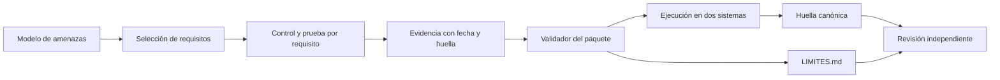
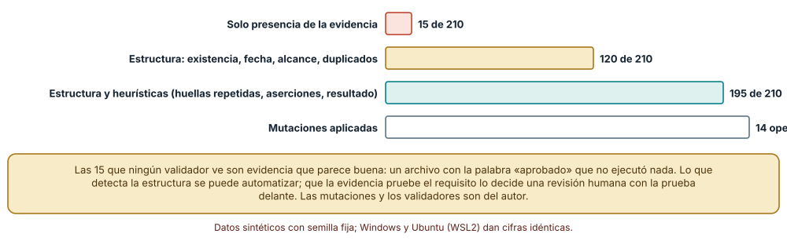
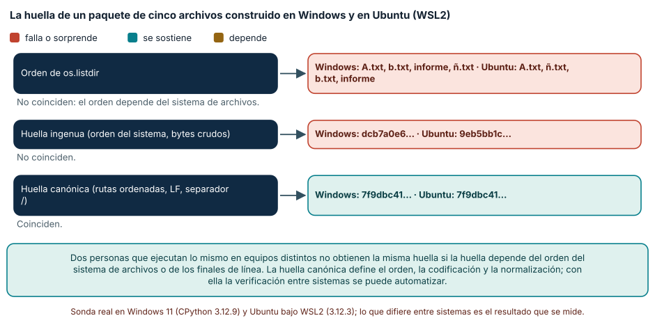

# SE-396 — Proyecto: producto con seguridad verificable

[← SE-395 — Taller: explotar y reparar un control aparente](https://github.com/vladimiracunadev-create/modern-software-engineering-program/blob/main/classes/part-32-seguridad-privacidad-y-cumplimiento/se-395-taller-explotar-y-reparar-un-control-aparente/README.md) · [↑ Parte 32](https://github.com/vladimiracunadev-create/modern-software-engineering-program/blob/main/classes/part-32-seguridad-privacidad-y-cumplimiento/README.md) · [📚 Índice completo](https://github.com/vladimiracunadev-create/modern-software-engineering-program/blob/main/classes/README.md) · [🌐 Portal](https://vladimiracunadev-create.github.io/modern-software-engineering-program/classes/SE-396.html) · [SE-397 — Build reproducible y hermético →](https://github.com/vladimiracunadev-create/modern-software-engineering-program/blob/main/classes/part-33-build-release-y-cadena-de-suministro/se-397-build-reproducible-y-hermetico/README.md)

## Punto profesional y fundamento pedagógico

**Punto profesional.** El proyecto existe para que entregues un producto cuya seguridad otra persona pueda comprobar sin creerte: requisitos de verificación elegidos con un criterio, cada uno con su prueba, su evidencia con fecha y huella, un validador que revisa el paquete y una lista honesta de lo que ninguna comprobación ve. La habilidad profesional es producir un paquete reproducible, no una declaración.

**Por qué aparece aquí.** Cierra la **Parte 32** e integra lo anterior: el modelo de amenazas (`SE-385`), identidad y acceso (`SE-386`, `SE-387`), entradas (`SE-388`), criptografía y secretos (`SE-389`, `SE-390`), privacidad (`SE-391`), proceso y abusos (`SE-392`), respuesta (`SE-393`), evidencia (`SE-394`) y controles aparentes (`SE-395`). El caso conductor es **la plataforma de entregas**, evaluada contra una selección de requisitos del OWASP ASVS 5.0.

**Error conceptual que debe corregir.** Creer que un paquete completo es un paquete verdadero. Un validador que comprueba que cada requisito tenga evidencia detecta lo que falta y no detecta la evidencia que parece buena y no prueba nada.

**Secuencia de aprendizaje.** Antes de mirar los resultados, predices cuántas de 210 mutaciones de un paquete detecta un validador que solo mira la presencia, uno que comprueba estructura y uno con heurísticas semánticas; después mides si la huella del paquete coincide entre Windows y Ubuntu con y sin canonicalización. La secuencia usa predicción, contraste y explicación propia. [ICAP](https://icap.education.asu.edu/research) distingue participar de construir conocimiento; [How People Learn II](https://nap.nationalacademies.org/catalog/24783/how-people-learn-ii-learners-contexts-and-cultures) respalda diseñar la práctica con contextos reales y retroalimentación.

**Evidencia de aprendizaje.** `paquete-seguridad/` con la selección de requisitos y su justificación, la matriz requisito–control–prueba–evidencia, el validador, las huellas canónicas, la ejecución en dos sistemas y `LIMITES.md`.

**Límite de la conclusión.** Los 30 requisitos, las 14 mutaciones y los tres validadores son construcciones del autor; los porcentajes marcan una frontera y no una tasa. No se evaluó ningún producto real contra ASVS ni se obtuvo ninguna verificación independiente, y los identificadores `R00`–`R29` del experimento no son requisitos reales de ASVS.

### Trazabilidad fuente → afirmación

| Fuente primaria u oficial | Afirmación que respalda | Lo que no prueba |
|---|---|---|
| [OWASP ASVS](https://owasp.org/www-project-application-security-verification-standard/) y [repositorio](https://github.com/OWASP/ASVS) | Es un estándar abierto de requisitos para diseñar, desarrollar y probar la seguridad de aplicaciones web y servicios, con versión 5.0.0 publicada. | No certifica que la plataforma cumpla ni dice qué nivel le corresponde. |
| [NIST SP 800-218 (SSDF)](https://csrc.nist.gov/pubs/sp/800/218/final) | Aporta el vocabulario de prácticas para producir y proteger el software. | No mide la eficacia de las prácticas. |
| [Reproducible Builds](https://reproducible-builds.org/) | Define prácticas que crean un camino verificable de forma independiente desde el código fuente hasta el binario. | No garantiza que un paquete de evidencia sea reproducible. |
| [OWASP SAMM](https://owaspsamm.org/) | Ofrece un modelo de madurez para priorizar mejoras. | No sustituye la verificación técnica. |
| [Jia y Harman](https://doi.org/10.1109/TSE.2010.62) | Sustenta la mutación como medida de lo que detecta una comprobación. | No da la tasa que debe alcanzar un validador. |

## Antes de empezar

Recupera `SE-394` (cadena requisito–evidencia) y `SE-395` (control aparente). La pregunta activa es: **¿qué parte de lo que afirma tu paquete podría ser falsa sin que ninguna comprobación automática lo note?**

## Prerrequisitos

- Haber completado `SE-395`.
- Python 3.11 o posterior; solo biblioteca estándar.
- Haber leído las clases de la Parte 32.

## Problema auténtico

En un escenario ilustrativo, el equipo entregó a una institución cliente un «informe de seguridad» de 40 páginas con una tabla de requisitos, todos «cumple». Otra persona pidió reproducirlo en su equipo: la huella del paquete no coincidía entre sistemas porque dependía del orden del listado y de los finales de línea; tres evidencias eran el mismo archivo; una prueba citada no tenía ninguna aserción; y un requisito se declaraba «no aplica» sin justificación. Nada era deshonesto; todo era inverificable. El proyecto construye el paquete de modo que esas fallas se detecten, y declara las que no se pueden detectar.

## Objetivos observables

Al terminar podrás:

1. seleccionar requisitos de verificación con un criterio ligado al modelo de amenazas;
2. construir un paquete con requisito, control, prueba, evidencia, fecha, alcance y huella;
3. escribir un validador y medir qué mutaciones detecta y cuáles no;
4. producir una huella canónica del paquete que coincida entre Windows y Ubuntu;
5. redactar `LIMITES.md` con lo que ninguna comprobación ve.

## Mapa conceptual



El paquete se construye de izquierda a derecha y termina en una **revisión independiente**: el validador reduce el trabajo de la persona revisora, no lo sustituye.

## Temas y por qué importan

| Tema | Por qué cambia una decisión profesional | Evidencia mínima |
|---|---|---|
| Selección de requisitos | Verificar todo no es posible; se elige por riesgo. | Lista con justificación por amenaza |
| Estructura del paquete | Sin campos obligatorios, faltan eslabones. | Esquema con requisito, prueba, evidencia, fecha y alcance |
| Validación y mutación | Un validador se mide por lo que detecta. | Tabla de mutaciones por validador |
| Reproducibilidad entre sistemas | La huella debe ser independiente del sistema. | Huella canónica en dos sistemas |
| Límites y revisión | Lo que ninguna regla ve necesita a una persona. | `LIMITES.md` |

## Conceptos y decisiones

### 1. Elegir qué verificar

ASVS enumera muchos requisitos; un producto no los verifica todos a la vez. El criterio es el modelo de amenazas: los requisitos que cubren los caminos más baratos (`SE-385`) y los controles aparentes (`SE-395`) van primero. Cada selección o exclusión se justifica por escrito, porque una exclusión sin razón es un hueco.

### 2. Estructura del paquete

Cada requisito tiene estado (cumple, no aplica, excepción), control, prueba, evidencia, fecha, alcance (versión del producto) y dueño. «No aplica» exige justificación; una excepción exige dueño y fecha de vencimiento. La evidencia es el resultado ejecutable de una prueba, no una captura.

### 3. Validar el paquete

El validador comprueba la forma: campos, existencia, fechas, alcance y duplicados. Una segunda capa aplica heurísticas: huellas repetidas entre requisitos, pruebas sin aserciones, resultados fallidos marcados como cumple, evidencias vacías. Cada regla la imaginó alguien; lo que nadie imaginó pasa.

### 4. Reproducibilidad entre sistemas

Una huella que depende del orden de `os.listdir`, de los finales de línea o del separador de ruta cambia entre sistemas aunque el contenido sea el mismo. La huella canónica ordena las rutas, usa separador `/`, normaliza `\r\n` a `\n` y fija la codificación. Es la misma idea de reproducibilidad que defiende Reproducible Builds para los binarios.

### 5. Declarar los límites

`LIMITES.md` lista lo que el paquete no demuestra: evidencia válida pero sin relación con el requisito, defectos no previstos por el modelo, comportamiento en producción, y lo que decide una norma. Quien revisa empieza por ese archivo.

### Tres validadores frente a 210 mutaciones

Se construye un paquete de 30 requisitos y se aplican 14 operadores de mutación, 15 veces cada uno. El primer validador solo exige que haya evidencia; el segundo comprueba existencia, fecha de 90 días o menos, alcance, justificación, dueño y duplicados; el tercero añade huellas repetidas, aserciones y resultado de la prueba.

| Validador | Mutaciones detectadas de 210 |
|---|---:|
| Solo presencia de la evidencia | 15 |
| Estructura | 120 |
| Estructura y heurísticas | 195 |

Las 15 restantes son una evidencia única que dice «aprobado» sin haber ejecutado nada: tiene la forma de una evidencia correcta.



**Cómo leer la figura.** Cada barra añade reglas; la barra de 210 es el total. **Dónde deja de valer:** mutaciones y reglas son del autor y se escribieron conociéndose; la cifra marca una frontera.


**Cómo leer la figura.** Cada fila es un tipo de defecto y cada columna un validador; el cero final es el límite. **Dónde deja de valer:** los operadores son 14 elecciones del autor; otro catálogo daría otro reparto.

### La huella entre Windows y Ubuntu

Se crean cinco archivos (algunos con `\r\n`, un nombre con eñe, una subcarpeta) y se calcula una huella ingenua y una canónica en ambos sistemas.

| Método | Windows 11 | Ubuntu (WSL2) | Coinciden |
|---|---|---|---|
| Orden de `os.listdir` | A.txt, b.txt, informe, ñ.txt | A.txt, ñ.txt, b.txt, informe | No |
| Huella ingenua | `dcb7a0e6…` | `9eb5bb1c…` | No |
| Huella canónica | `7f9dbc41…` | `7f9dbc41…` | Sí |



**Cómo leer la figura.** La última fila es la que permite verificar entre sistemas. **Dónde deja de valer:** solo se probaron dos sistemas, CPython 3.12 y cinco archivos; otros sistemas de archivos, normalización Unicode de nombres o permisos pueden introducir diferencias no cubiertas.

## Definiciones de trabajo

- **paquete de evidencia:** conjunto versionado de requisitos, controles, pruebas y evidencias con fecha, alcance y huella.
- **huella canónica:** resumen criptográfico calculado sobre una representación con orden, codificación y finales de línea fijados.
- **validador de paquete:** programa que comprueba la estructura y la coherencia del paquete sin juzgar si la evidencia prueba el requisito.
- **excepción:** incumplimiento aceptado con dueño, razón y fecha de vencimiento.
- **revisión independiente:** examen del paquete por una persona que no lo produjo.

Las definiciones son operativas para la plataforma de entregas. No convierten términos con una historia más amplia en sinónimos y deben contrastarse con la documentación primaria enlazada al final.

## Ejemplo mínimo

Antes de ejecutarlo, predice si las dos huellas coinciden.

```python
import hashlib
print(hashlib.sha256(b"a\r\nb\r\n").hexdigest()[:8], hashlib.sha256(b"a\nb\n").hexdigest()[:8])
```

No coinciden: el mismo texto con otros finales de línea da otra huella. Normaliza `\r\n` a `\n` y comprueba que coinciden.

## Ejemplo profesional

El equipo selecciona 30 requisitos por amenaza, genera el paquete en cada versión, ejecuta el validador en la integración continua en Windows y Ubuntu, compara las huellas canónicas y publica `LIMITES.md`. Una persona ajena revisa por muestreo estratificado (`SE-394`) y en especial las evidencias que el validador no puede juzgar. En el modelo de la clase el validador completo detecta 195 de 210 mutaciones.

## Práctica guiada

1. Predice las detecciones de los tres validadores.
2. Selecciona 30 requisitos y justifica cada uno con una amenaza.
3. Construye el paquete con los campos obligatorios.
4. Implementa los tres validadores y las 14 mutaciones.
5. Calcula la huella ingenua y la canónica en dos sistemas.
6. Escribe `LIMITES.md`.
7. Pide a otra persona que construya una mutación que tu validador no vea.

## Ejercicios

1. **Selección:** justifica la exclusión de cinco requisitos.
2. **Regla:** diseña una regla que detecte evidencia sin relación con el requisito y su falsa alarma.
3. **Huella:** añade la normalización Unicode de nombres a la huella canónica.
4. **Excepción:** redacta una excepción completa con dueño y vencimiento.

## Reto verificable

Entrega el paquete, el validador, las huellas de dos sistemas y `LIMITES.md`. Se aprueba si otra persona lo ejecuta desde un checkout limpio, obtiene la misma huella canónica y las mismas detecciones, y puede nombrar una mutación que el validador no ve. No se aprueba por un paquete «completo» sin límites declarados.

## Caso conductor

La plataforma de entregas queda con un paquete de seguridad verificable. La Parte 33 pasa a la construcción, la versión y la cadena de suministro. Cambia un solo dato, el plazo de frescura, y observa qué requisitos dejan de estar vigentes.

## Preguntas frecuentes

### ¿Esto equivale a una certificación ASVS?

No. Es un paquete de autoevaluación; una verificación independiente la hace otra persona o entidad.

### ¿Cuántos requisitos hay que incluir?

Los que el modelo de amenazas justifique, con las exclusiones explicadas.

### ¿Un validador puede aprobar un paquete falso?

Sí: la última fila de la tabla es un ejemplo. Por eso existen `LIMITES.md` y la revisión independiente.

## Fallo controlado y diagnóstico

Reproduce el fallo: **un paquete que valida y no prueba nada**. Sustituye una evidencia por un texto «APROBADO» sin ejecución.

**Síntoma:** el validador aprueba y la prueba nunca se ejecutó. **Hipótesis rivales:** (a) el validador falla; (b) la evidencia es válida; (c) la regla no mira el contenido. **Prueba:** busca la salida de la prueba en el registro de ejecución; si no existe, la causa es (c). **Conclusión:** el validador comprueba forma, no ejecución. **Regresión:** exige que la evidencia incluya la huella del registro de ejecución de la integración continua y que el validador la compruebe. No cambies a la vez la regla y el paquete.

## Errores comunes y cómo corregirlos

| Síntoma | Causa probable | Corrección |
|---|---|---|
| La huella cambia entre sistemas | Orden, finales de línea o separadores | Huella canónica |
| Tres requisitos con la misma evidencia | Evidencia copiada | Regla de huellas repetidas |
| «No aplica» sin razón | Campo opcional | Campo obligatorio con justificación |
| Evidencia de hace meses | Sin fecha ni frescura | Fecha, alcance y límite de edad |
| El validador aprueba todo | Solo mira presencia | Estructura, heurísticas y revisión humana |

## Entorno y archivos clave

```text
work/SE-396/
├── paquete-seguridad/
│   ├── requisitos.csv
│   ├── evidencias/
│   ├── validador.py
│   ├── huella.py
│   └── LIMITES.md
├── tests/test_paquete.py
└── evidence/proyecto-log.md
```

Los experimentos usan solo la biblioteca estándar y se ejecutaron con CPython 3.12.9 en Windows 11 y 3.12.3 en Ubuntu bajo WSL2: el validador dio cifras idénticas y las sondas de portabilidad difieren por diseño.

## Seguridad, ética y accesibilidad

- todo el contenido es sintético: no incluyas datos reales ni secretos en el paquete;
- no declares conformidad con ASVS ni con ninguna norma sin una verificación independiente;
- el paquete debe poder leerse con lector de pantalla y sin herramientas especiales;
- las excepciones afectan a personas: documenta quién asume el riesgo.

## Puente hacia el trabajo con agentes

Un agente al que se le pide «prepara el informe de seguridad» producirá una tabla de «cumple». Pídele que genere cada evidencia ejecutando la prueba, que guarde la huella del registro, que ejecute el validador y las mutaciones mostrando la salida y que redacte `LIMITES.md`. Revisa que ninguna evidencia sea texto sin ejecución y que no invente requisitos de ASVS.

## Transferencia

Aplica el proyecto a otro producto (por ejemplo, la aplicación de citas de un taller): cambia los requisitos y conserva la selección por amenaza, el validador medido, la huella canónica y los límites. Está lograda cuando puedes decir qué mutación no vería tu validador.

## Evaluación y evidencia

| Criterio | Evidencia para aprobar |
|---|---|
| comprensión | explicación de qué detecta y qué no el validador |
| corrección | detecciones y huella canónica reproducibles |
| diseño | selección justificada y paquete con campos obligatorios |
| diagnóstico | fallo «valida y no prueba» con regresión |
| incertidumbre | `LIMITES.md` y declaración de supuestos |
| reproducibilidad | versiones, comandos y huellas en dos sistemas |

## Fuentes

- [OWASP ASVS](https://owasp.org/www-project-application-security-verification-standard/) — requisitos de verificación; autoridad: OWASP.
- [NIST SP 800-218](https://csrc.nist.gov/pubs/sp/800/218/final) — prácticas de desarrollo seguro; autoridad: NIST.
- [Reproducible Builds](https://reproducible-builds.org/) — verificación independiente; autoridad: proyecto Reproducible Builds.
- [OWASP SAMM](https://owaspsamm.org/) — madurez; autoridad: OWASP.
- [Jia y Harman, 2011](https://doi.org/10.1109/TSE.2010.62) — mutación; autoridad: IEEE Transactions on Software Engineering.

Cada fuente respalda el mecanismo indicado; ninguna demuestra que los 195 de 210 se observen en un producto real.

## Límites y siguiente paso

Se ejecutaron dos experimentos en Windows y Ubuntu (WSL2): el validador con cifras idénticas y la huella con diferencias por diseño. Los requisitos, mutaciones y validadores son del autor; no se evaluó ningún producto real. La Parte 33 pasa a build, release y cadena de suministro.

## Glosario

- **paquete de evidencia:** conjunto versionado de requisitos, controles, pruebas y evidencias con fecha, alcance y huella.
- **huella canónica:** resumen criptográfico calculado sobre una representación con orden, codificación y finales de línea fijados.
- **validador de paquete:** programa que comprueba la estructura y la coherencia del paquete sin juzgar si la evidencia prueba el requisito.
- **excepción:** incumplimiento aceptado con dueño, razón y fecha de vencimiento.
- **revisión independiente:** examen del paquete por una persona que no lo produjo.

---

[← SE-395 — Taller: explotar y reparar un control aparente](https://github.com/vladimiracunadev-create/modern-software-engineering-program/blob/main/classes/part-32-seguridad-privacidad-y-cumplimiento/se-395-taller-explotar-y-reparar-un-control-aparente/README.md) · [↑ Parte 32](https://github.com/vladimiracunadev-create/modern-software-engineering-program/blob/main/classes/part-32-seguridad-privacidad-y-cumplimiento/README.md) · [📚 Índice completo](https://github.com/vladimiracunadev-create/modern-software-engineering-program/blob/main/classes/README.md) · [🌐 Portal](https://vladimiracunadev-create.github.io/modern-software-engineering-program/classes/SE-396.html) · [SE-397 — Build reproducible y hermético →](https://github.com/vladimiracunadev-create/modern-software-engineering-program/blob/main/classes/part-33-build-release-y-cadena-de-suministro/se-397-build-reproducible-y-hermetico/README.md)
