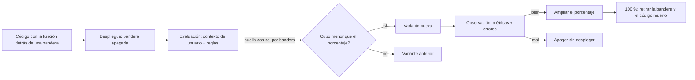
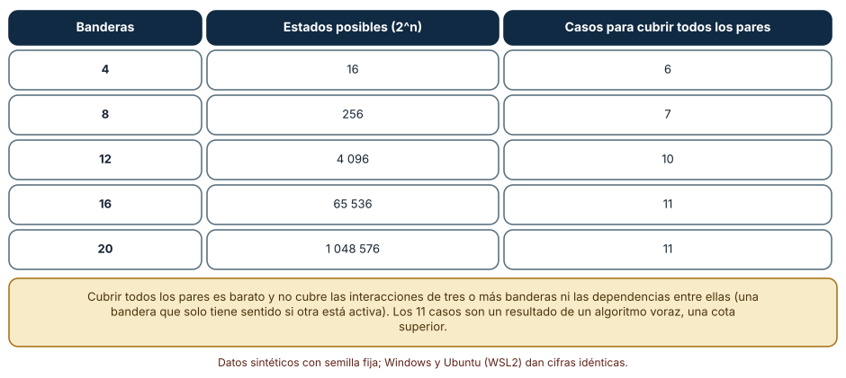
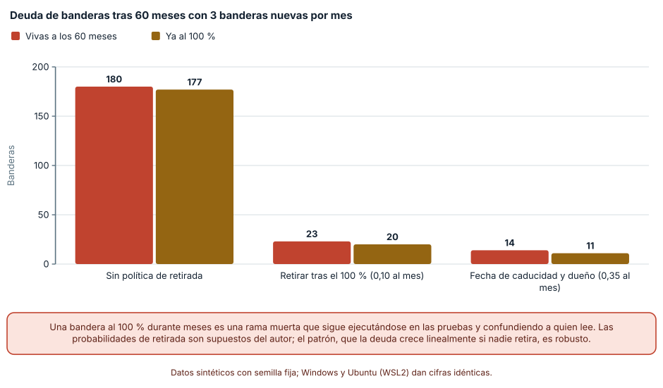

# SE-403 — Feature flags y entrega progresiva

[← SE-402 — Versionado, compatibilidad y changelog](https://github.com/vladimiracunadev-create/modern-software-engineering-program/blob/main/classes/part-33-build-release-y-cadena-de-suministro/se-402-versionado-compatibilidad-y-changelog/README.md) · [↑ Parte 33](https://github.com/vladimiracunadev-create/modern-software-engineering-program/blob/main/classes/part-33-build-release-y-cadena-de-suministro/README.md) · [📚 Índice completo](https://github.com/vladimiracunadev-create/modern-software-engineering-program/blob/main/classes/README.md) · [🌐 Portal](https://vladimiracunadev-create.github.io/modern-software-engineering-program/classes/SE-403.html) · [SE-404 — Canary, blue-green y rollback →](https://github.com/vladimiracunadev-create/modern-software-engineering-program/blob/main/classes/part-33-build-release-y-cadena-de-suministro/se-404-canary-blue-green-y-rollback/README.md)

## Punto profesional y fundamento pedagógico

**Punto profesional.** La clase existe para que separes dos decisiones que el despliegue tradicional ata: **desplegar** (poner código en producción) y **liberar** (hacerlo visible a las personas). Una bandera de funcionalidad (*feature flag*) permite desplegar con la función apagada, encenderla para un grupo pequeño, ampliar, y apagarla en segundos si algo sale mal. El costo es real: cada bandera es una rama del código que hay que probar, razonar y retirar. La habilidad profesional es usar banderas para reducir riesgo sin acumular una deuda que lo aumente.

**Por qué aparece aquí.** Sigue a **Versionado, compatibilidad y changelog**: allí se decidió qué promete un número de versión; aquí se aprende a exponer un cambio de forma gradual y reversible, sin esperar a un nuevo mayor. Precede a **Canary, blue-green y rollback**, que trata la misma idea a nivel de infraestructura. El caso conductor es el nuevo listado de entregas ordenado por fecha, que se quiere mostrar primero a un 1 % de usuarios.

**Error conceptual que debe corregir.** Creer que una bandera es un `if` inocuo que se puede encender y apagar sin consecuencias. La segmentación debe ser **consistente** (la misma persona ve siempre lo mismo mientras la bandera no cambie), las banderas **interactúan** (con n banderas hay 2^n estados) y las que no se retiran se convierten en código muerto que nadie se atreve a borrar.

**Secuencia de aprendizaje.** Antes de medir, predices qué fracción de las personas vería la función a ratos si la decisión se tomara al azar en cada petición, y cuántas combinaciones de 12 banderas hay que probar para cubrir todos los pares; después mides la uniformidad de una segmentación por huella con 100 000 usuarios, comparas el azar por petición con la huella, calculas el cubrimiento de pares y simulas la deuda de banderas en 60 meses. La secuencia usa predicción, un mecanismo real (hash) y modelos de semilla fija.

**Evidencia de aprendizaje.** `banderas-log.md` con la predicción, las tres figuras reproducidas, una política de banderas de la API de entregas (tipos, segmentación, propietario, caducidad, estado por defecto ante fallo) y una lista de las banderas existentes con su fecha de retiro.

**Límite de la conclusión.** La segmentación usa usuarios sintéticos (identificadores `u000000` a `u099999`) y el hash SHA-256 real; los modelos de combinatoria y de deuda usan supuestos del autor (3 banderas nuevas al mes, probabilidades de retirada de 0,10 y 0,35 mensuales). No se usó ningún sistema de gestión de banderas, ninguna plataforma de experimentos ni tráfico real, y no se midió el efecto de ninguna bandera sobre las personas usuarias.

### Trazabilidad fuente → afirmación

| Fuente primaria u oficial | Afirmación que respalda | Lo que no prueba |
|---|---|---|
| [Fowler, «Feature Toggles»](https://martinfowler.com/articles/feature-toggles.html) | Clasifica las banderas (de lanzamiento, de experimento, operativas, de permisos) por su duración y dinamismo y advierte de que tienen un costo de mantenimiento. | No dice cuántas banderas son demasiadas. |
| [OpenFeature: especificación](https://openfeature.dev/specification/) | Define una interfaz neutral para evaluar banderas, con contexto de evaluación, valores por defecto y manejo de errores. | No fija la política de segmentación de la API de entregas. |
| [Trunk Based Development: banderas de funcionalidad](https://trunkbaseddevelopment.com/feature-flags/) | Describe el uso de banderas para integrar con frecuencia código inacabado sin exponerlo. | No mide su efecto sobre la calidad. |
| [NIST SP 800-142: Practical Combinatorial Testing](https://csrc.nist.gov/pubs/sp/800/142/final) | Explica que la mayoría de los fallos se dispara con interacciones de pocos parámetros y que cubrir todos los pares reduce mucho el número de pruebas. | No garantiza que ninguna interacción de tres o más parámetros falle. |
| [Python: hashlib](https://docs.python.org/3/library/hashlib.html) | Documenta SHA-256, que se usa para repartir usuarios en cubos de forma determinista. | No decide la sal ni el tamaño de los cubos. |

## Antes de empezar

Recupera lo aprendido en `SE-402`: un cambio tiene un nivel de compatibilidad y a veces conviene exponerlo poco a poco. La pregunta activa es: **¿cómo expongo un cambio a una parte de las personas, de forma que cada una vea siempre lo mismo y yo pueda apagarlo sin desplegar?**

## Prerrequisitos

- Haber completado `SE-402` o poder explicar qué es un cambio incompatible.
- Python 3.11 o posterior; los experimentos usan solo la biblioteca estándar (`hashlib`, `random`, `itertools`, `collections`).
- Saber qué es una función hash y que su salida es uniforme y determinista.

## Problema auténtico

El equipo de la plataforma cambia el listado de entregas para que sea más rápido. Lo despliega apagado, lo enciende para el 5 % de las personas y observa. Al día siguiente, algunas personas se quejan de que a veces el listado «se ve distinto» al refrescar: la decisión de mostrar el listado nuevo se tomaba al azar en cada petición. Se corrige con una segmentación por usuario y, unas semanas después, una persona encuentra en el código 140 banderas, de las cuales nadie sabe cuántas están encendidas al 100 % desde hace años.

El problema real es de gobierno: la bandera reduce el riesgo del despliegue y aumenta el de las combinaciones y del tiempo, y sin una política cada mejora se convierte en una deuda.

## Objetivos observables

Al terminar podrás:

1. clasificar una bandera por su propósito y su duración y decidir su propietario y su fecha de retiro;
2. implementar una segmentación determinista por huella con sal por bandera y comprobar su uniformidad y su consistencia al ampliar;
3. explicar por qué el azar por petición produce experiencias inconsistentes y por qué dos banderas con la misma huella no son experimentos independientes;
4. calcular el crecimiento de estados con n banderas y el cubrimiento de pares como estrategia de pruebas;
5. diseñar el comportamiento por defecto ante un fallo del sistema de banderas y una política de retirada.

## Mapa conceptual



El mapa muestra que la bandera es un ciclo, no un estado: nace apagada, se amplía con observación y debe terminar retirada. El paso final es el que se olvida.

## Temas y por qué importan

| Tema | Por qué cambia una decisión profesional | Evidencia mínima |
|---|---|---|
| Tipos de banderas | Su duración determina su costo. | Predicción, traza causal y contraejemplo de **Tipos de banderas** en `banderas-log.md` |
| Segmentación y consistencia | Una persona debe ver siempre lo mismo. | Predicción, traza causal y contraejemplo de **Segmentación** en `banderas-log.md` |
| Independencia entre banderas | Banderas con la misma huella confunden los efectos. | Predicción, traza causal y contraejemplo de **Independencia** en `banderas-log.md` |
| Combinatoria de estados | Con n banderas hay 2^n estados. | Predicción, traza causal y contraejemplo de **Combinatoria** en `banderas-log.md` |
| Ciclo de vida y deuda | Una bandera sin retirar es código muerto. | Predicción, traza causal y contraejemplo de **Ciclo de vida** en `banderas-log.md` |

## Conceptos y decisiones

### 1. Tipos de banderas

No todas las banderas son iguales. Las **de lanzamiento** ocultan una función inacabada o la exponen gradualmente; deben ser efímeras (días o semanas). Las **de experimento** reparten personas entre variantes para comparar una métrica; duran lo que dure el experimento. Las **operativas** (interruptores de emergencia) permiten desactivar una función costosa o riesgosa bajo carga; pueden vivir años y deben estar probadas. Las **de permisos** activan funcionalidad para clientes o planes concretos; son parte del producto, no de la entrega. La clasificación importa porque cada tipo tiene propietario, duración y política de retirada distintos: tratar una bandera de lanzamiento como un permiso la hace inmortal.

### 2. Segmentación y consistencia

Para decidir si una persona ve la función nueva se evalúa una regla sobre un **contexto** (identificador de usuario, plan, región). La forma robusta de repartir porcentajes es la **huella**: se calcula un hash de la concatenación de la bandera y el identificador, se reduce a un número entre 0 y 9 999 y se compara con el porcentaje (por ejemplo, 500 para el 5 %). Es determinista, sin estado y uniforme. Tiene una propiedad esencial: al **ampliar** el porcentaje de 1 % a 5 % a 25 %, quien ya estaba dentro sigue dentro, porque el conjunto de cubos menores que 100 está contenido en el de menores que 500. Una decisión al **azar por petición** carece de esa propiedad: la misma persona ve la función a ratos, no puede reproducirse un informe de error y las métricas por usuario no tienen sentido.

### 3. Independencia entre banderas

Si dos banderas usan la misma huella sin distinguirlas, el 10 % de usuarios que recibe la primera es exactamente el mismo 10 % que recibe la segunda. Los experimentos dejan de ser independientes: cualquier efecto se atribuye a ambas, y un problema en una función arrastra a las personas de la otra. La corrección es usar la **bandera como sal** de la huella: así las asignaciones son estadísticamente independientes y el solapamiento esperado de dos banderas al 10 % es del 1 %. Hay un efecto secundario deseable: cuando se retira una bandera y se crea otra, la nueva asignación no hereda a las mismas personas, de modo que las mismas personas no son siempre las primeras en recibir lo experimental.

### 4. Combinatoria de estados

Con n banderas booleanas hay 2^n estados posibles del sistema; con 20 hay más de un millón. Nadie prueba todos, y no hace falta si las banderas son independientes. La estrategia práctica es **cubrir todos los pares**: elegir un conjunto pequeño de configuraciones en el que cada par de banderas aparezca en las cuatro combinaciones posibles. Como muestra el estudio del NIST, una parte muy grande de los fallos se dispara con la interacción de uno o dos parámetros, y cubrir pares cuesta una fracción de la prueba exhaustiva. El límite es que no cubre interacciones de tres o más ni las **dependencias** entre banderas (una que solo tiene sentido si otra está activa), que deben declararse y eliminarse de la matriz.

### 5. Ciclo de vida, deuda y fallo seguro

Una bandera tiene un ciclo: se crea con propietario y fecha de caducidad, se amplía, llega al 100 % y **se retira junto con el código de la rama antigua**. Cada bandera que sobrevive al 100 % es una rama muerta que sigue ejecutándose en las pruebas, confunde a quien lee y esconde la historia de por qué existe. La política que funciona es la que exige una fecha y un dueño en el momento de crearla y un aviso automático cuando vence. Además hay que decidir el **valor por defecto** ante un fallo del sistema que evalúa las banderas: para una función nueva, apagada; para un interruptor de emergencia, el valor que protege al sistema. Y como cada cambio de bandera cambia el comportamiento de producción, debe tener auditoría (quién, cuándo, qué) y un procedimiento tan controlado como un despliegue.

### Segmentación por huella

Se asignan 100 000 usuarios sintéticos a 100 cubos de 1 % con SHA-256 y se mide la uniformidad. Se comparan dos banderas al 10 % con la misma huella y con la bandera como sal, se amplía el porcentaje 1 % → 5 % → 25 % → 100 % y se compara con una decisión al azar por petición, con 10 peticiones por usuario al 25 %.

```python
def bucket(flag, user, salt=""):
    h = hashlib.sha256(f"{salt}{flag}:{user}".encode()).digest()
    return int.from_bytes(h[:8], "big") % 10000   # 0..9999
```


**Cómo leer la figura.** La primera fila muestra que el reparto es casi uniforme (chi-cuadrado 75,8 con 99 grados de libertad). La segunda y la tercera comparan dos banderas al 10 %: con la misma huella el solapamiento es total (9 821 de 9 821), con la bandera como sal es el esperado por azar. La cuarta, que ampliar no pierde a nadie, y la quinta, que el azar por petición inconsistente afecta al 94,1 % de las personas. **Dónde deja de valer:** los identificadores son sintéticos y consecutivos; con identificadores reales con estructura (prefijos, rangos) la uniformidad debe comprobarse de nuevo, y SHA-256 es una elección cómoda y no la única. La consistencia vale mientras el identificador sea estable: si el usuario cambia de cuenta o navega sin sesión, cambia de cubo.

### Combinatoria de banderas

Para n entre 4 y 20 banderas booleanas se calcula 2^n y se construye, con un algoritmo voraz y semilla fija, un conjunto de configuraciones que cubre todos los pares.



**Cómo leer la figura.** El número de estados se multiplica por 16 cada cuatro banderas, mientras que el de casos para cubrir pares crece lentamente (de 6 a 11). **Dónde deja de valer:** cubrir pares no cubre tripletes ni las dependencias entre banderas; los 11 casos son el resultado de un algoritmo voraz, una cota superior, y suponen que las banderas son booleanas e independientes. Si una bandera solo tiene sentido con otra activa, la matriz debe excluir las combinaciones imposibles, y si una interacción de tres banderas es crítica, debe probarse explícitamente.

### Deuda de banderas

Se simulan 60 meses con 3 banderas nuevas por mes y tres políticas: ninguna retirada, retirada tras llegar al 100 % con probabilidad 0,10 al mes, y fecha de caducidad con dueño (probabilidad 0,35 al mes).



**Cómo leer la figura.** Cada fila es una política; las columnas son las banderas vivas a los 60 meses, las que ya están al 100 % (ramas muertas) y los estados posibles. Sin política, casi todas las banderas están al 100 % y siguen en el código. **Dónde deja de valer:** las probabilidades de retirada son supuestos del autor y el modelo trata las banderas como independientes; el patrón de crecimiento lineal si nadie retira es robusto, pero el número depende de cada equipo. La política más eficaz del modelo no es la más cara: es la que pone un dueño y una fecha cuando se crea la bandera.

## Definiciones de trabajo

- **bandera de funcionalidad:** condición de ejecución que activa o desactiva una función sin desplegar código nuevo.
- **huella de segmentación:** número derivado de un hash del identificador y la bandera que asigna a cada persona un cubo.
- **sal:** texto que se añade a la entrada del hash para que dos banderas produzcan asignaciones independientes.
- **cubrimiento de pares:** conjunto de configuraciones en el que todo par de parámetros aparece en todas sus combinaciones.
- **deuda de banderas:** banderas que ya no cumplen su propósito y siguen en el código.

Las definiciones son operativas para la API de entregas. No convierten términos con una historia más amplia en sinónimos y deben contrastarse con la documentación primaria enlazada al final.

## Ejemplo mínimo

El fragmento decide si un usuario está en el 10 % de una bandera y comprueba que la decisión se mantiene. Antes de ejecutarlo, predice si el resultado cambia al repetir la llamada.

```python
import hashlib
def activa(flag, user, pct):
    h = int.from_bytes(hashlib.sha256(f"{flag}:{user}".encode()).digest()[:8], "big") % 10000
    return h < pct * 100
print([activa("listado-nuevo", "u000123", 10) for _ in range(3)], activa("listado-nuevo", "u000123", 50))
```

La decisión es la misma en las tres llamadas y, si la persona está dentro al 10 %, también lo está al 50 %. Registra versión de Python, comando y salida; después cambia la huella a `random.random() < 0.1` y comprueba que la persona entra y sale.

## Ejemplo profesional

El equipo de la API de entregas define una política: cada bandera tiene tipo, propietario, fecha de caducidad y valor por defecto ante fallo; las de lanzamiento caducan a los 30 días. La evaluación es local, determinista, con la bandera como sal y el identificador de usuario como contexto, y el sistema de reglas está detrás de una interfaz neutral para poder cambiar de proveedor. El nuevo listado se enciende al 1 %, se observan la latencia y la tasa de error durante una hora, se amplía al 5 %, 25 % y 100 % y, a los 30 días, se elimina la rama antigua en una solicitud de integración con la bandera. Un interruptor operativo permite desactivar la generación de miniaturas bajo carga; se prueba cada trimestre. Cada cambio de bandera queda en un registro de auditoría y las banderas vencidas generan una incidencia automática.

## Práctica guiada

1. Implementa `bucket(flag, user)` con SHA-256 y comprueba la uniformidad en 100 000 usuarios sintéticos.
2. Predice qué fracción verá la función a ratos con azar por petición y escríbelo antes de medir.
3. Mide la ampliación 1 % → 5 % → 25 % → 100 % y comprueba que nadie sale.
4. Compara dos banderas al 10 % con y sin sal y mide el solapamiento.
5. Calcula 2^n y construye un conjunto que cubra todos los pares para n = 4, 8, 12, 16 y 20.
6. Simula 60 meses de banderas con tres políticas de retirada con tus propias probabilidades.
7. Entrega `banderas-log.md` con la política de banderas de la API de entregas y pide a otra persona que encuentre una bandera sin dueño ni fecha.

## Ejercicios

1. **Consistencia:** una persona inicia sesión en dos dispositivos con distinto identificador de dispositivo; explica qué identificador conviene usar como contexto y por qué.
2. **Independencia:** diseña un experimento con dos banderas al 20 % cada una y calcula el solapamiento esperado con y sin sal.
3. **Combinatoria:** tienes 6 banderas, de las cuales B solo tiene sentido si A está activa; cuenta los estados válidos y cuántos pares deben cubrirse.
4. **Retirada:** escribe la lista de comprobaciones antes de borrar una bandera al 100 % (usos en el código, configuraciones, pruebas, documentación).

## Reto verificable

Entrega `banderas-log.md` con la predicción, las tres tablas, la política de banderas de la API de entregas y el inventario de banderas con tipo, propietario y fecha. Se aprueba si otra persona ejecuta los experimentos desde un checkout limpio, obtiene las mismas cifras y puede decir qué le ocurre a la persona del identificador `u000123` cuando el porcentaje pasa del 10 % al 50 %. No se aprueba por usar azar por petición para un experimento ni por dejar banderas sin propietario ni fecha.

## Caso conductor

La API de entregas es el caso conductor de la Parte 33. Esta clase deja el séptimo artefacto: una política de banderas con segmentación determinista, caducidad y valor por defecto. `SE-404` aplicará la idea al despliegue: cuánto tráfico enviar a la versión nueva, cuánto esperar y cuándo revertir. Cambia después un solo dato, la probabilidad de retirada mensual, y observa cuántas banderas muertas quedan.

## Preguntas frecuentes

### ¿Una bandera sustituye a las pruebas?

No. Reduce el riesgo de exponer un cambio y permite retroceder rápido, pero el código detrás de la bandera debe probarse en ambas ramas. Una bandera apagada que nunca se prueba esconde un defecto hasta el día en que se enciende.

### ¿Dónde se evalúan las banderas, en el cliente o en el servidor?

Donde se pueda confiar en la decisión. Las que protegen seguridad, permisos o integridad se evalúan en el servidor; las de presentación pueden evaluarse en el cliente, sabiendo que cualquiera puede alterarlas. En ambos casos conviene que la evaluación sea local y con valor por defecto, para que una caída del servicio de banderas no tumbe la aplicación.

### ¿Cuántas banderas son demasiadas?

No hay un número; hay una proporción: cuando las banderas vencidas superan a las vigentes, o cuando nadie sabe el estado de alguna, hay deuda. El indicador útil es el número de banderas al 100 % durante más de su caducidad.

### ¿Se puede experimentar con un 1 % de usuarios y sacar conclusiones?

Depende de la métrica y del efecto: con un 1 % y un efecto pequeño, la muestra es demasiado pequeña para distinguir señal de ruido (se verá en `SE-404`). Un despliegue gradual para reducir el riesgo y un experimento para decidir un producto necesitan tamaños de muestra distintos.

## Fallo controlado y diagnóstico

Reproduce el fallo clásico de la clase: **una función que «parpadea» porque la decisión se toma al azar en cada petición**. Implementa la bandera con `random.random()` y haz diez peticiones por usuario.

Registra síntoma, entrada mínima, hipótesis, observación que descarta cada hipótesis, causa, corrección y prueba de regresión. **Síntoma:** las personas ven la función nueva y la antigua alternadas al refrescar. **Hipótesis rivales:** (a) caché mal invalidada; (b) dos servidores con configuraciones distintas; (c) la decisión depende del azar y no del usuario. **Prueba:** repite la misma petición con el mismo identificador diez veces; si el resultado varía sin cambiar la configuración, la causa es (c). **Conclusión:** la segmentación no es determinista. **Regresión:** cambia a una huella de bandera e identificador y añade una prueba que verifique que el mismo usuario recibe siempre la misma variante, y que quien entra al 5 % sigue dentro al 25 %.

## Errores comunes y cómo corregirlos

| Síntoma | Causa probable | Corrección |
|---|---|---|
| La misma persona ve cosas distintas | Azar por petición | Huella determinista del identificador |
| Dos experimentos se confunden | Misma huella sin sal | Usar la bandera como sal |
| Hay cientos de banderas y nadie sabe cuáles están activas | Sin propietario ni caducidad | Registro con dueño, fecha y aviso de vencimiento |
| Un fallo del servicio de banderas tumba la aplicación | Evaluación remota sin valor por defecto | Evaluación local con caché y valor por defecto seguro |
| Un defecto aparece al encender una bandera | La rama apagada no se probaba | Probar ambas ramas y cubrir pares |

## Entorno y archivos clave

```text
work/SE-403/
├── README.md
├── banderas/
│   ├── huella.py
│   ├── combinatoria.py
│   └── deuda.py
├── banderas.yaml          # tipo, propietario, caducidad, valor por defecto
├── tests/test_banderas.py
└── evidence/banderas-log.md
```

El `README` declara plataforma, versión de Python, semillas y comandos. Los experimentos usan solo la biblioteca estándar y se ejecutaron con CPython 3.12.9 en Windows 11 y 3.12.3 en Ubuntu bajo WSL2 con salidas idénticas, porque SHA-256 y las semillas son deterministas. Si usas un sistema real de banderas, fija su versión y declara dónde se evalúa. El código completo del experimento está en `scripts/experiments_part33/e403.py` y se ejecuta con `python scripts/experiments_part33/e403.py`.

## Seguridad, ética y accesibilidad

- una bandera de permisos evaluada en el cliente puede alterarse: no confíes en ella para proteger datos;
- segmentar por atributos personales (región, dispositivo, plan) puede discriminar o excluir; revisa qué atributos usas, por qué y qué efecto tiene sobre grupos concretos;
- los experimentos con personas requieren transparencia y, según el caso, consentimiento; no pruebes en secreto cambios que afecten a decisiones importantes;
- una funcionalidad en prueba debe ser accesible igual que la definitiva: no uses banderas para dejar una variante inaccesible a un grupo;
- el registro de auditoría de banderas no debe guardar datos personales más allá del identificador pseudónimo necesario.

## Puente hacia el trabajo con agentes

Un agente al que se le pide «pon esto detrás de una bandera» escribirá una condición con una constante, o con `random()`, y la dejará en el código sin dueño ni fecha. Pídele en cambio que use la interfaz de banderas del proyecto, que segmente por huella de bandera e identificador, que añada el propietario, la caducidad y el valor por defecto, que pruebe ambas ramas y que abra la solicitud de retirada. Revisa especialmente si evalúa una decisión de seguridad en el cliente y si duplica la lógica en lugar de aislarla.

## Transferencia

Traslada el análisis a otro cambio (una migración de base de datos, un algoritmo de recomendación, un cambio de proveedor): cambia qué se protege con la bandera y conserva el procedimiento de segmentar por huella con sal, ampliar con observación, cubrir pares y retirar con dueño y fecha. La transferencia está lograda cuando puedes decir qué le pasa a la persona que cambia de cuenta o de dispositivo a mitad del experimento, no cuando repites los nombres de la API de entregas.

## Evaluación y evidencia

| Criterio | Evidencia para aprobar |
|---|---|
| comprensión | explicación de por qué el azar por petición es inconsistente y por qué la sal separa experimentos |
| corrección | tablas de la segmentación, la combinatoria y la deuda reproducibles con las mismas semillas |
| diseño | política de banderas con tipo, propietario, caducidad, valor por defecto y auditoría |
| diagnóstico | reproducción del fallo «función que parpadea» con regresión de determinismo y de ampliación |
| incertidumbre | declaración de que los usuarios son sintéticos y las probabilidades de retirada son supuestos |
| reproducibilidad | versiones, comandos, salida y límites declarados |

## Fuentes

- [Fowler, «Feature Toggles»](https://martinfowler.com/articles/feature-toggles.html) — tipos y costos de las banderas; autoridad: autor del texto.
- [OpenFeature: especificación](https://openfeature.dev/specification/) — interfaz neutral de evaluación; autoridad: proyecto OpenFeature, CNCF.
- [Trunk Based Development: banderas](https://trunkbaseddevelopment.com/feature-flags/) — integración continua con código oculto; autoridad: sitio de referencia de la práctica.
- [NIST SP 800-142](https://csrc.nist.gov/pubs/sp/800/142/final) — pruebas combinatorias; autoridad: NIST.
- [Python: hashlib](https://docs.python.org/3/library/hashlib.html) — funciones hash; autoridad: documentación de Python.

Cada fuente respalda el mecanismo indicado; ninguna demuestra que el 94,1 % de inconsistencia, los 11 casos de cubrimiento o las 177 banderas muertas se observen en tu sistema. Esa afirmación depende de tu segmentación, tu equipo y tu política de retirada.

## Límites y siguiente paso

Se ejecutaron cuatro experimentos con usuarios sintéticos y SHA-256 real, idénticos en Windows 11 (CPython 3.12.9) y Ubuntu bajo WSL2 (3.12.3). No se usó ningún sistema de banderas ni plataforma de experimentos, no se midió ningún efecto sobre personas reales y las 3 banderas nuevas por mes y las probabilidades de retirada de 0,10 y 0,35 son supuestos del autor; el cubrimiento de pares usa un algoritmo voraz con semilla fija y es una cota superior. La siguiente clase aplica la exposición gradual al despliegue de la infraestructura: canary, blue-green y retroceso.

## Glosario

- **bandera de funcionalidad:** condición de ejecución que activa o desactiva una función sin desplegar código nuevo.
- **huella de segmentación:** número derivado de un hash del identificador y la bandera que asigna a cada persona un cubo.
- **sal:** texto que se añade a la entrada del hash para que dos banderas produzcan asignaciones independientes.
- **cubrimiento de pares:** conjunto de configuraciones en el que todo par de parámetros aparece en todas sus combinaciones.
- **deuda de banderas:** banderas que ya no cumplen su propósito y siguen en el código.

---

[← SE-402 — Versionado, compatibilidad y changelog](https://github.com/vladimiracunadev-create/modern-software-engineering-program/blob/main/classes/part-33-build-release-y-cadena-de-suministro/se-402-versionado-compatibilidad-y-changelog/README.md) · [↑ Parte 33](https://github.com/vladimiracunadev-create/modern-software-engineering-program/blob/main/classes/part-33-build-release-y-cadena-de-suministro/README.md) · [📚 Índice completo](https://github.com/vladimiracunadev-create/modern-software-engineering-program/blob/main/classes/README.md) · [🌐 Portal](https://vladimiracunadev-create.github.io/modern-software-engineering-program/classes/SE-403.html) · [SE-404 — Canary, blue-green y rollback →](https://github.com/vladimiracunadev-create/modern-software-engineering-program/blob/main/classes/part-33-build-release-y-cadena-de-suministro/se-404-canary-blue-green-y-rollback/README.md)
