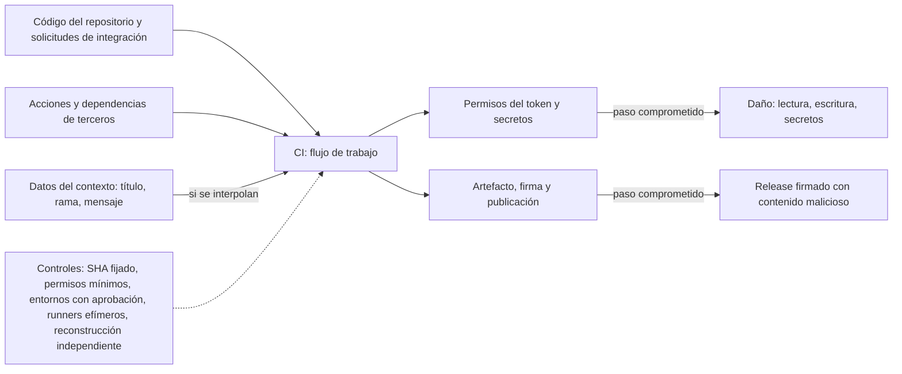

# SE-406 — Riesgos de CI y dependencias comprometidas

[← SE-405 — Instaladores, paquetes y actualizaciones](https://github.com/vladimiracunadev-create/modern-software-engineering-program/blob/main/classes/part-33-build-release-y-cadena-de-suministro/se-405-instaladores-paquetes-y-actualizaciones/README.md) · [↑ Parte 33](https://github.com/vladimiracunadev-create/modern-software-engineering-program/blob/main/classes/part-33-build-release-y-cadena-de-suministro/README.md) · [📚 Índice completo](https://github.com/vladimiracunadev-create/modern-software-engineering-program/blob/main/classes/README.md) · [🌐 Portal](https://vladimiracunadev-create.github.io/modern-software-engineering-program/classes/SE-406.html) · [SE-407 — Taller: verificar la procedencia de un release →](https://github.com/vladimiracunadev-create/modern-software-engineering-program/blob/main/classes/part-33-build-release-y-cadena-de-suministro/se-407-taller-verificar-la-procedencia-de-un-release/README.md)

## Punto profesional y fundamento pedagógico

**Punto profesional.** La clase existe para que veas el sistema de integración continua (CI) como lo que es para un atacante: un lugar donde se ejecuta código con credenciales. El CI construye, prueba y publica; para hacerlo posee permisos de escritura sobre el repositorio, secretos de despliegue y, a menudo, la clave que firma los releases. Quien logre ejecutar código ahí, o alterar algo de lo que el CI descarga y ejecuta, hereda esos poderes y firma con ellos. La habilidad profesional es **reducir lo que un paso comprometido puede alcanzar** y saber qué controles detectan una configuración peligrosa y cuáles no.

**Por qué aparece aquí.** Sigue a **Instaladores, paquetes y actualizaciones**: allí se diseñó lo que llega al equipo de la persona; aquí se protege el lugar donde eso se construye y se firma. Precede al taller de verificación de procedencia, que depende de que el constructor sea confiable. El caso conductor son los tres flujos de trabajo reales de este repositorio, que se analizan como un ejemplo de configuración endurecida.

**Error conceptual que debe corregir.** Creer que fijar las acciones a un SHA o dar permisos de solo lectura «asegura el CI». Son controles valiosos y detienen familias concretas de ataques; no detienen un SHA fijado a un commit malicioso, una dependencia comprometida que el build descarga, una acción de otro dueño que parece legítima ni una bandera de lectura que deja alterar el artefacto dentro del trabajo. Un escáner sin hallazgos dice que no hay lo que busca.

**Secuencia de aprendizaje.** Antes de medir, predices qué fracción de las acciones de los flujos de este repositorio está fijada a un SHA y cuántos de once tipos de debilidad detectaría un escáner de reglas; después escaneas los tres flujos reales con siete reglas, mutas los flujos con once operadores (155 mutaciones efectivas) y razonas qué alcanza un paso comprometido según la configuración de permisos. La secuencia usa una medición real sobre archivos del repositorio, un experimento de mutaciones y un análisis de alcance declarado como tal.

**Evidencia de aprendizaje.** `ci-riesgos-log.md` con la predicción, las tres figuras reproducidas, el modelo de amenazas del CI de la API de entregas (activos, entradas no confiables, permisos de cada trabajo, dependencias del CI) y una lista de controles con lo que cada uno cubre y lo que no.

**Límite de la conclusión.** El escáner son siete expresiones regulares sobre texto YAML: no interpreta el lenguaje de expresiones de GitHub Actions ni analiza el código de las acciones. Los tres flujos son de este repositorio, en la fecha de la medición, y el resultado sin hallazgos no prueba que sean seguros. Las once mutaciones son construcciones del autor, y las cuatro configuraciones de alcance son un modelo a partir de la documentación, no un ataque medido. No se ejecutó ningún flujo, no se usó ninguna herramienta de análisis de Actions (como zizmor) ni de puntuación de proyectos.

### Trazabilidad fuente → afirmación

| Fuente primaria u oficial | Afirmación que respalda | Lo que no prueba |
|---|---|---|
| [GitHub Docs: Security hardening for GitHub Actions](https://docs.github.com/en/actions/security-for-github-actions/security-guides/security-hardening-for-github-actions) | Recomienda permisos mínimos para el token, fijar las acciones de terceros a un SHA de commit completo y cuidado con la inyección de scripts a través de datos del contexto. | No garantiza que seguirlo evite un compromiso. |
| [GitHub Docs: Secure use reference](https://docs.github.com/en/actions/reference/security/secure-use) | Detalla los riesgos de `pull_request_target`, de interpolar entradas no confiables en comandos y del manejo de secretos. | No cubre acciones propias comprometidas. |
| [OWASP Top 10 CI/CD Security Risks](https://owasp.org/www-project-top-10-ci-cd-security-risks/) | Cataloga riesgos como flujos con permisos excesivos, dependencias no verificadas, ejecución de código no confiable y manejo de credenciales. | No ordena los riesgos para un proyecto concreto. |
| [NVD: CVE-2025-30066 (tj-actions/changed-files)](https://nvd.nist.gov/vuln/detail/CVE-2025-30066) | Registra que las etiquetas de versión de una acción muy usada fueron modificadas por un atacante para apuntar a un commit malicioso que exponía secretos en los registros. | No mide cuántos proyectos fueron afectados ni su daño. |
| [NVD: CVE-2024-3094 (xz)](https://nvd.nist.gov/vuln/detail/CVE-2024-3094) | Registra código malicioso en los tarballs de lanzamiento de xz, activado en el proceso de construcción de liblzma. | No describe cómo se obtuvo la confianza del mantenedor. |
| [Ohm et al., «Backstabber's Knife Collection»](https://doi.org/10.1007/978-3-030-52683-2_2) | Clasifica ataques reales de cadena de suministro de paquetes de código abierto. | No mide la frecuencia actual. |
| [OpenSSF Scorecard](https://scorecard.dev/) | Ofrece comprobaciones automáticas de prácticas de seguridad de proyectos (por ejemplo, acciones fijadas y permisos del token). | Una puntuación alta no equivale a un proyecto seguro. |

## Antes de empezar

Recupera lo aprendido en `SE-405`: el actualizador verifica lo que descarga con una firma y una clave. La pregunta activa es: **¿quién y qué puede alterar lo que el CI construye y firma, y qué controles ve cada ataque?**

## Prerrequisitos

- Haber completado `SE-405` o poder explicar por qué la firma de un release solo vale lo que valga el lugar donde se firma.
- Python 3.11 o posterior; el escáner usa solo la biblioteca estándar (`re`, `glob`, `random`, `hashlib`).
- Saber leer un archivo YAML de GitHub Actions: disparadores (`on`), permisos, trabajos, pasos y `uses`.

## Problema auténtico

La plataforma usa una acción de terceros para detectar qué archivos cambiaron en una solicitud de integración. Un día se publica un aviso: un atacante modificó las etiquetas de versión de esa acción para que apuntaran a un commit que imprimía los secretos del flujo en el registro. Todos los proyectos que la referenciaban por etiqueta (`@v45`) ejecutaron el código malicioso sin cambiar una línea de su repositorio, y los secretos quedaron en registros que, en un repositorio público, cualquiera puede leer.

El equipo de la plataforma descubre, al revisar, que su flujo de publicación tenía permisos de escritura para todo el repositorio, que el secreto de despliegue estaba disponible para todos los pasos y que otras seis acciones se referenciaban por etiqueta. Nada de eso era un defecto del código de la API de entregas.

## Objetivos observables

Al terminar podrás:

1. enumerar los activos de un CI (código, secretos, tokens, caché, clave de firma) y las entradas no confiables (solicitudes de forks, datos del contexto, dependencias descargadas);
2. explicar por qué fijar una acción a un SHA y limitar los permisos reduce el daño, y qué no cubre cada control;
3. escanear flujos de trabajo con reglas, medir el escáner frente a mutaciones y decir qué clase de debilidades no ve;
4. estimar el alcance de un paso comprometido según los permisos y la forma de entregar los secretos;
5. escribir un modelo de amenazas del CI con controles, responsables y un plan de respuesta ante un compromiso.

## Mapa conceptual



El mapa muestra que hay tres entradas que un atacante puede tocar (el código ajeno, las dependencias del CI y los datos del contexto) y dos activos que le interesan (los permisos y la firma). Los controles se colocan sobre las entradas y sobre el alcance.

## Temas y por qué importan

| Tema | Por qué cambia una decisión profesional | Evidencia mínima |
|---|---|---|
| El CI como objetivo | Concentra permisos y secretos. | Predicción, traza causal y contraejemplo de **El CI como objetivo** en `ci-riesgos-log.md` |
| Entradas no confiables | Una entrada del contexto puede convertirse en código. | Predicción, traza causal y contraejemplo de **Entradas no confiables** en `ci-riesgos-log.md` |
| Dependencias del CI | Una acción es código que se ejecuta con tus secretos. | Predicción, traza causal y contraejemplo de **Dependencias del CI** en `ci-riesgos-log.md` |
| Permisos y secretos | Definen el alcance de cualquier compromiso. | Predicción, traza causal y contraejemplo de **Permisos y secretos** en `ci-riesgos-log.md` |
| Detección y respuesta | Un escáner tiene límites; el plan de respuesta es el último control. | Predicción, traza causal y contraejemplo de **Detección y respuesta** en `ci-riesgos-log.md` |

## Conceptos y decisiones

### 1. El CI como objetivo

Un flujo de CI es un programa que ejecuta órdenes en una máquina efímera con un conjunto de credenciales: un **token** del repositorio con permisos de lectura o escritura, **secretos** inyectados como variables (claves de despliegue, tokens de publicación), acceso a una **caché** compartida y, en el paso de publicación, la clave que firma. Esa concentración lo convierte en un objetivo más rentable que el código de la aplicación: un solo compromiso permite alterar el repositorio, publicar un release con la firma legítima o robar credenciales que sirven para otros sistemas. Y la mayoría de los pasos ejecutan código escrito por otras personas (las acciones, las herramientas, las dependencias instaladas), de modo que el CI también es una cadena de suministro dentro de la cadena de suministro.

### 2. Entradas no confiables y la inyección de scripts

Un flujo se activa por eventos: un envío al repositorio, una solicitud de integración, un comentario. Parte de lo que acompaña a esos eventos lo controla quien los provoca: el título de la solicitud, el nombre de la rama, el mensaje del commit, el contenido del comentario. Si un paso interpola ese dato directamente en un comando (`run: echo "${{ github.event.pull_request.title }}"`), el título se sustituye antes de ejecutar el shell: un título con comillas y un punto y coma se convierte en código. La corrección es pasar el dato como **variable de entorno** y usarla entre comillas, de modo que el shell la trate como dato. Una variante grave es el disparador **`pull_request_target`**, que ejecuta el flujo del repositorio base con acceso a sus secretos pero puede procesar código de un fork: mezclar contexto privilegiado con código no confiable es la receta de muchos compromisos. La regla es no ejecutar nunca código de una solicitud externa en un contexto con secretos.

### 3. Dependencias del CI

Las **acciones** reutilizables de terceros son código que corre dentro de tu flujo con acceso a su entorno. Referenciarlas por una etiqueta de versión (`@v4`) es confiar en que nadie mueva esa etiqueta, y las etiquetas de un repositorio las controla quien tiene permiso de escritura en él; el incidente de la acción `tj-actions/changed-files` es el ejemplo: las etiquetas v1 a v45.0.7 fueron modificadas para apuntar a un commit malicioso. Fijar la acción a un **SHA de commit completo** hace inmutable la referencia; el control no impide que el SHA sea malicioso desde el principio ni que una acción fijada descargue código mutable en su ejecución. Lo mismo vale para las herramientas que el flujo instala (un `curl | bash`, un paquete sin versión fijada) y para las dependencias del propio build: el caso del paquete `xz` muestra que el código malicioso puede estar en el tarball de lanzamiento y no en el repositorio visible.

### 4. Permisos mínimos, secretos y entornos

El principio es **mínimo privilegio** por flujo y por trabajo: un permiso por defecto vacío en el nivel superior y, en cada trabajo, solo lo que necesita (leer el contenido para probar; escribir una etiqueta solo en el trabajo que publica). Los **secretos** se entregan solo al trabajo que los necesita, preferiblemente a través de un **entorno** protegido que exija una aprobación humana o se limite a ciertas ramas, y no como variables globales. Cuando es posible, se sustituye un secreto de larga vida por credenciales **efímeras** emitidas al vuelo por el proveedor para ese trabajo. Al extraer el código, conviene no persistir las credenciales en el directorio de trabajo (`persist-credentials: false`), porque pasos posteriores pueden leerlas. Los **runners** efímeros, que se destruyen tras cada trabajo, evitan que un compromiso persista; los runners autoalojados compartidos conservan estado, y un compromiso se queda.

### 5. Detección y respuesta

Los **escáneres** de flujos de trabajo revisan el texto buscando patrones peligrosos: acciones sin fijar, permisos amplios, disparadores arriesgados, interpolaciones. Son baratos, se pueden ejecutar en cada cambio y deben formar parte del propio CI, como hace este repositorio con un paso que exige acciones fijadas y permisos mínimos. Su límite es que ven la forma: un SHA válido de una acción maliciosa, una acción de otro dueño con aspecto legítimo o un paso que sale a la red por un camino que no usa `curl` pasan sin avisos. Por eso hace falta además una capa de **respuesta**: saber qué secretos tiene cada flujo para rotarlos de inmediato, mantener registros de auditoría, poder reconstruir y comparar releases (`SE-397`) y tener un plan de comunicación. Detectar un compromiso solo por sus efectos (un release que no corresponde a la fuente) depende de haber construido la capacidad de comparar.

### Escaneo real de los flujos de este repositorio

Se lee el texto de los tres flujos de trabajo del repositorio (`pages.yml`, `security.yml`, `validate.yml`) y se aplican siete reglas: acción sin fijar a un SHA de 40 caracteres, ausencia de `permissions` de nivel superior, permisos `write-all`, `pull_request_target`, un dato no confiable del contexto interpolado en un comando, `curl` canalizado a un shell, un secreto interpolado en un comando y un `checkout` sin `persist-credentials: false`.

```python
if "@" not in uses or not re.fullmatch(r"[0-9a-f]{40}", uses.split("@")[-1]):
    findings.append(("R1 acción sin fijar a SHA", line))
```


**Cómo leer la figura.** Cada grupo es un workflow del repositorio con dos barras: las acciones que usa (gris) y las fijadas a un SHA (turquesa). Mira que en los tres las barras son iguales: todas están fijadas. Los hallazgos de las siete reglas, cero, están en la tabla. **Dónde deja de valer:** que el escáner no encuentre nada no demuestra que los flujos sean seguros; son siete patrones sobre texto, y no ve qué hace cada acción, si el SHA fijado corresponde a un commit confiable ni si las dependencias que el flujo instala están fijadas. El resultado es una medición de este repositorio en la fecha de ejecución y es idéntico en Windows y en Ubuntu porque lee los mismos archivos.

### El escáner frente a mutaciones

Se aplican once operadores de mutación a los tres flujos reales, en cinco ubicaciones cada uno, y se cuenta cuántas veces el escáner detecta un hallazgo nuevo. Las mutaciones que no cambian el texto (porque el flujo ya tenía `permissions: {}`) se descartan: quedan 155.


**Cómo leer la figura.** Cada grupo es una mutación de los workflows con una barra gris de inyectadas y una turquesa de detectadas. Mira los tres últimos grupos, con la barra turquesa en cero: un SHA de otro dueño, un SHA malicioso válido o un paso con salida de red pasan, porque el escáner comprueba reglas de forma. **Dónde deja de valer:** el escáner se escribió y se afinó con las mismas categorías que lo evalúan, de modo que el 71 % es una frontera y no una tasa; las once mutaciones son construcciones del autor, y un atacante real no está obligado a usar patrones reconocibles. Detectar lo que cambia la forma y no lo que cambia en qué se confía es la limitación estructural de cualquier análisis de texto.

### Alcance de un paso comprometido

Se razona qué puede alcanzar un paso comprometido en cuatro configuraciones, a partir de la documentación de GitHub Actions.


**Cómo leer la figura.** A la izquierda está un paso comprometido y a la derecha cuatro configuraciones con lo que cada una deja alcanzar. Las cajas coral son las que dejan más al alcance, la dorada solo la lectura del código y la turquesa lo mínimo que cada job necesita. **Dónde deja de valer:** es un análisis del autor, sin ataque medido; el alcance real depende de la plataforma y del uso de entornos, de aprobaciones y de credenciales efímeras, y reducir permisos no evita el compromiso: reduce lo que se pierde cuando ocurre. Incluso en la configuración mínima, el artefacto producido dentro del trabajo comprometido puede estar alterado, que es el motivo de reconstruir de forma independiente (`SE-397`, `SE-407`).

## Definiciones de trabajo

- **CI (integración continua):** sistema que construye y prueba el código de forma automática ante cada cambio.
- **acción de terceros:** componente reutilizable de un flujo de trabajo escrito por otra persona.
- **SHA de commit:** identificador inmutable de un estado del repositorio; fijar una acción a él evita que la referencia cambie.
- **inyección de scripts:** interpolación de un dato controlado por un atacante en un comando que se ejecuta.
- **mínimo privilegio:** conceder a cada flujo y trabajo solo los permisos que necesita.

Las definiciones son operativas para la API de entregas. No convierten términos con una historia más amplia en sinónimos y deben contrastarse con la documentación primaria enlazada al final.

## Ejemplo mínimo

El fragmento muestra por qué interpolar un dato no confiable en un comando lo convierte en código. Antes de ejecutarlo, predice qué ejecuta el shell.

```python
import subprocess, sys
titulo = 'correccion"; echo INYECTADO; echo "'
orden = f'echo "{titulo}"'            # lo que produce una interpolación directa
print(orden)
print(subprocess.run(["bash", "-c", orden], capture_output=True, text=True).stdout)
```

La orden resultante contiene un segundo `echo` que el shell ejecuta. Si el dato se pasa como variable de entorno y se usa entre comillas, el shell lo trata como texto. Registra versión de Python, comando y salida; después reescribe el fragmento pasando el título por el entorno y comprueba que `INYECTADO` ya no se ejecuta como orden.

## Ejemplo profesional

El flujo de publicación de la API de entregas se reescribe con cuatro reglas. Todas las acciones se fijan a un SHA y un trabajo semanal propone las actualizaciones como solicitudes revisables. El permiso por defecto es vacío y cada trabajo declara el suyo: las pruebas leen el contenido, la publicación escribe solo la etiqueta del release. Los secretos de publicación viven en un entorno protegido que exige aprobación y solo es accesible desde la rama principal, y la clave de firma no está disponible para ningún trabajo que ejecute código de una solicitud externa. El flujo no usa `pull_request_target` y trata los datos del contexto como variables de entorno. Un trabajo de verificación reconstruye el artefacto en un runner distinto y compara su huella con la publicada antes de firmar. El plan de respuesta lista qué secretos rotar y en qué orden si un paso se compromete.

## Práctica guiada

1. Lee los flujos de trabajo de un repositorio y lista, para cada trabajo, sus permisos, los secretos que recibe y las acciones que usa.
2. Predice qué fracción de las acciones está fijada a un SHA y cuántas debilidades detectará tu escáner y escríbelo antes de medir.
3. Escribe un escáner de reglas con expresiones regulares y aplícalo a los flujos reales.
4. Aplica once mutaciones a los flujos y mide cuántas detecta el escáner; localiza las que se escapan.
5. Reproduce una inyección de scripts con un título malicioso y corrígela pasando el dato por una variable de entorno.
6. Construye una tabla de alcance de un paso comprometido para tus flujos con las configuraciones actual y propuesta.
7. Entrega `ci-riesgos-log.md` y pide a otra persona que modifique un flujo de modo que tu escáner no lo vea y sea peligroso.

## Ejercicios

1. **Inyección:** escribe un comando de un flujo que interpole el nombre de la rama y muestra una rama con una orden dentro; reescríbelo de forma segura.
2. **Permisos:** para un flujo con trabajos de pruebas, de construcción y de publicación, escribe los permisos mínimos de cada uno y qué secretos recibe cada uno.
3. **Fijación:** explica qué ataque detiene fijar una acción a un SHA y cuál no, con un ejemplo de cada uno.
4. **Respuesta:** redacta el plan de las primeras tres horas tras descubrir que una acción de tu flujo de publicación estuvo comprometida: qué se rota, qué se revisa y qué se comunica.

## Reto verificable

Entrega `ci-riesgos-log.md` con la predicción, las tres tablas, el modelo de amenazas del CI de la API de entregas y el plan de respuesta. Se aprueba si otra persona ejecuta el escáner desde un checkout limpio, obtiene las mismas cifras sobre los mismos archivos y puede decir qué debilidad peligrosa no detecta. No se aprueba por afirmar «el CI es seguro porque las acciones están fijadas» ni por un escáner sin una evaluación frente a mutaciones.

## Caso conductor

La API de entregas es el caso conductor de la Parte 33. Esta clase deja el décimo artefacto: un modelo de amenazas del CI con permisos mínimos, dependencias fijadas, un escáner evaluado y un plan de respuesta. `SE-407` pondrá a prueba la cadena completa en un taller: verificar la procedencia de un release. Cambia después un solo dato, el permiso por defecto del token, y observa cuánto crece el alcance de un paso comprometido.

## Preguntas frecuentes

### ¿Fijar a un SHA no resuelve el problema de las acciones?

Resuelve que la referencia cambie sin que lo sepas. No resuelve que el código en ese SHA sea malicioso, que la acción descargue más código al ejecutarse, ni que tu actualización automática acepte un SHA nuevo comprometido. Es un control necesario, no suficiente; conviene revisar lo que cambia en cada actualización.

### ¿Puedo ejecutar las pruebas de solicitudes de integración de forks?

Sí, pero sin secretos y con un token de solo lectura. El disparador que usa el contexto sin privilegios para el código del fork es el correcto; el que usa el contexto del repositorio base con código del fork, no. Si necesitas comentar o etiquetar, hazlo en un segundo flujo que no ejecute código del fork.

### ¿Los runners autoalojados son más seguros?

Dan control del entorno y la red, y exigen que sean efímeros y estén aislados: un runner compartido que conserva estado entre trabajos permite que un compromiso persista y contamine otros proyectos. En un repositorio público, un runner autoalojado que ejecuta código de forks es un riesgo mayor.

### ¿Qué hago si un secreto aparece en un registro?

Considéralo comprometido: rótalo de inmediato, revisa dónde se usó, borra o restringe el registro si es posible y busca el mecanismo que lo expuso. Un secreto enmascarado en un registro no es una garantía contra una acción que lo reformatee.

## Fallo controlado y diagnóstico

Reproduce el fallo clásico de la clase: **un comando que interpola un dato del evento y ejecuta lo que el atacante escribió**. Crea un flujo de ejemplo que haga `echo` del título de la solicitud y prueba un título con una orden dentro.

Registra síntoma, entrada mínima, hipótesis, observación que descarta cada hipótesis, causa, corrección y prueba de regresión. **Síntoma:** el registro del flujo muestra la salida de una orden que nadie escribió en el repositorio. **Hipótesis rivales:** (a) un compañero añadió un paso; (b) una acción de terceros imprime eso; (c) el título de la solicitud se interpoló en el comando. **Prueba:** busca en el archivo del flujo expresiones `${{ github.event... }}` dentro de `run`; si la hay, y el texto del título coincide con la salida, la causa es (c). **Conclusión:** inyección de scripts por contexto no confiable. **Regresión:** pasa el dato por una variable de entorno, añade la regla al escáner y una mutación que la reintroduzca para comprobar que el escáner la detecta.

## Errores comunes y cómo corregirlos

| Síntoma | Causa probable | Corrección |
|---|---|---|
| Una acción cambia de comportamiento sin cambios en el repositorio | Referencia por etiqueta | Fijar a un SHA y revisar las actualizaciones |
| Un título de solicitud ejecuta órdenes | Interpolación del contexto en `run` | Pasar el dato como variable de entorno |
| Un flujo de un fork accede a secretos | `pull_request_target` con código no confiable | Separar el flujo privilegiado del que ejecuta código externo |
| Un compromiso alcanza todo el repositorio | Permisos de escritura por defecto | `permissions` vacíos arriba y mínimos por trabajo |
| El escáner da «sin hallazgos» y hay un problema | Solo ve la forma | Evaluarlo con mutaciones y añadir revisión humana y reconstrucción |

## Entorno y archivos clave

```text
work/SE-406/
├── README.md
├── ci/
│   ├── escaner.py
│   ├── mutaciones.py
│   └── alcance.md
├── .github/workflows/
├── tests/test_escaner.py
└── evidence/ci-riesgos-log.md
```

El `README` declara plataforma, versión de Python, comandos y la fecha del escaneo. El escáner usa solo la biblioteca estándar y se ejecutó con CPython 3.12.9 (Windows 11) y 3.12.3 (Ubuntu bajo WSL2); el resultado sobre los flujos reales y las mutaciones fue idéntico, porque lee los mismos archivos con mutaciones deterministas. Si añades una herramienta de análisis de Actions o de puntuación de proyectos, fija su versión y declara qué reglas aplica. El código completo del experimento está en `scripts/experiments_part33/e406.py` y se ejecuta con `python scripts/experiments_part33/e406.py`. Por defecto escanea los flujos del repositorio que lo contiene; la variable de entorno `REPO` permite apuntar a otro.

## Seguridad, ética y accesibilidad

- no pruebes inyecciones ni flujos maliciosos en repositorios ajenos ni con secretos reales: usa un repositorio de ensayo sin credenciales;
- si encuentras una debilidad en el CI de otro proyecto, comunícala de forma responsable al mantenedor y no la expongas públicamente;
- rotar un secreto tras un incidente tiene costo y obliga a coordinar con quienes dependen de él: planifícalo antes;
- los avisos del CI (fallos, aprobaciones) deben ser comprensibles con lector de pantalla y no depender solo del color;
- respeta las licencias de las acciones y herramientas que uses y atribuye lo adaptado.

## Puente hacia el trabajo con agentes

Un agente al que se le pide «arregla el flujo de CI» añadirá una acción popular por etiqueta, dará permisos de escritura «para que funcione», interpolará variables del contexto en los comandos y, si falla, desactivará una comprobación. Pídele en cambio que fije cada acción a un SHA y explique qué cambió, que declare los permisos mínimos por trabajo, que use variables de entorno para datos del contexto y que ejecute el escáner y las mutaciones sobre el cambio. Revisa especialmente si añade `pull_request_target`, si amplía permisos o si introduce un `curl | bash`: son los tres atajos más frecuentes.

## Transferencia

Traslada el análisis a otra plataforma de CI (GitLab, Jenkins, un sistema propio): cambia la sintaxis de permisos y de secretos y conserva el procedimiento de listar activos y entradas no confiables, fijar las dependencias del CI, minimizar el alcance, evaluar el escáner con mutaciones y preparar la respuesta. La transferencia está lograda cuando puedes decir cuál es en la nueva plataforma el equivalente a `pull_request_target` y qué runner conserva estado.

## Evaluación y evidencia

| Criterio | Evidencia para aprobar |
|---|---|
| comprensión | explicación de por qué el CI concentra el riesgo y de lo que cubre y no cubre fijar a un SHA |
| corrección | tabla del escaneo real y de las mutaciones reproducible con los mismos archivos |
| diseño | modelo de amenazas con permisos mínimos, secretos acotados y reconstrucción independiente |
| diagnóstico | reproducción del fallo de inyección con corrección y regla de regresión |
| incertidumbre | declaración de que el escáner ve la forma, se afinó con sus categorías y no analiza las acciones |
| reproducibilidad | versiones, comandos, salida y límites declarados |

## Fuentes

- [GitHub Docs: Security hardening for GitHub Actions](https://docs.github.com/en/actions/security-for-github-actions/security-guides/security-hardening-for-github-actions) — endurecimiento de flujos; autoridad: documentación oficial de GitHub.
- [GitHub Docs: Secure use reference](https://docs.github.com/en/actions/reference/security/secure-use) — riesgos de disparadores y de interpolación; autoridad: documentación oficial de GitHub.
- [OWASP Top 10 CI/CD Security Risks](https://owasp.org/www-project-top-10-ci-cd-security-risks/) — catálogo de riesgos; autoridad: OWASP.
- [NVD: CVE-2025-30066](https://nvd.nist.gov/vuln/detail/CVE-2025-30066) — acción comprometida mediante etiquetas movidas; autoridad: NIST National Vulnerability Database.
- [NVD: CVE-2024-3094](https://nvd.nist.gov/vuln/detail/CVE-2024-3094) — código malicioso en los tarballs de xz; autoridad: NIST National Vulnerability Database.
- [Ohm et al., «Backstabber's Knife Collection»](https://doi.org/10.1007/978-3-030-52683-2_2) — ataques de cadena de suministro; autoridad: DIMVA 2020, Springer.
- [OpenSSF Scorecard](https://scorecard.dev/) — comprobaciones automáticas de prácticas de seguridad; autoridad: OpenSSF.

Cada fuente respalda el mecanismo indicado; ninguna demuestra que los 110 de 155, las 20 referencias fijadas o la jerarquía de alcance se observen en tu plataforma. Esa afirmación depende de tus flujos y de tu proveedor.

## Límites y siguiente paso

Se ejecutó un escaneo real de los tres flujos de este repositorio, un experimento de 155 mutaciones efectivas con semilla fija y un análisis de alcance, con resultados idénticos en Windows 11 (CPython 3.12.9) y Ubuntu bajo WSL2 (3.12.3). El escáner son siete expresiones regulares y se afinó con las mismas categorías que lo evalúan; no se ejecutó ningún flujo, no se analizó el código de ninguna acción ni se usó ninguna herramienta especializada, y el análisis de alcance no es una medición. La siguiente clase reúne las anteriores en un taller: verificar la procedencia de un release de principio a fin.

## Glosario

- **CI (integración continua):** sistema que construye y prueba el código de forma automática ante cada cambio.
- **acción de terceros:** componente reutilizable de un flujo de trabajo escrito por otra persona.
- **SHA de commit:** identificador inmutable de un estado del repositorio; fijar una acción a él evita que la referencia cambie.
- **inyección de scripts:** interpolación de un dato controlado por un atacante en un comando que se ejecuta.
- **mínimo privilegio:** conceder a cada flujo y trabajo solo los permisos que necesita.

---

[← SE-405 — Instaladores, paquetes y actualizaciones](https://github.com/vladimiracunadev-create/modern-software-engineering-program/blob/main/classes/part-33-build-release-y-cadena-de-suministro/se-405-instaladores-paquetes-y-actualizaciones/README.md) · [↑ Parte 33](https://github.com/vladimiracunadev-create/modern-software-engineering-program/blob/main/classes/part-33-build-release-y-cadena-de-suministro/README.md) · [📚 Índice completo](https://github.com/vladimiracunadev-create/modern-software-engineering-program/blob/main/classes/README.md) · [🌐 Portal](https://vladimiracunadev-create.github.io/modern-software-engineering-program/classes/SE-406.html) · [SE-407 — Taller: verificar la procedencia de un release →](https://github.com/vladimiracunadev-create/modern-software-engineering-program/blob/main/classes/part-33-build-release-y-cadena-de-suministro/se-407-taller-verificar-la-procedencia-de-un-release/README.md)
