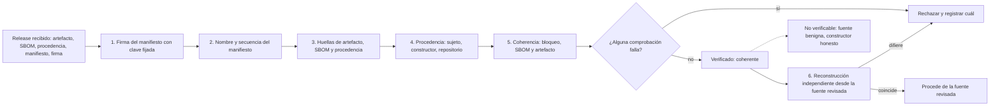
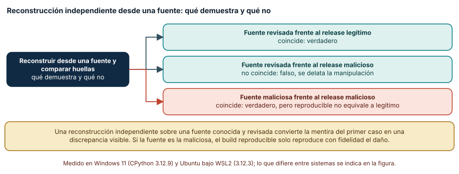

# SE-407 — Taller: verificar la procedencia de un release

[← SE-406 — Riesgos de CI y dependencias comprometidas](https://github.com/vladimiracunadev-create/modern-software-engineering-program/blob/main/classes/part-33-build-release-y-cadena-de-suministro/se-406-riesgos-de-ci-y-dependencias-comprometidas/README.md) · [↑ Parte 33](https://github.com/vladimiracunadev-create/modern-software-engineering-program/blob/main/classes/part-33-build-release-y-cadena-de-suministro/README.md) · [📚 Índice completo](https://github.com/vladimiracunadev-create/modern-software-engineering-program/blob/main/classes/README.md) · [🌐 Portal](https://vladimiracunadev-create.github.io/modern-software-engineering-program/classes/SE-407.html) · [SE-408 — Proyecto: release firmado y recuperable →](https://github.com/vladimiracunadev-create/modern-software-engineering-program/blob/main/classes/part-33-build-release-y-cadena-de-suministro/se-408-proyecto-release-firmado-y-recuperable/README.md)

## Punto profesional y fundamento pedagógico

**Punto profesional.** El taller existe para que ejecutes, de principio a fin y con tus manos, la pregunta que justifica toda la Parte 33: **«¿este release es lo que dice ser?»**. Recibes un paquete con un artefacto, un SBOM, una procedencia, un manifiesto y una firma, y debes decidir si lo aceptas, qué comprobaste y qué no. La habilidad profesional no es que el verificador diga «ok»: es poder explicar, ante otra persona, qué cadena de evidencia sostiene esa palabra, qué ataques habría visto, cuáles no y qué más haría falta.

**Por qué aparece aquí.** Es la clase de aplicación de las seis anteriores: una reconstrucción reproducible (`SE-397`), un artefacto identificado por huella (`SE-398`), un inventario fijado (`SE-399`), un SBOM y una procedencia (`SE-400`), una firma con raíz de confianza fijada (`SE-401`), una versión con significado (`SE-402`) y un canal de construcción en cuestión (`SE-406`). Precede al proyecto final, que construye el canal en lugar de verificarlo. El caso conductor es un release de la API de entregas que unas veces es legítimo y otras ha sido manipulado de dieciocho maneras.

**Error conceptual que debe corregir.** Creer que un verificador que rechaza todas las manipulaciones que se le presentan es un verificador de la confianza. Un release firmado por el CI legítimo con un commit malicioso aprobado pasa todas las comprobaciones, y también las pasa una procedencia que dice «reproducible» sin que nadie haya reconstruido. La verificación criptográfica certifica la coherencia de la cadena; la confianza en lo que hay al principio de la cadena es otra cosa.

**Secuencia de aprendizaje.** Antes de ejecutar, predices cuántos de dieciocho casos (doce manipulaciones detectables y seis casos coherentes) rechazará un verificador de doce comprobaciones; después lo ejecutas, clasificas cada resultado, reconstruyes el artefacto de forma independiente desde una fuente revisada y escribes el informe de verificación con tres estados posibles. La secuencia usa predicción, firmas reales y una reconstrucción independiente.

**Evidencia de aprendizaje.** `verificacion-log.md` con la predicción, las tres figuras reproducidas, el informe de verificación de un release (qué se comprobó, contra qué valores esperados fijados de antemano, con qué resultado, y qué quedó sin comprobar) y una tabla de los casos coherentes con el control que los vería.

**Límite de la conclusión.** Los releases son sintéticos: un árbol de 42 archivos de Python empaquetado en un zip, con un SBOM y una procedencia construidos por el programa y firmados con Ed25519 mediante `openssl`. Los dieciocho casos son construcciones del autor y el verificador se escribió con ese mismo catálogo en mente, de modo que su 12 de 12 es una frontera y no una tasa. No se usó ninguna herramienta real de verificación (cosign, slsa-verifier, in-toto), ningún registro de transparencia ni ningún repositorio de paquetes.

### Trazabilidad fuente → afirmación

| Fuente primaria u oficial | Afirmación que respalda | Lo que no prueba |
|---|---|---|
| [SLSA v1.0: niveles y verificación](https://slsa.dev/spec/v1.0/levels) | Define niveles de garantía de la construcción y describe que el consumidor verifica la procedencia contra valores esperados. | No dice que un nivel alto proteja contra una fuente maliciosa aprobada. |
| [in-toto: formato de declaración](https://github.com/in-toto/attestation/blob/main/spec/v1/statement.md) | Describe cómo una atestación liga un predicado a un sujeto por su huella. | No indica qué predicados exigir. |
| [Reproducible Builds: definición](https://reproducible-builds.org/docs/definition/) | Define la reconstrucción independiente como forma de verificar que el artefacto corresponde a la fuente. | No garantiza que la fuente sea benigna. |
| [NIST SP 800-218 (SSDF)](https://csrc.nist.gov/pubs/sp/800/218/final) | Recoge prácticas de desarrollo seguro, incluida la verificación de la integridad del software publicado y la protección del proceso de construcción. | No es un procedimiento de verificación ejecutable. |
| [Lamb y Zacchiroli (IEEE Software, 2022)](https://doi.org/10.1109/MS.2021.3073045) | Presenta la reconstrucción independiente como defensa contra un proceso de construcción comprometido. | No mide la proporción de ataques que detecta. |
| [OpenSSL: pkeyutl](https://docs.openssl.org/3.0/man1/openssl-pkeyutl/) | Documenta la orden con la que se firma y se verifica en el taller. | No fija los parámetros de un uso real. |

## Antes de empezar

Recupera lo aprendido en `SE-406`: el constructor es un objetivo y su firma solo vale lo que valga su aislamiento. La pregunta activa es: **¿qué puedo afirmar de un release recibido, con qué evidencia, y qué debo decir que no pude comprobar?**

## Prerrequisitos

- Haber completado `SE-397` a `SE-406`, o poder explicar para cada una qué evidencia aporta a la cadena.
- Python 3.11 o posterior y `openssl` 3.x en la línea de órdenes; el taller usa `hashlib`, `json`, `zipfile`, `subprocess` y `tempfile`.
- Tener a mano las tablas de `SE-401` (estrategias de verificación) y `SE-400` (qué detectan los campos de la procedencia).

## Problema auténtico

Un cliente recibe, a través de un canal externo, el release 1.4.0 de la API de entregas y pide al equipo de seguridad que confirme que es auténtico antes de desplegarlo en el entorno de su universidad. El equipo tiene el artefacto, el SBOM, la procedencia, el manifiesto y la firma. Quien revisa ejecuta `openssl`, ve «Verified OK» y responde que «está firmado». Una semana después se descubre que el release incluía un cambio que nadie había revisado.

El informe habría podido decir otra cosa si hubiera separado tres afirmaciones: «la firma corresponde a la clave esperada y el manifiesto no fue alterado» (comprobado), «el artefacto sale de la fuente y del constructor declarados» (comprobado solo si alguien reconstruyó) y «el contenido de la fuente es benigno» (no verificable con estos documentos).

## Objetivos observables

Al terminar podrás:

1. ejecutar una verificación de doce comprobaciones sobre un release y explicar qué rechaza cada una;
2. clasificar un resultado como verificado, no verificado o no verificable, y justificar por qué;
3. construir casos de manipulación y casos coherentes y medir qué diferencia a unos de otros;
4. reconstruir el artefacto desde una fuente revisada y comparar su huella;
5. redactar un informe de verificación que diga qué se comprobó, contra qué valores y qué quedó fuera.

## Mapa conceptual



El mapa muestra que la verificación recorre cinco grupos de comprobaciones antes de declarar coherente el release y que la reconstrucción independiente añade una sexta capa. Lo que queda en la línea punteada no lo ve ninguna comprobación.

## Temas y por qué importan

| Tema | Por qué cambia una decisión profesional | Evidencia mínima |
|---|---|---|
| Cadena de evidencia | Cada documento cierra un ataque y deja otros. | Predicción, traza causal y contraejemplo de **Cadena de evidencia** en `verificacion-log.md` |
| Valores esperados y raíz de confianza | Sin valores fijados de antemano no se verifica nada. | Predicción, traza causal y contraejemplo de **Valores esperados** en `verificacion-log.md` |
| Manipulaciones frente a mentiras coherentes | Distingue lo que la criptografía ve de lo que no. | Predicción, traza causal y contraejemplo de **Casos coherentes** en `verificacion-log.md` |
| Reconstrucción independiente | Es la única comprobación que ata el artefacto a la fuente. | Predicción, traza causal y contraejemplo de **Reconstrucción** en `verificacion-log.md` |
| Informe honesto | El resultado es una afirmación con alcance. | Predicción, traza causal y contraejemplo de **Informe** en `verificacion-log.md` |

## Conceptos y decisiones

### 1. La cadena de evidencia

Un release serio es una **cadena de huellas firmadas**. La firma cubre el manifiesto; el manifiesto contiene las huellas del artefacto, del SBOM y de la procedencia; la procedencia contiene la huella del sujeto (que debe ser el artefacto), el constructor, el repositorio, el commit y los materiales (entre ellos, la huella del archivo de bloqueo); el SBOM debe coincidir con el bloqueo; y el artefacto contiene, a su vez, el bloqueo. Cada eslabón se comprueba contra el siguiente, de modo que alterar uno obliga a alterar todos los que lo referencian y a firmar de nuevo. Las dos manipulaciones que un atacante «con trabajo» intenta, cambiar el artefacto y volver a firmar el manifiesto con una clave que no es la esperada, fallan en la comprobación de la firma; cambiar el artefacto y re-firmar con la clave real exige además actualizar la procedencia, y cada actualización deja una discrepancia con los valores esperados.

### 2. Valores esperados y raíz de confianza

Un verificador solo es tan bueno como los valores contra los que compara. Los valores esperados se **fijan de antemano y por fuera del release**: la clave pública (en el cliente o en un repositorio independiente), el nombre del producto, el identificador del constructor legítimo, el repositorio de origen, la secuencia más alta ya vista. Si el verificador toma el constructor o el repositorio del propio documento que verifica, no comprueba nada: cualquier documento coherente consigo mismo pasa. En el taller, los valores esperados están en una estructura distinta del release y el ejercicio incluye escribir una versión «tramposa» del verificador que los toma del documento, para ver que acepta todo.

### 3. Manipulaciones y mentiras coherentes

Las **manipulaciones detectables** rompen la coherencia de la cadena: el artefacto ya no tiene la huella del manifiesto, la procedencia dice otro constructor, el bloqueo declarado no es el usado, un componente falta del SBOM, la secuencia retrocede. Un verificador las rechaza por una comprobación concreta y el informe nombra cuál. Las **mentiras coherentes** son releases que la cadena acepta porque son consistentes: un commit malicioso que alguien aprobó y que el CI legítimo construyó; una dependencia comprometida declarada en el bloqueo; un commit distinto del revisado (el verificador no conoce la revisión); una clave de firma robada; un segundo release que reemplaza al primero con la misma versión y secuencia; una procedencia que dice «reproducible» sin que nadie lo haya comprobado. La distinción es el centro del taller: lo que la criptografía y la coherencia ven, y lo que requiere otros controles (revisión, registros de transparencia, claves de vida corta, reconstrucción).

### 4. Reconstrucción independiente

La **reconstrucción independiente** toma la fuente revisada, la construye con las entradas declaradas en un entorno que no es el del constructor y compara la huella con la del release. Si coincide, el artefacto procede de esa fuente; si difiere, hay una manipulación del proceso o una entrada no declarada (y se vuelve a `SE-397` para localizarla). Es la única comprobación que ata el artefacto a la fuente sin confiar en el constructor, y por eso convierte en discrepancia visible el primer caso coherente: si el código malicioso no está en la fuente revisada, la reconstrucción desde esa fuente no coincide con el release. Tiene un límite que el taller exhibe: si la fuente es la maliciosa, la reconstrucción coincide y confirma con exactitud el daño. Reproducible no es lo mismo que benigno.

### 5. El informe de verificación

El resultado de una verificación no es un booleano sino un **informe con tres estados**. *Verificado*: se comprobó, con estos valores esperados, y coincide. *No verificado*: se comprobó y no coincide (con la comprobación que falló). *No verificable con esta evidencia*: ninguna de las comprobaciones puede decidirlo (la bondad del contenido de la fuente, la honestidad del constructor, la existencia de una clave robada). El informe indica la fecha, las versiones de las herramientas, los valores esperados y su origen, las comprobaciones ejecutadas, las no ejecutadas y el estado de cada afirmación. Esa honestidad es el producto del taller: la frase «el release está verificado» se sustituye por «estas afirmaciones se verificaron, estas no, y estas no son verificables con lo que tengo».

### Doce manipulaciones detectables

Se construye un release legítimo y doce manipulaciones: artefacto cambiado con manifiesto intacto, SBOM alterado, procedencia alterada, firma inválida, firma de otra clave, secuencia menor, nombre de otro producto, constructor distinto, repositorio distinto, artefacto cambiado con manifiesto re-firmado sin actualizar la procedencia, bloqueo declarado distinto del usado y componente retirado del SBOM con manifiesto re-firmado.

```python
if not verify(pub, rel["manifest"], rel["signature"]): return ["firma del manifiesto"]
if m["seq"] < state["seq"]: bad.append("secuencia (retroceso)")
if p["subject"]["sha256"] != m["artifact"]: bad.append("sujeto de la procedencia distinto del artefacto")
```


**Cómo leer la figura.** Cada fila es una manipulación y la segunda columna, la comprobación que la rechaza; ninguna comprobación sola rechaza todas y cada una cierra un camino distinto. El verificador rechazó las doce, con firmas Ed25519 reales de `openssl`, de forma idéntica en Windows y en Ubuntu. **Dónde deja de valer:** las doce manipulaciones son las que el autor imaginó al escribir el verificador, de modo que 12 de 12 es una frontera y no una tasa de detección; una manipulación que mantenga la coherencia (el atacante lee la lógica del verificador) no figura. Las filas agrupan 12 casos en 10 líneas por espacio.

### Seis casos coherentes

Se construyen seis releases que la cadena acepta: código malicioso aprobado y construido por el CI legítimo, dependencia comprometida declarada en el bloqueo, commit distinto del revisado, clave de firma robada, segundo release con la misma versión y secuencia, y procedencia con «reproducible» sin reconstrucción.


**Cómo leer la figura.** Cada fila es un caso con el resultado del verificador («pasa») y el control que lo vería, que está fuera del verificador. El resultado agregado es 0 de 6 rechazados, y el sexto caso es el propio release legítimo con una afirmación que nadie comprueba: la figura lo incluye para mostrar que el verificador no distingue una afirmación verdadera de una falsa. **Dónde deja de valer:** los controles de la tercera columna son propuestas del autor y cada uno tiene sus propios límites (una revisión de código puede aprobar lo malicioso, un registro transparente exige que alguien lo vigile). La figura no dice que esos controles funcionen; dice que ninguno de ellos es una comprobación de la cadena de huellas.

### Reconstrucción independiente

Se reconstruye el artefacto desde la fuente revisada y se compara con el release legítimo, con el release malicioso, y se reconstruye desde la fuente maliciosa y se compara con el release malicioso.



**Cómo leer la figura.** La primera fila es la comprobación que importa: la fuente revisada produce exactamente el artefacto legítimo. La segunda es la que convierte el primer caso coherente en una discrepancia visible: el release malicioso no coincide con lo que produce la fuente revisada. La tercera es el límite: si la reconstrucción parte de la fuente maliciosa, coincide. **Dónde deja de valer:** exige que exista una «fuente revisada» independiente de la que se usó para el release, que el build sea reproducible (`SE-397`) y que las entradas estén declaradas; un compilador real con entradas no declaradas haría que la coincidencia no ocurriera ni siquiera en el caso legítimo.

## Definiciones de trabajo

- **verificación:** comprobación de que la evidencia de un release es coherente con valores esperados fijados de antemano.
- **valor esperado:** dato (clave, constructor, repositorio, secuencia) que el verificador conoce por fuera del release.
- **caso coherente:** release maliciosa o dudosa que supera todas las comprobaciones porque su evidencia es consistente.
- **reconstrucción independiente:** construcción del artefacto desde la fuente por una parte distinta del constructor original.
- **no verificable:** afirmación sobre la cual ninguna comprobación disponible puede decidir.

Las definiciones son operativas para la API de entregas. No convierten términos con una historia más amplia en sinónimos y deben contrastarse con la documentación primaria enlazada al final.

## Ejemplo mínimo

El fragmento verifica que una firma corresponde a un manifiesto con `openssl` y detecta un cambio de un byte. Antes de ejecutarlo, predice el resultado de la segunda verificación.

```python
import subprocess, tempfile, os
d = tempfile.mkdtemp()
def sh(*a, **k): return subprocess.run(["openssl", *a], capture_output=True, **k)
sh("genpkey", "-algorithm", "ED25519", "-out", f"{d}/k.pem"); sh("pkey", "-in", f"{d}/k.pem", "-pubout", "-out", f"{d}/k.pub")
open(f"{d}/m", "wb").write(b'{"v":"1.4.0"}')
sh("pkeyutl", "-sign", "-inkey", f"{d}/k.pem", "-rawin", "-in", f"{d}/m", "-out", f"{d}/s")
ok = lambda: sh("pkeyutl", "-verify", "-pubin", "-inkey", f"{d}/k.pub", "-rawin", "-in", f"{d}/m", "-sigfile", f"{d}/s").returncode == 0
print(ok()); open(f"{d}/m", "wb").write(b'{"v":"1.4.1"}'); print(ok())
```

La primera verificación es verdadera y la segunda falsa. Registra versión de Python, versión de `openssl`, comando y salida; después fabrica un manifiesto cuya firma es válida pero cuya secuencia retrocede y comprueba qué parte del verificador lo detecta.

## Ejemplo profesional

El equipo de seguridad de la universidad cliente define un procedimiento de aceptación. Los valores esperados (clave pública, nombre del producto, identificador del constructor, repositorio) se obtienen del contrato y de un canal independiente y se guardan en un archivo de configuración versionado; la secuencia más alta se registra en cada aceptación. El verificador recorre las doce comprobaciones y escribe un informe con los tres estados. Para cada release crítico, una segunda persona reconstruye el artefacto desde la fuente revisada en su propio entorno y compara la huella. Cuando la huella coincide, el informe lo registra como «procede de la fuente revisada»; cuando no, el release se rechaza y se abre una investigación. El informe lista siempre las afirmaciones no verificables (contenido de la fuente, honestidad del constructor, robo de clave) y qué controles de otra naturaleza las cubren.

## Práctica guiada

1. Genera dos pares de claves (la del equipo y la del atacante) y un release legítimo con SBOM, procedencia, manifiesto y firma.
2. Predice cuántos de dieciocho casos rechazará tu verificador y escríbelo antes de ejecutar.
3. Implementa el verificador de doce comprobaciones con valores esperados fuera del release.
4. Construye las doce manipulaciones y comprueba qué comprobación rechaza cada una.
5. Construye los seis casos coherentes y comprueba que pasan; para cada uno, anota el control que lo vería.
6. Reconstruye el artefacto desde la fuente revisada y compara huellas con el release legítimo y con el malicioso.
7. Redacta el informe de verificación con los tres estados y pide a otra persona que construya un caso que tu verificador no rechace.

## Ejercicios

1. **Valores esperados:** escribe una versión del verificador que toma el constructor del propio documento y construye un release que la engaña; explica qué cambió.
2. **Cadena:** dibuja qué huellas se referencian entre sí en un release y qué debe cambiar un atacante para alterar solo el SBOM sin que nada falle.
3. **Coherentes:** para el caso de la clave robada, lista dos controles que no son una comprobación de la cadena y qué ventana de exposición dejan.
4. **Informe:** redacta el informe de verificación de un release que pasa las doce comprobaciones pero cuya reconstrucción difiere, con el estado de cada afirmación.

## Reto verificable

Entrega `verificacion-log.md` con la predicción, las tres tablas, el verificador y el informe de verificación de un release legítimo y de uno coherente malicioso. Se aprueba si otra persona ejecuta el verificador desde un checkout limpio, obtiene los mismos rechazos y puede decir cuál de tus seis casos coherentes se detectaría con una reconstrucción independiente y cuál no. No se aprueba por entregar un verificador que lea los valores esperados del documento ni un informe que diga «verificado» sin los tres estados.

## Caso conductor

La API de entregas es el caso conductor de la Parte 33. Este taller deja el undécimo artefacto: un verificador con valores esperados fijados, un catálogo de dieciocho casos y un informe de verificación con tres estados. `SE-408` construye el canal completo en un proyecto: release firmado, verificable en dos sistemas y recuperable. Cambia después un solo dato, un valor esperado (el constructor legítimo), y observa qué casos dejan de pasar.

## Preguntas frecuentes

### ¿Basta con verificar la firma?

No. La firma del manifiesto dice que lo firmó quien tiene la clave, no que el manifiesto sea el esperado (nombre, secuencia), no que las huellas correspondan a los archivos ni que la procedencia sea la correcta. Cada comprobación adicional cierra un camino que la firma sola deja abierto.

### ¿Por qué no rechazar también los casos coherentes?

Porque, por definición, no hay incoherencia que ver. Hace falta información que no está en el release: quién revisó la fuente, qué fuente es la legítima, si la clave sigue siendo de confianza. Esa información tiene que llegar por otro camino y compararse.

### ¿Reconstruir cada release es práctico?

Para releases críticos o con riesgo alto, sí; para el resto puede hacerse por muestreo o por un tercero independiente que lo haga de forma continua. La condición es que el build sea reproducible: sin ella, la reconstrucción no coincide ni en el caso legítimo.

### ¿Qué hago si no puedo verificar algo?

Dilo en el informe como «no verificable con esta evidencia» y decide con ese dato. Aceptar un release con partes no verificables es una decisión de riesgo legítima si queda registrada; presentarlo como verificado, no.

## Fallo controlado y diagnóstico

Reproduce el fallo clásico de la clase: **un verificador que toma los valores esperados del propio documento y acepta un release manipulado coherente**. Cambia el constructor y el repositorio en la procedencia, re-firma con la clave del atacante y publica su clave junto al release.

Registra síntoma, entrada mínima, hipótesis, observación que descarta cada hipótesis, causa, corrección y prueba de regresión. **Síntoma:** el verificador informa «verificado» ante un release construido en la máquina del atacante. **Hipótesis rivales:** (a) la firma es débil; (b) el algoritmo es inseguro; (c) los valores de comparación proceden del propio documento. **Prueba:** ejecuta el verificador con los valores esperados leídos de un archivo independiente; si ahora rechaza el constructor y la clave, la causa es (c). **Conclusión:** el verificador no tenía raíz de confianza. **Regresión:** mueve los valores esperados a una configuración fuera del release y añade las doce manipulaciones y el caso de la clave del atacante al conjunto de pruebas.

## Errores comunes y cómo corregirlos

| Síntoma | Causa probable | Corrección |
|---|---|---|
| El verificador acepta un release de otro constructor | Valores esperados tomados del documento | Configuración independiente y fijada de antemano |
| Un release antiguo pasa como el último | Sin comprobar la secuencia | Recordar la mayor secuencia vista y rechazar menores |
| El informe dice «verificado» a secas | Resultado booleano sin alcance | Tres estados y lista de lo no comprobado |
| Un release con código no revisado pasa | Solo se comprueba la coherencia | Reconstrucción desde la fuente revisada y control de revisión |
| Las pruebas pasan siempre | El catálogo solo tiene casos que el verificador conoce | Añadir casos coherentes y pedir a otra persona que construya los suyos |

## Entorno y archivos clave

```text
work/SE-407/
├── README.md
├── verificar/
│   ├── release.py
│   ├── verificador.py
│   └── casos.py
├── esperados.json            # clave pública, constructor, repositorio, nombre, secuencia
├── tests/test_verificador.py
└── evidence/verificacion-log.md
```

El `README` declara plataforma, versiones de Python y de `openssl`, y comandos. Los resultados (12 rechazados de 12, 0 de 6 coherentes y las comparaciones de reconstrucción) fueron idénticos en Windows 11 (CPython 3.12.9, OpenSSL 3.5.7) y Ubuntu bajo WSL2 (3.12.3, OpenSSL 3.0.13); las claves se generan de nuevo en cada ejecución. No guardes claves privadas en el repositorio. El código completo del experimento está en `scripts/experiments_part33/e407.py` y se ejecuta con `python scripts/experiments_part33/e407.py`.

## Seguridad, ética y accesibilidad

- usa solo claves de prueba generadas para el taller y no firmes nada real con ellas;
- no publiques releases manipulados fuera del entorno del taller: pueden confundirse con releases reales;
- un informe que oculta lo no verificable engaña a quien decide: la honestidad del alcance es parte de la ética profesional;
- los informes y las tablas deben ser comprensibles con lector de pantalla y no depender solo del color para distinguir rechazado de aceptado;
- respeta las licencias de las herramientas de verificación y atribuye lo adaptado.

## Puente hacia el trabajo con agentes

Un agente al que se le pide «verifica este release» ejecutará `openssl` sobre la firma, imprimirá «Verified OK» y concluirá que el release es auténtico. Pídele en cambio que lea los valores esperados de un archivo independiente, que ejecute las doce comprobaciones nombrando cada una, que reconstruya el artefacto desde la fuente revisada y que emita el informe con tres estados, listando lo no verificable. Revisa especialmente si toma el constructor del propio documento, si omite la secuencia y si presenta «coherente» como «seguro».

## Transferencia

Traslada el taller a otro release (una imagen de contenedor firmada, un paquete de un índice, un firmware): cambia el formato de los documentos y las herramientas de verificación y conserva el procedimiento de fijar valores esperados, recorrer la cadena de huellas, ejecutar una reconstrucción independiente y emitir un informe con tres estados. La transferencia está lograda cuando puedes decir qué caso coherente seguiría pasando en el nuevo formato y qué control lo vería.

## Evaluación y evidencia

| Criterio | Evidencia para aprobar |
|---|---|
| comprensión | explicación de la diferencia entre coherencia y confianza y de por qué reproducible no es benigno |
| corrección | tablas de las doce manipulaciones, los seis casos coherentes y la reconstrucción reproducibles con firmas reales |
| diseño | verificador con valores esperados fuera del release y doce comprobaciones nombradas |
| diagnóstico | reproducción del fallo «valores del documento» con regresión que añade casos |
| incertidumbre | informe con tres estados y declaración de que el catálogo es del autor y de lo que ningún control ve |
| reproducibilidad | versiones de Python y `openssl`, comandos, salida y límites declarados |

## Fuentes

- [SLSA v1.0: niveles](https://slsa.dev/spec/v1.0/levels) — garantías de la construcción y verificación de procedencia; autoridad: proyecto SLSA, OpenSSF.
- [in-toto: declaración (Statement)](https://github.com/in-toto/attestation/blob/main/spec/v1/statement.md) — atestaciones ligadas a un sujeto; autoridad: proyecto in-toto.
- [Reproducible Builds: definición](https://reproducible-builds.org/docs/definition/) — reconstrucción independiente; autoridad: proyecto Reproducible Builds.
- [NIST SP 800-218](https://csrc.nist.gov/pubs/sp/800/218/final) — prácticas de desarrollo seguro de software; autoridad: NIST.
- [Lamb y Zacchiroli, «Reproducible Builds»](https://doi.org/10.1109/MS.2021.3073045) — reconstrucción independiente como defensa; autoridad: IEEE Software.
- [OpenSSL: pkeyutl](https://docs.openssl.org/3.0/man1/openssl-pkeyutl/) — firma y verificación en el taller; autoridad: proyecto OpenSSL.

Cada fuente respalda el mecanismo indicado; ninguna demuestra que el 12 de 12, el 0 de 6 o la coincidencia de la reconstrucción se observen con herramientas y releases reales. Esa afirmación depende de tu cadena de construcción y de tu verificador.

## Límites y siguiente paso

Se ejecutó un taller con releases sintéticos (zip de 42 archivos, SBOM y procedencia simplificados, firmas Ed25519 de `openssl`) en Windows 11 (CPython 3.12.9, OpenSSL 3.5.7) y Ubuntu bajo WSL2 (3.12.3, OpenSSL 3.0.13) con resultados idénticos. Los dieciocho casos son construcciones del autor, el verificador se escribió con ese catálogo en mente y no se usó ninguna herramienta real de verificación, ni un registro de transparencia, ni un repositorio de paquetes. La siguiente clase integra todo en un proyecto: construir un canal de release firmado y recuperable, y demostrarlo.

## Glosario

- **verificación:** comprobación de que la evidencia de un release es coherente con valores esperados fijados de antemano.
- **valor esperado:** dato (clave, constructor, repositorio, secuencia) que el verificador conoce por fuera del release.
- **caso coherente:** release maliciosa o dudosa que supera todas las comprobaciones porque su evidencia es consistente.
- **reconstrucción independiente:** construcción del artefacto desde la fuente por una parte distinta del constructor original.
- **no verificable:** afirmación sobre la cual ninguna comprobación disponible puede decidir.

---

[← SE-406 — Riesgos de CI y dependencias comprometidas](https://github.com/vladimiracunadev-create/modern-software-engineering-program/blob/main/classes/part-33-build-release-y-cadena-de-suministro/se-406-riesgos-de-ci-y-dependencias-comprometidas/README.md) · [↑ Parte 33](https://github.com/vladimiracunadev-create/modern-software-engineering-program/blob/main/classes/part-33-build-release-y-cadena-de-suministro/README.md) · [📚 Índice completo](https://github.com/vladimiracunadev-create/modern-software-engineering-program/blob/main/classes/README.md) · [🌐 Portal](https://vladimiracunadev-create.github.io/modern-software-engineering-program/classes/SE-407.html) · [SE-408 — Proyecto: release firmado y recuperable →](https://github.com/vladimiracunadev-create/modern-software-engineering-program/blob/main/classes/part-33-build-release-y-cadena-de-suministro/se-408-proyecto-release-firmado-y-recuperable/README.md)
