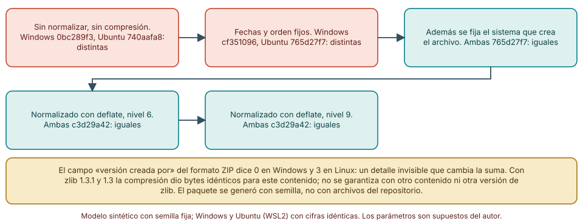
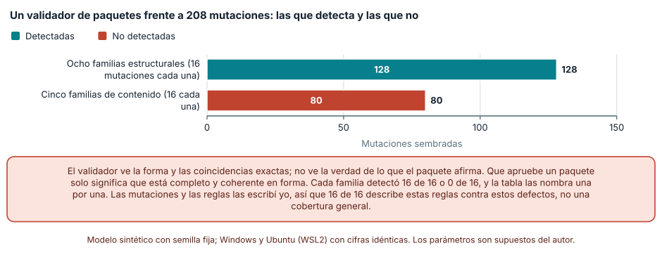
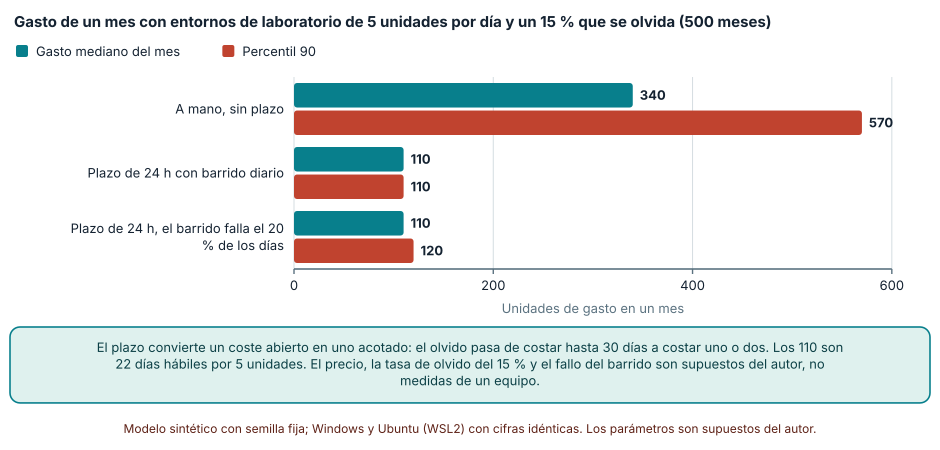

# SE-408 — Proyecto: plataforma mínima reproducible

[← SE-407 — Taller: desplegar y destruir un entorno seguro](https://github.com/vladimiracunadev-create/modern-software-engineering-program/blob/main/classes/part-33-cloud-plataforma-e-infraestructura/se-407-taller-desplegar-y-destruir-un-entorno-seguro/README.md) · [↑ Parte 33](https://github.com/vladimiracunadev-create/modern-software-engineering-program/blob/main/classes/part-33-cloud-plataforma-e-infraestructura/README.md) · [📚 Índice completo](https://github.com/vladimiracunadev-create/modern-software-engineering-program/blob/main/classes/README.md) · [🌐 Portal](https://vladimiracunadev-create.github.io/modern-software-engineering-program/classes/SE-408.html) · [SE-409 — Qué hace distinto a un producto SaaS →](https://github.com/vladimiracunadev-create/modern-software-engineering-program/blob/main/classes/part-34-saas-y-plataformas-de-producto/se-409-que-hace-distinto-a-un-producto-saas/README.md)

## Punto profesional y fundamento pedagógico

**Punto profesional.** El proyecto existe para que entregues una plataforma mínima que otra persona pueda reconstruir, revisar y destruir sin pedirte contexto: un paquete con la descripción de la infraestructura, el plan, las políticas, el presupuesto, la prueba de destrucción y los límites. Un paquete así no demuestra que la plataforma sea buena; demuestra que su evidencia se puede comprobar, y que la persona que lo entrega sabe qué parte no se comprueba.

**Por qué aparece aquí.** Cierra la **[Parte 33](../README.md)** después de **Taller: desplegar y destruir un entorno seguro**: las once clases anteriores dejaron una matriz de responsabilidades, fronteras de aislamiento, peticiones de recursos, una clasificación de piezas, el grafo de flujos y permisos, el estado y su política, el mapa de cuentas, la política de capacidad, la estrategia de portabilidad, el camino dorado y el ciclo de vida de un entorno. El caso conductor es la plataforma de entregas llevada a una infraestructura gestionada, y este proyecto reúne esas decisiones en un paquete verificable.

**Error conceptual que debe corregir.** Creer que un paquete completo es un paquete correcto. Un validador puede comprobar que no falta ninguna sección, que los hashes coinciden y que no hay un secreto en claro, y no puede ver que la prueba de destrucción es de 2019, que el gasto supera diez mil veces el tope ni que la evidencia fue copiada de otro paquete. Lo que el validador no ve es el contenido de la sección de límites.

**Secuencia de aprendizaje.** Antes de leer los resultados, predices si el mismo paquete construido en Windows y en Ubuntu tendrá la misma suma de comprobación, cuántas de trece familias de defectos detectará un validador de forma y cuánto gasta un mes con entornos olvidados con y sin plazo; después construyes el paquete con cinco variantes de archivo, evalúas el validador con 208 mutaciones y simulas el gasto de 500 meses. La secuencia usa predicción, explicación propia, contraste y recuperación. [ICAP](https://icap.education.asu.edu/research) distingue participación de construcción de conocimiento; [How People Learn II](https://nap.nationalacademies.org/catalog/24783/how-people-learn-ii-learners-contexts-and-cultures) exige conectar conocimiento previo, contexto y transferencia; la [práctica de recuperación](https://pubmed.ncbi.nlm.nih.gov/16507066/) respalda producir de nuevo la explicación tras una demora; y [Education for Life and Work](https://nap.nationalacademies.org/resource/13398/dbasse_084153.pdf) exige devolución que explique la causa del error.

**Evidencia de aprendizaje.** El paquete `plataforma-minima/` con su manifiesto, su validador y sus pruebas, el `LIMITES.md` que declara lo que ninguna prueba ve, las tres figuras reproducidas y una reconstrucción hecha por otra persona desde un checkout limpio.

**Límite de la conclusión.** El paquete de ejemplo se genera con una semilla y no contiene archivos de infraestructura reales; el validador y sus mutaciones los escribí yo, así que sus 16 de 16 describen estas reglas contra estos defectos; el gasto, la tasa de olvido y el fallo del barrido son supuestos del autor. No se desplegó nada en un proveedor ni se midió una organización.

### Trazabilidad fuente → afirmación

| Fuente primaria u oficial | Afirmación que respalda | Lo que no prueba |
|---|---|---|
| [Reproducible Builds: documentación](https://reproducible-builds.org/docs/) | Explica que una construcción reproducible produce los mismos bytes con las mismas entradas y señala causas de diferencia como las marcas de tiempo, el orden de los archivos y los metadatos. | No garantiza que cualquier proyecto sea reproducible sin trabajo. |
| [SLSA v1.0: especificación](https://slsa.dev/spec/v1.0/) | Define niveles de garantía sobre cómo se produce un artefacto y qué procedencia lo acompaña. | No evalúa la calidad del contenido del artefacto. |
| [NIST SP 800-218, Secure Software Development Framework](https://csrc.nist.gov/pubs/sp/800/218/final) | Reúne prácticas de desarrollo seguro, entre ellas conservar la integridad del software y la evidencia de sus verificaciones. | No dice cómo estructurar un paquete concreto. |
| [Python: zipfile](https://docs.python.org/3/library/zipfile.html) | Documenta los campos que describen cada entrada de un archivo ZIP, como la fecha, los atributos y el sistema de creación. | No dice cómo debe normalizarse un archivo para que sea reproducible. |
| [FinOps Framework](https://www.finops.org/framework/) | Propone prácticas para informar, optimizar y operar el gasto en la nube, incluidas la asignación y los presupuestos. | No fija un tope ni un plazo adecuados. |

## Antes de empezar

Recupera lo aprendido en `SE-407`: un entorno se destruye cuando una verificación independiente lo confirma. La pregunta activa es: **¿qué debe tener el paquete para que otra persona lo reconstruya, lo destruya y sepa qué no se comprobó?**

## Prerrequisitos

- Haber completado `SE-397` a `SE-407` o poder explicar el artefacto que cada una dejó.
- Python 3.11 o posterior; los experimentos usan solo la biblioteca estándar (`zipfile`, `hashlib`, `json`, `random`) y no necesitan proveedor, Terraform ni contenedores.
- Poder ejecutar un script en Windows o en Ubuntu (WSL2) y comparar dos sumas de comprobación.

## Problema auténtico

El equipo de la plataforma de entregas entregó a una auditoría interna un paquete con el código de infraestructura, la política de estados, la prueba de destrucción de un entorno y el presupuesto. La auditoría reconstruyó el paquete en otra máquina y su suma no coincidió con la publicada: el archivo comprimido contenía marcas de tiempo y un campo que depende del sistema. El validador del equipo aprobó el paquete, pero la prueba de destrucción era de un entorno anterior y el tope de gasto, de un trimestre que ya había pasado. Además, un entorno de laboratorio olvidado llevaba cuatro semanas encendido y representó el 40 % del gasto del mes. Cuatro defectos de naturaleza distinta, y solo uno lo veía el validador.

## Objetivos observables

Al terminar podrás:

1. definir una plataforma mínima por las capacidades que ofrece y por la evidencia que entrega;
2. construir un paquete cuya suma de comprobación sea la misma en dos sistemas y explicar qué campos la alteraban;
3. escribir un validador de forma y medir qué familias de defectos detecta y cuáles no;
4. estimar el gasto de entornos olvidados con y sin plazo y con un barrido que falla algunos días;
5. redactar `LIMITES.md` con todo lo que ninguna prueba del paquete comprueba.

## Mapa conceptual


El mapa tiene dos garantías con límites distintos: la **construcción reproducible** asegura que el paquete es el que se dice, y el **validador** asegura que está completo y es coherente en forma. Ninguna asegura que su contenido sea cierto; esa tarea queda a la revisión de otra persona y a `LIMITES.md`.

## Temas y por qué importan

| Tema | Por qué cambia una decisión profesional | Evidencia mínima |
|---|---|---|
| Plataforma mínima | Acota lo que se ofrece a lo que se puede sostener y comprobar. | Lista de capacidades con su evidencia |
| Reproducibilidad del paquete | Una suma que cambia con el sistema impide confiar en el artefacto. | Sumas en dos sistemas con y sin normalizar |
| Validador de forma | Detecta lo estructural y deja pasar lo que exige interpretar. | Defectos detectados y no detectados por familia |
| Costo y caducidad | Un entorno olvidado convierte el gasto en abierto. | Gasto mensual con y sin plazo |
| Límites declarados | Dicen qué no se comprobó y quién lo revisó. | `LIMITES.md` firmado por una segunda persona |

## Conceptos y decisiones

### 1. Plataforma mínima

Una plataforma mínima no es una plataforma pequeña sino la que ofrece solo lo que puede sostener con evidencia. Para la plataforma de entregas son cuatro capacidades: un entorno aislado y con identidad mínima (clases 350 y 353), su descripción declarativa con estado y política de cambios (354 y 355), un camino de creación con verificador (358) y un ciclo de vida con presupuesto, caducidad y prueba de destrucción (356 y 359). Cada capacidad nombra el artefacto que la respalda y quién lo revisó. Lo que no está respaldado no se ofrece: es mejor un catálogo corto y comprobable que uno largo y declarativo.

### 2. El paquete como artefacto

El paquete reúne los archivos que permiten entender, reconstruir y destruir la plataforma: el plan y el estado de referencia, las políticas, el presupuesto con su tope, el procedimiento de destrucción con su prueba, los módulos con versión y hash, la evidencia y `LIMITES.md`. Un manifiesto lista cada archivo con su suma y su procedencia. La idea de SLSA es la misma a otra escala: un artefacto es confiable si se sabe cómo y de qué se produjo, y si ese proceso puede repetirse. El paquete no es una promesa sobre el entorno, sino un registro de cómo se llegó a él.

### 3. Reproducibilidad del paquete

Una construcción es reproducible si las mismas entradas dan los mismos bytes. Las causas habituales de diferencia, que documenta el proyecto Reproducible Builds, son las marcas de tiempo, el orden en que se listan los archivos y los metadatos que dependen del sistema. Un archivo ZIP guarda la fecha de cada entrada y un campo con el sistema que lo creó, que vale 0 en Windows y 3 en Linux: un detalle invisible que cambia la suma. Normalizar es fijar esos campos: orden alfabético, fecha constante, permisos fijos y sistema fijo. La reproducibilidad no demuestra que el contenido sea bueno; demuestra que quien lo recibe puede comprobar que es lo que se publicó.

### 4. Un validador de forma

El validador comprueba lo que se puede decidir mirando la forma: que estén las ocho secciones, que no estén vacías, que los identificadores no se repitan, que cada hash coincida, que el tope de gasto sea positivo, que haya caducidad, que las versiones estén fijadas y que no haya un secreto literal. Cada una es una regla escrita contra un defecto conocido. Lo que el validador no puede hacer es interpretar: que la prueba de destrucción sea reciente, que el gasto sea razonable frente al tope, que la evidencia sea propia o que los límites digan algo útil. Esas comprobaciones pertenecen a una persona.

### 5. Costo, caducidad y límites

El presupuesto y la caducidad son parte del paquete porque convierten el gasto de abierto en acotado. Un entorno de laboratorio sin plazo cuesta cada día hasta que alguien se acuerda; con un plazo y un barrido, el máximo es el plazo. `LIMITES.md` cierra el paquete: lista lo que ninguna prueba comprueba, desde la fidelidad del modelo hasta la actualidad de la prueba de destrucción, y quién lo revisó. Un paquete sin límites no es más confiable: oculta lo que no se sabe.

### Las mismas entradas, sumas distintas

Se genera con una semilla un paquete de 12 archivos de 2 000 caracteres y se construye como ZIP en Windows 11 (zlib 1.3.1) y en Ubuntu bajo WSL2 (zlib 1.3) con cinco variantes: sin normalizar y sin comprimir; con orden y fechas fijos pero sin fijar el sistema que crea el archivo; con el sistema fijado; y con compresión deflate en los niveles 6 y 9. Se calcula el SHA-256.

```python
zi = zipfile.ZipInfo(n, date_time=(2026, 1, 1, 0, 0, 0))   # fecha constante
zi.external_attr = 0o644 << 16                             # permisos fijos
zi.create_system = 3                                       # 0 en Windows, 3 en Linux por defecto
names = sorted(files)                                      # orden estable
```

| Variante de construcción | Windows 11 | Ubuntu (WSL2) | ¿Igual? |
|---|---|---|---|
| Sin normalizar, sin compresión | 0bc289f3 | 740aafa8 | No |
| Fechas y orden fijos, sin fijar el sistema | cf351096 | 765d27f7 | No |
| Además se fija el sistema que crea el archivo | 765d27f7 | 765d27f7 | Sí |
| Normalizado con deflate, nivel 6 | c3d29a42 | c3d29a42 | Sí |
| Normalizado con deflate, nivel 9 | c3d29a42 | c3d29a42 | Sí |

Normalizar el orden y las fechas no bastó: el campo que registra el sistema de creación seguía distinguiendo los dos entornos. Solo al fijarlo coincidieron. Con compresión deflate también coincidieron con zlib 1.3.1 y 1.3, para este contenido; no se garantiza con otro contenido ni con otra versión de la biblioteca.



**Cómo leer la figura.** Se lee de izquierda a derecha y de arriba abajo: cada recuadro añade normalización a la construcción anterior; los recuadros coral son sumas distintas entre sistemas y los verde azulado, sumas iguales, con los primeros 8 caracteres de cada una. Mira en qué recuadro pasa del coral al verde azulado: al fijar el sistema que crea el archivo. **Dónde deja de valer:** el paquete se generó con una semilla y no con los archivos reales; con archivos de un repositorio entran además los saltos de línea, que dependen de la configuración de Git, y los permisos de archivo, que Windows no representa.

### Lo que un validador de forma ve

Se parte de un paquete válido con ocho secciones y cinco módulos, y se aplican 16 mutaciones de cada una de 13 familias (208 en total): ocho estructurales que el validador debería detectar y cinco que exigen interpretar el contenido.

```python
def validate(pk):
    errs = []
    for s in sections:
        if s not in pk or not pk[s]: errs.append(f"falta:{s}")
    for m in pk.get("modulos", []):
        if m.get("hash") != hashlib.sha256(m["id"].encode()).hexdigest()[:8]: errs.append("hash no coincide")
    if re.search(r"(clave|token)=\w{12,}", json.dumps(pk)): errs.append("secreto literal")
    return errs
```

| Defecto sembrado | Detectado |
|---|---|
| Falta una sección, sección vacía, módulo duplicado | 16 de 16 cada uno |
| Hash alterado, tope de gasto no positivo, TTL en cero | 16 de 16 cada uno |
| Versión sin fijar, secreto literal | 16 de 16 cada uno |
| Prueba de destrucción de 2019 (caducada) | 0 de 16 |
| Gasto de 10^6 sobre un tope de 100 | 0 de 16 |
| Evidencia copiada de otro paquete | 0 de 16 |
| Límites que dicen «sin límites» | 0 de 16 |
| Estado que no corresponde al plan | 0 de 16 |

El validador ve la forma y las coincidencias exactas y es ciego a lo que requiere interpretar, porque un paquete con una prueba de 2019 es tan completo y coherente en forma como uno con una de ayer. Un paquete aprobado por el validador solo está completo; su verdad la responde una persona. Los 16 de 16 describen estas reglas contra estos defectos, que escribí yo; no son una cobertura general.



**Cómo leer la figura.** Cada barra es un grupo de familias de defectos y mide sus mutaciones sembradas (16 por familia); el verde azulado es lo detectado y el coral lo que pasó. La separación es total: lo que el validador ve es forma y lo que no, interpretación. La tabla nombra una por una las 13 familias. **Dónde deja de valer:** las mutaciones y las reglas las escribí yo y las reglas se diseñaron conociéndolas; un paquete real tiene defectos que no se me ocurrieron, y por eso la cifra describe el validador, no su cobertura sobre paquetes reales.

### Entornos olvidados

Se simulan 500 meses de 30 días. Cada día hábil (22 en el mes) se crea un entorno de laboratorio que cuesta 5 unidades por día, y con probabilidad 0,15 se olvida. Sin plazo, un entorno olvidado cuesta hasta el fin del mes; con plazo de 24 horas se destruye al siguiente barrido diario, y el barrido puede fallar con probabilidad 0,2 cada día.

```python
if ttl is None: total += 5.0 * (30 - day)
else:
    d = 1
    while d < 30 - day and rr2.random() < sweep_fail: d += 1
    total += 5.0 * d
```

| Proceso | Gasto mediano del mes | Percentil 90 |
|---|---:|---:|
| A mano, sin plazo | 340 | 570 |
| Plazo de 24 h con barrido diario | 110 | 110 |
| Plazo de 24 h, el barrido falla el 20 % de los días | 110 | 120 |

El gasto mínimo, 110 unidades (22 días hábiles por 5), se alcanza con un barrido diario; sin plazo el mediano triplica ese mínimo y el percentil 90 lo multiplica por cinco. Un barrido que falla uno de cada cinco días apenas se nota, porque el siguiente lo corrige. El plazo convierte un costo abierto en uno acotado: el olvido pasa de costar hasta treinta días a costar uno o dos.



**Cómo leer la figura.** Cada grupo es un proceso; la barra verde azulada es el gasto mediano del mes y la coral, el del percentil 90, en 500 meses simulados. Mira la diferencia entre sin plazo y con plazo, y que el barrido que falla casi no mueve ninguna barra. **Dónde deja de valer:** el precio, la tasa de olvido del 15 % y el fallo del barrido son supuestos del autor; un entorno real puede costar mucho más por día, y un recurso con datos o con acceso expuesto es un riesgo que ninguna cifra de gasto mide.

## Definiciones de trabajo

- **plataforma mínima:** conjunto acotado de capacidades que una plataforma ofrece y puede sostener con evidencia comprobable.
- **construcción reproducible:** proceso que, con las mismas entradas, produce siempre los mismos bytes.
- **manifiesto:** lista de los archivos de un paquete con su suma de comprobación y su procedencia.
- **validador de forma:** comprobador que decide si un paquete está completo y es coherente en su estructura, sin interpretar su contenido.
- **paquete aprobado:** paquete que pasó la validación y la revisión de otra persona, con fecha y con sus límites declarados.

Las definiciones son operativas para la plataforma de entregas. Cada marco usa estos términos con matices y debe contrastarse con la documentación primaria enlazada al final.

## Ejemplo mínimo

El fragmento calcula el SHA-256 de un mismo contenido con y sin fecha incrustada. Antes de ejecutarlo, predice si las dos sumas coinciden.

```python
import hashlib
contenido = b"plan: 12 recursos"
a = hashlib.sha256(contenido + b"\n2026-01-01 00:00:01").hexdigest()[:8]
b = hashlib.sha256(contenido + b"\n2026-01-01 00:00:02").hexdigest()[:8]
c = hashlib.sha256(contenido).hexdigest()[:8]
print(a == b, c == hashlib.sha256(contenido).hexdigest()[:8])
```

La salida es `False True`: un solo segundo de diferencia cambia la suma. Registra versión de Python, comando y salida; después construye un ZIP de dos archivos dos veces y compara.

## Ejemplo profesional

El equipo de la plataforma reúne en `plataforma-minima/` los artefactos de las once clases: la matriz de responsabilidades, el cuadro de fronteras, las peticiones y límites, la clasificación de piezas, el grafo de flujos y la política de permisos mínimos, el código declarativo con su política de estado, el mapa de cuentas, la política de capacidad, la estrategia de portabilidad, el camino dorado y el taller de entorno con su prueba de destrucción. Un manifiesto lista cada archivo con su suma y de qué clase proviene. Construye el paquete con un script que normaliza orden, fecha, permisos y sistema, lo construye en Windows y en Ubuntu y compara las sumas en la integración continua. El validador de forma comprueba las ocho secciones, los hashes, el tope y la caducidad en cada cambio. Una segunda persona reconstruye el paquete desde un checkout limpio, comprueba que la prueba de destrucción tiene fecha reciente y que el gasto del último mes corresponde al presupuesto, y firma `LIMITES.md`. Compara con el estado inicial: ya no hay una suma que cambie con la máquina ni una prueba de otro entorno aprobada por el validador.

## Práctica guiada

1. Predice si el paquete tendrá la misma suma en Windows y Ubuntu y qué campo lo cambia.
2. Genera el paquete con semilla fija y construye las cinco variantes de ZIP en tu sistema.
3. Repite en un segundo sistema (Ubuntu en WSL2 o una máquina distinta) y compara las sumas.
4. Escribe el validador de forma con sus ocho reglas y pruébalo con 16 mutaciones por regla.
5. Escribe cinco defectos que cumplan la forma y comprueba que el validador los acepta.
6. Simula 500 meses de entornos olvidados con y sin plazo y con un barrido que falla algunos días.
7. Redacta `LIMITES.md` y pide a otra persona que reconstruya el paquete y que añada un límite que tú no viste.

## Ejercicios

1. **Suma:** explica por qué fijar la fecha y el orden no bastó para igualar las sumas en Windows y Ubuntu.
2. **Validador:** diseña una regla que detecte la prueba de destrucción caducada y di qué defecto seguiría sin ver.
3. **Gasto:** con un plazo de 72 horas y un barrido que falla el 20 % de los días, estima cualitativamente el gasto mediano y razona la dirección del cambio.
4. **Límites:** escribe cinco líneas de `LIMITES.md` para la plataforma de entregas que no se repitan en otro paquete.

## Reto verificable

Entrega `plataforma-minima/` con el manifiesto, el validador y sus pruebas, el script de construcción reproducible, las tres tablas reproducidas con las mismas semillas, `LIMITES.md` y la prueba de destrucción con fecha. Se aprueba si otra persona lo reconstruye desde un checkout limpio en un sistema distinto al tuyo, obtiene la misma suma y las mismas cifras, y puede decir tres cosas que el validador no comprueba. No se aprueba por aportar un paquete que pasa su validador sin una segunda persona, ni por declarar límites genéricos copiados de otro paquete.

## Caso conductor

La plataforma de entregas es el caso conductor de la [Parte 33](../README.md) y este proyecto la cierra: el paquete reúne el artefacto de cada clase y lo hace reconstruible. La [Parte 35](../../part-35-estrategia-y-tecnicas-de-prueba/README.md) cambia de pregunta: de cómo se construye y se entrega la plataforma a cómo se prueba con una estrategia por riesgo. Cambia una decisión, por ejemplo la política de estado o el plazo de caducidad, y comprueba cuántas partes del paquete deben cambiar y cuáles se conservan.

## Preguntas frecuentes

### ¿Un paquete reproducible es un paquete seguro?

No: es un paquete verificable. Que dos sistemas produzcan los mismos bytes dice que el artefacto es el que se publicó, no que su contenido sea seguro ni correcto. Es una condición para confiar, no una razón suficiente.

### ¿Por qué no basta con que el validador pase?

Porque un validador de forma comprueba lo que sus reglas enuncian. Una prueba de destrucción caducada o un gasto desmesurado cumplen la forma. La segunda persona y `LIMITES.md` cubren lo que el validador no ve.

### ¿Hay que construir el paquete en dos sistemas siempre?

Al menos una vez al diseñar el proceso, y después en la integración continua si el paquete se distribuye. La diferencia entre sistemas aparece en campos que nadie mira hasta que dos sumas no coinciden.

### ¿Qué incluir en `LIMITES.md`?

Lo que el paquete afirma y no demuestra: qué parte del modelo es una simulación, qué supuestos sostienen cada cifra, qué comprobó el validador y qué no, y quién revisó. Si cabe en una línea, probablemente falta.

## Fallo controlado y diagnóstico

Reproduce el fallo clásico de la clase: **una suma de comprobación distinta en dos sistemas**. Construye el paquete sin fijar el sistema de creación en Windows y en Ubuntu y compara.

Registra síntoma, entrada mínima, hipótesis, observación que descarta cada hipótesis, causa, corrección y prueba de regresión. **Síntoma:** la suma publicada no coincide con la reconstruida por la auditoría. **Hipótesis rivales:** (a) el contenido de algún archivo cambió; (b) la compresión usa otra versión de la biblioteca; (c) un campo de metadatos del archivo depende del sistema. **Prueba:** construye el paquete sin comprimir, compara los bytes con una herramienta de diferencias y lista los campos distintos de la entrada. **Conclusión:** el campo del sistema de creación vale 0 en Windows y 3 en Linux. **Regresión:** fija el campo y el resto de los metadatos y añade una prueba que construya el paquete dos veces y compare las sumas, y otra que lo compare con la del otro sistema en la integración continua. No arregles a la vez los metadatos y el contenido.

## Errores comunes y cómo corregirlos

| Síntoma | Causa probable | Corrección |
|---|---|---|
| La suma cambia entre máquinas | Marcas de tiempo, orden o campos del sistema en el archivo | Normalizar orden, fecha, permisos y sistema, y comparar en dos sistemas |
| El validador aprueba un paquete con evidencia vieja | Solo comprueba la forma | Revisión por otra persona y fecha máxima de antigüedad |
| El paquete contiene un secreto | Se copió una configuración real | Escanear secretos antes de construir y usar valores de ejemplo |
| Un entorno de laboratorio cuesta semanas | Sin plazo ni barrido | Caducidad por defecto y barrido con verificación |
| `LIMITES.md` es genérico | Se copió de otro paquete | Escribir los límites desde lo que este paquete no comprueba |

## Entorno y archivos clave

```text
plataforma-minima/
├── README.md
├── LIMITES.md
├── MANIFIESTO.json
├── plan.json
├── estado.json
├── politicas.rego
├── presupuesto.json
├── destruccion.md
├── evidencia/
│   ├── costes.csv
│   └── escaneo.txt
├── modulos/
│   ├── red.tf
│   ├── computo.tf
│   └── datos.tf
├── tests/test_paquete.py
└── herramientas/
    ├── construir.py
    └── validar.py
```

El `README` declara sistema, versión de Python, semillas y comandos. Los experimentos usan solo la biblioteca estándar y se ejecutaron con CPython 3.12.9 en Windows 11 (zlib 1.3.1) y 3.12.3 en Ubuntu bajo WSL2 (zlib 1.3) con salidas idénticas en la validación y el gasto, y sumas iguales solo al normalizar. Los archivos del paquete de ejemplo son texto generado con semilla: no contienen infraestructura real.

## Seguridad, ética y accesibilidad

- el paquete no debe contener secretos, datos personales ni rutas de máquinas reales: escanéalo antes de publicarlo y usa valores de ejemplo;
- una prueba de destrucción con datos de personas reales es un dato personal: usa entornos con datos sintéticos;
- `LIMITES.md` es una obligación de honestidad con quien confía en el paquete: no lo reduzcas para que parezca más sólido;
- documenta el paquete en texto además de diagramas, con nombres de archivo y descripciones claras, para que un lector de pantalla pueda recorrerlo;
- respeta las licencias de los módulos reutilizados y atribuye lo adaptado.

## Puente hacia el trabajo con agentes

Un agente al que se le pide «prepara el paquete de la plataforma» reunirá los archivos que encuentre, calculará sumas con lo que haya en su máquina y producirá un `LIMITES.md` amable y genérico. Pídele en cambio que construya con normalización, que compare las sumas en dos sistemas, que ejecute el validador y que escriba los límites desde la lista de lo que el validador no comprueba, con una persona como revisora. Revisa especialmente las fechas de las pruebas, de dónde copió la evidencia y qué dijo en los límites: son los tres lugares donde un paquete que pasa el validador puede no decir la verdad.

## Transferencia

Traslada el proyecto a otro dominio (por ejemplo, la infraestructura de una tienda con pagos): cambia las capacidades y conserva el procedimiento de reunir las decisiones en un paquete, construirlo de forma reproducible, validar su forma, simular el gasto de lo olvidado y escribir los límites con una segunda persona. La transferencia está lograda cuando puedes decir qué comprueba cada parte del paquete y cuál no, no cuando las carpetas se parecen.

## Evaluación y evidencia

| Criterio | Evidencia para aprobar |
|---|---|
| comprensión | explicación de qué garantiza la reproducibilidad, el validador y la revisión |
| corrección | sumas iguales en dos sistemas y cifras reproducibles con las mismas semillas |
| decisión | capacidades ofrecidas con su evidencia y presupuesto con caducidad |
| diagnóstico | reproducción del fallo «suma distinta entre sistemas» con regresión |
| incertidumbre | `LIMITES.md` con lo que ninguna prueba comprueba, revisado por otra persona |
| reproducibilidad | reconstrucción por otra persona desde un checkout limpio |

## Fuentes

- [Reproducible Builds](https://reproducible-builds.org/docs/) — causas y prácticas de la construcción reproducible; autoridad: proyecto Reproducible Builds.
- [SLSA v1.0](https://slsa.dev/spec/v1.0/) — niveles de garantía sobre la producción de artefactos; autoridad: proyecto SLSA (OpenSSF).
- [NIST SP 800-218, SSDF](https://csrc.nist.gov/pubs/sp/800/218/final) — prácticas de desarrollo seguro; autoridad: NIST.
- [Python: zipfile](https://docs.python.org/3/library/zipfile.html) — campos de cada entrada de un archivo ZIP; autoridad: documentación de Python.
- [FinOps Framework](https://www.finops.org/framework/) — presupuestos, asignación y operación del gasto; autoridad: FinOps Foundation.

Cada fuente respalda el mecanismo indicado; ninguna demuestra que las cinco sumas, los 16 de 16 ni los 110 de gasto mínimo se observen con un paquete real. Esa afirmación depende de los archivos, de las herramientas y de los entornos de cada organización.

## Límites y siguiente paso

Se ejecutaron tres experimentos en Windows y Ubuntu (WSL2): la validación y la simulación del gasto fueron idénticas, y las sumas coincidieron solo al normalizar. El paquete se generó con una semilla y no hay infraestructura real, el validador y sus mutaciones los escribí yo y el gasto, la tasa de olvido y el fallo del barrido son supuestos del autor. No se desplegó nada en un proveedor ni se evaluó una organización. La [Parte 35](../../part-35-estrategia-y-tecnicas-de-prueba/README.md) pasa de construir y entregar la plataforma a probarla con una estrategia por riesgo.

## Glosario

- **plataforma mínima:** conjunto acotado de capacidades que una plataforma ofrece y puede sostener con evidencia comprobable.
- **construcción reproducible:** proceso que, con las mismas entradas, produce siempre los mismos bytes.
- **manifiesto:** lista de los archivos de un paquete con su suma de comprobación y su procedencia.
- **validador de forma:** comprobador que decide si un paquete está completo y es coherente en su estructura, sin interpretar su contenido.
- **paquete aprobado:** paquete que pasó la validación y la revisión de otra persona, con fecha y con sus límites declarados.

---

[← SE-407 — Taller: desplegar y destruir un entorno seguro](https://github.com/vladimiracunadev-create/modern-software-engineering-program/blob/main/classes/part-33-cloud-plataforma-e-infraestructura/se-407-taller-desplegar-y-destruir-un-entorno-seguro/README.md) · [↑ Parte 33](https://github.com/vladimiracunadev-create/modern-software-engineering-program/blob/main/classes/part-33-cloud-plataforma-e-infraestructura/README.md) · [📚 Índice completo](https://github.com/vladimiracunadev-create/modern-software-engineering-program/blob/main/classes/README.md) · [🌐 Portal](https://vladimiracunadev-create.github.io/modern-software-engineering-program/classes/SE-408.html) · [SE-409 — Qué hace distinto a un producto SaaS →](https://github.com/vladimiracunadev-create/modern-software-engineering-program/blob/main/classes/part-34-saas-y-plataformas-de-producto/se-409-que-hace-distinto-a-un-producto-saas/README.md)
