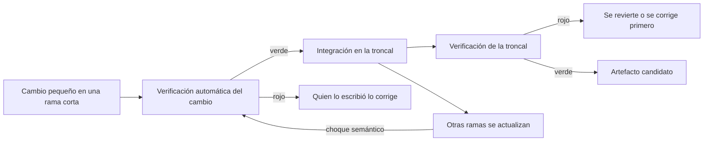
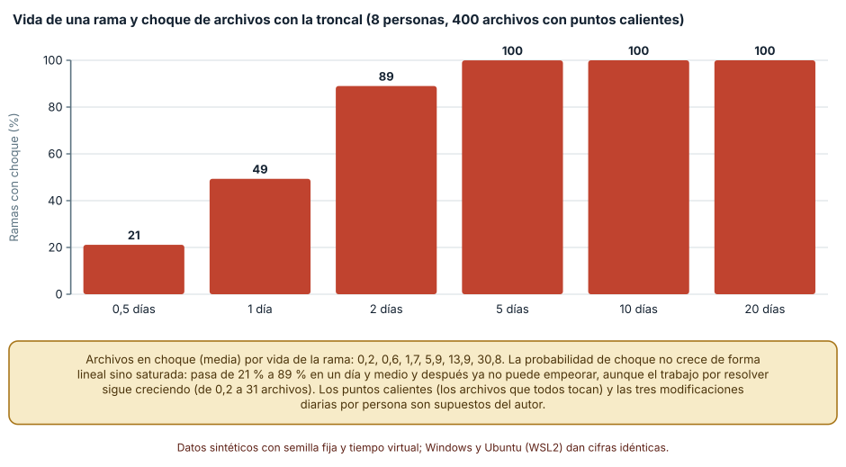
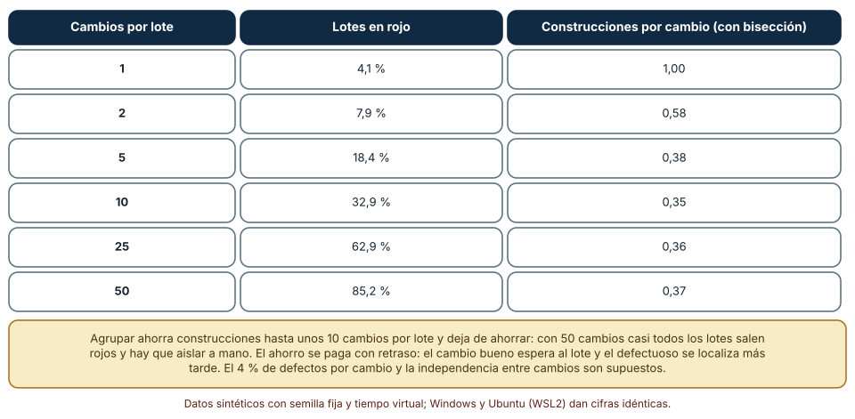
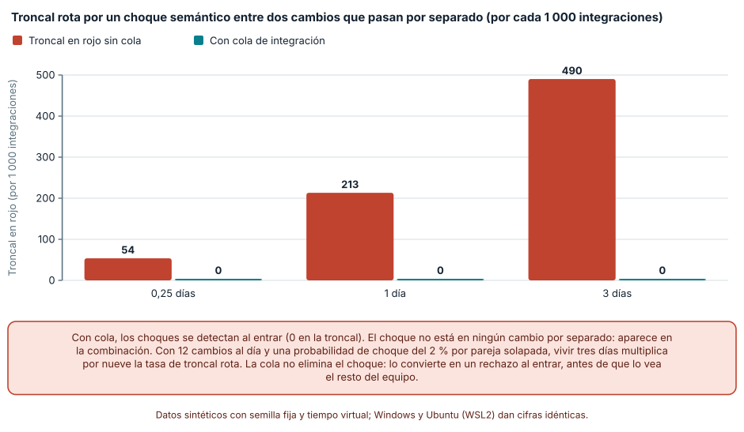

# SE-409 — Integración continua y feedback temprano

[← SE-408 — Proyecto: release firmado y recuperable](https://github.com/vladimiracunadev-create/modern-software-engineering-program/blob/main/classes/part-33-build-release-y-cadena-de-suministro/se-408-proyecto-release-firmado-y-recuperable/README.md) · [↑ Parte 34](https://github.com/vladimiracunadev-create/modern-software-engineering-program/blob/main/classes/part-34-ci-cd-iac-y-platform-engineering/README.md) · [📚 Índice completo](https://github.com/vladimiracunadev-create/modern-software-engineering-program/blob/main/classes/README.md) · [🌐 Portal](https://vladimiracunadev-create.github.io/modern-software-engineering-program/classes/SE-409.html) · [SE-410 — Pipelines, jobs, matrices y cachés →](https://github.com/vladimiracunadev-create/modern-software-engineering-program/blob/main/classes/part-34-ci-cd-iac-y-platform-engineering/se-410-pipelines-jobs-matrices-y-caches/README.md)

## Punto profesional y fundamento pedagógico

**Punto profesional.** La clase existe para que dejes de tratar la integración continua como un servidor que «corre builds» y la trates como una práctica con consecuencias medibles: cada cuánto se integra el trabajo de varias personas, cuánto cuesta cada integración tardía, cuánto tarda la señal de que algo se rompió y quién actúa cuando aparece. La habilidad profesional no es configurar un runner sino decidir, con números, cuánto trabajo se acepta en la troncal sin verificar y qué hace el equipo cuando la señal es roja.

**Por qué aparece aquí.** Abre la **Parte 34** después de **Proyecto: release firmado y recuperable**: la Parte 33 dejó un artefacto que se construye de forma reproducible, se firma y se puede recuperar; ahora hay que decidir quién y cuándo lo construye. Un build reproducible que se ejecuta una vez por semana llega tarde. El caso conductor de la parte es la **canalización del repositorio de la API de entregas de la plataforma educativa** (la misma API de la Parte 31): un repositorio, ocho personas y cambios que deben llegar a producción sin romper el cierre de plazos.

**Error conceptual que debe corregir.** Creer que la integración continua es una herramienta que se instala: es una práctica —integrar al menos a diario en la troncal y verificar cada integración— y una herramienta que no cambia esa conducta solo automatiza la espera.

**Secuencia de aprendizaje.** Antes de mirar los resultados, predices qué fracción de las ramas de uno y de cinco días choca con la troncal y si integrar en lotes de 50 cambios ahorra construcciones; después reproduces la vida de la rama, los lotes con bisección y el choque semántico que una cola de integración atrapa. La secuencia usa predicción, explicación propia, contraste y recuperación. [ICAP](https://icap.education.asu.edu/research) distingue participación de construcción de conocimiento; [How People Learn II](https://nap.nationalacademies.org/catalog/24783/how-people-learn-ii-learners-contexts-and-cultures) respalda diseñar la práctica con contextos reales y retroalimentación.

**Evidencia de aprendizaje.** `ci-log.md` con la predicción, las tres figuras reproducidas, una política de troncal escrita (qué se verifica antes de integrar, cuánto puede tardar, quién actúa sobre un rojo y en cuánto tiempo) y una nota que separe qué parte de cada conclusión es medida, cuál inferida y cuál supuesta.

**Límite de la conclusión.** Los equipos, los archivos, los puntos calientes, la tasa de defectos y la probabilidad de choque entre cambios son sintéticos y elegidos por el autor; los experimentos corren en tiempo virtual con semilla fija. No se midió ningún repositorio, equipo ni servidor de integración reales, y no se probó ninguna herramienta de integración continua concreta: la clase explica la práctica y deja los detalles de configuración a la siguiente.

### Trazabilidad fuente → afirmación

| Fuente primaria u oficial | Afirmación que respalda | Lo que no prueba |
|---|---|---|
| [Martin Fowler, «Continuous Integration»](https://martinfowler.com/articles/continuousIntegration.html) | Define la práctica: integrar a la línea principal con frecuencia, construir y probar automáticamente cada integración, mantener la construcción rápida y corregir primero una construcción rota. | No fija un umbral universal de frecuencia ni de duración; el artículo describe una práctica, no una norma. |
| [DORA: integración continua](https://dora.dev/capabilities/continuous-integration/) y [desarrollo basado en la troncal](https://dora.dev/capabilities/trunk-based-development/) | Relacionan integrar con frecuencia y mantener ramas de corta vida con mejores resultados de entrega. | Es una correlación observada en encuestas de organizaciones; no demuestra que cambiar la práctica produzca por sí sola la mejora en tu equipo. |
| [GitHub: cola de fusión](https://docs.github.com/en/repositories/configuring-branches-and-merges-in-your-repository/configuring-pull-request-merges/managing-a-merge-queue) | Describe que una cola de fusión valida un cambio junto con los que lo preceden antes de integrarlo en la rama de destino. | No cuantifica cuántos choques evita ni sirve para otro proveedor; la clase usa el mecanismo, no el producto. |
| [git bisect](https://git-scm.com/docs/git-bisect) | Documenta la búsqueda binaria del primer commit defectuoso en un historial. | No dice cuántos cambios defectuosos esperar ni cómo se comporta con defectos intermitentes. |

## Antes de empezar

Recupera lo aprendido en la Parte 33: una versión se identifica por su contenido (resumen del artefacto), no por una etiqueta que se puede mover. La pregunta activa es: **¿cuánto trabajo sin verificar acepta tu equipo en la troncal, y cuánto tarda en enterarse cuando esa suposición falla?**

## Prerrequisitos

- Haber completado `SE-408` o poder explicar cómo se identifica y se recupera un release.
- Python 3.11 o posterior; los experimentos usan solo la biblioteca estándar (`random`, `itertools`, `functools`).
- Saber qué es una rama, una fusión y un conflicto de fusión, y leer un historial de git.

## Problema auténtico

Caso ilustrativo, no un incidente real: el equipo de la API de entregas trabajaba con ramas de funcionalidad de una o dos semanas. La integración era un evento: cada viernes alguien dedicaba la tarde a fusionar, resolver conflictos y reparar lo que dejaba de compilar. Una de esas tardes se fusionaron seis ramas a la vez, las pruebas fallaron y nadie sabía cuál de los cuarenta y tantos cambios era la causa; la lista de entregas de un curso dejó de ordenar por fecha y el defecto llegó a producción el lunes siguiente. Nadie había escrito mal el código: cada rama funcionaba sola. Lo que fallaba era la distancia entre ramas y la ausencia de una señal por cada cambio. La clase enseña a medir esa distancia, a acortar el lote y a decidir qué verifica la integración antes de aceptar un cambio.

## Objetivos observables

Al terminar podrás:

1. explicar qué prácticas componen la integración continua y por qué una herramienta sola no la produce;
2. estimar con un modelo la probabilidad de conflicto de una rama según su vida y la concentración de cambios;
3. calcular cuántas construcciones exige aislar los cambios defectuosos de un lote por bisección y elegir un tamaño de lote con ese dato;
4. explicar por qué un cambio probado contra su base puede romper la troncal y qué hace una cola de integración;
5. escribir una política de troncal con umbral de duración, responsable y plazo de reacción ante un rojo.

## Mapa conceptual



El mapa separa la **verificación del cambio** (antes de integrar) de la **verificación de la troncal** (después). Un rojo en la primera detiene a una persona; un rojo en la segunda detiene a todo el equipo, y por eso la política debe decir quién lo trata y con qué prioridad.

## Temas y por qué importan

| Tema | Por qué cambia una decisión profesional | Evidencia mínima |
|---|---|---|
| Integración continua como práctica | Una herramienta que nadie obedece no integra nada; la práctica define la conducta que la herramienta apoya. | Política de troncal escrita |
| Costo de integrar tarde | El choque crece con la vida de la rama y se satura; saberlo evita discutir con intuiciones. | Figura 1 y su predicción |
| Retroalimentación temprana | La señal útil llega mientras la persona recuerda qué cambió; tarde se vuelve arqueología. | Tiempo hasta la señal y su responsable |
| Lotes y aislamiento de fallos | Verificar de a muchos ahorra construcciones y encarece encontrar la causa. | Figura 2 y tamaño de lote elegido |
| Choques semánticos y cola de integración | Dos cambios correctos por separado pueden fallar juntos; probar contra una base vieja no lo ve. | Figura 3 y una cola descrita |

## Conceptos y decisiones

### 1. La integración continua es una práctica

Integrar significa combinar el trabajo de varias personas en una línea común y comprobar que el resultado funciona. La integración continua conserva esa definición y cambia la frecuencia y la forma: cada persona integra al menos una vez al día en la troncal, cada integración dispara una verificación automática y una verificación en rojo se corrige antes de seguir añadiendo cambios. Fowler enumera las prácticas que la sostienen: un único repositorio de referencia, una construcción automatizada, pruebas que se ejecutan en esa construcción, integraciones frecuentes, construcción de cada integración en una máquina de integración, construcción rápida, un entorno de prueba parecido al de producción, visibilidad del estado y, en su evolución, despliegue automático. Ninguna de esas prácticas es una herramienta: una máquina que construye cada noche y manda un correo que nadie lee cumple la parte técnica y viola la parte esencial, que es la reacción. Por eso la clase mide conducta (vida de las ramas, tamaño de los lotes, plazo de reacción ante un rojo) antes de tocar configuración.

### 2. El costo de integrar tarde

Cada rama es una apuesta de que nadie más tocará lo mismo mientras tanto. Cuanto más vive la rama, más cambios acumula la troncal que la rama no ha visto y mayor es la probabilidad de que ambos lados hayan modificado un mismo archivo. El crecimiento no es lineal: la probabilidad de que exista al menos un archivo en choque se **satura** (después de unos días casi toda rama choca con algo), pero el trabajo de resolverlos sigue creciendo porque aumenta el número de archivos. Existe además un efecto de concentración: los cambios no se reparten parejos, hay archivos «calientes» (rutas, configuración, el modelo de datos) que casi todos tocan. Por eso un equipo con pocos archivos calientes sufre más choques que uno de igual tamaño con cambios dispersos, y por eso la decisión de partir un archivo caliente es una decisión de integración. La conclusión práctica no es «ramas de una hora» sino saber cuánto cuesta cada día extra de vida con los datos de tu repositorio.

### 3. Retroalimentación temprana

La retroalimentación es útil si llega mientras la persona recuerda el cambio y puede actuar sin reconstruir el contexto. Tres propiedades la definen: **latencia** (cuánto tarda la señal desde el commit), **confiabilidad** (un rojo debe significar defecto, no inestabilidad) y **dueño** (alguien concreto debe sentirse obligado a actuar). Una señal rápida pero poco confiable enseña a ignorarla; una confiable pero lenta se atiende en lotes y pierde su valor. Una práctica recomendada es dar un presupuesto de latencia a la verificación previa a la integración (por ejemplo, diez minutos) y mover lo que lo excede a una verificación posterior, con la decisión escrita de qué riesgo se acepta mientras tanto. También importa qué ve la persona: un mensaje que dice qué falló, dónde y cómo reproducirlo localmente reduce el tiempo de reacción mucho más que un build un minuto más rápido.

### 4. Lotes y aislamiento de fallos

Cuando la verificación es costosa se tienta a verificar de a varios cambios a la vez. El costo es el aislamiento: si el lote sale rojo hay que encontrar cuál de los cambios fue. La búsqueda binaria (la idea que usa `git bisect`) divide el lote y construye cada mitad: para un único cambio defectuoso en un lote de `k` cambios hacen falta del orden de `log2(k)` construcciones adicionales, y con varios defectuosos hay que repetirlo en cada rama. El resultado es un compromiso: un lote pequeño se verifica entero muchas veces, un lote grande casi siempre sale rojo y obliga a bisectar. Con una tasa de defectos por cambio `p`, la probabilidad de que un lote de `k` salga rojo es `1 − (1 − p)^k`, y crece más rápido de lo que la intuición espera. El tamaño óptimo no es universal: depende de `p`, del costo de una construcción y del costo de esperar.

### 5. Choques semánticos y cola de integración

Un conflicto de fusión es lo que git detecta; un **choque semántico** es lo que git no puede detectar: dos cambios que tocan archivos distintos y juntos rompen una suposición compartida (uno renombra un campo que el otro empieza a leer). Cada cambio pasó su verificación contra la base en la que nació; ninguno fue probado contra el resultado de integrar ambos. La defensa es probar la combinación: una **cola de integración** toma cada cambio aprobado, lo combina virtualmente con los que están por delante y solo lo integra si esa combinación pasa. No elimina el choque: lo transforma en un rechazo al entrar, antes de que la troncal quede en rojo para todos. Su costo es latencia (cada cambio espera su turno y puede reconstruirse si uno anterior se rechaza) y complejidad operativa; se justifica cuando la tasa de troncal rota supera lo que el equipo tolera.

### La vida de la rama y el choque de archivos

Se modela un repositorio de 400 archivos y ocho personas que modifican tres archivos al día cada una; la probabilidad de tocar el archivo `i` es proporcional a `1/(i+1)^0,8`, de modo que unos pocos archivos son calientes. Para cada vida de rama se sortean 3 000 pares (la rama de una persona y los cambios de las otras siete en el mismo periodo) y se cuenta cuántas veces comparten al menos un archivo.

| Vida de la rama | Con algún archivo en choque | Archivos en choque (media) |
|---|---:|---:|
| 0,5 días | 21 % | 0,2 |
| 1 día | 49 % | 0,6 |
| 2 días | 89 % | 1,7 |
| 5 días | 99,97 % | 5,9 |
| 10 días | 100 % | 13,9 |
| 20 días | 100 % | 30,8 |

La probabilidad pasa de 21 % a 89 % en un día y medio y deja de crecer, mientras que los archivos en choque, que son el trabajo de resolverlos, se multiplican por 140 entre medio día y veinte días.



**Cómo leer la figura.** Cada fila es una vida de rama; la segunda columna es la probabilidad de que haya al menos un choque y la tercera, cuánto trabajo hay que resolver. **Dónde deja de valer:** las tres modificaciones diarias, los 400 archivos y el exponente de concentración son supuestos del autor. En un repositorio con cambios muy dispersos el choque sería menor; en uno con un archivo que todos tocan, mayor. Además, un choque de texto no es un choque de significado: la tabla cuenta archivos compartidos, no defectos.

### Lotes y aislamiento de fallos

Se generan 24 000 cambios, el 4 % defectuosos, con independencia entre ellos. Para cada tamaño de lote se verifica el lote y, si sale rojo, se divide por la mitad recursivamente hasta aislar cada cambio defectuoso, contando las construcciones.

```python
def aislar(trozo):
    construcciones = 1
    if not any(trozo):
        return construcciones, 0
    if len(trozo) == 1:
        return construcciones, 1
    m = len(trozo) // 2
    b1, f1 = aislar(trozo[:m])
    b2, f2 = aislar(trozo[m:])
    return construcciones + b1 + b2, f1 + f2
```

| Cambios por lote | Lotes en rojo | Construcciones por cambio |
|---:|---:|---:|
| 1 | 4,1 % | 1,00 |
| 2 | 7,9 % | 0,58 |
| 5 | 18,4 % | 0,38 |
| 10 | 32,9 % | 0,35 |
| 25 | 62,9 % | 0,36 |
| 50 | 85,2 % | 0,37 |

En todos los casos se encuentran los mismos 974 cambios defectuosos. Pasar de verificar cada cambio a lotes de diez reduce las construcciones por cambio de 1,00 a 0,35; seguir creciendo no ahorra más, porque casi todos los lotes salen rojos y la bisección hace el trabajo que el lote pretendía evitar.



**Cómo leer la figura.** La tercera columna es el costo de computación por cambio; la segunda es la fracción de lotes que no se pueden integrar de una vez. **Dónde deja de valer:** el 4 % de defectos y la independencia entre cambios son supuestos; si los defectos se agrupan (los hace la misma persona, en el mismo módulo) la bisección cuesta menos. El modelo mide construcciones, no tiempo: el cambio bueno que espera a su lote pierde horas que esta tabla no cuenta, y el aislamiento supone que el defecto se manifiesta siempre, algo que no ocurre con defectos intermitentes.

### La troncal rota por un choque que ningún cambio ve

Doce cambios al día entran por un proceso de Poisson y cada uno vive 0,25, 1 o 3 días antes de integrarse. Dos cambios que coinciden en vida chocan semánticamente con una probabilidad del 2 %. Sin cola, un cambio solo se prueba contra su base, así que el choque con un cambio que se integró mientras vivía rompe la troncal. Con cola, ese cambio se prueba combinado y se rechaza al entrar.

| Vida del cambio | Troncal rota sin cola (por 1 000 integraciones) | Con cola de integración |
|---|---:|---|
| 0,25 días | 54 | 0 (se detectan al entrar) |
| 1 día | 213 | 0 (se detectan al entrar) |
| 3 días | 490 | 0 (se detectan al entrar) |



**Cómo leer la figura.** La columna central cuenta cuántas de cada mil integraciones dejan la troncal en rojo; la última dice qué ocurre con la cola. **Dónde deja de valer:** el «0» de la cola no significa que el choque no exista: significa que se descubre antes de integrar, como un rechazo con su costo de espera y de reconstrucción, que este modelo no mide. La probabilidad de choque del 2 % por pareja y la tasa de 12 cambios por día son supuestos; una vida de tres días no es típica de un equipo que integra a diario.

## Definiciones de trabajo

- **integración continua:** práctica de integrar el trabajo de todas las personas en una línea común con frecuencia y verificar automáticamente cada integración.
- **troncal:** línea de desarrollo de la que parte y a la que vuelve el trabajo de todo el equipo.
- **conflicto semántico:** combinación de dos cambios que no choca en el texto y rompe una suposición compartida.
- **cola de integración:** mecanismo que verifica cada cambio combinado con los que lo preceden antes de integrarlo.
- **bisección:** búsqueda binaria del primer cambio defectuoso dividiendo repetidamente un conjunto de cambios.

Las definiciones son operativas para la canalización de la API de entregas. No convierten términos con una historia más amplia en sinónimos y deben contrastarse con la documentación primaria enlazada al final.

## Ejemplo mínimo

El fragmento calcula la probabilidad de que un lote de `k` cambios salga rojo cuando el 4 % de los cambios son defectuosos. Antes de ejecutarlo, predice si un lote de 25 sale rojo más o menos de la mitad de las veces.

```python
p = 0.04
for k in (1, 5, 10, 25, 50):
    print(k, round(1 - (1 - p) ** k, 3))
```

Salen 0,04, 0,185, 0,335, 0,640 y 0,870: con 25 cambios el lote sale rojo casi dos veces de cada tres, y con 50, siete de cada ocho. La cuenta exacta (64,0 % y 87,0 % para 25 y 50 cambios) se parece a la simulación de la segunda figura (62,9 % y 85,2 %), con la diferencia propia del muestreo. Registra versión de Python, comando y salida; después cambia `p` a 0,01 y observa qué tamaño de lote vuelve a ser razonable.

## Ejemplo profesional

El equipo de la API de entregas revisa su historial: las ramas viven nueve días de mediana, el 60 % de las fusiones tiene conflictos y el viernes por la tarde se fusiona todo. Con el modelo de la primera figura estiman que a esa vida casi toda rama choca con algo; con la segunda, que verificar de a diez cambios es razonable porque su tasa de defectos ronda el 4 %. Escriben una política de troncal: las ramas viven como máximo dos días y, si una funcionalidad es mayor, se integra detrás de una bandera apagada; la verificación previa a la integración tiene un presupuesto de diez minutos (lint, tipos y pruebas unitarias); lo demás se ejecuta tras la integración; un rojo en la troncal tiene prioridad sobre cualquier otro trabajo y quien integró el último cambio lo corrige o lo revierte en menos de quince minutos. Añaden una cola de integración porque, con doce cambios al día, un choque semántico cada dos semanas ya es un día perdido. Registran la decisión con su fecha y el dato que la revisaría: si la tasa de troncal rota baja de una por mes, la cola deja de pagarse. Compara con el punto de partida: ahora hay una conducta escrita, un número que la sustenta y una condición que la cancela.

## Práctica guiada

1. Mide en un repositorio propio (o en uno de ejemplo) la vida mediana de las ramas fusionadas: fecha del primer commit y fecha de fusión.
2. Predice qué fracción de ramas de uno y de cinco días choca con la troncal y escribe tu estimación antes de medir.
3. Ejecuta el modelo de ramas con semilla fija y reproduce la tabla; cambia el exponente de concentración a 0 (cambios dispersos) y observa cómo cae el choque.
4. Simula 24 000 cambios con el 4 % de defectos y reproduce la tabla de lotes; después cambia `p` a 1 % y 10 % y anota cómo se desplaza el tamaño óptimo.
5. Simula la troncal rota con y sin cola para vidas de 0,25 y 3 días y anota cuántos rechazos «gratuitos» produce la cola.
6. Escribe la política de troncal: vida máxima de las ramas, presupuesto de duración de la verificación previa, responsable y plazo de reacción ante un rojo.
7. Entrega `ci-log.md` y pide a otra persona que diga qué conducta de la política sería la primera en incumplirse y por qué.

## Ejercicios

1. **Saturación:** con los datos de la primera tabla explica por qué pasar de 5 a 20 días de vida casi no cambia la probabilidad de choque y sí cambia el trabajo de resolverlo.
2. **Lotes:** si una construcción cuesta 10 minutos y esperar cuesta 2 minutos por cambio y por lote, estima si conviene verificar cada cambio o lotes de 5; razona qué dato falta.
3. **Cola:** calcula, con la tasa de rechazo del modelo, cuántos cambios al mes rechazaría la cola y compara con las integraciones que dejarían la troncal en rojo sin ella; decide cuándo no vale la pena.
4. **Política:** reescribe «el build debe ser rápido» como un presupuesto con número, alcance y consecuencia, y propón una medida complementaria que detecte que el presupuesto se cumple moviendo la lentitud a otra etapa.

## Reto verificable

Entrega `ci-log.md` con la predicción, las tres tablas, la política de troncal y la declaración del tipo de evidencia de cada número. Se aprueba si otra persona ejecuta el código desde un checkout limpio, obtiene las mismas tablas con las mismas semillas y puede decir qué vida máxima de rama y qué tamaño de lote fijarías para tu equipo y por qué. No se aprueba por describir las prácticas de integración continua sin medir ninguna ni por afirmar que «integramos a menudo» sin decir la vida mediana de las ramas.

## Caso conductor

La canalización del repositorio de la API de entregas es el caso conductor de la Parte 34. Esta clase deja el primer artefacto: la política de troncal con sus números. `SE-410` convertirá la verificación en una canalización con jobs, dependencias, matrices y cachés, y `SE-411` decidirá qué comprobaciones la bloquean. Cambia después un solo dato, la vida máxima de las ramas, y observa cuánto se mueve el choque esperado.

## Preguntas frecuentes

### ¿Hay que trabajar siempre sobre la troncal sin ramas?

No. Lo que exige la práctica es que las ramas vivan poco y se integren a menudo, no que no existan. Una rama de dos días con revisión es compatible con integrar a diario en términos de choque; una rama de tres semanas no, por muy bien nombrada que esté.

### ¿Una cola de integración sustituye a las pruebas del cambio?

No. La cola verifica la combinación; las pruebas del cambio verifican el cambio. Si el cambio llega a la cola con pruebas que fallan, la cola gasta tiempo en rechazarlo. Se complementan, y la verificación previa existe para que lo que entra a la cola casi siempre pase.

### ¿Qué hago si la verificación tarda más que el presupuesto?

Decide qué se mueve a una etapa posterior y escribe qué riesgo se acepta mientras tanto. Mover pruebas lentas fuera de la ruta crítica es una decisión legítima; hacerlo sin escribirla es perder una compuerta sin saberlo, como mostrará la clase 411 con el orden de las etapas.

### ¿La integración continua exige pruebas automatizadas?

Sin ellas, la verificación solo dice que el código compila. La práctica asume que existe un conjunto de pruebas que da confianza razonable; si no existe, el primer paso es construirlo, y mientras tanto la integración frecuente sigue reduciendo el choque aunque detecte menos defectos.

## Fallo controlado y diagnóstico

Reproduce el fallo clásico de la clase: **una integración semanal que fusiona muchas ramas y deja una troncal roja sin causa evidente**. Simula 50 cambios con el 4 % de defectuosos, intégralos de golpe y cuenta cuántas construcciones exige aislar los defectuosos.

Registra síntoma, entrada mínima, hipótesis, observación que descarta cada hipótesis, causa, corrección y prueba de regresión. **Síntoma:** la troncal queda en rojo tras una fusión grande y nadie sabe cuál de los cambios lo causó. **Hipótesis rivales:** (a) hay un único cambio defectuoso; (b) hay un problema de entorno de la máquina de integración; (c) hay varios cambios defectuosos y el lote tiene muy poca probabilidad de salir verde. **Prueba:** calcula `1 − (1 − p)^k` con `k = 50` y `p = 0,04`; si el lote tiene 87 % de probabilidad de salir rojo, no hay nada raro en el entorno. **Conclusión:** el fallo era esperable: lo anómalo fue haber esperado a juntar cincuenta cambios. **Regresión:** fija un máximo de diez cambios por integración o una vida máxima de rama de dos días, y añade una prueba que simule un lote y exija que la política lo rechace. No cambies a la vez la vida de las ramas y el tamaño del lote.

## Errores comunes y cómo corregirlos

| Síntoma | Causa probable | Corrección |
|---|---|---|
| Hay un servidor de integración y la troncal pasa días en rojo | No hay política de reacción ni dueño | Escribir quién actúa ante un rojo y en cuánto tiempo; revertir primero |
| Las fusiones del viernes duran toda la tarde | Ramas largas que se integran en lote | Acortar ramas, usar banderas para lo inacabado |
| El rojo se ignora porque «a veces falla solo» | Pruebas inestables mezcladas con defectos | Medir y cuarentenar las pruebas inestables (clase 411) |
| La cola rechaza cambios que pasaron todo | Pruebas que dependen del orden o de datos compartidos | Aislar los datos de prueba y reproducir el orden |
| Se acelera la verificación quitando pruebas | Se optimiza la duración y no la señal | Mantener una medida de escapes junto a la duración |

## Entorno y archivos clave

```text
work/SE-409/
├── README.md
├── ci/
│   ├── ramas.py
│   ├── lotes.py
│   └── cola.py
├── tests/test_ci.py
└── evidence/ci-log.md
```

El `README` declara plataforma, versión de Python, semillas y comandos. Los experimentos usan solo la biblioteca estándar (`random`, `functools`) y se ejecutaron con CPython 3.12.9 en Windows 11 y 3.12.3 en Ubuntu bajo WSL2: las salidas fueron idénticas. Si añades una herramienta de integración continua, fija su procedencia y su versión.

## Seguridad, ética y accesibilidad

- una canalización ejecuta código en cada integración: trata los permisos de la máquina de integración como los de un usuario con acceso al repositorio (la clase 412 los restringe);
- la presión por mantener la troncal verde puede llevar a ocultar pruebas que fallan: documenta qué se excluye y quién lo aprobó;
- el aviso de un rojo debe llegar por un canal accesible (texto, no solo color ni sonido) y con un resumen que un lector de pantalla pueda leer;
- no uses métricas individuales de «quién rompió el build» como sanción: miden riesgo del sistema, no de las personas;
- documenta las tablas con el texto alternativo de cada figura.

## Puente hacia el trabajo con agentes

Un agente al que se le pide «configura integración continua para este repositorio» producirá un archivo de flujo de trabajo que ejecuta las pruebas en cada push y declara el trabajo hecho. Pídele en cambio que entregue una política de troncal con vida máxima de ramas, presupuesto de duración, responsable de un rojo y plazo; que mida la vida mediana de las ramas del repositorio real antes de proponer nada; y que diga qué riesgo queda cubierto solo por la verificación posterior. Revisa especialmente si propone verificar todo en cada push sin presupuesto de tiempo y si trata la ausencia de una cola como un detalle: son los dos defectos que esta clase mostró con datos.

## Transferencia

Traslada el análisis a otro repositorio (por ejemplo, el de una aplicación móvil de un equipo de cuatro personas): cambia el número de personas, la concentración de archivos calientes y la tasa de defectos, y conserva el procedimiento de medir la vida de las ramas, calcular el costo del lote y decidir si una cola se justifica. La transferencia está lograda cuando puedes decir qué parte del resultado cambia con el tamaño del equipo y cuál no, no cuando las cifras se parecen a las de la plataforma.

## Evaluación y evidencia

| Criterio | Evidencia para aprobar |
|---|---|
| comprensión | explicación de por qué la integración continua es una práctica y no una herramienta, con la saturación del choque |
| corrección | tablas de ramas, lotes y cola reproducibles con las mismas semillas |
| diseño | política de troncal con vida máxima, presupuesto de duración, responsable y plazo |
| diagnóstico | reproducción del fallo «fusión semanal que deja la troncal roja» con regresión |
| incertidumbre | declaración de que equipos, archivos y tasas son sintéticos o del autor |
| reproducibilidad | versiones, comandos, salida y límites declarados |

## Fuentes

- [Fowler, «Continuous Integration»](https://martinfowler.com/articles/continuousIntegration.html) — prácticas de la integración continua; autoridad: Martin Fowler, texto de referencia del campo.
- [DORA: integración continua](https://dora.dev/capabilities/continuous-integration/) y [desarrollo basado en la troncal](https://dora.dev/capabilities/trunk-based-development/) — capacidades asociadas a mejor entrega; autoridad: DORA, Google Cloud.
- [trunkbaseddevelopment.com](https://trunkbaseddevelopment.com/) — descripción de las ramas de corta vida y las banderas; autoridad: Paul Hammant, sitio de referencia comunitario.
- [GitHub: gestionar una cola de fusión](https://docs.github.com/en/repositories/configuring-branches-and-merges-in-your-repository/configuring-pull-request-merges/managing-a-merge-queue) — funcionamiento de una cola de fusión; autoridad: documentación de GitHub.
- [git bisect](https://git-scm.com/docs/git-bisect) — búsqueda binaria del primer cambio defectuoso; autoridad: documentación de git.
- Humble y Farley, *Continuous Delivery* (Addison-Wesley, 2010, ISBN 978-0-321-60191-9) — la canalización de despliegue como extensión de la integración; autoridad: libro de referencia.

Cada fuente respalda el mecanismo indicado; ninguna demuestra que el 49 % de choque a un día, el 0,35 de construcciones por cambio o las 213 troncales rotas por mil se observen en tu repositorio. Esa afirmación depende de la distribución de los cambios, de la tasa de defectos y de la vida de las ramas.

## Límites y siguiente paso

Se ejecutaron tres experimentos con datos sintéticos en Windows y Ubuntu (WSL2) con resultados idénticos. No se midió ningún repositorio, equipo ni servidor de integración reales; los 400 archivos, los puntos calientes, las tres modificaciones diarias, el 4 % de defectos, la independencia entre cambios y el 2 % de choque entre cambios solapados son construcciones del autor, el modelo cuenta construcciones y no tiempo de espera, y no se probó ninguna herramienta ni cola de fusión concreta. La siguiente clase convierte la verificación en una canalización con jobs, dependencias, matrices y cachés.

## Glosario

- **integración continua:** práctica de integrar el trabajo de todas las personas en una línea común con frecuencia y verificar automáticamente cada integración.
- **troncal:** línea de desarrollo de la que parte y a la que vuelve el trabajo de todo el equipo.
- **conflicto semántico:** combinación de dos cambios que no choca en el texto y rompe una suposición compartida.
- **cola de integración:** mecanismo que verifica cada cambio combinado con los que lo preceden antes de integrarlo.
- **bisección:** búsqueda binaria del primer cambio defectuoso dividiendo repetidamente un conjunto de cambios.

---

[← SE-408 — Proyecto: release firmado y recuperable](https://github.com/vladimiracunadev-create/modern-software-engineering-program/blob/main/classes/part-33-build-release-y-cadena-de-suministro/se-408-proyecto-release-firmado-y-recuperable/README.md) · [↑ Parte 34](https://github.com/vladimiracunadev-create/modern-software-engineering-program/blob/main/classes/part-34-ci-cd-iac-y-platform-engineering/README.md) · [📚 Índice completo](https://github.com/vladimiracunadev-create/modern-software-engineering-program/blob/main/classes/README.md) · [🌐 Portal](https://vladimiracunadev-create.github.io/modern-software-engineering-program/classes/SE-409.html) · [SE-410 — Pipelines, jobs, matrices y cachés →](https://github.com/vladimiracunadev-create/modern-software-engineering-program/blob/main/classes/part-34-ci-cd-iac-y-platform-engineering/se-410-pipelines-jobs-matrices-y-caches/README.md)
