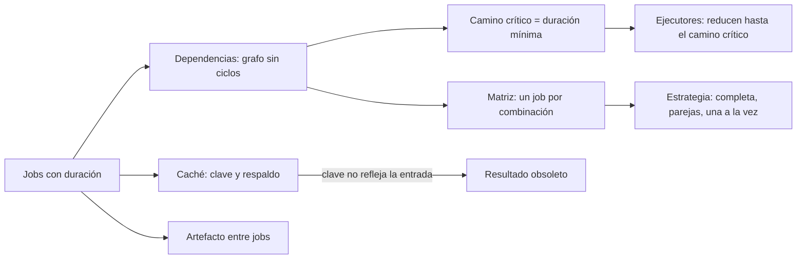
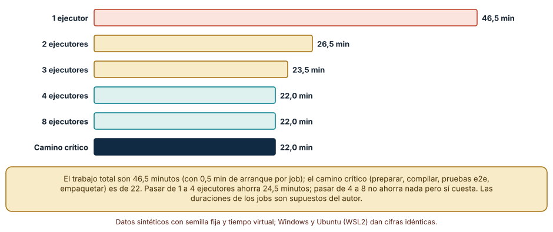

# SE-410 — Pipelines, jobs, matrices y cachés

[← SE-409 — Integración continua y feedback temprano](https://github.com/vladimiracunadev-create/modern-software-engineering-program/blob/main/classes/part-34-ci-cd-iac-y-platform-engineering/se-409-integracion-continua-y-feedback-temprano/README.md) · [↑ Parte 34](https://github.com/vladimiracunadev-create/modern-software-engineering-program/blob/main/classes/part-34-ci-cd-iac-y-platform-engineering/README.md) · [📚 Índice completo](https://github.com/vladimiracunadev-create/modern-software-engineering-program/blob/main/classes/README.md) · [🌐 Portal](https://vladimiracunadev-create.github.io/modern-software-engineering-program/classes/SE-410.html) · [SE-411 — Tests, seguridad y políticas como gates →](https://github.com/vladimiracunadev-create/modern-software-engineering-program/blob/main/classes/part-34-ci-cd-iac-y-platform-engineering/se-411-tests-seguridad-y-politicas-como-gates/README.md)

## Punto profesional y fundamento pedagógico

**Punto profesional.** La clase existe para que diseñes una canalización como un grafo de trabajos con dependencias, tiempos y costos, y no como una lista de pasos copiada de una plantilla. La habilidad profesional es responder con números tres preguntas que la plantilla esconde: qué es lo más corto que puede durar esta canalización, qué combinaciones de entorno vale la pena probar y qué ocurre cuando una caché devuelve algo que ya no corresponde.

**Por qué aparece aquí.** Sigue a **Integración continua y feedback temprano**: la clase anterior decidió qué conducta exige la integración y cuánto puede tardar la verificación previa; esta decide cómo se organiza esa verificación para cumplir el presupuesto sin perder señal. El caso conductor sigue siendo la canalización del repositorio de la API de entregas, ahora con nueve trabajos (preparar, lint, tipos, pruebas unitarias, compilar, integración, e2e, documentación y empaquetar).

**Error conceptual que debe corregir.** Creer que una canalización más rápida se consigue añadiendo máquinas o cachés: la duración mínima la fija el camino crítico del grafo, más ejecutores dejan de ayudar en cuanto lo alcanzas, y una caché mal definida acelera devolviendo resultados incorrectos.

**Secuencia de aprendizaje.** Antes de mirar los resultados, predices cuánto tarda la canalización con uno, cuatro y ocho ejecutores y qué fracción de los defectos de dos y tres factores encuentra una matriz reducida; después reproduces el cálculo del camino crítico, comparas cuatro estrategias de matriz y cuatro claves de caché. La secuencia usa predicción, explicación propia, contraste y recuperación. [ICAP](https://icap.education.asu.edu/research) distingue participación de construcción de conocimiento; [How People Learn II](https://nap.nationalacademies.org/catalog/24783/how-people-learn-ii-learners-contexts-and-cultures) respalda diseñar la práctica con contextos reales y retroalimentación.

**Evidencia de aprendizaje.** `pipeline-log.md` con la predicción, las tres figuras reproducidas, el grafo de la canalización con duración y camino crítico, la matriz elegida con su justificación y la clave de caché con su motivo, y una nota que separe qué parte de cada conclusión es medida, cuál inferida y cuál supuesta.

**Límite de la conclusión.** Las duraciones de los jobs, el arranque de 0,5 min por job, los tiempos de instalación de 180, 45 y 8 segundos y los defectos de la matriz son sintéticos o elegidos por el autor; los experimentos corren en tiempo virtual con semilla fija. No se ejecutó ninguna canalización real ni se midió ninguna caché de un proveedor, y los nombres de claves siguen el patrón de la documentación sin afirmar su rendimiento.

### Trazabilidad fuente → afirmación

| Fuente primaria u oficial | Afirmación que respalda | Lo que no prueba |
|---|---|---|
| [GitHub Actions: sintaxis de flujos de trabajo](https://docs.github.com/en/actions/reference/workflows-and-actions/workflow-syntax) | Describe jobs, dependencias con `needs`, estrategia de matriz, `include` y `exclude`, `fail-fast` y límites de tiempo por job. | No dice cuántos ejecutores concurrentes tendrá tu cuenta ni cuánto tardará un job concreto. |
| [GitHub Actions: almacenar dependencias en caché](https://docs.github.com/en/actions/reference/workflows-and-actions/dependency-caching) | Explica la clave de caché, las claves de respaldo por prefijo y que una entrada de caché no se modifica una vez creada. | No garantiza tasas de acierto; la clase mide la que produce un modelo con supuestos. |
| [GitHub Actions: variaciones de un job](https://docs.github.com/en/actions/how-tos/write-workflows/choose-what-workflows-do/run-job-variations) | Muestra cómo una matriz genera un job por combinación. | No sugiere qué combinaciones merecen la pena. |
| [NIST SP 800-142, Practical Combinatorial Testing](https://csrc.nist.gov/pubs/sp/800/142/final) | Justifica probar combinaciones de parejas o de orden superior en lugar del producto completo, con la observación de que muchos defectos dependen de pocos factores. | No garantiza cobertura de interacciones de orden mayor al elegido ni aplica a cualquier sistema. |
| [Graham, «Bounds on Multiprocessing Timing Anomalies»](https://doi.org/10.1137/0117039) | Demuestra que planificar trabajos con precedencias sobre procesadores puede producir anomalías (más procesadores o trabajos más cortos que alargan el total). | No se aplica sin más a un servicio de ejecutores con colas y arranques variables. |

## Antes de empezar

Recupera la política de troncal de `SE-409`: la verificación previa a la integración tiene un presupuesto de duración. La pregunta activa es: **¿cuál es la duración mínima de tu canalización y cuánto de lo que gastas por debajo de ese mínimo en máquinas y cachés compra realmente tiempo?**

## Prerrequisitos

- Haber completado `SE-409` o poder explicar por qué la verificación previa a la integración tiene un presupuesto.
- Python 3.11 o posterior; los experimentos usan solo la biblioteca estándar (`random`, `itertools`).
- Saber leer un grafo dirigido sin ciclos y un archivo de flujo de trabajo con jobs y pasos.

## Problema auténtico

Caso ilustrativo, no un incidente real: la canalización de la API de entregas ejecutaba todos sus pasos en un solo job y tardaba 46 minutos. Alguien la dividió en nueve jobs y la bajó a 26, y se celebró; después el equipo pidió más ejecutores para llegar a 15 y el gasto se duplicó sin que la duración cambiara de 22 minutos. Meses más tarde una prueba de integración empezó a fallar en la rama principal pero no en las ramas: la caché de dependencias usaba una clave fija creada cuando el proyecto dependía de otra versión de una biblioteca, y las ramas, que partían de una clave distinta, reconstruían el entorno bien. Nadie había mentido: la canalización «funcionaba» con la caché y con el grafo. La clase enseña a calcular el mínimo del grafo, a elegir qué combinaciones probar y a definir una clave de caché que no devuelva un entorno ajeno.

## Objetivos observables

Al terminar podrás:

1. representar una canalización como grafo de jobs con duración y calcular su camino crítico;
2. predecir la duración con `R` ejecutores y explicar por qué deja de mejorar;
3. elegir entre matriz completa, pareja a pareja y una a la vez con el defecto que cada una deja pasar;
4. diseñar una clave de caché con respaldo y explicar qué falla cuando la clave es fija o demasiado fina;
5. decidir qué se pasa entre jobs como artefacto y qué como caché.

## Mapa conceptual



El mapa separa lo que fija la **duración mínima** (el camino crítico del grafo), lo que fija el **número de trabajos** (la matriz) y lo que acelera **sin garantía de corrección** (la caché). Cada decisión tiene un modo de fallo distinto.

## Temas y por qué importan

| Tema | Por qué cambia una decisión profesional | Evidencia mínima |
|---|---|---|
| Canalización como grafo | Sin el grafo no se sabe qué acelerar: acortar un job fuera del camino crítico no cambia la duración. | Grafo con duraciones y camino crítico |
| Paralelismo y ejecutores | Más máquinas cuestan y dejan de acortar; los arranques suman. | Figura 1 y la predicción |
| Matrices de entornos | El producto completo crece multiplicando; probar parejas cubre mucho con poco. | Figura 2 y una matriz elegida |
| Cachés | Una clave define qué se considera «la misma entrada»; equivocarse devuelve resultados falsos. | Figura 3 y la clave elegida |
| Artefactos y aislamiento | Lo que un job produce y otro consume debe viajar explícito; el estado oculto rompe la reproducibilidad. | Lista de artefactos entre jobs |

## Conceptos y decisiones

### 1. La canalización como grafo de jobs

Un **job** es una unidad de trabajo que se ejecuta en un ejecutor aislado, con su propio sistema de archivos, de modo que nada de lo que un job deja en disco está disponible para otro salvo que se transmita de forma explícita. Un **paso** es una instrucción dentro de un job y comparte con sus hermanos el mismo entorno. Las dependencias entre jobs (`needs` en la sintaxis de GitHub Actions) forman un **grafo dirigido sin ciclos**: un job empieza cuando han terminado todos los que necesita. Esa estructura es la que determina qué puede ejecutarse a la vez y qué debe esperar. Diseñar la canalización es decidir dónde cortar: un job grande es simple y lento; muchos jobs pequeños son rápidos y pagan un arranque cada uno (descarga de imagen, preparación del entorno, restauración de caché). Además, cada frontera entre jobs obliga a decidir qué cruza: un binario compilado, un informe, un conjunto de datos de prueba. Lo que cruza se llama artefacto y debería ser inmutable e identificable por su contenido, como se vio en la Parte 33.

### 2. Camino crítico, ejecutores y anomalías

La **duración mínima** de una canalización con ejecutores ilimitados es la longitud de su **camino crítico**: la cadena de dependencias de mayor duración acumulada. Ningún número de máquinas la reduce, porque cada eslabón espera al anterior. Con pocos ejecutores el límite es el trabajo total dividido por el número de ejecutores, y la duración real queda entre ambos extremos. Hay dos consecuencias prácticas. Primero, acortar un job fuera del camino crítico (por ejemplo, la documentación) no cambia la duración, aunque reduzca el costo. Segundo, planificar trabajos con precedencias no es monótono: Graham mostró que añadir procesadores o acortar trabajos puede, con ciertas reglas de asignación, alargar el total. En la práctica el efecto es pequeño, pero conviene medir la duración en lugar de suponer que mejora. Un cálculo previo es suficiente para decidir si hace falta comprar ejecutores: si el camino crítico ya está alcanzado, no.

### 3. Matrices de entornos

Una **matriz** genera un job por cada combinación de valores de varios factores (sistema operativo, versión del lenguaje, base de datos). El número de combinaciones es el producto de los niveles: tres sistemas, cuatro versiones y tres bases dan 36 jobs. Cada factor adicional multiplica el costo. La pregunta correcta no es «¿qué combinaciones existen?» sino «¿qué defectos esperamos y de cuántos factores dependen?». La evidencia empírica recogida por el NIST indica que la mayoría de los defectos dependen de uno o dos factores, lo que justifica probar **todas las parejas** de niveles en lugar de todas las combinaciones. Una cobertura de parejas puede lograrse con muy pocas ejecuciones (la tabla de abajo la obtiene con 12 de 36). La alternativa de variar un factor a la vez a partir de una base barata también reduce el costo, pero no ve interacciones. Las exclusiones (`exclude`) y las inclusiones (`include`) permiten podar combinaciones imposibles o añadir una configuración especial; cada exclusión debería tener su motivo escrito.

### 4. Cachés: clave, respaldo y envenenamiento

Una **caché** guarda el resultado de un trabajo costoso (típicamente, las dependencias instaladas) para reutilizarlo. Funciona porque asocia un resultado a una **clave** que debería representar completamente la entrada: si la clave es el resumen del archivo de dependencias bloqueadas, el mismo archivo da el mismo resultado. Tres errores típicos: una clave **demasiado gruesa** (fija) que devuelve un resultado de otra entrada; una clave **demasiado fina** (el identificador del commit) que nunca acierta; una caché **envenenada** cuando alguien escribe en ella un resultado malicioso o incorrecto y todos los trabajos posteriores lo restauran. Las **claves de respaldo** por prefijo restauran la entrada más reciente parecida cuando la exacta no existe: acelera, pero entrega un entorno que no coincide del todo, y el paso siguiente debe sincronizarlo. La documentación de GitHub añade una propiedad útil: una entrada de caché no se puede modificar una vez creada, de modo que cambiar el contenido exige cambiar la clave. Tratar la caché como optimización y nunca como fuente de verdad (el resultado debe ser correcto también desde cero) es la regla que protege.

### 5. Artefactos, concurrencia y tiempo máximo

Lo que viaja entre jobs debe hacerlo como **artefacto** con nombre, y lo que se reutiliza entre ejecuciones como **caché**; mezclarlos es una fuente de errores porque el artefacto debe ser el mismo que se probó y se va a desplegar, mientras que la caché es descartable. La **concurrencia** (varias ejecuciones de la misma rama a la vez) desperdicia ejecutores si no se cancela la ejecución obsoleta cuando llega un commit nuevo, y puede causar carreras si dos ejecuciones escriben el mismo destino. Un **tiempo máximo** por job evita que un trabajo colgado consuma ejecutores indefinidamente y convierte un cuelgue en una señal. Estas tres decisiones no aceleran la canalización en un caso feliz; limitan el daño en los casos infelices, y por eso se deciden con el modo de fallo en mente.

### El camino crítico y los ejecutores

La canalización de la API de entregas tiene nueve jobs. Cada uno dura lo indicado más 0,5 minutos de arranque.

| Job | Duración | Depende de |
|---|---:|---|
| preparar | 1 min | — |
| lint | 2 | preparar |
| tipos | 3 | preparar |
| unitarias | 6 | preparar |
| compilar | 4 | preparar |
| integración | 9 | compilar |
| e2e | 12 | compilar |
| documentación | 2 | preparar |
| empaquetar | 3 | lint, tipos, unitarias, integración, e2e, documentación |

El trabajo total son 46,5 minutos con los arranques; el camino crítico (preparar, compilar, e2e, empaquetar) es de 22. Se asignan los jobs listos por duración decreciente a los ejecutores libres.

| Ejecutores | Duración |
|---:|---:|
| 1 | 46,5 min |
| 2 | 26,5 |
| 3 | 23,5 |
| 4 | 22,0 |
| 8 | 22,0 |

Pasar de uno a cuatro ejecutores ahorra 24,5 minutos; pasar de cuatro a ocho, ninguno.



**Cómo leer la figura.** Cada barra es la duración con esa cantidad de ejecutores; la barra del camino crítico es el piso. **Dónde deja de valer:** las duraciones y el arranque de 0,5 min son supuestos del autor y la planificación es una heurística de lista, no la óptima; un servicio real añade colas de espera de ejecutores y arranques que varían. Además, el modelo no incluye la espera por un ejecutor libre, que es habitualmente mayor que el arranque.

### Qué encuentra cada matriz

Se prueban 36 combinaciones (3 sistemas × 4 versiones × 3 bases). Se siembran, en 400 conjuntos, tres defectos por conjunto: uno que depende de un nivel de un factor, uno de dos factores y uno de tres. Se comparan cuatro estrategias: la matriz completa, una a la vez a partir de una base, la cobertura de parejas con un algoritmo voraz y nueve combinaciones al azar.

| Estrategia | Combinaciones | De 1 factor | De 2 factores | De 3 factores |
|---|---:|---:|---:|---:|
| Completa | 36 | 100 % | 100 % | 100 % |
| Pareja a pareja | 12 | 100 % | 100 % | 39 % |
| Una a la vez | 8 | 100 % | 52 % | 28 % |
| 9 al azar | 9 | 99 % | 62 % | 23 % |

Cubrir todas las parejas con un tercio de las combinaciones encuentra todos los defectos de dos factores y el 39 % de los de tres.


**Cómo leer la figura.** Cada grupo es una estrategia, con sus combinaciones entre paréntesis; las barras son los defectos de 1 factor (verde), 2 factores (dorada) y 3 factores (roja) que encuentra. Mira primero la barra roja de pareja a pareja: con un tercio de las combinaciones cubre todas las parejas y aun así pierde seis de cada diez defectos de tres factores. **Dónde deja de valer:** los defectos son un nivel por factor elegido al azar, algo mucho más regular que los reales; una interacción que depende de una combinación inusual (por ejemplo, una versión concreta con una base concreta en un sistema concreto) la ve solo la matriz completa. Los porcentajes dependen de cómo se siembren los defectos.

### Cuatro claves de caché

Se simulan 600 construcciones; en el 10 % cambia el archivo de dependencias bloqueadas (64 cambios) y en el 15 % la construcción es una repetición del mismo commit. Instalar desde cero tarda 180 segundos, completar una caché parcial 45 y restaurar una exacta 8.

| Clave de la caché | Aciertos | Parciales | Instalación media | Entorno obsoleto |
|---|---:|---:|---:|---:|
| Hash del archivo bloqueado | 89 % | 0 % | 26,6 s | 0 % |
| Hash con respaldo por prefijo | 89 % | 11 % | 12,2 s | 0 % |
| Identificador del commit | 17,5 % | 0 % | 149,9 s | 0 % |
| Clave fija | 100 % | 0 % | 8,0 s | 97 % |

La clave fija es la más rápida y la única que produce entornos obsoletos: el 97 % de las construcciones corre con dependencias que ya no coinciden con el archivo bloqueado.


**Cómo leer la figura.** Cada grupo es una clave de caché, con su instalación media entre paréntesis; las barras son el porcentaje de aciertos (verde), de restauraciones parciales (dorada) y de entorno obsoleto (roja). Mira primero la barra roja de la clave fija: es la más larga y la que acompaña al mejor tiempo. **Dónde deja de valer:** el modelo supone que un entorno obsoleto es siempre un error, cuando a veces pasa las pruebas sin que nadie lo note; esa invisibilidad es el peligro. Los tiempos de 180, 45 y 8 segundos son supuestos y la proporción de cambios del archivo bloqueado depende del proyecto.

## Definiciones de trabajo

- **job:** unidad de trabajo de una canalización que se ejecuta en un entorno aislado y puede depender de otros jobs.
- **camino crítico:** cadena de dependencias de mayor duración acumulada, que fija la duración mínima.
- **matriz:** generación de un job por cada combinación de valores de varios factores.
- **cobertura de parejas:** conjunto de combinaciones en el que cada pareja de niveles de dos factores aparece al menos una vez.
- **clave de caché:** identificador que decide cuándo una entrada guardada se considera la misma entrada.

Las definiciones son operativas para la canalización de la API de entregas. No convierten términos con una historia más amplia en sinónimos y deben contrastarse con la documentación primaria enlazada al final.

## Ejemplo mínimo

El fragmento calcula el camino crítico de un grafo pequeño. Antes de ejecutarlo, predice si dos ejecutores bastan para alcanzarlo.

```python
dur = {"a": 1, "b": 3, "c": 4, "d": 2}
dep = {"a": [], "b": ["a"], "c": ["a"], "d": ["b", "c"]}
fin = {}
for n in ("a", "b", "c", "d"):
    fin[n] = dur[n] + max((fin[x] for x in dep[n]), default=0)
print(fin["d"])
```

El camino crítico vale 7 (a, c, d). Con dos ejecutores, `b` y `c` corren a la vez tras `a` y se alcanza ese mínimo; un tercer ejecutor no aporta nada. Registra versión de Python, comando y salida; después alarga `b` a 6 y comprueba cómo el camino crítico cambia de camino.

## Ejemplo profesional

El equipo de la API de entregas dibuja su canalización con las duraciones reales de los últimos treinta días. El camino crítico pasa por compilar y por las pruebas e2e: los 22 minutos no bajarán comprando ejecutores. Deciden dividir e2e en tres grupos que corren a la vez (con lo que el camino se acorta a unos 14 minutos, a costa de tres arranques más) y mover la documentación a una etapa posterior que no bloquea. Para la matriz, la compatibilidad declarada es Linux, Windows y macOS, Python 3.10 a 3.13 y tres bases de datos; el producto completo son 36 jobs, y optan por doce combinaciones que cubren todas las parejas más la configuración de producción completa en cada ejecución nocturna. Para la caché usan el resumen del archivo bloqueado como clave y un respaldo por prefijo, y añaden un paso que sincroniza las dependencias, de modo que el resultado es correcto aunque la restauración sea parcial. Registran cada decisión con su motivo (por qué se excluye macOS con Postgres, por ejemplo) y el dato que la revisaría: si un defecto aparece en una combinación no cubierta, se amplía la matriz. Compara con la plantilla original: ahora existe un cálculo que explica por qué la canalización dura lo que dura.

## Práctica guiada

1. Dibuja el grafo de la canalización de un repositorio propio con la duración medida de cada job y calcula el camino crítico.
2. Predice la duración con uno, cuatro y ocho ejecutores y escribe los números antes de calcular.
3. Programa la planificación por lista y reproduce la tabla; cambia el arranque a 2 minutos y observa cuántos jobs pequeños conviene fundir.
4. Escribe una matriz de 36 combinaciones, genera la cobertura de parejas con el algoritmo voraz y comprueba que cada pareja de niveles aparece.
5. Siembra defectos de uno, dos y tres factores y compara las cuatro estrategias.
6. Simula las cuatro claves de caché con tus propios tiempos y anota cuándo la clave fija produce un entorno obsoleto.
7. Entrega `pipeline-log.md` y pide a otra persona que encuentre una combinación defectuosa que tu matriz no cubra.

## Ejercicios

1. **Camino crítico:** dibuja un grafo de seis jobs, calcula el camino crítico y el número mínimo de ejecutores que lo alcanza, y justifica cuál job conviene acelerar primero.
2. **Anomalía:** construye un caso, con tres trabajos y dos ejecutores, donde acortar un trabajo alargue el total con una regla de asignación fija; explica qué lo causa.
3. **Matriz:** con cuatro factores de tres niveles, calcula el producto completo y el número de combinaciones que necesitas para cubrir parejas; razona qué defecto de tres factores quedaría fuera.
4. **Caché:** propón una clave para dependencias que cambian con un archivo bloqueado, otra para una compilación incremental y otra para un conjunto de datos de prueba, y di qué falla en cada una si la clave se vuelve fija.

## Reto verificable

Entrega `pipeline-log.md` con la predicción, las tres tablas, el grafo con su camino crítico, la matriz elegida con su justificación y la clave de caché con su motivo. Se aprueba si otra persona ejecuta el código desde un checkout limpio, obtiene las mismas tablas con las mismas semillas y puede decir cuántos ejecutores comprar y qué combinaciones dejar fuera. No se aprueba por dibujar un grafo sin duraciones ni por afirmar que la caché «ahorra tiempo» sin decir qué entrada representa su clave.

## Caso conductor

La canalización de la API de entregas es el caso conductor de la Parte 34. Esta clase deja el segundo artefacto: el grafo de jobs con su camino crítico, la matriz y la clave de caché. `SE-411` decidirá qué comprobaciones bloquean la integración y en qué orden, y `SE-412` dará a esos jobs credenciales de corta vida. Cambia después un solo dato, el arranque por job, y observa si sigue valiendo la pena dividir un job.

## Preguntas frecuentes

### ¿Más jobs significa más rápido?

No necesariamente. Cada job paga un arranque y cada frontera obliga a pasar artefactos. Dividir ayuda mientras el camino crítico se acorta más de lo que el arranque suma; dividir un job que ya está fuera del camino crítico solo aumenta el costo.

### ¿Hay que probar todas las combinaciones del producto?

Depende del riesgo. La matriz completa se justifica cuando los factores interactúan de formas que no puedes predecir y el costo es pequeño; en otros casos, las parejas más una configuración de producción completa cubren la mayoría de los defectos con una fracción del costo. Lo importante es escribir qué se excluye y por qué.

### ¿Se puede confiar en una caché que acierta casi siempre?

Solo si el resultado no depende de que acierte. Una caché es una optimización: la canalización debe producir el mismo resultado sin ella, aunque tarde más. Una caché cuya clave no refleja la entrada puede devolver un resultado equivocado que las pruebas no noten.

### ¿Qué es mejor, cancelar ejecuciones obsoletas o dejarlas terminar?

Cancelar las de la misma rama ahorra ejecutores y entrega la señal del commit más nuevo; dejarlas terminar conserva el historial de cada commit. Se puede cancelar en ramas de trabajo y conservar todas en la troncal. Lo importante es decidirlo, no heredar un valor por defecto.

## Fallo controlado y diagnóstico

Reproduce el fallo clásico de la clase: **una prueba que falla en la troncal pero no en las ramas por una caché de clave fija**. Simula un archivo de dependencias bloqueadas que cambia en la construcción 100 y compara el entorno restaurado con el esperado.

Registra síntoma, entrada mínima, hipótesis, observación que descarta cada hipótesis, causa, corrección y prueba de regresión. **Síntoma:** la rama pasa y la troncal falla con un error de versión de una biblioteca. **Hipótesis rivales:** (a) la prueba es inestable; (b) hay una diferencia de sistema entre ejecutores; (c) el entorno restaurado de la caché no coincide con el archivo bloqueado. **Prueba:** imprime el resumen del archivo bloqueado y el de la clave de caché en cada ejecución; si no coinciden y la clave es la misma, la causa es la caché. **Conclusión:** la clave fija trataba entradas distintas como una sola; una caché solo es segura si la clave refleja la entrada. **Regresión:** usa el resumen del archivo bloqueado como clave y añade una prueba que cambie el archivo y exija que el entorno se reconstruya. No cambies a la vez la clave y el tiempo de expiración.

## Errores comunes y cómo corregirlos

| Síntoma | Causa probable | Corrección |
|---|---|---|
| La canalización no baja de un mínimo al añadir ejecutores | El camino crítico ya está alcanzado | Calcular el camino crítico y acortar su eslabón más largo |
| Muchos jobs pequeños y la duración sube | El arranque domina la duración de cada job | Fundir jobs que comparten preparación |
| La matriz triplica el costo cada trimestre | Se añaden factores sin retirar ninguno | Cobertura de parejas y exclusiones con motivo |
| Funciona con caché y falla desde cero | La caché oculta una dependencia no declarada | Ejecutar periódicamente sin caché |
| Un artefacto distinto del probado llega a producción | Se reconstruyó en otro job | Pasar el artefacto por resumen, no reconstruirlo |

## Entorno y archivos clave

```text
work/SE-410/
├── README.md
├── pipeline/
│   ├── grafo.py
│   ├── matriz.py
│   └── cache.py
├── tests/test_pipeline.py
└── evidence/pipeline-log.md
```

El `README` declara plataforma, versión de Python, semillas y comandos. Los experimentos usan solo la biblioteca estándar (`random`, `itertools`) y se ejecutaron con CPython 3.12.9 en Windows 11 y 3.12.3 en Ubuntu bajo WSL2: las salidas fueron idénticas. Si añades una herramienta de integración continua, fija su procedencia y su versión.

## Seguridad, ética y accesibilidad

- una caché compartida entre ramas y entre bifurcaciones es un canal de escritura: una rama no confiable no debería poder escribir en la caché que restaura la troncal;
- los artefactos que cruzan jobs deben identificarse por su resumen para que nadie sustituya el binario probado por otro;
- las matrices que consumen minutos de ejecutores tienen costo económico y energético; justifica cada combinación;
- el resumen de la canalización (qué job falló, cuánto tardó) debe presentarse en texto, no solo en color;
- documenta las tablas con el texto alternativo de cada figura.

## Puente hacia el trabajo con agentes

Un agente al que se le pide «acelera la canalización» probablemente añadirá cachés con claves fijas, paralelizará todo lo que pueda y declarará una reducción de tiempo. Pídele en cambio que dibuje primero el grafo con duraciones medidas de ejecuciones reales, que calcule el camino crítico y diga cuánto de la mejora propuesta cae fuera de él; que justifique cada clave de caché diciendo qué entrada representa; y que muestre la matriz con las combinaciones excluidas y el motivo. Revisa especialmente si una caché acelera algo que no estaba en el camino crítico y si hay una ejecución sin caché que valide el resultado: son los dos defectos que esta clase mostró con números.

## Transferencia

Traslada el análisis a otra canalización (por ejemplo, la de una aplicación móvil con compilaciones para dos sistemas): cambia los jobs, sus duraciones y los factores de la matriz, y conserva el procedimiento de calcular el camino crítico, elegir cobertura de parejas y definir la clave por la entrada. La transferencia está lograda cuando puedes decir qué eslabón del camino acelerar primero y qué combinación quedaría sin probar, no cuando el grafo se parece al de la plataforma.

## Evaluación y evidencia

| Criterio | Evidencia para aprobar |
|---|---|
| comprensión | explicación de por qué más ejecutores dejan de acortar y qué fija la duración mínima |
| corrección | tablas de ejecutores, matrices y claves reproducibles con las mismas semillas |
| diseño | grafo con camino crítico, matriz elegida y clave de caché justificadas |
| diagnóstico | reproducción del fallo «caché de clave fija» con regresión |
| incertidumbre | declaración de que duraciones, defectos y tiempos son sintéticos o del autor |
| reproducibilidad | versiones, comandos, salida y límites declarados |

## Fuentes

- [GitHub Actions: sintaxis de flujos de trabajo](https://docs.github.com/en/actions/reference/workflows-and-actions/workflow-syntax) — jobs, dependencias y matrices; autoridad: documentación de GitHub.
- [GitHub Actions: dependencias en caché](https://docs.github.com/en/actions/reference/workflows-and-actions/dependency-caching) — claves, respaldos y restricciones de la caché; autoridad: documentación de GitHub.
- [GitHub Actions: variaciones de un job](https://docs.github.com/en/actions/how-tos/write-workflows/choose-what-workflows-do/run-job-variations) — matrices de combinaciones; autoridad: documentación de GitHub.
- [NIST SP 800-142: Practical Combinatorial Testing](https://csrc.nist.gov/pubs/sp/800/142/final) — pruebas combinatorias y cobertura de parejas; autoridad: NIST.
- [Graham, «Bounds on Multiprocessing Timing Anomalies»](https://doi.org/10.1137/0117039) — anomalías de planificación con precedencias (SIAM Journal on Applied Mathematics, 1969); autoridad: artículo con DOI verificado en Crossref.

Cada fuente respalda el mecanismo indicado; ninguna demuestra que 22 minutos, 12 combinaciones o el 97 % de entornos obsoletos se observen en tu repositorio. Esa afirmación depende del grafo, de los defectos reales y de la clave de caché.

## Límites y siguiente paso

Se ejecutaron tres experimentos con datos sintéticos en Windows y Ubuntu (WSL2) con resultados idénticos. No se ejecutó ninguna canalización real ni se midió ninguna caché de un proveedor; las duraciones de los nueve jobs, el arranque de 0,5 min, los tiempos de 180, 45 y 8 segundos, la proporción del 10 % de cambios de dependencias y los defectos sembrados son construcciones del autor, la planificación es una heurística y no se midió la espera por un ejecutor libre. La siguiente clase decide qué pruebas, análisis de seguridad y políticas bloquean la integración y en qué orden.

## Glosario

- **job:** unidad de trabajo de una canalización que se ejecuta en un entorno aislado y puede depender de otros jobs.
- **camino crítico:** cadena de dependencias de mayor duración acumulada, que fija la duración mínima.
- **matriz:** generación de un job por cada combinación de valores de varios factores.
- **cobertura de parejas:** conjunto de combinaciones en el que cada pareja de niveles de dos factores aparece al menos una vez.
- **clave de caché:** identificador que decide cuándo una entrada guardada se considera la misma entrada.

---

[← SE-409 — Integración continua y feedback temprano](https://github.com/vladimiracunadev-create/modern-software-engineering-program/blob/main/classes/part-34-ci-cd-iac-y-platform-engineering/se-409-integracion-continua-y-feedback-temprano/README.md) · [↑ Parte 34](https://github.com/vladimiracunadev-create/modern-software-engineering-program/blob/main/classes/part-34-ci-cd-iac-y-platform-engineering/README.md) · [📚 Índice completo](https://github.com/vladimiracunadev-create/modern-software-engineering-program/blob/main/classes/README.md) · [🌐 Portal](https://vladimiracunadev-create.github.io/modern-software-engineering-program/classes/SE-410.html) · [SE-411 — Tests, seguridad y políticas como gates →](https://github.com/vladimiracunadev-create/modern-software-engineering-program/blob/main/classes/part-34-ci-cd-iac-y-platform-engineering/se-411-tests-seguridad-y-politicas-como-gates/README.md)
