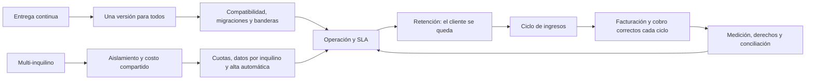
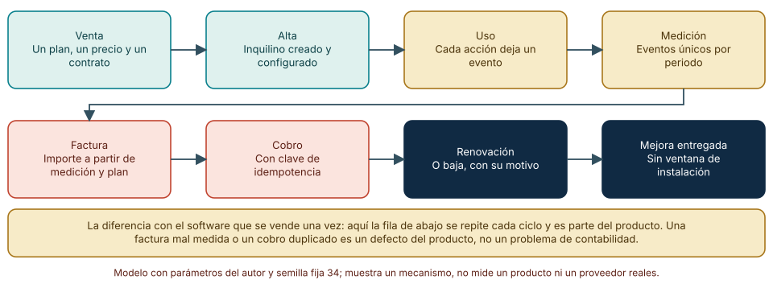
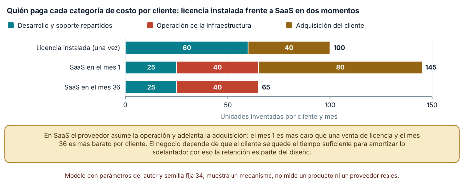

# SE-409 — Qué hace distinto a un producto SaaS

[← SE-408 — Proyecto: plataforma mínima reproducible](https://github.com/vladimiracunadev-create/modern-software-engineering-program/blob/main/classes/part-33-cloud-plataforma-e-infraestructura/se-408-proyecto-plataforma-minima-reproducible/README.md) · [↑ Parte 34](https://github.com/vladimiracunadev-create/modern-software-engineering-program/blob/main/classes/part-34-saas-y-plataformas-de-producto/README.md) · [📚 Índice completo](https://github.com/vladimiracunadev-create/modern-software-engineering-program/blob/main/classes/README.md) · [🌐 Portal](https://vladimiracunadev-create.github.io/modern-software-engineering-program/classes/SE-409.html) · [SE-410 — Aislamiento multi-inquilino y vecino ruidoso →](https://github.com/vladimiracunadev-create/modern-software-engineering-program/blob/main/classes/part-34-saas-y-plataformas-de-producto/se-410-aislamiento-multi-inquilino-y-vecino-ruidoso/README.md)

## Punto profesional y fundamento pedagógico

**Punto profesional.** La clase existe para que dejes de tratar un producto SaaS como «una aplicación web con suscripción» y lo analices como lo que es: un sistema que se entrega continuamente a muchos clientes a la vez desde una sola operación, y cuyo ingreso no ocurre en la venta sino cada ciclo. De esas dos propiedades (entrega continua y multi-inquilino) más una tercera (el ciclo de ingresos) se derivan casi todas las decisiones técnicas del resto de la parte: cómo se aísla a cada cliente, cómo se da de alta, cómo se cobra, qué se mide, qué se promete y cómo se opera. Quien confunde estas tres propiedades con una lista de funciones diseña facturación como un módulo accesorio, o aislamiento como una opción de configuración; el resultado es un producto que funciona en la demostración y se rompe el primer mes de cobro.

**Por qué aparece aquí.** Abre la Parte 34 porque nombra el problema que las demás clases resuelven por pedazos. Retoma lo aprendido sobre modelos de negocio y costos en `SE-133` y `SE-134`, sobre la entrega continua en `SE-485`, sobre cómo un cambio llega gradualmente a producción en `SE-475` y sobre multi-tenancy como estilo arquitectónico en `SE-342`. Esas clases explican cada mecanismo en general; esta explica por qué un producto SaaS los necesita todos juntos y qué cambia en el trabajo diario de ingeniería cuando el ingreso depende de que el servicio siga funcionando para cada cliente cada mes.

**Error conceptual que debe corregir.** Creer que SaaS es una forma de distribución (el cliente abre un navegador en vez de instalar un programa). La distribución es lo visible; lo que cambia el trabajo es que el proveedor se queda con la operación, con los datos de todos los clientes y con la obligación de cobrarles bien durante años. En la simulación de la clase, un cliente que cuesta 300 adquirir y deja 39,2 de margen mensual recupera lo invertido en 9 meses con 3 % de baja mensual y no lo recupera nunca con 15 %: con el mismo producto y el mismo precio, la retención decide si el negocio existe. Por eso un defecto de facturación o de aislamiento es un defecto del producto, no un asunto de otra área.

**Secuencia de aprendizaje.** Antes de leer el desarrollo predices tres cosas: qué gasto asume el proveedor en SaaS que no asumía con la licencia instalada, cuántos meses tarda en recuperar lo que gastó en conseguir a un cliente y qué cambia si la baja mensual pasa de 3 % a 15 %. Después calculas con datos sintéticos las métricas de ingreso recurrente de un mes (ingreso nuevo, expansión, contracción, bajas, retención neta), compruebas que la suma cuadra y lees tres figuras que muestran el bucle de entrega e ingresos, el reparto del costo y la recuperación de la inversión. Terminas con un mapa de qué propiedad de SaaS exige qué decisión técnica.

**Evidencia de aprendizaje.** `mapa-saas.md` con la propiedad de SaaS que más pesa en un producto real o elegido por ti, las tres decisiones técnicas que de ella se derivan, el cálculo de recuperación de la adquisición con tus propios supuestos y la métrica que mostraría que el producto deja de ser sostenible.

**Límite de la conclusión.** Se ejecutó un cálculo de ingreso recurrente con sqlite3 sobre 440 clientes sintéticos (semilla 34) y un modelo de recuperación de la inversión con parámetros del autor; no se midió ningún producto real, ningún precio de mercado ni la tasa de baja de ninguna industria. Los números ilustran un mecanismo y no sirven como referencia de negocio. No se afirma revisión humana externa del contenido.

### Trazabilidad fuente → afirmación

| Fuente primaria u oficial | Afirmación que respalda | Lo que no prueba |
|---|---|---|
| [AWS Well-Architected: SaaS Lens](https://docs.aws.amazon.com/wellarchitected/latest/saas-lens/saas-lens.html) | Describe el SaaS como un modelo donde el proveedor opera una solución para muchos clientes y propone un conjunto de preguntas de diseño (aislamiento, incorporación, medición, operación) para revisarlo. | No fija qué decisión conviene a tu producto ni sustituye un estudio de tus clientes. |
| [AWS: fundamentos de arquitectura SaaS](https://docs.aws.amazon.com/whitepapers/latest/saas-architecture-fundamentals/saas-architecture-fundamentals.html) | Explica el plano de control (altas, configuración, medición, facturación) separado del plano de aplicación por el que circula el uso de cada cliente. | Es la visión de un proveedor de nube; otros proveedores nombran las piezas de otra forma. |
| [Microsoft Learn: aplicaciones multi-inquilino](https://learn.microsoft.com/en-us/azure/architecture/guide/multitenant/overview) | Define inquilino, plantea el modelo de ingresos y la economía de compartir infraestructura como parte del diseño, no como un añadido posterior. | No indica qué precio ni qué margen son razonables en tu mercado. |
| [The Twelve-Factor App](https://12factor.net/) | Resume la práctica de aplicaciones desplegables de forma continua en plataformas: configuración fuera del código, procesos sin estado, paridad entre entornos. | Se escribió para aplicaciones de servicio en general; no trata facturación ni inquilinos. |
| [Stripe: descripción de suscripciones](https://docs.stripe.com/billing/subscriptions/overview) | Muestra el modelo de datos de una suscripción (cliente, plan, ciclo, estado, factura) como una máquina de estados con eventos. | No es un contrato ni una garantía de que tu modelo deba parecerse al de un proveedor concreto. |

## Antes de empezar

Recupera lo aprendido en `SE-133` sobre modelos de negocio: quién paga, por qué, cuánto y cada cuánto. La pregunta activa es: **si cobras por mes a quien usa tu producto, ¿qué parte de tu sistema, si falla una vez, te cuesta un cliente, y qué parte, si falla una vez, te cuesta dinero que ya habías ganado?** Anótala con tu intuición antes de seguir; la clase vuelve a ella.

## Prerrequisitos

- Haber completado `SE-133` y `SE-134` (modelos de negocio y costos) y `SE-485` (entrega y despliegue continuos).
- Haber leído `SE-342` sobre multi-tenancy o estar dispuesto a leerla en paralelo: aquí se usa su vocabulario (inquilino, aislamiento, vecino ruidoso) sin repetirlo.
- Saber leer una consulta SQL con `JOIN`, `GROUP BY` y subconsultas.
- Python 3.11 o posterior; el cálculo usa solo `sqlite3` y `random` de la biblioteca estándar.

## Problema auténtico

*Tablero* es una herramienta de gestión de proyectos para equipos pequeños. Nació como un programa que cada empresa instalaba en su servidor: se vendía una licencia, se cobraba una vez, se publicaba una versión cada seis meses y el soporte era una dirección de correo. Funcionó mientras había veinte clientes. Con trescientos, tres cosas dolían: cada cliente estaba en una versión distinta y corregir un defecto exigía mantener cinco ramas, las empresas pequeñas no podían instalar nada y dejaban de comprar, y la caja del año dependía de cuánto se vendiera en el último trimestre.

El equipo decide ofrecer *Tablero* como servicio en línea. Los primeros meses parecen una victoria: nadie instala, una corrección llega a todos a la vez y los clientes pagan 49 al mes en lugar de una licencia grande. Después aparecen los problemas que la licencia no tenía. Un cliente grande sube un millón de tareas y los demás ven la aplicación lenta. Un reintento tras un tiempo de espera cobra dos veces la misma renovación. Un cliente pasa del plan gratuito al de pago y durante dos días no tiene acceso a lo que pagó. Un informe de ingresos dice una cifra y el procesador de pagos otra. Ninguno de estos problemas se parece a «agregar una función»; todos nacen de la manera en que el producto se entrega, se comparte y se cobra.

El problema de la clase es doble: entender qué hace distinto a un producto SaaS y qué decisiones técnicas se derivan de cada diferencia, y calcular con datos las métricas que muestran si el negocio es sostenible, de modo que una discusión de ingeniería (¿invertimos en aislamiento o en una función nueva?) se pueda decidir con números y no con adjetivos.

## Objetivos observables

Al terminar podrás:

1. enumerar las tres propiedades que distinguen un producto SaaS (entrega continua desde una sola operación, multi-inquilino y ciclo de ingresos recurrente) y, para cada una, nombrar dos decisiones técnicas que de ella se derivan;
2. calcular con SQL el ingreso recurrente mensual de un conjunto de suscripciones y descomponer su variación en clientes nuevos, expansión, contracción y bajas, comprobando que la suma cuadra;
3. distinguir retención bruta de retención neta y explicar por qué un producto puede tener una retención neta superior a 100 % con clientes que se van;
4. estimar cuántos meses tarda en recuperarse el costo de adquirir un cliente según su margen mensual y su tasa de baja, y reconocer cuándo no se recupera nunca;
5. explicar quién asume cada categoría de costo (desarrollo, operación, adquisición) en una licencia instalada y en un servicio, y qué obligaciones nuevas aparecen con la operación.

## Mapa conceptual



Cada propiedad abre un grupo de decisiones y los tres grupos terminan en la operación, que es lo que el cliente compra de verdad. El retorno de la retención hacia el ciclo de ingresos es el bucle económico: el ingreso de mañana depende de que hoy el servicio, el cobro y la medición hayan sido correctos.

## Temas y por qué importan

| Tema | Por qué cambia una decisión profesional | Evidencia mínima |
|---|---|---|
| Entrega continua desde una sola operación | Una corrección llega a todos a la vez, pero también un defecto; no hay «versión del cliente» donde esconderse. | Una versión en producción y un mecanismo de despliegue gradual |
| Multi-inquilino | Compartir reduce el costo por cliente y crea el riesgo de que un cliente afecte a otro. | Costo por cliente y prueba de aislamiento |
| Ciclo de ingresos | Cada ciclo se factura, se cobra y puede fallar; el ingreso se reconoce con el tiempo, no en la venta. | Descomposición del ingreso recurrente que cuadra |
| Retención | Decide si lo gastado en conseguir un cliente se recupera. | Meses de recuperación con tasa de baja |
| Operación como producto | El cliente no compra un programa sino que siga funcionando. | Objetivo de nivel de servicio medido |
| Datos del cliente en custodia | El proveedor responde por datos ajenos durante años, incluida su salida. | Política de exportación y borrado |
| Qué no resuelve la técnica | Un buen sistema de cobro no arregla un producto que nadie quiere. | Métricas de uso y de baja por motivo |

## Conceptos y decisiones

### 1. Una sola versión para todos es una ventaja y una responsabilidad

En software instalado coexisten decenas de versiones y cada una se corrige por separado; en SaaS existe una versión en producción (o, durante un despliegue, dos). La ventaja es directa: una corrección de seguridad llega a todos en horas, no en el próximo ciclo de actualización del cliente. La responsabilidad es la contraria: un defecto también llega a todos a la vez, y no existe la excusa de que «ese cliente no actualizó». Por eso la entrega continua de SaaS se apoya en mecanismos que limitan el daño de un cambio: banderas de funcionalidad (`SE-475`), despliegues graduales, migraciones compatibles hacia atrás y la posibilidad de volver atrás sin pérdida de datos (`SE-523`).

La consecuencia práctica más dura es la compatibilidad con los datos. El código nuevo debe leer lo que escribió el código viejo y, durante un despliegue, el viejo debe tolerar lo que ya escribe el nuevo. Un cambio de esquema que en software instalado se aplicaba en una ventana de instalación en SaaS se hace sin ventana, con el servicio en uso y miles de clientes con datos distintos.

### 2. Multi-inquilino cambia la economía y el riesgo a la vez

Compartir infraestructura entre clientes es lo que permite cobrar 49 por un servicio que, dedicado, costaría cientos. Esa economía existe porque el costo fijo se reparte: en el modelo de la clase, el costo mensual por cliente de una solución totalmente compartida baja de 62 con diez clientes a 2,6 con mil, mientras que la dedicada se queda en 90. La contrapartida es que los clientes dejan de estar separados por construcción: uno puede ver datos de otro por un filtro olvidado o puede consumir tanta capacidad que los demás esperen. `SE-342` explica los modelos de aislamiento y sus fallos; `SE-410` mide el vecino ruidoso con y sin cuotas. Aquí basta fijar que **el aislamiento no es una función del producto sino una propiedad de la que depende que el producto se pueda vender**.

### 3. El ingreso es un flujo con estado, no un evento

En una licencia, la venta es un evento: se factura, se cobra y termina. En una suscripción existe un estado que evoluciona (prueba, activa, con pago pendiente, suspendida, cancelada) y cada cambio de estado tiene consecuencias de facturación, de acceso y de contabilidad. Esto convierte la facturación en un subsistema con reglas propias: cuándo empieza el ciclo, cómo se prorratea un cambio de plan, qué pasa si el cobro falla, cuándo se retiran los derechos. `SE-412` desarrolla la máquina de estados y el cobro fallido; `SE-413` el uso medido; `SE-417` los pagos y la conciliación.

El estado debe tener un dueño único. Si la pantalla de facturación, el control de acceso y el informe de ingresos deducen cada uno el estado de la última factura, tres lugares pueden decir cosas distintas. La práctica profesional es guardar el estado de la suscripción y derivar de él los derechos y los informes, con los eventos que lo cambiaron.

### 4. El ingreso recurrente se descompone, y la descomposición debe cuadrar

El ingreso recurrente mensual (MRR) es la suma de lo que cada cliente activo paga por mes, normalizado a un mes. Su variación entre dos meses se explica con cuatro movimientos: clientes nuevos, expansión (clientes que pagan más: más puestos, plan superior), contracción (pagan menos sin irse) y bajas. En el experimento, con 366 clientes de pago en septiembre y 440 en octubre, el ingreso pasó de 61 034 a 78 808: **61 034 + 3 610 (nuevos) + 19 850 (expansión) − 3 300 (contracción) − 2 386 (bajas) = 78 808**. Que la suma cuadre al céntimo es la prueba mínima de que la consulta de ingresos usa la misma definición de «cliente» y «mes» que la facturación; cuando no cuadra, hay clientes contados en dos meses o ninguno.

De esa descomposición salen dos retenciones. La **retención bruta** descuenta bajas y contracciones y nunca supera 100 %: en el experimento, 90,7 %. La **retención neta** añade la expansión: 123,2 %. Una retención neta mayor que 100 % significa que los clientes existentes pagan más que hace un mes aunque algunos se hayan ido; es una señal de que el producto crece dentro de las cuentas. Pero oculta que 3,8 % de los clientes se fue, y por eso no se reporta sola.

### 5. La retención decide si lo que gastaste en conseguir al cliente se recupera

Conseguir un cliente cuesta (ventas, publicidad, onboarding) y ese gasto se adelanta; el margen llega mes a mes mientras el cliente se queda. Con un costo de adquisición de 300 y un margen de 39,2 mensuales (49 de precio con 80 % de margen bruto), la inversión se recupera en 9 meses con 3 % de baja mensual, en 12 con 8 % y no se recupera nunca con 15 %, porque la suma geométrica de los márgenes se acerca a 261, por debajo de 300. La aritmética es elemental, pero su consecuencia es profunda: **con precio, costo y producto iguales, una tasa de baja mayor puede convertir un negocio rentable en uno que pierde dinero con cada cliente nuevo**. Por eso en SaaS la ingeniería de retención (fiabilidad, incorporación rápida, soporte, funciones que crean hábito) es ingeniería de ingresos.

### 6. La operación es lo que se vende

El cliente de una licencia compra un programa; el de un servicio compra que el programa funcione, con sus datos y a cualquier hora, y paga por eso cada mes. La disponibilidad, el tiempo de recuperación, el soporte y la seguridad de los datos pasan de ser atributos del producto a ser el producto. Esto se formaliza en niveles de servicio (`SE-497`, `SE-419`) y se refleja en la estructura de costos: la operación aparece como costo recurrente por cliente (40 en el modelo) que en la licencia no existía. También cambia el riesgo legal: el proveedor trata datos de otras empresas, a veces de sus clientes, y responde por ellos (`SE-463`).

### 7. Qué pone el cliente y qué pone el proveedor: la responsabilidad compartida

El proveedor SaaS decide cosas que el cliente no ve (la nube, las copias de seguridad, el cifrado) y el cliente decide otras que el proveedor no controla (quién tiene cuenta, qué datos sube, cómo configura permisos). Un incidente de seguridad mal atribuido a una u otra parte destruye la confianza. La práctica madura es escribir esa frontera: qué protege el proveedor, qué debe proteger el cliente, qué herramientas ofrece el producto para que el cliente cumpla su parte (registros de auditoría, autenticación federada, exportación). `SE-419` retoma la frontera con los niveles de servicio y de soporte.

### 8. Qué no garantiza ser SaaS

Ser SaaS no garantiza escalabilidad (un monolito mal indexado sigue sin escalar), ni seguridad (un filtro olvidado expone datos de otros), ni margen (la operación puede costar más de lo que se cobra) ni retención (un producto innecesario se cancela con la misma facilidad con que se contrató). Tampoco es obligatorio: hay productos donde la instalación local, por requisitos de privacidad o de conexión, es la elección correcta. La decisión de ofrecer un servicio es económica y organizativa tanto como técnica, y se revisa con los números de la sección siguiente.

## El bucle de entrega e ingresos



**Cómo leer la figura.** Las ocho cajas son un ciclo, no una lista: lo que sale de la mejora entregada vuelve a ser parte del producto que se vende. Mira que la fila de abajo (factura, cobro, renovación) se repite cada ciclo y que cada caja es un punto donde puede fallar algo que el cliente nota. **Dónde deja de valer:** el bucle es una simplificación de un producto de suscripción; no incluye venta asistida, contratos anuales con descuentos ni facturación por orden de compra, que añaden pasos y estados.

## Quién paga cada costo



**Cómo leer la figura.** Cada barra es el costo por cliente en un momento y cada color una categoría. Compara la operación (rojo): no existe en la licencia y es permanente en el servicio; y la adquisición (amarillo): en el mes 1 pesa más que en la licencia y en el mes 36 ya no existe. **Dónde deja de valer:** las cifras son parámetros del autor para mostrar la forma; un producto real tiene costos de adquisición recurrentes (se siguen captando clientes) y de soporte que cambian con el tamaño del cliente.

## Cuánto tarda en recuperarse el cliente


**Cómo leer la figura.** Cada línea parte de menos 300 (lo gastado en conseguir al cliente) y sube con el margen que deja mientras sigue activo. Mira dónde cruza la línea de cero y qué pasa con la línea coral, que se aplana por debajo de cero. **Dónde deja de valer:** supone precio y margen constantes y baja mensual uniforme; en la práctica la baja es mayor al principio y los clientes que se quedan amplían su plan, lo que mueve las curvas. No incorpora tasa de descuento ni el costo de capital.

## Definiciones de trabajo

- **SaaS (software como servicio):** producto operado por el proveedor, entregado de forma continua a muchos clientes y pagado por suscripción o consumo.
- **Inquilino (tenant):** cliente cuya cuenta, usuarios y datos el producto trata como una unidad de aislamiento y de facturación.
- **Plano de control:** parte del sistema que gestiona inquilinos, planes, medición y facturación; distinta de la que atiende el uso de cada cliente.
- **MRR (ingreso recurrente mensual):** suma de lo que los clientes activos pagan por mes, normalizado a un mes.
- **Expansión y contracción:** aumento o disminución de lo que paga un cliente que sigue activo.
- **Retención bruta y neta:** parte del MRR inicial que se conserva sin y con la expansión de los clientes existentes.
- **Baja (churn):** cliente o ingreso que deja de pagar en un periodo.
- **CAC (costo de adquisición de cliente):** lo que cuesta conseguir un cliente nuevo.

## Ejemplo mínimo

Dados los registros de suscripción de dos meses, descomponer la variación del MRR y comprobar que cuadra:

```python
import sqlite3

db = sqlite3.connect(":memory:")
db.execute("CREATE TABLE suscripcion (cliente TEXT, mes TEXT, mrr INTEGER)")
db.executemany("INSERT INTO suscripcion VALUES (?,?,?)", [
    ("a", "2026-09", 49), ("a", "2026-10", 199),   # expansión: 150
    ("b", "2026-09", 199), ("b", "2026-10", 49),   # contracción: 150
    ("c", "2026-09", 49),                            # baja: 49
    ("d", "2026-10", 49),                            # nuevo: 49
])
q = lambda sql: db.execute(sql).fetchone()[0] or 0
ini = q("SELECT SUM(mrr) FROM suscripcion WHERE mes='2026-09'")
fin = q("SELECT SUM(mrr) FROM suscripcion WHERE mes='2026-10'")
nuevos = q("SELECT SUM(mrr) FROM suscripcion WHERE mes='2026-10' AND cliente NOT IN (SELECT cliente FROM suscripcion WHERE mes='2026-09')")
bajas = q("SELECT SUM(mrr) FROM suscripcion WHERE mes='2026-09' AND cliente NOT IN (SELECT cliente FROM suscripcion WHERE mes='2026-10')")
exp = q("SELECT SUM(o.mrr - s.mrr) FROM suscripcion s JOIN suscripcion o ON o.cliente=s.cliente AND o.mes='2026-10' WHERE s.mes='2026-09' AND o.mrr > s.mrr")
con = q("SELECT SUM(s.mrr - o.mrr) FROM suscripcion s JOIN suscripcion o ON o.cliente=s.cliente AND o.mes='2026-10' WHERE s.mes='2026-09' AND o.mrr < s.mrr")
print(ini, fin, nuevos, exp, con, bajas, ini + nuevos + exp - con - bajas == fin)   # 297 297 49 150 150 49 True
```

El ejemplo es pequeño a propósito: cuatro movimientos, una identidad que debe cumplirse. Si la última comparación da `False`, hay un cliente contado dos veces o un mes con datos faltantes, y el informe de ingresos no se puede usar hasta explicarlo. El script de la clase aplica la misma consulta a 440 clientes sintéticos.

## Ejemplo profesional

*Escenario ilustrativo: las cifras de este ejemplo son supuestos de la narración, no mediciones.*

El equipo de *Tablero* quiere decidir si el siguiente trimestre invierte en un aislamiento de datos más fuerte o en una función que los clientes piden. Antes de discutir, calcula con datos propios cuatro números: la descomposición del MRR de los últimos seis meses, la retención neta y bruta, la distribución de bajas por motivo declarado y el costo por cliente de su infraestructura. Encuentra que la retención neta es 118 % pero la bruta es 88 %: los clientes que se quedan amplían su plan lo suficiente para ocultar que uno de cada ocho clientes se va, y que el motivo más frecuente de baja (31 %) es «lentitud en cuentas grandes».

La decisión deja de ser una preferencia entre dos tareas: la lentitud en cuentas grandes es un problema de vecino ruidoso (`SE-410`), afecta justo a los clientes que más amplían, y su costo es medible. El equipo escribe una hipótesis falsable («con cuotas por cliente, las bajas por lentitud caerán a la mitad en dos trimestres»), define la métrica que la contradiría y fija cuándo la revisará. La función pedida queda para después, con su propia hipótesis. La clase no enseña esta decisión: enseña a tener los cuatro números que permiten tomarla.

## Práctica guiada

1. Ejecuta `python scripts/experiments_part34_metering.py` y localiza la línea `metricas`. Comprueba que `cuadra` es `True` y recalcula a mano la retención neta.
2. Cambia en el script el porcentaje de bajas de 4 % a 12 % y vuelve a ejecutar. Anota cómo cambian la retención bruta, la neta y el MRR final, y qué conclusión equivocada sacarías si miraras solo la neta.
3. Repite el ejemplo mínimo añadiendo un cliente que se da de baja y vuelve en octubre: ¿lo cuenta tu consulta como nuevo o como existente? Decide qué regla de negocio quieres y escríbela.
4. Con la recuperación de la adquisición, calcula en una hoja de cálculo o en Python los meses para recuperar 300 con margen de 39,2 y bajas de 2 %, 5 % y 10 %. Compara con la figura.
5. Para un producto SaaS que uses, escribe en una línea quién asume cada categoría de costo (desarrollo, operación, adquisición) y qué obligación de operación tiene su proveedor que una versión instalada no tendría.

## Ejercicios

1. **Básico.** Explica por qué 61 034 + 3 610 + 19 850 − 3 300 − 2 386 debe dar 78 808 y qué dos errores de consulta harían que no diera.
2. **Intermedio.** Un producto tiene retención neta de 112 % y bruta de 85 %. Describe qué le está pasando a sus clientes y qué métrica añadirías al informe para que la dirección no se confíe con el 112 %.
3. **Avanzado.** Diseña la discusión entre invertir en fiabilidad o en funciones para un producto con baja mensual de 6 %: qué datos pedirías, qué hipótesis plantearías, cómo medirías si la inversión valió la pena y qué cambiaría tu decisión.

## Reto verificable

Entrega `mapa-saas.md` y la consulta SQL de tu descomposición de MRR sobre al menos 100 filas sintéticas generadas con semilla fija. Es válido si otra persona ejecuta tu consulta y obtiene la misma descomposición, la suma cuadra, y tu documento declara qué definición de «cliente nuevo» usaste cuando un cliente vuelve tras una baja.

## Caso conductor

*Tablero* pasa de licencia a servicio y esta clase fija el vocabulario con el que el resto de la parte decide: aislamiento, alta, suscripción, medición, derechos, precios, pagos, operación. Cada clase siguiente toma una de las tres propiedades y la lleva a un mecanismo medible; el taller final las reúne en un producto mínimo con evidencia.

## Preguntas frecuentes

### ¿Todo producto web es SaaS?

No. Una aplicación web que tu empresa instala en su propio servidor para sus empleados no lo es: nadie más la usa ni la opera. SaaS exige que un proveedor opere el producto para varios clientes y que el ingreso dependa de que lo siga haciendo.

### ¿Es mejor cobrar por suscripción o por uso?

Ninguna es mejor en abstracto. La suscripción da previsibilidad al proveedor y al cliente; el cobro por uso alinea precio y valor pero hace la factura menos predecible y exige medición confiable (`SE-413`). Muchos productos combinan una base fija y un consumo adicional.

### ¿Por qué hablar de retención en una clase de ingeniería?

Porque casi todas las causas técnicas de baja (lentitud, caídas, cobros erróneos, pérdida de datos, soporte lento) son decisiones de ingeniería y porque la tasa de baja decide si el sistema que construyes se paga a sí mismo. Una ingeniería que no sabe qué le cuesta una caída en términos de clientes decide a ciegas.

### ¿Un SaaS tiene que ser multi-inquilino?

No necesariamente. Hay SaaS de instancia dedicada por cliente (cada uno con su despliegue), que reducen el riesgo de aislamiento y multiplican el costo y el trabajo de operar. La decisión es una combinación que `SE-410` y `SE-411` desarrollan, y a menudo varía por plan.

## Fallo controlado y diagnóstico

**Fallo (escenario ilustrativo, cifras de la narración).** El informe de ingresos de octubre dice 78 808 y el procesador de pagos reportó cobros por 77 400. Finanzas pide una explicación antes del cierre.

**Diagnóstico paso a paso.** (1) Se comprueba que la descomposición cuadra: sí, así que la consulta es coherente consigo misma. (2) Se compara el MRR con el cobrado, que no son lo mismo: el MRR normaliza a un mes los planes anuales y el procesador cobra el año completo el mes de la renovación. (3) Se descuenta de la comparación a los clientes con plan anual y se encuentra una diferencia de 1 408 que no se explica. (4) Se lista a los clientes con estado «pago pendiente» en octubre: 29 clientes suman 1 408 y siguen contados en el MRR aunque su cobro no se ha producido. (5) Se decide una política explícita: el MRR incluye a los clientes con pago pendiente hasta que se agota el calendario de reintentos (`SE-412`), pero el informe separa «MRR en riesgo» para que la diferencia deje de ser una sorpresa.

**Lección.** Un número de ingresos tiene siempre una definición, y dos áreas que usan el mismo nombre con definiciones distintas producen diferencias que parecen errores. La corrección es escribir la definición y separar lo que es riesgo de lo que es ingreso confirmado, no ajustar una cifra para que cuadre.

## Errores comunes y cómo corregirlos

- **Tratar la facturación como un módulo accesorio.** Se diseña al final y falla con casos que el producto sí permite (cambio de plan a mitad de ciclo, reintentos). Corrige modelando la suscripción como una máquina de estados desde el inicio (`SE-412`).
- **Medir solo la retención neta.** Oculta una baja alta detrás de la expansión. Corrige reportando siempre bruta y neta y las bajas por motivo.
- **Suponer que «la nube escala sola».** Un cliente grande degrada a los demás si no hay cuotas. Corrige con aislamiento y límites medidos (`SE-410`).
- **Comparar el costo de un cliente solo en su primer mes.** Ignora que la adquisición se amortiza. Corrige con el cálculo de recuperación y su sensibilidad a la baja.
- **No definir «cliente activo» ni «mes».** Dos informes dan cifras distintas. Corrige con definiciones escritas y una prueba de que la descomposición cuadra.
- **Prometer disponibilidad sin haberla medido.** El contrato obliga a lo que no se sabe cumplir. Corrige con objetivos basados en datos reales (`SE-419`).

## Entorno y archivos clave

- `scripts/experiments_part34_metering.py`: función `metricas_saas` con la descomposición del MRR y las demás mediciones de uso; se ejecuta con `python scripts/experiments_part34_metering.py`.
- `scripts/experiments_part34_tenancy.py`: costo por modelo de aislamiento y simulación del vecino ruidoso, usados por las figuras de esta clase y de `SE-410`.
- `scripts/figures_part34_a.py`: las tres figuras de la clase.
- Requiere Python 3.11 o posterior y solo la biblioteca estándar.

## Seguridad, ética y accesibilidad

Un servicio custodia datos de otras personas durante años; esa custodia es la obligación ética central del modelo. Escribe qué datos guarda el producto, durante cuánto tiempo, cómo sale el cliente con ellos al irse y cuándo se borran, y comprueba que esa política se cumple de verdad (`SE-358`). No uses el MRR para presionar a un equipo a esconder bajas ni a retener clientes con fricción deliberada para cancelar: es una práctica engañosa y, en muchas jurisdicciones, ilegal. Las métricas de producto pueden incluir datos de personas (`SE-137`): agrégalas y limita quién las ve. Para accesibilidad, las pantallas de plan, factura y cancelación son las que más importan al cliente y las que más suelen descuidarse; deben poder usarse con teclado y lector de pantalla y con textos claros sobre importes y fechas.

## Puente hacia el trabajo con agentes

Un agente de código que ayuda a construir un producto SaaS necesita las mismas definiciones que un equipo humano: qué es un inquilino, qué significa «cliente activo», qué invariantes de facturación no se pueden romper. Si le pides «optimiza esta consulta de ingresos» sin esas definiciones, puede devolver una consulta más rápida que cuenta distinto. Ponle en el contexto el diccionario de métricas, la consulta de referencia con su resultado esperado y la regla de que cualquier cambio en la descomposición debe seguir cuadrando; y revisa a mano cualquier cambio que toque cobros o derechos, porque un error ahí se multiplica por todos los clientes.

## Transferencia

Elige un producto SaaS que uses a diario. Escribe en una página: cuál es su plan y su límite principal, qué crees que le cuesta a su proveedor operarlo, qué ocurriría con tus datos si cancelaras mañana y qué evidencia pública tienes de su disponibilidad. Marca las respuestas que son supuestos tuyos. Si no puedes responder la tercera, ya conoces la primera pregunta que hacer antes de contratar un servicio.

## Evaluación y evidencia

| Criterio | Evidencia aceptable | Rechazo |
|---|---|---|
| Propiedades de SaaS | Tres propiedades con dos decisiones técnicas derivadas de cada una | Una lista de funciones |
| Ingreso recurrente | Consulta reproducible cuya descomposición cuadra | Una cifra sin definición |
| Retención | Bruta y neta, con la interpretación de su diferencia | Solo la neta |
| Recuperación | Meses calculados con supuestos explícitos y sensibilidad a la baja | Una promesa de «rentable» |
| Límites | Qué no mide el ejercicio ni el modelo | Generalizar a un mercado |

## Fuentes

- AWS. [Well-Architected: SaaS Lens](https://docs.aws.amazon.com/wellarchitected/latest/saas-lens/saas-lens.html) y [fundamentos de arquitectura SaaS](https://docs.aws.amazon.com/whitepapers/latest/saas-architecture-fundamentals/saas-architecture-fundamentals.html).
- Microsoft Learn. [Arquitectura de aplicaciones multi-inquilino](https://learn.microsoft.com/en-us/azure/architecture/guide/multitenant/overview).
- Wiggins, A. [The Twelve-Factor App](https://12factor.net/).
- Stripe. [Suscripciones: descripción](https://docs.stripe.com/billing/subscriptions/overview) y caso de estudio [Stripe](https://github.com/vladimiracunadev-create/modern-software-engineering-program/blob/main/casos/exito/stripe.md) del curso.
- SQLite. [Documentación de SQL](https://www.sqlite.org/lang.html) y [Python `sqlite3`](https://docs.python.org/3/library/sqlite3.html).

## Límites y siguiente paso

Se calculó el ingreso recurrente de 440 clientes sintéticos con sqlite3 y se modeló la recuperación de la adquisición con parámetros del autor; no se midió un producto real, ni un procesador de pagos, ni la tasa de baja de ningún mercado. Los precios, márgenes y porcentajes son didácticos. El siguiente paso, `SE-410`, toma la segunda propiedad y mide qué ocurre cuando un cliente de un sistema compartido hace ruido, con y sin cuotas, y cuánto cuesta cada nivel de aislamiento.

## Glosario

| Término | Definición breve |
|---|---|
| SaaS | Software operado por el proveedor para muchos clientes y pagado de forma recurrente |
| Inquilino | Cliente tratado como unidad de aislamiento y de facturación |
| Plano de control | Gestión de inquilinos, planes, medición y facturación |
| MRR | Ingreso recurrente mensual |
| Expansión | Aumento de lo que paga un cliente que sigue |
| Contracción | Disminución de lo que paga un cliente que sigue |
| Retención bruta | MRR conservado sin contar expansión |
| Retención neta | MRR conservado contando expansión |
| Baja | Cliente o ingreso que deja de pagar |
| CAC | Costo de conseguir un cliente nuevo |

---

[← SE-408 — Proyecto: plataforma mínima reproducible](https://github.com/vladimiracunadev-create/modern-software-engineering-program/blob/main/classes/part-33-cloud-plataforma-e-infraestructura/se-408-proyecto-plataforma-minima-reproducible/README.md) · [↑ Parte 34](https://github.com/vladimiracunadev-create/modern-software-engineering-program/blob/main/classes/part-34-saas-y-plataformas-de-producto/README.md) · [📚 Índice completo](https://github.com/vladimiracunadev-create/modern-software-engineering-program/blob/main/classes/README.md) · [🌐 Portal](https://vladimiracunadev-create.github.io/modern-software-engineering-program/classes/SE-409.html) · [SE-410 — Aislamiento multi-inquilino y vecino ruidoso →](https://github.com/vladimiracunadev-create/modern-software-engineering-program/blob/main/classes/part-34-saas-y-plataformas-de-producto/se-410-aislamiento-multi-inquilino-y-vecino-ruidoso/README.md)
