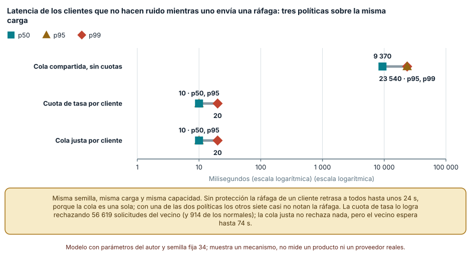
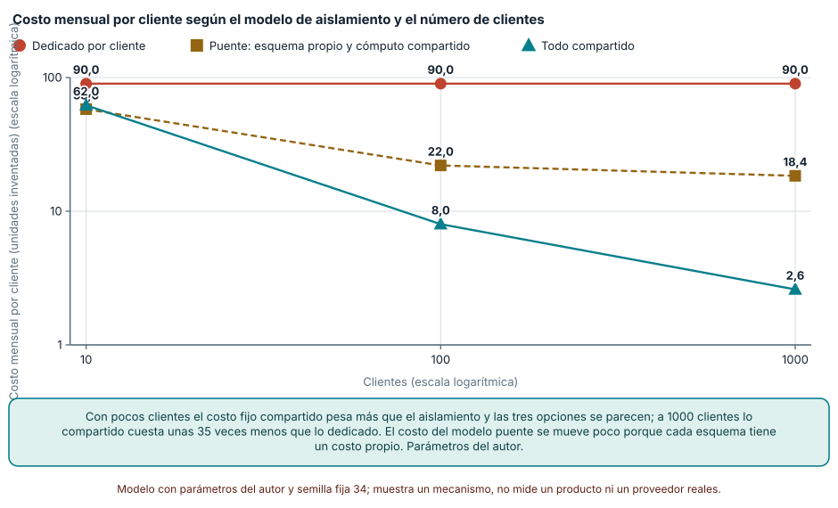

# SE-410 — Aislamiento multi-inquilino y vecino ruidoso

[← SE-409 — Qué hace distinto a un producto SaaS](https://github.com/vladimiracunadev-create/modern-software-engineering-program/blob/main/classes/part-34-saas-y-plataformas-de-producto/se-409-que-hace-distinto-a-un-producto-saas/README.md) · [↑ Parte 34](https://github.com/vladimiracunadev-create/modern-software-engineering-program/blob/main/classes/part-34-saas-y-plataformas-de-producto/README.md) · [📚 Índice completo](https://github.com/vladimiracunadev-create/modern-software-engineering-program/blob/main/classes/README.md) · [🌐 Portal](https://vladimiracunadev-create.github.io/modern-software-engineering-program/classes/SE-410.html) · [SE-411 — Alta, aprovisionamiento y configuración por cliente →](https://github.com/vladimiracunadev-create/modern-software-engineering-program/blob/main/classes/part-34-saas-y-plataformas-de-producto/se-411-alta-aprovisionamiento-y-configuracion-por-cliente/README.md)

## Punto profesional y fundamento pedagógico

**Punto profesional.** La clase existe para que puedas elegir, medir y defender el nivel de aislamiento que un producto SaaS ofrece a cada cliente, y para que sepas qué ocurre con los demás clientes cuando uno de ellos consume más de lo esperado. `SE-342` presentó el espectro de aislamiento (filas compartidas, esquema propio, base propia) y sus fugas de datos. Esta clase añade la mitad que ese capítulo deja en un recuadro: el aislamiento de *rendimiento*, que no se ve en una consulta ni se prueba con datos de un solo inquilino, y la economía de cada nivel, que decide qué plan puede permitírselo.

**Por qué aparece aquí.** Sigue a `SE-409`, que fijó que el costo compartido es lo que hace viable el precio y que el aislamiento es lo que hace viable la venta. Prepara `SE-411`, donde el alta de un cliente debe crear (o no) un esquema, una base o una cuota según su plan, y `SE-415`, donde los límites por plan son una decisión de precio. Se apoya en `SE-436` (latencia y saturación) y en `SE-439` (bulkheads y degradación) para el vocabulario de contención.

**Error conceptual que debe corregir.** Creer que el aislamiento de datos basta para que los clientes no se afecten. Un cliente puede no ver ni un byte de otro y aun así hacerle esperar veinte segundos. En el experimento de la clase, con una sola cola compartida, la ráfaga de un cliente multiplicó por unas 940 la mediana de espera de los otros siete (de 10 ms a 9 370 ms, con un p99 de 24,7 s) sin que ninguna consulta tocara datos ajenos. El aislamiento de cómputo, de cola, de conexiones y de cuota es una propiedad distinta, que se diseña y se prueba aparte.

**Secuencia de aprendizaje.** Antes de ejecutar, predices cuánto tardan en responder los clientes normales mientras uno envía una ráfaga de 40 solicitudes por tick (con una capacidad de 20), con una cola compartida, con una cuota de tasa y con una cola justa por cliente. Después ejecutas la simulación con semilla fija, comparas las percentiles de los otros clientes y lo que paga el vecino en cada política, y mides el costo mensual por cliente de tres modelos de aislamiento con 10, 100 y 1000 clientes. Terminas escribiendo una política: qué plan recibe qué nivel de aislamiento y qué se mide para saber que se cumple.

**Evidencia de aprendizaje.** `aislamiento.md` con el modelo elegido por plan, los límites por cliente con su justificación, la medición de la latencia de los otros durante una ráfaga con y sin la política, el costo por cliente de cada opción y la señal que dispararía el traslado de un cliente a otro nivel.

**Límite de la conclusión.** Se ejecutó una simulación de colas discreta con semilla 34 (ocho clientes, capacidad de 20 trabajos por tick, un tick igual a 10 ms de tiempo simulado) y un modelo de costo con parámetros del autor; no se midió un proveedor de nube, una base de datos ni un balanceador reales, y la forma del efecto (una cola única contagia, una cuota o una cola justa contienen) es robusta pero sus magnitudes no se trasladan. No se afirma revisión humana externa del contenido.

### Trazabilidad fuente → afirmación

| Fuente primaria u oficial | Afirmación que respalda | Lo que no prueba |
|---|---|---|
| [Microsoft Learn: antipatrón del vecino ruidoso](https://learn.microsoft.com/en-us/azure/architecture/antipatterns/noisy-neighbor/noisy-neighbor) | Describe el problema (un inquilino monopoliza recursos compartidos y degrada a otros) y las líneas de mitigación (cuotas, aislamiento de recursos, trasladar al inquilino). | No da magnitudes de ningún sistema concreto. |
| [Microsoft Learn: modelos de tenencia](https://learn.microsoft.com/en-us/azure/architecture/guide/multitenant/considerations/tenancy-models) | Compara tenencia compartida, por inquilino y mixta con sus compromisos de costo, aislamiento y operación. | No fija qué mezcla conviene a tu producto. |
| [AWS: estrategias de aislamiento de inquilinos](https://docs.aws.amazon.com/whitepapers/latest/saas-tenant-isolation-strategies/saas-tenant-isolation-strategies.html) | Distingue aislamiento en silo, en pool y en puente, y trata el contexto del inquilino y las políticas de acceso como mecanismos de aislamiento. | No sustituye la prueba de tus propios límites. |
| [Microsoft Learn: patrón de limitación de tasa](https://learn.microsoft.com/en-us/azure/architecture/patterns/rate-limiting-pattern) | Explica la limitación de tasa como forma de proteger un recurso compartido y su efecto sobre quien la excede. | No elige los límites por ti. |
| [PostgreSQL: seguridad a nivel de fila](https://www.postgresql.org/docs/current/ddl-rowsecurity.html) | Documenta políticas que el motor aplica a cada consulta aunque la aplicación omita un filtro. | No impide que un inquilino sature la base. |

## Antes de empezar

Recupera lo aprendido en `SE-342`: la identidad del inquilino es contexto, no un parámetro que cada consulta recuerde. La pregunta activa es: **si uno de tus clientes enviara hoy diez veces su tráfico habitual durante un minuto, ¿qué cliente lo notaría primero, en qué métrica y cuánto tardarías en saber cuál fue el causante?**

## Prerrequisitos

- Haber completado `SE-409` y haber leído `SE-342` (modelos de aislamiento y fugas por filtro).
- Conocer los conceptos de cola, capacidad, latencia y percentil de `SE-436`.
- Saber qué es un límite de tasa y una cola de trabajo (`SE-249`, `SE-247`).
- Python 3.11 o posterior; la simulación usa solo la biblioteca estándar.

## Problema auténtico

*Tablero* tiene 4 000 clientes en un clúster compartido. Un lunes, una empresa importa un millón de tareas desde otra herramienta con un script que lanza trescientas peticiones en paralelo. En cuatro minutos la latencia de todos los clientes pasa de 80 ms a más de 6 s. Soporte recibe trescientas llamadas, ninguna de las cuales dice «hay un cliente que importa»; todas dicen «Tablero está caído». Nadie accedió a datos ajenos; la tabla de usuarios y las claves de cifrado de cada cliente están intactas. Y sin embargo, para los demás, el servicio dejó de existir.

El equipo ya tenía aislamiento de datos (filtro por inquilino más una política de filas en la base). Lo que no tenía era una política de recursos: cuánto de la capacidad puede usar un cliente, qué ocurre con su exceso y a quién beneficia o perjudica esa decisión. Hay tres respuestas clásicas: rechazar lo que exceda su cuota, ponerlo a esperar su turno sin retrasar a los demás o separar físicamente a los clientes grandes. Cada una tiene un costo para el cliente que hace ruido, para los demás y para la factura, y el equipo debe elegir con números.

El problema de la clase es medir esa decisión: simular la ráfaga de un cliente sobre una capacidad compartida, comparar la latencia de los otros con y sin política, ver qué paga el vecino en cada caso y estimar cuánto cuesta cada nivel de aislamiento por cliente según el tamaño de la base de clientes.

## Objetivos observables

Al terminar podrás:

1. distinguir aislamiento de datos de aislamiento de rendimiento y dar un ejemplo de fallo de cada uno que el otro no previene;
2. medir con una simulación con semilla fija la latencia de los clientes normales durante la ráfaga de un vecino con una cola compartida, con una cuota de tasa y con una cola justa, y reportar p50, p95 y p99;
3. explicar qué paga el vecino en cada política (solicitudes rechazadas o espera propia) y por qué esa elección es una decisión de producto, no solo técnica;
4. calcular el costo mensual por cliente de tres modelos de aislamiento (dedicado, puente, compartido) y reconocer a partir de qué número de clientes lo compartido compensa;
5. definir qué señales disparan trasladar a un cliente de un nivel de aislamiento a otro y cómo se hace sin interrumpirlo.

## Mapa conceptual


La petición lleva su inquilino desde la entrada; la cuota decide si entra, la cola por inquilino evita que el exceso de uno retrase a los demás, el planificador reparte la capacidad por turnos, y las métricas por inquilino son lo que permite saber quién causó qué y mover a ese cliente a un nivel dedicado cuando la medición lo justifique.

## Temas y por qué importan

| Tema | Por qué cambia una decisión profesional | Evidencia mínima |
|---|---|---|
| Silo, puente y pool | Reparte de forma distinta riesgo, costo y trabajo de operación. | Costo por cliente a 10, 100 y 1000 clientes |
| Contexto del inquilino | Es lo primero que se pierde en un trabajo asíncrono y lo que hace posible toda política posterior. | Identificador en cada mensaje y traza |
| Vecino ruidoso | Un cliente puede degradar a todos sin tocar sus datos. | Latencia de los otros con y sin ráfaga |
| Cuota de tasa | Protege la capacidad rechazando el exceso, que es un costo para quien lo envía. | Solicitudes rechazadas por cliente |
| Cola justa | Protege a los demás sin rechazar, pero hace esperar más al que excede. | Espera del vecino frente a la de los otros |
| Métricas por inquilino | Sin ellas no se sabe quién hizo ruido ni a quién afectó. | Consumo por inquilino y por recurso |
| Traslado de nivel | El aislamiento se puede subir cuando el cliente lo justifica. | Procedimiento y tiempo de traslado |

## Conceptos y decisiones

### 1. Tres niveles de aislamiento y por qué casi nunca basta uno

En un *silo* cada cliente tiene su propia pila (cómputo, datos y red); en un *pool* todos comparten todo y el sistema los distingue por el identificador del inquilino; el *puente* mezcla (cómputo compartido, datos separados por esquema o por base). Cada nivel desplaza el riesgo: el silo minimiza fugas y ruido a costa de costo y de operar miles de entornos; el pool minimiza el costo y obliga a que cada línea de código y cada política respeten al inquilino; el puente da un punto medio con su propia complejidad (muchos esquemas que migrar). Los productos maduros combinan: la mayoría de los clientes en un pool, los de plan alto o regulado en un puente o un silo, con un procedimiento para moverlos entre niveles.

### 2. El contexto del inquilino viaja con el trabajo, incluido el asíncrono

Toda política de aislamiento exige saber de qué inquilino es cada pieza de trabajo. En una petición HTTP se obtiene de una credencial firmada y se copia a un contexto al entrar. Se pierde con facilidad en tres sitios: los trabajos de segundo plano (un mensaje en una cola sin el identificador), las cachés (una clave sin el inquilino devuelve datos de otro) y los registros (un log sin inquilino no permite saber quién hizo ruido). La regla es que el identificador forme parte del sobre de cada mensaje, de cada clave de caché y de cada línea de log, y que una prueba falle si falta (`SE-342` detalla la propagación y las fugas).

### 3. Aislar datos no aísla recursos

Una política de filas en la base (PostgreSQL ofrece seguridad a nivel de fila) garantiza que una consulta olvidada no devuelva filas ajenas. No impide que una consulta pesada de un cliente consuma conexiones, memoria y CPU de la base que los demás también usan. El aislamiento de datos y el de recursos se implementan con mecanismos distintos y se prueban con pruebas distintas: una prueba de datos pide algo del cliente A con la credencial del B y espera un rechazo; una prueba de recursos lanza carga con A y mide la latencia de B.

### 4. Con una cola compartida, la ráfaga de uno es la espera de todos

La simulación tiene ocho clientes y una capacidad de 20 trabajos por tick (2 000 por segundo, con un tick de 10 ms). Siete clientes normales envían en promedio 1,9 trabajos por tick cada uno y el vecino también, hasta que entre los ticks 2 000 y 3 500 (15 segundos) el vecino envía 40 por tick. La carga total pasa de 15,2 (76 % de la capacidad) a unos 53 (más del doble). Con una sola cola, los trabajos se atienden en orden de llegada: los de los clientes normales quedan detrás de los miles del vecino. Resultado para los siete clientes normales: **p50 de 9 370 ms, p95 de 23 540 ms y p99 de 24 730 ms**, frente a 10 ms en un sistema sin ráfaga. El atraso no desaparece cuando la ráfaga termina: la cola acumulada (unos 50 000 trabajos) se vacía a 4,8 trabajos por tick de holgura y tarda más de diez mil ticks, es decir, casi dos minutos, en drenarse. La capacidad sobrante es lo que decide cuánto tarda el sistema en recuperarse.

### 5. Una cuota de tasa protege rechazando: el costo lo paga quien excede

Una cuota por cliente limita cuántas solicitudes puede enviar por unidad de tiempo; lo que excede se rechaza (en HTTP, con 429 y un tiempo de reintento). En la simulación, un cubo de fichas con recarga de 2,4 por tick y ráfaga máxima de 10 deja a los otros siete en **p50 10 ms, p95 10 ms y p99 20 ms** durante toda la prueba, y el vecino ve su p99 en 10 ms para lo que sí se atiende, pero **56 619 solicitudes rechazadas**. Un detalle importante: 914 solicitudes de los clientes normales también se rechazaron, porque su llegada aleatoria (Poisson de media 1,9) a veces supera la recarga de 2,4 en un instante. Una cuota demasiado ajustada castiga a quien no hace ruido; por eso la recarga se fija con holgura sobre el consumo típico y la ráfaga permitida (el tamaño del cubo) se ajusta a lo que un cliente legítimo hace en un pico.

### 6. Una cola justa protege sin rechazar: el costo lo paga quien excede, esperando

En lugar de rechazar, se mantiene una cola por cliente y el planificador atiende por turnos (un trabajo de cada cliente con trabajo pendiente). Los otros siete quedan igual: **p50 10 ms, p95 10 ms y p99 20 ms**. El vecino no pierde ninguna solicitud, pero espera lo que su propia cola le impone: **p50 de 34 870 ms y p99 de 74 280 ms**. La cola justa traslada el daño al causante en forma de espera y mantiene todo el trabajo, lo que conviene si el cliente necesita que su importación termine aunque tarde. Su límite es la memoria que ocupan las colas largas: sin un tope, un cliente puede agotar la memoria con sus pendientes, así que se combinan ambas políticas (cola justa con una cola máxima por cliente y rechazo más allá de ella).

### 7. La elección entre rechazar y esperar es una decisión de producto

Rechazar con un error claro obliga al cliente a implementar reintentos con espera y evita colas ocultas; hacer esperar mantiene el flujo pero oculta el exceso y puede producir tiempos de espera de minutos que parecen un fallo. Un cliente de importación masiva prefiere esperar; un cliente interactivo prefiere un error rápido. La política razonable distingue por tipo de operación: las interactivas con cuota estricta y respuesta inmediata; las masivas en una cola de segundo plano con prioridad baja y tope. Escribe la política y su razón, porque soporte tendrá que explicarla.

### 8. El costo del aislamiento depende del número de clientes

El modelo de costo de la clase parte de parámetros del autor: un entorno dedicado por cliente cuesta 90 al mes; el modelo puente tiene un costo base de 18 por cliente más una parte de un costo fijo de 400 repartido; el compartido tiene 2 por cliente más un fijo de 600 repartido. Con 10 clientes los tres costos por cliente son 90, 58 y 62: lo compartido ni siquiera es el más barato porque el fijo se reparte entre pocos. Con 100 son 90, 22 y 8; con 1 000, 90, 18,4 y 2,6. La conclusión no es «compartir siempre»: es que el punto en que compartir compensa depende de cuántos clientes hay y cuánto cuesta el costo fijo, y que el modelo puente sale de la competencia con pocos clientes y regresa con clientes que exigen separación.

### 9. Trasladar a un cliente de nivel es una operación de producto

Cuando las métricas por inquilino muestran que un cliente consume cinco veces su cuota de forma sostenida o su contrato exige aislamiento, hay que moverlo a otro nivel. Mover datos de un pool a un entorno dedicado es una migración con el servicio en uso: copia, sincronización de cambios, corte breve y verificación (`SE-523`). Un procedimiento ensayado, con un tiempo medido y una vuelta atrás, es lo que permite ofrecer ese traslado como parte de un plan y no como una emergencia.

### 10. Qué no garantizan estas políticas

Una cuota no protege de un ataque distribuido que use muchos inquilinos falsos; una cola justa no protege de un recurso que no pasa por ella (por ejemplo, un bloqueo de tabla de la base); y un silo no protege de un fallo en el plano de control compartido que lo crea o lo factura. Por eso se complementan con límites en cada recurso compartido (conexiones, memoria, E/S), con arquitecturas celulares para acotar el radio del daño (`SE-344`) y con pruebas de caos (`SE-394`) que reproduzcan el ruido de forma controlada.

### 11. Organizaciones, usuarios e identidad: quién es el inquilino

El inquilino no siempre es una persona ni una empresa simple. En un producto SaaS suele haber una *organización* (la entidad que contrata y paga), varios *espacios de trabajo* o proyectos dentro de ella, *usuarios* que pueden pertenecer a más de una organización y *roles* que valen dentro de cada una. Confundir estos niveles produce fallos de aislamiento sutiles: una persona que es administradora en una organización y miembro en otra no debe arrastrar sus permisos de una a otra, y la credencial que llega a la API debe decir en nombre de qué organización actúa, no solo quién es. La identidad responde a «¿quién eres?» y se delega a un proveedor (inicio de sesión federado, SSO) cuando el cliente lo exige; la pertenencia y el rol responden a «¿a qué organización perteneces y qué puedes hacer en ella?» y son datos del producto con el identificador del inquilino como parte de la clave.

Tres decisiones se toman pronto y cuestan mucho cambiar después: si un usuario puede pertenecer a varias organizaciones (casi siempre sí), cómo se elige la organización activa en cada petición (un identificador firmado en la credencial o un selector explícito, nunca un parámetro libre) y qué ocurre con las cuentas de personas cuando la organización las elimina (se conserva la identidad y se retira la pertenencia). La autorización por rol dentro de la organización es el tema de `SE-459`; el derecho del plan, el de `SE-414`.

## La latencia de los otros según la política



**Cómo leer la figura.** Cada fila es una política y cada pista va del p50 al p99 de los clientes que *no* hicieron ruido, en escala logarítmica. Mira la distancia entre la primera fila y las otras dos: son tres órdenes de magnitud. Mira también que las dos políticas protectoras dan resultados casi idénticos para los otros; lo que las distingue está en lo que le pasa al vecino. **Dónde deja de valer:** simulación de colas con llegadas aleatorias y servicio constante; un sistema real tiene tiempos de servicio variables, varios recursos y reintentos de los clientes, que pueden amplificar la ráfaga.

## Costo por cliente según el modelo



**Cómo leer la figura.** El eje horizontal es el número de clientes y el vertical el costo mensual por cliente, ambos en escala logarítmica. La línea coral es plana porque cada cliente tiene su entorno; las otras bajan porque el costo fijo se reparte. Observa el cruce a la izquierda, donde con pocos clientes lo compartido no es el más barato. **Dónde deja de valer:** los parámetros son del autor y no incluyen el costo de personas (operar mil entornos dedicados exige automatización que tiene su propio costo), ni descuentos por volumen, ni requisitos regulatorios que obliguen a separar.

## Dónde se fija el inquilino


**Cómo leer la figura.** Las cuatro cajas son puntos sucesivos donde el identificador del inquilino se establece o se exige. Lee de derecha a izquierda para ver qué detiene el olvido de cada punto anterior: la base con política de filas detiene un acceso a datos sin filtro. **Dónde deja de valer:** la figura trata el aislamiento de datos; no cubre el de recursos, que necesita su propio camino (cuotas y colas), ni los datos que no pasan por la base (cachés, buscadores, archivos).

## Definiciones de trabajo

- **Silo, puente, pool:** aislamiento dedicado por cliente, mixto o totalmente compartido.
- **Vecino ruidoso:** inquilino cuyo consumo degrada el servicio de otros.
- **Cuota:** límite de uso por inquilino y periodo; en tasa, un número de solicitudes por unidad de tiempo.
- **Cubo de fichas:** mecanismo de cuota que recarga fichas a ritmo fijo hasta un máximo y gasta una por solicitud.
- **Cola justa:** una cola por inquilino con un planificador que atiende por turnos.
- **Contexto del inquilino:** identificador que acompaña a cada petición, mensaje, clave de caché y línea de registro.
- **Radio de impacto:** conjunto de clientes afectados por un fallo.

## Ejemplo mínimo

Un cubo de fichas por inquilino y un planificador por turnos en pocas líneas:

```python
from collections import deque


class Cubo:
    def __init__(self, recarga: float, maximo: float) -> None:
        self.fichas, self.recarga, self.maximo = maximo, recarga, maximo

    def tick(self) -> None:
        self.fichas = min(self.maximo, self.fichas + self.recarga)

    def admitir(self) -> bool:
        if self.fichas >= 1:
            self.fichas -= 1
            return True
        return False


colas = {"a": deque(range(5)), "b": deque(range(2))}
atendidos = []
while any(colas.values()):
    for inquilino in list(colas):          # un trabajo por turno a cada inquilino con trabajo pendiente
        if colas[inquilino]:
            atendidos.append((inquilino, colas[inquilino].popleft()))
print(atendidos[:6])                        # [('a', 0), ('b', 0), ('a', 1), ('b', 1), ('a', 2), ('a', 3)]
```

El planificador por turnos atiende a `b` aunque `a` tenga más trabajo: mientras `b` tenga pendientes, ninguno atiende dos veces seguidas. Es la idea de la cola justa en cinco líneas; el experimento la ejecuta con ocho clientes y 15 000 ticks.

## Ejemplo profesional

*Escenario ilustrativo: las cifras y los resultados de este ejemplo son supuestos de la narración, no mediciones.*

El equipo de *Tablero* instrumenta primero: cada solicitud, trabajo y línea de log lleva el identificador del inquilino y el panel muestra el consumo por inquilino y por recurso. En una semana descubren que 11 de 4 000 clientes generan el 62 % de las consultas pesadas. Diseñan la política en tres capas: cuota de tasa por inquilino para las operaciones interactivas (con un cubo cuyo máximo cubre un pico legítimo y una respuesta 429 con el tiempo de reintento), cola justa con tope de longitud para las importaciones masivas (con prioridad baja) y una regla de traslado: el cliente que supera durante dos semanas el triple de su cuota recibe una oferta de plan con aislamiento dedicado.

Antes de activar la política la prueban con carga: lanzan desde un entorno de ensayo la ráfaga de un cliente simulado y miden la latencia de los demás con y sin la política activa; solo la activan cuando el p99 de los otros se mantiene dentro de su objetivo. Después de activarla, vigilan dos señales contrarias: que los rechazos de los clientes normales no suban (la cuota estaría demasiado ajustada) y que el consumo de los once clientes grandes no se mueva a otros recursos que sí comparten (por ejemplo, la cola de correo). La política se revisa cuando cambian los planes.

## Práctica guiada

1. Ejecuta `python scripts/experiments_part34_tenancy.py` y localiza las tres líneas de política. Compara con la tabla de la clase y con tu predicción.
2. Cambia `TASA_RAFAGA` de 40 a 25 y a 60 y repite: anota cuándo la cola compartida deja de recuperarse dentro de la ventana de 15 000 ticks.
3. Cambia la recarga del cubo de 2,4 a 1,9 y a 3,0: observa cuántas solicitudes de clientes normales se rechazan y qué ocurre con el p99 del vecino.
4. Añade un tope de 200 trabajos a la cola de cada cliente en la política de cola justa y cuenta cuántos rechaza; compara con la cuota de tasa.
5. Escribe para tu producto una tabla de tres filas (plan gratuito, intermedio, empresarial) con el nivel de aislamiento, la cuota y la política ante exceso, y una justificación de una línea para cada celda.

## Ejercicios

1. **Básico.** Explica por qué la política de cola justa no rechaza solicitudes y aun así el vecino tiene un p99 de 74 s, mayor que con una cola compartida (24,8 s). ¿Qué queda sin resolverse?
2. **Intermedio.** Diseña la prueba de aislamiento de rendimiento de *Tablero*: qué carga lanza, qué mide en otros inquilinos, qué umbral hace fallar el pipeline y cómo evitas que la prueba dependa de una máquina concreta.
3. **Avanzado.** Un cliente exige por contrato «que ningún otro cliente pueda afectar nuestra latencia». Propón qué nivel de aislamiento ofrecerías, qué cláusula escribirías para no prometer lo que no puedes verificar, qué medirías para demostrarlo y cuánto subiría el precio según el modelo de costo.

## Reto verificable

Entrega `aislamiento.md` con la política por plan y la ejecución de la simulación con tu cambio de parámetros. Es válido si otra persona reproduce con la misma semilla las percentiles de los otros clientes con las tres políticas, entiende qué paga el vecino en cada una y puede explicar en qué situación recomendarías cada política.

## Caso conductor

*Tablero* creció con un único clúster compartido y la ráfaga de un cliente se convirtió en una caída percibida por todos. Esta clase da los mecanismos para acotar esa ráfaga y el costo para decidir cuándo conviene un entorno dedicado. `SE-411` automatiza el alta para que el nivel de aislamiento se asigne al crear al cliente, y `SE-415` convierte las cuotas en límites de plan.

## Preguntas frecuentes

### ¿Por qué no poner a cada cliente en su propio entorno y evitar el problema?

Porque el costo por cliente no escala a precios bajos: en el modelo, 90 por cliente frente a 2,6 compartido con 1 000 clientes. Un entorno dedicado es una opción de plan, no una solución universal, y operar miles de entornos exige una automatización que tiene su propio costo.

### ¿La cuota de tasa no castiga a los clientes que más pagan?

Puede hacerlo si se fija sin holgura: por eso se calibra con el consumo real de cada plan y se ofrece un nivel superior a quien lo necesita. La cuota es una promesa clara («hasta 100 solicitudes por segundo en tu plan»), mientras que la degradación sin cuota es una promesa implícita para todos.

### ¿Cómo sé quién es el vecino ruidoso en producción?

Con métricas por inquilino de cada recurso compartido (CPU, conexiones, solicitudes, trabajos en cola) y trazas que lleven el inquilino. Sin eso, la alerta dice «la latencia subió» y el análisis tarda horas; con eso, el panel ordena a los clientes por consumo y la causa se ve en minutos. Cuida la cardinalidad: con miles de inquilinos, las métricas por inquilino se agregan por tramos o se limitan a los más grandes.

### ¿Qué pasa con los trabajos de segundo plano?

Son la fuente más común de ruido y la más olvidada. Una importación masiva que entra por una cola sin cuota ocupa a los trabajadores de todos. Cada cola de trabajos necesita su política por inquilino, y el identificador debe viajar en el mensaje.

## Fallo controlado y diagnóstico

**Fallo.** Después de activar la cuota de tasa, el cliente más antiguo de *Tablero* reporta que su sincronización nocturna falla desde hace tres noches con errores 429, aunque su consumo medio está muy por debajo de su plan.

**Diagnóstico paso a paso.** (1) Se mira el consumo por minuto, no el medio: la sincronización lanza todas sus solicitudes en los primeros cuatro segundos de la noche, 900 solicitudes. (2) El cubo de su plan tiene máximo de 100 y recarga de 20 por segundo: en cuatro segundos admite 180. (3) El resto se rechaza, y el cliente, que no tiene lógica de reintento con espera, reintenta de inmediato y vuelve a recibir 429. (4) La medición media engañaba: la cuota se aplica a la ráfaga, no al promedio. (5) Se corrige por dos vías: el cliente espera el tiempo que indica la respuesta antes de reintentar y se amplía el máximo del cubo para ese plan según el pico legítimo medido.

**Lección.** Una cuota se evalúa con la distribución de la carga real, no con su media, y acompaña al límite con un contrato de reintento (tiempo de espera indicado en la respuesta). Sin ese contrato, la protección se convierte en una tormenta de reintentos.

## Errores comunes y cómo corregirlos

- **Confiar el aislamiento a un filtro por inquilino.** Se olvida y se rompe en silencio. Corrige con una barrera que no dependa de la consulta (`SE-342`) y una prueba que pida datos ajenos.
- **Medir la latencia solo en promedio.** El ruido se ve en los percentiles. Corrige con p95 y p99 por inquilino.
- **Aplicar la misma cuota a todos los planes.** Penaliza a los que pagan más o regala capacidad a los que no. Corrige con cuotas por plan y una oferta de plan superior (`SE-415`).
- **Dejar sin política las colas de segundo plano.** Una importación ocupa a todos los trabajadores. Corrige con colas justas con tope y prioridad.
- **Perder el inquilino en un mensaje o en una clave de caché.** Se filtra o se mezcla. Corrige con un sobre de mensaje y un formato de clave que lo incluyan y una prueba que falle si falta.
- **Suponer que el traslado de nivel es sencillo.** Sin ensayo se descubre durante una emergencia. Corrige con un procedimiento medido y una vuelta atrás.

## Entorno y archivos clave

- `scripts/experiments_part34_tenancy.py`: simulación del vecino ruidoso (`simular`, `p99_en_rafaga`), modelo de costo (`costo_por_modelo`) y medición de la alta de un inquilino (`aprovisionamiento`).
- `scripts/figures_part34_a.py`: las tres figuras de la clase.
- Requiere Python 3.11 o posterior y solo la biblioteca estándar; la semilla es 34 y los resultados se repiten idénticos.

## Seguridad, ética y accesibilidad

La fuga de datos entre clientes es el incidente más grave de un SaaS: además de los daños al cliente, suele exigir notificación a las autoridades (`SE-463`). Prueba el aislamiento con inquilinos distintos en cada entorno de ensayo y no uses datos reales de clientes para reproducir un ruido. Las métricas por inquilino pueden revelar el comportamiento de un cliente; limita quién las ve y por cuánto tiempo se guardan. Las respuestas de rechazo deben ser comprensibles para personas y para programas: un mensaje claro, un código estable y un tiempo de reintento; una pantalla que muestra «error» sin explicar que el plan alcanzó un límite excluye a quien usa lector de pantalla y a quien no sabe qué cambiar.

## Puente hacia el trabajo con agentes

Un agente que ejecuta tareas largas (migrar proyectos, importar datos, generar informes) sobre una plataforma compartida es, con facilidad, el vecino ruidoso de la clase: lanza muchas peticiones en paralelo y no sabe que comparte capacidad. Dale límites explícitos de concurrencia y de tasa, haz que respete el tiempo de reintento de las respuestas 429 y exige que registre qué inquilino afecta cada acción. Si diseñas la plataforma para agentes, trátalos como un tipo de cliente con cuota propia, no como tráfico anónimo.

## Transferencia

Escoge un recurso compartido de tu sistema (una cola, una base, una caché, una API de terceros) y escribe: quién puede monopolizarlo, qué métrica lo mostraría, qué política lo contendría (cuota, cola justa, tope) y qué paga quien excede. Si no tienes la métrica, ya sabes qué instrumentar primero.

## Evaluación y evidencia

| Criterio | Evidencia aceptable | Rechazo |
|---|---|---|
| Distinción datos y recursos | Un fallo de cada tipo y la prueba que lo detecta | «Aislamiento» sin distinguir |
| Medición | Percentiles de los otros con y sin política, semilla y parámetros | Un promedio |
| Política | Qué paga el vecino y por qué esa elección | Una cuota sin razón |
| Costo | Costo por cliente con supuestos y punto de cruce | Una afirmación de que compartir siempre conviene |
| Traslado | Señal, procedimiento y vuelta atrás | «Se migra cuando haga falta» |

## Fuentes

- Microsoft Learn. [Antipatrón del vecino ruidoso](https://learn.microsoft.com/en-us/azure/architecture/antipatterns/noisy-neighbor/noisy-neighbor), [modelos de tenencia](https://learn.microsoft.com/en-us/azure/architecture/guide/multitenant/considerations/tenancy-models) y [patrón de limitación de tasa](https://learn.microsoft.com/en-us/azure/architecture/patterns/rate-limiting-pattern).
- AWS. [Estrategias de aislamiento de inquilinos](https://docs.aws.amazon.com/whitepapers/latest/saas-tenant-isolation-strategies/saas-tenant-isolation-strategies.html) y [SaaS Lens](https://docs.aws.amazon.com/wellarchitected/latest/saas-lens/saas-lens.html).
- PostgreSQL. [Seguridad a nivel de fila](https://www.postgresql.org/docs/current/ddl-rowsecurity.html).
- Shopify Engineering. [Balanceo de fragmentos de MySQL a escala de terabytes](https://shopify.engineering/mysql-database-shard-balancing-terabyte-scale) (traslado de inquilinos entre fragmentos).

## Límites y siguiente paso

Se simularon ocho clientes sobre una capacidad compartida con semilla 34 y se modeló el costo con parámetros del autor; no se midió ningún proveedor, base de datos ni balanceador, ni se contempló el efecto de los reintentos del cliente sobre la cola. Las magnitudes dependen del modelo; la forma (una cola única contagia, una cuota o una cola justa contienen) es el resultado que se puede reutilizar. El siguiente paso, `SE-411`, automatiza el alta de un cliente: qué se crea, en qué orden, cómo se deshace si falla y cómo se asigna el nivel de aislamiento según su plan.

## Glosario

| Término | Definición breve |
|---|---|
| Silo | Pila dedicada por cliente |
| Pool | Todo compartido, distinguido por inquilino |
| Puente | Mezcla de compartido y separado |
| Vecino ruidoso | Inquilino que degrada a otros con su consumo |
| Cuota | Límite de uso por inquilino y periodo |
| Cubo de fichas | Cuota con recarga fija y máximo |
| Cola justa | Cola por inquilino con turnos |
| Radio de impacto | Clientes afectados por un fallo |

---

[← SE-409 — Qué hace distinto a un producto SaaS](https://github.com/vladimiracunadev-create/modern-software-engineering-program/blob/main/classes/part-34-saas-y-plataformas-de-producto/se-409-que-hace-distinto-a-un-producto-saas/README.md) · [↑ Parte 34](https://github.com/vladimiracunadev-create/modern-software-engineering-program/blob/main/classes/part-34-saas-y-plataformas-de-producto/README.md) · [📚 Índice completo](https://github.com/vladimiracunadev-create/modern-software-engineering-program/blob/main/classes/README.md) · [🌐 Portal](https://vladimiracunadev-create.github.io/modern-software-engineering-program/classes/SE-410.html) · [SE-411 — Alta, aprovisionamiento y configuración por cliente →](https://github.com/vladimiracunadev-create/modern-software-engineering-program/blob/main/classes/part-34-saas-y-plataformas-de-producto/se-411-alta-aprovisionamiento-y-configuracion-por-cliente/README.md)
