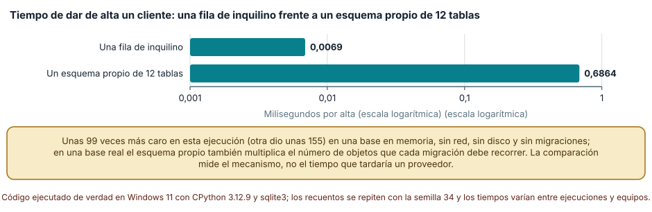

# SE-411 — Alta, aprovisionamiento y configuración por cliente

[← SE-410 — Aislamiento multi-inquilino y vecino ruidoso](https://github.com/vladimiracunadev-create/modern-software-engineering-program/blob/main/classes/part-34-saas-y-plataformas-de-producto/se-410-aislamiento-multi-inquilino-y-vecino-ruidoso/README.md) · [↑ Parte 34](https://github.com/vladimiracunadev-create/modern-software-engineering-program/blob/main/classes/part-34-saas-y-plataformas-de-producto/README.md) · [📚 Índice completo](https://github.com/vladimiracunadev-create/modern-software-engineering-program/blob/main/classes/README.md) · [🌐 Portal](https://vladimiracunadev-create.github.io/modern-software-engineering-program/classes/SE-411.html) · [SE-412 — Suscripciones, ciclos de facturación y dunning →](https://github.com/vladimiracunadev-create/modern-software-engineering-program/blob/main/classes/part-34-saas-y-plataformas-de-producto/se-412-suscripciones-ciclos-de-facturacion-y-dunning/README.md)

## Punto profesional y fundamento pedagógico

**Punto profesional.** La clase existe para que diseñes el momento en que un cliente nuevo entra a un producto SaaS como lo que es: una operación distribuida con varios sistemas, que debe poder fallar a la mitad, repetirse sin duplicar nada y dejar al cliente en un estado conocido. El alta no es un formulario que inserta una fila; es la primera vez que el plano de control (el que crea inquilinos, planes y facturación) debe coordinar con el plano de datos (donde vive lo que el cliente usa), con la identidad (quién es su primer administrador) y con el cobro (qué plan paga). Si esa coordinación se improvisa, los primeros clientes de pago son los primeros en encontrarse con cuentas a medias.

**Por qué aparece aquí.** Sigue a `SE-410`, donde el nivel de aislamiento depende del plan: alguien debe crear el esquema, la cuota o el entorno al dar de alta al cliente. Reutiliza la idempotencia de `SE-246` y `SE-392`, la ejecución durable de `SE-596` y el vocabulario de configuración de `SE-345` (la configuración vive fuera del código). Prepara `SE-412`, donde el estado de la suscripción nace en el alta, y `SE-414`, donde los derechos se derivan del plan asignado.

**Error conceptual que debe corregir.** Creer que el alta termina cuando el usuario ve la pantalla de bienvenida. En el experimento de la clase, un alta de cinco pasos se corta en el cuarto porque el procesador de pagos no responde: sin registro de pasos hechos, el reintento crea un segundo administrador y un segundo cliente de facturación; con registro, el reintento retoma donde se quedó y el resultado tras tres ejecuciones es un inquilino, un administrador, dos filas semilla y un cliente de facturación. La corrección no está en reintentar más, sino en que cada paso se pueda repetir sin efecto adicional y que el estado del alta sea visible.

**Secuencia de aprendizaje.** Antes de ejecutar, predices cuántos administradores y cuántos clientes de facturación habrá si un alta falla en el cuarto paso y se repite dos veces con y sin registro de pasos. Después ejecutas el alta con un fallo inyectado, la reanudas, mides cuánto cuesta crear un inquilino como fila frente a crearlo como esquema propio y lees tres figuras: la saga con compensación, la duración de un alta con actores en paralelo y el costo por modo de alta. Terminas escribiendo el contrato de alta de tu producto: pasos, estado, reintento, compensación y configuración por capas.

**Evidencia de aprendizaje.** `alta.md` con la lista de pasos del alta de tu producto, su estado en cada punto de falla, qué hace cada paso al repetirse, qué se compensa y qué se deja en revisión, y el modelo de configuración por capas con su orden de precedencia.

**Límite de la conclusión.** Se ejecutó un alta con sqlite3 en memoria (cinco pasos, un fallo inyectado) y una medición de creación de 200 inquilinos como fila y como esquema de 12 tablas; no se probó una base de datos de producción, un proveedor de identidad ni un procesador real. El cociente entre crear un esquema y crear una fila varió entre unas 99 y unas 155 veces en dos ejecuciones sobre la misma máquina. No se afirma revisión humana externa del contenido.

### Trazabilidad fuente → afirmación

| Fuente primaria u oficial | Afirmación que respalda | Lo que no prueba |
|---|---|---|
| [AWS: fundamentos de arquitectura SaaS](https://docs.aws.amazon.com/whitepapers/latest/saas-architecture-fundamentals/saas-architecture-fundamentals.html) | Describe la incorporación de inquilinos como una función del plano de control que crea los recursos del inquilino, lo registra y lo conecta con identidad y facturación. | No fija el orden de pasos de tu producto. |
| [AWS: SaaS Lens](https://docs.aws.amazon.com/wellarchitected/latest/saas-lens/saas-lens.html) | Trata el aprovisionamiento y la incorporación automatizados y repetibles como parte de la excelencia operativa de un SaaS. | No mide cuánto tarda tu alta. |
| [Microsoft Learn: patrón Saga](https://learn.microsoft.com/en-us/azure/architecture/patterns/saga) | Define una secuencia de transacciones locales con acciones compensatorias para deshacer lo hecho si un paso falla. | No resuelve qué compensar cuando el efecto ya llegó a un tercero. |
| [microservices.io: patrón Saga](https://microservices.io/patterns/data/saga.html) | Distingue coreografía y orquestación de sagas y señala que cada paso debe ser idempotente. | No elige entre ambas por ti. |
| [The Twelve-Factor App: configuración](https://12factor.net/config) | Propone separar la configuración del código y guardarla en el entorno. | Trata la configuración del despliegue, no la de cada cliente del producto. |

## Antes de empezar

Recupera lo aprendido en `SE-246` sobre idempotencia: una operación repetida no debe cambiar el resultado. La pregunta activa es: **si el proceso que da de alta a un cliente se corta justo después de crear su administrador y antes de crear su facturación, ¿qué ve el cliente, qué ve soporte y qué hace el sistema cuando alguien vuelve a pulsar «crear cuenta»?**

## Prerrequisitos

- Haber completado `SE-409` y `SE-410`, y `SE-246` y `SE-392` sobre idempotencia.
- Conocer el concepto de transacción local y de consistencia eventual (`SE-351`).
- Saber leer SQL con claves únicas y `INSERT OR IGNORE` (o su equivalente `ON CONFLICT DO NOTHING`).
- Python 3.11 o posterior; los experimentos usan solo la biblioteca estándar.

## Problema auténtico

*Tablero* lanza un plan gratuito con alta autoservicio: cualquier persona crea una cuenta, un espacio de trabajo y un primer proyecto en un minuto. El primer mes se registran 6 000 cuentas y 140 pasan al plan de pago. Al revisar el panel de operaciones aparecen casos que nadie diseñó: 37 cuentas con espacio de trabajo y sin administrador (el alta se cortó), 12 administradores creados dos veces (el usuario pulsó dos veces el botón), 9 clientes de pago sin cliente de facturación en el procesador (falló la llamada y la cuenta quedó marcada como activa) y 4 espacios con la configuración de otro plan (se copió una plantilla equivocada). Cada caso tiene un camino de reparación manual que consume horas de soporte y, en dos ocasiones, una cuenta de pago estuvo sin acceso durante un día.

Las causas no son exóticas. El alta toca al menos cinco sistemas (la base de datos del producto, el proveedor de identidad, el procesador de pagos, el correo y el sistema de configuración), cada uno puede fallar o tardar, y el usuario no espera ni siente la complejidad: repite, cierra la ventana, cambia de dispositivo. Un diseño que supone que todos los pasos tienen éxito en el primer intento es correcto solo en las demostraciones.

El problema de la clase es diseñar el alta como una operación repetible y observable: con estado visible, con pasos idempotentes, con compensación cuando corresponde y con una configuración por cliente que no dependa de editar archivos a mano ni de copiar plantillas.

## Objetivos observables

Al terminar podrás:

1. dividir un alta en pasos y marcar para cada uno si es repetible sin efecto, si requiere compensación y si deja efecto en un sistema externo;
2. implementar un alta reanudable con registro de pasos y comprobar con un fallo inyectado que el resultado final no duplica administradores, filas semilla ni clientes de facturación;
3. representar el estado del alta como parte del inquilino (aprovisionando, activo, fallido, con motivo) y decidir qué hace soporte con un alta fallida;
4. medir el costo de crear un inquilino como fila frente a como esquema y explicar qué otros costos (migraciones, copias de seguridad) multiplica el esquema propio;
5. diseñar la configuración por cliente en capas (valores por defecto, plan, inquilino, usuario), con validación y versión, y explicar la diferencia entre configuración y derecho.

## Mapa conceptual


El alta nace con una clave que identifica la solicitud, y todo lo que ocurre después se registra contra el inquilino. Los pasos independientes (datos e identidad) pueden avanzar en paralelo; la facturación depende de ambos. Un fallo deja al inquilino en un estado explícito desde el que se puede reintentar o compensar, y solo un alta terminada abre la configuración propia del cliente.

## Temas y por qué importan

| Tema | Por qué cambia una decisión profesional | Evidencia mínima |
|---|---|---|
| Plano de control y plano de datos | Separar quién crea y gobierna a los inquilinos de quién les sirve evita acoplar el alta al camino de uso. | Diagrama con las dos partes |
| Pasos idempotentes | Permiten repetir sin miedo tras cualquier corte. | Alta repetida sin duplicados |
| Estado del alta | Hace visible lo que falló y habilita la reparación. | Estado y motivo por inquilino |
| Saga y compensación | Deshace lo hecho cuando seguir no es posible. | Orden inverso de compensación |
| Costo de aprovisionar | El esquema propio multiplica el costo de alta y de migraciones. | Medición de alta por fila y por esquema |
| Configuración por capas | Separa lo que decide el producto de lo que decide el cliente. | Orden de precedencia y validación |
| Baja y salida | El final del ciclo también se diseña: exportar, retener, borrar. | Procedimiento de baja con plazos |

## Conceptos y decisiones

### 1. El alta es una saga, aunque no la llames así

Una saga es una secuencia de transacciones locales, cada una confirmada en su propio sistema, con acciones compensatorias para deshacer los efectos cuando un paso posterior falla. El alta de un cliente encaja exactamente: crear el registro del inquilino (base del producto), sembrar sus datos (base del producto), crear al administrador (proveedor de identidad), crear al cliente de facturación (procesador de pagos) y enviar el correo de bienvenida. No existe una transacción única que abarque cinco sistemas; existe un orden de pasos y una política para cada falla. La orquestación (un componente que lleva el estado y llama a cada paso) es más fácil de observar que la coreografía (cada paso reacciona a eventos del anterior), y para un alta con pocos pasos es la elección habitual.

### 2. Cada paso debe poder repetirse sin efecto adicional

El requisito central es la idempotencia: ejecutar el paso dos veces con la misma entrada deja el mismo resultado que ejecutarlo una vez. Se logra con dos herramientas: una clave natural única (el identificador del inquilino más el nombre del paso) y operaciones que ignoran el repetido (`INSERT OR IGNORE` en sqlite, `ON CONFLICT DO NOTHING` en PostgreSQL, o una clave de idempotencia al llamar a un servicio externo, como las que ofrecen los procesadores de pago). En el experimento, el alta registra en una tabla de pasos cada paso terminado y salta los ya hechos. Con el fallo inyectado en la facturación, el primer intento deja `datos` y `admin` registrados y el inquilino en `fallido` con el motivo «el procesador no responde»; el segundo intento omite esos dos pasos, completa la facturación y marca `activo`; un tercer intento no cambia nada. El resultado: **1 inquilino, 1 administrador, 2 filas semilla, 1 cliente de facturación y 3 pasos registrados**.

### 3. El estado del alta es dato, no un supuesto

Mientras el alta se ejecuta, el inquilino está en `aprovisionando`; si termina, en `activo`; si falla de forma que requiere intervención, en `fallido` con un motivo legible. Ese estado se guarda y se muestra: al usuario («estamos preparando tu espacio, vuelve en un minuto»), al soporte (un listado de altas fallidas con su motivo y su antigüedad) y al propio sistema (que reintenta las que llevan menos de una hora). Sin estado explícito, una cuenta a medias es indistinguible de una cuenta sana hasta que el cliente se queja. Se añade un reloj: un alta que lleva más tiempo del esperado en `aprovisionando` es una alerta.

### 4. Compensar o reanudar: la decisión por paso

Ante un fallo hay dos caminos. **Reanudar** (reintentar desde donde se cortó) es la opción por defecto cuando el fallo es transitorio y todos los pasos son repetibles. **Compensar** (deshacer en orden inverso) se usa cuando el alta no puede continuar (el cliente no pasó una verificación, el plan elegido ya no existe) y se quiere dejar el sistema limpio. Cada paso declara su acción compensatoria o que no tiene (un correo enviado no se puede deshacer; se registra). Hay una frontera de no retorno: después de crear al cliente en el procesador de pagos y emitir un cobro, la compensación ya no es «borrar», es «reembolsar». Por eso el cobro se coloca lo más tarde posible en la secuencia, después de todo lo que puede fallar y es barato de deshacer.

### 5. Los pasos independientes corren a la vez, y la ruta más larga manda

El alta del ejemplo tarda nueve segundos porque tres de sus pasos son secuenciales (control, datos, facturación) y uno más va detrás. Los datos y la identidad son independientes y corren en paralelo; reducir el tiempo de la identidad no acorta nada si los datos son los que determinan la ruta. Esta lógica (la ruta crítica) decide dónde optimizar: medir la duración de cada paso en producción y optimizar el que está en la ruta larga. En un alta autoservicio, el tiempo hasta que el usuario puede trabajar es una métrica de producto; una primera sesión de varios minutos sin avance pierde registros.

### 6. Crear una fila de inquilino no cuesta lo mismo que crear una pila

El modelo de pool (todos los inquilinos comparten tablas y se distinguen por un identificador) crea un cliente insertando una fila. El modelo de esquema o de base por inquilino exige crear objetos: en la medición, **0,0069 ms por alta como fila frente a 0,6864 ms como esquema de 12 tablas, unas 99 veces más** (otra ejecución dio unas 155), con una base en memoria y sin migraciones. La diferencia real en producción es mayor y no solo por el tiempo de alta: cada migración de esquema debe aplicarse a todos los esquemas, cada copia de seguridad cubre miles de objetos y cada despliegue puede dejar a algunos inquilinos en una versión de esquema distinta. La elección entre pool y esquema se decide por el riesgo y el precio (`SE-410`), y el costo de aprovisionar debe contarse en la comparación.

### 7. La configuración por cliente se organiza en capas

La configuración de un cliente (idioma, zona horaria, nombre de marca, políticas de contraseñas, integraciones, notificaciones) no se escribe en archivos ni en código: es un dato del producto con propietario y versión. Un esquema de capas resuelve la mayoría de los casos: valores por defecto del producto, valores del plan, valores del inquilino y, si procede, valores del usuario; la capa más específica gana. Cada capa tiene un esquema (qué claves existen, su tipo y sus valores permitidos) y se valida al escribir, no al leer. Se guarda el historial de cambios con autor y fecha, porque una configuración mal cambiada es una causa habitual de incidentes que nadie puede reconstruir. El orden de precedencia se documenta y se prueba: una prueba debe fallar si una clave del plan puede ser sobrescrita por un cliente cuando no debería.

### 8. Configuración no es derecho

Un derecho dice qué puede hacer el cliente según lo que contrató (hasta 25 usuarios, acceso a la exportación). La configuración dice cómo quiere el cliente que se comporte el producto dentro de lo que puede hacer (qué idioma, qué avisos). Mezclarlos produce dos fallos: un cliente cambia un valor de configuración y se concede una funcionalidad que no pagó, o un cambio de plan reinicia su configuración personal. Se guardan por separado, con propietarios distintos (el plan decide el derecho; el cliente decide la configuración) y se componen solo al consultar (`SE-414` desarrolla el motor de derechos).

### 9. El alta es también una superficie de abuso

Un alta autoservicio gratuita invita a abusos: registros masivos con correos desechables para obtener cuotas gratuitas, cuentas de prueba encadenadas para evitar pagar, pruebas de tarjetas robadas contra la pantalla de pago. Las defensas forman parte del diseño: verificación del correo antes de activar derechos, límites de tasa por red y por dispositivo, una única prueba gratuita por organización (con las limitaciones que eso tiene para identificar organizaciones) y señales de riesgo en el procesador de pagos. La defensa debe ser proporcional: demasiada fricción pierde clientes legítimos; muy poca regala capacidad. Se mide: tasa de altas verificadas, de altas que llegan a un primer uso y de altas marcadas como abuso.

### 10. La baja también se diseña

El final del ciclo de vida tiene los mismos mecanismos que el alta: pasos, estado, idempotencia y compensación. Cuando un cliente cancela, el producto conserva el acceso hasta el final del periodo pagado, permite exportar sus datos, mantiene una ventana de reactivación y, pasado el plazo, borra de forma verificable (`SE-358`): datos del producto, copias de seguridad según su calendario, registros con datos personales, cliente en el procesador. Cada paso es repetible y el estado es visible (`datos retenidos`, `eliminado`). Una baja que no se puede demostrar es un riesgo legal y, para el cliente, una duda sobre qué se hizo con lo que entregó.

### 11. El ciclo de vida del tenant: migrar y dar de baja

El alta es el primer tramo de un ciclo que sigue con cambios y termina con la baja. Dos operaciones intermedias merecen diseño propio. La **migración** mueve a un inquilino de un nivel de aislamiento a otro (del pool a un entorno dedicado, de una región a otra, de un fragmento de base de datos a otro). Se hace con el servicio en uso: se copia el estado, se sincronizan los cambios que ocurren durante la copia, se corta con una breve pausa de escritura, se verifica y se conserva la ruta de vuelta atrás. Plataformas grandes de comercio describen públicamente cómo mueven tiendas entre fragmentos de MySQL con casi nula interrupción para equilibrar la carga; la lección no es la técnica concreta sino que el traslado es una función del producto con procedimiento, medición y reversibilidad (`SE-523`).

La **baja** es el otro extremo y debe tener los mismos mecanismos que el alta: pasos idempotentes, estado visible y plazos. Un procedimiento razonable conserva el acceso hasta el fin del periodo pagado, permite exportar los datos, mantiene una ventana de reactivación, borra de forma verificable los datos del producto, de las copias de seguridad según su calendario y de los registros con datos personales, y cierra el cliente de facturación. Cada paso queda registrado con fecha para poder demostrar qué se hizo con lo que el cliente entregó (`SE-358`).

## Compensar un alta que falla en el cuarto paso


**Cómo leer la figura.** La fila superior es el camino feliz y la inferior lo que se hace cuando el cuarto paso falla y no es posible reintentar. Observa que las compensaciones van en orden inverso a los pasos y que la última caja ofrece dos salidas: reintentar con la misma clave o dejar en revisión. **Dónde deja de valer:** la figura supone que cada paso tiene una compensación segura; los pasos con efecto externo irreversible (un correo enviado, un cobro) no se pueden compensar y exigen otra política (reembolso, aviso).

## Cuánto tarda un alta y qué manda


**Cómo leer la figura.** Cada carril es un actor y el eje es el tiempo; las barras que se solapan corren a la vez. Busca la secuencia que no tiene hueco: control, datos, facturación y correo suman los nueve segundos. La identidad termina en el segundo 4 y acelerarla no cambia el total. **Dónde deja de valer:** las duraciones son del autor; en producción se miden por paso y varían con la carga y con las llamadas externas, que son las más inestables.

## El costo de dar de alta según el modelo



**Cómo leer la figura.** Dos barras, una escala logarítmica: la diferencia visual entre ellas es de dos órdenes de magnitud. Esa distancia es el costo de crear objetos en lugar de una fila, medido en el caso más favorable (memoria, sin red ni disco). **Dónde deja de valer:** no incluye migraciones ni copias de seguridad, que multiplican el costo del esquema propio; y la proporción cambió entre ejecuciones (unas 99 a unas 155 veces), de modo que el dato útil es el orden de magnitud, no la cifra.

## Definiciones de trabajo

- **Aprovisionamiento:** creación de los recursos y registros que un inquilino necesita para operar.
- **Plano de control:** componentes que crean, configuran, miden y facturan a los inquilinos.
- **Saga:** secuencia de transacciones locales con acciones compensatorias.
- **Orquestación:** un componente central lleva el estado de la saga y llama a cada paso.
- **Idempotente:** que repetir la operación con la misma entrada no cambia el resultado.
- **Compensación:** acción que deshace o neutraliza el efecto de un paso anterior.
- **Configuración por capas:** valores resueltos de lo general a lo específico (producto, plan, inquilino, usuario).
- **Semilla:** datos iniciales que se crean para que el cliente tenga algo con qué empezar.

## Ejemplo mínimo

Un paso idempotente con registro de pasos hechos:

```python
import sqlite3

db = sqlite3.connect(":memory:")
db.executescript("""
CREATE TABLE paso (inquilino TEXT, nombre TEXT, PRIMARY KEY (inquilino, nombre));
CREATE TABLE admin (inquilino TEXT PRIMARY KEY, correo TEXT);
""")


def paso_admin(inquilino: str) -> None:
    if db.execute("SELECT 1 FROM paso WHERE inquilino=? AND nombre='admin'", (inquilino,)).fetchone():
        return                                    # ya hecho: no repetir
    db.execute("INSERT OR IGNORE INTO admin VALUES (?, 'admin@ejemplo.test')", (inquilino,))
    db.execute("INSERT INTO paso VALUES (?, 'admin')", (inquilino,))


for _ in range(3):
    paso_admin("acme")
print(db.execute("SELECT COUNT(*) FROM admin").fetchone()[0], db.execute("SELECT COUNT(*) FROM paso").fetchone()[0])   # 1 1
```

Tres ejecuciones dejan un administrador y un paso registrado. Dos protecciones colaboran: la clave primaria de `admin` impide el duplicado y la tabla de pasos evita incluso intentarlo. En una base con transacciones, los dos `INSERT` van en la misma transacción para que un corte no registre el paso sin haberlo hecho ni al revés.

## Ejemplo profesional

*Escenario ilustrativo: las cifras y los resultados de este ejemplo son supuestos de la narración, no mediciones.*

El equipo de *Tablero* rediseña el alta tras revisar sus 62 altas fallidas del mes. Escribe el contrato de cada paso (entrada, efecto, repetición, compensación, estado que deja) y mueve la facturación al final, justo antes del correo de bienvenida. Añade la tabla de pasos y un trabajador que, cada cinco minutos, reintenta las altas en `aprovisionando` con más de diez minutos y menos de una hora, y alerta sobre las de más de una hora. El panel de operaciones muestra altas por estado, tiempo en `aprovisionando` y motivos de fallo agrupados.

Para la configuración, crea el esquema por capas con un documento por capa y validación al escribir; el plan define qué claves puede cambiar el cliente. Prueba el alta en un entorno de ensayo con tres fallos inyectados (identidad no disponible, procesador lento, correo rechazado) y comprueba que, tras reintentar, no quedan administradores duplicados ni clientes de facturación sin cuenta. A las dos semanas de activar el cambio las altas fallidas bajan de 62 a 9 y el tiempo medio de soporte por alta fallida pasa de horas a minutos, porque el motivo ya está en la pantalla. Lo que no se pudo resolver (el correo de bienvenida rechazado por el servidor del cliente) se documenta como límite conocido.

## Práctica guiada

1. Ejecuta `python scripts/experiments_part34_tenancy.py` y localiza `alta reanudable`. Predice antes el número de administradores y de pasos registrados, y compara.
2. Cambia el paso en que se inyecta el fallo (la facturación) por el de los datos y repite: ¿qué queda registrado tras el primer intento?
3. Quita el registro de pasos (comenta la comprobación de `paso`) y deja solo el `INSERT OR IGNORE`: ¿qué duplicados aparecen, si alguno?
4. Añade un sexto paso, «enviar bienvenida», sin compensación. Decide en qué posición debe ir y por qué.
5. Escribe para tu producto la tabla de pasos del alta con cuatro columnas: efecto, ¿se puede repetir?, compensación y qué estado deja.

## Ejercicios

1. **Básico.** Explica por qué un `INSERT` simple de un administrador crea un duplicado al reintentar y qué dos mecanismos lo evitan.
2. **Intermedio.** Diseña la política de reintentos del alta: cuántas veces, con qué esperas, cuándo se declara `fallido` y qué se muestra al usuario en cada caso. Justifica cada número con la distribución de fallos que esperas.
3. **Avanzado.** *Tablero* ofrece un plan empresarial con entorno dedicado. Diseña el alta de ese plan: qué pasos nuevos aparecen, cuánto puede tardar, cómo evitas que el cliente espere sin información y qué compensación existe si el aprovisionamiento del entorno falla después de cobrar la primera cuota.

## Reto verificable

Entrega `alta.md` y un alta reanudable para tu propio dominio con cinco pasos, un fallo inyectable y una prueba que ejecute el alta tres veces y compruebe que el número de filas por paso es el esperado. Es válido si otra persona reproduce el fallo, la reanudación y el recuento final, y si tu documento declara qué pasos no se pueden compensar.

## Caso conductor

*Tablero* tenía altas a medias y soporte reparándolas a mano. Esta clase rediseña el alta como una operación repetible con estado visible, y fija dónde vive la configuración de cada cliente. `SE-412` toma el estado de la suscripción que nace en el último paso del alta y lo lleva a su ciclo de vida.

## Preguntas frecuentes

### ¿Por qué no usar una transacción distribuida para todo el alta?

Porque los sistemas externos (identidad, procesador de pagos) no participan en tu transacción y ningún protocolo de dos fases funciona de forma práctica con ellos. La alternativa que sí funciona es la saga: pasos locales, repetibles y con compensación.

### ¿Cuántos reintentos son razonables?

Los suficientes para cubrir un fallo transitorio (segundos a minutos), con espera creciente, y un límite de tiempo después del cual el alta pasa a `fallido` con alerta. Reintentar para siempre oculta un problema real y puede cobrar o notificar repetidamente.

### ¿Dónde se guarda la configuración del cliente?

En el almacén de datos del producto, no en variables de entorno ni en el código: es un dato por cliente con esquema, validación y historial. Las variables de entorno son para la configuración del despliegue (conexión a la base, claves de servicios), no para lo que elige un cliente.

### ¿Se puede dar de alta a un cliente a mano?

Sí, y casi siempre se hace al principio. La regla es que el procedimiento manual use la misma lógica que el automático (la misma función con la misma clave), no una ruta paralela con scripts distintos: de lo contrario, los clientes dados de alta a mano son los que tienen datos inconsistentes.

## Fallo controlado y diagnóstico

**Fallo.** Cuarenta clientes de pago de un mismo día no pueden entrar al producto: la pantalla dice «tu espacio se está preparando» desde hace tres horas.

**Diagnóstico paso a paso.** (1) Se consulta el panel de altas: los 40 están en `aprovisionando` con el motivo vacío; no hay estado `fallido`. (2) El trabajador de reintentos ejecuta cada cinco minutos y cada ejecución registra un error de tiempo agotado contra el proveedor de identidad. (3) El tiempo de espera del paso de identidad es de 30 segundos y el proveedor tardaba 45 por una degradación: el paso fallaba, pero el código de reintento capturaba la excepción y no actualizaba el estado. (4) Se corrige la captura: tras el tercer fallo el alta pasa a `fallido` con el motivo; se añade una alerta por altas con más de 15 minutos en `aprovisionando`. (5) Se reintentan los 40 manualmente una vez restablecido el proveedor y se comprueba que cada uno tiene un administrador. (6) La prueba que faltaba se añade al conjunto: un proveedor lento debe producir `fallido`, no un estado eterno.

**Lección.** El estado que no cambia cuando algo falla es peor que un error: parece normal. Todo reintento tiene un límite y todo límite termina en un estado visible con una alerta.

## Errores comunes y cómo corregirlos

- **Dar de alta con un `INSERT` simple.** Un reintento duplica. Corrige con claves únicas y operaciones idempotentes.
- **Marcar al cliente `activo` antes de terminar.** El usuario entra a una cuenta a medias. Corrige con estado `aprovisionando` y activación al final.
- **Cobrar antes de terminar el aprovisionamiento.** Si algo falla, hay que reembolsar. Corrige colocando el cobro lo más tarde posible.
- **Copiar una plantilla de configuración sin esquema.** Se heredan valores del plan equivocado. Corrige con capas validadas y pruebas de precedencia.
- **Dejar la configuración del cliente en archivos del despliegue.** Cada cambio es un despliegue. Corrige guardándola como dato con historial.
- **No diseñar la baja.** Los datos quedan sin dueño ni plazo. Corrige con un procedimiento de exportación, retención y borrado verificable.

## Entorno y archivos clave

- `scripts/experiments_part34_tenancy.py`: funciones `alta_reanudable` (alta con fallo inyectado y reanudación) y `aprovisionamiento` (alta como fila frente a esquema).
- `scripts/figures_part34_a.py`: las tres figuras de la clase.
- Requiere Python 3.11 o posterior y solo la biblioteca estándar; el alta usa sqlite3 en memoria y no toca ningún servicio externo.

## Seguridad, ética y accesibilidad

El alta crea la primera identidad privilegiada del cliente: el administrador. Un error aquí es un acceso indebido a todo lo que el cliente suba. Verifica el correo antes de conceder derechos, no envíes credenciales en claro, exige un segundo factor para el administrador cuando el plan lo permita y registra quién y cuándo creó cada cuenta. No recojas en el alta más datos de los necesarios (`SE-463`) y explica para qué se usan. Las pantallas de alta deben ser accesibles: formularios con etiquetas y errores asociados a cada campo, avisos de progreso que un lector de pantalla pueda anunciar («tu espacio se está preparando») y sin pruebas que dependan solo de la vista. Un estado de espera de minutos sin información excluye a quien no puede saber si debe esperar o reintentar.

## Puente hacia el trabajo con agentes

Un agente que crea entornos, cuentas o recursos (por ejemplo, un espacio de pruebas por cada tarea) enfrenta el mismo problema: si se corta a mitad, ¿qué quedó creado? Dale la misma disciplina: un identificador de operación que haga repetible cada creación, un registro de pasos hechos y un paso final que verifique el estado completo. Si tu producto ofrece una API de alta para agentes, exige clave de idempotencia y límites por inquilino, porque un agente que reintenta sin memoria multiplica los duplicados más rápido que una persona.

## Transferencia

Dibuja el alta de un producto que uses o construyas: cada sistema que toca, el orden, qué se puede repetir y qué estado deja. Marca el primer paso con efecto externo irreversible y pregúntate si podría ir más tarde. Si no puedes decir qué pasa si el proceso se corta justo después de ese paso, ya tienes el primer caso de prueba.

## Evaluación y evidencia

| Criterio | Evidencia aceptable | Rechazo |
|---|---|---|
| Idempotencia | Alta repetida con recuentos por tabla | «Reintenta y funciona» |
| Estado | Estados y motivos con alerta por tiempo | Un booleano `activo` |
| Compensación | Orden inverso y paso sin compensación declarado | Compensar todo con la misma lógica |
| Costo | Medición por fila y por esquema con su límite | Una afirmación sin número |
| Configuración | Capas, precedencia, validación e historial | Archivos copiados por cliente |

## Fuentes

- AWS. [Fundamentos de arquitectura SaaS](https://docs.aws.amazon.com/whitepapers/latest/saas-architecture-fundamentals/saas-architecture-fundamentals.html) y [SaaS Lens](https://docs.aws.amazon.com/wellarchitected/latest/saas-lens/saas-lens.html).
- Microsoft Learn. [Patrón Saga](https://learn.microsoft.com/en-us/azure/architecture/patterns/saga) y [aplicaciones multi-inquilino](https://learn.microsoft.com/en-us/azure/architecture/guide/multitenant/overview).
- Richardson, C. [Patrón Saga (microservices.io)](https://microservices.io/patterns/data/saga.html).
- Wiggins, A. [The Twelve-Factor App: configuración](https://12factor.net/config).
- SQLite. [`UPSERT` y `ON CONFLICT`](https://www.sqlite.org/lang_upsert.html).

## Límites y siguiente paso

Se ejecutó un alta de cinco pasos con sqlite3 en memoria y un fallo inyectado, y se midió la creación de 200 inquilinos como fila y como esquema de 12 tablas; no se probó una base de producción, un proveedor de identidad ni un procesador de pagos, y el cociente de tiempos varió entre ejecuciones. El siguiente paso, `SE-412`, parte del estado `activo` que el alta deja y modela el ciclo de vida de la suscripción: ciclos de facturación, cambios de plan, cobros fallidos y su recuperación.

## Glosario

| Término | Definición breve |
|---|---|
| Aprovisionamiento | Creación de recursos y registros de un inquilino |
| Plano de control | Gestión de inquilinos, planes, medición y facturación |
| Saga | Secuencia de pasos locales con compensaciones |
| Orquestación | Un coordinador lleva el estado de la saga |
| Idempotente | Repetir no cambia el resultado |
| Compensación | Acción que neutraliza un paso previo |
| Configuración por capas | Valores resueltos de lo general a lo específico |
| Semilla | Datos iniciales de un cliente nuevo |

---

[← SE-410 — Aislamiento multi-inquilino y vecino ruidoso](https://github.com/vladimiracunadev-create/modern-software-engineering-program/blob/main/classes/part-34-saas-y-plataformas-de-producto/se-410-aislamiento-multi-inquilino-y-vecino-ruidoso/README.md) · [↑ Parte 34](https://github.com/vladimiracunadev-create/modern-software-engineering-program/blob/main/classes/part-34-saas-y-plataformas-de-producto/README.md) · [📚 Índice completo](https://github.com/vladimiracunadev-create/modern-software-engineering-program/blob/main/classes/README.md) · [🌐 Portal](https://vladimiracunadev-create.github.io/modern-software-engineering-program/classes/SE-411.html) · [SE-412 — Suscripciones, ciclos de facturación y dunning →](https://github.com/vladimiracunadev-create/modern-software-engineering-program/blob/main/classes/part-34-saas-y-plataformas-de-producto/se-412-suscripciones-ciclos-de-facturacion-y-dunning/README.md)
