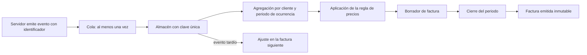
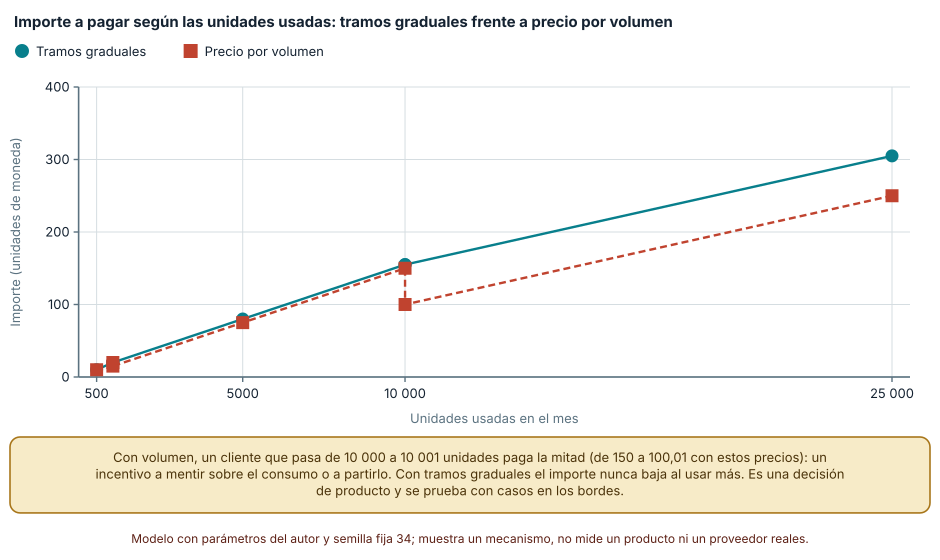

# SE-413 — Medición de uso y facturación por consumo

[← SE-412 — Suscripciones, ciclos de facturación y dunning](https://github.com/vladimiracunadev-create/modern-software-engineering-program/blob/main/classes/part-34-saas-y-plataformas-de-producto/se-412-suscripciones-ciclos-de-facturacion-y-dunning/README.md) · [↑ Parte 34](https://github.com/vladimiracunadev-create/modern-software-engineering-program/blob/main/classes/part-34-saas-y-plataformas-de-producto/README.md) · [📚 Índice completo](https://github.com/vladimiracunadev-create/modern-software-engineering-program/blob/main/classes/README.md) · [🌐 Portal](https://vladimiracunadev-create.github.io/modern-software-engineering-program/classes/SE-413.html) · [SE-414 — Planes, derechos de uso y banderas de funcionalidad →](https://github.com/vladimiracunadev-create/modern-software-engineering-program/blob/main/classes/part-34-saas-y-plataformas-de-producto/se-414-planes-derechos-de-uso-y-banderas-de-funcionalidad/README.md)

## Punto profesional y fundamento pedagógico

**Punto profesional.** La clase existe para que conviertas «lo que el cliente usó» en un importe que el cliente pueda verificar, que contabilidad pueda conciliar y que sobreviva a que los mensajes se repitan, lleguen tarde o se pierdan. El cobro por consumo parece una multiplicación (unidades por precio) y es en realidad una tubería de datos con garantías: cada evento debe contarse una sola vez, asignarse al periodo en que ocurrió, agregarse por cliente y convertirse en importe con una regla de precios que no sorprenda. Un error aquí no se ve en una prueba funcional y se paga en facturas incorrectas, es decir, en confianza.

**Por qué aparece aquí.** Sigue a `SE-412`, donde la factura de la suscripción era un importe fijo. Aquí una parte de la factura depende del uso y el cálculo debe ser exacto y explicable. Se apoya en la entrega «al menos una vez» y sus duplicados de `SE-376`, en la idempotencia de `SE-246` y `SE-392`, en la calidad de datos y en el modelo de eventos de `SE-374`. Prepara `SE-414` (los límites que se hacen cumplir necesitan este consumo), `SE-415` (el precio por tramos es una decisión de producto) y `SE-417` (la factura se concilia con lo cobrado).

**Error conceptual que debe corregir.** Creer que sumar los eventos que llegan es medir el uso. Con entrega «al menos una vez» (lo normal en colas, reintentos y webhooks), una parte de los eventos llega dos veces. En el experimento de la clase, con 30 000 eventos de los que el 6 % se entregó dos veces (31 744 entregas), la suma directa dio **95 394 unidades frente a 90 157 reales: 5 237 de más (5,8 %)** y 63 de las 80 combinaciones de cliente y periodo quedaron mal facturadas; con un identificador único por evento y una inserción que ignora los repetidos, la suma coincidió exactamente con la verdad. La corrección no es un algoritmo sofisticado sino una propiedad del evento: tiene identidad.

**Secuencia de aprendizaje.** Antes de ejecutar, predices cuántas unidades de más aparecerán al sumar sin identificador y cuánto se factura de más a un cliente de 5 000 unidades con tramos graduales y con precio por volumen. Después ejecutas el medidor con y sin identificador, aplicas dos reglas de precios a los mismos consumos y observas qué ocurre con los eventos tardíos que pertenecen al periodo anterior. Terminas escribiendo el contrato de un evento de uso y la política de cierre del periodo.

**Evidencia de aprendizaje.** `medicion.md` con la métrica facturable definida (qué cuenta, en qué unidad, con qué precisión), el esquema del evento, la clave de deduplicación, la política de eventos tardíos con su plazo de cierre, la regla de precios con casos en los bordes y la prueba que muestra la suma correcta con duplicados.

**Límite de la conclusión.** Se ejecutaron un medidor sobre sqlite3 con 30 000 eventos sintéticos (semilla 34, 6 % de duplicados, 3 % de eventos del periodo anterior) y un cálculo de precios con tramos de ejemplo; no se midió una cola real, un reloj distribuido ni un procesador de pagos, y los precios son del autor. No se afirma revisión humana externa del contenido.

### Trazabilidad fuente → afirmación

| Fuente primaria u oficial | Afirmación que respalda | Lo que no prueba |
|---|---|---|
| [Stripe: facturación por uso](https://docs.stripe.com/billing/subscriptions/usage-based) y [registro del uso](https://docs.stripe.com/billing/subscriptions/usage-based/recording-usage) | Describe un medidor al que se envían eventos de uso y la agregación de ese uso para facturar. | No fija tu definición de unidad facturable. |
| [Stripe: solicitudes idempotentes](https://docs.stripe.com/api/idempotent_requests) | Explica que una clave de idempotencia permite repetir una solicitud sin ejecutar la operación dos veces. | No resuelve duplicados entre tu cola y tu almacén. |
| [AWS SaaS Lens](https://docs.aws.amazon.com/wellarchitected/latest/saas-lens/saas-lens.html) | Trata la medición de uso por inquilino como una capacidad del plano de control y la relaciona con costo y facturación. | No indica la granularidad adecuada para tu producto. |
| [Microsoft Learn: modelos de precios](https://learn.microsoft.com/en-us/azure/architecture/guide/multitenant/considerations/pricing-models) | Compara precios por uso, por puesto y fijos y su relación con el costo de servir a cada inquilino. | No elige el modelo ni el precio. |
| [SQLite: `UPSERT`](https://www.sqlite.org/lang_upsert.html) | Define `ON CONFLICT` y la inserción que ignora un conflicto de clave única. | Es un motor concreto; otros usan `ON CONFLICT DO NOTHING` o equivalentes. |

## Antes de empezar

Recupera lo aprendido en `SE-376` sobre semánticas de entrega: «al menos una vez» garantiza que el mensaje llega, no que llega una sola vez. La pregunta activa es: **si cada evento de uso pudiera llegar dos veces o llegar un día tarde, ¿qué propiedad del evento necesitarías para que la factura fuera correcta de todos modos?**

## Prerrequisitos

- Haber completado `SE-409` a `SE-412` y `SE-376` (entrega, orden y duplicación) y `SE-246` (idempotencia).
- Conocer el modelo de eventos de `SE-374` y la diferencia entre tiempo del evento y tiempo de procesamiento.
- Saber escribir consultas SQL con `GROUP BY` y claves únicas.
- Python 3.11 o posterior; solo la biblioteca estándar.

## Problema auténtico

*Tablero* añade un plan «Equipo+» con 100 000 llamadas de API incluidas y un cargo por cada millar adicional. Para medirlas, cada servidor de API emite un evento por llamada a una cola; un trabajador los suma por cliente y mes, y a fin de mes el sistema de facturación multiplica. El primer ciclo parece correcto hasta que un cliente envía el desglose a su equipo financiero y descubre que sus propios registros muestran 41 200 llamadas y la factura dice 43 700. Otro cliente recibe una factura menor de la esperada: un servidor estuvo caído seis horas el último día del mes y sus eventos se emitieron después del cierre. Un tercero ve que su factura cambió entre el borrador y la emisión sin que haya hecho nada, porque el trabajador reprocesó un lote. Cada caso tiene una causa distinta y el equipo no puede explicar ninguno con certeza porque no guardó los eventos originales, solo el total.

Las tres causas son el conjunto clásico: duplicados (el cliente de la cola reintentó), eventos tardíos (el servidor emitió con retraso) y un cálculo no reproducible (el agregado dependía del orden y del momento de ejecución). La solución no es un algoritmo, sino una disciplina de datos: eventos con identidad, tiempo de ocurrencia explícito, almacén que ignora los repetidos, agregación determinista a partir de los eventos crudos y un cierre del periodo con política para los tardíos.

El problema de la clase es construir esa tubería a escala pequeña, comprobar con duplicados y tardíos que el resultado es exacto y definir las reglas de precios (tramos, volumen) con casos en los bordes para que el cliente pueda reproducir su factura con una calculadora.

## Objetivos observables

Al terminar podrás:

1. definir una métrica facturable (qué cuenta, unidad, precisión) y escribir el esquema de un evento de uso con identidad, inquilino, cantidad y tiempo de ocurrencia;
2. demostrar con un experimento que sumar eventos sin identificador factura de más con entrega «al menos una vez» y que una clave única con inserción que ignora repetidos lo corrige;
3. asignar cada evento al periodo en que ocurrió, no en el que llegó, y explicar qué hacer cuando llega después del cierre;
4. aplicar y comparar precios por tramos graduales y por volumen sobre los mismos consumos, y encontrar el caso en el borde donde el precio por volumen baja al consumir más;
5. explicar por qué se conservan los eventos crudos y cómo se reproduce una factura a partir de ellos.

## Mapa conceptual



Cada evento atraviesa la cola, que puede duplicarlo; el almacén lo deduplica por su identificador, la agregación lo asigna al periodo en que ocurrió y la regla de precios lo convierte en importe. Los tardíos, una vez emitida la factura, no la editan: generan un ajuste en la siguiente.

## Temas y por qué importan

| Tema | Por qué cambia una decisión profesional | Evidencia mínima |
|---|---|---|
| Métrica facturable | Define qué se cobra y debe poder explicarse al cliente. | Definición con unidad y precisión |
| Identidad del evento | Convierte un sistema «al menos una vez» en un conteo exacto. | Suma con y sin clave única |
| Tiempo de ocurrencia | Asigna cada evento a su periodo aunque llegue tarde. | Unidades tardías asignadas al periodo anterior |
| Eventos crudos | Permiten reproducir y auditar cualquier factura. | Consulta que recalcula el total desde los eventos |
| Reglas de precios | Tramos graduales y volumen se comportan distinto en los bordes. | Importe en 1 000, 1 001, 10 000 y 10 001 unidades |
| Cierre del periodo | Fija cuándo un número deja de cambiar. | Plazo de cierre y política de ajustes |
| Límites y alertas | El cliente debe saber su consumo antes de la factura. | Alerta al 80 % del consumo incluido |

## Conceptos y decisiones

### 1. Una métrica facturable se define antes de medirla

Qué se cobra (llamadas de API, mensajes enviados, minutos de cómputo, gigabytes almacenados al mes, puestos activos) es una decisión de producto con consecuencias técnicas. Debe ser algo que el cliente entienda y pueda verificar, que el producto pueda medir con exactitud y que se correlacione con el valor que obtiene o con el costo que causa. Cada métrica necesita una definición escrita: qué evento la genera, en qué unidad (llamadas, no «peticiones», si una llamada puede abarcar varias), con qué precisión (enteros), si se cuentan los errores del propio servicio (normalmente no) y cómo se trata el uso en periodo de prueba. La ambigüedad aquí produce disputas, porque el cliente y el proveedor contarán distinto.

### 2. Un evento de uso tiene identidad, dueño, cantidad y tiempo propio

El esquema mínimo es: `event_id` único y estable (generado por quien produce el evento, no por la cola), `tenant_id`, `metric`, `quantity` (entero), `occurred_at` (cuándo ocurrió, en UTC) y, útil para auditoría, `source` y `received_at`. El identificador debe ser determinista respecto del hecho: si el servicio emite el mismo evento dos veces (un reintento tras un tiempo de espera), debe emitirlo con el mismo identificador; un UUID generado en cada intento no deduplica nada. Para un hecho que no tiene identificador natural, se construye uno estable a partir de sus componentes (cliente, métrica, instante y secuencia local).

### 3. Con «al menos una vez», la deduplicación es obligatoria

Casi todos los intermediarios de mensajes ofrecen entrega al menos una vez como equilibrio entre no perder y no bloquear; garantizar «exactamente una vez» de extremo a extremo exige que el consumidor sea idempotente. En el experimento, de 30 000 eventos, 1 744 (5,8 %) se entregaron dos veces y las entregas fueron 31 744. La suma directa dio **95 394 unidades frente a 90 157 reales**: 5 237 de más, un 5,8 % que se traduce en facturas más altas en 63 de las 80 combinaciones de cliente y periodo. Con una tabla con clave primaria en `event_id` y una inserción que ignora conflictos (`INSERT OR IGNORE`), la suma fue **90 157, idéntica a la verdad**. Es la misma técnica del alta (`SE-411`): la protección es una restricción del almacén, no una comprobación en el código que el consumidor debe recordar.

### 4. El periodo se decide por el tiempo de ocurrencia

Si un evento se asigna al periodo en que se *recibe*, un corte de seis horas el último día del mes mueve el uso al mes siguiente y el cliente paga un mes de menos y otro de más. El criterio correcto es el tiempo de ocurrencia: el evento pertenece al periodo en que el hecho ocurrió. En el experimento, el 3 % de los eventos (2 762 unidades) correspondía al periodo anterior y llegó cuando el periodo nuevo ya estaba abierto: asignados por ocurrencia, el agregado de septiembre incluye esas unidades. Esto exige una definición cuidadosa del límite (en UTC, o en la zona del cliente si el contrato lo dice) y es una fuente clásica de diferencias entre «lo que el cliente cuenta» y «lo que el sistema cuenta».

### 5. El cierre del periodo fija cuándo un número deja de cambiar

Un evento tardío puede llegar en cualquier momento, pero la factura debe emitirse en una fecha. La práctica es una *ventana de gracia*: el periodo se cierra N horas después de su fin (por ejemplo 24 horas) y la factura se emite desde ahí. Los eventos que llegan después del cierre no cambian la factura emitida (es inmutable): se registran como ajuste en la factura siguiente, con su concepto. El borrador previo al cierre se puede recalcular las veces que haga falta porque es una consulta determinista sobre los eventos crudos; la factura emitida no.

### 6. Los eventos crudos son la fuente de verdad; el agregado es una vista

Guardar solo el total mensual por cliente impide explicar ni reproducir una factura. Los eventos crudos (o, a gran volumen, agregados por hora con su historial de correcciones) permiten recalcular, auditar y resolver disputas. Se retienen el tiempo que exija la política contractual y regulatoria (`SE-358`), con costo de almacenamiento conocido. Un agregado debe poder recalcularse desde los crudos y producir el mismo número: esa prueba (recalcular y comparar) se ejecuta en cada cierre y es el control más barato de la tubería.

### 7. Los precios por tramos tienen dos formas y se comportan distinto

En el precio *gradual*, cada tramo se cobra a su precio: las primeras 1 000 unidades a 0,020, las siguientes hasta 10 000 a 0,015 y el resto a 0,010. En el precio *por volumen*, toda la cantidad se cobra al precio del tramo en el que cae. Con los mismos tramos, 500 unidades cuestan 10 en ambos; 5 000 cuestan 80 gradual y 75 por volumen; 25 000 cuestan 305 gradual y 250 por volumen. El precio por volumen tiene un borde peligroso: a 10 000 unidades paga 150 y a 10 001 paga 100,01, es decir, **consumir una unidad más cuesta casi 50 menos**. Eso incentiva a repartir el consumo o a ocultarlo y obliga a probar la regla en cada borde. El gradual es monótono (nunca baja al usar más) y por eso suele ser la elección segura; el volumen solo se justifica con una razón comercial clara y con topes que eviten la inversión.

### 8. La precisión y el redondeo se definen una vez

Los importes se calculan con enteros en la unidad mínima de la moneda (o con decimales exactos), nunca con coma flotante binaria; las cantidades son enteras. Cuando un precio unitario tiene fracciones de centavo (0,015 por llamada), la regla debe decir cuándo se redondea (al total del tramo, no por evento) y cómo (hacia el centavo más cercano). La factura muestra las líneas que el cliente necesita para reproducir el total: cantidad por tramo, precio, subtotal y redondeo. Si el cliente no puede reproducir el importe con una calculadora, abrirá un caso de soporte.

### 9. Medir para facturar y medir para limitar son dos problemas distintos

Para facturar se necesita exactitud al cierre, con tolerancia a minutos de retraso. Para hacer cumplir un límite (cortar al llegar al tope del plan) se necesita una respuesta inmediata, aunque aproximada. Un contador en memoria o en una caché, actualizado en cada llamada, sirve para lo segundo y se reconcilia después con lo primero. Mezclar ambos (esperar a la tubería de facturación para decidir si una llamada se permite) hace lento el producto; usar el contador aproximado para facturar produce discrepancias. `SE-414` desarrolla el cumplimiento de límites con derechos.

### 10. El cliente debe ver el consumo antes de la factura

Las facturas por consumo que sorprenden generan disputas y bajas. La contramedida es visibilidad: un panel con el consumo del periodo actual, alertas a umbrales (por ejemplo al 80 % y al 100 % del consumo incluido), proyección a fin de mes y, si el cliente lo pide, un tope de gasto que corta o limita en vez de seguir cobrando. El tope de gasto es una decisión de producto con consecuencias: cortar el servicio al llegar al tope protege al cliente y puede interrumpir su operación. La política se escribe y se ofrece como opción.

## Unidades medidas con y sin identificador


**Cómo leer la figura.** Tres barras: la verdad, lo que suma una tubería sin identidad de evento y lo que suma una con clave única. La línea punteada marca la verdad. Mira que la segunda barra la supera por 5,8 % y que la tercera la iguala exactamente: no hay aproximación, hay una restricción. **Dónde deja de valer:** los duplicados provienen de reintentos simulados al 6 %; con otra tasa o con duplicados de eventos *distintos* con el mismo identificador (un error del emisor), el resultado cambia. El experimento no prueba que el identificador sea estable en tu emisor.

## Tramos graduales y precio por volumen



**Cómo leer la figura.** El eje horizontal son las unidades usadas y el vertical el importe. La línea teal nunca baja; la coral cae en cada cambio de tramo y por eso un cliente que consume 10 000 paga más que uno que consume 10 001. Observa que tras la caída la línea coral vuelve a subir y que a 25 000 queda por debajo de la teal. **Dónde deja de valer:** los tramos y precios son de ejemplo; los puntos del dibujo son los bordes que interesan y se unen con rectas, de modo que entre ellos la curva real tiene la misma forma pero no pasa por puntos que no se calcularon.

## La tubería de un evento hasta la factura


**Cómo leer la figura.** El camino va de izquierda a derecha y de arriba abajo; cada caja es un punto donde se garantiza algo distinto: identidad (evento), duplicados admitidos (cola), deduplicación (almacén), asignación de periodo (agregación), recálculo posible (borrador) e inmutabilidad (factura). La nota explica cuántas unidades eran tardías en el experimento. **Dónde deja de valer:** la figura es una tubería de un solo flujo; con varias regiones, varios emisores o agregados intermedios por hora, hay más etapas y más puntos de corrección.

## Definiciones de trabajo

- **Métrica facturable:** magnitud medida que se convierte en importe, con unidad y precisión definidas.
- **Evento de uso:** registro inmutable de un hecho medible, con identidad, inquilino, cantidad y tiempo de ocurrencia.
- **Deduplicación:** descartar eventos repetidos mediante su identificador.
- **Tiempo de ocurrencia / de procesamiento:** cuándo ocurrió el hecho frente a cuándo lo recibió el sistema.
- **Ventana de gracia (cierre):** plazo tras el fin del periodo durante el cual aún se aceptan eventos antes de emitir la factura.
- **Ajuste:** línea en una factura posterior que corrige lo que llegó tras el cierre.
- **Tramos graduales / por volumen:** cada tramo a su precio frente a toda la cantidad al precio de su tramo.

## Ejemplo mínimo

Un medidor que ignora repetidos y aplica un precio gradual:

```python
import sqlite3

db = sqlite3.connect(":memory:")
db.execute("CREATE TABLE uso (evento_id TEXT PRIMARY KEY, cliente TEXT, periodo TEXT, unidades INTEGER)")
entregas = [("e1", "a", "2026-10", 10), ("e1", "a", "2026-10", 10), ("e2", "a", "2026-10", 5), ("e3", "a", "2026-09", 7)]
for e in entregas:
    db.execute("INSERT OR IGNORE INTO uso VALUES (?,?,?,?)", e)       # e1 llega dos veces: cuenta una
total_oct = db.execute("SELECT SUM(unidades) FROM uso WHERE cliente='a' AND periodo='2026-10'").fetchone()[0]
print(total_oct)                                                       # 15, no 25


def gradual(unidades: int, tramos=((1000, 0.020), (10000, 0.015), (None, 0.010))) -> float:
    total, previo = 0.0, 0
    for tope, precio in tramos:
        limite = unidades if tope is None else min(unidades, tope)
        if limite > previo:
            total += (limite - previo) * precio
            previo = limite
    return total


print(round(gradual(500), 2), round(gradual(5000), 2), round(gradual(25000), 2))   # 10.0 80.0 305.0
```

El identificador `e1` repetido no suma dos veces, y el evento `e3` del periodo anterior no entra en octubre aunque llegue después. La función `gradual` es monótona: añadir una unidad nunca reduce el importe.

## Ejemplo profesional

*Escenario ilustrativo: las cifras y los resultados de este ejemplo son supuestos de la narración, no mediciones.*

El equipo de *Tablero* rehace su medición de llamadas de API. Define la métrica («llamada autenticada que devolvió una respuesta distinta de 5xx, contada en el servidor»), el evento con su identificador estable (el identificador de petición asignado por el balanceador) y un almacén con clave única. Los agregados por cliente y hora se recalculan desde los eventos crudos cada noche y se comparan con los de la tubería en línea: la diferencia debe ser cero y si no, alerta. El periodo se cierra 24 horas después de su fin, y los eventos posteriores generan un ajuste.

Pruebas: duplicar cada evento de un día de prueba y comprobar que los totales no cambian; retrasar un lote de eventos del último día y comprobar que cae en el periodo de ocurrencia; ejecutar la regla de precios en 1, 1 000, 1 001, 10 000, 10 001 y 100 000 unidades y comparar con una tabla calculada a mano. El panel de consumo muestra el uso del cliente con el mismo cálculo que la factura, de modo que el cliente puede anticipar su importe. Después de un trimestre, las disputas por desglose bajan de once a dos por mes, y las que quedan se resuelven enviando al cliente la consulta de eventos de su periodo.

## Práctica guiada

1. Ejecuta `python scripts/experiments_part34_metering.py` y compara las líneas `sin id` y `con id`. Predice antes el exceso y compáralo.
2. Cambia en el script la tasa de duplicados de 6 % a 1 % y a 20 %: anota cómo cambia el número de pares de cliente y periodo con error.
3. Elimina la clave primaria de la tabla con identificador y observa cuántas unidades de más aparecen: es el efecto de confiar en la lógica y no en la restricción.
4. Implementa el precio por volumen y encuentra, con un barrido de 9 990 a 10 010 unidades, el punto exacto donde el importe baja.
5. Redacta para tu producto la definición de una métrica facturable en cinco líneas: evento, unidad, qué se excluye, precisión y periodo.

## Ejercicios

1. **Básico.** Explica por qué 31 744 entregas de 30 000 eventos producen 95 394 unidades en lugar de 90 157 y qué propiedad del almacén lo evita.
2. **Intermedio.** Diseña el cierre del periodo de *Tablero*: ventana de gracia, qué ocurre con un evento que llega 30 horas tarde, cómo aparece en la factura siguiente y qué información ve el cliente.
3. **Avanzado.** Un cliente discute que la factura dice 43 700 llamadas y sus registros 41 200. Describe qué datos pedirías, qué consulta ejecutarías sobre los eventos crudos, qué causas distinguirías (duplicados, definición de la métrica, zona horaria, errores 5xx) y qué respuesta ofrecerías si la diferencia es legítima.

## Reto verificable

Entrega `medicion.md` y un medidor con identidad, periodo de ocurrencia y cierre, con pruebas de duplicados, tardíos y bordes de precios. Es válido si otra persona reproduce con la misma semilla las cifras del experimento, ejecuta tus pruebas y comprueba que ninguna combinación de duplicados y tardíos cambia el total de un periodo ya cerrado.

## Caso conductor

*Tablero* factura llamadas de API por encima del plan y necesita que cada cliente pueda reproducir su factura. Esta clase da la tubería de medición y las reglas de precio que lo permiten. `SE-414` hará cumplir los límites del plan con los contadores aproximados y `SE-417` conciliará lo facturado con lo cobrado.

## Preguntas frecuentes

### ¿Basta con un contador en la base de datos que se incrementa en cada llamada?

Para un límite aproximado, sí. Para facturar, no: el contador no distingue duplicados ni permite recalcular o auditar. Se usa para limitar y se concilia con los eventos para facturar.

### ¿Cuánto tiempo se guardan los eventos crudos?

Mientras sirvan para explicar facturas y disputas (normalmente varios meses) y lo permitan la política de privacidad y la regulación. Después se conservan agregados con su historial de correcciones. El costo de almacenamiento se calcula y se considera parte del costo de ofrecer cobro por consumo.

### ¿Qué zona horaria define el periodo?

La que dice el contrato; la más frecuente es UTC por claridad. Si la factura se emite en la zona del cliente, el límite del mes cambia y los informes deben usar la misma regla. Lo importante es una sola regla escrita y probada.

### ¿Qué pasa si el emisor genera identificadores distintos para el mismo hecho?

La deduplicación falla en silencio. Por eso el identificador debe derivarse del hecho (por ejemplo, el identificador de la petición) y no de la entrega, y se prueba reemitiendo un lote y comprobando que los totales no cambian.

## Fallo controlado y diagnóstico

**Fallo.** Al cerrar octubre, el total facturado de un cliente es 1 920 unidades más que el del panel de consumo que el cliente consultó durante el mes.

**Diagnóstico paso a paso.** (1) Se compara el agregado de la tubería con el recálculo nocturno desde los eventos crudos: coinciden con el panel, no con la factura. (2) La factura se calculó con un agregado por hora que el trabajador regeneró durante una migración y que sumó dos veces un lote de la hora 14 del día 17. (3) La tabla de agregados no tenía restricción de unicidad por (cliente, hora, lote), solo una por (cliente, hora) que el trabajador omitió con una opción de «reemplazar» mal configurada. (4) Se detecta con la comparación de cierre: la diferencia es cero salvo en esa hora. (5) Se corrige el agregado, se vuelve a emitir un borrador y, como la factura estaba emitida, se genera una nota de crédito por 1 920 unidades y una factura nueva, con el motivo. (6) Se añade la comparación de cierre como paso obligatorio antes de emitir: una diferencia distinta de cero bloquea la emisión.

**Lección.** Los agregados son vistas derivadas y se pueden corromper sin que los eventos crudos cambien. La comparación entre la vista y el recálculo desde la fuente es el control que atrapa el error antes de que llegue al cliente.

## Errores comunes y cómo corregirlos

- **Sumar eventos sin identificador.** La entrega repetida factura de más. Corrige con clave única y almacén que ignora repetidos.
- **Generar un identificador nuevo en cada reintento.** No deduplica. Corrige derivándolo del hecho.
- **Asignar el periodo por la fecha de recepción.** Un corte mueve el uso de un mes a otro. Corrige con el tiempo de ocurrencia.
- **Guardar solo el total.** No se puede auditar. Corrige conservando los crudos y recalculando en cada cierre.
- **Usar precio por volumen sin probar los bordes.** Aparecen importes que bajan al usar más. Corrige con pruebas en cada borde o con tramos graduales.
- **Calcular con coma flotante.** Los céntimos no cuadran. Corrige con enteros o decimales exactos y una regla de redondeo declarada.

## Entorno y archivos clave

- `scripts/experiments_part34_metering.py`: funciones `medidor` (con y sin identificador), `precio_tramos`, `precio_volumen` y `metricas_saas`.
- `scripts/figures_part34_a.py`: las tres figuras de la clase.
- Requiere Python 3.11 o posterior y solo la biblioteca estándar; la semilla es 34.

## Seguridad, ética y accesibilidad

Los eventos de uso describen el comportamiento de un cliente y, a veces, de sus usuarios: guarda lo mínimo necesario para facturar y no incluyas contenido (el cuerpo de las peticiones) ni datos personales que no sean imprescindibles (`SE-463`, `SE-137`). Protege el emisor de eventos con autenticación: un tercero que pueda inyectar eventos puede inflar la factura de otro cliente o esconder su consumo. Las facturas por consumo deben ser transparentes: el cliente tiene derecho a ver cómo se calculó cada línea y a disputarla por un canal claro. Los paneles de consumo y las alertas deben ser accesibles (alternativas textuales a los gráficos, avisos por correo y no solo por pantalla) y los umbrales, configurables por el cliente.

## Puente hacia el trabajo con agentes

Un agente que consume una API de pago por uso puede generar mucho tráfico sin que nadie lo vea: un bucle, una herramienta que reintenta o un plan que paraleliza. Haz que cada agente tenga un presupuesto de llamadas, que consulte su consumo antes de empezar tareas largas y que se detenga al llegar al límite pactado. Si tu producto cobra por consumo a clientes que usan agentes, ofrece topes de gasto y alertas desde el primer día: un consumo anómalo causado por un agente defectuoso es una de las fuentes más rápidas de facturas inesperadas.

## Transferencia

Escoge un recurso que alguien te cobre por uso (almacenamiento, mensajes, cómputo) y escribe cómo lo mediría quien lo vende: qué evento, qué identidad, qué periodo y qué haría con un evento tardío. Compara con la factura que recibes: ¿puedes reproducir la cifra? Si no, lo que te falta son las definiciones que esta clase pide escribir.

## Evaluación y evidencia

| Criterio | Evidencia aceptable | Rechazo |
|---|---|---|
| Definición de métrica | Evento, unidad, exclusiones y precisión | «Se cuentan las llamadas» |
| Deduplicación | Suma exacta con duplicados y clave única | Una suma sin identidad |
| Periodo | Eventos tardíos asignados por ocurrencia y política de cierre | Asignación por recepción |
| Precios | Casos en los bordes y comparación gradual y por volumen | Una regla sin pruebas |
| Auditoría | Recálculo desde eventos crudos con diferencia cero | Solo totales guardados |

## Fuentes

- Stripe. [Facturación por uso](https://docs.stripe.com/billing/subscriptions/usage-based), [registro del uso](https://docs.stripe.com/billing/subscriptions/usage-based/recording-usage) y [solicitudes idempotentes](https://docs.stripe.com/api/idempotent_requests).
- AWS. [Well-Architected: SaaS Lens](https://docs.aws.amazon.com/wellarchitected/latest/saas-lens/saas-lens.html).
- Microsoft Learn. [Modelos de precios en aplicaciones multi-inquilino](https://learn.microsoft.com/en-us/azure/architecture/guide/multitenant/considerations/pricing-models).
- SQLite. [`UPSERT` y `ON CONFLICT`](https://www.sqlite.org/lang_upsert.html).

## Límites y siguiente paso

Se midieron 30 000 eventos sintéticos con duplicados y tardíos simulados con semilla 34 y se compararon dos reglas de precios con tramos de ejemplo; no se usó una cola real, ni un reloj distribuido, ni un procesador de pagos. Los precios y las tasas de duplicados y de tardíos son del autor. El siguiente paso, `SE-414`, hace cumplir lo que el cliente contrató: planes, derechos de uso, límites y banderas de funcionalidad con un motor de derechos.

## Glosario

| Término | Definición breve |
|---|---|
| Métrica facturable | Magnitud medida que se convierte en importe |
| Evento de uso | Registro inmutable de un hecho medible |
| Deduplicación | Descartar repetidos por identificador |
| Tiempo de ocurrencia | Cuándo ocurrió el hecho |
| Ventana de gracia | Plazo de aceptación tras el fin del periodo |
| Ajuste | Corrección de lo tardío en una factura posterior |
| Tramos graduales | Cada tramo a su precio |
| Precio por volumen | Toda la cantidad al precio de su tramo |

---

[← SE-412 — Suscripciones, ciclos de facturación y dunning](https://github.com/vladimiracunadev-create/modern-software-engineering-program/blob/main/classes/part-34-saas-y-plataformas-de-producto/se-412-suscripciones-ciclos-de-facturacion-y-dunning/README.md) · [↑ Parte 34](https://github.com/vladimiracunadev-create/modern-software-engineering-program/blob/main/classes/part-34-saas-y-plataformas-de-producto/README.md) · [📚 Índice completo](https://github.com/vladimiracunadev-create/modern-software-engineering-program/blob/main/classes/README.md) · [🌐 Portal](https://vladimiracunadev-create.github.io/modern-software-engineering-program/classes/SE-413.html) · [SE-414 — Planes, derechos de uso y banderas de funcionalidad →](https://github.com/vladimiracunadev-create/modern-software-engineering-program/blob/main/classes/part-34-saas-y-plataformas-de-producto/se-414-planes-derechos-de-uso-y-banderas-de-funcionalidad/README.md)
