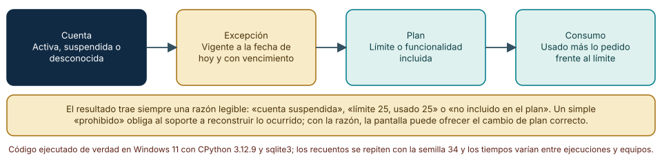
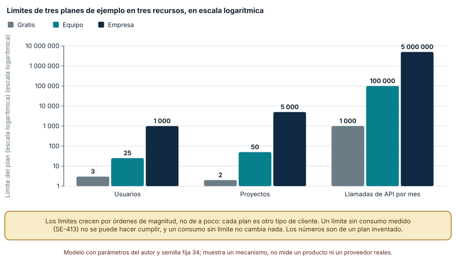
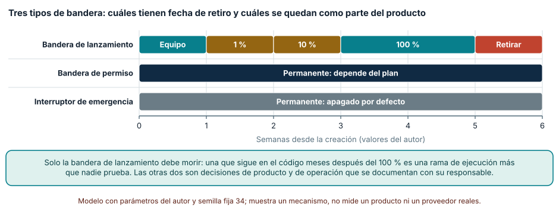

# SE-414 — Planes, derechos de uso y banderas de funcionalidad

[← SE-413 — Medición de uso y facturación por consumo](https://github.com/vladimiracunadev-create/modern-software-engineering-program/blob/main/classes/part-34-saas-y-plataformas-de-producto/se-413-medicion-de-uso-y-facturacion-por-consumo/README.md) · [↑ Parte 34](https://github.com/vladimiracunadev-create/modern-software-engineering-program/blob/main/classes/part-34-saas-y-plataformas-de-producto/README.md) · [📚 Índice completo](https://github.com/vladimiracunadev-create/modern-software-engineering-program/blob/main/classes/README.md) · [🌐 Portal](https://vladimiracunadev-create.github.io/modern-software-engineering-program/classes/SE-414.html) · [SE-415 — Precios, empaquetado y límites por plan →](https://github.com/vladimiracunadev-create/modern-software-engineering-program/blob/main/classes/part-34-saas-y-plataformas-de-producto/se-415-precios-empaquetado-y-limites-por-plan/README.md)

## Punto profesional y fundamento pedagógico

**Punto profesional.** La clase existe para que separes tres cosas que casi todos los productos SaaS mezclan en la misma tabla o, peor, en el mismo `if`: el *plan* (un paquete comercial que se vende), el *derecho* (lo que una cuenta concreta puede hacer hoy, con límites y vencimientos) y la *bandera de funcionalidad* (un interruptor operativo que decide qué código se ejecuta). Cuando se mezclan, un cambio de precio exige un despliegue, una excepción para un cliente exige tocar el código, una bandera de lanzamiento se queda para siempre decidiendo quién paga qué, y nadie puede responder con seguridad «¿puede este cliente hacer esto, y por qué?». Un motor de derechos pequeño, con razones legibles, es una de las piezas con mejor relación entre costo y confianza de todo el producto.

**Por qué aparece aquí.** Sigue a `SE-413`, que mide el consumo, y a `SE-412`, cuyo estado de suscripción decide si la cuenta tiene o no acceso. Aquí se cierra el círculo: lo contratado, lo consumido y el estado de pago se combinan en una sola decisión. Se apoya en las banderas y la entrega progresiva de `SE-475` (aquí se trata la diferencia entre una bandera de lanzamiento y un derecho) y en la autorización de `SE-459` (el derecho dice *si el plan lo incluye*; la autorización dice *si esta persona puede*). Prepara `SE-415`, donde los límites por plan son una decisión de precio.

**Error conceptual que debe corregir.** Creer que una bandera de funcionalidad puede hacer de derecho porque «también enciende y apaga cosas». Una bandera responde a «¿esta versión del código debe ejecutarse?» y la maneja el equipo de ingeniería con un ciclo de vida (nace, se despliega gradualmente, se retira); un derecho responde a «¿esta cuenta puede usar esto según lo que contrató?» y lo gobierna el negocio, con vencimientos y excepciones. En el experimento, un motor de derechos con sqlite3 contesta siete consultas con razón legible («límite 25, usado 25», «cuenta suspendida», «no incluido en el plan») y distingue una excepción vigente de una vencida; una bandera no puede hacer eso sin convertirse en un motor de derechos mal construido.

**Secuencia de aprendizaje.** Antes de ejecutar, predices qué responde el motor ante siete consultas (un cliente con una excepción vigente, la misma ya vencida, un plan sin una función, una cuenta suspendida, un cliente desconocido). Después ejecutas el motor con sqlite3, lees las razones de cada rechazo, diseñas el cambio de plan con sus casos en los bordes (qué pasa con un cliente que excede el límite del plan al que baja) y clasificas cuatro tipos de bandera con su fecha de retiro. Terminas escribiendo la separación entre plan, derecho y bandera de tu producto.

**Evidencia de aprendizaje.** `derechos.md` con el catálogo de planes, el modelo de derechos (boolean, límite numérico, cuota por periodo), el orden de decisión del motor, la política ante un exceso tras bajar de plan, la lista de banderas con su tipo, propietario y fecha de retiro, y las pruebas que muestran que un derecho no depende de una bandera.

**Límite de la conclusión.** Se ejecutó un motor de derechos con sqlite3 en memoria con tres planes y tres cuentas de ejemplo y siete consultas; no se midió su rendimiento bajo carga, no se integró con un sistema de autorización real ni con un servicio comercial de banderas. Los planes y sus límites son del autor. No se afirma revisión humana externa del contenido.

### Trazabilidad fuente → afirmación

| Fuente primaria u oficial | Afirmación que respalda | Lo que no prueba |
|---|---|---|
| [Stripe: derechos (entitlements)](https://docs.stripe.com/billing/entitlements) | Describe las funcionalidades como un catálogo vinculado a productos y la consulta de las funcionalidades activas de un cliente a partir de su suscripción. | No fija el modelo de derechos de tu producto. |
| [Martin Fowler: Feature Toggles](https://martinfowler.com/articles/feature-toggles.html) | Distingue tipos de interruptores (de lanzamiento, de experimento, operativos, de permiso) por su longevidad y dinamismo, y advierte el costo de dejarlos activos. | No dicta cuántas banderas puede soportar un equipo. |
| [OpenFeature](https://openfeature.dev/) | Define una interfaz neutral para evaluar banderas con un contexto de evaluación, separando la API del proveedor. | No decide qué debe ser una bandera y qué un derecho. |
| [AWS SaaS Lens](https://docs.aws.amazon.com/wellarchitected/latest/saas-lens/saas-lens.html) | Trata los planes (tiers) y la medición como parte del diseño del producto y de su plano de control. | No incluye tus planes ni tus límites. |
| [Microsoft Learn: modelos de precios](https://learn.microsoft.com/en-us/azure/architecture/guide/multitenant/considerations/pricing-models) | Relaciona niveles de servicio, límites y precios con el costo de servir a cada inquilino. | No elige los niveles de tu producto. |

## Antes de empezar

Recupera lo aprendido en `SE-475` sobre banderas y entrega progresiva: una bandera de lanzamiento debe tener fecha de retiro. La pregunta activa es: **si mañana cambia el precio de un plan o hay que dar tres meses de una función a un cliente, ¿cuántos lugares del código y de la base de datos tocas, y cuántos de ellos requieren un despliegue?**

## Prerrequisitos

- Haber completado `SE-409` a `SE-413`, y `SE-475` (banderas) y `SE-459` (autorización).
- Saber escribir consultas SQL con `JOIN` y valores por defecto.
- Entender la diferencia entre autenticación, autorización y derecho (lo que el plan incluye).
- Python 3.11 o posterior; solo biblioteca estándar.

## Problema auténtico

*Tablero* tiene tres planes (gratis, equipo, empresa) y el código decide el acceso con comprobaciones dispersas: `if usuario.plan == "empresa"` en 63 lugares, tres constantes distintas para el límite de usuarios en el servidor, la interfaz y el informe de facturación, y una bandera `nueva_exportacion` que el equipo encendió «temporalmente» hace ocho meses y que hoy decide quién puede exportar a CSV (los de plan equipo y empresa). Las consecuencias son concretas. Comercial promete a un cliente grande 40 usuarios durante seis meses sin cambiar de plan y la única forma es editar el código. Un cliente baja de equipo a gratis y conserva 18 usuarios en una cuenta que permite 3, sin que ninguna pantalla lo diga. Un cliente suspendido por impago sigue usando la API porque la comprobación vive solo en la interfaz. Cuando soporte pregunta «¿por qué no puede exportar este cliente?», nadie sabe si es el plan, la bandera, el estado de la cuenta o un error.

El patrón común es la falta de un lugar único donde se decida «¿puede esta cuenta hacer esto?» y de una forma de explicar la respuesta. Hay un conocimiento de negocio (qué incluye cada plan, qué excepciones se pactaron) que vive disperso en el código, y un mecanismo de ingeniería (las banderas) que se ha usado para cubrir ese hueco.

El problema de la clase es diseñar el motor que centraliza esa decisión: un modelo de planes y derechos que se puede cambiar sin desplegar, excepciones con fecha de vencimiento, límites que se comparan con el consumo medido, un orden de decisión que incluye el estado de la cuenta y una respuesta que siempre trae su razón; y delimitar para qué sí sirven las banderas.

## Objetivos observables

Al terminar podrás:

1. distinguir plan, derecho y bandera con un ejemplo de cada uno y decir quién los cambia, con qué frecuencia y con qué ciclo de vida;
2. modelar derechos de tres formas (funcionalidad incluida o no, límite numérico, cuota por periodo) y combinar plan, excepción por cliente y estado de la cuenta con un orden de precedencia explícito;
3. implementar con sqlite3 un motor que responde sí o no con una razón legible y comprobar siete casos, incluida una excepción vencida;
4. diseñar qué ocurre al subir y al bajar de plan, incluido el caso de una cuenta que excede el límite del plan nuevo;
5. clasificar banderas por tipo (de lanzamiento, de experimento, operativa, de permiso), asignarles propietario y fecha de retiro, y decidir cuándo una bandera debería convertirse en derecho.

## Mapa conceptual


El motor de derechos recibe cuatro entradas (plan, excepciones, estado y consumo) y produce una decisión con razón. Las banderas están a un lado: no deciden quién paga qué sino qué versión del código corre. Ambas pueden coincidir en una misma operación (una función nueva que solo ve el plan empresa), pero son dos decisiones con dueños y vidas distintos.

## Temas y por qué importan

| Tema | Por qué cambia una decisión profesional | Evidencia mínima |
|---|---|---|
| Plan, derecho y bandera | Mezclarlos vuelve el precio un despliegue y la bandera un derecho. | Ejemplo y propietario de cada uno |
| Tipos de derecho | Un booleano, un límite y una cuota se verifican de forma distinta. | Un caso de cada tipo |
| Orden de decisión | Cuenta, excepción, plan y consumo deben evaluarse en un orden fijo. | Siete consultas con su razón |
| Excepciones con vencimiento | Los pactos comerciales caducan; el código no debe recordarlos. | Excepción vigente y vencida |
| Cambio de plan | Subir y bajar tienen casos distintos, sobre todo con exceso. | Política de downgrade |
| Puntos de cumplimiento | Un derecho verificado solo en la interfaz no se cumple. | Prueba de la API sin interfaz |
| Banderas | Controlan código, no contratos, y deben retirarse. | Fecha de retiro y propietario |

## Conceptos y decisiones

### 1. Tres cosas distintas con tres dueños distintos

El **plan** es un paquete comercial: un nombre, un precio, un ciclo y un conjunto de derechos. Lo define producto y negocio y cambia por decisión de precios. El **derecho** es lo que una cuenta puede hacer en un momento dado: resulta de combinar el plan, las excepciones pactadas y el estado de la cuenta. Lo gobierna el negocio y se evalúa en cada operación. La **bandera de funcionalidad** controla qué código se ejecuta y lo gobierna ingeniería con el objetivo de desplegar sin exponer y retirarse después. Una función puede estar tras una bandera de lanzamiento *y* restringida a un plan: son dos puertas distintas con dos llaves distintas, y quitar la primera no debe tocar la segunda.

### 2. Tres formas de derecho

Una **funcionalidad** (exportar, inicio de sesión único, auditoría) es un derecho booleano: está o no incluida. Un **límite** (usuarios, proyectos) es un número máximo de algo que existe a la vez; se compara con el estado actual. Una **cuota por periodo** (llamadas de API por mes, correos enviados) es un número máximo de algo que ocurre en un periodo; se compara con el consumo medido (`SE-413`) y se renueva al comenzar el periodo. Distinguirlas importa porque se verifican en momentos distintos (el booleano al entrar a la función, el límite al crear, la cuota en cada llamada) y porque se comportan distinto ante un exceso: un límite puede dejar de crear y conservar lo existente; una cuota puede cobrar el exceso o bloquear.

### 3. El orden de decisión es parte del contrato

El motor del experimento evalúa en este orden: (1) ¿existe la cuenta?, (2) ¿está activa?, (3) ¿hay una excepción vigente para esta clave?, (4) si no, ¿qué dice el plan?, (5) ¿el consumo más lo pedido cabe en el límite? Cada paso devuelve su razón. Con tres planes y siete consultas, el resultado fue: `sso` para *acme* con una excepción vigente al 31-12-2026 → permitido; `usuarios` de *acme* hoy, con 25 usados de un límite de 25 → «límite 25, usado 25»; la misma consulta con fecha 1-5-2026, cuando una excepción de 40 usuarios seguía vigente → permitido; `proyectos` de *beta*, con 2 de 2 → rechazado con razón; `exportar` de *beta* en plan gratis → «límite 0, usado 0» (no incluido); `sso` de *gama*, suspendida → «cuenta suspendido»; cliente desconocido → «cliente desconocido». Cambiar el orden cambia los resultados: una excepción no debe poder reactivar una cuenta suspendida, y la comprobación de cuenta va antes que cualquier derecho.

### 4. Las excepciones caducan por diseño

Un pacto comercial («40 usuarios durante seis meses») es una excepción con vencimiento, no un cambio de plan ni un cambio de código. Se guarda como dato: cliente, clave, valor, vence, quién la autorizó y por qué. Al vencer, el motor vuelve al plan sin intervención y un trabajo avisa a comercial con anticipación. Dejar una excepción sin vencimiento convierte al cliente en un plan propio que nadie recuerda; el inventario de excepciones activas debería caber en una pantalla y revisarse cada trimestre.

### 5. La razón de un rechazo es parte del producto

Un rechazo que dice «prohibido» obliga a soporte a reconstruir lo ocurrido. Un rechazo con razón estructurada (código, límite, usado, plan actual, siguiente plan que lo permite) sirve a tres lectores: el usuario (mensaje claro y oferta de cambio), el soporte (diagnóstico inmediato) y el producto (métricas de qué límites se alcanzan más y qué conversiones provocan). El código de razón es estable y el texto se compone aparte, para poder traducirlo y cambiarlo sin tocar la lógica.

### 6. El derecho se cumple donde se hace la operación

Un derecho que solo se verifica en la interfaz no existe: cualquier cliente con la API o con una herramienta de línea de comandos lo ignora. Los puntos de cumplimiento son el servidor, en cada operación sensible, con una función única que consulta el motor. La interfaz consulta el mismo motor para ocultar o desactivar controles y ofrecer el cambio de plan, pero es un adorno: la decisión es la del servidor. Una prueba del conjunto debe llamar a la API sin interfaz con una cuenta de plan gratis y comprobar que una función de empresa responde con rechazo y su razón.

### 7. Subir y bajar de plan son casos distintos

Subir es sencillo: los derechos se amplían en cuanto el pago se confirma (`SE-412`). Bajar es difícil porque la cuenta puede exceder los límites del plan nuevo (18 usuarios en un plan de 3). Las políticas posibles son: impedir la bajada hasta que la cuenta cumpla, aplicarla al fin del ciclo y avisar con tiempo, o aplicarla y conservar lo existente en modo solo lectura y sin permitir crear más (*grandfathering* parcial). Cualquiera es válida si está escrita, se muestra antes de confirmar y se prueba. Lo que no es válido es no decidir: sin política, la cuenta conserva derechos que no paga o pierde datos sin aviso.

### 8. Los planes antiguos no desaparecen

Cuando se cambia el catálogo (se sube el precio, se elimina un plan), los clientes existentes suelen conservar el plan que contrataron durante un plazo. El catálogo debe versionarse: un plan «equipo v1» con sus derechos y un «equipo v2» pueden convivir, y el cliente se mueve de uno a otro con una fecha. Sin versiones, cambiar un límite del plan afecta a todos los clientes a la vez, incluidos los que no aceptaron el cambio, lo que puede ser un incumplimiento de contrato.

### 9. Una bandera tiene un tipo y una fecha de retiro

Fowler distingue los interruptores por su duración y dinamismo. Las de **lanzamiento** (separar despliegue de exposición) viven días o semanas y se retiran al llegar al 100 %. Las de **experimento** reparten usuarios entre variantes mientras dura la prueba. Las **operativas** (apagado de emergencia de una dependencia) pueden vivir años y deben estar probadas. Las de **permiso** son, en el fondo, derechos y conviene modelarlas como tales. En el ciclo de la figura, una bandera de lanzamiento pasa del equipo al 1 %, al 10 % y al 100 % y se retira en la sexta semana; la de permiso y la de emergencia son permanentes y deben tener propietario. Una bandera sin fecha de retiro es deuda: cada una duplica una rama de ejecución que nadie prueba.

### 10. Qué no hace un motor de derechos

El motor decide si la *cuenta* puede; no decide si *esta persona* puede (eso lo hace la autorización por rol, `SE-459`), no mide el consumo (`SE-413`), no cambia el estado de la suscripción (`SE-412`) y no sustituye una evaluación de seguridad. Tampoco debe volverse un lenguaje de reglas genérico: cuanto más expresivo, más difícil de explicar y de probar. Un conjunto pequeño de tipos de derecho (booleano, límite, cuota) cubre la inmensa mayoría de los casos.

### 11. Los puntos de cumplimiento: interfaz, API pública y webhooks

Un derecho se hace cumplir en cada superficie por la que un cliente puede actuar, y las superficies programables son las más fáciles de olvidar. La **API pública** debe consultar el mismo motor que la interfaz y devolver, ante un rechazo, un código estable con la razón estructurada (por ejemplo 403 para una función no incluida y 429 con tiempo de reintento para una cuota agotada), de modo que un integrador pueda reaccionar sin leer texto libre. Los **webhooks** que el producto envía al cliente son una función con su propio derecho (cuántas suscripciones, qué eventos), deben firmarse y reintentarse con espera creciente y deben incluir un identificador de evento para que el receptor deduplique. Los que el producto recibe (del procesador de pagos) se verifican por firma y se procesan de forma idempotente (`SE-412`). Un ecosistema de integraciones añade claves de API con alcance por inquilino: cada clave se limita a una organización y a un conjunto de operaciones, se puede rotar y revocar, y su uso se mide por separado para cuotas y facturación (`SE-379`).

## La decisión de un derecho, en orden



**Cómo leer la figura.** Las cuatro cajas son las preguntas que el motor responde de izquierda a derecha y en ese orden. Mira que la cuenta es lo primero: ningún derecho se evalúa sobre una cuenta que no está activa. **Dónde deja de valer:** el orden es el del experimento; un producto con cuentas de prueba o con jerarquías de cuentas (una empresa con filiales) añade pasos, y el consumo medido puede llegar con retraso (`SE-413`), de modo que el límite se hace cumplir con un contador aproximado.

## Límites de tres planes



**Cómo leer la figura.** Cada grupo es un recurso y cada barra un plan, en escala logarítmica para que quepan órdenes de magnitud muy distintos. Mira que cada plan multiplica los límites del anterior por factores de 8 a 100: los planes son segmentos de cliente, no variaciones pequeñas. **Dónde deja de valer:** los números son de un catálogo inventado; en un producto real los límites se fijan con el consumo medido de cada segmento y con el costo de servirlos (`SE-415`).

## Tres tipos de bandera y su vida



**Cómo leer la figura.** Cada carril es una bandera y cada barra una etapa. La primera es una secuencia que termina; las otras dos son una sola barra que no termina. Mira cuál de las tres debería aparecer en un inventario de «banderas por retirar» y cuáles no. **Dónde deja de valer:** las duraciones son del autor; los porcentajes y la longitud de cada etapa dependen del riesgo, del tamaño de la base y de lo que se observe en cada paso.

## Definiciones de trabajo

- **Plan:** paquete comercial con precio, ciclo y derechos.
- **Derecho (entitlement):** lo que una cuenta puede hacer, resultado de plan, excepciones y estado.
- **Límite:** máximo de algo que existe a la vez (usuarios, proyectos).
- **Cuota:** máximo de algo que ocurre en un periodo (llamadas por mes).
- **Excepción:** cambio de un derecho para un cliente, con vencimiento y autorización.
- **Bandera de funcionalidad:** interruptor que decide qué código se ejecuta.
- **Grandfathering:** conservar para clientes existentes condiciones que ya no se ofrecen.

## Ejemplo mínimo

El motor reducido a una función y tres tablas en memoria:

```python
PLAN = {"gratis": {"usuarios": 3, "exportar": 0}, "equipo": {"usuarios": 25, "exportar": 1}}
EXCEPCION = {("acme", "usuarios"): (40, "2026-06-30")}          # valor y vencimiento
CUENTA = {"acme": ("equipo", "activo"), "beta": ("gratis", "activo"), "gama": ("equipo", "suspendido")}
USO = {("acme", "usuarios"): 25, ("beta", "usuarios"): 3}


def puede(cliente: str, clave: str, hoy: str, pedir: int = 1) -> tuple[bool, str]:
    if cliente not in CUENTA:
        return False, "cliente_desconocido"
    plan, estado = CUENTA[cliente]
    if estado != "activo":
        return False, f"cuenta_{estado}"
    limite, vence = EXCEPCION.get((cliente, clave), (None, "0000-00-00"))
    if limite is None or vence < hoy:
        limite = PLAN[plan][clave]
    usado = USO.get((cliente, clave), 0)
    if usado + pedir > limite:
        return False, f"limite_{limite}_usado_{usado}"
    return True, "ok"


print(puede("acme", "usuarios", "2026-05-01"))    # (True, 'ok'): la excepción de 40 sigue vigente
print(puede("acme", "usuarios", "2026-11-23"))    # (False, 'limite_25_usado_25'): venció
print(puede("beta", "exportar", "2026-11-23"))    # (False, 'limite_0_usado_0'): no incluida
print(puede("gama", "usuarios", "2026-11-23"))    # (False, 'cuenta_suspendido')
```

Con una sola función, el cambio del precio de un plan o una excepción comercial es una fila nueva, no un despliegue. Una funcionalidad no incluida se modela como límite 0, lo que simplifica el motor a costa de una razón menos amable que la interfaz traduce a «no incluido en tu plan».

## Ejemplo profesional

*Escenario ilustrativo: las cifras y los resultados de este ejemplo son supuestos de la narración, no mediciones.*

El equipo de *Tablero* sustituye sus 63 comprobaciones por una llamada al motor. Primero inventaría: cada `if plan ==` pasa a una clave de derecho con su tipo; cada constante de límite pasa a una fila del plan. Después separa las banderas: la `nueva_exportacion` se retira (la función está al 100 % hace ocho meses), y «exportar» pasa a ser un derecho del plan. Las excepciones se cargan como filas con vencimiento: nueve clientes tenían pactos escondidos en el código, tres ya habían vencido sin que nadie lo notara.

Para el cumplimiento, el servidor llama al motor en cada operación sensible y la interfaz consulta el mismo motor para pintar los controles. Las pruebas cubren: cada plan con cada derecho, el orden de decisión (una excepción no reactiva una cuenta suspendida), una excepción vencida, el exceso tras bajar de plan y una llamada a la API sin interfaz. La política de bajada se escribe: se aplica al fin del ciclo, con un aviso de 15 días y la cuenta conserva lo existente en solo lectura. Tras la migración, la pregunta de soporte «¿por qué no puede?» se responde con la razón del motor, y la primera revisión trimestral de excepciones elimina seis.

## Práctica guiada

1. Ejecuta `python scripts/experiments_part34_metering.py` y localiza las siete líneas del motor de derechos. Predice cada resultado antes de mirar.
2. Cambia el orden de decisión del ejemplo mínimo (evalúa la excepción antes que el estado de la cuenta) y encuentra la consulta cuyo resultado se vuelve incorrecto.
3. Añade una cuota por periodo (`api_por_mes`) y una función que registre el consumo; comprueba que el motor rechaza la llamada que excede la cuota.
4. Escribe una prueba que baje a *acme* de equipo a gratis con 25 usuarios y decide qué debe responder el motor para crear el usuario 26 y para ver los existentes.
5. Haz una tabla de tus banderas actuales con tipo, propietario, fecha de creación y fecha prevista de retiro; marca las que en realidad son derechos.

## Ejercicios

1. **Básico.** Explica por qué un límite de 0 modela «funcionalidad no incluida» y qué ventaja y qué desventaja tiene frente a un booleano separado.
2. **Intermedio.** Diseña la política de bajada de plan de *Tablero* para usuarios, proyectos y cuota de API: qué se aplica de inmediato, qué al fin del ciclo y qué se conserva solo en lectura. Define qué ve el cliente antes de confirmar.
3. **Avanzado.** Un cliente grande exige que su límite de 40 usuarios «nunca cambie, aunque cambie el plan». Propón cómo lo modelarías (excepción sin vencimiento, plan propio versionado, cláusula contractual), qué riesgos tiene cada opción y qué revisión periódica pondrías.

## Reto verificable

Entrega `derechos.md` y un motor con al menos tres planes, tres tipos de derecho, excepciones con vencimiento y cuenta suspendida, con diez pruebas que cubran el orden de decisión y el exceso tras bajar de plan. Es válido si otra persona ejecuta las pruebas, obtiene las mismas razones y comprueba que cambiar un límite de un plan no requiere tocar código.

## Caso conductor

*Tablero* decidía el acceso con 63 comprobaciones dispersas y una bandera que se quedó haciendo de derecho. Esta clase da el motor que centraliza la decisión y la frontera con las banderas. `SE-415` usa este motor para diseñar los planes mismos: qué límite poner en cada uno y qué consecuencias de precio tienen.

## Preguntas frecuentes

### ¿Un servicio comercial de banderas sirve como motor de derechos?

Puede servir para una versión sencilla (funcionalidades activas por plan), pero los derechos tienen estado que cambia con la facturación, límites que dependen del consumo y excepciones con vencimiento y autoría: un modelo propio, ligado a tu base de clientes, suele ser más claro. La interfaz estándar de OpenFeature es útil para las banderas, no para el catálogo contractual.

### ¿Cómo evito que una consulta al motor sea un cuello de botella?

Con una caché por cuenta con vencimiento corto y con invalidación cuando cambian el plan, la excepción o el estado. Las consultas son lecturas pequeñas; el costo está en la coherencia: una caché desactualizada concede derechos tras una baja. Define cuánto retraso toleras y mídelo.

### ¿Se puede cambiar un límite de un plan sin avisar a los clientes?

Sube sí; baja, rara vez: puede incumplir el contrato o la expectativa. Los cambios que reducen derechos se versionan, se avisan con antelación y se aplican a nuevas contrataciones o a la siguiente renovación.

### ¿Qué hago con una bandera que lleva un año al 100 %?

Retírala: borra el código de la rama antigua y la bandera. Si la función se restringe a un plan, créale un derecho. Una bandera que sobrevive es una rama que nadie prueba y que puede reactivarse por error.

## Fallo controlado y diagnóstico

**Fallo.** Un cliente de plan gratis exporta datos con una herramienta de línea de comandos que usa la API, aunque la interfaz oculta el botón.

**Diagnóstico paso a paso.** (1) Se reproduce con una cuenta de plan gratis: la interfaz no ofrece exportar, la API responde 200 y entrega el archivo. (2) El servidor de la API no llama al motor en la operación de exportación: la comprobación existía solo en la interfaz y en un servicio que la API no atraviesa. (3) Se busca en el registro de acceso: otros 22 clientes de plan gratis usaron la ruta en las últimas tres semanas. (4) Se corrige llamando al motor en el servidor y devolviendo 403 con la razón estructurada; se añade una prueba que recorre todas las rutas de la API y verifica que cada operación sensible consulta el motor. (5) Se decide la política para quienes ya exportaron (sin acción retroactiva) y se comunica el cambio con un aviso.

**Lección.** El derecho se cumple donde ocurre la operación. Una verificación en la interfaz es una comodidad; una verificación en el servidor, una garantía. Y una prueba que enumera las rutas sensibles detecta la próxima omisión antes que un cliente.

## Errores comunes y cómo corregirlos

- **Comprobar `plan == "empresa"` en el código.** Cada cambio comercial es un despliegue. Corrige con claves de derecho y un motor.
- **Usar una bandera de lanzamiento como derecho.** Se queda para siempre y confunde a quién corresponde. Corrige retirando la bandera y modelando el derecho.
- **Verificar solo en la interfaz.** La API lo ignora. Corrige en el servidor con una prueba que recorra las rutas.
- **Excepciones sin vencimiento.** Cada cliente se vuelve un plan propio. Corrige con fecha, autor y revisión trimestral.
- **Responder «no permitido» sin razón.** Soporte reconstruye a ciegas. Corrige con códigos de razón y mensajes derivados.
- **No decidir qué pasa al bajar de plan.** Se conservan derechos no pagados o se pierden datos. Corrige con una política escrita y probada.

## Entorno y archivos clave

- `scripts/experiments_part34_metering.py`: función `motor_derechos` (tres planes, tres cuentas, siete consultas) con sqlite3.
- `scripts/figures_part34_a.py`: las tres figuras de la clase.
- Requiere Python 3.11 o posterior y solo la biblioteca estándar.

## Seguridad, ética y accesibilidad

El motor de derechos es un punto de control de acceso: un error que concede de más expone funciones de pago y uno que niega de más impide trabajar. Falla hacia lo seguro según la operación (cerrado para funciones sensibles, con una política explícita para las demás) y registra cada decisión negada con su razón. Protege las excepciones: quién puede crearlas y con qué autorización, porque son una forma de conceder acceso. No uses los derechos para segregar a las personas de maneras injustas (por ejemplo, negar funciones de accesibilidad o exportación de los propios datos por plan, lo que además puede estar regulado). Los mensajes de límite alcanzado deben ser claros, accesibles y no manipuladores, y ofrecer una salida (cambiar de plan, quitar elementos, contactar a soporte).

## Puente hacia el trabajo con agentes

Un agente que actúa en nombre de un cliente hereda los derechos de esa cuenta y a menudo opera mucho más rápido que una persona: puede agotar una cuota en minutos. Haz que cada acción del agente pase por el mismo motor, que lea la razón de un rechazo en lugar de reintentar, que respete los límites de tasa y que registre qué derecho consumió. Si el agente puede modificar banderas o excepciones, limita esas herramientas a entornos de prueba y exige revisión humana en producción: un cambio de derecho mal hecho afecta a la facturación y al acceso de muchos clientes.

## Transferencia

Haz una lista de las diez decisiones de «¿puede hacer esto?» de un producto que conozcas y clasifica cada una: plan, derecho, bandera, rol de la persona o regla de negocio. Para las que mezclan dos, dibuja la separación. Si no puedes decir quién las cambia ni con qué frecuencia, ya sabes dónde falta un propietario.

## Evaluación y evidencia

| Criterio | Evidencia aceptable | Rechazo |
|---|---|---|
| Separación | Plan, derecho y bandera con ejemplo, dueño y ciclo de vida | Una sola tabla de «configuración» |
| Motor | Siete o más consultas con razón y orden documentado | Un `if` por plan |
| Excepciones | Vencimiento, autor y revisión | Excepciones permanentes |
| Cumplimiento | Prueba de la API sin interfaz | Verificación solo visual |
| Banderas | Tipo, propietario y fecha de retiro | Banderas sin dueño |

## Fuentes

- Stripe. [Derechos (entitlements)](https://docs.stripe.com/billing/entitlements).
- Fowler, M. [Feature Toggles](https://martinfowler.com/articles/feature-toggles.html).
- OpenFeature. [Estándar para banderas](https://openfeature.dev/).
- AWS. [SaaS Lens](https://docs.aws.amazon.com/wellarchitected/latest/saas-lens/saas-lens.html) y Microsoft Learn. [Modelos de precios multi-inquilino](https://learn.microsoft.com/en-us/azure/architecture/guide/multitenant/considerations/pricing-models).

## Límites y siguiente paso

Se ejecutó un motor de derechos con sqlite3 con tres planes, tres cuentas y siete consultas; no se midió su rendimiento ni se integró con un sistema de autorización, un servicio de banderas ni un procesador de pagos. Los planes y límites son del autor. El siguiente paso, `SE-415`, decide los planes mismos: cómo se elige un precio, cómo se empaquetan las funciones y qué límites ponen en cada plan quién se queda y quién se va.

## Glosario

| Término | Definición breve |
|---|---|
| Plan | Paquete comercial con precio, ciclo y derechos |
| Derecho | Lo que una cuenta puede hacer según plan, excepciones y estado |
| Límite | Máximo de algo que existe a la vez |
| Cuota | Máximo de algo que ocurre en un periodo |
| Excepción | Cambio de un derecho para un cliente con vencimiento |
| Bandera | Interruptor que decide qué código corre |
| Grandfathering | Conservar condiciones antiguas a clientes existentes |

---

[← SE-413 — Medición de uso y facturación por consumo](https://github.com/vladimiracunadev-create/modern-software-engineering-program/blob/main/classes/part-34-saas-y-plataformas-de-producto/se-413-medicion-de-uso-y-facturacion-por-consumo/README.md) · [↑ Parte 34](https://github.com/vladimiracunadev-create/modern-software-engineering-program/blob/main/classes/part-34-saas-y-plataformas-de-producto/README.md) · [📚 Índice completo](https://github.com/vladimiracunadev-create/modern-software-engineering-program/blob/main/classes/README.md) · [🌐 Portal](https://vladimiracunadev-create.github.io/modern-software-engineering-program/classes/SE-414.html) · [SE-415 — Precios, empaquetado y límites por plan →](https://github.com/vladimiracunadev-create/modern-software-engineering-program/blob/main/classes/part-34-saas-y-plataformas-de-producto/se-415-precios-empaquetado-y-limites-por-plan/README.md)
