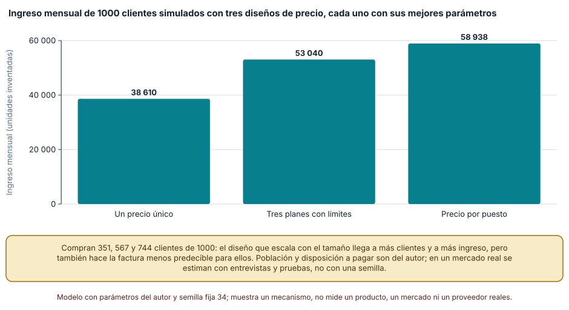
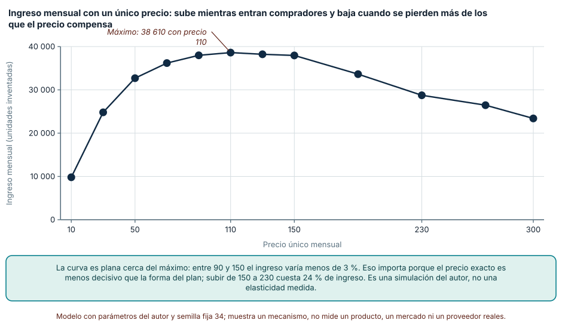
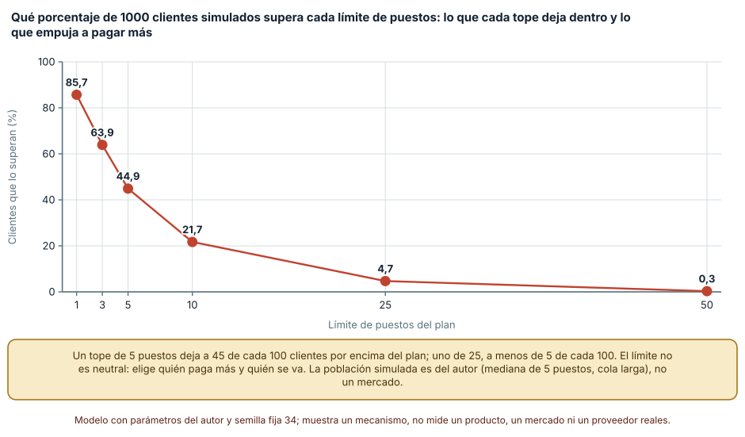

# SE-415 — Precios, empaquetado y límites por plan

[← SE-414 — Planes, derechos de uso y banderas de funcionalidad](https://github.com/vladimiracunadev-create/modern-software-engineering-program/blob/main/classes/part-34-saas-y-plataformas-de-producto/se-414-planes-derechos-de-uso-y-banderas-de-funcionalidad/README.md) · [↑ Parte 34](https://github.com/vladimiracunadev-create/modern-software-engineering-program/blob/main/classes/part-34-saas-y-plataformas-de-producto/README.md) · [📚 Índice completo](https://github.com/vladimiracunadev-create/modern-software-engineering-program/blob/main/classes/README.md) · [🌐 Portal](https://vladimiracunadev-create.github.io/modern-software-engineering-program/classes/SE-415.html) · [SE-416 — Marketplaces y plataformas de dos lados →](https://github.com/vladimiracunadev-create/modern-software-engineering-program/blob/main/classes/part-34-saas-y-plataformas-de-producto/se-416-marketplaces-y-plataformas-de-dos-lados/README.md)

## Punto profesional y fundamento pedagógico

**Punto profesional.** La clase existe para que trates el precio y el empaquetado como una decisión de ingeniería de producto con consecuencias medibles, y no como un número que alguien pone al final. Un plan decide quién compra, cuánto paga, cuándo se queda estrecho y a qué plan se mueve; los límites por plan son el mecanismo técnico que convierte esa intención en comportamiento: dónde se corta, qué se cobra aparte y qué funciones separan un segmento de otro. Un ingeniero que entiende por qué existe cada límite puede proponer cambios con datos, detectar límites que castigan a los mejores clientes y evitar que una decisión comercial rompa el sistema de medición y de derechos que `SE-413` y `SE-414` construyeron.

**Por qué aparece aquí.** Sigue a `SE-414`, que dio el motor de derechos: ahora se decide qué se pone dentro. Usa el costo por cliente de `SE-410` (lo que cuesta servir a cada segmento), la medición de `SE-413` (la métrica de valor debe poder medirse con exactitud) y los modelos de negocio y costos de `SE-133`, `SE-134` y `SE-140` (FinOps de producto y costo por resultado). Prepara `SE-416`, donde el precio tiene dos lados, y `SE-417`, donde cada precio se convierte en cargos reales.

**Error conceptual que debe corregir.** Creer que hay un precio «correcto» que se descubre con un cálculo, o que más planes y más límites siempre captan más ingreso. En la simulación de la clase, con 1 000 clientes cuyo tamaño y disposición a pagar son del autor, un precio único tiene su máximo en 110 por mes con 351 compradores y un ingreso de 38 610; tres planes con límites (40, 120 y 400) llegan a 53 040 con 567 compradores, y un precio por puesto (11 por puesto) a 58 938 con 744. El diseño importa más que el número exacto: entre 90 y 150 el ingreso del precio único varía menos de 2 %, mientras que cambiar la *forma* del precio mueve el ingreso un 50 %. Pero los tres números salen de una población inventada y no son una recomendación: lo que se transfiere es el método de compararlos con datos propios.

**Secuencia de aprendizaje.** Antes de ejecutar, predices si un precio único, tres planes o un precio por puesto llega a más clientes y a más ingreso en una población con muchos clientes pequeños y pocos grandes, y qué porcentaje de esa población supera un límite de 5 puestos. Después ejecutas la simulación, lees la curva de ingreso contra el precio, calculas con tu propia población cuántos clientes toca cada límite y escribes el catálogo de un producto con la métrica de valor, los planes, los límites y la razón de cada corte. Terminas definiendo qué evidencia te haría cambiar un precio.

**Evidencia de aprendizaje.** `precios.md` con la métrica de valor elegida y por qué, el catálogo de planes con sus límites y funciones, la justificación de cada corte con datos de uso (reales o simulados con su semilla), una tabla de qué porcentaje de clientes toca cada límite, la política ante cambios de precio de clientes existentes y la señal que dispararía una revisión.

**Límite de la conclusión.** Se ejecutó una simulación con semilla 34 de 1 000 clientes con tamaño (lognormal, mediana de 5 puestos) y disposición a pagar generadas por el autor; los precios, los umbrales y la elección racional del cliente son supuestos didácticos. No se midió ningún mercado, ninguna elasticidad real ni la competencia. No se afirma revisión humana externa del contenido.

### Trazabilidad fuente → afirmación

| Fuente primaria u oficial | Afirmación que respalda | Lo que no prueba |
|---|---|---|
| [Microsoft Learn: modelos de precios en multi-inquilino](https://learn.microsoft.com/en-us/azure/architecture/guide/multitenant/considerations/pricing-models) | Compara precios por puesto, por uso, por tramos y planes fijos y los relaciona con el costo de servir a cada inquilino. | No elige el modelo para tu producto. |
| [AWS SaaS Lens](https://docs.aws.amazon.com/wellarchitected/latest/saas-lens/saas-lens.html) | Trata los niveles (tiers) y la medición como decisiones de diseño con efecto en costo y en operación. | No incluye cifras de mercado. |
| [Stripe: facturación por uso](https://docs.stripe.com/billing/subscriptions/usage-based) | Muestra modelos de tarifa por uso (por unidad, por tramos, por volumen) como configuraciones de un producto de facturación. | No dice qué modelo conviene a tu cliente. |
| [Stripe: derechos](https://docs.stripe.com/billing/entitlements) | Vincula funcionalidades con productos y planes mediante un catálogo. | No fija qué funciones separan tus planes. |
| [Python `random`](https://docs.python.org/3/library/random.html) | Documenta el generador pseudoaleatorio con semilla y las distribuciones usadas en la simulación. | No hace real la población simulada. |

## Antes de empezar

Recupera lo aprendido en `SE-134` sobre costos de construcción, operación y oportunidad. La pregunta activa es: **si cobraras exactamente lo que cuesta servir a cada cliente más un margen fijo, ¿qué cliente pagaría de más, cuál de menos y quién se iría antes de pagar?**

## Prerrequisitos

- Haber completado `SE-409` a `SE-414`, y `SE-133` y `SE-134` (modelos de negocio y costos).
- Entender la diferencia entre límite, cuota y derecho de `SE-414` y la medición de `SE-413`.
- Manejar estadística elemental: mediana, percentil, distribución con cola larga.
- Python 3.11 o posterior; la simulación usa solo `random` de la biblioteca estándar.

## Problema auténtico

*Tablero* tiene hoy un plan gratuito (hasta 3 usuarios), un plan equipo a 49 por mes (hasta 25) y un plan empresa a 199. La dirección pide subir ingresos un 20 % sin perder clientes. Las propuestas son opuestas. Comercial quiere subir el plan equipo a 79. Producto quiere cobrar 8 por usuario y eliminar los planes. Soporte propone bajar el límite del plan gratuito a 2 usuarios porque «los gratuitos cuestan demasiado». Finanzas pide una opción con ingreso predecible y rechaza el cobro por usuario porque «la factura varía cada mes». Cada propuesta suena razonable y ninguna viene con datos de quién se vería afectado.

El análisis útil empieza por preguntas que se pueden responder con la base de clientes: ¿cómo se distribuye el tamaño de los clientes?, ¿cuántos están cerca de un límite?, ¿cuánto cuesta servir a un cliente gratuito frente a uno de pago?, ¿qué función usan más los que pagan más? Con eso, cada propuesta se convierte en una hipótesis con una predicción: «si el límite del plan gratuito baja a 2, X % de los gratuitos lo supera y, si la conversión histórica de quienes tocan el límite es del Y %, el ingreso sube Z».

El problema de la clase es aprender a comparar diseños de precio sobre una población con cola larga, a elegir una métrica de valor que escale con lo que el cliente obtiene, a ubicar los límites donde separan segmentos sin castigar el éxito del cliente y a proponer un cambio de precio con sus riesgos.

## Objetivos observables

Al terminar podrás:

1. elegir una métrica de valor para un producto y justificar por qué escala con lo que el cliente obtiene y puede medirse con exactitud;
2. comparar con una simulación de semilla fija tres diseños (precio único, planes con límites y precio por unidad) en ingreso y número de compradores y explicar la diferencia;
3. leer la curva de ingreso contra el precio y reconocer una meseta y un descenso;
4. calcular qué porcentaje de una población supera un límite dado y usarlo para decidir dónde poner el corte entre planes;
5. diseñar la política de cambio de precio para clientes existentes (grandfathering, aviso, versiones del catálogo) y la señal que dispara una revisión.

## Mapa conceptual


El valor que obtiene el cliente se resume en una métrica; el modelo de precio la convierte en dinero, los planes agrupan límites y funciones para segmentos distintos, y cada segmento aporta ingreso y cuesta algo servir. La revisión cierra el ciclo; el motor de derechos (`SE-414`) hace cumplir el diseño.

## Temas y por qué importan

| Tema | Por qué cambia una decisión profesional | Evidencia mínima |
|---|---|---|
| Métrica de valor | Un cobro que escala con el valor se acepta; uno que no, se percibe como castigo. | Justificación con datos de uso |
| Modelos de precio | Fijo, por puesto, por uso y por tramos reparten el riesgo distinto. | Comparación de ingreso en una población |
| Empaquetado | Qué funciones y límites va en cada plan separa segmentos. | Tabla de planes con su razón |
| Distribución del cliente | Con cola larga, un precio único deja dinero sobre la mesa y clientes fuera. | Percentiles de tamaño |
| Límites | Un tope en el lugar equivocado castiga el éxito del cliente. | Porcentaje de clientes sobre cada límite |
| Plan gratuito | Tiene un costo que debe pagar su conversión. | Costo por conversión estimado |
| Cambios de precio | Afectan a clientes existentes y exigen aviso y versiones. | Política de grandfathering |

## Conceptos y decisiones

### 1. La métrica de valor es lo que escala con lo que el cliente obtiene

Cobrar por algo que no se relaciona con el valor genera fricción: el cliente siente que paga por el hecho de usar, no por obtener. Las métricas habituales son el número de puestos (usuarios con acceso), el volumen de uso (llamadas, mensajes, gigabytes), los resultados (cobros procesados, correos entregados) y la capacidad (entornos, núcleos). Una buena métrica reúne cuatro propiedades: el cliente la entiende, crece cuando el cliente obtiene más valor, se puede medir con exactitud (`SE-413`) y se puede predecir (el cliente sabe más o menos cuánto pagará). El número de puestos tiene la ventaja de la predecibilidad y la desventaja de que no siempre se correlaciona con el valor (un puesto muy activo y uno que entra una vez al mes pagan igual); el uso se correlaciona mejor y se predice peor.

### 2. Cuatro modelos y el riesgo que reparte cada uno

Un **precio fijo** (por plan) es previsible para ambos y no distingue tamaños dentro del plan. Un **precio por puesto** escala con el tamaño del cliente y hace que el proveedor gane cuando el cliente crece, pero desalienta a añadir usuarios ocasionales. Un **precio por uso** alinea ingreso y valor, pero hace la factura variable y exige medición exacta. Los **planes con tramos y límites** (gratis, equipo, empresa) segmentan: cada uno paga según el nivel de necesidad. La mayoría de los productos mezclan: una base fija por plan más un consumo adicional por encima del límite. Elegir el modelo es elegir quién asume la incertidumbre: el precio fijo traslada al proveedor el riesgo de que el cliente use mucho; el uso lo traslada al cliente.

### 3. Con una población de cola larga, un precio único deja a unos fuera y a otros pagando poco

La simulación genera 1 000 clientes cuyo número de puestos sigue una distribución con cola larga (mediana de 5, máximo de 70) y cuya disposición a pagar crece con el tamaño pero menos que proporcionalmente. Con un precio único, el ingreso sube mientras entran compradores y baja cuando los que se pierden pesan más que lo que se gana por cliente: el máximo está en 110 con 351 compradores y 38 610 de ingreso. A 50 el ingreso es 32 700 (más clientes, menos por cliente); a 230, 28 750 (pocos clientes, mucho por cliente). Los clientes grandes pagarían más y los pequeños no pagan nada: **un único precio obliga a elegir a quién dejar fuera o a quién regalarle valor**.

### 4. La curva de ingreso tiene una meseta, y eso es una buena noticia

Cerca del máximo, el ingreso varía poco: entre 90 y 150 queda dentro del 2 % del máximo (de 37 950 a 38 610). La consecuencia práctica es que discutir si el precio debe ser 99 o 119 es discutir poco; lo que vale la pena discutir es la forma del precio. En un producto real, la meseta es una invitación a elegir por otros criterios (simplicidad, percepción, competidores, margen mínimo) en lugar de optimizar la última unidad. El descenso hacia la derecha, en cambio, es abrupto: pasar de 150 a 230 cuesta un 24 % del ingreso. Es más barato equivocarse hacia la izquierda de la meseta que hacia la derecha.

### 5. Segmentar con límites supera al precio único si los cortes están donde están los clientes

Con tres planes (40, 120 y 400, con límites de 5 y 25 puestos en los dos primeros), la simulación alcanza 53 040 de ingreso y 567 compradores: 296 eligen el plan básico, 240 el de equipo y 31 el de empresa. El diseño capta a los pequeños con un precio bajo, a los medianos con uno intermedio y a los grandes con uno alto. El resultado es un 37 % más de ingreso que el precio único y 216 clientes más. Dos advertencias: los precios y los cortes salieron de una búsqueda sobre esta población, y con otra población saldrían otros; y el modelo supone que cada cliente elige el plan de mayor excedente y que el límite es una barrera perfecta, cuando en la realidad los clientes reparten usuarios entre cuentas o ignoran los límites hasta que se aplican.

### 6. Un límite elige a quién empuja a pagar más

El porcentaje de la población que supera un límite de puestos es una función del corte: 63,9 % supera 3, 44,9 % supera 5, 21,7 % supera 10, 4,7 % supera 25 y 0,3 % supera 50. Colocar el tope de un plan en 5 deja a casi la mitad de los clientes por encima y los empuja al plan siguiente; colocarlo en 25 deja a menos del 5 %. Ninguno es mejor en abstracto: depende de qué se quiere. Un tope bajo en el plan gratuito convierte más (y expulsa a más), uno alto regala más capacidad. Se decide con datos: qué porcentaje de clientes de pago se acerca a cada límite, cuántos de los que lo tocan se convierten, cuántos se van.

### 7. Los límites no deben castigar el éxito de quien más valor obtiene

Un límite mal colocado cobra de más justo cuando el cliente tiene más éxito: un tope de proyectos que obliga a pagar el plan siguiente cuando el cliente lo necesita más puede percibirse como una trampa. Los límites funcionan mejor cuando escalan con el valor (usuarios, volumen) y peor cuando limitan algo que no cuesta nada al proveedor ni da más valor al cliente (la cantidad de etiquetas, por ejemplo). Se distingue el límite que protege el costo (cuotas de uso) del que segmenta (funciones de equipo) y del que incentiva la conversión (topes del plan gratuito), y cada tipo se justifica por su razón.

### 8. El plan gratuito es una inversión y se evalúa como tal

Un cliente gratuito cuesta infraestructura y soporte. Si cuesta 0,8 al mes y tarda seis meses en convertirse con probabilidad del 4 %, el costo en infraestructura por cada cliente que se convierte es 0,8 × 6 / 0,04 = 120, que se compara con el margen que deja el cliente de pago y con el costo de adquirirlo por otros canales (`SE-409`). Si el gratuito cuesta más de lo que aporta en conversiones, se acota (límites más bajos, retención de datos más corta, funciones de pago) o se sustituye por una prueba limitada en el tiempo. Si convierte bien y atrae a clientes por recomendación, es la forma más barata de adquirir. Las dos conclusiones se prueban con datos propios, no con costumbre.

### 9. Un cambio de precio es un cambio de contrato con los clientes que ya pagan

Subir precios o bajar límites afecta a clientes que compraron bajo otras condiciones. Las prácticas habituales son versionar el catálogo (los planes existentes conservan sus condiciones durante un plazo), avisar con antelación suficiente y por un canal que el cliente lea, ofrecer migrar voluntariamente a las condiciones nuevas si le convienen y medir la reacción (bajas y bajadas de plan tras el cambio). El motor de derechos (`SE-414`) debe poder representar el plan antiguo y el nuevo a la vez. Un cambio que no se comunica, o que se aplica con efecto inmediato, genera quejas y puede incumplir lo pactado.

### 10. Precios diferentes para personas distintas tienen límites éticos y legales

Variar el precio por región, por tamaño de empresa o por tipo de organización es común y legítimo cuando se documenta y se aplica de forma uniforme. Probar precios distintos con usuarios equivalentes sin que lo sepan, o variarlos según rasgos personales, puede ser engañoso, discriminatorio o contrario a la normativa de consumo de algunas jurisdicciones. Las pruebas de precio se diseñan con revisión legal y con una política de qué se prueba, a quién y cómo se corrige a quien pagó más. Lo que sigue es una restricción de ingeniería además de ética: la evidencia de un experimento de precio debe poder explicarse al cliente y a un regulador.

### 11. Economía unitaria: el costo de servir a cada inquilino

Un precio solo se evalúa frente a lo que cuesta servir. La economía unitaria compara, por cliente y por mes, el ingreso con el costo de servirlo: infraestructura (cómputo, almacenamiento, tráfico), costo de terceros que se factura por uso (correo, mensajería, procesamiento de pagos), soporte y la parte repartida de los costos fijos. En el modelo de costo de `SE-410`, un cliente en un entorno dedicado cuesta 90 al mes y uno en un pool de 1 000 clientes unos 2,6: poner el mismo precio a ambos regala margen al segundo y pierde dinero con el primero. Medir el costo por inquilino exige etiquetar los recursos con el identificador del cliente y atribuir los compartidos con una regla escrita (por uso o por partes iguales). Con ese dato se encuentran los clientes de margen negativo (a menudo los que más usan un recurso caro que el plan no limita), se fijan límites o precios por uso donde el costo escala y se decide qué plan gratuito es sostenible. La atribución es una aproximación, y por eso se declara como tal (`SE-140`, `SE-404`).

## Tres diseños de precio en la misma población



**Cómo leer la figura.** Cada barra es el ingreso mensual de los mismos 1 000 clientes simulados con un diseño distinto, cada uno con sus mejores parámetros dentro de una búsqueda. El orden (único, planes, por puesto) coincide con cuánto escala el precio con el tamaño. **Dónde deja de valer:** la disposición a pagar y el tamaño son sintéticos; los parámetros «mejores» se eligieron sobre la misma población, lo que favorece a los diseños con más parámetros (los planes, con tres) y no se validó con otra muestra. Un diseño que gana en simulación puede perder en el mercado por razones que el modelo no contempla (percepción, competencia, complejidad).

## Ingreso con un precio único



**Cómo leer la figura.** El eje horizontal es el precio y el vertical el ingreso. Sube rápido a la izquierda (entran muchos compradores), se aplana en la meseta alrededor de 110 y baja a la derecha. Observa que la pendiente a la derecha es mayor que a la izquierda de la meseta. **Dónde deja de valer:** una población y una disposición a pagar sintéticas, sin competencia ni efectos de red; los puntos son una muestra de la curva (cada 10 unidades) y la curva real tiene más ruido.

## Quién supera cada límite



**Cómo leer la figura.** El eje horizontal es el límite y el vertical el porcentaje de clientes que lo supera; la línea baja con rapidez al principio y casi se aplana a la derecha. Elige un tope y lee cuántos clientes quedan por encima: son los que ese límite empuja a otro plan o a otro precio. **Dónde deja de valer:** el tamaño es una distribución lognormal inventada con mediana de 5 puestos; en una base real se calcula con los puestos de cada cliente, y el porcentaje que supera un límite cambia con el tiempo a medida que los clientes crecen.

## Definiciones de trabajo

- **Métrica de valor:** unidad con la que se cobra, que escala con lo que obtiene el cliente.
- **Empaquetado:** agrupación de funciones y límites en planes para segmentos distintos.
- **Disposición a pagar:** máximo que un cliente aceptaría pagar por algo.
- **Meseta:** zona de la curva de ingreso donde cambiar el precio apenas cambia el ingreso.
- **Valla (fence):** límite o función que separa un segmento de otro.
- **Grandfathering:** conservar condiciones anteriores a clientes existentes.
- **Excedente del cliente:** valor que obtiene menos lo que paga.

## Ejemplo mínimo

Calcular qué porcentaje de una población supera cada límite y el ingreso de un precio único:

```python
import random

rng = random.Random(34)
poblacion = []
for _ in range(1000):
    puestos = max(1, int(rng.lognormvariate(1.6, 1.0)))
    disposicion = rng.lognormvariate(2.9, 0.5) * puestos ** 0.9      # lo que pagaría por mes
    poblacion.append((puestos, disposicion))

for limite in (3, 5, 10, 25):
    print(limite, round(100 * sum(1 for p, _ in poblacion if p > limite) / len(poblacion), 1))   # 63.9 44.9 21.7 4.7
mejor = max(((precio, precio * sum(1 for _, v in poblacion if v >= precio)) for precio in range(10, 301, 10)), key=lambda x: x[1])
print(mejor)                                              # (110, 38610)
```

La semilla fija repite las cifras de la clase. Cambiar la mediana de la distribución (el 1,6) o el exponente del tamaño (0,9) muestra qué parte de la conclusión depende del supuesto.

## Ejemplo profesional

*Escenario ilustrativo: las cifras y los resultados de este ejemplo son supuestos de la narración, no mediciones.*

El equipo de *Tablero* aborda la petición de subir ingresos sin adivinar. Exporta, para cada cliente de pago, los puestos, el plan, el uso de funciones y la antigüedad, y calcula tres tablas: distribución de puestos por plan, porcentaje de clientes a menos del 20 % de su límite y a más del 90 %, y uso de cada función por plan. Descubre que el 41 % de los clientes del plan equipo usa menos de 10 de sus 25 usuarios y que el 7 % está al borde del límite, y que los clientes que más usan la exportación y las integraciones son los que más amplían su plan.

Con eso replantea las propuestas como hipótesis. Subir equipo a 79 afecta a todos, incluidos los que usan menos de la mitad; producto propone un plan intermedio con 10 usuarios a 39 para quienes están lejos del límite y un precio por puesto adicional para quien lo supera. Soporte y finanzas obtienen respuesta con datos: bajar el límite gratuito a 2 empuja al 58 % de los gratuitos activos, pero su conversión histórica cerca del límite es de 4 %, y el cambio añadiría poco; en cambio, limitar el historial de proyectos sí correlaciona con conversiones. Antes de decidir, el equipo hace una prueba con un grupo pequeño de cuentas nuevas y define la señal de reversión: si las bajas del plan equipo en los 60 días siguientes superan el 8 %, se revierte. Los clientes existentes conservan su plan durante doce meses.

## Práctica guiada

1. Ejecuta `python scripts/experiments_part34_metering.py` y localiza `mercado` y `curva`. Predice cuál de los tres diseños gana y por cuánto; compara con tu predicción.
2. Cambia la mediana de tamaño (1,6) por 1,0 y por 2,2 y vuelve a ejecutar: ¿se mantiene el orden entre los tres diseños? Escribe qué conclusión depende del supuesto.
3. Calcula el porcentaje de la población que supera los límites 2, 7 y 15 y propón dónde pondrías el corte entre un plan básico y uno de equipo.
4. Estima el costo por conversión de un plan gratuito con tus propios números (costo mensual, meses hasta convertir, tasa) y compáralo con el margen mensual de un cliente de pago.
5. Escribe para tu producto tres hipótesis de cambio de precio, cada una con su predicción numérica y la señal que la refutaría.

## Ejercicios

1. **Básico.** Explica por qué la curva de ingreso con precio único tiene una meseta y qué implica para discutir 99 frente a 119.
2. **Intermedio.** Con la distribución de la clase, propón los límites de un plan básico y un plan equipo para que menos del 25 % de los clientes del básico supere el tope. Calcula cuántos clientes quedarían en cada plan.
3. **Avanzado.** Diseña el cambio de precio del plan equipo de *Tablero* de 49 a 59 para clientes nuevos y existentes: calendario, comunicación, versiones del catálogo, métricas de reacción, umbral de reversión y qué datos legales y contractuales revisarías.

## Reto verificable

Entrega `precios.md` y una simulación propia con semilla fija que compare al menos dos diseños de precio sobre una población que declares, con los porcentajes de clientes que superan cada límite. Es válido si otra persona ejecuta la simulación, obtiene las mismas cifras y entiende qué supuestos las sostienen y cuáles no.

## Caso conductor

*Tablero* quería subir ingresos un 20 % y tenía cuatro propuestas contradictorias. Esta clase da el método para compararlas con datos de la propia base, y la distinción entre la métrica, el modelo, los planes y los límites. `SE-416` lleva la cuestión del precio a una plataforma con dos lados, donde cada lado paga o se subvenciona según lo que el otro aporta.

## Preguntas frecuentes

### ¿Cuántos planes debería tener un producto?

Los que corresponden a segmentos que se comportan distinto: tres es habitual (básico, intermedio, avanzado) porque da a quien compra una opción del medio y permite capturar a los grandes. Más planes aumentan la complejidad de ventas, de soporte y del motor de derechos; menos dejan dinero o clientes fuera. Se decide con la distribución de clientes y se revisa con datos.

### ¿Hay que mostrar los precios públicamente?

Depende del segmento. Los planes de autoservicio se benefician de la transparencia; los de empresa suelen negociarse. En todo caso, lo que se publica debe coincidir con lo que se cobra y con los límites que se aplican, y los cambios deben anunciarse.

### ¿El cobro por puesto desincentiva el uso del producto?

Puede: si cada usuario adicional cuesta, el cliente limita el acceso y el producto se usa menos en la empresa, lo que reduce su valor y su retención. Una alternativa son planes por tramos de puestos o usuarios «de solo lectura» gratuitos. Se mide el efecto en uso y retención tras el cambio.

### ¿Cómo se prueba un precio sin afectar a los clientes?

Con grupos pequeños de cuentas nuevas (no con clientes existentes), con aviso claro de las condiciones, con una política de qué pasa si el precio probado era mayor y con revisión legal. Se compara conversión y retención y se define de antemano cuándo termina la prueba.

## Fallo controlado y diagnóstico

**Fallo.** Tras subir el límite de proyectos del plan gratuito de 2 a 5 para aumentar el uso, la conversión a plan de pago baja de 4,1 % a 2,6 % en dos meses.

**Diagnóstico paso a paso.** (1) Se compara la conversión por cohorte: las cuentas nuevas posteriores al cambio convierten menos, las anteriores no cambian. (2) Se mide el momento de conversión histórico: el 63 % de las conversiones ocurría cuando la cuenta alcanzaba el límite de 2 proyectos. (3) Con 5 proyectos, las cuentas tardan más en llegar al límite y una parte nunca llega: el límite era la valla que provocaba la decisión. (4) El uso del producto sí subió (más proyectos creados) pero con proyectos de baja actividad. (5) Se prueba una alternativa que mantiene 2 proyectos activos y permite archivar sin límite, de modo que el cliente no pierde su trabajo pero la valla persiste; la conversión se recupera a 3,8 % en seis semanas. (6) Se documenta el resultado: la métrica de éxito del cambio era el uso, no la conversión, y nadie había medido la relación entre ambas.

**Lección.** Un límite es un mecanismo de decisión del cliente además de un tope técnico. Cambiarlo sin una hipótesis sobre la conversión es optimizar una métrica a costa de la que sostiene el negocio. Cada cambio de límite lleva su predicción y su umbral de reversión.

## Errores comunes y cómo corregirlos

- **Elegir el precio con la intuición de quien lo discute.** Cada propuesta parece razonable. Corrige con la distribución de tu base y una predicción por propuesta.
- **Optimizar el valor exacto de un precio.** La curva tiene meseta. Corrige discutiendo la forma del precio, no la última unidad.
- **Poner límites en lo que no cuesta ni da valor.** Parecen una trampa. Corrige con límites que escalan con costo o con valor.
- **Cambiar un límite sin hipótesis.** Se mueve una métrica y se rompe otra. Corrige con una predicción y un umbral de reversión.
- **Cambiar precios a clientes existentes sin versionar.** Rompe contratos y confianza. Corrige con catálogo versionado y aviso.
- **Mantener un plan gratuito por costumbre.** Puede costar más de lo que convierte. Corrige estimando el costo por conversión y acotando.

## Entorno y archivos clave

- `scripts/experiments_part34_metering.py`: funciones `mercado` (tres diseños de precio) y `curva_precio` (ingreso contra precio único).
- `scripts/figures_part34_b.py`: las tres figuras de la clase.
- Requiere Python 3.11 o posterior y solo la biblioteca estándar; la semilla es 34 y la población se genera en cada ejecución.

## Seguridad, ética y accesibilidad

Un precio es una promesa a personas reales. Publica lo que cobras y lo que incluye cada plan en lenguaje claro, sin cargos ocultos ni precios que solo aparecen al final del pago. No uses patrones engañosos (cuentas atrás falsas, planes que se renuevan sin avisar, cancelaciones difíciles). No varíes el precio de una persona según rasgos personales sin base legal y transparente. Procura que las funciones de accesibilidad y la exportación de los propios datos no queden restringidas a planes caros. Las páginas de precios deben ser accesibles (tablas con encabezados, contrastes, lectura con teclado) y comprensibles por quien decide la compra sin ser técnico.

## Puente hacia el trabajo con agentes

Un agente puede ayudar a simular alternativas de precio, a limpiar datos de uso o a redactar el aviso de un cambio, pero no debe decidir un precio: el resultado depende de supuestos de negocio que alguien debe asumir. Pídele que muestre los supuestos de cada simulación, que reproduzca las cifras con la semilla y que señale qué conclusión cambia al modificar cada parámetro. Y no le des acceso de escritura al catálogo de planes en producción: un cambio erróneo en los derechos o en el precio afecta a todos los clientes a la vez.

## Transferencia

Toma el plan de precios de un producto que uses y reconstruye su lógica: cuál es la métrica de valor, qué límites separan los planes, qué porcentaje de clientes crees que supera cada límite y qué haría el proveedor si ese porcentaje cambiara. Anota qué datos necesitarías para comprobar tu hipótesis; son los que pedirías a tu propia base.

## Evaluación y evidencia

| Criterio | Evidencia aceptable | Rechazo |
|---|---|---|
| Métrica de valor | Justificada con uso y medible | «Se cobra por usuario» sin razón |
| Comparación de diseños | Simulación reproducible con supuestos declarados | Un solo diseño |
| Límites | Porcentaje de clientes sobre cada tope y razón del corte | Topes por costumbre |
| Cambio de precio | Versión del catálogo, aviso y umbral de reversión | Aplicación inmediata a todos |
| Límites del modelo | Supuestos que cambian la conclusión | Presentarlo como medición del mercado |

## Fuentes

- Microsoft Learn. [Modelos de precios en aplicaciones multi-inquilino](https://learn.microsoft.com/en-us/azure/architecture/guide/multitenant/considerations/pricing-models).
- AWS. [SaaS Lens](https://docs.aws.amazon.com/wellarchitected/latest/saas-lens/saas-lens.html).
- Stripe. [Facturación por uso](https://docs.stripe.com/billing/subscriptions/usage-based) y [derechos](https://docs.stripe.com/billing/entitlements).
- Python. [`random`](https://docs.python.org/3/library/random.html).

## Límites y siguiente paso

Se simularon 1 000 clientes con semilla 34 y se compararon tres diseños de precio con parámetros del autor; no se midió ningún mercado, elasticidad ni competencia, y los parámetros se optimizaron sobre la misma población, lo que favorece a los diseños con más parámetros. Las cifras muestran un método, no un precio recomendable. El siguiente paso, `SE-416`, pasa de un producto con un tipo de cliente a una plataforma con dos lados, donde el precio de un lado depende de cuánto aporte el otro.

## Glosario

| Término | Definición breve |
|---|---|
| Métrica de valor | Unidad de cobro que escala con el valor |
| Empaquetado | Agrupación de funciones y límites en planes |
| Disposición a pagar | Máximo que un cliente aceptaría pagar |
| Meseta | Zona donde el precio apenas cambia el ingreso |
| Valla | Límite o función que separa segmentos |
| Grandfathering | Conservar condiciones antiguas a clientes existentes |
| Excedente | Valor obtenido menos lo pagado |

---

[← SE-414 — Planes, derechos de uso y banderas de funcionalidad](https://github.com/vladimiracunadev-create/modern-software-engineering-program/blob/main/classes/part-34-saas-y-plataformas-de-producto/se-414-planes-derechos-de-uso-y-banderas-de-funcionalidad/README.md) · [↑ Parte 34](https://github.com/vladimiracunadev-create/modern-software-engineering-program/blob/main/classes/part-34-saas-y-plataformas-de-producto/README.md) · [📚 Índice completo](https://github.com/vladimiracunadev-create/modern-software-engineering-program/blob/main/classes/README.md) · [🌐 Portal](https://vladimiracunadev-create.github.io/modern-software-engineering-program/classes/SE-415.html) · [SE-416 — Marketplaces y plataformas de dos lados →](https://github.com/vladimiracunadev-create/modern-software-engineering-program/blob/main/classes/part-34-saas-y-plataformas-de-producto/se-416-marketplaces-y-plataformas-de-dos-lados/README.md)
