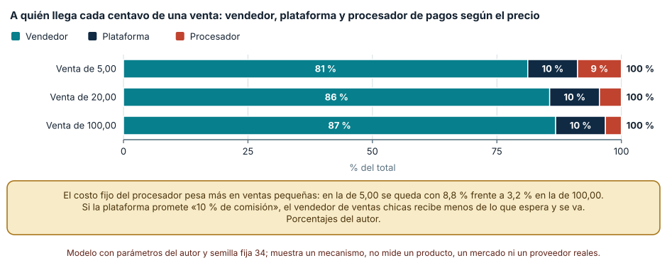

# SE-416 — Marketplaces y plataformas de dos lados

[← SE-415 — Precios, empaquetado y límites por plan](https://github.com/vladimiracunadev-create/modern-software-engineering-program/blob/main/classes/part-34-saas-y-plataformas-de-producto/se-415-precios-empaquetado-y-limites-por-plan/README.md) · [↑ Parte 34](https://github.com/vladimiracunadev-create/modern-software-engineering-program/blob/main/classes/part-34-saas-y-plataformas-de-producto/README.md) · [📚 Índice completo](https://github.com/vladimiracunadev-create/modern-software-engineering-program/blob/main/classes/README.md) · [🌐 Portal](https://vladimiracunadev-create.github.io/modern-software-engineering-program/classes/SE-416.html) · [SE-417 — Pagos, idempotencia y conciliación →](https://github.com/vladimiracunadev-create/modern-software-engineering-program/blob/main/classes/part-34-saas-y-plataformas-de-producto/se-417-pagos-idempotencia-y-conciliacion/README.md)

## Punto profesional y fundamento pedagógico

**Punto profesional.** La clase existe para que entiendas qué cambia cuando un producto deja de servir a un tipo de cliente y pasa a conectar a dos o más tipos que se necesitan entre sí: compradores y vendedores, huéspedes y anfitriones, quienes piden un viaje y quienes lo ofrecen. En una plataforma de dos lados el valor para un lado depende de cuántos hay del otro, el precio se reparte entre los lados (a veces uno subvenciona al otro), el dinero pasa por la plataforma y la confianza entre desconocidos se convierte en el producto principal. Lo que aprendiste hasta aquí (aislamiento, suscripciones, medición, derechos, precios) sigue valiendo, pero se aplica dos veces y con una pregunta nueva: ¿de quién es el cliente?

**Por qué aparece aquí.** Sigue a `SE-415`, que decidió precios para un solo tipo de cliente. Aquí el precio depende de la masa de cada lado y del reparto de la venta. Retoma los modelos de negocio de `SE-133` y de costos de `SE-134`, el dominio financiero y las invariantes monetarias de `SE-294` y los flujos de integración y eventos de `SE-379`. Prepara `SE-417`, donde el dinero que la plataforma retiene y reparte se registra y se concilia.

**Error conceptual que debe corregir.** Creer que una plataforma de dos lados es «un SaaS con un marketplace encima». La diferencia es de estructura: el producto fracasa por *liquidez* insuficiente, no por falta de funciones. En la simulación de la clase, con un 4 % de probabilidad de que cada vendedor sirva a un comprador cualquiera, con 5 vendedores solo el 18,4 % de los compradores encuentra una oferta; con 20, el 57,0 %; con 80, el 95,6 %; con 320, el 100 %. Quien visita la plataforma con 5 vendedores y no encuentra nada no vuelve, y sin compradores los vendedores se van: no hay función que corrija ese círculo, solo masa en cada lado. Por eso las decisiones técnicas más importantes de un marketplace son las que reducen la fricción de empezar, de encontrar y de confiar.

**Secuencia de aprendizaje.** Antes de ejecutar, predices cuántos vendedores hacen falta para que el 95 % de los compradores encuentre al menos una oferta y cuánto recibe un vendedor de una venta de 5,00, de 20,00 y de 100,00 con una comisión de plataforma de 10 % y un procesador de pagos de 2,9 % más 0,30. Después ejecutas el modelo de liquidez y el reparto de la venta, lees el flujo del dinero con retención hasta confirmar y relacionas cada mecanismo con los casos del curso (Airbnb, Uber y Mercado Libre). Terminas escribiendo el diseño de un marketplace mínimo: qué lado se atrae primero, cómo se genera confianza, cómo se reparte el dinero y qué riesgos regulatorios aparecen.

**Evidencia de aprendizaje.** `marketplace.md` con la identificación de los lados y de cuál es más difícil de atraer, la métrica de liquidez elegida y su umbral, el modelo de comisión con su tabla de reparto para tres precios, el flujo del dinero con retención y liberación, la política de disputa y la lista de obligaciones regulatorias que habría que consultar.

**Límite de la conclusión.** Se ejecutó un modelo de liquidez con semilla 34 (1 000 compradores por tamaño de oferta, 4 % de coincidencia por vendedor) y un cálculo de reparto con porcentajes del autor; no se midió ningún mercado, no se modelaron efectos de red cruzados ni precios, y el flujo del dinero es un diseño, no una operación con dinero real. Los casos del curso se citan como contexto, con sus propias fuentes. No se afirma revisión humana externa del contenido.

### Trazabilidad fuente → afirmación

| Fuente primaria u oficial | Afirmación que respalda | Lo que no prueba |
|---|---|---|
| [Stripe Connect](https://docs.stripe.com/connect) | Describe cómo una plataforma cobra a compradores y reparte fondos a cuentas conectadas de vendedores, con verificación de identidad de quienes reciben. | No decide qué licencias necesita tu plataforma en cada país. |
| [PCI Security Standards Council: PCI DSS](https://www.pcisecuritystandards.org/standards/pci-dss/) | Es el estándar de seguridad para quienes almacenan, procesan o transmiten datos de tarjetas; delegar el cobro a un proveedor reduce, no elimina, el alcance. | No sustituye una evaluación de tu alcance. |
| [AWS SaaS Lens](https://docs.aws.amazon.com/wellarchitected/latest/saas-lens/saas-lens.html) | Trata la separación de inquilinos y la medición como piezas de plataformas con muchos participantes. | No trata efectos de red ni liquidez. |
| [Caso de estudio: Airbnb](https://github.com/vladimiracunadev-create/modern-software-engineering-program/blob/main/casos/exito/airbnb.md) | Reúne, con fuentes públicas citadas, el arranque lento, el sistema de pagos propio y las reseñas como mecanismos de confianza. | Es un caso, no una teoría general de mercados. |
| [Caso de estudio: Mercado Libre](https://github.com/vladimiracunadev-create/modern-software-engineering-program/blob/main/casos/exito/mercado-libre.md) | Documenta que Mercado Pago nació como un producto de custodia para dar confianza en pagos entre desconocidos. | No prueba que la custodia baste en otro mercado. |

## Antes de empezar

Recupera lo aprendido en `SE-133` sobre modelos de negocio. La pregunta activa es: **si tu plataforma tuviera hoy 20 vendedores y 2 000 compradores, ¿qué lado se iría primero si no sucediera nada más, y qué harías para impedirlo?**

## Prerrequisitos

- Haber completado `SE-409` a `SE-415`, y `SE-133` y `SE-294` (dominio financiero e invariantes monetarias).
- Conocer el flujo de un pago con tarjeta y la diferencia entre autorizar, capturar y liquidar (se desarrolla en `SE-417`).
- Entender probabilidades elementales (la probabilidad de al menos un éxito en n intentos).
- Python 3.11 o posterior; solo biblioteca estándar.

## Problema auténtico

*Tablero* lanza «Plantillas»: un mercado donde equipos y consultores venden plantillas de proyecto (flujos, tableros preconfigurados) a otros usuarios del producto. El primer mes se publican 14 plantillas, la mayoría de dos autores que son amigos del equipo. Los compradores que buscan algo concreto («plan de lanzamiento de un producto físico») no encuentran nada y se van; los autores, sin ventas, dejan de publicar. En el segundo mes el equipo añade funciones: filtros, etiquetas, un buscador mejor. No cambia nada. El problema no es el buscador: con 14 plantillas, la probabilidad de que una búsqueda concreta encuentre algo es muy baja.

En el tercer mes el equipo cambia la estrategia: invita a cuarenta autores con una comisión del 0 % durante seis meses y publica ellos mismos treinta plantillas de base. La oferta pasa de 14 a 190; los compradores que encuentran algo vuelven, los autores ven ventas y publican más. Nuevos problemas aparecen: un autor vende una plantilla copiada de otro; un comprador reclama que lo comprado no funciona y exige reembolso; el dinero de una venta hay que repartirlo entre el autor, la plataforma y el procesador de pagos, y una venta de 5,00 deja al autor el 81 % mientras una de 100,00 le deja el 87 %; y un autor de otro país no puede recibir pagos porque la plataforma no ha completado su verificación de identidad.

Todo eso son problemas de plataforma de dos lados: masa crítica, confianza, reparto del dinero y obligaciones regulatorias. El problema de la clase es modelarlos con números y convertirlos en decisiones: qué lado se atrae primero, qué comisión se cobra y cuándo, cómo se reduce el riesgo de quien paga a un desconocido y qué parte del dinero y de la identidad se delega a un proveedor especializado.

## Objetivos observables

Al terminar podrás:

1. identificar los lados de una plataforma, explicar el efecto de red entre ellos y reconocer cuál es el más difícil de atraer;
2. modelar con una simulación con semilla fija la probabilidad de que un comprador encuentre al menos una oferta según el número de vendedores y leer el número de vendedores necesario para un umbral de liquidez;
3. calcular el reparto de una venta entre vendedor, plataforma y procesador de pagos para varios precios y explicar el efecto del costo fijo en ventas pequeñas;
4. diseñar un flujo de dinero con retención hasta la confirmación, liberación al vendedor y disputa, e indicar qué parte hace la plataforma y cuál un proveedor autorizado;
5. enumerar los mecanismos de confianza (verificación, reseñas, garantías, pagos protegidos) y los riesgos propios (suplantación, fuga de la transacción, fraude, disputas).

## Mapa conceptual


La plataforma une a los dos lados con tres capas: encontrar (búsqueda y emparejamiento), confiar (verificación, reseñas, garantía) y pagar (retención y liberación). La liquidez que resulta alimenta a ambos lados; si falta en uno, el círculo se corta.

## Temas y por qué importan

| Tema | Por qué cambia una decisión profesional | Evidencia mínima |
|---|---|---|
| Efectos de red entre lados | El valor para uno depende de la masa del otro. | Modelo de liquidez con semilla |
| Arranque en frío | Sin masa en un lado, el otro no llega. | Estrategia para el lado difícil |
| Liquidez | Mide si el mercado funciona, más que el número de usuarios. | Tasa de emparejamiento |
| Comisión y reparto | El costo fijo del pago pesa más en ventas pequeñas. | Tabla de reparto para tres precios |
| Confianza | Es el producto cuando los participantes no se conocen. | Verificación, reseñas y garantía |
| Pagos retenidos | Protegen al comprador y obligan a custodiar dinero ajeno. | Flujo con retención y liberación |
| Fuga y disputas | Los vendedores pueden llevarse la transacción; los compradores reclamar. | Política de disputa y de fuga |

## Conceptos y decisiones

### 1. Dos lados, un efecto de red cruzado

En un producto SaaS clásico, un cliente adicional no mejora el servicio para los demás (salvo por la economía de escala). En una plataforma de dos lados, cada comprador adicional mejora el servicio para los vendedores y cada vendedor adicional para los compradores. Ese efecto es la razón de ser de la plataforma y su mayor riesgo: sin masa en un lado no hay valor en el otro. Hay plataformas de más de dos lados (Uber conecta a quien pide, a quien conduce y, en el reparto, a los comercios) y la misma lógica se aplica con más relaciones cruzadas. Cada lado tiene sus propios incentivos, su propio costo de entrar y su propia sensibilidad al precio.

### 2. La liquidez es lo que mide si el mercado funciona

El número de usuarios registrados dice poco; lo que importa es la proporción de búsquedas que terminan en una transacción, el tiempo hasta la primera venta de un vendedor nuevo y la tasa de recompra. En el modelo de la clase, un comprador tiene probabilidad de 4 % de encontrar en cada vendedor algo que le sirva. La probabilidad de encontrar al menos una oferta con n vendedores es 1 − 0,96ⁿ, y las simulaciones dan **18,4 % con 5 vendedores, 57,0 % con 20, 95,6 % con 80 y 100 % con 320**. La relación no es lineal: de 5 a 20 vendedores la liquidez triplica y de 80 a 320 casi no cambia. Hay una zona de masa mínima por debajo de la cual el mercado no se sostiene y una zona de rendimientos decrecientes por encima; la plataforma debe saber en cuál está en cada categoría.

### 3. El arranque en frío se resuelve atacando un lado y una zona pequeña

Es imposible atraer a compradores sin vendedores y viceversa, por lo que las plataformas resuelven el círculo comenzando por un lado y por un segmento acotado (una ciudad, una categoría, una comunidad). Las tácticas habituales son: subvencionar al lado difícil (comisión cero, pagos garantizados, incentivos), aportar la oferta inicial (la plataforma publica los primeros productos o contrata a los primeros proveedores), concentrar la masa en un mercado pequeño hasta que funcione y luego expandir, y ofrecer valor a un lado aunque el otro aún no esté (una herramienta útil por sí sola que atrae a vendedores). Según el caso del curso sobre Airbnb, la empresa tuvo dos reservas en su lanzamiento en marzo de 2008 y creció por eventos concretos donde había demanda y no hospedaje: el arranque fue lento y focalizado, no uniforme.

### 4. El precio se reparte entre los lados, y uno suele subvencionar al otro

La plataforma puede cobrar a un lado, al otro o a ambos. La regla práctica es cobrar al lado que está menos sensible al precio y obtiene más valor, y subvencionar al que es más difícil de atraer. Una comisión sobre la venta (un porcentaje que paga el vendedor) tiene la ventaja de alinear el ingreso con el éxito del vendedor: no cobra si no se vende. Una cuota de publicación o una suscripción de vendedor da ingreso previsible pero eleva la barrera de entrada. Muchas plataformas combinan: comisión, más cargos al comprador por el servicio o por funciones adicionales. El modelo de suscripción de `SE-412` se aplica a cada lado por separado, con sus planes y límites (`SE-414`).

### 5. El reparto de una venta tiene costos fijos que pesan en lo pequeño

Con una comisión de plataforma del 10 % y un procesador que cobra 2,9 % más 0,30, el reparto de una venta de 5,00 es: plataforma 0,50, procesador 0,44, vendedor 4,06 (81,2 %). De 20,00: plataforma 2,00, procesador 0,88, vendedor 17,12 (85,6 %). De 100,00: plataforma 10,00, procesador 3,20, vendedor 86,80 (86,8 %). El procesador se queda con 8,8 % de la venta de 5,00 y con 3,2 % de la de 100,00 por su componente fijo. Si el mensaje al vendedor es «10 % de comisión», el vendedor de ventas pequeñas recibe menos de lo esperado y se desilusiona. La plataforma puede absorber el costo del procesador, trasladarlo en una línea visible, fijar un mínimo por venta o no admitir precios por debajo de un umbral. Lo importante es que el reparto se calcule en una sola función, con enteros en la unidad mínima de la moneda, y que se muestre al vendedor antes de aceptar.

### 6. La confianza es el producto cuando los participantes no se conocen

Comprar a un desconocido es arriesgado: puede no entregar, entregar algo distinto o no funcionar. Las plataformas construyen confianza con capas: verificación de identidad de quien vende, reseñas bidireccionales con reglas contra manipulación, pagos protegidos (el dinero se retiene hasta que se confirma), garantías o políticas de reembolso y un canal de disputa. Según los casos del curso, Mercado Pago nació como producto de custodia para dar confianza en pagos entre desconocidos, y Airbnb construyó pronto un sistema de pagos propio, reseñas y una garantía económica para anfitriones. En ambos casos el producto central del mercado es la reducción de la incertidumbre entre las partes, y la técnica (búsqueda, pagos, reseñas) se evalúa por cuánto la reduce.

### 7. El dinero pasa por la plataforma y eso cambia las obligaciones

Cuando la plataforma recibe el pago del comprador y lo entrega después al vendedor, mantiene dinero ajeno durante un tiempo. En muchas jurisdicciones eso es una actividad regulada (servicios de pago, custodia, transmisión de dinero) que exige licencias, verificación de identidad de los vendedores (conoce a tu cliente, KYC) y reportes fiscales. La solución habitual es delegar a un proveedor autorizado que ofrece cuentas conectadas, verificación y reparto, como Stripe Connect, y limitarse a modelar el flujo. Esto no elimina responsabilidades: sigue siendo la plataforma quien define el reparto, quien decide cuándo liberar y quien responde ante el cliente. Antes de lanzar, se consulta con asesoría legal local qué actividad se realiza y qué licencias aplican; el curso no sustituye esa asesoría.

### 8. Retener hasta confirmar protege al comprador y retrasa al vendedor

El flujo típico: el comprador paga; la plataforma retiene los fondos; el vendedor entrega; el comprador confirma o vence un plazo de reclamación; la plataforma calcula comisiones y libera el pago al vendedor, o resuelve una disputa y devuelve fondos al comprador. Cada paso es un estado con eventos (`SE-412`) y un asiento en el libro mayor (`SE-417`). La longitud del plazo es un compromiso: un plazo largo protege al comprador y retrasa al vendedor, que necesita liquidez; uno corto hace lo contrario. Se ofrece, a veces, liberación anticipada a vendedores con buen historial, lo que traslada riesgo a la plataforma y exige un modelo de pérdidas.

### 9. Los dos lados pueden intentar saltarse la plataforma

Si la plataforma solo conecta, una vez que comprador y vendedor se conocen pueden transaccionar fuera y evitar la comisión (la «fuga» o desintermediación). Las respuestas no son técnicas solamente: aportar valor continuo dentro de la plataforma (pagos protegidos, seguros, facturación, herramientas de gestión), ocultar los datos de contacto hasta la reserva, hacer que el costo de salir sea mayor que la comisión y, en último caso, prohibirlo en los términos con detección de patrones. Cada medida tiene un costo de fricción para los usuarios legítimos y debe medirse. Una comisión excesiva incentiva la fuga; un valor alto la desincentiva.

### 10. La plataforma tiene responsabilidades que no se delegan

Aunque los vendedores sean terceros, la plataforma decide qué se publica, cómo se ordenan los resultados, cuándo se retira un anuncio y cuándo se suspende a un vendedor. Esas decisiones tienen consecuencias para los vendedores (que dependen de la plataforma para su ingreso) y para los compradores (que confían en ella). Una política de moderación clara, un proceso de apelación, transparencia sobre el ordenamiento y protección frente a contenido fraudulento o ilícito son parte del producto, y en muchas jurisdicciones una obligación legal. El diseño técnico debe permitirlas: registros de decisiones, herramientas para el equipo de confianza y seguridad y métricas de errores de moderación.

### 11. Plataformas extensibles: plugins, SDK e integraciones de terceros

Una plataforma crece cuando otros construyen sobre ella: plugins que se ejecutan dentro del producto, aplicaciones que se conectan por API y SDK que facilitan esas conexiones. Cada vía añade un tipo de participante (el desarrollador) y un riesgo: código de terceros con acceso a datos de clientes. La contención se resuelve con permisos declarados y concedidos por el cliente (alcances), ejecución aislada con límites de CPU y memoria cuando el código corre dentro de la plataforma (`SE-277`), claves y tokens por aplicación con revocación, cuotas por aplicación y una revisión de lo que se publica en el mercado de extensiones. El SDK es parte del contrato: se versiona, mantiene compatibilidad y se prueba contra la API real (`SE-110`). Y el mercado de extensiones es otra plataforma de dos lados (desarrolladores y clientes) con su propia liquidez, reparto de ingresos y confianza, de modo que todo lo visto en esta clase se aplica una segunda vez.

## Cuántos vendedores hacen falta


**Cómo leer la figura.** El eje horizontal es el número de vendedores (en escala logarítmica) y el vertical el porcentaje de compradores que encuentra al menos una oferta. La curva sube rápido al principio y se aplana al final. Mira dónde cruza el 50 %: cerca de los 17 vendedores. **Dónde deja de valer:** el 4 % de coincidencia por vendedor es un supuesto uniforme; en un mercado real los compradores buscan cosas muy distintas y los vendedores no son intercambiables, de modo que la masa necesaria varía por categoría y por zona, y el precio y la calidad filtran aún más.

## A quién llega cada centavo de una venta



**Cómo leer la figura.** Cada barra es una venta repartida entre vendedor (teal), plataforma (azul) y procesador (coral). La plataforma se queda siempre con el 10 %; lo que cambia es el procesador, que pesa más en la venta pequeña. **Dónde deja de valer:** porcentajes del autor; los procesadores reales cobran distinto según el medio de pago, el país y el volumen, y añaden cargos por disputas o por conversión de moneda que no figuran aquí.

## El dinero de una compra


**Cómo leer la figura.** La fila superior es lo que ocurre hasta la entrega y la inferior lo que ocurre después. Cada caja es un estado con su evento y su asiento. La última caja tiene dos salidas: liberación o disputa. **Dónde deja de valer:** es un diseño genérico; no incluye pagos a plazo, devoluciones parciales, múltiples vendedores en un mismo pedido, impuestos ni reglas de cada jurisdicción sobre custodia de fondos.

## Definiciones de trabajo

- **Plataforma de dos lados:** producto que conecta a dos grupos que se necesitan entre sí y cuyo valor para cada uno depende del tamaño del otro.
- **Efecto de red cruzado:** el valor para un lado crece con la masa del otro.
- **Liquidez:** proporción de intentos (búsquedas, ofertas) que terminan en una transacción.
- **Arranque en frío:** el problema de que ninguno de los dos lados llega sin masa en el otro.
- **Comisión (take rate):** parte de cada venta que retiene la plataforma.
- **Custodia (escrow):** retención de fondos por un tercero hasta que se cumple una condición.
- **Desintermediación (fuga):** que las partes transaccionen fuera de la plataforma.
- **KYC:** verificación de la identidad de quien recibe pagos.

## Ejemplo mínimo

Probabilidad de emparejamiento y reparto de una venta:

```python
import random


def emparejamiento(vendedores: int, intentos: int = 1000, p: float = 0.04, semilla: int = 34) -> float:
    rng = random.Random(semilla)
    exitos = sum(1 for _ in range(intentos) if any(rng.random() < p for _ in range(vendedores)))
    return exitos / intentos


def reparto(precio: int, comision: float = 0.10, tasa: float = 0.029, fijo: int = 30) -> tuple[int, int, int]:
    plataforma = round(precio * comision)
    procesador = round(precio * tasa) + fijo
    return plataforma, procesador, precio - plataforma - procesador      # centavos


print([emparejamiento(n) for n in (5, 20, 80)])        # [0.184, 0.588, 0.973]
print(reparto(500), reparto(2000), reparto(10000))     # (50, 44, 406) (200, 88, 1712) (1000, 320, 8680)
```

Los importes se calculan en centavos y con enteros. Las cifras de emparejamiento de este ejemplo (18,4 %, 58,8 % y 97,3 %) no coinciden del todo con las del experimento de la clase (18,4 %, 57,0 % y 95,6 %): aquí `any` se detiene en el primer éxito y consume menos números aleatorios que el modelo del script, que sortea a todos los vendedores, y cada llamada reinicia la semilla. La forma de la curva es la misma y el valor exacto depende del orden en que se consume el generador: declarar la semilla *y* el procedimiento es parte de reproducir un resultado.

## Ejemplo profesional

*Escenario ilustrativo: las cifras y los resultados de este ejemplo son supuestos de la narración, no mediciones.*

El equipo de *Tablero* decide que el lado difícil de «Plantillas» es la oferta y diseña el lanzamiento alrededor de eso. Elige una sola categoría («planes de proyecto para pequeñas empresas»), contrata a veinte autores con una garantía mínima de ingresos durante tres meses, publica sus propias treinta plantillas de base y define la métrica de liquidez: porcentaje de búsquedas con al menos un resultado comprado en siete días. Mide cada semana; solo abre una segunda categoría cuando la primera supera el 40 %.

Para el dinero, el equipo delega en un proveedor de cuentas conectadas: la plataforma crea las cuentas de los autores con verificación de identidad, cobra al comprador, retiene los fondos siete días y libera descontando comisión y costo del procesador. Fija un mínimo de 5,00 por plantilla para que el costo fijo del procesador no deje al autor menos del 80 %, y muestra al autor el reparto exacto antes de publicar. Define la política de disputa (reembolso automático si la plantilla no abre; revisión humana si la causa es subjetiva), un canal para reportar copias y un registro de decisiones de moderación. Antes de abrir a otros países consulta a asesoría legal sobre licencias de pago, impuestos y KYC, y deja el lanzamiento fuera de los países en que aún no sabe qué se exige.

## Práctica guiada

1. Ejecuta `python scripts/experiments_part34_commerce.py` y localiza `liquidez` y `reparto`. Compara con tu predicción de cuántos vendedores hacen falta para el 95 %.
2. Cambia la probabilidad de coincidencia de 4 % a 1 % y a 10 %: ¿cuántos vendedores necesitas ahora para el 95 %? Relaciónalo con categorías de nicho y generales.
3. Calcula el reparto de ventas de 2,00, 5,00, 50,00 y 500,00 y busca el precio mínimo con el que el vendedor recibe al menos el 85 %.
4. Dibuja los estados del pedido de un marketplace (pagado, retenido, entregado, confirmado, en disputa, liberado, reembolsado) y los eventos que los mueven; compara con la máquina de `SE-412`.
5. Elige uno de los tres casos del curso (Airbnb, Uber o Mercado Libre) y escribe en un párrafo qué lado se atrajo primero, qué mecanismo de confianza construyó y qué parte de tu diseño de «Plantillas» tomarías de él.

## Ejercicios

1. **Básico.** Explica por qué la liquidez a 80 vendedores (95,6 %) es casi igual que a 320 (100 %) y qué implica para dónde invertir en atraer oferta.
2. **Intermedio.** Diseña la política de comisión de «Plantillas»: porcentaje, mínimo por venta, quién paga el costo del procesador y qué comunicas al autor. Justifica cada decisión con la tabla de reparto.
3. **Avanzado.** Un autor de gran volumen propone sacar a sus clientes de la plataforma y cobrarles directo. Analiza qué valor aporta la plataforma, qué medidas de retención son legítimas, cuáles no lo son y cómo medirías si la comisión empuja a la fuga.

## Reto verificable

Entrega `marketplace.md` con el diseño de un mercado mínimo (lados, métrica de liquidez, comisión, flujo del dinero, política de disputa) y una simulación propia con semilla fija del emparejamiento. Es válido si otra persona reproduce tus cifras, entiende qué supuestos las sostienen y puede identificar cuál sería el lado difícil de atraer y por qué.

## Caso conductor

*Tablero* lanzó «Plantillas» con 14 plantillas y comprobó que el buscador no era el problema. Esta clase da el modelo de liquidez, el reparto del dinero y el flujo de custodia, y conecta con los casos del curso: Airbnb (arranque lento y confianza), Mercado Libre (custodia como origen de un ecosistema de pagos) y Uber (más de dos lados y la diferencia entre ventas brutas e ingresos). `SE-417` toma el dinero que la plataforma retiene y reparte y lo registra con idempotencia y conciliación.

## Preguntas frecuentes

### ¿Qué lado se debe atraer primero?

El más difícil de atraer o el que menos valor obtiene sin el otro; suele ser la oferta, porque los compradores no vuelven a un lugar vacío. A veces se invierte: si los vendedores ya tienen clientes y buscan una herramienta, se atrae primero a los vendedores con valor propio (herramientas de gestión) y los compradores llegan después.

### ¿Es mejor cobrar al comprador o al vendedor?

Depende de quién es menos sensible al precio y quién obtiene más valor. Cobrar al vendedor por venta alinea el ingreso con su éxito; cobrar al comprador reduce la oferta atractiva de precios. Muchas plataformas cobran a ambos, con porcentajes distintos, y cada decisión se mide con la liquidez y la retención de cada lado.

### ¿Puedo guardar el dinero de las ventas en mi propia cuenta bancaria?

Habitualmente no es una buena idea y puede ser ilegal sin licencia: mantener fondos ajenos es una actividad regulada. La práctica común es delegar la custodia y el reparto a un proveedor autorizado. Consulta asesoría legal local antes de decidirlo.

### ¿Cómo evito reseñas falsas?

No hay solución única: se combinan reseñas solo de quienes compraron, verificación de identidad, detección de patrones (muchas reseñas desde la misma red), reseñas bidireccionales y revisión de casos sospechosos. Se mide el costo en falsos positivos: eliminar reseñas legítimas daña la confianza tanto como dejar las falsas.

## Fallo controlado y diagnóstico

**Fallo.** Tres semanas después de bajar la comisión de «Plantillas» de 15 % a 10 % para atraer autores, el ingreso de la plataforma baja un 31 % y el número de autores activos solo sube un 4 %.

**Diagnóstico paso a paso.** (1) Se separa el efecto: el volumen de ventas subió un 6 % y la comisión media efectiva cayó de 15 % a 10 %, de modo que el ingreso esperaba bajar un 29 %. (2) Se mira de dónde viene el crecimiento de autores: casi todos son autores que ya vendían y que ahora publican más plantillas del mismo tipo, no autores nuevos. (3) Se revisa la liquidez por categoría: la mayoría de las categorías ya superaba el 80 % y las que faltaban son nichos donde la comisión no era el obstáculo. (4) La causa: la medida atacaba un problema que ya no existía (la oferta general) y no el que sí (los nichos). (5) Se repone el 15 % en categorías con liquidez alta y se mantiene 10 % más una garantía de ingresos solo en las categorías por debajo del 40 %. (6) La lección se documenta con la métrica que faltaba: la liquidez por categoría, no el número total de autores.

**Lección.** Una palanca de precio actúa sobre el lado o la categoría donde falta masa; aplicada en todas partes regala ingreso. La métrica de decisión es la liquidez por segmento y la medida debe tener un umbral de reversión.

## Errores comunes y cómo corregirlos

- **Añadir funciones cuando falta masa.** Un mejor buscador no crea oferta. Corrige midiendo la liquidez y atacando el lado difícil.
- **Lanzar en todas las categorías o países a la vez.** Diluye la masa. Corrige con un segmento pequeño y expansión medida.
- **Anunciar «10 % de comisión» sin mostrar el reparto real.** El vendedor de ventas pequeñas se siente engañado. Corrige mostrando el reparto exacto antes de publicar.
- **Guardar dinero de terceros sin licencia ni proveedor autorizado.** Riesgo legal y operativo. Corrige delegando custodia y reparto y consultando asesoría local.
- **No diseñar disputas.** Cada reclamación se resuelve ad hoc. Corrige con estados, plazos y reglas de reembolso.
- **Ignorar la fuga.** La comisión empuja a salir. Corrige aportando valor dentro y midiendo la fuga.

## Entorno y archivos clave

- `scripts/experiments_part34_commerce.py`: funciones `liquidez` (emparejamiento por número de vendedores) y `reparto` (reparto de una venta en centavos).
- `scripts/figures_part34_b.py`: las tres figuras de la clase.
- Requiere Python 3.11 o posterior y solo la biblioteca estándar; la semilla es 34.

## Seguridad, ética y accesibilidad

Un marketplace concentra riesgos: identidad (suplantación de vendedores), fraude de pago (tarjetas robadas), contenido ilícito, reseñas manipuladas y abuso de los datos de contacto. Verifica a los vendedores en proporción al riesgo, no almacenes datos de tarjeta (el proveedor los custodia; el alcance de PCI DSS depende de cómo integres el cobro) y protege los datos personales de ambos lados (`SE-463`). Las decisiones de ordenamiento y de moderación afectan el ingreso de personas: documéntalas, permite apelar y no favorezcas sin transparencia a tus propias ofertas frente a las de terceros. Haz accesibles las páginas de publicación y de compra y explica en lenguaje claro la comisión, el plazo de liberación y la política de disputa; un vendedor que no entiende cuánto recibe tiene derecho a saberlo antes de aceptar.

## Puente hacia el trabajo con agentes

Los agentes aparecen en una plataforma como compradores automáticos, como vendedores que publican en masa o como asistentes del equipo de confianza. Un agente que compra puede saturar la búsqueda o forzar disputas; uno que vende puede inundar el catálogo con ofertas de baja calidad. Define qué acciones puede hacer un agente en nombre de un usuario, exige identificación del agente y límites por cuenta (`SE-410`), y mantén a una persona en las decisiones de moderación que afectan el ingreso de alguien. Si usas un agente para clasificar reseñas o detectar fraude, mide sus falsos positivos y ofrece apelación.

## Transferencia

Escoge una plataforma que uses como comprador o como vendedor y responde: ¿qué lado fue más difícil de atraer?, ¿qué mecanismo de confianza usa?, ¿cuánto se queda y de qué depende?, ¿qué haría falta para que tú transaccionaras fuera? Las respuestas que no puedas dar con datos públicos son supuestos tuyos y se marcan como tales.

## Evaluación y evidencia

| Criterio | Evidencia aceptable | Rechazo |
|---|---|---|
| Lados y efecto de red | Lados identificados y lado difícil con razón | «Es un marketplace» |
| Liquidez | Métrica y simulación reproducible con umbral | Número de usuarios |
| Reparto | Tabla para tres precios con enteros | Solo el porcentaje de comisión |
| Dinero | Flujo con retención, liberación y disputa; delegación declarada | Dinero en la cuenta de la empresa |
| Límites | Supuestos y obligaciones regulatorias por consultar | Generalizar de un caso |

## Fuentes

- Stripe. [Connect](https://docs.stripe.com/connect).
- PCI Security Standards Council. [PCI DSS](https://www.pcisecuritystandards.org/standards/pci-dss/).
- AWS. [SaaS Lens](https://docs.aws.amazon.com/wellarchitected/latest/saas-lens/saas-lens.html).
- Casos de estudio del curso: [Airbnb](https://github.com/vladimiracunadev-create/modern-software-engineering-program/blob/main/casos/exito/airbnb.md), [Uber](https://github.com/vladimiracunadev-create/modern-software-engineering-program/blob/main/casos/exito/uber.md) y [Mercado Libre](https://github.com/vladimiracunadev-create/modern-software-engineering-program/blob/main/casos/exito/mercado-libre.md), con sus propias fuentes públicas.
- Python. [`random`](https://docs.python.org/3/library/random.html).

## Límites y siguiente paso

Se simuló la liquidez con semilla 34 y se calculó el reparto con porcentajes del autor; no se midió ningún mercado, no se modelaron efectos de red completos ni precios, y el flujo del dinero es un diseño sin dinero real. Las obligaciones regulatorias dependen de cada jurisdicción y no se resuelven aquí. El siguiente paso, `SE-417`, toma el dinero que la plataforma retiene y reparte y lo registra con partida doble, cobros idempotentes y conciliación contra la liquidación del procesador.

## Glosario

| Término | Definición breve |
|---|---|
| Plataforma de dos lados | Producto que conecta dos grupos que se necesitan |
| Efecto de red cruzado | El valor de un lado crece con la masa del otro |
| Liquidez | Proporción de intentos que terminan en transacción |
| Arranque en frío | Falta de masa inicial en un lado |
| Comisión | Parte de la venta que retiene la plataforma |
| Custodia (escrow) | Retención de fondos hasta cumplir una condición |
| Desintermediación | Transaccionar fuera de la plataforma |
| KYC | Verificación de identidad de quien recibe pagos |

---

[← SE-415 — Precios, empaquetado y límites por plan](https://github.com/vladimiracunadev-create/modern-software-engineering-program/blob/main/classes/part-34-saas-y-plataformas-de-producto/se-415-precios-empaquetado-y-limites-por-plan/README.md) · [↑ Parte 34](https://github.com/vladimiracunadev-create/modern-software-engineering-program/blob/main/classes/part-34-saas-y-plataformas-de-producto/README.md) · [📚 Índice completo](https://github.com/vladimiracunadev-create/modern-software-engineering-program/blob/main/classes/README.md) · [🌐 Portal](https://vladimiracunadev-create.github.io/modern-software-engineering-program/classes/SE-416.html) · [SE-417 — Pagos, idempotencia y conciliación →](https://github.com/vladimiracunadev-create/modern-software-engineering-program/blob/main/classes/part-34-saas-y-plataformas-de-producto/se-417-pagos-idempotencia-y-conciliacion/README.md)
