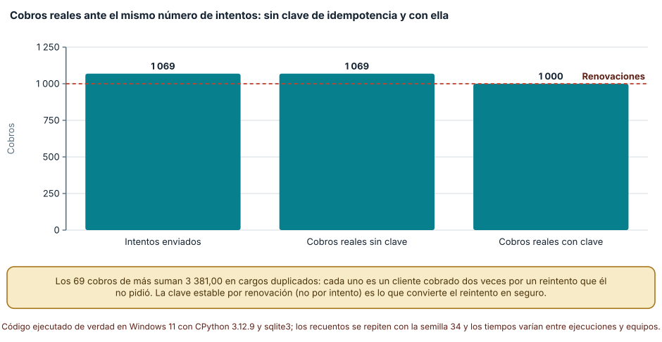

# SE-417 — Pagos, idempotencia y conciliación

[← SE-416 — Marketplaces y plataformas de dos lados](https://github.com/vladimiracunadev-create/modern-software-engineering-program/blob/main/classes/part-34-saas-y-plataformas-de-producto/se-416-marketplaces-y-plataformas-de-dos-lados/README.md) · [↑ Parte 34](https://github.com/vladimiracunadev-create/modern-software-engineering-program/blob/main/classes/part-34-saas-y-plataformas-de-producto/README.md) · [📚 Índice completo](https://github.com/vladimiracunadev-create/modern-software-engineering-program/blob/main/classes/README.md) · [🌐 Portal](https://vladimiracunadev-create.github.io/modern-software-engineering-program/classes/SE-417.html) · [SE-418 — Comercio electrónico: carrito, inventario, pagos y devoluciones →](https://github.com/vladimiracunadev-create/modern-software-engineering-program/blob/main/classes/part-34-saas-y-plataformas-de-producto/se-418-comercio-electronico-carrito-inventario-pagos-y-devoluciones/README.md)

## Punto profesional y fundamento pedagógico

**Punto profesional.** La clase existe para que construyas la parte del sistema donde un error cuesta dinero de verdad y casi nunca se ve en el momento: cobrar sin duplicar, registrar cada movimiento de modo que siempre cuadre y comprobar periódicamente que lo que dice tu libro es lo que el procesador y el banco dicen. Son tres disciplinas encadenadas. La *idempotencia* hace seguro repetir una petición cuando no sabes si llegó. La *partida doble* hace que cada movimiento tenga origen y destino y que un descuadre sea detectable por construcción. La *conciliación* compara tres versiones del mismo hecho (tu sistema, el procesador y el banco) y explica cada diferencia. Quien las trata como detalles de contabilidad descubre sus consecuencias en un cierre de mes.

**Por qué aparece aquí.** Es la clase donde convergen las anteriores: la suscripción de `SE-412` genera cobros, la medición de `SE-413` genera importes, el marketplace de `SE-416` reparte dinero. Retoma la idempotencia y la ejecución durable de `SE-246`, `SE-392` y `SE-596`, las invariantes monetarias de `SE-294` y las restricciones de `SE-352`. Prepara `SE-418` (pagos y devoluciones en el comercio electrónico) y el proyecto integrador `SE-420`.

**Error conceptual que debe corregir.** Creer que un reintento tras un tiempo de espera es seguro «porque el procesador rechazará un duplicado». El procesador no sabe que dos peticiones son la misma: las cobra dos veces salvo que le des una clave que las identifique. En el experimento de la clase, con 1 000 renovaciones de las que el 8 % se reintentó tras perder la respuesta (1 069 intentos), sin clave de idempotencia el procesador de ejemplo cobró **1 069 veces, 69 de más y 3 381,00 en cargos duplicados**; con una clave estable por renovación cobró 1 000. Y un segundo error acompaña al primero: creer que si el total del libro y el del procesador casi coinciden, todo está bien. En la conciliación de 500 cobros, el total del libro difería de la liquidación en 2 315 centavos, y esa diferencia era la suma de cuatro problemas distintos que se compensaban parcialmente.

**Secuencia de aprendizaje.** Antes de ejecutar, predices cuántos cobros de más habrá con y sin clave de idempotencia y qué pasa con la suma del libro si un asiento no cuadra. Después ejecutas el cobro con y sin clave, registras 500 cobros en un libro de partida doble con sqlite3, comparas con una liquidación a la que se le sembraron diferencias, explicas cada una y compruebas que el total cierra. Terminas escribiendo el procedimiento de conciliación de tu producto: qué se compara, cada cuánto, qué diferencias se aceptan y quién resuelve el resto.

**Evidencia de aprendizaje.** `pagos.md` con la clave de idempotencia de cada operación de cobro, el diseño del almacén de claves, el plan de cuentas mínimo, el asiento de cada evento de dinero (cobro, comisión, reembolso, liquidación), el procedimiento de conciliación con las diferencias que clasificas y la salida de tu ejecución con el total explicado.

**Límite de la conclusión.** Se ejecutó un procesador simulado (no se llamó a ningún servicio real ni se movió dinero) y un libro de partida doble con sqlite3 sobre 500 cobros con diferencias sembradas por el autor; las comisiones (2,9 % más 0,30) son del autor. No se evaluó el cumplimiento de PCI DSS ni de ninguna norma contable o fiscal. No se afirma revisión humana externa del contenido.

### Trazabilidad fuente → afirmación

| Fuente primaria u oficial | Afirmación que respalda | Lo que no prueba |
|---|---|---|
| [Stripe: solicitudes idempotentes](https://docs.stripe.com/api/idempotent_requests) | Una clave de idempotencia permite repetir una solicitud de forma segura; el sistema devuelve el resultado guardado, compara los parámetros con los de la solicitud original y da error si difieren, y las claves pueden eliminarse tras al menos 24 horas. | No describe cómo implementar tu propio almacén de claves. |
| [Stripe: PaymentIntents](https://docs.stripe.com/payments/payment-intents) | Modela un pago como un objeto con estados que avanza (requiere método, requiere acción, procesando, exitoso, cancelado). | No decide tus estados internos. |
| [Stripe: reembolsos](https://docs.stripe.com/refunds) y [disputas](https://docs.stripe.com/disputes) | Tratan el reembolso y la disputa como operaciones posteriores al cobro con su propio ciclo. | No fija la política de tu negocio ante cada una. |
| [Stripe: webhooks](https://docs.stripe.com/webhooks) | Los eventos se envían al producto, pueden repetirse y deben verificarse por firma. | No garantiza el orden de llegada. |
| [PCI SSC: PCI DSS](https://www.pcisecuritystandards.org/standards/pci-dss/) | Es el estándar de seguridad de datos para entidades que almacenan, procesan o transmiten datos de tarjetas. | No indica cuál es tu alcance concreto. |
| [Martin Fowler: Accounting Transaction](https://martinfowler.com/eaaDev/AccountingTransaction.html) | Presenta la transacción contable como un movimiento entre cuentas con entradas que suman cero. | No cubre un plan de cuentas completo. |
| [IETF: cabecera `Idempotency-Key` (borrador)](https://datatracker.ietf.org/doc/draft-ietf-httpapi-idempotency-key-header/) | Propone una cabecera HTTP estándar para claves de idempotencia en peticiones no idempotentes. | Es un borrador en curso, no una norma publicada. |

## Antes de empezar

Recupera lo aprendido en `SE-246` sobre idempotencia y en `SE-352` sobre invariantes: una operación repetida no cambia el resultado y una invariante es algo que siempre se cumple. La pregunta activa es: **si el servidor de pagos tarda 40 segundos en responder y tu servicio corta la conexión a los 30, ¿cobraste o no cobraste? ¿Y qué debería poder responder tu sistema una hora después sin preguntarle a nadie?**

## Prerrequisitos

- Haber completado `SE-409` a `SE-416`, y `SE-246`, `SE-392` y `SE-352` (idempotencia, procesamiento distribuido e invariantes).
- Conocer el ciclo de un pago con tarjeta: autorización, captura y liquidación.
- Saber SQL con restricciones `UNIQUE` y `CHECK` y transacciones.
- Python 3.11 o posterior; los experimentos usan `sqlite3` y la biblioteca estándar.

## Problema auténtico

*Tablero* cobra 1 000 renovaciones el primer día de cada mes. La llamada al procesador a veces tarda más que el tiempo máximo que el servicio acepta; el servicio considera que falló y reintenta. Un 8 % de los cobros se reintenta, y en cada reintento el procesador, que recibe una petición idéntica sin identificación, cobra otra vez. El mes siguiente, 69 clientes reciben dos cargos de 49,00. Soporte los reembolsa uno por uno, según el procesador la comisión del cobro original puede no devolverse y el departamento financiero pregunta por qué el procesador liquidó 3 381,00 más de lo que facturó el producto.

El equipo agrega una clave de idempotencia y el problema de los duplicados desaparece, pero aparece otro: al cierre de mes, el libro y el informe de liquidación del procesador difieren en 23,15. Nadie sabe por qué. Una persona dedica dos días a buscar y encuentra cuatro causas distintas: un cobro que está en el libro pero que el procesador no liquidó (esperando un reembolso parcial), un cobro con un monto distinto por una disputa parcial, un cobro que el procesador liquidó y el libro no conoce (un pago hecho desde otro entorno de pruebas de producción por error) y un asiento registrado dos veces por un reintento de un trabajo interno. Cada una se resuelve de forma distinta, y la suma neta de las cuatro (23,15) ocultaba que había cuatro problemas.

El problema de la clase es diseñar el sistema para que esas situaciones sean imposibles o detectables: cobros que se pueden repetir sin efecto, un libro en el que cada movimiento tiene dos lados que suman cero y no se edita, y una conciliación cobro por cobro que explica cada diferencia y que se ejecuta cada día, no cada fin de mes.

## Objetivos observables

Al terminar podrás:

1. diseñar una clave de idempotencia por operación de negocio (no por intento), un almacén que guarde la solicitud y su respuesta y el comportamiento ante la misma clave con parámetros distintos;
2. demostrar con una simulación que, sin clave, los reintentos tras una respuesta perdida cobran de más y que con una clave estable el número de cobros coincide con el de renovaciones;
3. registrar cobros, comisiones y reembolsos en un libro de partida doble con sqlite3, con asientos que suman cero, referencias únicas e inmutables, y comprobar que un reembolso es un asiento nuevo que revierte el anterior;
4. conciliar un libro con una liquidación, clasificar cada diferencia (falta en un lado, monto distinto, duplicado) y comprobar que la suma de las causas explica la brecha total;
5. explicar qué parte del manejo de dinero delegas a un procesador (datos de tarjeta, custodia) y qué parte sigue siendo tuya (libro, estados, conciliación, política de reembolsos).

## Mapa conceptual


La clave identifica la intención del negocio y el almacén decide si es nueva (llamar al procesador) o repetida (devolver lo guardado). El resultado llega como evento, se registra en el libro con un asiento y la conciliación compara el libro con la liquidación; lo que no cuadra se investiga y se corrige con un asiento nuevo, nunca editando uno anterior.

## Temas y por qué importan

| Tema | Por qué cambia una decisión profesional | Evidencia mínima |
|---|---|---|
| Ciclo de un pago | Autorizar, capturar, liquidar y reembolsar son estados distintos con dinero distinto. | Estados y eventos de un pago |
| Clave de idempotencia | Hace seguro reintentar tras una respuesta perdida. | Cobros con y sin clave |
| Almacén de claves | La clave por sí sola no basta: hay que guardar la solicitud y la respuesta. | Comportamiento ante clave repetida |
| Partida doble | Hace que un descuadre sea imposible de ocultar. | Asiento desbalanceado rechazado |
| Libro inmutable | La corrección es un asiento nuevo, no una edición. | Reembolso como asiento inverso |
| Conciliación | Compara tres versiones del hecho y explica la brecha. | Cuatro diferencias explicadas |
| Delegación y alcance | Qué datos y qué custodia quedan fuera de tu sistema. | Lista de lo que no almacenas |

## Conceptos y decisiones

### 1. Un pago es un ciclo con varios estados, y el dinero se mueve en distintos momentos

Pagar con tarjeta no es un solo acto. El comprador autoriza (el emisor reserva el importe), el comerciante captura (reclama el importe reservado), el procesador liquida (transfiere los fondos, descontando comisiones, en un lote posterior) y, si procede, se reembolsa (devuelve) o se disputa (el titular impugna el cargo y el emisor retira los fondos mientras se resuelve). Los procesadores modelan esto con un objeto de pago con estados (por ejemplo, requiere método, requiere acción, procesando, exitoso, cancelado). El producto no debe reducirlo a «pagado: sí/no»: cada estado implica un saldo distinto y una obligación distinta, y el libro debe poder representar lo que ya ocurrió y lo pendiente.

### 2. La clave de idempotencia identifica la intención, no el intento

Si el servicio no sabe si un cobro ocurrió, repetirlo es peligroso y no repetirlo también. Una clave de idempotencia resuelve el dilema: el servicio genera una clave para la *operación de negocio* («renovación del cliente 17 del periodo 2026-11»), la envía con la solicitud y, si hay que reintentar, envía la misma clave; el procesador, que ya la vio, devuelve el resultado guardado en lugar de cobrar otra vez. En el experimento, con clave por renovación, 1 069 intentos produjeron **1 000 cobros**; sin clave (una clave distinta por intento), produjeron 1 069. La clave debe ser determinista respecto de la operación (se puede reconstruir) y única por operación; un UUID nuevo por intento anula la protección. Los procesadores documentan sus reglas: por ejemplo, que comparan los parámetros de la solicitud nueva con los de la original y devuelven un error si difieren, y que pueden eliminar las claves pasadas al menos 24 horas, de modo que una clave reutilizada después genera una solicitud nueva.

### 3. Tu propio sistema también necesita un almacén de claves

La idempotencia no es solo para llamar al procesador: cualquier operación de tu API que mueva dinero (iniciar un reembolso, crear una factura, ejecutar un pago a un vendedor) debe poder repetirse sin efecto adicional. El patrón: una tabla con la clave, un resumen de los parámetros, el estado (en curso, terminada) y la respuesta. Al llegar una petición, se intenta insertar la clave; si ya existe y está terminada, se devuelve la respuesta guardada; si existe con parámetros distintos, se rechaza con un error claro; si está en curso, se devuelve un conflicto o se espera. La inserción y la ejecución deben ser coherentes: si el servicio se cae entre ambas, la clave queda «en curso» y necesita un tiempo máximo y una forma de recuperarla. El borrador del IETF sobre la cabecera `Idempotency-Key` propone un vocabulario común para ello, aún en discusión.

### 4. La partida doble hace que un descuadre sea imposible de esconder

En un libro de partida doble cada movimiento (un *asiento*) afecta como mínimo a dos cuentas, con débitos y créditos que suman lo mismo. Un cobro de 49,00 con una comisión de 1,72 se registra así: débito a «procesador por cobrar» 47,28, débito a «comisiones» 1,72, crédito a «ingresos» 49,00. Los totales de ambos lados son iguales; si alguien intenta registrar uno que no (`100` contra `90`), la función de registro lo rechaza (en el experimento, «asiento desbalanceado»). La propiedad que se obtiene es que **la suma de todos los débitos es igual a la suma de todos los créditos, siempre**, y por tanto cualquier error que rompa esa igualdad se detecta de inmediato. No impide errores de otra naturaleza (un importe equivocado en ambos lados), pero elimina la clase de errores en los que un lado se registra y el otro se olvida.

### 5. Los importes son enteros y los asientos no se editan

Los importes se guardan en la unidad mínima de la moneda (centavos) como enteros; la coma flotante binaria no representa exactamente 0,10 y acumula diferencias que, a escala, aparecen en la conciliación. Una restricción `CHECK` impide débitos o créditos negativos y apuntes con ambos lados. Una vez registrado, un asiento no se modifica ni se borra: un error se corrige con un asiento nuevo que lo revierte y, si procede, otro con el valor correcto, ambos con su motivo. En el experimento, un reembolso es un asiento que invierte el cobro (débito a ingresos, crédito a la cuenta por cobrar y a comisiones) y los saldos de las tres cuentas vuelven a cero con dos asientos registrados. El historial completo es lo que permite auditar.

### 6. La referencia única hace idempotente el libro

Cada asiento lleva una referencia externa única (el identificador del cobro del procesador, el de la factura): la restricción `UNIQUE` hace que registrar dos veces el mismo hecho no cree un segundo asiento. Es la misma técnica del medidor de uso (`SE-413`) aplicada al dinero. En el experimento de conciliación se sembró un asiento repetido con otra referencia local (`inv-0100-dup`) para el mismo cobro: el libro lo aceptó porque la referencia era distinta, y fue una de las cuatro causas de diferencia. Si la referencia del procesador hubiera sido la clave única, el segundo asiento habría fallado. La lección es qué se elige como identificador: el del hecho original, no el de tu propio proceso.

### 7. Conciliar es comparar tres versiones de un hecho y explicar cada diferencia

Tu libro dice qué crees que ocurrió; el informe de liquidación del procesador, qué se movió; el extracto bancario, qué llegó. La conciliación los compara por una clave común (el identificador del cobro) y clasifica las diferencias: **en tu libro y no en la liquidación** (cobros pendientes, retenidos o fallidos), **en la liquidación y no en el libro** (cobros que tu sistema no conoce), **con importes distintos** (disputas, reembolsos parciales, comisiones) y **duplicados**. En el experimento, de 500 cobros: uno estaba en el libro sin liquidar (1 815 centavos), uno tenía un monto distinto (500), uno estaba en la liquidación y no en el libro (4 728), y un asiento estaba repetido (4 728). La suma neta de las cuatro es 1 815 + 500 − 4 728 + 4 728 = **2 315**, exactamente la brecha entre los totales (5 900 255 del libro menos 5 897 940 de la liquidación).

### 8. Mirar solo el total oculta los problemas que se compensan

Una brecha de 2 315 sobre 5,9 millones es un 0,04 %: tentadora de aceptar como «ruido». Pero está formada por cuatro causas que tienen origen y remedio distintos y que, por casualidad, se compensan en parte (el cobro desconocido de 4 728 y el asiento repetido de 4 728 se anulan). Un procedimiento que concilia cobro por cobro encuentra tres de las cuatro diferencias por comparación directa; la cuarta aparece porque, tras explicar las tres, sobran 4 728 en el total, exactamente el monto de un asiento repetido. La regla es explicar *toda* la brecha, no aceptar una diferencia pequeña; una brecha sin explicar crece con el tiempo y, cuando es grande, nadie recuerda qué la causó.

### 9. La conciliación se ejecuta cada día, con tolerancia declarada

Conciliar a fin de mes obliga a investigar miles de movimientos. Conciliar cada día acota la investigación a un lote pequeño y detecta problemas mientras es posible corregirlos con el procesador o con el cliente. La conciliación diaria compara el libro con la liquidación del día (o de la ventana de liquidación, que puede tardar días), clasifica, genera un informe de diferencias con su antigüedad y alerta cuando una diferencia lleva más de N días sin explicar. Define de antemano qué diferencias se aceptan sin intervención (un redondeo de un centavo, por ejemplo, con un límite diario) y quién resuelve el resto.

### 10. Delegar tarjetas y custodia no te quita la responsabilidad del libro

Los procesadores permiten que los datos de tarjeta nunca toquen tu sistema (el navegador los envía directamente al procesador y tu servidor recibe un identificador): eso reduce el alcance de PCI DSS, el estándar para quienes almacenan, procesan o transmiten datos de tarjetas, pero no lo elimina: sigues siendo responsable de cómo integras y de proteger lo que sí tienes. Tampoco te quita la tarea de llevar el libro, los estados, la conciliación, la política de reembolsos y la respuesta a disputas. Una arquitectura sensata delega lo que un especialista hace mejor (custodia de datos de tarjeta, autorización, lucha contra el fraude de tarjetas) y conserva lo que es del negocio (qué se cobra, a quién, con qué estado y cómo se registra).

## Cobros reales con y sin clave



**Cómo leer la figura.** La primera barra es lo que el servicio envió y las otras dos lo que el procesador cobró sin y con clave. La línea punteada marca las 1 000 renovaciones que debían cobrarse. Mira que sin clave el procesador cobra todos los intentos, y que con clave el número coincide con la línea. **Dónde deja de valer:** el procesador es un doble simulado que respeta la clave; uno real tiene su propia política (duración de las claves, comparación de parámetros) y puede fallar de otras maneras (un cobro a medias, una respuesta ambigua). La simulación no prueba que tu clave sea estable en todos los reintentos.

## Un reintento seguro


**Cómo leer la figura.** Cada carril es un actor y el eje es el tiempo. El servicio espera en rojo, el procesador ya cobró en azul, y cuando el servicio repite con la misma clave el procesador responde con lo guardado (amarillo). El libro registra un único asiento al final. **Dónde deja de valer:** los tiempos son del autor y la secuencia supone que el procesador conserva la clave; si la clave expira antes del reintento (por ejemplo, tras más de 24 horas en algunos procesadores), el reintento crea un cobro nuevo.

## Cuatro diferencias que se compensan


**Cómo leer la figura.** Cada barra es una diferencia con su causa. Las dos últimas miden lo mismo y tienen signos contrarios en la brecha: por eso el total de 2 315 es menor que cualquiera de ellas. **Dónde deja de valer:** las diferencias fueron sembradas por el autor; en un sistema real las causas son más numerosas (comisiones, redondeos, monedas, ajustes del procesador) y varias llegan con retraso.

## Definiciones de trabajo

- **[Autorización, captura, liquidación](../../../glosario/entradas/a/autorizacion-captura-liquidacion.md):** reserva de un importe, reclamo de lo reservado y transferencia efectiva de fondos.
- **[Clave de idempotencia](../../../glosario/entradas/c/clave-de-idempotencia.md):** identificador de una operación de negocio que permite repetirla sin duplicar su efecto.
- **[Asiento](../../../glosario/entradas/a/asiento.md):** movimiento contable con apuntes cuyos débitos y créditos suman lo mismo.
- **[Partida doble](../../../glosario/entradas/p/partida-doble.md):** método en el que cada movimiento afecta a dos o más cuentas con sumas iguales.
- **[Referencia externa única](../../../glosario/entradas/r/referencia-externa-unica.md):** identificador del hecho original, con restricción de unicidad en el libro.
- **[Conciliación](../../../glosario/entradas/c/conciliacion.md):** comparación de dos fuentes del mismo hecho y explicación de sus diferencias.
- **[Contracargo (disputa)](../../../glosario/entradas/c/contracargo.md):** impugnación de un cargo por el titular de la tarjeta.
- **[Liquidación](../../../glosario/entradas/l/liquidacion.md):** informe y transferencia de fondos que el procesador entrega tras descontar comisiones.

## Ejemplo mínimo

Un libro de partida doble con referencia única y un reembolso que revierte:

```python
import sqlite3

db = sqlite3.connect(":memory:")
db.executescript("""
CREATE TABLE asiento (id INTEGER PRIMARY KEY, referencia TEXT UNIQUE NOT NULL);
CREATE TABLE apunte (asiento_id INTEGER NOT NULL REFERENCES asiento(id), cuenta TEXT NOT NULL,
                     debe INTEGER NOT NULL DEFAULT 0, haber INTEGER NOT NULL DEFAULT 0,
                     CHECK (debe >= 0 AND haber >= 0 AND (debe = 0 OR haber = 0)));
""")


def registrar(referencia: str, lineas: list[tuple[str, int, int]]) -> bool:
    if sum(d for _, d, _ in lineas) != sum(h for _, _, h in lineas):
        raise ValueError("asiento desbalanceado")
    try:
        cur = db.execute("INSERT INTO asiento(referencia) VALUES (?)", (referencia,))
    except sqlite3.IntegrityError:
        return False                                  # la misma referencia ya está registrada
    db.executemany("INSERT INTO apunte VALUES (?,?,?,?)", [(cur.lastrowid, c, d, h) for c, d, h in lineas])
    return True


cobro = [("procesador_por_cobrar", 4728, 0), ("comisiones", 172, 0), ("ingresos", 0, 4900)]
print(registrar("cobro-1", cobro), registrar("cobro-1", cobro))      # True False
try:
    registrar("roto", [("caja", 100, 0), ("ingresos", 0, 90)])
except ValueError as error:
    print(error)                                                      # asiento desbalanceado
registrar("reembolso-1", [("ingresos", 4900, 0), ("procesador_por_cobrar", 0, 4728), ("comisiones", 0, 172)])
print(db.execute("SELECT cuenta, SUM(debe - haber) FROM apunte GROUP BY cuenta ORDER BY cuenta").fetchall())
# [('comisiones', 0), ('ingresos', 0), ('procesador_por_cobrar', 0)]
```

Registrar el mismo cobro dos veces no crea un segundo asiento; un asiento desbalanceado se rechaza antes de tocar la base; y el reembolso deja las tres cuentas en cero con dos asientos conservados en el historial. Todo ocurre en una transacción en una base real, para que un fallo no deje un asiento sin apuntes.

## Ejemplo profesional

*Escenario ilustrativo: las cifras y los resultados de este ejemplo son supuestos de la narración, no mediciones.*

El equipo de *Tablero* ordena su manejo del dinero en tres capas. Primero, la clave de idempotencia: cada operación de cobro usa `renovacion:{cliente}:{periodo}`, y el almacén de claves guarda la solicitud (con un resumen de los parámetros), el estado y la respuesta; un reintento con la misma clave y los mismos parámetros devuelve lo guardado y con parámetros distintos devuelve un error. Segundo, el libro: plan de siete cuentas (por cobrar del procesador, caja, ingresos de suscripción, ingresos de uso, comisiones, reembolsos, disputas), asientos con la referencia del procesador como clave única y una prueba que recorre todos los eventos del procesador de un mes de ensayo y comprueba que cada uno tiene su asiento.

Tercero, la conciliación diaria: un trabajo descarga el informe de liquidación, lo compara con el libro por referencia, clasifica las diferencias (faltantes en cada lado, montos distintos, duplicados) y escribe un informe con la antigüedad de cada una. Las diferencias de menos de un centavo por redondeo se aceptan con un límite de diez al día; todas las demás generan una tarea con responsable. La primera semana encuentra tres cobros de un entorno de ensayo configurado contra producción; el equipo corrige la configuración y añade una comprobación al despliegue. Al mes, el cierre pasa de dos días de investigación a unas horas, y la brecha media sin explicar baja a cero. Lo que no pueden resolver sin el procesador (una disputa pendiente) queda registrado con fecha y estado.

## Práctica guiada

1. Ejecuta `python scripts/experiments_part34_ledger.py` y compara tus predicciones de cobros de más con y sin clave y de brecha total con las líneas de salida.
2. Cambia el porcentaje de reintentos de 8 % a 25 % y observa cuántos cobros de más aparecen sin clave y con clave.
3. Quita la restricción `UNIQUE` de la referencia del asiento y repite la conciliación: ¿qué diferencias nuevas aparecen?
4. Añade un caso a la conciliación: una disputa que el procesador retiró de la liquidación. Decide qué asiento lo registra y cómo lo explica el informe.
5. Escribe la clave de idempotencia de cada operación de dinero de tu sistema (cobro, reembolso, pago a vendedor) y di qué ocurre si dos operaciones distintas colisionan en la misma clave.

## Ejercicios

1. **Básico.** Explica por qué una clave nueva en cada reintento no protege de un doble cobro y cómo debe generarse.
2. **Intermedio.** Diseña la tabla de claves de idempotencia de *Tablero*: columnas, restricciones, qué guardas de la respuesta, cuánto tiempo y cómo tratas una clave «en curso» después de una caída del servicio.
3. **Avanzado.** Con los datos del experimento (cuatro diferencias, brecha de 2 315), propón el procedimiento de resolución de cada una: quién la investiga, qué evidencia pide, qué asiento de corrección registra y qué cambio en el sistema evita que se repita.

## Reto verificable

Entrega `pagos.md`, un libro de partida doble con referencia única y una conciliación con al menos cuatro tipos de diferencias sembradas y explicadas. Es válido si otra persona ejecuta tu código, obtiene la misma brecha y la misma clasificación, y la suma de las causas coincide con la brecha.

## Caso conductor

*Tablero* tuvo cobros duplicados primero y un descuadre sin explicar después. Esta clase da las tres piezas: claves de idempotencia, libro de partida doble inmutable y conciliación diaria. El caso de estudio de Stripe del curso muestra cómo una empresa de pagos trata la idempotencia, los eventos y el dinero como invariantes; en `SE-418` se aplican a una tienda con carrito, inventario y devoluciones.

## Preguntas frecuentes

### ¿Basta con que el procesador sea idempotente?

No. El procesador protege su propia llamada si le envías una clave; tu sistema tiene además operaciones propias (crear facturas, registrar asientos, notificar) que también deben ser idempotentes, y tu libro necesita sus propias referencias únicas.

### ¿Se pueden borrar asientos erróneos?

No en un libro contable serio: se corrigen con asientos nuevos que revierten el error y registran el valor correcto, con su motivo. El historial es parte de la evidencia. Una excepción son los datos de pruebas, que no deben vivir en la base de producción.

### ¿Cada cuánto se concilia?

Cada día para los cobros y los movimientos de dinero, y con el banco cuando llegan los extractos. La frecuencia depende del volumen y de cuánto tarda el procesador en liquidar, pero el criterio es que el lote a investigar sea pequeño y reciente.

### ¿Qué hago con el dinero en distintas monedas?

Guarda el importe y la moneda en cada apunte, nunca mezcles monedas en una suma y registra las conversiones como asientos con su tasa y su fecha. Es un caso especial que multiplica las diferencias posibles; si el producto es multimoneda, se diseña desde el principio.

## Fallo controlado y diagnóstico

**Fallo.** La conciliación diaria reporta 41 cobros «en la liquidación y no en el libro» cada lunes, siempre por importes parecidos.

**Diagnóstico paso a paso.** (1) Se revisa la antigüedad: los 41 corresponden al sábado y al domingo. (2) El trabajo que escribe los asientos de cobros se ejecuta de lunes a viernes y lee eventos del procesador con una consulta por fecha local del servidor. (3) Los eventos del fin de semana quedan fuera de la consulta del viernes (cierra a las 23:59 de la hora del servidor) y entran el lunes con una fecha de creación de sábado que el trabajo del lunes no incluye porque filtra «ayer». (4) Se corrige haciendo que el trabajo lea los eventos por identificador pendiente (los no registrados) y no por fecha, de modo que no dependa del reloj; se añade una prueba con un evento de fin de semana. (5) La conciliación del lunes siguiente no reporta diferencias. (6) Se documenta que la conciliación detectó el defecto: sin ella, los 41 cobros no habrían figurado en los ingresos del mes.

**Lección.** Un trabajo que lee por ventana de tiempo pierde lo que cae entre ventanas; leer por «lo que aún no he procesado» es robusto. Y la conciliación diaria es el control que convierte una pérdida silenciosa en una alerta de lunes.

## Errores comunes y cómo corregirlos

- **Una clave nueva por intento.** No protege. Corrige derivándola de la operación de negocio.
- **Guardar solo la clave y no la respuesta.** Un reintento no sabe qué devolver. Corrige guardando la respuesta y comparando los parámetros.
- **Importes con coma flotante.** Se acumulan diferencias. Corrige con enteros en la unidad mínima.
- **Editar o borrar asientos.** Se pierde el historial. Corrige con asientos de reversión.
- **Conciliar solo el total.** Las causas se compensan. Corrige cobro por cobro y explicando toda la brecha.
- **Usar la referencia propia como única.** Se duplica el hecho con otra referencia. Corrige usando la referencia del hecho original.

## Entorno y archivos clave

- `scripts/experiments_part34_ledger.py`: funciones `experimento_doble_cobro`, `experimento_conciliacion`, `experimento_asiento_invalido` y `experimento_reembolso`; se ejecuta con `python scripts/experiments_part34_ledger.py`.
- `scripts/figures_part34_b.py`: las tres figuras de la clase.
- Requiere Python 3.11 o posterior y solo la biblioteca estándar; no se llama a ningún servicio de pagos.

## Seguridad, ética y accesibilidad

No almacenes ni registres números completos de tarjeta ni códigos de seguridad: usa el identificador que entrega el procesador y trata los registros de depuración como datos sensibles. Verifica la firma de cada evento del procesador y protege las claves de API con gestión de secretos (`SE-462`). Restringe quién puede crear asientos de ajuste y registra quién lo hizo, porque son la vía más directa para ocultar un fraude. Los reembolsos y los contracargos afectan a personas: explica con claridad los plazos y los motivos en cada comunicación, no uses patrones oscuros para dificultar un reembolso legítimo y ofrece los avisos de cobro por canales accesibles. Las diferencias de conciliación que afectan a un cliente se corrigen en su favor y se le informa cuando se resuelven.

## Puente hacia el trabajo con agentes

Un agente que ayude con el soporte o la contabilidad nunca debería ejecutar directamente movimientos de dinero. Dale herramientas de solo lectura (consultar un cobro, el estado de un asiento, el informe de conciliación) y, para acciones que mueven dinero (un reembolso), una herramienta que *proponga* la operación con su clave de idempotencia y exija la aprobación de una persona con un límite por importe. Si un agente repite una acción por error, la clave la vuelve inofensiva; si propone una equivocada, la aprobación la detiene. Registra cada propuesta y su resultado para poder auditar qué hizo el agente y por qué.

## Transferencia

Haz la lista de cada lugar de tu sistema (o de uno que conozcas) donde se mueve dinero o algo equivalente (créditos, puntos, saldos) y responde para cada uno: ¿qué ocurre si se repite?, ¿cómo sabría si falta o sobra algo?, ¿quién lo verifica y cada cuánto? Donde no haya respuesta, falta una clave, un libro o una conciliación.

## Evaluación y evidencia

| Criterio | Evidencia aceptable | Rechazo |
|---|---|---|
| Idempotencia | Cobros con y sin clave, clave por operación y almacén con respuesta | Un UUID por intento |
| Libro | Asientos balanceados, enteros, referencia única e inmutabilidad | Un campo de saldo editable |
| Reversión | Reembolso como asiento nuevo | Borrar o editar el cobro |
| Conciliación | Clasificación de diferencias y suma de causas igual a la brecha | Aceptar una brecha «pequeña» |
| Alcance | Qué delegas y qué sigue siendo tuyo | «Stripe se ocupa» |

## Fuentes

- Stripe. [Solicitudes idempotentes](https://docs.stripe.com/api/idempotent_requests), [PaymentIntents](https://docs.stripe.com/payments/payment-intents), [reembolsos](https://docs.stripe.com/refunds), [disputas](https://docs.stripe.com/disputes) y [webhooks](https://docs.stripe.com/webhooks).
- IETF. [Borrador de la cabecera `Idempotency-Key`](https://datatracker.ietf.org/doc/draft-ietf-httpapi-idempotency-key-header/).
- Fowler, M. [Accounting Transaction](https://martinfowler.com/eaaDev/AccountingTransaction.html).
- PCI Security Standards Council. [PCI DSS](https://www.pcisecuritystandards.org/standards/pci-dss/).
- SQLite. [`UPSERT`](https://www.sqlite.org/lang_upsert.html) y [aislamiento](https://www.sqlite.org/isolation.html).
- Caso de estudio del curso: [Stripe](https://github.com/vladimiracunadev-create/modern-software-engineering-program/blob/main/casos/exito/stripe.md).

## Límites y siguiente paso

Se ejecutaron un procesador simulado, un libro de partida doble con sqlite3 y una conciliación con diferencias sembradas por el autor; no se llamó a ningún procesador real, no se movió dinero, no se evaluó PCI DSS ni normas fiscales o contables, y las comisiones son del autor. El siguiente paso, `SE-418`, aplica estos mecanismos a una tienda con carrito, inventario, pagos y devoluciones, y mide qué ocurre cuando muchos compradores piden a la vez la misma unidad.

## Glosario

| Término | Definición breve |
|---|---|
| Autorización | Reserva de un importe por el emisor |
| Captura | Reclamo del importe reservado |
| Liquidación | Transferencia de fondos tras descontar comisiones |
| Clave de idempotencia | Identificador de una operación que permite repetirla |
| Asiento | Movimiento contable con débitos y créditos que suman igual |
| Partida doble | Cada movimiento afecta a dos o más cuentas con sumas iguales |
| Conciliación | Comparación de fuentes y explicación de diferencias |
| Contracargo | Impugnación de un cargo por el titular |

Conceptos de esta clase en el [glosario del programa](../../../glosario/README.md): [Asiento](../../../glosario/entradas/a/asiento.md) · [Autorización, captura, liquidación](../../../glosario/entradas/a/autorizacion-captura-liquidacion.md) · [Clave de idempotencia](../../../glosario/entradas/c/clave-de-idempotencia.md) · [Conciliación](../../../glosario/entradas/c/conciliacion.md) · [Contracargo](../../../glosario/entradas/c/contracargo.md) · [Liquidación](../../../glosario/entradas/l/liquidacion.md) · [Partida doble](../../../glosario/entradas/p/partida-doble.md) · [Referencia externa única](../../../glosario/entradas/r/referencia-externa-unica.md).

---

[← SE-416 — Marketplaces y plataformas de dos lados](https://github.com/vladimiracunadev-create/modern-software-engineering-program/blob/main/classes/part-34-saas-y-plataformas-de-producto/se-416-marketplaces-y-plataformas-de-dos-lados/README.md) · [↑ Parte 34](https://github.com/vladimiracunadev-create/modern-software-engineering-program/blob/main/classes/part-34-saas-y-plataformas-de-producto/README.md) · [📚 Índice completo](https://github.com/vladimiracunadev-create/modern-software-engineering-program/blob/main/classes/README.md) · [🌐 Portal](https://vladimiracunadev-create.github.io/modern-software-engineering-program/classes/SE-417.html) · [SE-418 — Comercio electrónico: carrito, inventario, pagos y devoluciones →](https://github.com/vladimiracunadev-create/modern-software-engineering-program/blob/main/classes/part-34-saas-y-plataformas-de-producto/se-418-comercio-electronico-carrito-inventario-pagos-y-devoluciones/README.md)
