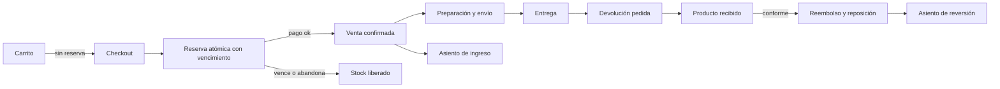
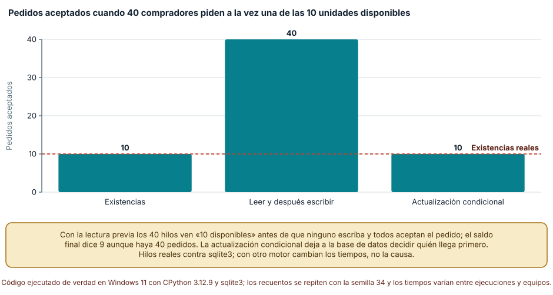
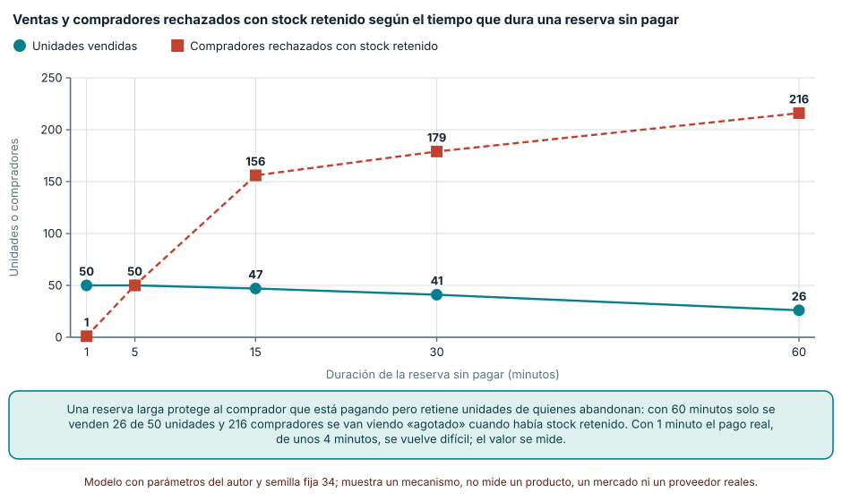

# SE-418 — Comercio electrónico: carrito, inventario, pagos y devoluciones

[← SE-417 — Pagos, idempotencia y conciliación](https://github.com/vladimiracunadev-create/modern-software-engineering-program/blob/main/classes/part-34-saas-y-plataformas-de-producto/se-417-pagos-idempotencia-y-conciliacion/README.md) · [↑ Parte 34](https://github.com/vladimiracunadev-create/modern-software-engineering-program/blob/main/classes/part-34-saas-y-plataformas-de-producto/README.md) · [📚 Índice completo](https://github.com/vladimiracunadev-create/modern-software-engineering-program/blob/main/classes/README.md) · [🌐 Portal](https://vladimiracunadev-create.github.io/modern-software-engineering-program/classes/SE-418.html) · [SE-419 — SLA por nivel, soporte y operación del producto →](https://github.com/vladimiracunadev-create/modern-software-engineering-program/blob/main/classes/part-34-saas-y-plataformas-de-producto/se-419-sla-por-nivel-soporte-y-operacion-del-producto/README.md)

## Punto profesional y fundamento pedagógico

**Punto profesional.** La clase existe para que construyas el camino que va de «quiero esto» a «lo recibí» y vuelve si algo sale mal, sabiendo en cada tramo qué se promete y qué se puede cumplir. Una tienda en línea parece una aplicación sencilla (listar productos, añadir al carrito, pagar) y concentra casi todos los problemas de coordinación del software: un recurso limitado que muchos piden a la vez (el inventario), un proceso largo con varios sistemas (pago, almacén, transporte), operaciones que no se pueden repetir (cobrar, enviar) y obligaciones posteriores a la venta (devoluciones, reembolsos). Es el lugar donde la idempotencia, la concurrencia y el libro mayor de las clases anteriores se encuentran con una persona que quiere su camiseta.

**Por qué aparece aquí.** Sigue a `SE-417`, que dio el cobro idempotente, el libro de partida doble y la conciliación; aquí se usan sobre un flujo de compra completo. Se apoya en las transacciones y el aislamiento de `SE-351`, en las invariantes de `SE-352`, en la ejecución durable de `SE-596` y en la medición de la demanda de `SE-404`. Prepara `SE-419`, donde la operación del producto se compromete a niveles de servicio, y el taller `SE-420`.

**Error conceptual que debe corregir.** Creer que «comprobar el stock antes de vender» evita vender de más. Comprobar y luego escribir son dos pasos; entre ellos, otros compradores comprueban lo mismo. En el experimento de la clase, 40 compradores piden a la vez una de las 10 unidades disponibles: con «leer el saldo, validar y escribir el saldo menos uno», los 40 leyeron «10 disponibles» antes de que ninguno escribiera y **los 40 pedidos fueron aceptados: 30 unidades vendidas de más**, con un saldo final de 9. Se repitió cinco veces y el resultado fue idéntico (30). Con una sola sentencia que descuenta y comprueba a la vez (`UPDATE … SET disponible = disponible − 1 WHERE disponible > 0`), los pedidos aceptados fueron exactamente 10. La corrección no es un orden más cuidadoso del código sino una operación atómica en el lugar donde vive la verdad.

**Secuencia de aprendizaje.** Antes de ejecutar, predices cuántos pedidos se aceptan con y sin una operación atómica cuando 40 compradores piden a la vez 10 unidades, y cuántas unidades se venden con una reserva sin pagar que dura 1, 15 o 60 minutos. Después ejecutas el experimento con hilos reales contra sqlite3, la simulación de reservas con semilla fija y una máquina de estados del pedido, y lees tres figuras. Terminas escribiendo la política de inventario, reserva y devolución de una tienda con sus invariantes y las pruebas que las vigilan.

**Evidencia de aprendizaje.** `tienda.md` con los números de inventario que distingues (físico, reservado, vendible), la operación atómica que reserva y vende, el tiempo de reserva elegido con su justificación medida, los estados del pedido con el efecto de cada uno en el inventario y el libro, la política de devoluciones y la prueba de concurrencia que demuestra que no se vende de más.

**Límite de la conclusión.** Se ejecutaron 40 hilos reales contra sqlite3 en un archivo temporal (el motor serializa las escrituras, de modo que la prueba muestra la lógica, no el comportamiento de una base de producción con réplicas) y una simulación de reservas con semilla 34 y parámetros del autor (50 unidades, 300 compradores, 65 % de abandono); no se probó un motor distinto, un almacén físico ni un proveedor de envíos. No se afirma revisión humana externa del contenido.

### Trazabilidad fuente → afirmación

| Fuente primaria u oficial | Afirmación que respalda | Lo que no prueba |
|---|---|---|
| [SQLite: aislamiento](https://www.sqlite.org/isolation.html) | Documenta que las transacciones de SQLite son serializables y cómo se comportan las lecturas y escrituras concurrentes. | No describe otros motores, que ofrecen niveles distintos por defecto. |
| [SQLite: `UPSERT`](https://www.sqlite.org/lang_upsert.html) | Define las sentencias que combinan inserción y actualización condicional en una operación. | No es una guía de diseño de inventario. |
| [Stripe: PaymentIntents](https://docs.stripe.com/payments/payment-intents) | Modela el pago como objeto con estados y separa la autorización de la captura. | No fija cuándo conviene capturar en tu tienda. |
| [Stripe: reembolsos](https://docs.stripe.com/refunds) | Trata el reembolso como operación posterior sobre un pago, total o parcial. | No define tu política de devoluciones. |
| [Shopify Engineering: balanceo de fragmentos](https://shopify.engineering/mysql-database-shard-balancing-terabyte-scale) | Describe cómo una plataforma de comercio mueve tiendas entre fragmentos de MySQL con casi nula interrupción. | No es una guía para una tienda pequeña. |
| [PCI SSC: PCI DSS](https://www.pcisecuritystandards.org/standards/pci-dss/) | Es el estándar de seguridad para quienes manejan datos de tarjetas. | No indica tu alcance concreto. |

## Antes de empezar

Recupera lo aprendido en `SE-351` sobre transacciones y aislamiento: dos transacciones que leen y luego escriben pueden pisarse. La pregunta activa es: **si dos personas pulsan «comprar» sobre la última unidad con diez milisegundos de diferencia, ¿qué parte de tu sistema decide quién se la queda, y dónde está escrita esa decisión?**

## Prerrequisitos

- Haber completado `SE-417` (pagos, idempotencia y conciliación), `SE-351` y `SE-352` (transacciones, aislamiento e invariantes).
- Conocer la máquina de estados de `SE-412` y el libro de `SE-417`.
- Saber qué es una condición de carrera y una operación atómica.
- Python 3.11 o posterior; los experimentos usan `sqlite3`, `threading` y `tempfile` de la biblioteca estándar.

## Problema auténtico

*Tablero* abre una tienda de merchandising con 50 camisetas de una edición limitada. El lanzamiento se anuncia a las 12:00. A las 12:00:02 llegan 300 personas. La tienda lee el stock, muestra «quedan 3» y, tres segundos después, 58 pedidos están aceptados para 50 unidades. Hay que escribir 8 correos de disculpa y reembolsar 8 pagos, y quienes los reciben se enteran por redes sociales de que otros recibieron lo mismo.

El equipo corrige el inventario y descubre otro problema, de signo contrario: añadió una reserva de 30 minutos al agregar al carrito para que nadie pierda su unidad mientras paga. Con 300 compradores y un 65 % de abandono, a los 20 minutos hay 40 unidades «reservadas» por personas que ya cerraron la pestaña, y los compradores nuevos ven «agotado» cuando hay stock físico. Al fin de la hora se vendieron 26 de las 50 unidades: el producto se agotó para quienes querían comprar y sobró para nadie.

Después llega el tercer problema: las devoluciones. Un cliente devuelve una camiseta; el sistema la repone al inventario al registrar la solicitud, no al recibirla; se vende a otro; la camiseta devuelta nunca llega, y hay dos clientes con derecho a una unidad. Y el cuarto: el reembolso se hace desde el panel del procesador y el libro de ingresos no se entera.

Cuatro problemas, un mismo origen: no se modeló el inventario, la reserva, el pedido y la devolución como estados con reglas, y no se puso la verificación donde la verdad vive. El problema de la clase es diseñarlos, medir cada compromiso y probarlo con concurrencia real.

## Objetivos observables

Al terminar podrás:

1. distinguir inventario físico, reservado y vendible, y explicar qué estado del pedido cambia cada número;
2. demostrar con hilos reales que «leer, validar y escribir» vende de más y que una actualización condicional atómica no lo hace;
3. elegir la duración de una reserva sin pagar con una simulación y explicar el compromiso entre proteger al que paga y bloquear stock a quien abandona;
4. diseñar los estados de un pedido y de una devolución con el efecto de cada uno sobre el inventario, el pago y el libro mayor;
5. escribir las pruebas de concurrencia y de idempotencia que protegen las invariantes («nunca se acepta más de lo disponible», «cada reembolso tiene su asiento»).

## Mapa conceptual



El carrito es una intención sin compromiso; el checkout convierte la intención en reserva con vencimiento y la reserva en venta al confirmarse el pago. La liberación al vencer devuelve el stock. Tras la entrega, la devolución es otro proceso con sus estados: la reposición ocurre al recibir el producto y el reembolso genera su asiento de reversión.

## Temas y por qué importan

| Tema | Por qué cambia una decisión profesional | Evidencia mínima |
|---|---|---|
| Tres números de inventario | Físico, reservado y vendible responden a preguntas distintas. | Definición de cada uno |
| Operación atómica | Es la única forma de que no se acepte más de lo que hay. | 40 hilos, 10 unidades, 10 pedidos |
| Reserva con vencimiento | Protege al que paga y puede bloquear a todos. | Ventas según el tiempo de reserva |
| Estados del pedido | Cada estado cambia inventario, pago y libro. | Diagrama con efectos |
| Captura del pago | Cobrar al reservar o al enviar cambia el riesgo. | Decisión justificada |
| Devoluciones | Reponer demasiado pronto vende lo que no está. | Reposición al recibir |
| Idempotencia del pedido | Un doble clic no crea dos pedidos. | Clave de pedido |

## Conceptos y decisiones

### 1. El carrito es una intención; no reserva nada

Un carrito guarda lo que una persona quiere comprar y el precio que vio. No debe descontar inventario: la mayoría de los carritos se abandona, y reservar con cada «añadir» bloquea el stock a quienes sí compran. Pero el carrito debe poder volver a evaluarse: al pasar al pago se recomprueban precios, disponibilidad e impuestos y se informa de lo que cambió. Guardar el precio visto como una instantánea evita sorpresas, y recalcular al pagar evita vender a un precio obsoleto; la política (¿se honra el precio visto?, ¿por cuánto tiempo?) es una decisión de negocio que el sistema aplica sin ambigüedad.

### 2. El inventario tiene al menos tres números

El **físico** es lo que hay en el almacén. El **reservado** es lo que está comprometido con pedidos en curso (reservas vivas más ventas pendientes de enviar). El **vendible** es lo que se puede ofrecer ahora: físico menos reservado menos un colchón de seguridad. Mezclarlos produce errores en ambos sentidos: mostrar «agotado» porque el físico está reservado por abandonos, o vender lo que está dañado o en tránsito. Cada operación (reservar, confirmar, enviar, recibir una devolución, ajustar por conteo) cambia números concretos y se registra como un movimiento con motivo, de modo que el inventario sea un libro y no solo un contador.

### 3. «Comprobar y luego escribir» vende de más

El patrón ingenuo lee el saldo, comprueba que sea mayor que cero y escribe el saldo menos uno. Entre la lectura y la escritura, otro comprador ha hecho lo mismo. En el experimento, con 40 hilos que arrancan juntos y una pausa de 2 ms entre leer y escribir (la validación del pago, una consulta adicional), los 40 leyeron 10 y los 40 escribieron: **40 pedidos aceptados, 30 de más, saldo final 9** (la última escritura gana). El resultado fue el mismo en cinco ejecuciones porque la pausa deja la ventana de carrera abierta para todos. En un sistema real la ventana es menor y los fallos más raros, lo que los hace más difíciles de reproducir y más peligrosos.

### 4. La operación atómica traslada la decisión a la base de datos

La corrección es una sola sentencia que comprueba y descuenta a la vez: `UPDATE producto SET disponible = disponible - 1 WHERE sku = ? AND disponible > 0`, seguida de comprobar cuántas filas cambió. Si cambió una, el comprador consiguió la unidad; si cero, no hay stock. La base serializa las actualizaciones sobre la misma fila, de modo que la decisión de quién llega primero es suya y no depende de la aplicación. En el experimento: **10 pedidos aceptados de 40 intentos, saldo final 0**. Una restricción `CHECK (disponible >= 0)` es la segunda línea de defensa: aunque otra parte del código se equivoque, la base se niega a quedar en negativo. Otras opciones equivalentes son el bloqueo explícito de la fila (`SELECT … FOR UPDATE` donde el motor lo ofrezca) o el control optimista con una columna de versión; todas trasladan la comprobación y la escritura a una sola unidad atómica.

### 5. La reserva con vencimiento protege al que paga y puede bloquear a todos

Cuando el pago tarda segundos o minutos, reservar la unidad evita que se la lleve otro mientras el comprador introduce su tarjeta. Pero una reserva que dura más que el pago bloquea el stock a quienes no pagarán. En la simulación (50 unidades, 300 compradores en dos horas, 35 % que completa el pago en unos 4 minutos y 65 % que abandona), **con una reserva de 1 minuto se vendieron las 50 unidades y solo 1 comprador vio «agotado» con stock retenido; con 5 minutos se vendieron 50 y 50 compradores vieron «agotado» mientras había stock retenido; con 15 minutos se vendieron 47 y 156 personas se fueron; con 30, 41 vendidas y 179 se fueron; con 60, solo 26 vendidas y 216 se fueron**. La reserva larga, pensada para ser amable, vendió casi la mitad. En el modelo, quien paga conserva su unidad hasta terminar (unos 4 minutos) y la duración solo gobierna a quien abandona, por eso una reserva corta libera pronto lo abandonado. En un sistema real una reserva más corta que el tiempo de pago le quita la unidad a quien sí iba a pagar, así que se extiende mientras haya un pago en curso. El tiempo de reserva es un parámetro que se mide con datos reales, no una constante de código.

### 6. El pedido es una máquina de estados y cada estado tiene un efecto

Los estados típicos son: carrito, reserva, pagado, preparado, enviado, entregado, devolución pedida, reembolsado y cancelado. Cada transición cambia algo: la reserva descuenta del vendible; el pago confirma la reserva como venta y crea el asiento de ingreso (`SE-417`); el envío descuenta del físico; la entrega inicia el plazo de devolución; el reembolso crea el asiento de reversión y, si el producto vuelve, repone. Una transición inválida debe fallar (no se envía lo que no está pagado) y cada una debe ser idempotente (un evento de pago repetido no crea otro pedido). El estado vive con el pedido y es la fuente de verdad para el cliente, el almacén y las finanzas.

### 7. Cuándo capturar el cobro es una decisión de riesgo

Se puede capturar el pago al confirmar el pedido o autorizar al confirmar y capturar al enviar. Capturar de inmediato asegura el dinero y obliga a reembolsar si el pedido no puede cumplirse; autorizar primero reduce los reembolsos pero la autorización caduca (en tarjetas, en días) y el comprador puede no tener fondos al capturar. Los productos con envío inmediato (digitales) capturan al comprar; los que dependen de existencias o de preparación manual suelen autorizar y capturar al enviar. Lo importante es que la decisión sea explícita y que cada estado del pago tenga su correspondencia con el del pedido.

### 8. Un pedido es un documento que no cambia retroactivamente

El pedido guarda una copia de lo que se vendió: precio, impuestos, descuentos, dirección, descripción del producto. Si el catálogo cambia después (un precio nuevo, un producto renombrado), el pedido no. Referenciar el producto en vez de copiarlo hace que un cambio de precio altere pedidos pasados y que una factura reimpresa diga otra cosa. Se aplican las reglas del libro (`SE-417`): lo emitido es inmutable y las correcciones son documentos nuevos (nota de crédito, devolución).

### 9. Devolver no es lo mismo que reponer

Una devolución es un proceso: el cliente la solicita, se autoriza (según la política y el plazo), el producto viaja, se recibe, se inspecciona, y solo entonces se repone al inventario (si está en condiciones) y se reembolsa. Reponer al solicitar, antes de recibir, vende unidades que aún no están en el almacén. El reembolso puede ser total o parcial, antes o después de recibir el producto según la política, y genera un asiento de reversión con su referencia. Las devoluciones se miden (tasa por producto, motivo, tiempo hasta reembolso) porque indican problemas de descripción, de calidad o de fraude, y porque su costo (envío de vuelta, reventa, pérdida) es parte del margen.

### 10. El mismo pedido no se crea dos veces

Un doble clic en «pagar», un reintento tras un tiempo agotado o un botón «atrás» pueden enviar la misma intención varias veces. La protección es la clave de idempotencia de `SE-417`, aplicada al crear el pedido: se genera al abrir el checkout (no al pulsar) y se envía con cada intento; el servidor devuelve el pedido ya creado si la clave se repite. La misma clave se reutiliza para el cobro, de modo que dos intentos nunca generan dos pedidos ni dos cargos. Sin esto, la tienda depende de que los usuarios no se equivoquen, que es lo que menos controla.

## Pedidos aceptados con 40 compradores simultáneos



**Cómo leer la figura.** La primera barra son las existencias reales, la segunda lo que acepta el patrón «leer y escribir» y la tercera lo que acepta la actualización condicional; la línea punteada marca las existencias. Mira que la segunda barra cuadruplica a la línea. **Dónde deja de valer:** SQLite serializa las escrituras y la pausa de 2 ms hace la ventana de carrera visible y repetible; un motor con réplicas, cachés o niveles de aislamiento menos estrictos puede fallar de otras formas, y la corrección debe probarse con el motor de producción.

## Los estados del pedido y su efecto


**Cómo leer la figura.** Cada caja es un estado y su color indica el tipo de cambio (reserva, venta, devolución). La fila de abajo empieza donde acaba la de arriba. Mira «Devolución pedida»: el inventario todavía no cambia, y «Reembolsado» abre el asiento de reversión. **Dónde deja de valer:** el diagrama es lineal; un pedido real tiene cancelaciones, envíos parciales, pagos fallidos y cambios de dirección que añaden estados y transiciones.

## Cuánto dura una reserva sin pago



**Cómo leer la figura.** El eje horizontal es la duración de la reserva y el vertical cuenta unidades vendidas (teal) y compradores que se van viendo «agotado» cuando había stock retenido (coral). A la derecha, las ventas caen y los rechazados suben: la reserva larga bloquea stock a quien no pagará. **Dónde deja de valer:** 65 % de abandono, pago de unos 4 minutos y llegadas uniformes en dos horas son supuestos del autor; con picos de llegada o pagos más lentos, el punto bueno se mueve, y la simulación no incluye personas que vuelven.

## Definiciones de trabajo

- **Inventario físico / reservado / vendible:** unidades en el almacén, unidades comprometidas y unidades que se pueden ofrecer ahora.
- **Reserva:** retención temporal de una unidad para un comprador, con vencimiento.
- **Condición de carrera:** resultado que depende del orden de operaciones concurrentes.
- **Actualización condicional atómica:** sentencia que comprueba y modifica a la vez.
- **Sobreventa:** aceptar más pedidos de los que hay unidades.
- **Captura:** reclamo del importe autorizado de un pago.
- **RMA (autorización de devolución):** permiso para devolver un producto con su número de seguimiento.
- **Reposición:** vuelta de un producto devuelto al inventario vendible.

## Ejemplo mínimo

La actualización condicional y la comprobación de filas cambiadas:

```python
import sqlite3

db = sqlite3.connect(":memory:")
db.execute("CREATE TABLE producto (sku TEXT PRIMARY KEY, disponible INTEGER NOT NULL CHECK (disponible >= 0))")
db.execute("CREATE TABLE pedido (id INTEGER PRIMARY KEY AUTOINCREMENT, comprador TEXT, sku TEXT)")
db.execute("INSERT INTO producto VALUES ('camiseta', 2)")


def comprar(comprador: str) -> bool:
    cur = db.execute("UPDATE producto SET disponible = disponible - 1 WHERE sku = 'camiseta' AND disponible > 0")
    if cur.rowcount == 1:                              # la base decidió que había una unidad
        db.execute("INSERT INTO pedido(comprador, sku) VALUES (?, 'camiseta')", (comprador,))
        return True
    return False


print([comprar(c) for c in ("ana", "beto", "carla")])   # [True, True, False]
print(db.execute("SELECT disponible FROM producto").fetchone()[0], db.execute("SELECT COUNT(*) FROM pedido").fetchone()[0])   # 0 2
```

La tercera compra devuelve `False` sin que el código haya leído nunca el saldo. La restricción `CHECK` es la segunda defensa: un `UPDATE` descuidado que bajara de cero fallaría. En una base de producción, la actualización y la inserción del pedido van en la misma transacción para que un fallo no deje una unidad descontada sin pedido.

## Ejemplo profesional

*Escenario ilustrativo: las cifras y los resultados de este ejemplo son supuestos de la narración, no mediciones.*

El equipo de *Tablero* rediseña la tienda tras el lanzamiento fallido. Define los tres números de inventario y un movimiento por cada cambio (reserva, venta, envío, devolución, ajuste) con un motivo, y la operación de reserva como una actualización condicional con una restricción `CHECK` de respaldo. La reserva dura 3 minutos y se extiende 10 más mientras haya un pago en curso, con un trabajo que libera las vencidas cada 30 segundos. Antes de lanzar, una prueba de concurrencia lanza 300 compradores contra 50 unidades y comprueba tres cosas: pedidos aceptados igual a 50, ningún saldo negativo y ninguna unidad reservada más de 13 minutos.

El pedido guarda una copia de lo vendido, nace con una clave de idempotencia generada al abrir el checkout y avanza por una máquina de estados con las transiciones inválidas rechazadas. El cobro se autoriza al reservar y se captura al preparar el envío, con un trabajo que cancela autorizaciones vencidas. Para devoluciones, el RMA es un objeto con estados; la reposición ocurre al recibir e inspeccionar, el reembolso crea su asiento de reversión con la referencia del procesador y la conciliación diaria (`SE-417`) comprueba que cada reembolso del procesador tiene su asiento. En el siguiente lanzamiento, 300 compradores consiguen 50 pedidos, 3 reservas vencen sin pago y 3 compradores que las esperaban las obtienen en la siguiente hora.

## Práctica guiada

1. Ejecuta `python scripts/experiments_part34_commerce.py` y localiza las dos líneas de inventario. Compara con tu predicción y con el resultado repetido cinco veces.
2. Cambia el número de compradores a 4 y a 400 y observa cuántos pedidos aceptan los dos modos. ¿Con cuántos compradores desaparece el defecto del modo ingenuo?
3. Quita la pausa de 2 ms del modo ingenuo y repite varias veces: ¿se vende de más siempre? Explica qué te dice esto sobre la dificultad de reproducir una carrera.
4. Ejecuta la línea `reservas` con duraciones de 1, 5, 15, 30 y 60 minutos y cambia el abandono de 65 % a 30 %: ¿dónde se mueve el punto en el que las ventas empiezan a caer?
5. Dibuja los estados de un RMA (solicitada, autorizada, en tránsito, recibida, inspeccionada, reembolsada, rechazada) y marca para cada uno el efecto sobre inventario y libro.

## Ejercicios

1. **Básico.** Explica por qué `UPDATE … WHERE disponible > 0` evita la sobreventa sin leer el saldo y qué papel cumple la restricción `CHECK`.
2. **Intermedio.** Diseña la tabla de movimientos de inventario de *Tablero* (columnas, tipos de movimiento, restricciones) y escribe la consulta que obtiene los tres números para un producto a partir de ella.
3. **Avanzado.** El lanzamiento de la próxima edición tendrá 2 000 unidades y 50 000 compradores en cinco minutos. Propón qué cambiarías (cola de espera, reserva más corta, precalentamiento, limitación por comprador), cómo lo probarías con carga y qué pasaría con los compradores que no entran.

## Reto verificable

Entrega `tienda.md` y un experimento de concurrencia propio con al menos 50 hilos y un recurso limitado, con el modo ingenuo y el atómico. Es válido si otra persona ejecuta tu código, obtiene el sobrante del modo ingenuo y la igualdad exacta del atómico, y puede explicar por qué el resultado del primero es repetible aquí y no necesariamente en producción.

## Caso conductor

*Tablero* lanzó una edición limitada y vendió de más, luego bloqueó stock con reservas largas y después repuso devoluciones antes de recibirlas. Esta clase da la operación atómica, la reserva medida, los estados del pedido y la devolución como proceso. `SE-419` se ocupa de lo que el cliente espera de ese servicio en disponibilidad y soporte, y `SE-420` reúne todo en un producto mínimo.

## Preguntas frecuentes

### ¿Basta con un bloqueo en la aplicación?

Un bloqueo dentro de un proceso no protege cuando hay varios procesos o servidores; solo la base compartida puede arbitrar. Un bloqueo distribuido (con su propio servicio) añade fallos posibles (expiración, partición) y rara vez es necesario si la actualización atómica de la base resuelve el caso.

### ¿Se debe reservar al añadir al carrito?

Rara vez: la mayoría de los carritos se abandona y la reserva bloquea el stock. Se reserva al iniciar el pago, con un tiempo breve, y solo en productos de oferta limitada; para los de stock abundante, la comprobación al confirmar el pago es suficiente.

### ¿Qué hago si el pago falla después de reservar?

La reserva vence o se libera explícitamente al fallar, y el pedido pasa a «pago fallido» con la posibilidad de reintentar durante la ventana de reserva. Nunca se deja una reserva sin vencimiento: es un recurso retenido por alguien que quizá ya no está.

### ¿Cómo se prueba una condición de carrera?

Con hilos o procesos que arrancan a la vez (una barrera) contra el recurso real, con una pausa que ensanche la ventana si hace falta, y comprobando una invariante (pedidos ≤ existencias) más que un resultado exacto. La prueba debe ejecutarse contra el motor de producción y repetirse muchas veces; una sola ejecución verde no demuestra ausencia de carreras.

## Fallo controlado y diagnóstico

**Fallo.** Tras activar la actualización condicional, un producto con 5 unidades muestra «agotado» durante el lanzamiento, pero el panel de almacén dice que hay 5 en la estantería.

**Diagnóstico paso a paso.** (1) El inventario vendible es cero y el reservado es 5: hay cinco reservas vivas. (2) Las cinco reservas son de compradores que abrieron el pago hace 40 minutos y no lo completaron. (3) El trabajo que libera las reservas vencidas se ejecuta cada hora y la reserva dura 30 minutos: entre la caducidad y la liberación pueden pasar hasta 30 minutos más. (4) Además, el trabajo falló dos veces por un tiempo agotado y no reintentó. (5) Se corrige liberando las vencidas con una condición en la propia consulta de reserva (una reserva vencida no cuenta como reservada al calcular lo vendible) y manteniendo el trabajo como limpieza de respaldo; se alerta si hay reservas vencidas de más de 5 minutos sin liberar. (6) Se añade una prueba que simula el paso del tiempo y comprueba que el vendible cuenta solo las reservas vigentes.

**Lección.** El inventario vendible es una consulta sobre estado vigente, no un contador que un trabajo debe acordarse de corregir. Un vencimiento que depende de que un proceso externo funcione es un vencimiento que puede no ocurrir.

## Errores comunes y cómo corregirlos

- **Comprobar el saldo y luego escribir.** Se vende de más. Corrige con una actualización condicional atómica y una restricción de respaldo.
- **Reservar al añadir al carrito.** Bloquea el stock a quienes pagarían. Corrige reservando al pagar, con vencimiento corto.
- **Reserva sin vencimiento o con vencimiento largo.** El stock queda retenido. Corrige con tiempo medido y liberación en la consulta.
- **Reponer al solicitar una devolución.** Se vende lo que no está. Corrige reponiendo al recibir e inspeccionar.
- **Referenciar el catálogo desde el pedido.** Un cambio de precio altera el pasado. Corrige copiando lo vendido.
- **Reembolsar sin asiento.** El libro no cuadra con el procesador. Corrige registrando el asiento y conciliando.

## Entorno y archivos clave

- `scripts/experiments_part34_commerce.py`: funciones `inventario` (40 hilos, modo ingenuo y atómico) y `reservas` (simulación del tiempo de reserva).
- `scripts/figures_part34_b.py`: las tres figuras de la clase.
- Requiere Python 3.11 o posterior y solo la biblioteca estándar; los hilos corren contra un archivo sqlite3 temporal creado con `tempfile`.

## Seguridad, ética y accesibilidad

Una tienda recibe datos personales (dirección, teléfono, pedidos) y datos de pago: el navegador debe enviar los datos de tarjeta directamente al procesador, sin pasar por tu servidor, para reducir el alcance de PCI DSS. Protege las rutas de pedido contra acceso a pedidos ajenos (un identificador secuencial en la URL es una vulnerabilidad clásica: comprueba el dueño en cada consulta) y limita la creación de pedidos por red y por cuenta para frenar a los programas que acaparan stock de lanzamientos. Sé honesto con las existencias y los plazos: un «quedan 3» falso o un contador de urgencia inventado es una práctica engañosa. El flujo de compra debe ser accesible (formularios con etiquetas, errores claros, pago completable con teclado) y la política de devoluciones, visible antes de pagar.

## Puente hacia el trabajo con agentes

Un agente que compra por una persona o que gestiona devoluciones hace muchas operaciones por minuto y no tiene la intuición de «esto se compró dos veces». Obliga a que cada compra y cada devolución lleven su clave de idempotencia, a que el agente consulte el estado del pedido antes de repetir una acción y a que los reembolsos pasen por aprobación humana con un límite de importe. Si ofreces una API de compra para agentes, trata el acaparamiento de stock como un abuso previsible: cuotas por cuenta, reservas cortas y señales de comportamiento automatizado.

## Transferencia

Escoge un recurso limitado de tu sistema (una plaza, un cupo, una licencia, una cita, una unidad) y escribe: quién lo pide, dónde vive la verdad sobre cuánto queda, qué operación decide quién lo consigue y qué ocurre con lo reservado y no confirmado. Si la decisión ocurre en la aplicación después de leer, tienes la carrera de esta clase.

## Evaluación y evidencia

| Criterio | Evidencia aceptable | Rechazo |
|---|---|---|
| Inventario | Tres números definidos y movimientos con motivo | Un contador único |
| Atomicidad | Prueba con hilos que iguala pedidos a existencias | «Se comprueba antes» |
| Reserva | Duración justificada con una medición | Un valor por costumbre |
| Estados | Efecto de cada estado en inventario, pago y libro | Un campo `estado` sin reglas |
| Devoluciones | Reposición al recibir y reembolso con asiento | Reposición al solicitar |

## Fuentes

- SQLite. [Aislamiento](https://www.sqlite.org/isolation.html) y [`UPSERT`](https://www.sqlite.org/lang_upsert.html).
- Stripe. [PaymentIntents](https://docs.stripe.com/payments/payment-intents) y [reembolsos](https://docs.stripe.com/refunds).
- Shopify Engineering. [Balanceo de fragmentos de MySQL a escala de terabytes](https://shopify.engineering/mysql-database-shard-balancing-terabyte-scale).
- PCI Security Standards Council. [PCI DSS](https://www.pcisecuritystandards.org/standards/pci-dss/).
- Python. [`threading`](https://docs.python.org/3/library/threading.html), [`tempfile`](https://docs.python.org/3/library/tempfile.html) y [`sqlite3`](https://docs.python.org/3/library/sqlite3.html).

## Límites y siguiente paso

Se ejecutaron 40 hilos reales contra sqlite3 (que serializa las escrituras) y una simulación de reservas con semilla 34 y parámetros del autor; no se probó otro motor, ni réplicas, ni un almacén físico, ni un proveedor de envíos, y la reproducibilidad del defecto depende de la pausa que ensancha la ventana. El siguiente paso, `SE-419`, mira el producto desde el compromiso con el cliente: qué disponibilidad se promete por nivel, cómo se mide, cómo se opera el soporte y qué ocurre cuando no se cumple.

## Glosario

| Término | Definición breve |
|---|---|
| Inventario vendible | Unidades que se pueden ofrecer ahora |
| Reserva | Retención temporal con vencimiento |
| Condición de carrera | Resultado que depende del orden de operaciones |
| Actualización condicional | Comprueba y modifica en una sola sentencia |
| Sobreventa | Aceptar más pedidos que unidades |
| Captura | Reclamo del importe autorizado |
| RMA | Autorización de devolución |
| Reposición | Vuelta del producto al inventario vendible |

---

[← SE-417 — Pagos, idempotencia y conciliación](https://github.com/vladimiracunadev-create/modern-software-engineering-program/blob/main/classes/part-34-saas-y-plataformas-de-producto/se-417-pagos-idempotencia-y-conciliacion/README.md) · [↑ Parte 34](https://github.com/vladimiracunadev-create/modern-software-engineering-program/blob/main/classes/part-34-saas-y-plataformas-de-producto/README.md) · [📚 Índice completo](https://github.com/vladimiracunadev-create/modern-software-engineering-program/blob/main/classes/README.md) · [🌐 Portal](https://vladimiracunadev-create.github.io/modern-software-engineering-program/classes/SE-418.html) · [SE-419 — SLA por nivel, soporte y operación del producto →](https://github.com/vladimiracunadev-create/modern-software-engineering-program/blob/main/classes/part-34-saas-y-plataformas-de-producto/se-419-sla-por-nivel-soporte-y-operacion-del-producto/README.md)
