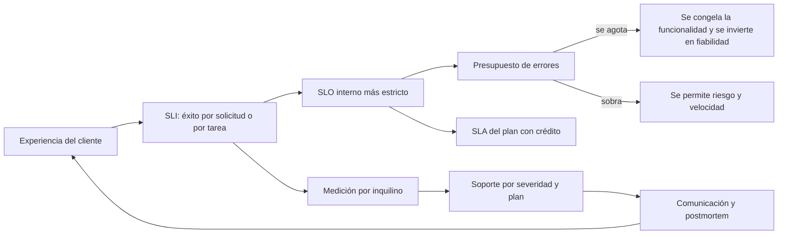
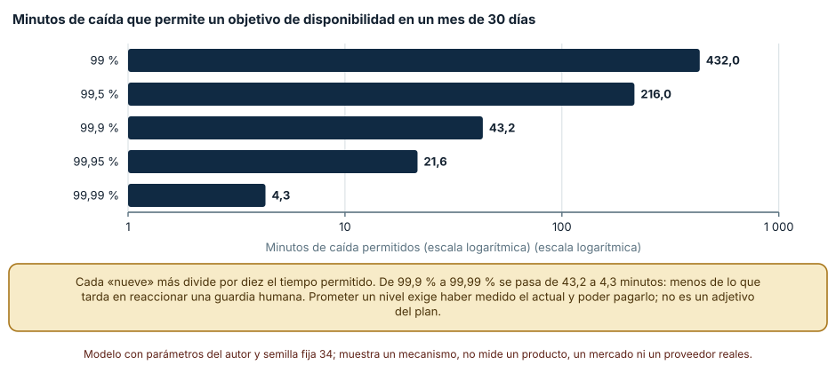
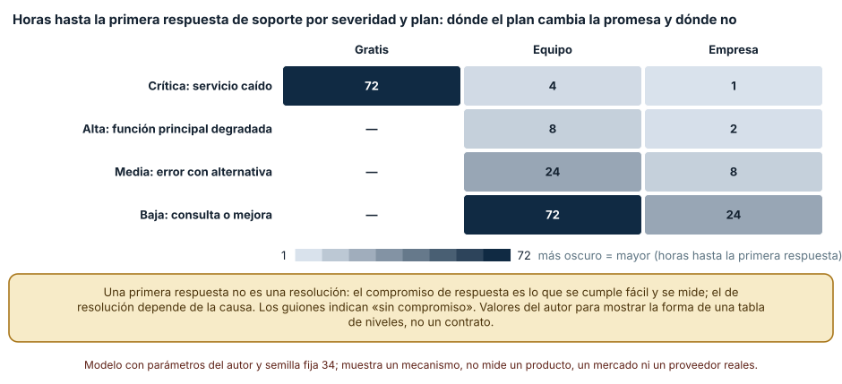

# SE-419 — SLA por nivel, soporte y operación del producto

[← SE-418 — Comercio electrónico: carrito, inventario, pagos y devoluciones](https://github.com/vladimiracunadev-create/modern-software-engineering-program/blob/main/classes/part-34-saas-y-plataformas-de-producto/se-418-comercio-electronico-carrito-inventario-pagos-y-devoluciones/README.md) · [↑ Parte 34](https://github.com/vladimiracunadev-create/modern-software-engineering-program/blob/main/classes/part-34-saas-y-plataformas-de-producto/README.md) · [📚 Índice completo](https://github.com/vladimiracunadev-create/modern-software-engineering-program/blob/main/classes/README.md) · [🌐 Portal](https://vladimiracunadev-create.github.io/modern-software-engineering-program/classes/SE-419.html) · [SE-420 — Taller y proyecto integrador: producto SaaS mínimo con evidencia →](https://github.com/vladimiracunadev-create/modern-software-engineering-program/blob/main/classes/part-34-saas-y-plataformas-de-producto/se-420-taller-y-proyecto-integrador-producto-saas-minimo-con-evidencia/README.md)

## Punto profesional y fundamento pedagógico

**Punto profesional.** La clase existe para que conviertas una promesa comercial («99,9 % de disponibilidad», «respuesta en cuatro horas») en un compromiso que el producto puede medir, cumplir y, cuando falla, compensar con honestidad. En un SaaS la operación es lo que se vende (`SE-409`): el cliente paga cada mes por que el servicio siga funcionando, y la forma en que el proveedor lo promete, lo mide, lo comunica y lo repara define si confía en él. Un acuerdo de nivel de servicio (SLA) escrito sin medición es una apuesta; uno medido con la métrica equivocada es una trampa para el proveedor o para el cliente. La clase une tres piezas que suelen vivir en equipos distintos: los objetivos de fiabilidad (SLO), el contrato por nivel de plan y el soporte que lo hace creíble.

**Por qué aparece aquí.** Sigue a `SE-418` (una tienda cuyos picos ponen a prueba la disponibilidad) y a `SE-410` (el aislamiento decide qué cliente nota un fallo). Retoma `SE-497` (SLI, SLO, SLA y presupuestos de error), `SE-499` (runbooks y guardias), `SE-500` (gestión de incidentes y comunicación) y `SE-493` (señales y observabilidad). Prepara el taller final `SE-420`, que exige un panel de operación con presupuesto y por inquilino.

**Error conceptual que debe corregir.** Creer que una disponibilidad agregada de 99,9 % significa que cada cliente tuvo 99,9 %. En el experimento de la clase, con 100 inquilinos y 2 000 000 de solicitudes, la disponibilidad agregada fue **99,908 %**, es decir, cumplía el objetivo de 99,9 %; pero un inquilino que recibía solo el 0,3 % del tráfico y fallaba el 12 % de sus solicitudes (por ejemplo, porque su fragmento estaba degradado) tuvo **87,7 %**. El panel agregado estaba en verde mientras un cliente vivía una caída casi permanente. Una promesa por cliente se mide por cliente.

**Secuencia de aprendizaje.** Antes de ejecutar, predices cuántos minutos de caída permite cada nivel de disponibilidad en un mes de 30 días, qué disponibilidad ofrece una cadena de tres servicios de 99,9 %, 99,9 % y 99,95 %, y si un 99,9 % agregado garantiza que ningún cliente está por debajo. Después ejecutas el cálculo de minutos permitidos, la composición de componentes y la simulación por inquilino, lees la curva de consumo de un presupuesto de errores en tres meses distintos y diseñas la tabla de niveles de un producto con soporte por severidad. Terminas escribiendo el SLA, el SLO interno y la política de presupuesto de errores.

**Evidencia de aprendizaje.** `niveles.md` con la tabla de planes (disponibilidad, tiempos de respuesta por severidad, objetivos de recuperación, créditos), el SLI exacto de cada compromiso (qué se cuenta como éxito y dónde se mide), los SLO internos más estrictos que el SLA, la política de presupuesto de errores y el cálculo de disponibilidad compuesta de tu arquitectura.

**Límite de la conclusión.** Se calcularon minutos permitidos, disponibilidades compuestas y una simulación con semilla 34 de 100 inquilinos con una tasa de fallos sembrada por el autor; los tramos de crédito y los tiempos de respuesta de soporte son valores del autor para mostrar la forma de una tabla. No se midió ningún servicio real, no se revisó ningún contrato y el texto no es asesoría legal: un SLA es un documento contractual que debe revisar un abogado. No se afirma revisión humana externa del contenido.

### Trazabilidad fuente → afirmación

| Fuente primaria u oficial | Afirmación que respalda | Lo que no prueba |
|---|---|---|
| [Google SRE: objetivos de nivel de servicio](https://sre.google/sre-book/service-level-objectives/) | Define SLI (indicador), SLO (objetivo) y SLA (acuerdo con consecuencias), y recomienda objetivos basados en lo que importa al usuario. | No fija los objetivos de tu producto. |
| [Google SRE Workbook: implementar SLO](https://sre.google/workbook/implementing-slos/) | Describe cómo elegir SLI, fijar objetivos y usar el presupuesto de errores para decidir entre fiabilidad y funciones. | Es la práctica de una empresa; otras la adaptan. |
| [AWS SaaS Lens](https://docs.aws.amazon.com/wellarchitected/latest/saas-lens/saas-lens.html) | Propone observar y operar por inquilino y relacionar niveles de servicio con los planes. | No contiene tus cifras. |
| [Microsoft Learn: antipatrón del vecino ruidoso](https://learn.microsoft.com/en-us/azure/architecture/antipatterns/noisy-neighbor/noisy-neighbor) | Explica cómo un inquilino puede degradar el servicio de otros y por qué conviene medir por inquilino. | No da umbrales numéricos. |
| [Microsoft Learn: aplicaciones multi-inquilino](https://learn.microsoft.com/en-us/azure/architecture/guide/multitenant/overview) | Incluye los niveles de servicio y las expectativas de cada inquilino entre las decisiones de diseño. | No es una plantilla contractual. |

## Antes de empezar

Recupera lo aprendido en `SE-497` sobre SLI, SLO y SLA: el indicador mide, el objetivo decide qué es suficiente y el acuerdo pone consecuencias. La pregunta activa es: **si un cliente te dice que el producto estuvo caído una hora el martes y tu panel dice 100 %, ¿quién tiene razón y cómo lo demostrarías?**

## Prerrequisitos

- Haber completado `SE-409` a `SE-418`, y `SE-497`, `SE-499` y `SE-500` (SLO, runbooks e incidentes).
- Conocer las señales y la observabilidad útil de `SE-493` y el percentil como medida de latencia.
- Saber multiplicar probabilidades de eventos independientes.
- Python 3.11 o posterior; solo biblioteca estándar.

## Problema auténtico

*Tablero* vende tres planes y en la página de precios dice «99,9 % de disponibilidad» solo en el plan empresa. Un cliente empresa abre una queja: dice que el martes sus usuarios no pudieron cargar proyectos durante 70 minutos. El panel interno, que mide la disponibilidad del balanceador de entrada, muestra 100 % ese día: las solicitudes llegaron y se devolvieron respuestas. Lo que el panel no veía es que el 38 % de esas respuestas eran errores 503 de un servicio interno degradado que solo afectaba a cuentas de un fragmento. Soporte no tiene datos por cliente; el contrato dice «99,9 % mensual» sin definir qué se cuenta como disponible; el crédito que corresponde, según la cláusula, depende de cómo se mida.

La conversación con el cliente se vuelve un debate de definiciones, y el equipo descubre varios huecos: no hay una definición de «disponible» (¿una respuesta 503 cuenta como caída?, ¿una página lenta?); no hay medición por cliente; el mantenimiento programado nunca se avisó con la antelación que el contrato exige; y el plan intermedio promete «soporte prioritario» sin decir en cuánto tiempo responde. En el análisis posterior se agrega la composición: el producto depende de tres servicios en serie (la API, la base de datos del fragmento y el servicio de archivos) cuyas disponibilidades son 99,9 %, 99,9 % y 99,95 %; en conjunto no pueden prometer 99,9 %.

El problema de la clase es hacer que la promesa sea medible y cumplible: definir el indicador con precisión, fijar objetivos internos más estrictos que el compromiso, medir por cliente, calcular la composición de las dependencias, diseñar los niveles de soporte por severidad y decidir qué ocurre cuando se agota el presupuesto de errores.

## Objetivos observables

Al terminar podrás:

1. distinguir SLI, SLO y SLA y escribir el SLI de un compromiso con qué cuenta como éxito, dónde se mide y en qué ventana;
2. calcular los minutos de caída que permite cada nivel de disponibilidad y la disponibilidad de una cadena de componentes en serie;
3. demostrar con una simulación que una disponibilidad agregada puede cumplir mientras un inquilino no, y explicar por qué se mide también por inquilino;
4. diseñar un presupuesto de errores con su política (qué pasa al agotarse) y leer su consumo en tres meses distintos;
5. diseñar una tabla de niveles de soporte por plan y severidad con tiempos de primera respuesta, y distinguir respuesta de resolución.

## Mapa conceptual



Todo parte de lo que el cliente experimenta; el SLI lo expresa en números, el SLO interno deja margen frente al SLA y el presupuesto de errores convierte el objetivo en una decisión. La medición por inquilino evita que el agregado esconda a un cliente, y el soporte y la comunicación cierran el ciclo cuando algo falla.

## Temas y por qué importan

| Tema | Por qué cambia una decisión profesional | Evidencia mínima |
|---|---|---|
| SLI, SLO, SLA | Separan medir, objetivo interno y compromiso con consecuencia. | Definición de cada uno |
| Minutos permitidos | Convierten un porcentaje en tiempo que se puede planificar. | Tabla por nivel de nueves |
| Disponibilidad compuesta | La cadena es peor que su peor eslabón. | Cálculo de tres componentes |
| Medición por inquilino | El agregado puede esconder a un cliente. | Disponibilidad del peor inquilino |
| Presupuesto de errores | Convierte la fiabilidad en una decisión con política. | Consumo en tres meses |
| Créditos | Dan una consecuencia a un incumplimiento sin sustituir la reparación. | Tramos y su cálculo |
| Soporte por severidad | Respuesta y resolución son compromisos distintos. | Tabla por plan y severidad |

## Conceptos y decisiones

### 1. Tres siglas, tres funciones

Un **SLI** (indicador de nivel de servicio) es una medición de lo que el usuario experimenta: la proporción de solicitudes que tienen éxito, la proporción que responde en menos de un umbral, la proporción de trabajos que terminan a tiempo. Un **SLO** (objetivo) es el valor que el equipo se propone para ese indicador en una ventana («99,95 % de solicitudes con éxito en 30 días»). Un **SLA** (acuerdo) es el compromiso contractual con el cliente, con consecuencias (créditos) si no se cumple. El SLO interno debe ser más estricto que el SLA: si se promete 99,9 % al cliente y el equipo se fija 99,9 % por dentro, el primer mes malo ya es un incumplimiento. Esa diferencia es el margen operativo.

### 2. El SLI se escribe con precisión

«Disponible» no es una palabra de contrato sino una fórmula: qué solicitudes cuentan (todas las de la API pública, no las de depuración), qué es éxito (respuesta con código distinto de 5xx en menos de 2 segundos), dónde se mide (en el borde, desde el cliente simulado o en el servidor), en qué ventana (un mes natural en UTC) y qué se excluye (mantenimiento programado con aviso previo, solicitudes inválidas del propio cliente). Cada decisión mueve el número: medir en el balanceador cuenta como disponible una respuesta de error rápida; medir desde una sonda externa cuenta lo que ve un usuario pero puede no representar a todos. Una buena práctica es medir con dos fuentes (real y sintética) y declarar cuál manda en un conflicto.

### 3. Cada nueve más cuesta mucho más

En un mes de 30 días (43 200 minutos), un objetivo de 99 % permite 432 minutos de caída; 99,5 %, 216; 99,9 %, 43,2; 99,95 %, 21,6; y 99,99 %, 4,3. Cada nueve adicional divide por diez el tiempo permitido. Con 43 minutos al mes, un solo incidente de una hora ya incumple; con 4,3, un tiempo de detección y reacción humano (varios minutos) ya consumiría todo el presupuesto. Por eso los niveles altos exigen automatización de la recuperación, redundancia y despliegues graduales, y cuestan más. Prometer 99,99 % sin esa infraestructura es prometer lo que no se puede cumplir; la tabla de niveles de los planes debe corresponder a lo que se ha medido y se puede costear.

### 4. Una cadena de servicios es menos disponible que cada eslabón

Si un producto necesita que tres componentes funcionen a la vez, su disponibilidad es el producto de las tres. Con 99,9 %, 99,9 % y 99,95 %, la cadena ofrece **99,75 %: unos 108 minutos de caída al mes (107,9 con las cifras exactas)**, no 43. Con cuatro componentes de 99,95 % se obtiene 99,80 %. Esto explica por qué prometer un nivel exige que las dependencias críticas sean más fiables que el compromiso, que se reduzca el número de componentes en el camino crítico, que se use redundancia (dos instancias en paralelo mejoran la disponibilidad del conjunto) o que se degrade con gracia (el producto sigue funcionando sin el componente no crítico). Las dependencias externas (el procesador de pagos, el correo) tienen su propio SLA y entran en el cálculo.

### 5. El agregado puede estar en verde con un cliente en rojo

El SLI global suma solicitudes de todos los inquilinos, y un inquilino pequeño con muchos errores apenas lo mueve. En el experimento, con 100 inquilinos y 2 000 000 de solicitudes, un inquilino que representaba el 0,32 % del tráfico y fallaba el 12 % de sus solicitudes tuvo una disponibilidad de **87,7 %**, mientras que la agregada fue **99,908 %**. Dos inquilinos estaban por debajo de 99,9 %: el degradado y otro por ruido de muestreo, algo que ocurre con muestras pequeñas y recuerda que el SLI por inquilino necesita volumen suficiente para ser significativo. La consecuencia: el SLA que se promete por cliente se mide por cliente. Se calcula el SLI por inquilino (o por grupos con volumen suficiente), se alerta cuando el peor inquilino cae por debajo del umbral y se muestra al cliente su propio indicador. El costo es de cardinalidad: se agregan las métricas por inquilino con cuidado.

### 6. El presupuesto de errores convierte el objetivo en decisión

El presupuesto es el complemento del objetivo: con 99,9 %, hay 43,2 minutos al mes de «mala disponibilidad» que se pueden gastar. Se gasta con incidentes, con despliegues arriesgados y con mantenimientos. La política dice qué ocurre según el consumo: por debajo del 50 % el equipo despliega con normalidad; entre 50 % y 100 % se exige revisión adicional de los cambios riesgosos; al agotarse se detienen los lanzamientos de funcionalidad hasta restablecer el margen y se prioriza la fiabilidad. En la curva de la clase, un mes tranquilo termina en 12 minutos (28 %); un mes con un incidente grande de 40 minutos cierra en 44 (102 %); un mes con tres incidentes supera el presupuesto entre el día 10 y el 15 y llega a 78 minutos (181 %). La misma política da respuestas distintas a los tres meses, y esa diferencia es la que el negocio necesita para decidir.

### 7. El crédito es una consecuencia, no una reparación

Un SLA típico ofrece créditos por incumplimiento: un porcentaje de la factura mensual según la disponibilidad medida. Con tramos de ejemplo (el autor los fija: 0 % por encima de 99,9 %, 10 % entre 99 % y 99,9 %, 25 % entre 95 % y 99 %, 100 % por debajo de 95 %), un mes de 99,5 % da 10 % de crédito y uno de 97 % da 25 %. El crédito suele ser el único remedio contractual y no compensa el daño que causa una caída; por eso la discusión con un cliente grande suele incluir cláusulas adicionales (penalizaciones, derecho de rescisión) que dependen de la negociación. Lo técnico es que el cálculo debe ser automático, explicable y auditable: el cliente debe ver cómo se midió su mes. Un sistema que concede créditos solo cuando el cliente reclama invita a la desconfianza.

### 8. Respuesta no es resolución

El soporte promete tiempos de primera respuesta («4 horas para severidad alta en el plan equipo») porque son medibles y dependen de la organización. Los tiempos de resolución dependen de la causa y rara vez se garantizan; lo que se promete son objetivos o planes de comunicación («actualización cada 2 horas hasta resolver»). En la tabla de ejemplo, una severidad crítica recibe primera respuesta en 1 hora en empresa, 4 horas en equipo y 72 horas en el plan gratuito (donde no hay compromiso para el resto de severidades). La severidad debe estar definida por impacto («servicio caído para todos los usuarios», «función principal degradada», «error con alternativa», «consulta») y el cliente puede proponerla, pero la confirma el soporte.

### 9. Operar un producto es un proceso, no una guardia

Operar incluye guardias con alertas basadas en SLO (que despiertan por consumo de presupuesto, no por cada pico), runbooks para los fallos conocidos (`SE-499`), gestión de incidentes con roles claros y comunicación en una página de estado (`SE-500`), postmortems sin culpa con acciones que se siguen y revisiones periódicas de los límites y de los costos por cliente. Para un SaaS, la comunicación forma parte de la disponibilidad percibida: un incidente comunicado a tiempo y con claridad cuesta menos confianza que uno silencioso de menor duración. Una página de estado con historia, y notificaciones a los clientes afectados (no solo a todos), es una obligación práctica y a menudo contractual.

### 10. Qué no resuelve un SLA

Un SLA no hace más fiable el producto: lo que lo hace es la ingeniería. Tampoco cubre todo lo que el cliente espera (la lentitud sin error, la pérdida de datos, la seguridad) a menos que esos aspectos tengan su propio indicador y objetivo (objetivos de recuperación de datos, `SE-357`). Y no es un documento que se escribe una vez: se revisa con las mediciones y con las incidencias reales. Antes de comprometer un nivel, el equipo calcula lo que su arquitectura puede sostener y lo que cuesta, y firma solo lo que puede demostrar con datos.

## Minutos de caída permitidos por nivel



**Cómo leer la figura.** Cada barra es un objetivo de disponibilidad y su largo, los minutos de caída que admite en 30 días, en escala logarítmica. Mira que cada nueve añadido acorta la barra a una décima. La comparación útil es con tu tiempo de detección y de reparación habitual: si es mayor que la barra, no puedes prometer ese nivel. **Dónde deja de valer:** supone un mes de 30 días y que toda caída cuenta; un SLA real excluye mantenimientos con aviso y define ventanas distintas (trimestral, anual), y la caída parcial (algunos clientes, algunas funciones) se mide con SLI por solicitud y no por tiempo.

## El presupuesto de errores en tres meses


**Cómo leer la figura.** Cada línea es un mes y el eje vertical los minutos de caída acumulados; la línea punteada es el presupuesto de 99,9 %. Observa en qué día cruza cada serie la línea: el segundo mes la cruza tarde y por poco, el tercero pronto y de largo. **Dónde deja de valer:** las series son inventadas para mostrar la lectura; en un sistema real el presupuesto se calcula con SLI por solicitud y se consume también por degradaciones parciales, no solo por caídas totales.

## Horas hasta la primera respuesta



**Cómo leer la figura.** Las filas son severidades y las columnas, planes; cuanto más oscura la celda, más horas de espera. Las celdas con guion son «sin compromiso». Mira que subir de plan reduce la espera en todas las filas y que la fila crítica es la que más cambia. **Dónde deja de valer:** son valores del autor para mostrar la forma de la tabla; en un producto real se fijan según la capacidad del equipo y se miden mes a mes. Una tabla que no se cumple es peor que una más modesta que sí.

## Definiciones de trabajo

- **SLI:** medición de un aspecto de lo que el usuario experimenta.
- **SLO:** valor objetivo de un SLI en una ventana.
- **SLA:** acuerdo contractual con consecuencias si no se cumple.
- **Presupuesto de errores:** complemento del objetivo, expresado como cantidad de fallo tolerable.
- **Disponibilidad compuesta:** disponibilidad de una cadena en serie, igual al producto de las disponibilidades.
- **Crédito de servicio:** compensación contractual, normalmente un porcentaje de la factura.
- **Severidad:** clasificación de un incidente o solicitud por su impacto.
- **Primera respuesta / resolución:** tiempo hasta el primer contacto frente al tiempo hasta solucionar.

## Ejemplo mínimo

Minutos permitidos, disponibilidad compuesta y crédito:

```python
def minutos_permitidos(objetivo: float, dias: int = 30) -> float:
    return round(dias * 24 * 60 * (1 - objetivo), 1)


def compuesta(componentes: list[float]) -> float:
    resultado = 1.0
    for disponibilidad in componentes:
        resultado *= disponibilidad
    return resultado


def credito(medida: float) -> int:
    """Porcentaje de la factura (tramos de ejemplo, no un contrato real)."""
    if medida >= 0.999:
        return 0
    if medida >= 0.99:
        return 10
    if medida >= 0.95:
        return 25
    return 100


print([minutos_permitidos(o) for o in (0.99, 0.995, 0.999, 0.9995, 0.9999)])   # [432.0, 216.0, 43.2, 21.6, 4.3]
d = compuesta([0.999, 0.999, 0.9995])
print(round(d, 5), minutos_permitidos(d))                                      # 0.9975 107.9
print([credito(m) for m in (0.9995, 0.995, 0.97, 0.9)])                        # [0, 10, 25, 100]
```

La cadena de tres componentes ofrece 99,75 %, no 99,9 %: si se promete lo segundo, el incumplimiento está en el diseño antes de que ocurra el primer incidente. La función de crédito es la que el cliente podría reproducir con una calculadora, que es lo que debe poder hacer.

## Ejemplo profesional

*Escenario ilustrativo: las cifras y los resultados de este ejemplo son supuestos de la narración, no mediciones.*

El equipo de *Tablero* rehace sus niveles tras la queja del cliente empresa. Define el SLI («proporción de solicitudes de la API y de la aplicación con respuesta distinta de 5xx en menos de 2 segundos, medida en el borde y verificada con sondas externas cada minuto, por inquilino») y fija un SLO interno de 99,95 % mensual para el plan empresa frente a un SLA de 99,9 %. Calcula la composición de su cadena crítica, descubre que ofrece 99,75 % y decide dos mejoras antes de firmar el SLA: una réplica de lectura que saque a un componente del camino crítico y un modo degradado para el servicio de archivos.

Construye un panel por inquilino con alerta cuando el peor inquilino con volumen suficiente cae por debajo de 99,9 %, y expone a cada cliente su propio indicador y su historial de incidentes. Define la política de presupuesto: por encima del 50 % consumido se exige revisión extra de cambios; al 100 % se congelan los lanzamientos de funcionalidad. La tabla de soporte por severidad y plan se publica con valores que el equipo ya cumple con holgura (se mide durante dos meses antes de prometer) y el cálculo del crédito se vuelve automático y se muestra en la factura. A los seis meses, el cliente empresa renueva con un anexo que incluye su propio panel de SLI, y la disputa sobre «qué es caída» no vuelve a aparecer porque la definición está escrita.

## Práctica guiada

1. Ejecuta `python scripts/experiments_part34_commerce.py` y localiza `sla por inquilino` y `compuesta`. Predice antes la disponibilidad del peor inquilino y compara.
2. Cambia el porcentaje de fallos del inquilino degradado de 12 % a 2 %: ¿en qué punto deja de verse como un incumplimiento por inquilino y qué volumen de solicitudes necesitas para distinguirlo del ruido?
3. Calcula la disponibilidad compuesta de tu arquitectura (o de una que conozcas) con cinco componentes y decide cuál mejorarías primero.
4. Escribe el SLI del compromiso principal de un producto tuyo con las cinco decisiones (qué solicitudes, qué es éxito, dónde se mide, ventana, exclusiones).
5. Diseña la tabla de severidad y plan de un producto con tiempos de primera respuesta que tu equipo pueda cumplir hoy, y define cómo vas a medir el cumplimiento.

## Ejercicios

1. **Básico.** Explica por qué el SLO interno debe ser más estricto que el SLA y qué pasaría si fueran iguales.
2. **Intermedio.** Un producto depende de la API (99,95 %), una base (99,95 %), un procesador de pagos (99,9 %) y un servicio de correo no crítico (99,5 %). Calcula la disponibilidad del camino crítico y propón cómo mejorarla sin cambiar los porcentajes de los componentes.
3. **Avanzado.** Diseña la política de presupuesto de errores para un producto con SLO de 99,95 %: umbrales, qué cambia en el proceso de despliegue a cada umbral, quién puede autorizar una excepción y cómo se revisa la política si se agota el presupuesto tres meses seguidos.

## Reto verificable

Entrega `niveles.md` con el SLI, el SLO, el SLA, el cálculo de disponibilidad compuesta de tu arquitectura, la política de presupuesto y la tabla de soporte por severidad, y una simulación propia por inquilino con semilla fija. Es válido si otra persona reproduce tus cifras, entiende dónde se mide cada indicador y puede decir qué decisión toma el equipo cuando el presupuesto se agota.

## Caso conductor

*Tablero* prometía 99,9 % sin definir «disponible», sin medir por cliente y con una arquitectura que ofrecía 99,75 %. Esta clase da las definiciones, los cálculos y la política que permiten prometer lo que se puede cumplir. `SE-420` reúne todo el recorrido en un producto mínimo con aislamiento, alta, suscripción, medición, derechos, pagos, inventario y niveles de servicio, con evidencia de cada invariante.

## Preguntas frecuentes

### ¿Qué disponibilidad debo prometer?

La que puedas demostrar con datos de al menos tres meses, con margen entre el SLO interno y el SLA, y que puedas costear. Una promesa más modesta que se cumple siempre es más valiosa que una ambiciosa que se incumple. Puedes ofrecer niveles distintos por plan, con infraestructura distinta que los sostenga.

### ¿El mantenimiento programado cuenta como caída?

Depende del contrato. Lo habitual es excluir mantenimientos anunciados con una antelación y una duración máximas, y contarlos si exceden esas condiciones. Lo importante es que la regla esté escrita y que el producto pueda hacer mantenimientos sin caída (despliegues graduales, migraciones compatibles), porque cada exclusión es una pérdida de confianza.

### ¿Se mide con datos propios o con una sonda externa?

Con ambos: los datos propios dan la proporción real de solicitudes y las sondas externas ven lo que un usuario ve, incluidos los fallos que impiden que lleguen solicitudes. En un conflicto manda la fuente que el contrato declare, y se investiga la diferencia.

### ¿Hay que exponer el SLI a cada cliente?

Es una buena práctica para clientes de planes altos: reduce disputas y refuerza la confianza. Requiere medir por inquilino con volumen suficiente y proteger los datos de otros clientes. Una página de estado pública resume lo general; un panel por cliente muestra lo suyo.

## Fallo controlado y diagnóstico

**Fallo.** El panel de disponibilidad de *Tablero* muestra 99,96 % el mes entero y, aun así, tres clientes empresa piden créditos por caídas.

**Diagnóstico paso a paso.** (1) Se separa el indicador por inquilino: los tres clientes tienen entre 98,9 % y 99,4 %. (2) Los tres están en el mismo fragmento de la base de datos, que tuvo una degradación de 6 horas repartida en cuatro episodios. (3) El indicador agregado la absorbe porque el fragmento atiende al 4 % del tráfico. (4) La alerta de presupuesto era global y nunca saltó. (5) Se corrige con alertas por fragmento y por inquilino con volumen mínimo, con SLI visible para el cliente, y se concede el crédito conforme a la fórmula del contrato (como el SLI por inquilino es el que el contrato nombra). (6) El postmortem añade una acción: medir el SLI también por fragmento para detectar un fallo localizado antes de que un cliente lo reclame.

**Lección.** Un indicador agregado responde a una pregunta de la plataforma; la promesa al cliente es de cada cliente. La medición se organiza según la pregunta a la que debe responder, y el contrato nombra el nivel de agregación.

## Errores comunes y cómo corregirlos

- **Prometer un nivel sin calcular la composición.** La cadena ofrece menos. Corrige multiplicando las disponibilidades del camino crítico.
- **SLO interno igual al SLA.** Cualquier mes malo incumple. Corrige con un margen medido.
- **Definir «disponible» solo como «el servidor responde».** Los errores rápidos cuentan como éxito. Corrige con un SLI de respuestas correctas y a tiempo.
- **Medir solo en agregado.** Un cliente puede estar caído. Corrige midiendo por inquilino con volumen suficiente.
- **Prometer tiempos de resolución.** Dependen de la causa. Corrige con respuesta y comunicación periódica.
- **Calcular los créditos a mano y solo si el cliente reclama.** Genera desconfianza. Corrige con cálculo automático y visible.

## Entorno y archivos clave

- `scripts/experiments_part34_commerce.py`: funciones `sla`, `credito_sla`, `sla_por_inquilino` y `disponibilidad_compuesta`.
- `scripts/figures_part34_b.py`: las tres figuras de la clase.
- Requiere Python 3.11 o posterior y solo la biblioteca estándar; la semilla es 34.

## Seguridad, ética y accesibilidad

La comunicación de incidentes es parte de la honestidad con el cliente: publica lo que ocurrió con la información de la que dispones, sin minimizar ni inventar plazos, y no ocultes una pérdida de datos o una brecha detrás de un lenguaje técnico (muchas jurisdicciones exigen notificar en plazos definidos). Los paneles por inquilino exponen información de cada cliente: asegúrate de que cada uno vea solo lo suyo. Los canales de soporte deben ser accesibles (alternativas al teléfono, a las imágenes y a formularios solo visuales) y la tabla de niveles debe estar escrita en lenguaje claro. Evita guardias que agoten a las personas: las alertas por presupuesto, la rotación y los descansos son parte de la fiabilidad.

## Puente hacia el trabajo con agentes

Un agente de soporte o de operaciones puede clasificar severidades, resumir incidentes o proponer borradores de comunicación, pero no debe decidir créditos, ni comprometer plazos, ni anunciar causas que no se han verificado. Dale acceso de lectura a los paneles por inquilino y a los runbooks, exige que cada respuesta cite los datos que usó y mantén a una persona en las decisiones que comprometen dinero o promesas. Y mide sus errores: un agente que clasifica mal la severidad de un incidente critica puede retrasar la respuesta justo cuando el cliente más la necesita.

## Transferencia

Elige un servicio del que dependas (una nube, un procesador de pagos, una herramienta de equipo) y lee su SLA: ¿cómo define disponibilidad?, ¿qué excluye?, ¿qué crédito ofrece y cómo se reclama? Compara con tu propia promesa a tus clientes: ¿tu cadena de dependencias te permite prometer lo que prometes?

## Evaluación y evidencia

| Criterio | Evidencia aceptable | Rechazo |
|---|---|---|
| SLI | Cinco decisiones escritas (solicitudes, éxito, medición, ventana, exclusiones) | «Disponibilidad del servicio» |
| Composición | Producto de las disponibilidades del camino crítico | Prometer el nivel del mejor componente |
| Por inquilino | Peor inquilino con volumen suficiente y alerta | Solo el agregado |
| Presupuesto | Política con umbrales y consumo en meses distintos | Un objetivo sin consecuencias |
| Soporte | Tabla por severidad y plan medible y cumplida | Promesas de resolución |

## Fuentes

- Google. [Service Level Objectives (SRE Book)](https://sre.google/sre-book/service-level-objectives/) e [Implementing SLOs (SRE Workbook)](https://sre.google/workbook/implementing-slos/).
- AWS. [SaaS Lens](https://docs.aws.amazon.com/wellarchitected/latest/saas-lens/saas-lens.html).
- Microsoft Learn. [Antipatrón del vecino ruidoso](https://learn.microsoft.com/en-us/azure/architecture/antipatterns/noisy-neighbor/noisy-neighbor) y [aplicaciones multi-inquilino](https://learn.microsoft.com/en-us/azure/architecture/guide/multitenant/overview).
- Python. [`random`](https://docs.python.org/3/library/random.html).

## Límites y siguiente paso

Se calcularon minutos permitidos, una disponibilidad compuesta y una simulación por inquilino con una tasa de fallos sembrada por el autor; los tramos de crédito y los tiempos de soporte son del autor, no hay ningún servicio real medido y el texto no sustituye la revisión legal de un contrato. El siguiente paso, `SE-420`, reúne las once clases en un taller y un proyecto integrador: un producto SaaS mínimo con evidencia reproducible de cada invariante.

## Glosario

| Término | Definición breve |
|---|---|
| SLI | Indicador de lo que el usuario experimenta |
| SLO | Objetivo de un SLI en una ventana |
| SLA | Acuerdo contractual con consecuencias |
| Presupuesto de errores | Fallo tolerable según el objetivo |
| Disponibilidad compuesta | Producto de las disponibilidades de una cadena |
| Crédito de servicio | Compensación contractual por incumplimiento |
| Severidad | Clasificación por impacto |
| Primera respuesta | Tiempo hasta el primer contacto de soporte |

---

[← SE-418 — Comercio electrónico: carrito, inventario, pagos y devoluciones](https://github.com/vladimiracunadev-create/modern-software-engineering-program/blob/main/classes/part-34-saas-y-plataformas-de-producto/se-418-comercio-electronico-carrito-inventario-pagos-y-devoluciones/README.md) · [↑ Parte 34](https://github.com/vladimiracunadev-create/modern-software-engineering-program/blob/main/classes/part-34-saas-y-plataformas-de-producto/README.md) · [📚 Índice completo](https://github.com/vladimiracunadev-create/modern-software-engineering-program/blob/main/classes/README.md) · [🌐 Portal](https://vladimiracunadev-create.github.io/modern-software-engineering-program/classes/SE-419.html) · [SE-420 — Taller y proyecto integrador: producto SaaS mínimo con evidencia →](https://github.com/vladimiracunadev-create/modern-software-engineering-program/blob/main/classes/part-34-saas-y-plataformas-de-producto/se-420-taller-y-proyecto-integrador-producto-saas-minimo-con-evidencia/README.md)
