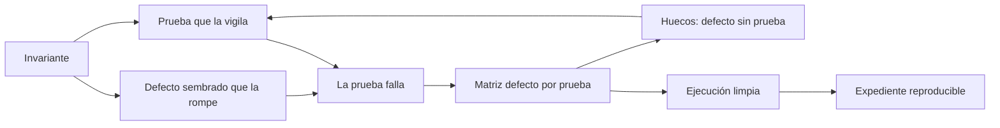
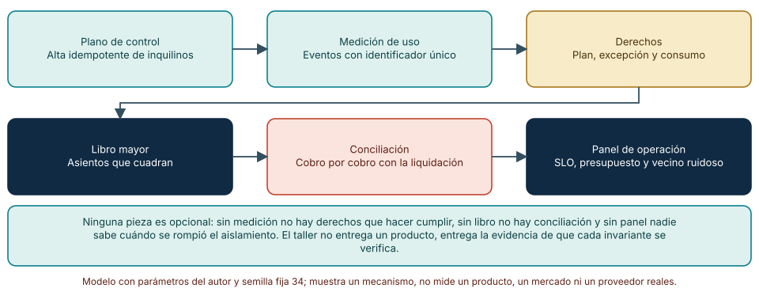
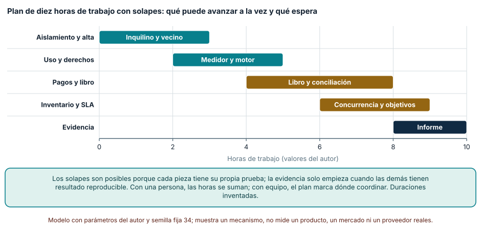

# SE-420 — Taller y proyecto integrador: producto SaaS mínimo con evidencia

[← SE-419 — SLA por nivel, soporte y operación del producto](https://github.com/vladimiracunadev-create/modern-software-engineering-program/blob/main/classes/part-34-saas-y-plataformas-de-producto/se-419-sla-por-nivel-soporte-y-operacion-del-producto/README.md) · [↑ Parte 34](https://github.com/vladimiracunadev-create/modern-software-engineering-program/blob/main/classes/part-34-saas-y-plataformas-de-producto/README.md) · [📚 Índice completo](https://github.com/vladimiracunadev-create/modern-software-engineering-program/blob/main/classes/README.md) · [🌐 Portal](https://vladimiracunadev-create.github.io/modern-software-engineering-program/classes/SE-420.html) · [SE-421 — Calidad por riesgo y propósito de las pruebas →](https://github.com/vladimiracunadev-create/modern-software-engineering-program/blob/main/classes/part-35-estrategia-y-tecnicas-de-prueba/se-421-calidad-por-riesgo-y-proposito-de-las-pruebas/README.md)

## Punto profesional y fundamento pedagógico

**Punto profesional.** La clase existe para que demuestres, con un producto pequeño y con evidencia que otra persona pueda repetir, que sabes sostener las invariantes que hacen sostenible a un SaaS: que un cliente no vea ni degrade a otro, que dar de alta sea repetible, que el estado de la suscripción y el uso medido sean exactos, que los derechos se hagan cumplir donde ocurre la operación, que el dinero deje un libro que cuadra y que la promesa de servicio se pueda medir. Hasta aquí cada clase aisló un mecanismo. Un producto real los hace coincidir, y en esa coincidencia aparecen los fallos que ningún mecanismo mostró por separado: un cobro repetido que ensucia el uso facturado, un límite ignorado que descuadra el derecho, un asiento que no cuadra y que solo la conciliación ve. El taller y el proyecto se hacen juntos porque el taller prepara el instrumento que el proyecto necesita: una batería de defectos sembrados y de pruebas que los detectan.

**Por qué aparece aquí.** Cierra la Parte 34 y reúne `SE-409` a `SE-419`: el modelo de producto (`SE-409`), el aislamiento (`SE-410`), el alta (`SE-411`), la suscripción (`SE-412`), la medición (`SE-413`), los derechos (`SE-414`), el precio (`SE-415`), el marketplace (`SE-416`), los pagos (`SE-417`), la tienda (`SE-418`) y los niveles de servicio (`SE-419`). Se apoya en la disciplina de pruebas de `SE-421`, en las pruebas de contrato de `SE-547` y en el diseño de una arquitectura defendible de `SE-336`. No añade un mecanismo nuevo: exige elegir, integrar, medir y declarar límites.

**Error conceptual que debe corregir.** Creer que un producto «funciona» porque su camino feliz pasa. Con seis defectos sembrados por separado, el camino feliz seguía pasando en los seis; lo que los distinguía eran seis comprobaciones distintas, y cada defecto era visible solo para una o dos. Un cobro repetido sin clave no hacía fallar ninguna prueba funcional: lo vieron la prueba de idempotencia y la conciliación contra la factura. Por eso la evidencia de un producto no es «la demostración funcionó» sino una tabla en que cada defecto temido hace fallar una comprobación concreta, y una ejecución limpia en la que ninguna falla.

**Secuencia de aprendizaje.** Antes de ejecutar, predices, para seis defectos (consulta sin filtro, evento duplicado, cobro repetido, sobreventa, límite ignorado y asiento descuadrado), qué comprobación de las seis lo detecta y cuáles no. Después ejecutas la batería del taller, comparas tu matriz con la real, discutes los casos que una sola comprobación no cubre y construyes tu propio producto mínimo con sus pruebas. Terminas con un expediente que otra persona puede repetir y con una lista honesta de lo que el producto no cubre.

**Evidencia de aprendizaje.** `expediente-saas.md` con la arquitectura mínima, las invariantes elegidas y la prueba de cada una, la matriz defecto por comprobación predicha y medida, la salida de una ejecución limpia, las mediciones propias (aislamiento, uso, libro, concurrencia, SLI) con su semilla y la lista de lo que el producto no cubre.

**Límite de la conclusión.** El taller usa un producto mínimo en memoria con sqlite3, hilos reales y datos sintéticos; no incluye red, identidad real, un procesador de pagos, un despliegue ni una base distinta de sqlite. La matriz muestra que seis defectos sembrados son detectables por las seis comprobaciones, no que cualquier defecto lo sea. Una matriz completa no certifica un producto. No se afirma revisión humana externa del contenido.

### Trazabilidad fuente → afirmación

| Fuente primaria u oficial | Afirmación que respalda | Lo que no prueba |
|---|---|---|
| [AWS Well-Architected: SaaS Lens](https://docs.aws.amazon.com/wellarchitected/latest/saas-lens/saas-lens.html) | Ofrece preguntas de revisión sobre aislamiento, incorporación, medición y operación que sirven de lista de comprobación del expediente. | No sustituye una revisión de tu producto. |
| [Microsoft Learn: aplicaciones multi-inquilino](https://learn.microsoft.com/en-us/azure/architecture/guide/multitenant/overview) | Organiza las decisiones de un producto multi-inquilino (tenencia, aislamiento, facturación, costos, operación) como consideraciones a documentar. | No indica qué decisión tomar. |
| [Stripe: idempotencia](https://docs.stripe.com/api/idempotent_requests) y [suscripciones](https://docs.stripe.com/billing/subscriptions/overview) | Son la referencia pública de dos mecanismos que la batería verifica. | No prueba tu implementación. |
| [Google SRE: objetivos de nivel de servicio](https://sre.google/sre-book/service-level-objectives/) | Respalda el indicador, el objetivo y el presupuesto como forma de convertir una promesa en medición. | No fija tus objetivos. |
| [SQLite: aislamiento](https://www.sqlite.org/isolation.html) | Documenta el comportamiento transaccional del motor usado en las pruebas de concurrencia. | No describe otros motores. |

## Antes de empezar

Repasa los resultados de las once clases anteriores y elige, de cada una, el número que más te sorprendió. La pregunta activa es: **si tuvieras que entregar mañana un producto con una sola garantía respaldada por una prueba que falla cuando se rompe, ¿cuál elegirías y qué defecto sembrarías para comprobar que la prueba sirve?**

## Prerrequisitos

- Haber completado `SE-409` a `SE-419` y haber ejecutado al menos los experimentos de tres de ellas.
- Conocer la estructura de una suite de pruebas con casos que deben fallar (pruebas negativas, `SE-421`).
- Python 3.11 o posterior; los experimentos usan `sqlite3`, `threading` y `tempfile`.

## Problema auténtico

*Tablero* va a firmar su primer contrato empresarial. El comprador pide, antes de firmar, un «dossier de fiabilidad»: cómo se aísla a los clientes, cómo se mide y se factura el uso, cómo se evita cobrar dos veces, qué ocurre si el procesador de pagos falla, cómo se concilia lo cobrado, qué disponibilidad se promete y cómo se mide. El equipo tiene las piezas, pero no un expediente que las una. Lo que existe son descripciones («usamos claves de idempotencia») y capturas de pantalla; no existe una ejecución que pueda repetir un tercero, ni una prueba que falle cuando alguien rompe una invariante.

El comprador envía un técnico que hace tres preguntas concretas. ¿Qué pasa si siembro una consulta sin filtro de inquilino? ¿Qué pasa si envío el mismo evento de uso dos veces? ¿Qué ocurre si 20 compradores piden a la vez las 5 unidades que quedan? Nadie del equipo puede responder con una ejecución, solo con una explicación. Esa diferencia, entre explicar y mostrar, es lo que la clase quiere cerrar.

El problema es construir un producto mínimo con las invariantes que hacen sostenible a un SaaS, sembrar los defectos que las romperían y comprobar que una batería de pruebas los detecta, declarando con la misma claridad lo que la batería no cubre. El resultado es un expediente de evidencia: lo que prometes, la prueba que lo vigila y el defecto que demuestra que la prueba sirve.

## Objetivos observables

Al terminar podrás:

1. definir las invariantes de un SaaS mínimo (aislamiento, idempotencia, concurrencia, derechos, partida doble y conciliación) y escribir la prueba de cada una;
2. sembrar defectos de forma controlada y comprobar que cada uno hace fallar una comprobación concreta, y descubrir qué defectos solo detecta una combinación de pruebas;
3. predecir y medir la matriz de defectos por comprobaciones y explicar cualquier discrepancia entre predicción y medición;
4. integrar al menos tres mecanismos de la parte en un mismo producto mínimo y demostrar que una ejecución limpia pasa las seis comprobaciones;
5. escribir un expediente reproducible que declare semillas, versiones, resultados y límites, y que otra persona pueda ejecutar y revisar.

## Mapa conceptual



Cada invariante tiene una prueba que la vigila y un defecto que la rompe. La matriz resultante muestra qué defectos detecta cada prueba y, sobre todo, cuáles no detecta ninguna. Un hueco vuelve a empezar el ciclo con una prueba nueva.

## Temas y por qué importan

| Tema | Por qué cambia una decisión profesional | Evidencia mínima |
|---|---|---|
| Invariantes | Son lo que el producto promete mantener siempre. | Lista con su prueba |
| Defecto sembrado | Comprueba que la prueba puede fallar. | Una prueba que falla con el defecto |
| Matriz defecto por prueba | Muestra solapes y huecos. | Matriz predicha y medida |
| Ejecución limpia | Prueba que las comprobaciones no fallan sin motivo. | Salida sin falsos positivos |
| Integración | Los fallos aparecen en las uniones. | Un caso que cruza dos mecanismos |
| Reproducibilidad | Un tercero puede repetir la evidencia. | Semilla, versiones y comando |
| Límites declarados | Una matriz completa no es una certificación. | Lista de lo no cubierto |

## Conceptos y decisiones

### 1. Una invariante sin prueba es una intención

Las clases anteriores dejaron invariantes concretas: la consulta de un inquilino nunca devuelve filas de otro (`SE-410`), un alta repetida no duplica nada (`SE-411`), el uso medido de un evento es el mismo con duplicados (`SE-413`), una cuenta no supera el límite de su plan (`SE-414`), cada asiento suma cero (`SE-417`), nunca se aceptan más pedidos que unidades (`SE-418`) y lo cobrado coincide con lo facturado (`SE-417`). Cada una es una frase que cabe en una línea y puede comprobarse con una prueba. Escribir la lista es el primer entregable: si no cabe en una línea, todavía no se entiende.

### 2. Una prueba que nunca ha fallado no demuestra nada

Una prueba que pasa siempre puede estar vigilando algo o puede estar vacía. La única forma de saberlo es romper lo vigilado y comprobar que falla: sembrar un defecto. En la batería del taller, la prueba de aislamiento falla solo cuando la consulta pierde su filtro de inquilino (D1), y pasa en los otros cinco defectos; eso demuestra que no es una prueba vacía y que no depende de lo que no vigila. Cada defecto se siembra por separado en un producto limpio: con todos a la vez no sabrías qué prueba responde a qué.

### 3. La matriz muestra qué ve cada prueba, y cuántas hacen falta

Se ejecutó cada defecto con las seis comprobaciones. Resultado: la **consulta sin filtro (D1)** solo la ve la prueba de aislamiento; el **evento duplicado (D2)** lo ven la prueba de idempotencia y la conciliación (el agregado de uso no coincide con los eventos de origen); el **cobro repetido sin clave (D3)** lo ven la prueba de idempotencia y la conciliación (lo liquidado supera lo facturado); la **sobreventa (D4)** solo la ve la prueba de concurrencia; el **límite ignorado (D5)** solo la ve la prueba de derechos; y el **asiento que no cuadra (D6)** lo ven la comprobación de balance y la conciliación. En la ejecución sin defectos, ninguna falló. Tres defectos los ven dos pruebas y tres los ve una sola: donde hay solape, la conciliación actúa como segunda red; donde hay una sola, quitar esa prueba deja el defecto invisible.

### 4. Los solapes son seguridad, no redundancia

Que la conciliación vea también el evento duplicado y el cobro repetido significa que, si la prueba de idempotencia se desactiva o se rompe, un defecto sigue siendo visible *en producción*, donde la conciliación corre cada día. La conciliación no sustituye las pruebas, porque llega tarde (ve el daño ya hecho, no lo impide); las pruebas no sustituyen la conciliación, porque solo ven lo que alguien pensó probar. Las dos capas cubren fallos distintos: una en el momento del cambio y la otra en la operación.

### 5. Una conciliación necesita algo con lo que comparar

En el experimento, la comprobación del libro contra la liquidación del procesador no veía el cobro repetido sin clave: el libro registraba fielmente los dos cobros que el procesador había hecho, y ambos totales coincidían. Lo que lo detectó fue comparar lo liquidado con lo facturado (4 900 esperados, 9 800 liquidados). Es una lección general: una comprobación que compara dos copias del mismo error no detecta el error; hace falta una tercera fuente independiente (la factura, el evento de origen, el contrato). Por eso `SE-417` concilia tres versiones.

### 6. La concurrencia exige una prueba que la provoque

Los defectos de carrera no aparecen en pruebas secuenciales. La comprobación de concurrencia lanza 20 hilos que arrancan a la vez contra 5 unidades y verifica la invariante («pedidos ≤ existencias»), no un resultado exacto: con el defecto, aceptó pedidos de más; sin él, exactamente 5. La prueba debe ejecutarse contra el motor de producción y con suficiente presión para abrir la ventana; en el taller, una pausa de 2 ms entre leer y escribir la ensancha y hace el defecto repetible. Declara en el expediente que una prueba verde de concurrencia no demuestra ausencia de carreras, solo que esta no se manifestó con esta presión.

### 7. Integrar es probar las uniones

Los defectos del taller son de un solo mecanismo cada uno, pero los fallos de integración cruzan dos: un evento de uso duplicado que, además, se factura (`SE-413` con `SE-417`), un derecho que depende de un estado de suscripción que cambió (`SE-412` con `SE-414`), un cobro tardío que reactiva una cuenta ya suspendida. El proyecto exige al menos un caso que atraviese dos mecanismos y que tenga su prueba: por ejemplo, «un cobro repetido no crea dos asientos ni dos periodos de acceso». Ese caso es el que más se parece a lo que pasará en producción.

### 8. La ejecución limpia es tan importante como la que falla

Una batería que falla con defectos y también con el producto limpio (falsos positivos) no sirve: se ignora o se desactiva. La ejecución sin defectos debe dar cero fallos de forma estable, repetida y en entornos distintos. En el taller se repitió la ejecución completa tres veces con salida idéntica; si una prueba depende del orden, del reloj o de la velocidad de la máquina, se convierte en una prueba inestable y se corrige antes de confiar en ella.

### 9. El expediente es el producto de la clase

El entregable no es el código sino lo que permite a otra persona repetir y juzgar: arquitectura mínima, lista de invariantes con su prueba, matriz predicha y medida, salida limpia, semillas, versiones, comandos, y lista de lo que no se cubrió. La arquitectura se dibuja con cinco piezas (plano de control, medición, derechos, libro, conciliación) más un panel de operación; cada pieza declara qué invariante cuida y qué prueba la vigila. El expediente debe poder leerlo quien no estuvo, como el técnico que envió el comprador.

### 10. Una matriz completa no certifica

Que las seis comprobaciones detecten los seis defectos sembrados dice que la batería *puede* detectar esas seis cosas. No dice que no haya un séptimo defecto que ninguna vea, ni que el producto sea seguro, ni que cumpla la normativa, ni que soporte la carga de producción. Un expediente honesto separa tres niveles: lo que se ejecutó y funcionó, lo que se ejecutó y es parcial, y lo que no se ejecutó. Esa separación es lo que da credibilidad a las partes que sí se probaron.

## Una arquitectura que vigila sus invariantes



**Cómo leer la figura.** Las seis cajas son las piezas del producto mínimo y el color indica su familia (control, uso, dinero, operación). Cada una cuida una invariante que tiene prueba. Mira que la conciliación (coral) cruza lo que producen las demás: es la que ve lo que ninguna ve sola. **Dónde deja de valer:** es una arquitectura de laboratorio; no incluye identidad real, red, despliegue ni integración con terceros, que añaden piezas y fallos.

## Qué prueba ve cada defecto


**Cómo leer la figura.** Las filas son defectos sembrados y las columnas, comprobaciones; la celda marcada es una comprobación que falla con ese defecto. Cuenta las celdas por fila (cada defecto tiene al menos una) y por columna (la conciliación aparece tres veces: es la red común). **Dónde deja de valer:** es la matriz medida de seis defectos que el autor eligió; no enumera los defectos posibles, y un defecto que cruce dos mecanismos o dependa del tiempo puede escapar a las seis pruebas.

## Un plan de diez horas



**Cómo leer la figura.** Cada carril es un grupo de trabajo con su pieza y las barras muestran cuándo se hace. Los solapes (por ejemplo de 2 a 3) son posibles porque cada pieza tiene su propia prueba. La evidencia al final reúne los resultados. **Dónde deja de valer:** las horas son del autor para un producto mínimo; una persona sola las suma, y las integraciones reales (identidad, pagos, despliegue) las multiplican.

## Definiciones de trabajo

- **Invariante:** propiedad que el producto debe mantener siempre.
- **Defecto sembrado:** error introducido a propósito para comprobar que una prueba lo detecta.
- **Falso positivo:** prueba que falla sin que haya un defecto.
- **Falso negativo:** defecto que ninguna prueba detecta.
- **Matriz defecto por prueba:** tabla de qué prueba falla con cada defecto.
- **Red de seguridad:** comprobación que vigila en operación lo que las pruebas vigilan en el cambio.
- **Expediente:** conjunto de evidencia reproducible con sus límites.

## Ejemplo mínimo

La estructura de una comprobación negativa: se siembra un defecto y se exige que la prueba falle.

```python
import sqlite3


def tareas(db: sqlite3.Connection, inquilino: str, con_defecto: bool) -> list[str]:
    if con_defecto:
        return [r[0] for r in db.execute("SELECT titulo FROM tarea")]                         # olvida el filtro
    return [r[0] for r in db.execute("SELECT titulo FROM tarea WHERE inquilino=?", (inquilino,))]


def prueba_aislamiento(con_defecto: bool) -> bool:
    """True si la prueba FALLA (detecta una fuga)."""
    db = sqlite3.connect(":memory:")
    db.execute("CREATE TABLE tarea (inquilino TEXT, titulo TEXT)")
    db.executemany("INSERT INTO tarea VALUES (?,?)", [("A", "de A"), ("B", "de B")])
    return any("de B" in t for t in tareas(db, "A", con_defecto))


print(prueba_aislamiento(False), prueba_aislamiento(True))     # False True
```

La prueba pasa con el producto limpio (`False`: no detecta fuga) y falla con el defecto (`True`). Si devolviera `False` en ambos casos, estaría vacía; si devolviera `True` en ambos, estaría rota. El experimento del taller hace lo mismo seis veces con seis defectos y seis comprobaciones.

## Ejemplo profesional

*Escenario ilustrativo: las cifras y los resultados de este ejemplo son supuestos de la narración, no mediciones.*

El equipo de *Tablero* prepara el dossier para el comprador. Escribe siete invariantes con su prueba y su defecto sembrado, construye la matriz y la ejecuta delante del técnico del comprador. Cuando el técnico pide sembrar «uno que no esperen», quitan la restricción de unicidad de la referencia del asiento: la matriz muestra que ninguna de las seis pruebas lo ve y la conciliación diaria tarda un día en señalarlo. El equipo lo registra como un hueco, añade la prueba de referencia única y la matriz queda con la celda nueva.

El expediente final incluye: la arquitectura de seis piezas, las siete invariantes, la matriz con la columna nueva, la salida limpia repetida tres veces, la medición de la latencia de los otros clientes durante la ráfaga de un cliente de prueba con y sin cuotas, el SLI por inquilino del mes de ensayo con su peor inquilino, y una página de límites: sin identidad real, sin carga de producción, sin procesador real, sin evaluación de seguridad externa, sin certificación. El comprador firma, y el hueco descubierto en la sesión es el motivo: valoró más que el equipo mostrara un defecto que no esperaba que que ninguno apareciera.

## Práctica guiada

1. Antes de ejecutar nada, dibuja en papel la matriz de seis defectos por seis comprobaciones y marca con una cruz dónde esperas que falle. Guárdala.
2. Ejecuta `python scripts/experiments_part34_taller.py` y compara con tu matriz. Anota cada celda en que difieres y averigua por qué.
3. Siembra un séptimo defecto de tu elección (por ejemplo, reintentar un alta sin clave, o una cuota que no se renueva) y comprueba qué comprobaciones lo ven. Si ninguna, escribe la prueba que falta.
4. Ejecuta la batería sin defectos diez veces y comprueba que el resultado es idéntico; si una comprobación es inestable, corrígela.
5. Integra dos mecanismos: por ejemplo, un cobro repetido cuyo asiento y cuyo periodo de acceso deben ser únicos, y escribe la prueba que los cruza.

## Ejercicios

1. **Básico.** Explica por qué el defecto «consulta sin filtro» no lo detecta la prueba de idempotencia ni la conciliación, y por qué eso no es un fallo de esas pruebas.
2. **Intermedio.** La conciliación de la batería no veía el cobro repetido hasta que se comparó lo liquidado con lo facturado. Diseña la tercera fuente para otro defecto: un reembolso aplicado dos veces. ¿Contra qué lo compararías?
3. **Avanzado.** Propón tres defectos de integración (que crucen dos mecanismos de la parte), la prueba que los vería y una estimación de su probabilidad en producción; explica cuál priorizarías y por qué.

## Reto verificable

Entrega `expediente-saas.md`, el código de tu producto mínimo y tu batería con al menos seis defectos sembrados y seis comprobaciones, más un defecto propio que haga fallar una prueba nueva. Es válido si otra persona ejecuta tu batería con la misma versión de Python, obtiene tu matriz, comprueba que la ejecución limpia no falla y encuentra declarado en el expediente qué no se cubrió.

## Caso conductor

*Tablero* firma su primer contrato empresarial cuando puede mostrar, no solo explicar. El expediente reúne lo que la parte construyó: un producto con invariantes, defectos que las rompen y pruebas que los detectan. Los casos de estudio del curso (Stripe, Airbnb, Uber y Mercado Libre) muestran, con fuentes públicas, cómo organizaciones reales sostienen invariantes parecidas a escala: idempotencia y ledger en pagos, confianza entre partes, mercados de más de dos lados y custodia de fondos. El contraste entre ellos y un producto de laboratorio es la lista de límites que el expediente debe declarar.

## Preguntas frecuentes

### ¿Cuántos defectos sembrar?

Los suficientes para cubrir cada invariante al menos una vez, más uno que no esperes. Seis o siete bastan para un producto mínimo; más defectos no mejoran la evidencia si no cubren invariantes distintas.

### ¿Qué hago si una prueba falla con el producto limpio?

Es un falso positivo: se investiga antes de continuar. Casi siempre depende del reloj, del orden de ejecución, de datos compartidos entre pruebas o de la velocidad de la máquina. Se aísla, se corrige y se repite la ejecución limpia varias veces.

### ¿Hace falta una base de datos real para el proyecto?

Para el aprendizaje basta sqlite3, pero la prueba de concurrencia y las de aislamiento deben repetirse contra el motor que usarás en producción, porque los niveles de aislamiento y los bloqueos cambian. Declara en el expediente con qué motor se ejecutó.

### ¿Puedo usar servicios reales de pagos o de identidad?

Solo en entornos de prueba que el proveedor ofrezca, con claves de prueba y sin datos reales de personas, y declarándolo. Para el expediente de la clase basta un doble simulado; lo importante es que la evidencia se repita sin cuentas ni dinero reales.

## Fallo controlado y diagnóstico

**Fallo.** La batería de un equipo pasa con los seis defectos sembrados y falla una vez cada diez ejecuciones sin defectos.

**Diagnóstico paso a paso.** (1) Se repite la ejecución limpia treinta veces y se registra cuál comprobación falla: siempre la de concurrencia. (2) La prueba lanza 20 hilos y espera 2 ms antes de comprobar; en una máquina cargada, algunos hilos no han terminado cuando se cuenta y el recuento es menor, y a veces mayor porque un hilo atrasado cuenta dos veces. (3) El fallo no es del producto sino de la prueba: no espera a que los hilos terminen. (4) Se corrige con `join` antes de contar y con una barrera de arranque, y se compara el recuento final con la invariante (pedidos ≤ existencias) en lugar de con un número exacto. (5) Se repite la ejecución limpia cien veces sin fallos. (6) Se añade al expediente una nota sobre la estabilidad de la prueba y cómo se comprobó.

**Lección.** Una prueba inestable es peor que ninguna: enseña a ignorar fallos. La estabilidad se comprueba repitiendo, y una comprobación de concurrencia espera a que terminen los hilos y verifica una invariante, no un valor exacto.

## Errores comunes y cómo corregirlos

- **Probar solo el camino feliz.** Todo pasa y nada está vigilado. Corrige con defectos sembrados y pruebas negativas.
- **Sembrar todos los defectos a la vez.** No sabes qué prueba responde a cuál. Corrige uno por uno sobre el producto limpio.
- **Conciliar dos copias del mismo error.** No lo ve. Corrige con una tercera fuente independiente.
- **No repetir la ejecución limpia.** Pruebas inestables pasan desapercibidas. Corrige repitiendo y arreglando lo inestable.
- **Declarar «cubierto» sin lista de límites.** Parece una certificación. Corrige con las tres categorías: ejecutado, parcial, no ejecutado.
- **No integrar.** Los mecanismos funcionan solos y fallan juntos. Corrige con al menos un caso que cruce dos.

## Entorno y archivos clave

- `scripts/experiments_part34_taller.py`: producto mínimo con seis defectos y seis comprobaciones; imprime la matriz.
- `scripts/experiments_part34_tenancy.py`, `_metering.py`, `_ledger.py` y `_commerce.py`: los experimentos de las clases anteriores, reutilizables para las mediciones del expediente.
- `scripts/figures_part34_b.py`: las tres figuras de la clase.
- Requiere Python 3.11 o posterior y solo la biblioteca estándar; los hilos del taller usan un archivo sqlite3 temporal.

## Seguridad, ética y accesibilidad

El expediente es evidencia que otra persona usará para confiar en tu producto: no la infles. No ocultes un defecto que la batería no vio, no uses datos reales de clientes en las pruebas, no guardes credenciales de procesadores en el repositorio (usa marcadores como `<TOKEN_EJEMPLO>` y gestión de secretos) y declara cuándo una prueba depende de un entorno que no puedes ofrecer al revisor. Escribe el expediente de modo que lo entienda una persona que no sea especialista (tablas con encabezados, texto alternativo en las figuras, lenguaje claro) y que se pueda leer sin ejecutar nada; quien decide la compra a menudo no es quien ejecuta las pruebas.

## Puente hacia el trabajo con agentes

Un agente de código es muy útil para sembrar defectos y escribir pruebas negativas, y puede ser engañoso: puede hacer que una prueba pase debilitándola en lugar de corregir el producto. Pídele que siembre un defecto, que muestre la prueba que falla y que la deje fallar; luego que lo corrija sin tocar la prueba. Revisa a mano cualquier cambio que modifique una comprobación. Y usa la matriz como contrato con el agente: ningún cambio se acepta si deja una celda de la matriz sin cubrir o si hace fallar la ejecución limpia.

## Transferencia

Escoge un producto con garantías importantes (un sistema de reservas, de nóminas, de inventario) y escribe cinco invariantes con el defecto que las rompería y la comprobación que lo vería. Marca cuáles tienen una sola comprobación y cuáles dos. Esa tabla es el esqueleto del expediente de tu próximo proyecto.

## Evaluación y evidencia

| Criterio | Evidencia aceptable | Rechazo |
|---|---|---|
| Invariantes | Lista de al menos seis, cada una con prueba y defecto | Una descripción general |
| Matriz | Predicha y medida con discrepancias explicadas | Solo la medida |
| Ejecución limpia | Repetida, estable y sin falsos positivos | Una sola ejecución |
| Integración | Un caso que cruza dos mecanismos y su prueba | Mecanismos aislados |
| Reproducibilidad | Semillas, versiones y comandos | «Funciona en mi máquina» |
| Límites | Ejecutado, parcial y no ejecutado | «Cubierto» sin lista |

## Fuentes

- AWS. [Well-Architected: SaaS Lens](https://docs.aws.amazon.com/wellarchitected/latest/saas-lens/saas-lens.html).
- Microsoft Learn. [Aplicaciones multi-inquilino](https://learn.microsoft.com/en-us/azure/architecture/guide/multitenant/overview).
- Stripe. [Solicitudes idempotentes](https://docs.stripe.com/api/idempotent_requests) y [suscripciones](https://docs.stripe.com/billing/subscriptions/overview).
- Google. [Service Level Objectives](https://sre.google/sre-book/service-level-objectives/).
- SQLite. [Aislamiento](https://www.sqlite.org/isolation.html).
- Casos de estudio del curso: [Stripe](https://github.com/vladimiracunadev-create/modern-software-engineering-program/blob/main/casos/exito/stripe.md), [Airbnb](https://github.com/vladimiracunadev-create/modern-software-engineering-program/blob/main/casos/exito/airbnb.md), [Uber](https://github.com/vladimiracunadev-create/modern-software-engineering-program/blob/main/casos/exito/uber.md) y [Mercado Libre](https://github.com/vladimiracunadev-create/modern-software-engineering-program/blob/main/casos/exito/mercado-libre.md).

## Límites y siguiente paso

El taller usa un producto mínimo en memoria con seis defectos elegidos por el autor, sqlite3, hilos reales y datos sintéticos; no incluye red, identidad, un procesador de pagos ni un despliegue, y la matriz no certifica ningún producto. Con esta clase se cierra la Parte 34. El camino natural es llevar el expediente a un producto real: repetir las comprobaciones contra el motor de producción, incorporar los casos de integración con terceros en entornos de prueba y someter el resultado a la revisión de otra persona con la lista de límites a la vista.

## Glosario

| Término | Definición breve |
|---|---|
| Invariante | Propiedad que debe mantenerse siempre |
| Defecto sembrado | Error introducido para comprobar una prueba |
| Falso positivo | Prueba que falla sin defecto |
| Falso negativo | Defecto que ninguna prueba detecta |
| Matriz defecto por prueba | Tabla de qué prueba falla con cada defecto |
| Red de seguridad | Comprobación que vigila en operación |
| Expediente | Evidencia reproducible con sus límites |

---

[← SE-419 — SLA por nivel, soporte y operación del producto](https://github.com/vladimiracunadev-create/modern-software-engineering-program/blob/main/classes/part-34-saas-y-plataformas-de-producto/se-419-sla-por-nivel-soporte-y-operacion-del-producto/README.md) · [↑ Parte 34](https://github.com/vladimiracunadev-create/modern-software-engineering-program/blob/main/classes/part-34-saas-y-plataformas-de-producto/README.md) · [📚 Índice completo](https://github.com/vladimiracunadev-create/modern-software-engineering-program/blob/main/classes/README.md) · [🌐 Portal](https://vladimiracunadev-create.github.io/modern-software-engineering-program/classes/SE-420.html) · [SE-421 — Calidad por riesgo y propósito de las pruebas →](https://github.com/vladimiracunadev-create/modern-software-engineering-program/blob/main/classes/part-35-estrategia-y-tecnicas-de-prueba/se-421-calidad-por-riesgo-y-proposito-de-las-pruebas/README.md)
