# Parte 35 — Estrategia y técnicas de prueba

La Parte 33 dejó una plataforma mínima reproducible. La pregunta cambia de «cómo se construye y se despliega» a «cómo se sabe que funciona, y cuánto se está dispuesto a no saber». Esta parte trabaja sobre **la estrategia de pruebas de la plataforma de entregas de tareas**, un caso sintético: diez componentes, 40 horas de pruebas por trimestre, una integración continua que no debe pasar de diez minutos y una lista de incidentes. Recorre el reparto de un presupuesto de pruebas por riesgo, las pruebas unitarias y el diseño que las permite, las pruebas de integración y de contrato, los recorridos de extremo a extremo y los criterios de aceptación, las pruebas basadas en propiedades y en modelos, la mutación y el fuzzing, los dobles y los entornos, los datos y los fixtures deterministas, la exploración con misiones, las pruebas inestables, un taller para demostrar que una prueba detecta defectos y un proyecto que entrega una estrategia ejecutable y validable.

## Pregunta rectora

> ¿Qué evidencia demuestra que una prueba detecta el defecto que dice detectar, y qué decisión de no probar queda escrita con su razón y su fecha?

## Antes del recorrido clase por clase

Esta parte no enseña un marco de pruebas ni una herramienta. Enseña a repartir un presupuesto limitado entre fallos posibles, a medir qué detecta realmente una batería con cambios mecánicos del código, a separar un cálculo de sus dependencias para poder probarlo, a distinguir lo que un doble copia de lo que el proveedor hace, a calcular cuánto ruido produce una suite de recorridos largos, a elegir generadores que lleguen a las fronteras, a comparar estrategias de generación de entradas, a identificar lo que cambia entre procesos y sistemas sin tocar el código, a explorar con misiones y a diagnosticar una prueba que falla a veces con evidencia en lugar de intuición. Cada clase ejecuta experimentos con datos sintéticos que muestran un mecanismo (cinco casos con el 100 % de las líneas ejecutadas que matan 9 de 16 cambios, un doble que acepta una nota de 9,0 que la base rechaza, 490 de 500 órdenes aleatorios con algún fallo por un fixture compartido, una condición de carrera que da verde en 100 ejecuciones y falla en 40 de 40) y declara lo que esa medida no demuestra.

```mermaid
flowchart LR
    A[Calidad por riesgo] --> B[Pruebas unitarias y testabilidad]
    B --> C[Integración y contratos]
    C --> D[Extremo a extremo y aceptación]
    D --> E[Propiedades y modelos]
    E --> F[Mutación y fuzzing]
    F --> G[Dobles y entornos]
    G --> H[Datos y fixtures deterministas]
    H --> I[Exploración]
    I --> J[Flakiness y mantenimiento]
    J --> K[Taller: demostrar la detección]
    K --> L[Proyecto: estrategia ejecutable]
    L -->|incidente o hallazgo| A
```

El diagrama se lee de izquierda a derecha y no es un proceso obligatorio. El retorno indica que un incidente o un hallazgo de una sesión de exploración cambia una estimación y obliga a repartir de nuevo; una estrategia aprobada no cierra la discusión, la fecha.

## Resultados acumulativos

Podrás descomponer el riesgo de un componente en probabilidad e impacto, repartir un presupuesto de pruebas con cuatro criterios, medir la pérdida residual y la sensibilidad ante estimaciones erradas y asignar a cada clase de fallo el nivel de prueba que puede verla; escribir pruebas unitarias con fronteras, generar mutantes con `ast`, medir cuántos detecta cada batería y separar las dependencias ocultas de una función; construir un contrato por consumidor, compararlo con una diferencia de esquema completo y localizar un defecto de interfaz; calcular la tasa de ejecuciones limpias de un recorrido, elegir recorridos por tráfico e impacto y comparar una instantánea con aserciones semánticas; enunciar propiedades con un generador sesgado a las fronteras, reducir contraejemplos y comprobar una cola contra un modelo; clasificar los supervivientes de una mutación y comparar tres estrategias de fuzzing; medir la fidelidad de un doble con una batería de contrato, el acoplamiento de las pruebas de interacción y las diferencias de entorno entre dos sistemas; ejecutar una suite en órdenes aleatorios, registrar semillas e inventariar fuentes de no determinismo; explorar con misiones, calcular el contraste de WCAG y usar sondas de entrada; calcular el ruido de una suite grande, el efecto de los reintentos y clasificar la causa de una prueba inestable; demostrar con rojo, verde y refactor lo que detecta cada prueba; y entregar un paquete de estrategia con un validador cuyos límites conoces.

Al finalizar podrás defender una estrategia de pruebas con su tabla de riesgos y sus supuestos, el nivel de cada clase de fallo, la demostración de cada prueba, sus criterios de bloqueo, sus exclusiones con caducidad y una lista de lo que ningún nivel cubre, y podrás indicar qué parte de tu conclusión es observación, cuál es inferencia y cuál es suposición.

## Prerrequisitos enlazados

- [Parte 4 — Pensamiento computacional](https://github.com/vladimiracunadev-create/modern-software-engineering-program/blob/main/classes/part-04-pensamiento-computacional-y-resolucion-de-problemas/): enumeración de casos y razonamiento sobre evidencia.
- [Parte 13 — Especificaciones, contratos y modelos](https://github.com/vladimiracunadev-create/modern-software-engineering-program/blob/main/classes/part-13-especificaciones-contratos-y-modelos/): invariantes, compatibilidad y contratos comprobables.
- [Parte 20 — Backend, APIs y procesamiento asíncrono](https://github.com/vladimiracunadev-create/modern-software-engineering-program/blob/main/classes/part-20-backend-apis-y-procesamiento-asincrono/): contratos de respuesta, idempotencia y errores consistentes.
- [Parte 27 — Arquitectura de software y dominio](https://github.com/vladimiracunadev-create/modern-software-engineering-program/blob/main/classes/part-27-arquitectura-de-software-y-dominio/): fronteras, atributos de calidad y revisión contra escenarios.
- [Parte 29 — Datos, persistencia y recuperación](https://github.com/vladimiracunadev-create/modern-software-engineering-program/blob/main/classes/part-29-datos-persistencia-y-recuperacion/): invariantes, transacciones y datos de prueba sintéticos.
- Python 3.11+ y terminal; los experimentos usan solo la biblioteca estándar (incluido `ast`, `sqlite3`, `threading` y `unittest.mock`) y datos sintéticos.

## Bloques y progresión

1. **Decidir qué probar y cómo:** las clases 361 y 362 reparten un presupuesto por riesgo y miden qué detecta una batería unitaria.
2. **Probar lo que une y lo que ve el usuario:** las clases 363 y 364 comprueban el acuerdo entre componentes y eligen recorridos completos con su costo de inestabilidad.
3. **Generar casos y medir las pruebas:** las clases 365 y 366 usan propiedades, modelos, mutación y fuzzing.
4. **Controlar lo que rodea a la prueba:** las clases 367 y 368 tratan dobles, entornos, fixtures y fuentes de no determinismo.
5. **Explorar y mantener:** las clases 369 y 370 exploran con criterio y diagnostican pruebas que fallan a veces.
6. **Aplicar e integrar:** las clases 371 y 372 demuestran la detección y entregan una estrategia ejecutable.

## Evidencia medida y límites

Las figuras y los ejemplos de esta parte usan experimentos ejecutados con CPython 3.12.9 en Windows 11 y repetidos con CPython 3.12.3 en Ubuntu bajo WSL2. Los datos son **sintéticos** y las semillas están fijadas: las salidas de los doce experimentos fueron idénticas en ambos sistemas en todas las cifras salvo las que dependen del entorno por diseño: en `SE-427` el separador de rutas, la codificación por defecto y los bytes de un archivo de texto difieren entre Windows y Ubuntu (el objeto de la medida), en `SE-428` el orden de un conjunto da entre 15 y 18 salidas distintas en 30 procesos y la suma de flotantes en orden mezclado entre 1 y 3, y el fallo de una propiedad sin semilla fija cambia en cada ejecución (73 a 101 de 1 000), y en `SE-430` el comportamiento de los hilos reales depende de la versión del intérprete. Ninguno mide tiempo de reloj. Todo el código usa solo la biblioteca estándar.

Los experimentos son: el reparto de 40 horas entre diez componentes con cuatro criterios, la sensibilidad ante estimaciones erradas hasta un factor 2 en 5 000 realidades y una matriz de ocho clases de fallo contra seis niveles de prueba (`SE-421`); dos baterías de pruebas sobre una función de nota frente a 16 mutantes generados con `ast`, el análisis de dependencias ocultas antes y después de un refactor y una prueba de plazos con el reloj real frente a la hora inyectada (`SE-422`); ocho cambios de un proveedor frente a cuatro tipos de prueba sobre una respuesta JSON y una base SQLite, tres consumidores con diez cambios y la localización de 1 000 defectos de interfaz con tres recorridos o siete pruebas por interfaz (`SE-423`); la tasa de ejecuciones limpias de un recorrido de 3 a 30 pasos, la selección de recorridos sobre 20 000 sesiones sintéticas y una instantánea frente a aserciones semánticas sobre 16 cambios de un HTML (`SE-424`); cinco versiones de una función de reparto frente a cinco ejemplos y cuatro propiedades, la reducción de contraejemplos y una cola contra un modelo por longitud de secuencia (`SE-425`); cuatro baterías frente a 18 mutantes con la cobertura de líneas, los supervivientes clasificados y tres estrategias de fuzzing sobre cuatro defectos escondidos en 20 semillas (`SE-426`); tres dobles de un repositorio frente a ocho comprobaciones de contrato, tres estilos de prueba frente a tres refactorizaciones neutras y un mismo script en 12 procesos y dos sistemas (`SE-427`); doce pruebas en 500 órdenes aleatorios con tres estrategias de fixture, una propiedad con datos aleatorios con y sin semilla y ocho fuentes de no determinismo en 30 procesos (`SE-428`); tres agentes simulados contra 12 defectos plantados, el contraste de WCAG y la partición de 374 defectos de accesibilidad y 15 sondas de entrada frente a cadenas aleatorias sobre seis validadores (`SE-429`); la aritmética \((1-p)^N\), el efecto de los reintentos, las intercalaciones de una carrera contra hilos reales y la clasificación de la causa de 440 pruebas con 300 ejecuciones de historial (`SE-430`); catorce pruebas contra 18 mutantes y seis refactorizaciones, el conjunto mínimo y un validador de paquetes de evidencia sobre 200 mutaciones (`SE-431`); y 2 000 trimestres simulados con seis estrategias, una reasignación tras un incidente y un validador de estrategias sobre 200 mutaciones (`SE-432`).

Los parámetros (la probabilidad y el impacto de cada componente, la dificultad de detección, la matriz de niveles contra clases de fallo, los 16 y 18 mutantes, las baterías de pruebas, los cambios del proveedor, el 3 % de pausas, la inestabilidad por paso, la distribución Zipf de las rutas, los defectos inyectados, los 12 defectos de la aplicación de juguete, las clases de accesibilidad plantadas, los historiales con causas plantadas, las 200 mutaciones de cada paquete y los costos de un escape) son supuestos del autor, no datos de una plataforma, una institución ni de personas reales. Las reglas de los clasificadores y de los dos validadores se ajustaron con los mismos casos que los evalúan: su exactitud real es desconocida. Los generadores de números pseudoaleatorios de Python se usaron solo para simular; no son criptográficos. No se usó ningún marco de pruebas externo, herramienta de mutación, fuzzer, navegador, contenedor, servidor de integración continua ni base distinta de SQLite; no se midió tiempo de ejecución, rendimiento ni a ninguna persona evaluadora, y los exploradores son programas. Esta parte no tiene laboratorio propio en `labs/`; el proyecto integrador `SE-432` define el paquete y la evidencia. Cada clase termina con un puente hacia el trabajo con agentes.

## Guía razonada clase por clase

La estrategia de pruebas de la plataforma mantiene diez componentes, un presupuesto y un paquete estables mientras cambian las decisiones. Cada clase explica qué incertidumbre reduce, qué experimento la muestra, qué no demuestra y qué evidencia permite abandonar la conclusión.

### Bloque 1 — Decidir qué probar y cómo

#### SE-421 — Calidad por riesgo y propósito de las pruebas

Repartir el esfuerzo por igual o por el tamaño del código es una decisión, y rara vez la mejor. La clase mide la pérdida residual de cinco repartos de 40 horas, cuánto empeoran cuando las estimaciones se equivocan por un factor 2 y qué clases de fallo no ve ningún nivel barato.

El estudiante entrega una tabla de riesgos con supuestos, un reparto y una lista de exclusiones con caducidad. `SE-422` baja al nivel más barato, la prueba unitaria.

#### SE-422 — Pruebas unitarias y diseño testable

La cobertura de líneas no distingue una batería que detecta de una que solo ejecuta. La clase genera 16 mutantes con `ast`, mide dos baterías con el mismo 100 % de líneas, analiza las dependencias ocultas de una función y compara una prueba de plazos con el reloj real y con la hora inyectada.

El estudiante entrega una función con su tabla de fronteras y el cierre separado de sus efectos. `SE-423` pregunta cómo comprobar que las piezas funcionan juntas.

### Bloque 2 — Probar lo que une y lo que ve el usuario

#### SE-423 — Integración, componentes y contratos

Un doble copia lo que el consumidor cree, no lo que el proveedor hace. La clase aplica ocho cambios a un proveedor y mide qué detecta un doble, un contrato, la respuesta real y la comparación de esquema completo, compara contratos por consumidor con alarmas globales y mide cuántas interfaces quedan sospechosas con recorridos y con pruebas por interfaz.

El estudiante entrega contratos por consumidor y pruebas por interfaz. `SE-424` elige los recorridos completos que merece la pena pagar caros.

#### SE-424 — End-to-end, aceptación y recorridos críticos

Cada paso de un recorrido multiplica la probabilidad de un fallo espurio. La clase calcula la tasa de ejecuciones limpias según los pasos, elige cinco recorridos que cubren el 87 % del tráfico y compara una instantánea con aserciones semánticas sobre siete cambios benignos y nueve defectos.

El estudiante entrega cinco recorridos con criterio de aceptación y presupuesto de inestabilidad. `SE-425` cambia el método de elegir casos.

### Bloque 3 — Generar casos y medir las pruebas

#### SE-425 — Pruebas basadas en propiedades y modelos

Un generador mal diseñado nunca llega a las fronteras. La clase compara cinco ejemplos con cuatro propiedades sobre cinco versiones de una función, reduce contraejemplos de 155 a 21 caracteres y mide qué fracción de secuencias aleatorias descubre el defecto de una cola contra un modelo.

El estudiante entrega propiedades con un generador sesgado y un modelo de la cola. `SE-426` mide la calidad de las propias pruebas.

#### SE-426 — Mutación, fuzzing y generación de casos

La cobertura y la mutación pueden divergir: pasar del 72 % al 94 % de líneas no mató un solo mutante más. La clase mide cuatro baterías, clasifica los supervivientes y compara bytes aleatorios, un generador estructurado y uno guiado por cobertura sobre cuatro defectos escondidos.

El estudiante entrega la lista de supervivientes clasificada y un fuzzer con corpus. `SE-427` trata lo que rodea a la prueba.

### Bloque 4 — Controlar lo que rodea a la prueba

#### SE-427 — Dobles, virtualización y entornos de prueba

Un doble es tan fiel como la batería que lo ancla. La clase mide qué comprobaciones supera un diccionario ingenuo frente a una base real, cuántas refactorizaciones neutras rompen cada estilo de prueba y qué cambia entre procesos y entre Windows y Ubuntu sin tocar el código.

El estudiante entrega una batería de contrato ejecutada contra el doble y la dependencia real. `SE-428` trata los datos y el estado de cada prueba.

#### SE-428 — Datos deterministas y gestión de fixtures

Un estado compartido hace que el resultado dependa del orden. La clase ejecuta doce pruebas en 500 órdenes con tres estrategias de fixture, mide una propiedad con datos aleatorios con y sin semilla y cuenta las salidas distintas de ocho fuentes de no determinismo.

El estudiante entrega reglas de datos de prueba y un inventario de fuentes con su remedio. `SE-429` pasa de lo automático a la exploración.

### Bloque 5 — Explorar y mantener

#### SE-429 — Pruebas exploratorias y sesiones

Un guion de regresión no explora. La clase compara tres agentes simulados contra 12 defectos plantados, calcula el contraste de WCAG y clasifica 374 defectos de accesibilidad según los decida una regla o una persona, y prueba una lista de sondas contra seis validadores.

El estudiante entrega misiones, una lista de sondas y la partición regla/persona. `SE-430` aborda lo que más erosiona la confianza: las pruebas que fallan a veces.

#### SE-430 — Flakiness, diagnóstico y mantenimiento

Con 0,1 % de fallo espurio por prueba, una suite de 1 000 pasa limpia el 36,8 % de las veces. La clase mide el efecto de los reintentos sobre el ruido y sobre un defecto real, compara la enumeración de una carrera con hilos reales y clasifica la causa de 440 pruebas con un historial.

El estudiante entrega una política de cuarentena y un procedimiento de diagnóstico. `SE-431` pide demostrar lo que detecta cada prueba.

### Bloque 6 — Aplicar e integrar

#### SE-431 — Taller: demostrar que una prueba detecta defectos

Tres pruebas matan 6 mutantes cada una sin afirmar ningún valor y una pasa por la razón equivocada. El taller construye la matriz de catorce pruebas contra mutantes y refactorizaciones neutras, calcula el conjunto mínimo y valida un paquete de evidencia con 200 mutaciones.

El estudiante entrega la matriz de detección y un paquete re-ejecutable. `SE-432` lo integra en una estrategia.

#### SE-432 — Proyecto: estrategia ejecutable por riesgo

Una estrategia que nadie valida es un documento. El proyecto simula 2 000 trimestres con seis estrategias, reasigna el presupuesto tras un incidente y mide qué detecta un validador de tres niveles sobre 200 mutaciones del paquete.

El estudiante entrega un paquete de estrategia con su validador, su simulación y `LIMITES.md`. La Parte 36 lleva esos riesgos a atributos de calidad medibles, carga y resiliencia.

## Resumen operativo del recorrido

| Clase | Núcleo profesional | Aporte acumulativo |
|---|---|---|
| [SE-421](https://github.com/vladimiracunadev-create/modern-software-engineering-program/blob/main/classes/part-35-estrategia-y-tecnicas-de-prueba/se-421-calidad-por-riesgo-y-proposito-de-las-pruebas/) | Calidad por riesgo y propósito de las pruebas | Entrega una tabla de riesgos con supuestos, un reparto y una lista de exclusiones con caducidad |
| [SE-422](https://github.com/vladimiracunadev-create/modern-software-engineering-program/blob/main/classes/part-35-estrategia-y-tecnicas-de-prueba/se-422-pruebas-unitarias-y-diseno-testable/) | Pruebas unitarias y diseño testable | Entrega una función con su tabla de fronteras y el cierre separado de sus efectos |
| [SE-423](https://github.com/vladimiracunadev-create/modern-software-engineering-program/blob/main/classes/part-35-estrategia-y-tecnicas-de-prueba/se-423-integracion-componentes-y-contratos/) | Integración, componentes y contratos | Entrega contratos por consumidor y pruebas por interfaz |
| [SE-424](https://github.com/vladimiracunadev-create/modern-software-engineering-program/blob/main/classes/part-35-estrategia-y-tecnicas-de-prueba/se-424-end-to-end-aceptacion-y-recorridos-criticos/) | End-to-end, aceptación y recorridos críticos | Entrega cinco recorridos con criterio de aceptación y presupuesto de inestabilidad |
| [SE-425](https://github.com/vladimiracunadev-create/modern-software-engineering-program/blob/main/classes/part-35-estrategia-y-tecnicas-de-prueba/se-425-pruebas-basadas-en-propiedades-y-modelos/) | Pruebas basadas en propiedades y modelos | Entrega propiedades con un generador sesgado y un modelo de la cola |
| [SE-426](https://github.com/vladimiracunadev-create/modern-software-engineering-program/blob/main/classes/part-35-estrategia-y-tecnicas-de-prueba/se-426-mutacion-fuzzing-y-generacion-de-casos/) | Mutación, fuzzing y generación de casos | Entrega la lista de supervivientes clasificada y un fuzzer con corpus |
| [SE-427](https://github.com/vladimiracunadev-create/modern-software-engineering-program/blob/main/classes/part-35-estrategia-y-tecnicas-de-prueba/se-427-dobles-virtualizacion-y-entornos-de-prueba/) | Dobles, virtualización y entornos de prueba | Entrega una batería de contrato ejecutada contra el doble y la dependencia real |
| [SE-428](https://github.com/vladimiracunadev-create/modern-software-engineering-program/blob/main/classes/part-35-estrategia-y-tecnicas-de-prueba/se-428-datos-deterministas-y-gestion-de-fixtures/) | Datos deterministas y gestión de fixtures | Entrega reglas de datos de prueba y un inventario de fuentes con su remedio |
| [SE-429](https://github.com/vladimiracunadev-create/modern-software-engineering-program/blob/main/classes/part-35-estrategia-y-tecnicas-de-prueba/se-429-pruebas-exploratorias-y-sesiones/) | Pruebas exploratorias y sesiones | Entrega misiones, una lista de sondas y la partición regla/persona |
| [SE-430](https://github.com/vladimiracunadev-create/modern-software-engineering-program/blob/main/classes/part-35-estrategia-y-tecnicas-de-prueba/se-430-flakiness-diagnostico-y-mantenimiento/) | Flakiness, diagnóstico y mantenimiento | Entrega una política de cuarentena y un procedimiento de diagnóstico |
| [SE-431](https://github.com/vladimiracunadev-create/modern-software-engineering-program/blob/main/classes/part-35-estrategia-y-tecnicas-de-prueba/se-431-taller-demostrar-que-una-prueba-detecta-defectos/) | Taller: demostrar que una prueba detecta defectos | Entrega la matriz de detección y un paquete re-ejecutable |
| [SE-432](https://github.com/vladimiracunadev-create/modern-software-engineering-program/blob/main/classes/part-35-estrategia-y-tecnicas-de-prueba/se-432-proyecto-estrategia-ejecutable-por-riesgo/) | Proyecto: estrategia ejecutable por riesgo | Entrega un paquete de estrategia con su validador, su simulación y `LIMITES.md` |

## Fuentes

- [ISO/IEC 25010:2023](https://www.iso.org/standard/78176.html) — atributos de calidad del producto; autoridad: ISO/IEC.
- [NIST SP 800-30 Rev. 1](https://csrc.nist.gov/pubs/sp/800/30/r1/final) y [NIST SP 800-218](https://csrc.nist.gov/pubs/sp/800/218/final) — evaluación de riesgos y verificación en el desarrollo; autoridad: NIST.
- [Martin Fowler, «TestPyramid»](https://martinfowler.com/bliki/TestPyramid.html) y [«ContractTest»](https://martinfowler.com/bliki/ContractTest.html) — niveles de prueba y contratos; autoridad: autor del texto.
- [Inozemtseva y Holmes, «Coverage is not strongly correlated with test suite effectiveness»](https://doi.org/10.1145/2568225.2568271) — cobertura y eficacia; autoridad: artículo revisado de ICSE 2014.
- [Claessen y Hughes, «QuickCheck»](https://doi.org/10.1145/351240.351266) y [Documentación de Hypothesis](https://hypothesis.readthedocs.io/en/latest/) — pruebas basadas en propiedades; autoridad: artículo original y documentación oficial.
- [DeMillo, Lipton y Sayward (1978)](https://doi.org/10.1109/C-M.1978.218136) y [Jia y Harman (2011)](https://doi.org/10.1109/TSE.2010.62) — prueba de mutación; autoridad: artículos revisados.
- [Miller et al., «An empirical study of the reliability of UNIX utilities»](https://doi.org/10.1145/96267.96279) y [Böhme et al. (2016)](https://doi.org/10.1145/2976749.2978428) — fuzzing; autoridad: artículos revisados.
- [Luo et al., «An empirical analysis of flaky tests»](https://doi.org/10.1145/2635868.2635920) — causas de las pruebas inestables; autoridad: artículo revisado de FSE 2014.
- [WCAG 2.2](https://www.w3.org/TR/WCAG22/) y [OWASP Web Security Testing Guide](https://owasp.org/www-project-web-security-testing-guide/) — accesibilidad y seguridad web; autoridad: W3C y OWASP.

Las fuentes se vinculan también dentro de cada clase. Definen vocabulario y mecanismos; la adecuación de las decisiones de una estrategia de pruebas se demuestra con el caso, la evidencia trazable y la revisión de otra persona, no con la autoridad de la fuente.

## Criterios de aceptación de la parte

- cada clase conecta mecanismo, medida y límite en una conclusión revisable;
- cada medida puede reproducirse desde un checkout limpio con las mismas semillas;
- ninguna afirmación sobre una herramienta, un equipo o personas reales se apoya en una simulación;
- los límites declarados permiten a otra persona decidir qué comprobar antes de confiar.

[Volver al índice de clases](https://github.com/vladimiracunadev-create/modern-software-engineering-program/blob/main/classes/README.md)
