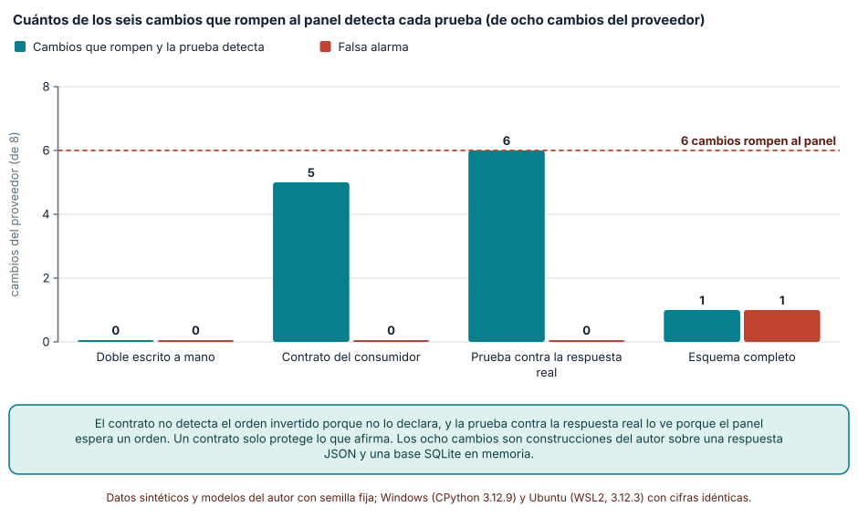
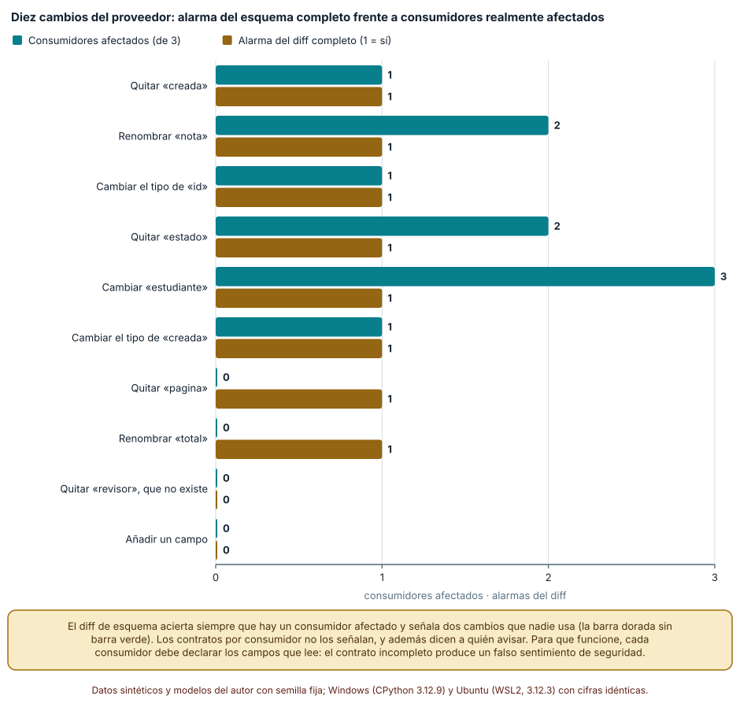
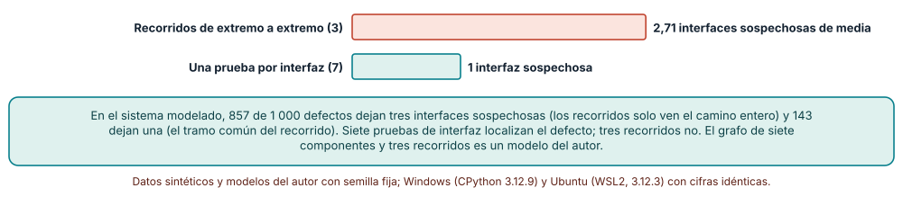

# SE-423 — Integración, componentes y contratos

[← SE-422 — Pruebas unitarias y diseño testable](https://github.com/vladimiracunadev-create/modern-software-engineering-program/blob/main/classes/part-35-estrategia-y-tecnicas-de-prueba/se-422-pruebas-unitarias-y-diseno-testable/README.md) · [↑ Parte 35](https://github.com/vladimiracunadev-create/modern-software-engineering-program/blob/main/classes/part-35-estrategia-y-tecnicas-de-prueba/README.md) · [📚 Índice completo](https://github.com/vladimiracunadev-create/modern-software-engineering-program/blob/main/classes/README.md) · [🌐 Portal](https://vladimiracunadev-create.github.io/modern-software-engineering-program/classes/SE-423.html) · [SE-424 — End-to-end, aceptación y recorridos críticos →](https://github.com/vladimiracunadev-create/modern-software-engineering-program/blob/main/classes/part-35-estrategia-y-tecnicas-de-prueba/se-424-end-to-end-aceptacion-y-recorridos-criticos/README.md)

## Punto profesional y fundamento pedagógico

**Punto profesional.** La clase existe para que compruebes que las piezas de un sistema funcionan juntas sin levantar el sistema entero, y para que protejas el acuerdo entre un proveedor y sus consumidores con un contrato que cada parte pueda verificar. Un defecto de integración vive entre dos componentes que, por separado, pasan todas sus pruebas.

**Por qué aparece aquí.** Sigue a **Pruebas unitarias y diseño testable**: allí cada función se comprobó aislada y con dobles; ahora hay que comprobar el acuerdo entre ellas. La [Parte 27](../../part-27-arquitectura-de-software-y-dominio/README.md) dejó fronteras y la [Parte 20](../../part-20-backend-apis-y-procesamiento-asincrono/README.md) contratos de API; esta clase pregunta cómo se prueba que una frontera se respeta.

**Error conceptual que debe corregir.** Creer que si cada componente pasa sus pruebas y el consumidor se prueba con un doble del proveedor, la integración queda cubierta. El doble es una copia de lo que el consumidor *cree* que el proveedor responde: si el proveedor cambia, el doble no se entera y la prueba sigue en verde.

**Secuencia de aprendizaje.** Antes de leer los resultados, predices cuántos de ocho cambios de un proveedor detecta una prueba del consumidor con un doble fijo; después mides un contrato, una prueba contra la respuesta real y una comparación de esquema completo, y comparas dónde localiza un fallo una prueba de extremo a extremo frente a una por interfaz. La secuencia usa predicción, explicación propia, contraste y recuperación. [ICAP](https://icap.education.asu.edu/research) distingue participación de construcción de conocimiento; [How People Learn II](https://nap.nationalacademies.org/catalog/24783/how-people-learn-ii-learners-contexts-and-cultures) exige conectar conocimiento previo, contexto y transferencia; la [práctica de recuperación](https://pubmed.ncbi.nlm.nih.gov/16507066/) respalda producir de nuevo la explicación tras una demora; y [Education for Life and Work](https://nap.nationalacademies.org/resource/13398/dbasse_084153.pdf) exige devolución que explique la causa del error.

**Evidencia de aprendizaje.** `integracion-log.md` con la predicción, el contrato del consumidor, la matriz de cambios del proveedor contra tipos de prueba, la comparación entre contrato por consumidor y diferencia de esquema, y el análisis de localización del fallo por interfaz.

**Límite de la conclusión.** El proveedor y el consumidor son funciones de Python con una respuesta JSON y una base SQLite en memoria; no se usó red, servidor HTTP, herramienta de contratos ni mensajería. Los ocho cambios del proveedor y el grafo de siete componentes son construcciones del autor. Los resultados muestran qué clase de prueba puede ver qué clase de cambio, no con qué frecuencia ocurre en un sistema real.

### Trazabilidad fuente → afirmación

| Fuente primaria u oficial | Afirmación que respalda | Lo que no prueba |
|---|---|---|
| [Martin Fowler, «IntegrationTest»](https://martinfowler.com/bliki/IntegrationTest.html) | Distingue pruebas de integración de banda estrecha (un colaborador real) y de banda ancha. | No fija cuántas hacen falta. |
| [Martin Fowler, «ContractTest»](https://martinfowler.com/bliki/ContractTest.html) | Define una prueba de contrato como la que comprueba que un doble o un servicio externo se comporta como se espera. | No es una herramienta concreta. |
| [Ian Robinson, «Consumer-Driven Contracts»](https://martinfowler.com/articles/consumerDrivenContracts.html) | Describe contratos que expresan lo que cada consumidor realmente usa del proveedor. | No cubre el costo de mantener muchos contratos. |
| [Documentación de Pact](https://docs.pact.io/) | Documenta pruebas de contrato dirigidas por el consumidor con verificación del proveedor. | No la usa esta clase; se implementa un verificador mínimo. |
| [JSON Schema](https://json-schema.org/specification) | Especifica cómo describir la forma de un documento JSON. | No dice qué campos usa cada consumidor. |
| [OpenAPI](https://spec.openapis.org/oas/latest.html) | Define cómo describir una API HTTP y sus respuestas. | No garantiza que la implementación la cumpla. |

## Antes de empezar

Recupera lo aprendido en `SE-422`: una función con dependencias separadas se prueba con valores. La pregunta activa es: **si el panel de la plataforma consume la respuesta de un servicio de notas, ¿qué cambios de ese servicio rompen al panel, quién se entera y dónde?**

## Prerrequisitos

- Haber completado `SE-422` o poder explicar qué es una dependencia inyectada.
- Python 3.11 o posterior con `json` y `sqlite3`.
- Haber visto en `SE-164` o `SE-244` qué es un contrato de respuesta y cómo evoluciona, o saber leer un documento JSON.

## Problema auténtico

El servicio de notas de la plataforma devuelve una lista JSON de entregas; el panel docente, el exportador de informes y el servicio de avisos la consumen. Un día el equipo del servicio renombra `nota` por `calificacion` para alinearse con el vocabulario del negocio y sus pruebas pasan. El panel falla en producción. Revisando las pruebas del panel se descubre que usan un doble escrito a mano con el campo `nota`: seguían pasando. Alguien propone comparar el esquema completo en cada cambio; otra persona nota que eso generaría alarmas por campos que nadie usa. El equipo necesita un mecanismo que avise a los consumidores afectados y solo a ellos, y una forma de localizar el fallo cuando un recorrido completo se rompe.

## Objetivos observables

Al terminar podrás:

1. distinguir una prueba de integración, una de contrato y una de componente, y decir qué cambio de un proveedor puede detectar cada una;
2. escribir un contrato del consumidor con los campos, los tipos y el orden que realmente usa y verificarlo contra la respuesta del proveedor;
3. comparar un contrato por consumidor con una diferencia de esquema completa y contar falsas alarmas;
4. explicar por qué un doble fijo nunca detecta un cambio del proveedor;
5. elegir entre pruebas por interfaz y recorridos completos según cuánto acotan el fallo.

## Mapa conceptual


El mapa parte de lo que el consumidor usa y no de lo que el proveedor ofrece: el contrato es la lista de lo que alguien depende. El retorno indica que un uso nuevo amplía el contrato.

## Temas y por qué importan

| Tema | Por qué cambia una decisión profesional | Evidencia mínima |
|---|---|---|
| Qué es una integración | Un defecto de integración vive en la interfaz, no en ninguna de las partes. | Predicción, traza y contraejemplo en `integracion-log.md` |
| Dobles y respuesta real | El doble copia la creencia del consumidor, no el comportamiento del proveedor. | Matriz de cambios del proveedor contra pruebas |
| Contratos dirigidos por el consumidor | Avisan solo a quien depende de lo que cambia. | Contrato por consumidor y diferencia de esquema |
| Lo que un contrato no dice | Un contrato protege solo lo que afirma: orden, formato y semántica quedan fuera si no se escriben. | Lista de cambios no detectados |
| Localizar un fallo | Un recorrido completo dice que algo falló, no dónde. | Sospechosas por fallo según el tipo de prueba |

## Conceptos y decisiones

### 1. Qué es una integración

Los componentes se comunican a través de interfaces: una respuesta JSON, una tabla compartida, una cola. Cada uno asume algo sobre la otra parte: nombres, tipos, valores posibles, orden, cuántos elementos aparecen por página. Un defecto de integración es una asunción que ya no se cumple. Ninguna prueba de una sola parte lo ve, porque cada una se comprueba contra su propia versión de la asunción. Las pruebas de integración ejecutan dos o más piezas reales juntas y comprueban que la asunción de una coincide con el comportamiento de la otra.

### 2. Dobles y respuesta real

Un doble de un proveedor es un objeto que responde lo que el consumidor espera. Es útil para aislar la prueba del consumidor, y por eso no puede detectar cambios del proveedor: es la copia de una creencia. La protección contra el cambio tiene que venir de una prueba que ejecute al proveedor real, o de un contrato que ambas partes verifiquen. Cuando el doble y el proveedor se verifican contra el mismo contrato, el doble queda anclado a la realidad (esto es el tema de `SE-427`).

### 3. Contratos dirigidos por el consumidor

Un contrato dirigido por el consumidor lista lo que el consumidor lee: qué campos, con qué tipo y qué valores. El proveedor ejecuta los contratos de todos sus consumidores contra cada cambio. Lo bueno es que avisa a quien depende de lo que cambió y no a los demás: quitar un campo que nadie lee no genera una alarma. Lo malo es que exige que cada consumidor declare su uso con honestidad: un contrato incompleto produce falsa seguridad.

### 4. Lo que un contrato no dice

Un contrato verifica lo que afirma. Si el consumidor depende del orden de la lista, de que la primera página tenga todos los elementos o de que las fechas usen un formato concreto, y el contrato no lo dice, el cambio pasa sin aviso. Una buena práctica es registrar cada incidente de integración como una cláusula nueva del contrato. Tampoco dice nada sobre el comportamiento temporal (tiempos de espera, reintentos) ni sobre las cargas.

### 5. Localizar un fallo

Cuando una prueba de extremo a extremo falla, dice que algún eslabón del recorrido se rompió. Con varios recorridos que comparten tramos se puede acotar por intersección, pero no siempre a una interfaz. Una prueba por interfaz verifica un solo acuerdo y apunta directamente a él. La contrapartida es que hay tantas como interfaces y no prueban que el recorrido funcione como un todo.

### Ocho cambios del proveedor frente a cuatro pruebas

El proveedor consulta una base SQLite en memoria y devuelve JSON con `items`, `total` y `pagina`. El panel convierte cada elemento en una tupla (estudiante, nota o «sin nota», estado en mayúsculas). Se aplican ocho cambios al JSON y se ejecutan cuatro pruebas: un doble fijo escrito por el equipo del panel, la verificación del contrato del consumidor (campos, tipos, enum y coherencia entre `total` y la lista), el panel contra la respuesta real modificada y una comparación del esquema completo.

```python
CONTRATO = {"items": {"estudiante": str, "nota": (float, int, type(None)),
                      "estado": ("calificada", "enviada", "anulada")}, "total": int}

def verificar_contrato(texto):
    d = json.loads(texto)
    errs = []
    if d["total"] != len(d["items"]): errs.append("total != len(items)")
    for it in d["items"]:
        for k, esperado in CONTRATO["items"].items():
            if k not in it: errs.append(f"falta {k}")
    return errs
```

| Cambio del proveedor | ¿Rompe el panel? | Doble fijo | Contrato | Respuesta real | Esquema completo |
|---|---|---|---|---|---|
| Renombrar `nota` por `calificacion` | Sí | No | Sí | Sí | Sí |
| `nota` de número a texto | Sí | No | Sí | Sí | No |
| Estado nulo | Sí | No | Sí | Sí | No |
| Valor nuevo en el enum de estado | Sí | No | Sí | Sí | No |
| Orden de la lista invertido | Sí | No | No | Sí | No |
| Primera página con 1 de 2 elementos | Sí | No | Sí | Sí | No |
| Campo extra `revisor` | No | No | No | No | Sí (falsa alarma) |
| Fecha con espacio en vez de `T` | No | No | No | No | No |

El doble fijo no detecta ninguno de los ocho, por construcción: siempre devuelve lo que se escribió. El contrato detecta cinco de los seis cambios que rompen al panel y no ve el orden invertido porque no lo declara. La prueba contra la respuesta real los ve todos porque ejecuta al panel, y no da falsas alarmas. La comparación de esquema completo acierta el renombrado y da una falsa alarma con el campo extra; no detecta cambios de tipo ni de valores.



**Cómo leer la figura.** Cada grupo es una prueba del consumidor; la barra verde cuenta los cambios que rompen al panel y esa prueba detecta (la línea punteada marca los seis que rompen) y la barra roja, las falsas alarmas. Mira la distancia entre cada barra verde y la línea. **Dónde deja de valer:** la respuesta real detecta todo porque el panel de juguete tiene una sola expectativa exacta; un consumidor con salida menos rígida detectaría menos. La figura muestra qué clase de prueba puede ver qué clase de cambio, no con qué frecuencia ocurre cada uno.

### Todo el esquema o solo lo que cada consumidor usa

Tres consumidores usan campos distintos: el panel (`estudiante`, `nota`, `estado`), el exportador (`id`, `estudiante`, `nota`, `creada`) y el servicio de avisos (`estudiante`, `estado`). Se aplican diez cambios al proveedor y se compara una alarma por diferencia del esquema completo con los contratos de cada consumidor.

| Cambio | Diff de esquema completo | Consumidores afectados |
|---|---|---|
| Quitar `creada` | Alarma | exportador |
| Renombrar `nota` | Alarma | panel, exportador |
| Cambiar el tipo de `id` | Alarma | exportador |
| Quitar `estado` | Alarma | panel, avisos |
| Cambiar `estudiante` | Alarma | panel, exportador, avisos |
| Cambiar el tipo de `creada` | Alarma | exportador |
| Quitar `pagina` | Alarma | nadie (falsa alarma) |
| Renombrar `total` | Alarma | nadie (falsa alarma) |
| Quitar `revisor`, que no existe | Sin alarma | nadie |
| Añadir un campo | Sin alarma | nadie (compatible) |

De las ocho alarmas, seis afectan al menos a un consumidor y dos a ninguno. Lo más valioso del enfoque por consumidor es la columna de la derecha: dice a quién avisar, cosa que la alarma global no sabe. El panel no lee `pagina` ni `total` en este modelo, de modo que su ausencia no le afecta; si algún consumidor empieza a leerlos, su contrato debe cambiar antes.



**Cómo leer la figura.** Cada fila es un cambio; la barra verde cuenta los consumidores que realmente se rompen y la dorada vale 1 cuando el diff de esquema completo da alarma. Las filas con barra dorada y sin barra verde son falsas alarmas. **Dónde deja de valer:** los usos por consumidor son una tabla escrita por el autor; en un sistema real el uso se declara, se infiere de las trazas o se descubre en un incidente, y cada vía tiene su propio error. La figura no dice que los contratos por consumidor sean gratuitos: alguien debe mantenerlos.

### Dónde localiza el fallo cada tipo de prueba

Se modela un sistema con siete interfaces entre componentes (web–api, api–notas, api–colas, notas–db, colas–db, api–auth, auth–db) y tres recorridos de extremo a extremo (calificar, encolar, ingresar). Se sortean 1 000 defectos, cada uno en una interfaz, y se cuenta cuántas interfaces quedan como sospechosas tras ver qué recorridos fallan, frente a siete pruebas, una por interfaz.

```python
sospechosas = set.intersection(*sets) if len(fallan) > 1 else sets[0]
```

Con los recorridos, la media es 2,71 interfaces sospechosas por fallo: en 857 de 1 000 casos son tres (el defecto vive en un tramo que pertenece a un solo recorrido, y el recorrido pasa por tres interfaces) y en 143 es una (la interfaz común de los tres recorridos, web–api). Con una prueba por interfaz, la sospechosa es siempre una. A cambio hay siete pruebas en lugar de tres.



**Cómo leer la figura.** Cada barra es el número medio de interfaces entre las que habría que buscar tras el primer fallo. **Dónde deja de valer:** el grafo de siete componentes y la hipótesis de que cada defecto vive en una interfaz son un modelo del autor; los defectos reales pueden estar en la lógica de un componente o repartirse entre varias interfaces. La figura mide localización, no detección: ambas estrategias ven el defecto.

## Definiciones de trabajo

- **prueba de integración:** prueba que ejecuta dos o más piezas reales juntas y comprueba el acuerdo entre ellas.
- **contrato:** descripción verificable de lo que un consumidor espera de un proveedor (campos, tipos, valores, orden).
- **contrato dirigido por el consumidor:** contrato escrito por quien consume, que expresa solo lo que usa.
- **cambio compatible:** cambio del proveedor que no rompe ningún contrato de consumidor.
- **interfaz:** punto en el que un componente expone o consume datos de otro.

Las definiciones son operativas para la plataforma de entregas y deben contrastarse con la documentación primaria enlazada al final.

## Ejemplo mínimo

El fragmento muestra por qué un doble no detecta un cambio. Antes de ejecutarlo, predice qué prueba falla.

```python
import json
proveedor_nuevo = lambda: json.dumps({"items": [{"estudiante": "ana", "calificacion": 6.5, "estado": "calificada"}], "total": 1})
doble = '{"items": [{"estudiante": "ana", "nota": 6.5, "estado": "calificada"}], "total": 1}'
def panel(texto): return [(i["estudiante"], i["nota"]) for i in json.loads(texto)["items"]]
assert panel(doble) == [("ana", 6.5)]                  # pasa: el doble no cambió
try: panel(proveedor_nuevo()); raise SystemExit("no debería pasar")
except KeyError: pass                                  # falla con la respuesta real
```

Registra versión, comando y salida. Después añade una verificación de contrato que compruebe la presencia de `nota` y observa quién la ejecuta.

## Ejemplo profesional

El equipo del servicio de notas mantiene en su repositorio una carpeta `contratos/` con un archivo por consumidor (`panel.json`, `exportador.json`, `avisos.json`) que lista los campos, tipos y valores que ese consumidor usa y, desde un incidente, el orden de la lista. La integración continua del servicio ejecuta los tres contratos contra su respuesta en cada propuesta de cambio y falla con el nombre del consumidor afectado. Los equipos de los consumidores abren un contrato nuevo cuando empiezan a usar un campo, y retiran las cláusulas que dejaron de usar. Las pruebas de integración del panel ejecutan el panel contra la respuesta real del servicio con una base sembrada, una por interfaz del recorrido; los tres recorridos de extremo a extremo (`SE-424`) quedan para el comportamiento visible. Cada incidente de integración añade una cláusula al contrato.

## Práctica guiada

1. Escribe un proveedor que consulte SQLite y devuelva JSON, y un panel que lo consuma.
2. Escribe un doble fijo del proveedor y una prueba del panel con él.
3. Predice cuántos de ocho cambios del proveedor detecta cada tipo de prueba y anótalo.
4. Implementa la verificación del contrato y la prueba contra la respuesta real y rellena la matriz.
5. Declara los campos que usa cada uno de tres consumidores y compara la alarma por diferencia de esquema con los contratos.
6. Define un grafo de interfaces y tres recorridos y mide las sospechosas tras 1 000 defectos sorteados.
7. Entrega `integracion-log.md` y pide a otra persona que proponga un cambio que ningún contrato detecte.

## Ejercicios

1. **Contrato:** escribe el contrato de un consumidor que lee `id` y `creada` e incluye el orden por fecha; añade el cambio que lo rompe.
2. **Cambio compatible:** clasifica diez cambios posibles (añadir un campo, relajar un tipo, endurecer un enum, cambiar un formato de fecha) como compatibles o no para un consumidor concreto.
3. **Localización:** diseña un grafo de interfaces donde un recorrido de extremo a extremo localice mejor que una prueba por interfaz, y explica qué lo permite.
4. **Incidente:** a partir de un incidente inventado («las fechas llegaron con zona horaria»), escribe la cláusula del contrato y la prueba que habría fallado.

## Reto verificable

Entrega `integracion-log.md` con la predicción, el proveedor y el panel, la matriz de ocho cambios contra cuatro pruebas, la comparación con tres consumidores y el análisis de localización. Se aprueba si otra persona ejecuta el código, obtiene las mismas matrices y puede indicar qué cambio deja pasar el contrato y por qué. No se aprueba por mostrar que el panel pasa sus pruebas con el doble.

## Caso conductor

La plataforma de entregas es el caso conductor. Esta clase deja el tercer artefacto: los contratos de los tres consumidores del servicio de notas y las pruebas de integración por interfaz. `SE-424` pregunta qué recorridos completos merece la pena probar y cuánto cuesta cada uno. Cambia después una decisión, quitar `total` de la respuesta, y observa qué contrato deja de cumplirse.

## Preguntas frecuentes

### ¿Los contratos reemplazan las pruebas de integración?

No: verifican el acuerdo de forma barata y sin levantar el sistema, y no comprueban que el comportamiento combinado sea correcto. Las pruebas de integración siguen siendo necesarias para lo que el contrato no dice (transacciones, ordenamiento, efectos).

### ¿Quién escribe el contrato, el proveedor o el consumidor?

El consumidor, porque solo él sabe lo que lee. El proveedor lo ejecuta. Un contrato escrito por el proveedor tiende a describir todo lo que ofrece y genera las mismas falsas alarmas que la comparación de esquema completo.

### ¿Qué pasa si hay cientos de consumidores?

El mantenimiento de contratos crece con ellos. Se mitiga con contratos generados a partir de las llamadas reales, con versionado explícito y con una política de retirada. Si el proveedor no puede conocer a sus consumidores (una API pública), la compatibilidad se gestiona con versiones y con tiempos de aviso, no con contratos.

### ¿Un esquema OpenAPI es un contrato?

Describe lo que el proveedor ofrece. Sirve para generar clientes y validar respuestas, pero no sabe qué campos usa cada consumidor, de modo que se comporta como la comparación de esquema completo.

## Fallo controlado y diagnóstico

Reproduce el fallo clásico de la clase: **un cambio del proveedor que el doble del consumidor no puede ver**. Renombra `nota` por `calificacion` en el proveedor y ejecuta las pruebas del panel con el doble.

Registra síntoma, entrada mínima, hipótesis, observación que descarta cada hipótesis, causa, corrección y prueba de regresión. **Síntoma:** las pruebas del panel pasan, el panel falla en producción con `KeyError`. **Hipótesis rivales:** (a) el doble está mal escrito; (b) el proveedor tiene un defecto; (c) el doble refleja una versión antigua del proveedor. **Prueba:** ejecuta el panel contra la respuesta real del proveedor modificado y compara con el doble; si la respuesta real lanza `KeyError` y el doble sigue devolviendo `nota`, la causa es la divergencia entre doble y proveedor. **Conclusión:** el doble copió una creencia que dejó de ser cierta. **Regresión:** añade la verificación del contrato del panel al proveedor y una prueba del panel contra la respuesta real; confirma que ambas fallan con el cambio y que el contrato nombra al consumidor afectado. No cambies a la vez el proveedor y el doble.

## Errores comunes y cómo corregirlos

| Síntoma | Causa probable | Corrección |
|---|---|---|
| El consumidor falla en producción y sus pruebas pasan | El doble refleja una versión antigua del proveedor | Verificar el doble contra el proveedor con el mismo contrato |
| El proveedor recibe alarmas por cambios que nadie usa | Comparación de esquema completo | Contratos por consumidor |
| Un cambio de orden o de formato no se detecta | El contrato no declara orden ni formato | Registrar cada incidente como cláusula nueva |
| Un fallo de extremo a extremo tarda horas en localizarse | Solo hay recorridos completos | Añadir una prueba por interfaz crítica |
| Los contratos quedan obsoletos | Nadie retira las cláusulas que dejó de usarse | Revisión periódica y retirada explícita |

## Entorno y archivos clave

```text
work/SE-423/
├── README.md
├── servicio/
│   ├── proveedor.py
│   └── panel.py
├── contratos/
│   ├── panel.json
│   ├── exportador.json
│   └── avisos.json
├── tests/test_integracion.py
└── evidence/integracion-log.md
```

El `README` declara plataforma, versiones de Python y de SQLite, semilla (363) y comandos. Los experimentos usan solo la biblioteca estándar (`json`, `sqlite3`, `random`) y se ejecutaron con CPython 3.12.9 en Windows 11 y 3.12.3 en Ubuntu bajo WSL2: las salidas fueron idénticas. Si añades una dependencia, fija procedencia y versión.

## Seguridad, ética y accesibilidad

- los contratos y las respuestas de prueba no deben contener datos personales reales: usa estudiantes sintéticos;
- una prueba de integración contra un servicio compartido puede enviar correos o modificar datos de otros equipos: usa entornos aislados;
- un contrato que expone campos sensibles (correo, nota) en un repositorio público filtra información: revisa qué se publica;
- los mensajes de error del proveedor no deben revelar rutas, versiones ni estructura interna que sirvan de apoyo a un ataque;
- documenta quién es dueño de cada contrato para que un cambio no quede sin responsable.

## Puente hacia el trabajo con agentes

Un agente al que se le pide «escribe pruebas de integración para el servicio de notas» generará un doble que devuelve lo que el panel espera y comprobará que el panel lo procesa. Pídele en cambio el contrato por consumidor derivado del código real del consumidor, la verificación contra el proveedor y la matriz de cambios que cada prueba detecta. Revisa especialmente que las pruebas ejecuten el proveedor real o su contrato, y que el contrato no incluya campos que el consumidor no lee: ese es el defecto que esta clase mostró.

## Transferencia

Traslada el análisis a otro servicio (por ejemplo, un servicio de inscripciones con un consumidor de correo y otro de calendario): declara lo que usa cada consumidor, aplica cambios al proveedor y mide qué detecta cada tipo de prueba. La transferencia está lograda cuando puedes explicar por qué el contrato no vio un cambio concreto, no cuando la tabla se parece.

## Evaluación y evidencia

| Criterio | Evidencia para aprobar |
|---|---|
| comprensión | explicación de por qué un doble nunca ve un cambio del proveedor |
| corrección | matrices y conteos reproducibles con las mismas semillas |
| diseño | contratos por consumidor, pruebas por interfaz y cláusula por incidente |
| diagnóstico | reproducción del fallo «renombrar un campo» con regresión |
| incertidumbre | declaración de que los cambios, los usos y el grafo son construcciones del autor |
| reproducibilidad | versiones, comandos, salida y límites declarados |

## Fuentes

- [Martin Fowler, «IntegrationTest»](https://martinfowler.com/bliki/IntegrationTest.html) — pruebas de integración; autoridad: autor del texto.
- [Martin Fowler, «ContractTest»](https://martinfowler.com/bliki/ContractTest.html) — pruebas de contrato; autoridad: autor del texto.
- [Ian Robinson, «Consumer-Driven Contracts»](https://martinfowler.com/articles/consumerDrivenContracts.html) — contratos por consumidor; autoridad: autor del texto.
- [Documentación de Pact](https://docs.pact.io/) — herramienta de contratos; autoridad: documentación oficial.
- [Especificación de JSON Schema](https://json-schema.org/specification) — descripción de documentos JSON; autoridad: especificación oficial.
- [Especificación de OpenAPI](https://spec.openapis.org/oas/latest.html) — descripción de APIs HTTP; autoridad: especificación oficial.

Cada fuente respalda el mecanismo indicado; ninguna demuestra que 5 de 6 cambios detectados por el contrato o las 2,71 interfaces sospechosas se observen en el sistema de la plataforma. Esa afirmación depende de los consumidores y de los cambios reales.

## Límites y siguiente paso

Se ejecutaron tres experimentos con un proveedor y un consumidor sintéticos en Windows y Ubuntu (WSL2) con salidas idénticas. No se usó red, servidor HTTP ni herramienta de contratos; los ocho cambios, los tres consumidores y el grafo de siete interfaces son del autor. La verificación del contrato es un verificador mínimo y su exactitud real es desconocida. La siguiente clase pregunta qué recorridos completos merece la pena probar de extremo a extremo y cuánto cuestan en estabilidad.

## Glosario

- **prueba de integración:** prueba que ejecuta dos o más piezas reales juntas y comprueba el acuerdo entre ellas.
- **contrato:** descripción verificable de lo que un consumidor espera de un proveedor (campos, tipos, valores, orden).
- **contrato dirigido por el consumidor:** contrato escrito por quien consume, que expresa solo lo que usa.
- **cambio compatible:** cambio del proveedor que no rompe ningún contrato de consumidor.
- **interfaz:** punto en el que un componente expone o consume datos de otro.

---

[← SE-422 — Pruebas unitarias y diseño testable](https://github.com/vladimiracunadev-create/modern-software-engineering-program/blob/main/classes/part-35-estrategia-y-tecnicas-de-prueba/se-422-pruebas-unitarias-y-diseno-testable/README.md) · [↑ Parte 35](https://github.com/vladimiracunadev-create/modern-software-engineering-program/blob/main/classes/part-35-estrategia-y-tecnicas-de-prueba/README.md) · [📚 Índice completo](https://github.com/vladimiracunadev-create/modern-software-engineering-program/blob/main/classes/README.md) · [🌐 Portal](https://vladimiracunadev-create.github.io/modern-software-engineering-program/classes/SE-423.html) · [SE-424 — End-to-end, aceptación y recorridos críticos →](https://github.com/vladimiracunadev-create/modern-software-engineering-program/blob/main/classes/part-35-estrategia-y-tecnicas-de-prueba/se-424-end-to-end-aceptacion-y-recorridos-criticos/README.md)
