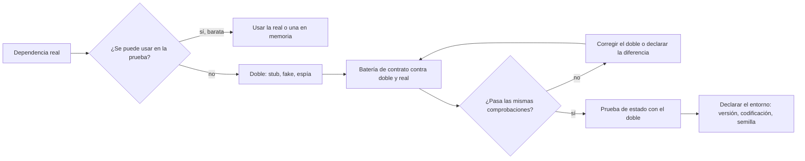
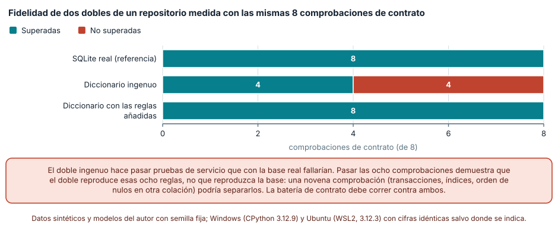
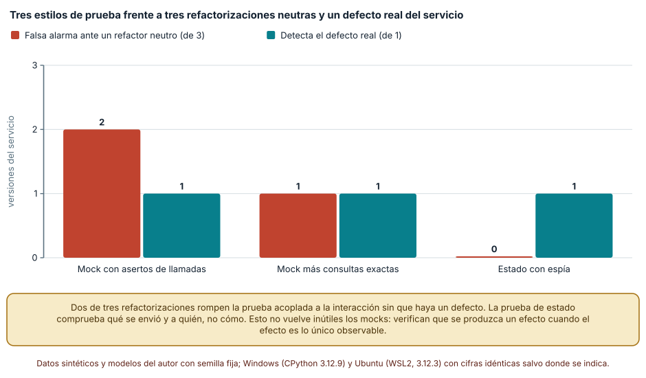
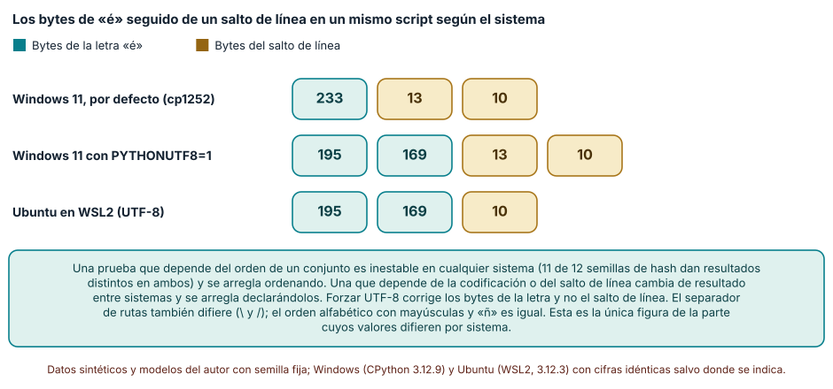

# SE-427 — Dobles, virtualización y entornos de prueba

[← SE-426 — Mutación, fuzzing y generación de casos](https://github.com/vladimiracunadev-create/modern-software-engineering-program/blob/main/classes/part-35-estrategia-y-tecnicas-de-prueba/se-426-mutacion-fuzzing-y-generacion-de-casos/README.md) · [↑ Parte 35](https://github.com/vladimiracunadev-create/modern-software-engineering-program/blob/main/classes/part-35-estrategia-y-tecnicas-de-prueba/README.md) · [📚 Índice completo](https://github.com/vladimiracunadev-create/modern-software-engineering-program/blob/main/classes/README.md) · [🌐 Portal](https://vladimiracunadev-create.github.io/modern-software-engineering-program/classes/SE-427.html) · [SE-428 — Datos deterministas y gestión de fixtures →](https://github.com/vladimiracunadev-create/modern-software-engineering-program/blob/main/classes/part-35-estrategia-y-tecnicas-de-prueba/se-428-datos-deterministas-y-gestion-de-fixtures/README.md)

## Punto profesional y fundamento pedagógico

**Punto profesional.** La clase existe para que decidas qué reemplazar en una prueba (un doble, una base en memoria, un contenedor, una máquina virtual) y cuánto te cuesta esa decisión en fidelidad, en acoplamiento a la implementación y en diferencias de entorno que cambian el resultado. Todo doble es una apuesta: ahorra tiempo y aislamiento a cambio de dejar de comprobar algo.

**Por qué aparece aquí.** Sigue a **Mutación, fuzzing y generación de casos**, que midió la calidad de las pruebas sobre código sin dependencias. `SE-422` mostró cómo separar dependencias y `SE-423` que un doble escrito a mano no ve cambios del proveedor; esta clase sistematiza qué dobles existen y cuándo cada uno es defendible.

**Error conceptual que debe corregir.** Creer que «mockear» es sinónimo de aislar y que un doble con las llamadas verificadas prueba el comportamiento. Una prueba que verifica llamadas a un doble se rompe con cualquier refactor que conserve el comportamiento, y un doble sin una batería de contrato en común con el real se aleja de él sin aviso.

**Secuencia de aprendizaje.** Antes de leer los resultados, predices cuántas de ocho comprobaciones de comportamiento de una base pasa un diccionario ingenuo; después mides la fidelidad de tres dobles, cuántas refactorizaciones rompen tres estilos de prueba y qué cambia de resultado entre procesos, sistemas operativos y codificaciones. La secuencia usa predicción, explicación propia, contraste y recuperación. [ICAP](https://icap.education.asu.edu/research) distingue participación de construcción de conocimiento; [How People Learn II](https://nap.nationalacademies.org/catalog/24783/how-people-learn-ii-learners-contexts-and-cultures) exige conectar conocimiento previo, contexto y transferencia; la [práctica de recuperación](https://pubmed.ncbi.nlm.nih.gov/16507066/) respalda producir de nuevo la explicación tras una demora; y [Education for Life and Work](https://nap.nationalacademies.org/resource/13398/dbasse_084153.pdf) exige devolución que explique la causa del error.

**Evidencia de aprendizaje.** `dobles-log.md` con la predicción, la batería de contrato ejecutada contra la base real y dos dobles, la matriz de refactorizaciones contra estilos de prueba y la tabla de diferencias de entorno por sistema y semilla de hash.

**Límite de la conclusión.** La base real es SQLite en memoria; no se usó un servidor de bases de datos, contenedores, Testcontainers ni máquinas virtuales. Las diferencias de entorno se midieron entre Windows 11 (CPython 3.12.9) y Ubuntu bajo WSL2 (3.12.3), que son dos entornos, no una muestra de entornos. La fidelidad se mide con ocho comprobaciones escogidas por el autor.

### Trazabilidad fuente → afirmación

| Fuente primaria u oficial | Afirmación que respalda | Lo que no prueba |
|---|---|---|
| [xUnit Patterns: Test Double](http://xunitpatterns.com/Test%20Double.html) | Clasifica dummy, stub, spy, mock y fake por su función. | No mide su fidelidad. |
| [Martin Fowler, «TestDouble»](https://martinfowler.com/bliki/TestDouble.html) | Resume la taxonomía de dobles y su uso. | No fija cuándo conviene cada uno. |
| [Martin Fowler, «Mocks Aren't Stubs»](https://martinfowler.com/articles/mocksArentStubs.html) | Distingue verificación de estado y de comportamiento y su acoplamiento. | No cuantifica la fragilidad. |
| [Documentación de `unittest.mock`](https://docs.python.org/3/library/unittest.mock.html) | Describe `Mock`, `spec`, `wraps` y las aserciones de llamadas. | No dice qué verificar. |
| [Documentación de Testcontainers](https://testcontainers.com/) | Describe pruebas contra dependencias reales en contenedores desechables. | No se ejecutó en la clase. |
| [`PYTHONHASHSEED` en la documentación de Python](https://docs.python.org/3/using/cmdline.html#envvar-PYTHONHASHSEED) | Explica la aleatorización de los valores hash de cadenas y cómo fijarla. | No cubre otros orígenes de variación. |
| [PEP 540: modo UTF-8](https://peps.python.org/pep-0540/) | Describe cómo forzar UTF-8 independientemente de la configuración regional. | No resuelve los saltos de línea. |

## Antes de empezar

Recupera lo aprendido en `SE-423`: un doble copia una creencia. La pregunta activa es: **¿qué comprobaciones tiene que superar un doble para que merezca confianza, y qué cambia entre mi máquina, la de un compañero y el servidor de integración sin que nadie haya tocado el código?**

## Prerrequisitos

- Haber completado `SE-422` y `SE-423` o poder explicar qué es una costura y qué copia un doble.
- Python 3.11 o posterior con `unittest.mock`, `sqlite3` y `subprocess`.
- Poder ejecutar un script en dos entornos (por ejemplo Windows y WSL2) para comparar.

## Problema auténtico

El servicio de avisos de la plataforma lee entregas de un repositorio y envía un correo a los estudiantes sin nota. Sus pruebas sustituyen el repositorio por un diccionario y verifican con `assert_called_with` que se llamó al correo con los argumentos esperados. Un refactor que consulta las entregas en otro orden rompe dos pruebas sin cambiar nada observable; el diccionario acepta un identificador duplicado que la base rechaza y una prueba del servicio pasa con datos que producción nunca recibirá; y una prueba que depende del orden de un conjunto de cadenas pasa en la máquina de una persona y falla en la integración continua. El equipo necesita criterios para decidir qué doble usar, cómo comprobar que no se aleja de lo real y cómo declarar el entorno.

## Objetivos observables

Al terminar podrás:

1. clasificar un doble (dummy, stub, spy, mock, fake) por lo que sustituye y lo que verifica;
2. medir la fidelidad de un doble ejecutando una batería de contrato contra él y contra la implementación real;
3. distinguir pruebas de estado y de interacción y medir cuántas refactorizaciones neutras las rompen;
4. identificar diferencias de entorno que cambian el resultado (semilla de hash, codificación, separador de rutas, saltos de línea) y fijarlas;
5. elegir entre doble, base en memoria, contenedor y entorno compartido según el riesgo.

## Mapa conceptual



El mapa parte de la dependencia real y baja a un doble solo cuando hace falta, y el doble se ancla a la realidad con una batería compartida. El entorno se declara al final porque también es una dependencia.

## Temas y por qué importan

| Tema | Por qué cambia una decisión profesional | Evidencia mínima |
|---|---|---|
| Tipos de doble | Cada uno sustituye y verifica algo distinto. | Clasificación de los dobles de la plataforma |
| Fidelidad de un doble | Un doble infiel hace pasar pruebas que producción rechazaría. | Batería de contrato contra doble y real |
| Estado frente a interacción | La verificación de llamadas acopla la prueba a la implementación. | Refactorizaciones neutras que rompen cada estilo |
| Dependencias en memoria y contenedores | Se pueden usar reales y baratas en muchos casos. | Criterio de elección por riesgo |
| Diferencias de entorno | La prueba pasa aquí y falla allá sin cambiar el código. | Tabla de comportamiento por sistema y semilla |

## Conceptos y decisiones

### 1. Tipos de doble

Un *dummy* rellena un parámetro que no se usa; un *stub* devuelve respuestas fijas; un *spy* registra las llamadas que recibe para que la prueba las consulte después; un *mock* tiene expectativas preprogramadas y falla si no se cumplen; un *fake* es una implementación funcional más simple (una base en memoria, un diccionario con reglas). La diferencia útil es qué verifica la prueba: con un stub o un fake, el estado resultante; con un mock, la interacción. Los dobles de estado envejecen mejor, porque no dependen de cómo se llegó al resultado.

### 2. Fidelidad de un doble

Un doble es fiel en la medida en que se comporta como lo real en lo que las pruebas usan. No se mide por inspección: se escribe una batería de comportamientos (rechazar un duplicado, respetar un rango, ordenar los nulos de una forma, tratar mayúsculas) y se ejecuta contra la implementación real y contra el doble. Cada comprobación que el doble no supera es una situación en la que una prueba de servicio pasará con él y fallaría con la real. La batería de contrato es el mismo mecanismo que anclaba al doble en `SE-423`.

### 3. Estado frente a interacción

Una prueba de estado comprueba el resultado observable (qué se guardó, qué se envió). Una de interacción comprueba cómo se llegó a él (qué métodos se invocaron, en qué orden y con qué argumentos). La segunda se rompe con refactorizaciones que conservan el comportamiento (cambiar el orden de proceso, usar argumentos con nombre, agrupar consultas), y esa fragilidad es un costo de mantenimiento, no una prueba de que el código está bien. Verificar interacciones tiene sentido cuando el efecto es lo único observable (un correo enviado) y el contrato de la llamada importa.

### 4. Dependencias en memoria, contenedores y entornos compartidos

Una base en memoria del mismo motor que producción (SQLite en memoria) tiene mucha más fidelidad que un diccionario y casi el mismo costo. Un contenedor desechable con el servicio real (una base de datos, un broker) da fidelidad alta con tiempo de arranque. Un entorno compartido de integración da fidelidad total y trae estado compartido, contención y fallos que dependen de otros. La decisión es de riesgo: cuanto más grave el defecto que solo la dependencia real revela, más cerca de lo real se prueba.

### 5. Diferencias de entorno

El mismo código puede producir resultados distintos entre procesos y entre sistemas: el orden de iteración de un conjunto de cadenas cambia con la semilla de hash de cada proceso; la codificación por defecto al abrir un archivo de texto cambia entre sistemas; el separador de rutas y el salto de línea también. Son variables de entorno que una prueba no declara. Se tratan como una dependencia más: se fijan (`PYTHONHASHSEED`, modo UTF-8, saltos de línea explícitos), se eliminan (ordenar antes de comparar) o se prueban en cada entorno que importa.

### Tres dobles frente a la misma batería de contrato

Se define una base real (SQLite en memoria con restricciones de unicidad, rango y no nulo, y una columna de correo con comparación sin distinguir mayúsculas) y tres implementaciones: la real, un diccionario ingenuo y un diccionario con las reglas añadidas. Ocho comprobaciones de comportamiento las someten a prueba: rechazo de un id duplicado, de una nota fuera de rango, de un estudiante nulo, `obtener` de un inexistente, orden por nota con nulos primero, media que ignora nulos, correo único sin distinguir mayúsculas y media de una tabla vacía.

```python
COMPROBACIONES = {
    "id duplicado se rechaza": lambda R: ...,
    "nota fuera de rango se rechaza": lambda R: lanza(R().agregar, 1, "a", 9.0) is True,
    "orden por nota con nulos: nulo primero": lambda R: ...,
}
```

| Implementación | Comprobaciones superadas | Qué no reproduce |
|---|---|---|
| SQLite real (referencia) | 8 de 8 | — |
| Diccionario ingenuo | 4 de 8 | Id duplicado, nota fuera de rango, estudiante nulo y correo único sin distinguir mayúsculas |
| Diccionario con las reglas añadidas | 8 de 8 | — |

El diccionario ingenuo pasa cuatro y deja pasar datos que la base rechaza; una prueba del servicio con él aceptaría una nota de 9,0. El diccionario con reglas pasa las ocho, pero «pasa las ocho» significa que reproduce esas ocho: no hay comprobación de transacciones, de índices ni de un orden con otra colación. Una de las cuatro que el ingenuo supera (el orden con nulos) la supera por casualidad, porque su ordenamiento trata `None` como 0 y coincide con el de SQLite para ese conjunto.



**Cómo leer la figura.** Cada barra mide ocho comprobaciones: el tramo verde son las superadas y el rojo, las que el doble no reproduce. Mira cuánto de la barra del diccionario ingenuo es rojo. **Dónde deja de valer:** las ocho comprobaciones son las que el autor pensó; un doble puede superarlas y diferir en otras que no se escribieron. La figura no dice que un doble con reglas sea tan bueno como la base: dice que su infidelidad es medible con la batería que se escriba.

### Tres estilos de prueba frente a refactorizaciones neutras

El servicio de avisos consulta cada entrega, y si no tiene nota envía un correo. Se prueban cinco versiones: la original, tres refactorizaciones que no cambian lo que el servicio hace (procesar en orden inverso y devolver en el original, usar argumentos con nombre en el envío, consultar todas las entregas antes de recorrerlas) y una con un defecto (avisa también a quien ya tiene nota). Tres estilos de prueba: un mock con `assert_has_calls` sobre los envíos, el mismo con las consultas al repositorio fijadas y una prueba de estado con un espía que guarda lo enviado.

```python
def prueba_mock(S):
    p = mock.Mock(spec=Pasarela); s = S(repo_con_datos(), p); s.avisar_tardias([1, 2, 3])
    p.enviar.assert_has_calls([mock.call("ana@curso.test", "Entrega pendiente", "..."), ...])

def prueba_estado(S):
    p = PasarelaEspia(); r = S(repo_con_datos(), p).avisar_tardias([1, 2, 3])
    assert r == [1, 3] and sorted(d for d, _ in p.enviados) == ["ana@curso.test", "caro@curso.test"]
```

| Versión del servicio | Mock con asertos de llamadas | Mock más consultas exactas | Estado con espía |
|---|---|---|---|
| Original | Pasa | Pasa | Pasa |
| Refactor: orden inverso | Falla | Falla | Pasa |
| Refactor: argumentos con nombre | Falla | Pasa | Pasa |
| Refactor: consulta antes de enviar | Pasa | Pasa | Pasa |
| Defecto: avisa a quien ya tiene nota | Falla | Falla | Falla |

Dos de tres refactorizaciones neutras rompen la prueba con asertos de llamadas, y una rompe la que además fija las consultas; la prueba de estado no se rompe con ninguna. Las tres detectan el defecto real. El mock no es peor detectando el defecto: es peor tolerando cambios que no importan, y cada falsa alarma es un costo de mantenimiento y una razón para no refactorizar.



**Cómo leer la figura.** Cada grupo es un estilo de prueba; la barra roja cuenta las falsas alarmas ante refactorizaciones que no cambian el comportamiento (de 3) y la verde, el defecto real detectado. Mira que la barra verde es igual en los tres y la roja no. **Dónde deja de valer:** son tres refactorizaciones elegidas por el autor sobre un servicio de diez líneas; no dicen con qué frecuencia ocurren en un proyecto real. La figura no desaconseja los mocks: muestra el costo de usarlos donde el estado es observable.

### Qué cambia sin tocar el código

Un script pequeño devuelve el orden de un conjunto de cinco cadenas, el separador de rutas, la codificación por defecto, los bytes que escribe al guardar «é» con un salto de línea y el orden alfabético de `["beto", "Ana", "ñandú", "caro"]`. Se ejecuta en 12 procesos con `PYTHONHASHSEED` de 0 a 11, en Windows 11 y en Ubuntu bajo WSL2.

```python
env = dict(os.environ, PYTHONHASHSEED=str(s), TMPD=td)
r = subprocess.run([sys.executable, "-c", CODIGO], capture_output=True, text=True, env=env)
```

| Comportamiento | Windows 11 (3.12.9) | Ubuntu en WSL2 (3.12.3) |
|---|---|---|
| Orden de un conjunto de cadenas (12 semillas de hash) | 11 resultados distintos | 11 resultados distintos |
| Separador de rutas | `\` | `/` |
| Codificación por defecto al abrir un archivo | cp1252 | UTF-8 |
| Bytes de «é» seguido de salto de línea | 233, 13, 10 | 195, 169, 10 |
| Con `PYTHONUTF8=1` | 195, 169, 13, 10 | 195, 169, 10 |
| Orden alfabético con mayúsculas y «ñ» | Igual | Igual |

El orden de un conjunto cambia en 11 de 12 procesos en ambos sistemas: una prueba que lo compara con una lista fija falla casi siempre en alguno y pasa en otros, sin que haya un defecto. La codificación y el salto de línea cambian entre sistemas: la misma prueba que escribe y lee un archivo da bytes distintos. Forzar el modo UTF-8 arregla la codificación en Windows (195, 169) y no el salto de línea, que sigue siendo 13, 10. Ordenar antes de comparar, declarar la codificación y el salto de línea en cada `open` son correcciones que no dependen del entorno.



**Cómo leer la figura.** Cada fila es un entorno y cada casilla, un byte: las verdes son los bytes de la letra y las doradas, los del salto de línea. Mira qué casillas cambian al forzar UTF-8 (las verdes) y cuáles siguen distintas entre sistemas (las doradas). **Dónde deja de valer:** son dos entornos concretos con una versión de Python cada uno; otro sistema, otra configuración regional o un contenedor darían otros valores. La figura es la única de la parte cuyos valores difieren por sistema, y esa diferencia es la que enseña.

## Definiciones de trabajo

- **doble de prueba:** objeto que sustituye a una dependencia real durante una prueba.
- **fake:** doble con una implementación funcional simplificada (por ejemplo, una base en memoria).
- **espía (spy):** doble que registra las llamadas que recibe para consultarlas después.
- **prueba de contrato:** batería de comprobaciones que se ejecuta contra el doble y contra la implementación real.
- **fidelidad:** grado en que un doble se comporta como la dependencia real en lo que las pruebas usan.

Las definiciones son operativas para la plataforma de entregas y deben contrastarse con la documentación primaria enlazada al final.

## Ejemplo mínimo

El fragmento comprueba una regla contra dos implementaciones. Antes de ejecutarlo, predice cuál falla.

```python
import sqlite3
def real():
    db = sqlite3.connect(":memory:"); db.execute("create table e(id integer primary key)")
    return lambda i: db.execute("insert into e values(?)", (i,))
def doble():
    s = set()
    return lambda i: s.add(i)
for nombre, f in (("real", real()), ("doble", doble())):
    f(1)
    try: f(1); print(nombre, "acepta el duplicado")
    except sqlite3.IntegrityError: print(nombre, "rechaza el duplicado")
```

La base rechaza el duplicado y el conjunto lo acepta: una diferencia de comportamiento que ninguna prueba del servicio con el doble vería. Registra versión, comando y salida.

## Ejemplo profesional

El equipo de la plataforma define una carpeta `contrato/` con una batería de ocho comprobaciones del repositorio de entregas y la ejecuta dos veces en la integración continua: contra SQLite en memoria y contra el fake del repositorio que usan las pruebas de servicio; si el fake no supera una comprobación que la base supera, la compilación falla. Las pruebas del servicio de avisos usan el fake y un espía de correo, verifican el estado (qué se envió y a quién) y solo conservan una prueba de interacción: la que comprueba que no se envían correos a estudiantes con nota. La integración continua fija `PYTHONHASHSEED`, abre todos los archivos con codificación y salto de línea explícitos, y ejecuta la batería en Windows y Ubuntu. Una vez al trimestre se ejecutan las pruebas de servicio contra una base real en un contenedor desechable para detectar diferencias que el contrato no cubre.

## Práctica guiada

1. Escribe un repositorio real con SQLite, un diccionario ingenuo y un fake con reglas.
2. Escribe ocho comprobaciones de contrato y predice cuántas supera cada implementación.
3. Ejecuta la batería contra las tres y anota qué no reproduce cada doble.
4. Escribe un servicio de avisos y tres refactorizaciones neutras; prueba con un mock de llamadas, con consultas fijas y con estado.
5. Ejecuta un mismo script en 12 procesos con `PYTHONHASHSEED` distinto y compara lo que cambia.
6. Si dispones de otro sistema (Windows y WSL2, o un contenedor), repite y registra las diferencias.
7. Entrega `dobles-log.md` y pide a otra persona que proponga una novena comprobación que separe al fake de la base.

## Ejercicios

1. **Fidelidad:** añade una comprobación de transacción (un `rollback` deshace una inserción) y observa cuáles de los tres repositorios la superan.
2. **Estado:** convierte una prueba con mocks de tu código en una prueba de estado con un espía y compara cuántas refactorizaciones neutras la rompen.
3. **Entorno:** escribe una prueba que dependa del orden de un conjunto y arréglala de dos maneras (ordenar y fijar la semilla); explica por qué la primera es mejor.
4. **Criterio:** para tres dependencias de tu sistema (correo, reloj, base), decide doble, base en memoria o contenedor y justifica con el riesgo.

## Reto verificable

Entrega `dobles-log.md` con la predicción, la batería de contrato con sus resultados por implementación, la matriz de refactorizaciones contra estilos de prueba y la tabla de entorno por sistema. Se aprueba si otra persona ejecuta el código, obtiene las mismas cifras (salvo las diferencias de sistema que la tabla declara) y puede decir qué comprobación añadiría para separar el fake de la base. No se aprueba por mostrar pruebas con mocks que pasan.

## Caso conductor

La plataforma de entregas es el caso conductor. Esta clase deja el séptimo artefacto: la batería de contrato del repositorio, el fake anclado a ella y las pruebas de servicio por estado. `SE-428` trata los datos de prueba y los fixtures, que también determinan si una prueba es determinista. Cambia después una decisión, sustituir el fake por la base en memoria en las pruebas de servicio, y observa cuántas comprobaciones nuevas aparecen y cuánto tiempo suman.

## Preguntas frecuentes

### ¿Siempre es mejor usar la dependencia real?

No: cuesta tiempo, aislamiento o dinero (un servicio de pago, un correo real). Es mejor cuando es barata y el defecto que revela es grave; el doble anclado a una batería de contrato es la alternativa cuando no lo es. La decisión es de riesgo, y se escribe.

### ¿Cuándo tiene sentido verificar una interacción?

Cuando el efecto es la única evidencia observable y el contrato de la llamada importa (se envió un correo, se publicó un evento, se llamó a un servicio de pago con el importe correcto). Aun así, se verifica lo que importa del contrato, no el orden ni los detalles accidentales.

### ¿Por qué `PYTHONHASHSEED` cambia el orden de un conjunto?

Python aleatoriza el valor hash de las cadenas en cada proceso para dificultar ciertos ataques; el orden de iteración de un conjunto depende de esos valores y por tanto cambia entre procesos. Fijar la semilla lo hace reproducible; ordenar antes de comparar lo hace independiente de ella.

### ¿Un contenedor resuelve las diferencias de entorno?

Reduce las del sistema operativo y las de las dependencias, y no las del código (el orden de un conjunto, la hora). Declarar el entorno completo, incluidas las variables que lo afectan, sigue siendo necesario.

## Fallo controlado y diagnóstico

Reproduce el fallo clásico de la clase: **una prueba que pasa con un doble infiel y fallaría con la dependencia real**. Ejecuta una prueba del servicio que registra una nota de 9,0 con el diccionario ingenuo.

Registra síntoma, entrada mínima, hipótesis, observación que descarta cada hipótesis, causa, corrección y prueba de regresión. **Síntoma:** la prueba del servicio pasa y, con la base real, la misma operación lanza una excepción de integridad. **Hipótesis rivales:** (a) el servicio tiene un defecto; (b) la base está mal configurada; (c) el doble acepta lo que la base rechaza. **Prueba:** ejecuta la batería de contrato contra el diccionario ingenuo (4 de 8) y contra la base (8 de 8); la comprobación «nota fuera de rango se rechaza» separa a ambos. **Conclusión:** el doble no reproduce una regla de la base. **Regresión:** añade las reglas al fake, comprueba que supera las ocho comprobaciones y deja la batería en la integración continua para que el fake no se aleje. No cambies a la vez el servicio y el doble.

## Errores comunes y cómo corregirlos

| Síntoma | Causa probable | Corrección |
|---|---|---|
| Una prueba con doble pasa y con la dependencia real falla | El doble no reproduce una regla | Batería de contrato ejecutada contra ambos |
| Un refactor sin cambios de comportamiento rompe pruebas | Pruebas que verifican llamadas y orden | Pruebas de estado y verificación de interacción solo donde el efecto es lo único observable |
| Una prueba pasa en un equipo y falla en la integración continua | Semilla de hash, codificación o saltos de línea sin declarar | Ordenar antes de comparar y declarar codificación y salto de línea |
| Se usa un servicio real en las pruebas y envía correos | No hay doble ni entorno aislado | Espía o servidor de pruebas y limpieza |
| Los dobles se alejan con el tiempo | Nadie ejecuta la batería de contrato | Integrarla en la compilación |

## Entorno y archivos clave

```text
work/SE-427/
├── README.md
├── contrato/
│   ├── comprobaciones.py
│   └── repositorios.py
├── servicio/avisos.py
├── tests/
│   ├── test_contrato.py
│   └── test_avisos.py
├── entorno/diferencias.py
└── evidence/dobles-log.md
```

El `README` declara plataforma, versión de Python y de SQLite, valores de `PYTHONHASHSEED` y comandos. Los experimentos usan solo la biblioteca estándar (`unittest.mock`, `sqlite3`, `subprocess`) y se ejecutaron con CPython 3.12.9 en Windows 11 y 3.12.3 en Ubuntu bajo WSL2: las salidas fueron idénticas salvo las diferencias de sistema de la tabla de entorno, que son el objeto del experimento. Si añades una dependencia, fija procedencia y versión.

## Seguridad, ética y accesibilidad

- un doble que simula un servicio de pagos o de correo debe impedir envíos reales por error: configura el doble por defecto y exige una acción explícita para el servicio real;
- los datos de los dobles no deben ser copias de datos personales reales;
- un doble que no reproduce la autenticación puede ocultar defectos de seguridad: prueba también contra la dependencia con autenticación real en un entorno aislado;
- los contenedores y máquinas virtuales de prueba pueden exponer puertos y credenciales: no los publiques ni reutilices contraseñas reales;
- documenta qué entornos cubre la suite para que quien use otro sepa qué no se probó.

## Puente hacia el trabajo con agentes

Un agente al que se le pide «escribe pruebas con mocks para este servicio» verificará cada llamada con sus argumentos y su orden, y el primer refactor las romperá. Pídele en cambio un fake con la batería de contrato ejecutada contra la dependencia real, pruebas de estado con un espía y la lista de variables de entorno que afectan al resultado. Revisa especialmente que la batería se ejecute contra ambos y que no haya `assert_called_with` sobre detalles accidentales.

## Transferencia

Traslada el análisis a otra dependencia (por ejemplo, un servicio de almacenamiento de archivos): escribe ocho comprobaciones de contrato, ejecútalas contra un doble y contra uno real (o contra una implementación local), y mide diferencias de entorno entre dos sistemas. La transferencia está lograda cuando puedes decir qué comprobación separa al doble del real, no cuando el código se parece.

## Evaluación y evidencia

| Criterio | Evidencia para aprobar |
|---|---|
| comprensión | explicación de qué verifica cada tipo de doble y de por qué el estado envejece mejor |
| corrección | batería de contrato y matriz de refactorizaciones reproducibles |
| diseño | fake anclado a la batería, pruebas de estado y entorno declarado |
| diagnóstico | reproducción del fallo «doble infiel» con regresión |
| incertidumbre | declaración de que las comprobaciones y los dos entornos son del autor |
| reproducibilidad | versiones, semillas de hash, comandos, salida y diferencias de sistema declaradas |

## Fuentes

- [xUnit Patterns: Test Double](http://xunitpatterns.com/Test%20Double.html) — taxonomía de dobles; autoridad: autor del libro.
- [Martin Fowler, «TestDouble»](https://martinfowler.com/bliki/TestDouble.html) — resumen de dobles; autoridad: autor del texto.
- [Martin Fowler, «Mocks Aren't Stubs»](https://martinfowler.com/articles/mocksArentStubs.html) — estado frente a comportamiento; autoridad: autor del texto.
- [Documentación de unittest.mock](https://docs.python.org/3/library/unittest.mock.html) — dobles en Python; autoridad: documentación oficial de Python.
- [Testcontainers](https://testcontainers.com/) — dependencias reales en contenedores desechables; autoridad: sitio oficial del proyecto.
- [Variable PYTHONHASHSEED](https://docs.python.org/3/using/cmdline.html#envvar-PYTHONHASHSEED) — aleatorización de hash; autoridad: documentación oficial de Python.
- [PEP 540: modo UTF-8](https://peps.python.org/pep-0540/) — codificación independiente de la configuración regional; autoridad: PEP oficial.

Cada fuente respalda el mecanismo indicado; ninguna demuestra que 4 de 8 comprobaciones de un diccionario ingenuo, dos de tres refactorizaciones rompiendo un mock o los 11 órdenes distintos de un conjunto se observen en el código y los entornos de la plataforma. Esa afirmación depende de las dependencias reales y de las máquinas.

## Límites y siguiente paso

Se ejecutaron tres experimentos con datos sintéticos, una base SQLite y procesos locales en Windows 11 y Ubuntu (WSL2); las salidas fueron idénticas salvo las diferencias de sistema que el tercero mide. No se usó un servidor de base de datos, un contenedor ni una máquina virtual, y la fidelidad se midió con ocho comprobaciones del autor. La siguiente clase trata los datos deterministas y los fixtures: cómo preparar el estado de una prueba sin que dependa del orden ni del azar.

## Glosario

- **doble de prueba:** objeto que sustituye a una dependencia real durante una prueba.
- **fake:** doble con una implementación funcional simplificada (por ejemplo, una base en memoria).
- **espía (spy):** doble que registra las llamadas que recibe para consultarlas después.
- **prueba de contrato:** batería de comprobaciones que se ejecuta contra el doble y contra la implementación real.
- **fidelidad:** grado en que un doble se comporta como la dependencia real en lo que las pruebas usan.

---

[← SE-426 — Mutación, fuzzing y generación de casos](https://github.com/vladimiracunadev-create/modern-software-engineering-program/blob/main/classes/part-35-estrategia-y-tecnicas-de-prueba/se-426-mutacion-fuzzing-y-generacion-de-casos/README.md) · [↑ Parte 35](https://github.com/vladimiracunadev-create/modern-software-engineering-program/blob/main/classes/part-35-estrategia-y-tecnicas-de-prueba/README.md) · [📚 Índice completo](https://github.com/vladimiracunadev-create/modern-software-engineering-program/blob/main/classes/README.md) · [🌐 Portal](https://vladimiracunadev-create.github.io/modern-software-engineering-program/classes/SE-427.html) · [SE-428 — Datos deterministas y gestión de fixtures →](https://github.com/vladimiracunadev-create/modern-software-engineering-program/blob/main/classes/part-35-estrategia-y-tecnicas-de-prueba/se-428-datos-deterministas-y-gestion-de-fixtures/README.md)
