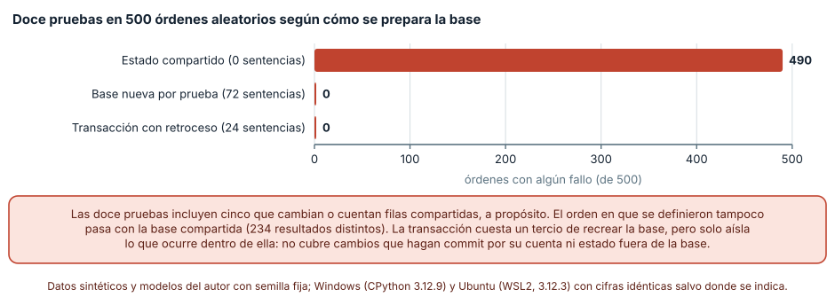

# SE-428 — Datos deterministas y gestión de fixtures

[← SE-427 — Dobles, virtualización y entornos de prueba](https://github.com/vladimiracunadev-create/modern-software-engineering-program/blob/main/classes/part-35-estrategia-y-tecnicas-de-prueba/se-427-dobles-virtualizacion-y-entornos-de-prueba/README.md) · [↑ Parte 35](https://github.com/vladimiracunadev-create/modern-software-engineering-program/blob/main/classes/part-35-estrategia-y-tecnicas-de-prueba/README.md) · [📚 Índice completo](https://github.com/vladimiracunadev-create/modern-software-engineering-program/blob/main/classes/README.md) · [🌐 Portal](https://vladimiracunadev-create.github.io/modern-software-engineering-program/classes/SE-428.html) · [SE-429 — Pruebas exploratorias y sesiones →](https://github.com/vladimiracunadev-create/modern-software-engineering-program/blob/main/classes/part-35-estrategia-y-tecnicas-de-prueba/se-429-pruebas-exploratorias-y-sesiones/README.md)

## Punto profesional y fundamento pedagógico

**Punto profesional.** La clase existe para que prepares el estado de cada prueba de forma que el resultado dependa solo del código y de los datos declarados, y para que identifiques y elimines las fuentes de no determinismo (orden de ejecución, azar, hora, identificadores, orden de colecciones). Una prueba determinista es la condición para poder confiar en que un fallo significa algo.

**Por qué aparece aquí.** Sigue a **Dobles, virtualización y entornos de prueba**, que trató lo que se sustituye y lo que cambia de un entorno a otro. Aquí se trata el estado y los datos con los que arranca cada prueba. `SE-422` ya inyectó la hora y `SE-425` registró semillas; esta clase generaliza ambos mecanismos.

**Error conceptual que debe corregir.** Creer que los datos de prueba son un detalle de preparación y que un fixture compartido «ahorra tiempo». Un estado compartido entre pruebas hace que el resultado dependa del orden de ejecución, y los datos aleatorios sin semilla convierten un fallo raro en uno que nadie puede reproducir.

**Secuencia de aprendizaje.** Antes de leer los resultados, predices en cuántos de 500 órdenes aleatorios fallan doce pruebas que comparten una base; después mides tres estrategias de fixture, una propiedad con datos aleatorios que falla una de cada diez veces y ocho fuentes de no determinismo en 30 procesos. La secuencia usa predicción, explicación propia, contraste y recuperación. [ICAP](https://icap.education.asu.edu/research) distingue participación de construcción de conocimiento; [How People Learn II](https://nap.nationalacademies.org/catalog/24783/how-people-learn-ii-learners-contexts-and-cultures) exige conectar conocimiento previo, contexto y transferencia; la [práctica de recuperación](https://pubmed.ncbi.nlm.nih.gov/16507066/) respalda producir de nuevo la explicación tras una demora; y [Education for Life and Work](https://nap.nationalacademies.org/resource/13398/dbasse_084153.pdf) exige devolución que explique la causa del error.

**Evidencia de aprendizaje.** `fixtures-log.md` con la predicción, la matriz de órdenes por estrategia de fixture, la medida de fallo de la propiedad aleatoria con y sin semilla, el inventario de fuentes de no determinismo con su remedio y las reglas de datos de prueba del equipo.

**Límite de la conclusión.** Las doce pruebas incluyen cinco que dependen de estado compartido a propósito; la propiedad aleatoria falla por un efecto de redondeo escogido por el autor; el inventario de fuentes usa un generador de informe de juguete. El orden de un directorio y el de un conjunto dependen del sistema y de la versión de Python. No se midió tiempo de reloj ni se usó un marco de pruebas externo.

### Trazabilidad fuente → afirmación

| Fuente primaria u oficial | Afirmación que respalda | Lo que no prueba |
|---|---|---|
| [Martin Fowler, «Eradicating Non-Determinism in Tests»](https://martinfowler.com/articles/nonDeterminism.html) | Cataloga las causas del no determinismo (aislamiento, asincronía, recursos remotos) y cómo tratarlas. | No cuantifica su frecuencia. |
| [pytest: cómo usar fixtures](https://docs.pytest.org/en/stable/how-to/fixtures.html) | Describe ámbitos, composición y limpieza de fixtures. | No decide qué ámbito conviene. |
| [SQLite: transacciones](https://www.sqlite.org/lang_transaction.html) | Documenta `BEGIN` y `ROLLBACK` como forma de deshacer cambios. | No cubre cambios fuera de la base. |
| [Documentación del módulo `random`](https://docs.python.org/3/library/random.html) | Documenta las semillas y que el generador no es criptográfico. | No describe la elección de datos de prueba. |
| [Martin Fowler, «ObjectMother»](https://martinfowler.com/bliki/ObjectMother.html) | Describe fábricas de datos de prueba y su costo de acoplamiento. | No compara con constructores. |
| [Reproducible Builds: SOURCE_DATE_EPOCH](https://reproducible-builds.org/docs/source-date-epoch/) | Propone un valor de tiempo fijo y externo para eliminar la hora de las salidas. | Está pensado para compilaciones, no para pruebas. |

## Antes de empezar

Recupera lo aprendido en `SE-427`: el entorno es una dependencia. La pregunta activa es: **si ejecuto esta prueba sola, en cualquier orden o cien veces, ¿obtengo siempre el mismo resultado, y de qué datos depende?**

## Prerrequisitos

- Haber completado `SE-427` o poder explicar qué variables de entorno cambian un resultado.
- Python 3.11 o posterior con `sqlite3`, `random`, `uuid` y `subprocess`.
- Saber qué es una transacción y un `ROLLBACK`.

## Problema auténtico

Las pruebas de la plataforma pasan una a una y fallan en la integración continua cuando se ejecutan en paralelo o en otro orden: una prueba inserta una entrega y otra que cuenta las filas espera tres. Otra prueba usa datos aleatorios para comprobar que una nota con atraso nunca es mayor que la nota a tiempo, y falla una de cada diez ejecuciones; quien la ve fallar la vuelve a lanzar y pasa. Un informe diario incluye la hora de generación y un identificador, y la prueba que compara su salida con una referencia nunca pasa dos veces seguidas. El equipo necesita reglas para preparar datos, saber qué fuente de azar hay en cada prueba y poder reproducir un fallo.

## Objetivos observables

Al terminar podrás:

1. elegir una estrategia de fixture (compartida, nueva por prueba, transacción con retroceso) y medir su costo y su aislamiento;
2. detectar dependencia del orden ejecutando una suite en órdenes aleatorios con semilla registrada;
3. hacer reproducible una prueba con datos aleatorios y calcular cuánto amplifica la probabilidad de fallo el número de elementos;
4. inventariar las fuentes de no determinismo de una función (hora, azar, identificadores, orden de colecciones, sumas de flotantes) y aplicar el remedio de cada una;
5. definir reglas de datos de prueba que otro equipo pueda aplicar.

## Mapa conceptual


El mapa muestra dos ejes independientes: el estado que la prueba hereda y las fuentes de variación que la atraviesan. Ambos deben controlarse para que un resultado se pueda reproducir.

## Temas y por qué importan

| Tema | Por qué cambia una decisión profesional | Evidencia mínima |
|---|---|---|
| Aislamiento del estado | El orden de ejecución no debe cambiar el resultado. | Matriz de órdenes aleatorios por estrategia |
| Costo de preparar | Aislar cuesta, y el costo decide qué estrategia se usa. | Sentencias de preparación por estrategia |
| Datos aleatorios con semilla | Un fallo raro necesita reproducirse. | Semilla en el informe y repetición del fallo |
| Fuentes de no determinismo | Cada una tiene un remedio distinto. | Inventario con salidas distintas por fuente |
| Reglas de datos de prueba | Datos sintéticos y mínimos protegen y aclaran. | Reglas del equipo en `fixtures-log.md` |

## Conceptos y decisiones

### 1. Aislamiento del estado

Una prueba aislada produce el mismo resultado ejecutada sola, después de cualquier otra o en paralelo. El aislamiento falla cuando comparte algo mutable: una base, un archivo, una variable global, un reloj. Los síntomas son pruebas que pasan en el orden de definición y fallan en otro, o que fallan al ejecutarse en paralelo. La causa casi siempre está en el fixture: una preparación hecha una vez para todas.

### 2. Estrategias de fixture

Hay tres estrategias habituales. La **compartida** prepara el estado una vez y todas las pruebas lo modifican: es barata y acopla el resultado al orden. La **nueva por prueba** crea el estado desde cero: aísla totalmente y cuesta una preparación por prueba. La **transacción con retroceso** abre una transacción antes de cada prueba y la deshace al terminar: aísla lo que ocurre dentro de la base y cuesta menos que recrearla, pero no cubre lo que hace commit por su cuenta ni lo que vive fuera de la base (archivos, caches). La elección es entre costo y alcance del aislamiento.

### 3. Datos aleatorios con semilla

Los datos aleatorios amplían los casos y rompen la reproducibilidad. La corrección no es quitar el azar sino registrar la semilla: cada ejecución genera con una semilla impresa en el informe, y quien ve un fallo lo repite con ella. Además hay un efecto de composición: una propiedad que falla con probabilidad pequeña por elemento falla con probabilidad mucho mayor con veinte elementos, de modo que un generador con muchos elementos por prueba hace aflorar casos raros a menudo y los hace parecer intermitentes.

### 4. Fuentes de no determinismo

Las principales son: la hora actual, el azar sin semilla, los identificadores aleatorios, el orden de iteración de conjuntos y diccionarios con claves de cadena (que cambia con la semilla de hash por proceso), el orden de un listado de directorio (que depende del sistema de archivos), la suma de números de coma flotante en un orden que cambia, y los identificadores de memoria. Cada una se elimina con una técnica distinta: inyectar el reloj, fijar o inyectar la semilla, inyectar el generador de identificadores, ordenar antes de comparar, sumar en orden fijo y no usar la identidad de los objetos como dato.

### 5. Reglas de datos de prueba

Un conjunto de reglas evita discusiones y accidentes: los datos son sintéticos y nunca copias de producción; cada prueba declara solo los datos que le importan (el resto toma valores por defecto de un constructor); los valores con significado de negocio se nombran (`plazo_vencido`, `nota_en_el_limite`) y no se escriben como números sueltos; y toda fuente de azar recibe una semilla que se registra. Los constructores de datos de prueba (builders) reducen el acoplamiento a los cambios de esquema respecto de grandes archivos de datos compartidos.

### Doce pruebas, tres formas de preparar la base

Se definen doce pruebas sobre una base SQLite en memoria con tres entregas (`ana` 6,0, `beto` sin nota, `caro` 4,0) y un contador de cierres. Cinco comparten estado a propósito: una inserta una fila, una borra las enviadas, una incrementa el contador y las demás cuentan filas o leen valores que las anteriores cambian. Se ejecutan en 500 órdenes aleatorios (semilla 368) con tres estrategias, y se cuentan las órdenes con algún fallo, los resultados distintos y las sentencias de preparación por corrida.

```python
for p in orden:
    db = compartida if estrategia == "compartida" else crear_y_sembrar()   # base nueva por prueba
    if estrategia == "retroceso": db.execute("begin")
    try: p(db); resultados[p.__name__] = True
    except Exception: resultados[p.__name__] = False
    if estrategia == "retroceso": db.rollback()
```

| Estrategia de fixture | Órdenes con algún fallo | Resultados distintos | Sentencias de preparación |
|---|---:|---:|---:|
| Estado compartido | 490 de 500 | 234 | 0 |
| Base nueva por prueba | 0 de 500 | 1 | 72 |
| Transacción con retroceso | 0 de 500 | 1 | 24 |

Con una base compartida, 490 de 500 órdenes tienen algún fallo y producen 234 combinaciones de resultados distintas: ninguna prueba individual tiene un defecto, y el resultado cambia con el orden. Tampoco el orden de definición pasa todas las pruebas. Las otras dos estrategias dan siempre el mismo resultado; recrear la base cuesta 72 sentencias por corrida y la transacción 24, un tercio. La transacción aísla lo que ocurre dentro de la base; no aísla un archivo que la prueba escriba ni una variable global.



**Cómo leer la figura.** Cada barra es una forma de preparar la base y su longitud, las órdenes aleatorias con algún fallo; el costo de preparar va en la etiqueta. Mira el contraste entre la barra larga y las dos ausentes, y el precio que lo compra. **Dónde deja de valer:** cinco de las doce pruebas se escribieron para mutar el estado compartido, de modo que la proporción de fallos de una suite real será menor; el costo se mide en sentencias, no en tiempo. La figura muestra el mecanismo y el precio del aislamiento, no una tasa.

### Una propiedad que falla una de cada diez veces

La propiedad es «con atraso, la nota nunca es mayor que sin atraso»: para 20 entregas aleatorias (nota bruta de 1,0 a 7,0, atraso de 0, 5, 30, 60 o 100 horas) se comprueba `nota(b, h) < nota(b, 0)`. Falla cuando la nota bruta es 1,0: el factor de penalización la lleva por debajo del mínimo y el resultado se limita a 1,0 en ambos casos. Se ejecuta con 1 000 semillas.

```python
for e in generar_entregas(rng, 20):
    if e["horas"] > 0:
        assert nota(e["bruta"], e["horas"]) < nota(e["bruta"], 0), e
```

| Medida | Resultado | Lectura |
|---|---|---|
| Entregas individuales que violan la propiedad | 0,48 % | Efecto del redondeo con nota bruta 1,0 |
| Pruebas con 20 entregas aleatorias que fallan, 1 000 semillas | 109 de 1 000 (10,9 %) | 20 entregas multiplican el riesgo |
| Semilla 6 anotada, 100 repeticiones | Falla 100 de 100 | Reproducible |
| Sin semilla fija, 1 000 corridas independientes | Falla 87 a 101 de 1 000 | No reproducible; el valor cambia en cada corrida |

Una probabilidad de 0,48 % por entrega se convierte en 10,9 % por prueba, unas 23 veces mayor. Quien relanza la prueba ve que «a veces falla» y la archiva como intermitente; quien registró la semilla 6 la repite siempre y descubre la causa: una nota bruta de 1,0 con atraso. El defecto no es del generador, es de la propiedad: con nota mínima no puede ser menor. La corrección es enunciarla con `<=` o excluir el mínimo, no «arreglar la aleatoriedad».


**Cómo leer la figura.** Cada barra es una medida de la misma propiedad y el eje es logarítmico: cada marca vale diez veces la anterior. Mira el salto de 0,48 % a 10,9 % al pasar de una entrega a veinte, y la diferencia entre 100 % con semilla y un valor que cambia sin ella. **Dónde deja de valer:** el 0,48 % depende del redondeo y de las distribuciones elegidas por el autor; el rango de la corrida sin semilla (87 a 101) cambia con cada ejecución y entre sistemas. La figura enseña que registrar la semilla convierte un fallo del tipo «a veces» en uno reproducible, no que 10,9 % sea una tasa general.

### Ocho fuentes de no determinismo

Un generador de informe de juguete se ejecuta en 30 procesos nuevos con cada fuente activada de a una: ninguna (datos fijos ordenados), la hora actual, un `uuid4`, un número aleatorio, el orden de un conjunto de cuatro nombres, la suma de seis flotantes en orden mezclado, el listado de un directorio de tres archivos y la identidad de un objeto. Se cuentan las salidas distintas.

```python
for f in fuentes:
    outs = {subprocess.run([sys.executable, "-c", CODIGO, f], capture_output=True, text=True).stdout.strip()
            for _ in range(30)}
    print(f, len(outs))
```

| Fuente | Salidas distintas en 30 procesos |
|---|---:|
| Datos fijos ordenados (referencia) | 1 |
| Reloj (hora actual) | 30 |
| Identificador aleatorio (uuid4) | 30 |
| Número aleatorio sin semilla | 30 |
| Orden de un conjunto de cadenas | 18 en Windows, 16 en Ubuntu |
| Suma de flotantes en orden mezclado | 3 |
| Identidad de un objeto (`id`) | 2 |
| Listado de un directorio de tres archivos | 1 en ambos sistemas |

Las tres primeras producen una salida distinta en cada proceso y son las más fáciles de ver. El orden de un conjunto produce entre 16 y 18 salidas distintas por la semilla de hash. La suma de flotantes cambia en el último dígito según el orden. El listado de un directorio dio una sola salida en ambos sistemas con tres archivos, pero el orden no está garantizado por el sistema de archivos: es una fuente latente, no una inocua.


**Cómo leer la figura.** Cada barra es el número de salidas distintas tras 30 ejecuciones con esa fuente activa; 1 significa determinista. **Dónde deja de valer:** el generador es de juguete, y la identidad de un objeto o el orden de un listado dependen de la implementación y del sistema; los valores de 2 y 1 no significan que esas fuentes sean seguras. La figura dice que cada fuente exige su propio remedio, no que unas importen más que otras.

## Definiciones de trabajo

- **[fixture](../../../glosario/entradas/f/fixture.md):** estado y datos con los que se prepara una prueba antes de ejecutarla.
- **[determinismo](../../../glosario/entradas/d/determinismo.md):** propiedad de producir el mismo resultado ante las mismas entradas declaradas.
- **[dependencia del orden](../../../glosario/entradas/d/dependencia-del-orden.md):** resultado de una prueba que cambia según qué pruebas se ejecutaron antes.
- **[semilla](../../../glosario/entradas/s/semilla.md):** valor inicial de un generador pseudoaleatorio que permite repetir su secuencia.
- **[constructor de datos (builder)](../../../glosario/entradas/c/constructor-de-datos.md):** función que crea un dato de prueba con valores por defecto y permite cambiar solo lo relevante.

Las definiciones son operativas para la plataforma de entregas y deben contrastarse con la documentación primaria enlazada al final.

## Ejemplo mínimo

El fragmento muestra dependencia del orden con una base compartida. Antes de ejecutarlo, predice qué orden falla.

```python
import sqlite3
db = sqlite3.connect(":memory:"); db.execute("create table e(id integer primary key)")
def cuenta_cero(): assert db.execute("select count(*) from e").fetchone()[0] == 0
def inserta(): db.execute("insert into e default values")
cuenta_cero()                       # pasa: la base está vacía
inserta()
try: cuenta_cero()
except AssertionError: print("falla si inserta corrió antes")
```

Si cada prueba abre `begin` y termina con `rollback`, ambas pasan en cualquier orden. Registra versión, comando y salida.

## Ejemplo profesional

El equipo de la plataforma adopta cuatro reglas. Primera: cada prueba de servicio abre una transacción sobre una base creada una vez por proceso y la deshace al terminar; las pruebas de migración, que hacen commit, crean su propia base. Segunda: la suite se ejecuta cada noche en un orden aleatorio con semilla impresa; un fallo se repite con `--semilla`. Tercera: toda prueba con datos aleatorios recibe un generador con semilla de un único punto, y la semilla va en el informe. Cuarta: los constructores (`entrega(nota=None)`) crean datos con valores por defecto; los valores con significado se nombran (`LIMITE_24H`). Un inventario trimestral recorre las pruebas con `grep` de `now(`, `uuid`, `random` y `set(` y comprueba que cada uso está inyectado, fijado u ordenado.

## Práctica guiada

1. Escribe doce pruebas sobre una base compartida y comprueba que pasan en el orden de definición.
2. Predice en cuántos de 500 órdenes aleatorios fallan y anótalo.
3. Ejecuta los 500 órdenes con tres estrategias de fixture y mide fallos, resultados distintos y sentencias.
4. Escribe una propiedad con datos aleatorios, ejecútala con 1 000 semillas y repite la de la primera que falle.
5. Escribe un generador de informe con las ocho fuentes y mide salidas distintas en 30 procesos.
6. Aplica el remedio de cada fuente y vuelve a medir.
7. Entrega `fixtures-log.md` y pide a otra persona que ejecute la suite en un orden que no probaste.

## Ejercicios

1. **Aislamiento:** modifica una prueba para que dependa de otra a propósito y detecta con órdenes aleatorios cuál es.
2. **Semilla:** convierte una prueba con `random` sin semilla en una reproducible y escribe cómo se registra la semilla en el informe.
3. **Composición:** calcula cuántas entregas por prueba harían falta para que una propiedad que falla con 0,48 % por entrega falle con 50 % por prueba.
4. **Fuente:** elige una fuente de la tabla y escribe el cambio mínimo que la elimina en el generador de informe.

## Reto verificable

Entrega `fixtures-log.md` con la predicción, la matriz de órdenes por estrategia, la medida de la propiedad aleatoria con y sin semilla, el inventario de fuentes con su remedio y las reglas de datos de prueba. Se aprueba si otra persona ejecuta el código, obtiene las mismas cifras con las mismas semillas y puede decir qué estrategia elegiría para una prueba que escribe un archivo. No se aprueba por mostrar que las pruebas pasan en el orden de definición.

## Caso conductor

La plataforma de entregas es el caso conductor. Esta clase deja el octavo artefacto: las reglas de fixtures del equipo, la transacción por prueba y el inventario de fuentes de no determinismo. `SE-429` pasa de lo que se puede automatizar a la exploración con criterio humano. Cambia después una sola decisión, el orden de ejecución a aleatorio con semilla, y observa si aparece una dependencia que nadie había notado.

## Preguntas frecuentes

### ¿Recrear la base en cada prueba no es demasiado lento?

Con una base en memoria el costo es bajo: 72 sentencias por corrida en el experimento. Con un servidor real, la transacción con retroceso o la limpieza selectiva cuestan menos. Se mide, no se supone.

### ¿Cuándo es válida una prueba con datos aleatorios?

Cuando la semilla se registra y el fallo se puede repetir, y cuando la propiedad está bien enunciada. En el experimento, la propiedad estaba mal por un caso borde (nota 1,0), y la aleatoriedad solo la hizo aflorar.

### ¿Conviene fijar siempre la semilla en la integración continua?

Conviene que cada ejecución use una semilla distinta y la registre: una semilla fija repite siempre los mismos casos y pierde la ventaja de explorar. Para reproducir un fallo se reutiliza la semilla del informe.

### ¿Cómo evito que el orden de un diccionario o un conjunto altere el resultado?

Ordenando antes de comparar o de serializar, o usando estructuras con orden definido. El orden de inserción de un diccionario de Python está garantizado; el de un conjunto no.

## Fallo controlado y diagnóstico

Reproduce el fallo clásico de la clase: **una suite con un fixture compartido que depende del orden de ejecución**. Ejecuta las doce pruebas en 500 órdenes aleatorios con una base compartida.

Registra síntoma, entrada mínima, hipótesis, observación que descarta cada hipótesis, causa, corrección y prueba de regresión. **Síntoma:** en 490 de 500 órdenes falla alguna prueba y cada orden da un conjunto distinto de fallos. **Hipótesis rivales:** (a) alguna prueba tiene un defecto; (b) la base está corrupta; (c) las pruebas comparten estado y su resultado depende del orden. **Prueba:** ejecuta cada prueba sola en una base nueva (pasan las doce) y busca cuáles modifican filas o el contador (`p_agrega`, `p_borra_enviadas`, `p_cierra`). **Conclusión:** el resultado depende de qué se ejecutó antes. **Regresión:** cambia el fixture a transacción con retroceso, ejecuta 500 órdenes y comprueba 0 fallos; deja el orden aleatorio con semilla impresa como parte de la integración continua. No cambies a la vez el fixture y las pruebas.

## Errores comunes y cómo corregirlos

| Síntoma | Causa probable | Corrección |
|---|---|---|
| Las pruebas pasan una a una y fallan juntas | Estado compartido mutable | Transacción con retroceso o base nueva por prueba |
| Una prueba falla una vez de cada diez | Datos aleatorios sin semilla o propiedad mal enunciada | Registrar la semilla y revisar la propiedad |
| La salida de un informe nunca coincide con la referencia | Hora o identificadores en la salida | Inyectar el reloj y el generador de identificadores |
| Una comparación de listas falla según el proceso | Orden de un conjunto | Ordenar antes de comparar |
| Los datos de prueba cambian al cambiar el esquema | Grandes archivos de datos compartidos | Constructores con valores por defecto |

## Entorno y archivos clave

```text
work/SE-428/
├── README.md
├── fixtures/
│   ├── estrategias.py
│   └── constructores.py
├── no_determinismo/
│   ├── informe.py
│   └── fuentes.py
├── tests/test_orden_aleatorio.py
└── evidence/fixtures-log.md
```

El `README` declara plataforma, versión de Python y de SQLite, semilla (368) y comandos. Los experimentos usan solo la biblioteca estándar (`sqlite3`, `random`, `uuid`, `subprocess`) y se ejecutaron con CPython 3.12.9 en Windows 11 y 3.12.3 en Ubuntu bajo WSL2: las salidas fueron idénticas salvo el orden de un conjunto (18 y 16 salidas distintas) y la cifra sin semilla fija (101 y 87 fallos de 1 000), que cambia en cada ejecución. Si añades una dependencia, fija procedencia y versión.

## Seguridad, ética y accesibilidad

- los datos de prueba no deben ser copias de producción: contienen datos personales y se filtran en informes y capturas;
- una semilla registrada en un informe público puede revelar cómo se generaron datos de seguridad: no uses el azar de pruebas para claves reales;
- los fixtures que contienen credenciales o tokens deben ser claramente falsos y estar marcados;
- el no determinismo oculta defectos de concurrencia y de seguridad que solo aparecen a veces: tratarlos como ruido es una decisión de riesgo, no de comodidad;
- documenta qué datos de prueba representan casos de accesibilidad (nombres largos, caracteres no latinos) para que no se pierdan.

## Puente hacia el trabajo con agentes

Un agente al que se le pide «arregla las pruebas intermitentes» añadirá esperas, reintentos o un orden fijo y las pruebas dejarán de fallar sin que desaparezca la causa. Pídele en cambio el orden aleatorio con semilla impresa, la matriz de fallos por orden, el inventario de fuentes de no determinismo con el remedio de cada una y los fixtures por transacción. Revisa especialmente que no fije un orden o una semilla constante para ocultar el problema y que cada fuente quede inyectada o declarada.

## Transferencia

Traslada el análisis a otra suite (por ejemplo, las pruebas de un sistema de reservas): ejecútalas en órdenes aleatorios, mide qué estrategia de fixture aísla mejor y a qué costo, e inventaría las fuentes de no determinismo. La transferencia está lograda cuando puedes explicar qué prueba dependía de cuál y cómo lo supiste, no cuando la tabla se parece.

## Evaluación y evidencia

| Criterio | Evidencia para aprobar |
|---|---|
| comprensión | explicación de por qué el estado compartido produce dependencia del orden |
| corrección | matrices y conteos reproducibles con las mismas semillas |
| diseño | transacción por prueba, semilla registrada y fuentes inyectadas |
| diagnóstico | reproducción del fallo «fixture compartido» con regresión |
| incertidumbre | declaración de que las doce pruebas, la propiedad y el generador son del autor y de que algunas cifras varían por sistema |
| reproducibilidad | versiones, semillas, comandos, salida y límites declarados |

## Fuentes

- [Martin Fowler, «Eradicating Non-Determinism in Tests»](https://martinfowler.com/articles/nonDeterminism.html) — causas del no determinismo; autoridad: autor del texto.
- [pytest: cómo usar fixtures](https://docs.pytest.org/en/stable/how-to/fixtures.html) — ámbitos y limpieza; autoridad: documentación oficial de pytest.
- [SQLite: transacciones](https://www.sqlite.org/lang_transaction.html) — `BEGIN` y `ROLLBACK`; autoridad: documentación oficial de SQLite.
- [Documentación del módulo random](https://docs.python.org/3/library/random.html) — semillas y límites; autoridad: documentación oficial de Python.
- [Martin Fowler, «ObjectMother»](https://martinfowler.com/bliki/ObjectMother.html) — fábricas de datos de prueba; autoridad: autor del texto.
- [Reproducible Builds: SOURCE_DATE_EPOCH](https://reproducible-builds.org/docs/source-date-epoch/) — tiempo fijo y externo; autoridad: proyecto Reproducible Builds.

Cada fuente respalda el mecanismo indicado; ninguna demuestra que 490 de 500 órdenes con fallo, el 10,9 % de una propiedad con 20 elementos o los 30 resultados distintos de una fuente se observen en la suite de la plataforma. Esa afirmación depende de las pruebas y de los datos reales.

## Límites y siguiente paso

Se ejecutaron tres experimentos con una base SQLite en memoria, una propiedad con datos sintéticos y procesos locales en Windows y Ubuntu (WSL2) con salidas idénticas salvo las cifras que dependen del sistema o de la ejecución, declaradas arriba. Cinco de las doce pruebas dependen del estado compartido por diseño, y la propiedad falla por un efecto del redondeo escogido por el autor. No se midió tiempo ni se usó un marco de pruebas. La siguiente clase deja lo automático y pregunta cómo se explora con criterio un sistema que ninguna prueba escrita cubre.

## Glosario

- **[fixture](../../../glosario/entradas/f/fixture.md):** estado y datos con los que se prepara una prueba antes de ejecutarla.
- **[determinismo](../../../glosario/entradas/d/determinismo.md):** propiedad de producir el mismo resultado ante las mismas entradas declaradas.
- **[dependencia del orden](../../../glosario/entradas/d/dependencia-del-orden.md):** resultado de una prueba que cambia según qué pruebas se ejecutaron antes.
- **[semilla](../../../glosario/entradas/s/semilla.md):** valor inicial de un generador pseudoaleatorio que permite repetir su secuencia.
- **[constructor de datos (builder)](../../../glosario/entradas/c/constructor-de-datos.md):** función que crea un dato de prueba con valores por defecto y permite cambiar solo lo relevante.

Conceptos de esta clase en el [glosario del programa](../../../glosario/README.md): [Constructor de datos](../../../glosario/entradas/c/constructor-de-datos.md) · [Dependencia del orden](../../../glosario/entradas/d/dependencia-del-orden.md) · [Determinismo](../../../glosario/entradas/d/determinismo.md) · [Fixture](../../../glosario/entradas/f/fixture.md) · [Fuentes de no determinismo](../../../glosario/entradas/f/fuentes-de-no-determinismo.md) · [Semilla](../../../glosario/entradas/s/semilla.md).

---

[← SE-427 — Dobles, virtualización y entornos de prueba](https://github.com/vladimiracunadev-create/modern-software-engineering-program/blob/main/classes/part-35-estrategia-y-tecnicas-de-prueba/se-427-dobles-virtualizacion-y-entornos-de-prueba/README.md) · [↑ Parte 35](https://github.com/vladimiracunadev-create/modern-software-engineering-program/blob/main/classes/part-35-estrategia-y-tecnicas-de-prueba/README.md) · [📚 Índice completo](https://github.com/vladimiracunadev-create/modern-software-engineering-program/blob/main/classes/README.md) · [🌐 Portal](https://vladimiracunadev-create.github.io/modern-software-engineering-program/classes/SE-428.html) · [SE-429 — Pruebas exploratorias y sesiones →](https://github.com/vladimiracunadev-create/modern-software-engineering-program/blob/main/classes/part-35-estrategia-y-tecnicas-de-prueba/se-429-pruebas-exploratorias-y-sesiones/README.md)
