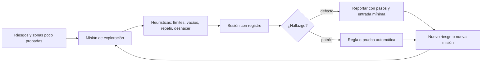
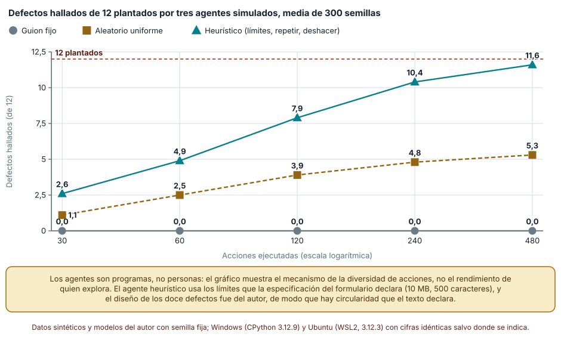
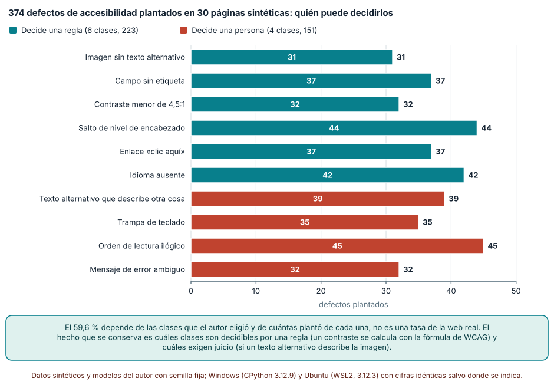
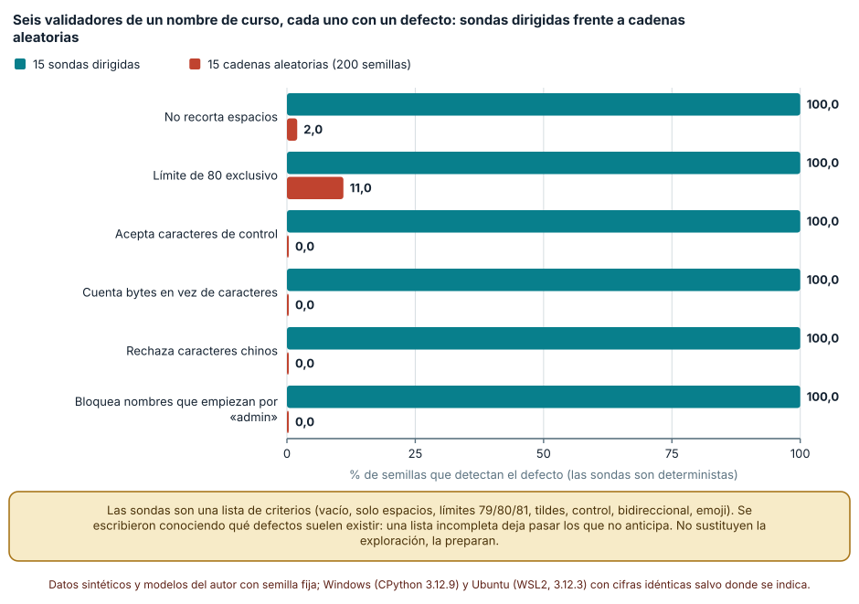

# SE-429 — Pruebas exploratorias y sesiones

[← SE-428 — Datos deterministas y gestión de fixtures](https://github.com/vladimiracunadev-create/modern-software-engineering-program/blob/main/classes/part-35-estrategia-y-tecnicas-de-prueba/se-428-datos-deterministas-y-gestion-de-fixtures/README.md) · [↑ Parte 35](https://github.com/vladimiracunadev-create/modern-software-engineering-program/blob/main/classes/part-35-estrategia-y-tecnicas-de-prueba/README.md) · [📚 Índice completo](https://github.com/vladimiracunadev-create/modern-software-engineering-program/blob/main/classes/README.md) · [🌐 Portal](https://vladimiracunadev-create.github.io/modern-software-engineering-program/classes/SE-429.html) · [SE-430 — Flakiness, diagnóstico y mantenimiento →](https://github.com/vladimiracunadev-create/modern-software-engineering-program/blob/main/classes/part-35-estrategia-y-tecnicas-de-prueba/se-430-flakiness-diagnostico-y-mantenimiento/README.md)

## Punto profesional y fundamento pedagógico

**Punto profesional.** La clase existe para que explores un sistema con criterio (misiones acotadas, sondas de entrada, heurísticas) donde ninguna prueba escrita llega, y para que sepas qué partes de la accesibilidad y de la seguridad decide una regla automática y cuáles exigen a una persona. La exploración es una disciplina de aprendizaje sobre el producto, no la ausencia de método.

**Por qué aparece aquí.** Sigue a **Datos deterministas y gestión de fixtures**, que cerró el bloque de pruebas automáticas reproducibles. Todas las pruebas anteriores comprueban lo que alguien ya pensó; esta clase pregunta cómo se descubre lo que nadie pensó, y qué se puede delegar a una herramienta. `SE-258` y `SE-236` dieron el vocabulario de accesibilidad y seguridad del navegador.

**Error conceptual que debe corregir.** Creer que explorar es «jugar con la aplicación» sin método y que, por tanto, no se puede planificar ni medir, o creer lo contrario: que una herramienta automática de accesibilidad o de seguridad certifica el cumplimiento. Las dos creencias olvidan que una parte de los defectos se decide con una regla y otra con juicio.

**Secuencia de aprendizaje.** Antes de leer los resultados, predices cuántos de 12 defectos plantados halla un guion fijo y cuántos un explorador heurístico con 120 acciones; después mides cómo cambian con las misiones, qué fracción de 374 defectos de accesibilidad decide una regla y cuántos defectos de un validador halla una lista de sondas frente a cadenas aleatorias. La secuencia usa predicción, explicación propia, contraste y recuperación. [ICAP](https://icap.education.asu.edu/research) distingue participación de construcción de conocimiento; [How People Learn II](https://nap.nationalacademies.org/catalog/24783/how-people-learn-ii-learners-contexts-and-cultures) exige conectar conocimiento previo, contexto y transferencia; la [práctica de recuperación](https://pubmed.ncbi.nlm.nih.gov/16507066/) respalda producir de nuevo la explicación tras una demora; y [Education for Life and Work](https://nap.nationalacademies.org/resource/13398/dbasse_084153.pdf) exige devolución que explique la causa del error.

**Evidencia de aprendizaje.** `exploracion-log.md` con la predicción, la curva de defectos hallados por estrategia, las misiones con sus resultados, la clasificación de defectos de accesibilidad por quién los decide, la lista de sondas de entrada y las notas de una sesión.

**Límite de la conclusión.** Los exploradores son programas, no personas: no se midió a ningún evaluador humano y el desempeño de una persona con experiencia no se infiere de estas curvas. La aplicación de juguete tiene 12 defectos plantados por el autor, el explorador heurístico usa los límites que declara la especificación del formulario y las clases de defectos de accesibilidad y sus cantidades son una elección del autor. El contraste se calculó con la fórmula publicada de WCAG; no se evaluó ninguna página real ni se hizo una prueba de seguridad.

### Trazabilidad fuente → afirmación

| Fuente primaria u oficial | Afirmación que respalda | Lo que no prueba |
|---|---|---|
| [Bach, «Exploratory Testing»](https://www.satisfice.com/exploratory-testing) | Describe la exploración como aprendizaje, diseño y ejecución simultáneos con una misión. | No mide la eficacia frente a otros enfoques. |
| [WCAG 2.2](https://www.w3.org/TR/WCAG22/) | Define los criterios de conformidad y la fórmula de la relación de contraste. | No dice qué proporción de defectos detecta una herramienta. |
| [Understanding SC 1.4.3: contraste mínimo](https://www.w3.org/WAI/WCAG22/Understanding/contrast-minimum.html) | Explica los umbrales de 4,5:1 y 3:1 y las excepciones. | No cubre contraste de imágenes ni de estados. |
| [W3C WAI: evaluar la accesibilidad web](https://www.w3.org/WAI/test-evaluate/) | Describe combinar herramientas automáticas con revisión manual. | No fija una proporción. |
| [OWASP Web Security Testing Guide](https://owasp.org/www-project-web-security-testing-guide/) | Cataloga pruebas de seguridad de aplicaciones web, incluida la validación de entradas. | No sustituye una auditoría. |
| [OWASP ASVS](https://owasp.org/www-project-application-security-verification-standard/) | Define requisitos verificables de seguridad de aplicaciones por nivel. | No dice cómo se prueba cada uno. |

## Antes de empezar

Recupera lo aprendido en `SE-428`: una prueba reproducible fija sus datos y su orden. La pregunta activa es: **si tuviera 90 minutos para explorar el formulario de entrega, ¿qué misión me daría, qué valores probaría primero y cómo dejaría constancia de lo que descubrí?**

## Prerrequisitos

- Haber completado `SE-428` o poder explicar qué hace reproducible una prueba.
- Haber visto `SE-233` (formularios y experiencia de error) y `SE-258` (accesibilidad) o conocer el contraste y las etiquetas de formulario.
- Python 3.11 o posterior con `random` y `statistics`.

## Problema auténtico

Antes del cierre del curso, el equipo de la plataforma tiene una batería automática en verde y un formulario de entrega que, usado por el primer estudiante real, pierde el adjunto al cambiar de curso. Otro estudiante envía dos veces seguidas y se crean dos entregas. Una revisión de accesibilidad con una herramienta automática pasa «sin errores» y una persona con lector de pantalla no puede salir de un menú. Alguien propone «pedir a QA que juegue con la aplicación dos horas»; otra persona pregunta qué significa jugar y cómo se sabrá si sirvió. El equipo necesita una forma de explorar con una misión, un registro y un criterio de qué detecta una herramienta y qué no.

## Objetivos observables

Al terminar podrás:

1. escribir una misión de exploración con alcance, recursos y un criterio de qué se registra;
2. aplicar heurísticas de exploración (límites, vacíos, repetición, deshacer, secuencias) y medir su efecto frente a una exploración sin método;
3. explicar por qué una misión acotada halla más defectos de su zona y menos fuera de ella;
4. calcular el contraste de color con la fórmula de WCAG y clasificar defectos de accesibilidad entre decidibles por regla y dependientes de juicio;
5. construir una lista de sondas de entrada y usarla contra un validador, y dejar constancia de una sesión.

## Mapa conceptual



El mapa muestra que explorar alimenta a la automatización: cada hallazgo se convierte en un defecto reportado o en una regla que se automatiza. El ciclo continúa porque cada sesión enseña dónde mirar después.

## Temas y por qué importan

| Tema | Por qué cambia una decisión profesional | Evidencia mínima |
|---|---|---|
| Misiones y sesiones | Convierten una exploración vaga en algo acotado y revisable. | Tres misiones con alcance y registro |
| Heurísticas de exploración | La diversidad de acciones halla más que repetir lo mismo. | Curva de defectos por longitud y estrategia |
| Accesibilidad decidible y no decidible | Una herramienta automática ve una parte y no el resto. | Clasificación de defectos por quién los decide |
| Sondas de entrada | Un validador falla ante pocos valores especiales. | Lista de sondas y defectos que halla |
| Registro de una sesión | Lo explorado sin registro no se puede repetir ni auditar. | Notas de una sesión con hallazgos y preguntas |

## Conceptos y decisiones

### 1. Misiones y sesiones

Una sesión de exploración es un bloque de tiempo acotado (por ejemplo 60 a 90 minutos) con una misión: «explorar la subida de archivos buscando pérdidas de datos». La misión limita el alcance sin escribir los pasos, y el registro de la sesión anota qué se hizo, qué se encontró y qué dudas surgieron. Lo que distingue una exploración de «jugar» es que existe una misión y un registro; lo que la distingue de una prueba escrita es que los pasos se deciden sobre la marcha, aprovechando lo que se aprende.

### 2. Heurísticas de exploración

Las heurísticas son atajos que orientan qué probar: valores límite (el máximo, el máximo más uno, el vacío, el cero), repetición (enviar dos veces seguidas), deshacer y volver (quitar un adjunto y reenviar), cambiar de contexto en mitad de una acción (cambiar de curso con un archivo adjunto), caracteres especiales y entradas largas. Cada una se apoya en la experiencia de qué suele fallar y en lo que la especificación declara (el límite de 10 MB, el máximo de 500 caracteres). No son una receta, son una lista de preguntas.

### 3. Alcance de una misión

Una misión acotada halla más defectos de su zona por unidad de tiempo y deja sin mirar el resto. Tres misiones de 60 acciones (archivos, sesión y zona horaria, texto) cubren más que una sesión de 180 acciones sin misión porque obligan a repartir la atención; la contrapartida es que un defecto entre dos zonas (un archivo grande con otra zona horaria) se encuentra menos. El diseño de las misiones es una decisión de riesgo, como el reparto de `SE-421`.

### 4. Accesibilidad: lo que decide una regla y lo que no

Algunas condiciones se deciden por una regla sobre el documento: una imagen sin texto alternativo, un campo sin etiqueta, un cociente de contraste menor que 4,5:1 (se calcula con la luminancia relativa de dos colores), un salto de nivel de encabezado, un idioma no declarado. Otras exigen juicio: si el texto alternativo describe de verdad la imagen, si el orden de lectura tiene sentido, si el foco queda atrapado en un menú o si un mensaje de error se entiende. Una herramienta automática cubre las primeras; las segundas requieren una persona, idealmente con las tecnologías de apoyo que usa la audiencia.

### 5. Sondas de entrada

Una sonda es un valor elegido por lo que suele romper: vacío, solo espacios, longitudes de borde (79, 80, 81), caracteres con tilde o combinantes, controles, texto bidireccional, emoji, cadenas que empiezan por un nombre reservado. Una lista de sondas es una lista de verificación de entradas; no sustituye a la exploración, la prepara. Contra un validador con un defecto específico, la lista dirigida lo encuentra casi siempre y cadenas aleatorias casi nunca.

### Un explorador contra una aplicación con doce defectos

La aplicación de juguete tiene un formulario de entrega con diez acciones (acceso, salida, elegir curso, adjuntar, quitar adjunto, comentar, enviar, reenviar, cambiar zona, cancelar) y 12 defectos plantados (por ejemplo, enviar sin adjunto crea una entrega, el límite exacto de 10 MB se rechaza, un nombre con tilde falla, un comentario de 500 caracteres se trunca, reenviar tras quitar el adjunto duplica, enviar dos veces crea dos entregas). Se comparan tres agentes simulados con 300 semillas: un guion fijo del camino feliz, un explorador con acciones y argumentos al azar y uno heurístico (repite el envío, deshace, usa valores límite).

```python
if tipo == "heurístico":
    if hist and rng.random() < 0.2 and app.ultimo in ("enviar", "reenviar"): a = app.ultimo   # repetir
    elif rng.random() < 0.15: a = rng.choice(["quitar_adjunto", "logout", "cancelar", "login", "reenviar"])   # deshacer
    arg = arg_heuristico(rng, a)       # vacío, 0, 10 MB y ±1, 499/500/501, tildes, '<'
```

| Acciones | Guion fijo | Aleatorio uniforme | Heurístico (límites, repetir, deshacer) |
|---|---:|---:|---:|
| 30 | 0,0 | 1,1 | 2,6 |
| 60 | 0,0 | 2,5 | 4,9 |
| 120 | 0,0 | 3,9 | 7,9 |
| 240 | 0,0 | 4,8 | 10,4 |
| 480 | 0,0 | 5,3 | 11,6 |

El guion del camino feliz no halla ninguno en ninguna longitud: es una prueba de regresión, no una exploración. El aleatorio satura cerca de 5 defectos (sus valores son «típicos»). El heurístico halla 7,9 con 120 acciones y 11,6 con 480, y la curva se aplana (rendimientos decrecientes). Con tres misiones de 60 acciones se halla un promedio de 10,9 defectos, frente a 9,4 con una sesión de 180 sin misión; cada misión individual halla entre 5,1 y 8,5. En una sesión de 180 acciones, el defecto que combina otra zona horaria con un archivo grande se encontró en el 40 % de las semillas, y los demás entre el 67 y el 99,7 %.



**Cómo leer la figura.** El eje horizontal son las acciones ejecutadas (escala logarítmica) y el vertical, la media de defectos hallados en 300 semillas; la línea punteada es el total plantado. Mira primero que el guion fijo no sube y que el heurístico se acerca a los 12. **Dónde deja de valer:** los agentes son programas y el diseño de los 12 defectos es del autor; el explorador heurístico usa los límites que declara la especificación (10 MB, 500 caracteres), de modo que hay circularidad que no existe en una aplicación real donde los límites no se conocen todos. La figura no mide a una persona exploradora.

### Accesibilidad: qué decide una regla

El contraste de color se calcula con la fórmula de WCAG: luminancia relativa de cada color y razón \((L_1 + 0{,}05)/(L_2 + 0{,}05)\). El negro sobre blanco da 21,0; el gris `#767676` sobre blanco 4,54 (cumple el umbral de 4,5); `#777777` 4,48 (falla por un centésimo); `#949494` sobre blanco da 3,03, que cumple solo para texto grande (3:1). Sobre 30 páginas sintéticas se plantan 374 defectos de diez clases con cantidades aleatorias de semilla 369 y se clasifica cada clase según si una regla puede decidirla.

```python
def lum(hexa):
    r, g, b = [int(hexa[i:i + 2], 16) / 255 for i in (1, 3, 5)]
    f = lambda c: c / 12.92 if c <= 0.03928 else ((c + 0.055) / 1.055) ** 2.4
    return 0.2126 * f(r) + 0.7152 * f(g) + 0.0722 * f(b)
```

| Clase de defecto | Plantados | Quién decide |
|---|---:|---|
| Imagen sin texto alternativo | 31 | Regla |
| Campo sin etiqueta | 37 | Regla |
| Contraste menor de 4,5:1 | 32 | Regla |
| Salto de nivel de encabezado | 44 | Regla |
| Enlace «clic aquí» | 37 | Regla |
| Idioma ausente | 42 | Regla |
| Texto alternativo que describe otra cosa | 39 | Persona |
| Trampa de teclado | 35 | Persona |
| Orden de lectura ilógico | 45 | Persona |
| Mensaje de error ambiguo | 32 | Persona |

Seis clases las decide una regla, con 223 de los 374 defectos (59,6 %); cuatro necesitan a una persona, con 151. El porcentaje depende de qué clases se plantaron y cuántos de cada una; lo que se conserva es la partición. Aun el contraste necesita juicio en ocasiones: el texto decorativo no informa y un texto grande tiene un umbral menor, de modo que la regla se aplica y su resultado se interpreta.



**Cómo leer la figura.** Cada barra es una clase de defecto plantado y su color dice quién puede decidirla: verde, una regla; rojo, una persona. Mira cómo las barras verdes y rojas se agrupan y cuál es la proporción de cada grupo. **Dónde deja de valer:** las cantidades las elige el autor y la partición «regla/persona» es una simplificación (una regla puede aproximar si un texto alternativo parece un nombre de archivo, por ejemplo). La figura no estima qué fracción de defectos reales detecta una herramienta.

### Sondas dirigidas frente a cadenas aleatorias

Seis validadores del nombre de un curso, cada uno con un defecto distinto respecto de la especificación (1 a 80 caracteres tras recortar, imprimibles): no recorta espacios, el límite de 80 es exclusivo, acepta caracteres de control, cuenta bytes en lugar de caracteres, rechaza caracteres chinos y bloquea nombres que empiezan por «admin». Se prueban con 15 sondas dirigidas (vacío, espacios, longitudes de 79, 80 y 81, 41 letras con tilde, salto de línea, carácter nulo, caracteres chinos, marca bidireccional, una `e` con acento combinante repetida, «Administración», un emoji, un tabulador) y con 15 cadenas aleatorias de letras, dígitos y espacios, repetido con 200 semillas.

| Defecto del validador | Sondas dirigidas | Cadenas aleatorias (200 semillas) |
|---|---|---:|
| No recorta espacios | Detecta (1 sonda) | 2,0 % |
| Límite de 80 exclusivo | Detecta (2 sondas) | 11,0 % |
| Acepta caracteres de control | Detecta (3 sondas) | 0,0 % |
| Cuenta bytes en vez de caracteres | Detecta (2 sondas) | 0,0 % |
| Rechaza caracteres chinos | Detecta (2 sondas) | 0,0 % |
| Bloquea nombres que empiezan por «admin» | Detecta (1 sonda) | 0,0 % |

La lista dirigida halla los seis defectos; las cadenas aleatorias hallan dos con baja probabilidad y no hallan los otros cuatro porque su alfabeto no incluye los caracteres que los provocan. La lista se escribió conociendo qué defectos suelen existir: uno que no anticipa (por ejemplo, que se rechace «Curso 1» con espacio) quedaría fuera de ella.



**Cómo leer la figura.** Cada grupo es un validador con su defecto; la barra verde es la lista de sondas (detecta siempre) y la roja, el porcentaje de 200 semillas de cadenas aleatorias que lo detectan. Mira que la roja casi no existe. **Dónde deja de valer:** los defectos y las sondas los escribió la misma persona; la lista está ajustada a ellos y su exactitud real es desconocida. La figura muestra que el conocimiento de lo que suele romper vale más que el volumen de entradas.

## Definiciones de trabajo

- **exploración:** actividad simultánea de aprendizaje, diseño y ejecución de pruebas con una misión.
- **misión:** objetivo acotado de una sesión de exploración, sin pasos prescritos.
- **heurística de prueba:** regla práctica que orienta qué entradas o acciones probar.
- **sonda:** valor de entrada elegido por su capacidad de revelar defectos conocidos.
- **relación de contraste:** cociente de luminancias de dos colores definido por WCAG.

Las definiciones son operativas para la plataforma de entregas y deben contrastarse con la documentación primaria enlazada al final.

## Ejemplo mínimo

El fragmento calcula un contraste. Antes de ejecutarlo, predice si el gris `#777777` sobre blanco cumple el umbral de texto normal.

```python
def lum(h):
    c = [int(h[i:i + 2], 16) / 255 for i in (1, 3, 5)]
    f = lambda v: v / 12.92 if v <= 0.03928 else ((v + 0.055) / 1.055) ** 2.4
    return 0.2126 * f(c[0]) + 0.7152 * f(c[1]) + 0.0722 * f(c[2])
def contraste(a, b):
    la, lb = sorted((lum(a), lum(b)), reverse=True)
    return (la + 0.05) / (lb + 0.05)
print(round(contraste("#777777", "#ffffff"), 2))   # 4.48: falla por un centésimo
```

Registra versión, comando y salida. Después prueba `#767676` y comprueba que cruza el umbral.

## Ejemplo profesional

Antes de cada cierre de curso, el equipo de la plataforma planifica tres sesiones de 60 minutos con misiones distintas (archivos y adjuntos; sesión, zona horaria y plazo; texto y caracteres especiales) a cargo de personas que no escribieron el código. Cada sesión usa una hoja con la misión, la lista de heurísticas (límites de la especificación, repetir, deshacer, cambiar de contexto) y una sección de registro con hallazgos, preguntas y lo que no se pudo probar. La batería automática de accesibilidad corre en cada propuesta de cambio y bloquea solo las seis clases que decide una regla; una revisión manual con lector de pantalla cubre una vez por trimestre los recorridos de ingreso y de entrega. La lista de sondas de entrada se ejecuta contra cada validador nuevo, y cada hallazgo de una sesión se convierte en un defecto con pasos mínimos o en una regla automática.

## Práctica guiada

1. Escribe tres misiones para un formulario de entrega con alcance y un criterio de registro.
2. Predice cuántos defectos de una aplicación con doce plantados halla un guion fijo y un explorador heurístico.
3. Escribe una aplicación de juguete con defectos plantados y tres agentes (guion, aleatorio, heurístico) y mide la media de 300 semillas por longitud.
4. Compara tres misiones de 60 acciones con una sesión de 180 sin misión.
5. Implementa el cálculo de contraste y clasifica diez clases de defectos de accesibilidad entre decidibles por regla y por persona.
6. Escribe una lista de 15 sondas de entrada y pruébala contra seis validadores con defectos distintos.
7. Entrega `exploracion-log.md` y pide a otra persona que ejecute una sesión con tu misión y anote qué descubrió que tu lista no previó.

## Ejercicios

1. **Misión:** escribe una misión para explorar el cambio de zona horaria del plazo, con qué recursos y qué registrarías.
2. **Heurística:** añade una heurística nueva (interrupción de la red a mitad de una subida) al explorador y observa qué defectos nuevos puede hallar.
3. **Contraste:** encuentra un par de colores que cumple 4,5:1 con texto de 16 px y falla con un fondo de otro estado (foco, deshabilitado) y explica qué regla lo decide.
4. **Sondas:** añade tres sondas que un validador de correo electrónico debería tener y explica qué defecto busca cada una.

## Reto verificable

Entrega `exploracion-log.md` con la predicción, la curva de defectos por estrategia, la comparación de misiones, la clasificación de accesibilidad con la fórmula de contraste, la lista de sondas y las notas de una sesión. Se aprueba si otra persona ejecuta el código, obtiene las mismas cifras con las mismas semillas y puede decir qué defecto nunca halló ninguna estrategia ni sonda. No se aprueba por mostrar que «se exploró durante dos horas».

## Caso conductor

La plataforma de entregas es el caso conductor. Esta clase deja el noveno artefacto: las tres misiones de exploración, la lista de sondas de entrada y la partición de accesibilidad entre reglas y juicio. `SE-430` aborda lo que más erosiona la confianza en todo lo anterior: las pruebas que fallan a veces. Cambia después una sola decisión, el límite de adjuntos de 10 MB a 25 MB, y observa qué sondas y misiones cambian.

## Preguntas frecuentes

### ¿La exploración se puede medir?

Se pueden medir los hallazgos por sesión, las zonas cubiertas y qué parte de lo hallado se convirtió en una regla automática. No se mide bien el rendimiento de una persona con una cifra única, y no debe usarse como evaluación individual. Las curvas de la clase usan agentes simulados, no personas.

### ¿Una herramienta automática de accesibilidad basta?

Cubre las clases que decide una regla y deja sin ver las que requieren juicio. En el experimento fueron el 59,6 % de los defectos plantados, cifra que depende de qué se plantó. Una revisión manual con tecnologías de apoyo complementa, no sustituye.

### ¿Quién debe explorar?

Preferiblemente personas que no escribieron el código y que tengan conocimiento del dominio y de los usuarios; con frecuencia un desarrollador de otro equipo, un docente o una persona usuaria. Quien escribió el código tiende a repetir los caminos que previó.

### ¿Cuánto debe durar una sesión?

Lo bastante para entrar en materia y lo bastante poco para mantener la atención: de 60 a 90 minutos es la práctica habitual. En el modelo, la curva se aplana pasado cierto punto, y es más útil otra misión que otra hora de la misma.

## Fallo controlado y diagnóstico

Reproduce el fallo clásico de la clase: **confiar en un guion de regresión como si explorara**. Ejecuta el guion del camino feliz contra la aplicación con doce defectos.

Registra síntoma, entrada mínima, hipótesis, observación que descarta cada hipótesis, causa, corrección y prueba de regresión. **Síntoma:** el guion pasa 60 acciones sin hallar ninguno de los 12 defectos y el equipo concluye que la aplicación «está bien». **Hipótesis rivales:** (a) la aplicación no tiene defectos; (b) el guion es demasiado corto; (c) el guion no recorre las zonas donde están los defectos. **Prueba:** ejecuta 480 acciones del mismo guion (sigue en 0) y una exploración heurística de 120 acciones (halla 7,9 de media). **Conclusión:** el guion repite siempre las mismas entradas y por eso nunca llega a los límites ni a las secuencias. **Regresión:** convierte los defectos hallados en pruebas automáticas (límite de 10 MB, doble envío), añade una sesión con una misión nueva por cierre y registra la zona explorada. No cambies a la vez el guion y la aplicación.

## Errores comunes y cómo corregirlos

| Síntoma | Causa probable | Corrección |
|---|---|---|
| «Exploramos» y nadie sabe qué se hizo | Sin misión ni registro | Misión acotada y notas de sesión |
| La herramienta de accesibilidad pasa y una persona no puede usar la página | Solo se probó lo que una regla decide | Revisión manual con tecnologías de apoyo |
| El explorador repite siempre el camino feliz | Falta de heurísticas | Límites, repetición, deshacer y cambio de contexto |
| Un validador acepta entradas que no debería | Solo se probaron valores típicos | Lista de sondas por tipo de dato |
| Los hallazgos se pierden | No se convierten en defectos ni reglas | Reportar con pasos y automatizar los patrones |

## Entorno y archivos clave

```text
work/SE-429/
├── README.md
├── exploracion/
│   ├── app_con_defectos.py
│   ├── agentes.py
│   └── misiones.md
├── accesibilidad/
│   ├── contraste.py
│   └── clasificacion.py
├── sondas/
│   ├── validadores.py
│   └── lista_de_sondas.txt
└── evidence/exploracion-log.md
```

El `README` declara plataforma, versión de Python, semillas (de 0 a 299 para los agentes, 369 para las páginas) y comandos. Los experimentos usan solo la biblioteca estándar (`random`, `statistics`, `unicodedata`) y se ejecutaron con CPython 3.12.9 en Windows 11 y 3.12.3 en Ubuntu bajo WSL2: las salidas fueron idénticas. Si añades una dependencia, fija procedencia y versión.

## Seguridad, ética y accesibilidad

- las sondas de entrada que incluyen cargas de inyección deben ejecutarse solo contra sistemas propios o con autorización explícita, nunca contra servicios de terceros;
- una sesión de exploración con cuentas reales puede modificar datos de personas: usa cuentas y datos sintéticos;
- las capturas y los registros de una sesión pueden contener información personal: trátalos como datos;
- «cumple WCAG» según una herramienta es una afirmación parcial: declara qué no se verificó y con quién se probó;
- la exploración no debe usarse como métrica de rendimiento individual: induce a ocultar hallazgos.

## Puente hacia el trabajo con agentes

Un agente al que se le pide «prueba la accesibilidad de esta página» ejecutará una herramienta automática y declarará la página conforme. Pídele en cambio la lista de reglas decididas y de las clases que necesitan juicio, una lista de sondas por tipo de campo con los defectos que cada una busca, misiones de exploración con alcance y registro y la lista de lo que no se verificó. Revisa especialmente que no use la palabra «conforme» sin una revisión manual y que sus sondas no incluyan cargas ofensivas contra sistemas ajenos.

## Transferencia

Traslada el método a otra interfaz (por ejemplo, un formulario de inscripción a un evento): escribe tres misiones, una lista de sondas por campo, calcula el contraste de su paleta y clasifica qué decide una regla y qué una persona. La transferencia está lograda cuando puedes explicar qué hallazgo se convirtió en una regla automática y cuál sigue necesitando a una persona, no cuando la lista se parece.

## Evaluación y evidencia

| Criterio | Evidencia para aprobar |
|---|---|
| comprensión | explicación de por qué un guion de regresión no explora y de qué decide una regla de accesibilidad |
| corrección | curvas, contrastes y tasas reproducibles con las mismas semillas |
| diseño | misiones con registro, lista de sondas y partición regla/persona |
| diagnóstico | reproducción del fallo «guion que no halla nada» con regresión |
| incertidumbre | declaración de que los exploradores son programas y los defectos plantados son del autor |
| reproducibilidad | versiones, semillas, comandos, salida y límites declarados |

## Fuentes

- [Bach, «Exploratory Testing»](https://www.satisfice.com/exploratory-testing) — exploración como disciplina; autoridad: autor del texto.
- [WCAG 2.2](https://www.w3.org/TR/WCAG22/) — criterios de accesibilidad; autoridad: Recomendación del W3C.
- [Understanding SC 1.4.3: contraste mínimo](https://www.w3.org/WAI/WCAG22/Understanding/contrast-minimum.html) — umbrales de contraste; autoridad: W3C WAI.
- [W3C WAI: evaluar la accesibilidad web](https://www.w3.org/WAI/test-evaluate/) — herramientas y revisión manual; autoridad: W3C WAI.
- [OWASP Web Security Testing Guide](https://owasp.org/www-project-web-security-testing-guide/) — pruebas de seguridad web; autoridad: OWASP.
- [OWASP ASVS](https://owasp.org/www-project-application-security-verification-standard/) — requisitos verificables de seguridad; autoridad: OWASP.

Cada fuente respalda el mecanismo indicado; ninguna demuestra que el 11,6 de 12 de un explorador heurístico, el 59,6 % de defectos decididos por una regla o el 100 % de detección de una lista de sondas se observen en la plataforma. Esa afirmación depende de las personas, de las páginas reales y de los defectos.

## Límites y siguiente paso

Se ejecutaron tres experimentos con agentes simulados, páginas sintéticas y validadores escritos por el autor en Windows y Ubuntu (WSL2) con salidas idénticas. No se midió a ninguna persona exploradora, no se evaluó una página real con tecnologías de apoyo y no se hizo una prueba de seguridad; el explorador heurístico y la lista de sondas conocían los límites de la especificación. La siguiente clase trata el síntoma que más erosiona la confianza en cualquier suite: las pruebas que fallan a veces y cómo diagnosticarlas y mantenerlas.

## Glosario

- **exploración:** actividad simultánea de aprendizaje, diseño y ejecución de pruebas con una misión.
- **misión:** objetivo acotado de una sesión de exploración, sin pasos prescritos.
- **heurística de prueba:** regla práctica que orienta qué entradas o acciones probar.
- **sonda:** valor de entrada elegido por su capacidad de revelar defectos conocidos.
- **relación de contraste:** cociente de luminancias de dos colores definido por WCAG.

---

[← SE-428 — Datos deterministas y gestión de fixtures](https://github.com/vladimiracunadev-create/modern-software-engineering-program/blob/main/classes/part-35-estrategia-y-tecnicas-de-prueba/se-428-datos-deterministas-y-gestion-de-fixtures/README.md) · [↑ Parte 35](https://github.com/vladimiracunadev-create/modern-software-engineering-program/blob/main/classes/part-35-estrategia-y-tecnicas-de-prueba/README.md) · [📚 Índice completo](https://github.com/vladimiracunadev-create/modern-software-engineering-program/blob/main/classes/README.md) · [🌐 Portal](https://vladimiracunadev-create.github.io/modern-software-engineering-program/classes/SE-429.html) · [SE-430 — Flakiness, diagnóstico y mantenimiento →](https://github.com/vladimiracunadev-create/modern-software-engineering-program/blob/main/classes/part-35-estrategia-y-tecnicas-de-prueba/se-430-flakiness-diagnostico-y-mantenimiento/README.md)
