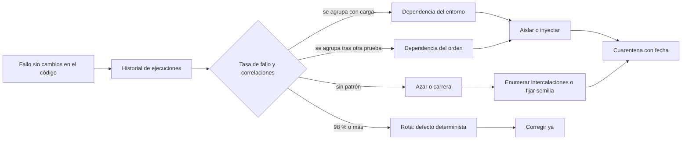
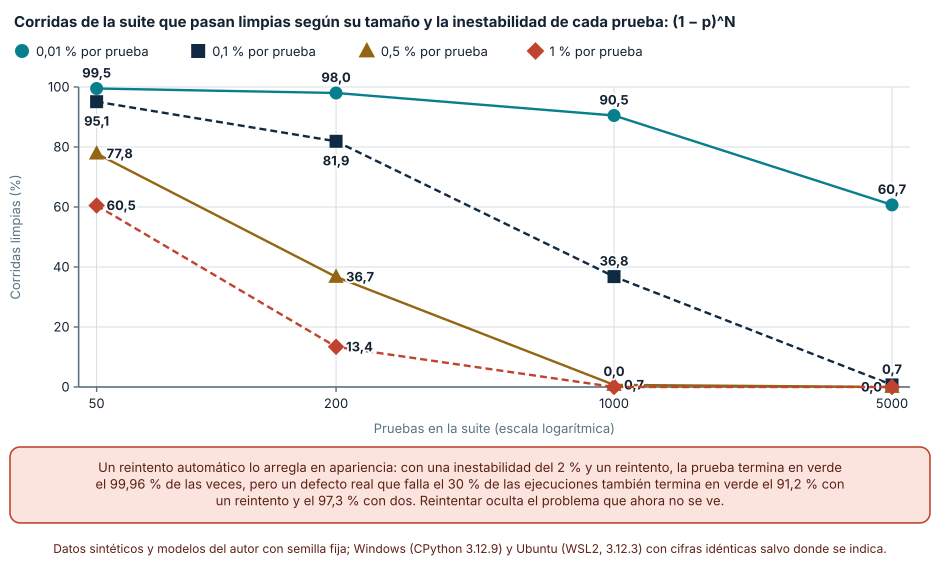
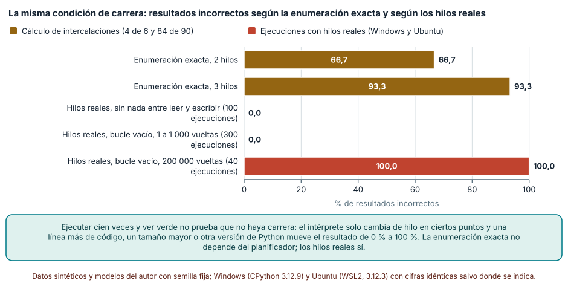
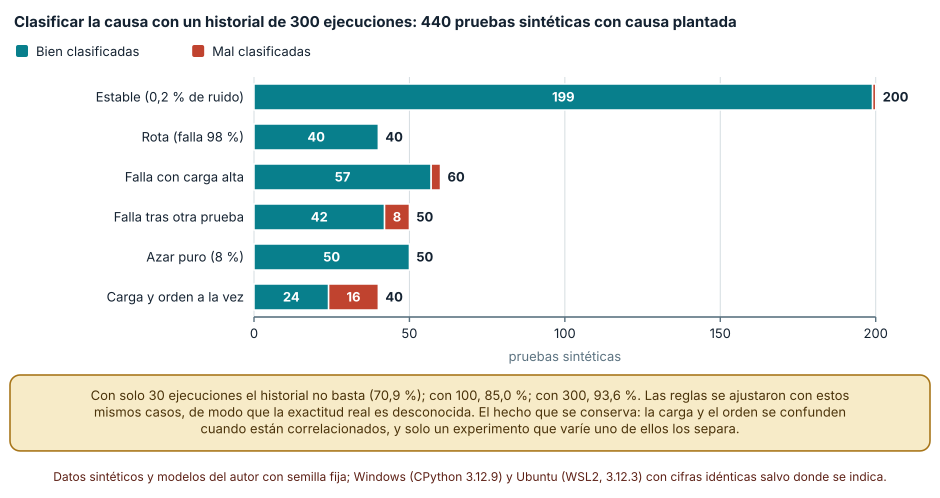

# SE-430 — Flakiness, diagnóstico y mantenimiento

[← SE-429 — Pruebas exploratorias y sesiones](https://github.com/vladimiracunadev-create/modern-software-engineering-program/blob/main/classes/part-35-estrategia-y-tecnicas-de-prueba/se-429-pruebas-exploratorias-y-sesiones/README.md) · [↑ Parte 35](https://github.com/vladimiracunadev-create/modern-software-engineering-program/blob/main/classes/part-35-estrategia-y-tecnicas-de-prueba/README.md) · [📚 Índice completo](https://github.com/vladimiracunadev-create/modern-software-engineering-program/blob/main/classes/README.md) · [🌐 Portal](https://vladimiracunadev-create.github.io/modern-software-engineering-program/classes/SE-430.html) · [SE-431 — Taller: demostrar que una prueba detecta defectos →](https://github.com/vladimiracunadev-create/modern-software-engineering-program/blob/main/classes/part-35-estrategia-y-tecnicas-de-prueba/se-431-taller-demostrar-que-una-prueba-detecta-defectos/README.md)

## Punto profesional y fundamento pedagógico

**Punto profesional.** La clase existe para que diagnostiques las pruebas que fallan a veces: que calcules cuánto ruido produce una suite aunque cada prueba sea casi estable, que distingas una prueba inestable de un defecto intermitente real, que clasifiques la causa con evidencia y que mantengas la suite de modo que un fallo siga significando algo. Una suite en la que se ignora el rojo deja de proteger.

**Por qué aparece aquí.** Sigue a **Pruebas exploratorias y sesiones** y cierra el bloque de técnicas antes del taller y el proyecto. `SE-424` midió la inestabilidad compuesta en recorridos y `SE-428` listó las fuentes de no determinismo; esta clase pregunta qué hacer cuando ya existen las pruebas inestables y cómo averiguar de qué dependen.

**Error conceptual que debe corregir.** Creer que una prueba inestable se arregla con un reintento. Un reintento hace pasar la prueba con espurias y también esconde defectos reales que ocurren a veces: la misma medida que silencia al ruido silencia la señal.

**Secuencia de aprendizaje.** Antes de leer los resultados, predices en qué fracción de corridas pasa limpia una suite de 1 000 pruebas si cada una falla al azar el 0,1 % de las veces; después mides el efecto de los reintentos sobre una prueba inestable y sobre un defecto real, enumeras las intercalaciones de una condición de carrera y la comparas con hilos reales, y clasificas la causa de 440 pruebas sintéticas con un historial de 300 ejecuciones. La secuencia usa predicción, explicación propia, contraste y recuperación. [ICAP](https://icap.education.asu.edu/research) distingue participación de construcción de conocimiento; [How People Learn II](https://nap.nationalacademies.org/catalog/24783/how-people-learn-ii-learners-contexts-and-cultures) exige conectar conocimiento previo, contexto y transferencia; la [práctica de recuperación](https://pubmed.ncbi.nlm.nih.gov/16507066/) respalda producir de nuevo la explicación tras una demora; y [Education for Life and Work](https://nap.nationalacademies.org/resource/13398/dbasse_084153.pdf) exige devolución que explique la causa del error.

**Evidencia de aprendizaje.** `flaky-log.md` con la predicción, la tabla de corridas limpias por tamaño, el efecto de los reintentos, la enumeración y los hilos reales de una carrera, la matriz de confusión del clasificador y un procedimiento de diagnóstico con cuarentena y fecha.

**Límite de la conclusión.** El historial de ejecuciones, las causas y sus probabilidades son sintéticos y plantados por el autor, y el clasificador se ajustó con los mismos casos que lo evalúan: su exactitud real es desconocida. El experimento con hilos usa CPython 3.12 en dos sistemas y su resultado depende de la versión del intérprete (el cambio de hilo ocurre en puntos concretos del código). No se midió ninguna suite, servidor de integración ni empresa real.

### Trazabilidad fuente → afirmación

| Fuente primaria u oficial | Afirmación que respalda | Lo que no prueba |
|---|---|---|
| [Luo et al., «An empirical analysis of flaky tests» (FSE 2014)](https://doi.org/10.1145/2635868.2635920) | Analiza las causas de las pruebas inestables en proyectos de código abierto y las clasifica. | No cubre todos los lenguajes ni la proporción en la plataforma. |
| [Lam et al., «iDFlakies» (ICST 2019)](https://doi.org/10.1109/ICST.2019.00038) | Presenta una herramienta que detecta pruebas inestables y las separa por dependencia del orden. | No es el clasificador de esta clase. |
| [Google Testing Blog: Flaky Tests at Google and How We Mitigate Them](https://testing.googleblog.com/2016/05/flaky-tests-at-google-and-how-we.html) | Describe la prevalencia y la mitigación (reejecución, cuarentena) en una organización. | Es la experiencia de una empresa. |
| [Micco, «The State of Continuous Integration Testing @Google»](https://research.google/pubs/the-state-of-continuous-integration-testing-google/) | Reporta el costo de los fallos inestables en la integración continua de gran escala. | No es transferible sin ajuste. |
| [Martin Fowler, «Eradicating Non-Determinism in Tests»](https://martinfowler.com/articles/nonDeterminism.html) | Propone aislar, cuarentenar y corregir las pruebas no deterministas. | No cuantifica su costo. |
| [Documentación de `threading`](https://docs.python.org/3/library/threading.html) y [`sys.setswitchinterval`](https://docs.python.org/3/library/sys.html#sys.setswitchinterval) | Describen hilos en Python y el intervalo en el que el intérprete cede el control. | No garantizan el orden de ejecución. |

## Antes de empezar

Recupera lo aprendido en `SE-428`: cada fuente de no determinismo tiene un remedio. La pregunta activa es: **cuando una prueba falla una vez de cada cincuenta, ¿cómo averiguo si es el ruido de la prueba, un defecto real que aparece a veces o una dependencia del orden o de la carga, y qué hago mientras tanto?**

## Prerrequisitos

- Haber completado `SE-428` o poder explicar qué es una dependencia del orden y qué es una semilla.
- Python 3.11 o posterior con `threading`, `random` y `statistics`.
- Conocer el producto de probabilidades \((1-p)^N\) de `SE-424`.

## Problema auténtico

La integración continua de la plataforma ejecuta 1 200 pruebas en cada propuesta de cambio y falla alrededor de un tercio de las veces sin que haya un defecto; el equipo ha configurado un reintento y aun así, de cada diez fallos, uno resulta ser real y se descarta como «otra intermitente». Una prueba de la cola de correcciones falla una vez al mes y nadie sabe si es el servidor, el orden o una carrera. Hay una discusión sobre si poner en cuarentena las veinte pruebas con peor historial. El equipo necesita calcular cuánto ruido produce su tamaño, decidir qué hacer con los reintentos, y clasificar las causas con evidencia en lugar de intuición.

## Objetivos observables

Al terminar podrás:

1. calcular la probabilidad de una corrida limpia de una suite a partir de la inestabilidad por prueba y su tamaño;
2. medir qué hace un reintento con una prueba inestable y con un defecto intermitente real;
3. explicar por qué una condición de carrera puede dar verde cien veces y enumerar sus intercalaciones;
4. clasificar la causa probable de una prueba inestable (carga, orden, azar, rota) con un historial de ejecuciones y reconocer cuándo no alcanza;
5. definir una política de cuarentena y mantenimiento con responsable, fecha y criterio de salida.

## Mapa conceptual



El mapa parte del historial y no de la intuición: la tasa y las correlaciones separan las causas antes de tocar el código. La cuarentena es un estado temporal con fecha, no un destino.

## Temas y por qué importan

| Tema | Por qué cambia una decisión profesional | Evidencia mínima |
|---|---|---|
| Aritmética de la inestabilidad | Una suite grande produce ruido aunque cada prueba sea casi estable. | Tabla \((1-p)^N\) y el efecto del tamaño |
| Reintentos | Silencian la espuria y también el defecto real intermitente. | Verde con y sin reintentos para ambos casos |
| Condiciones de carrera | Dar verde cien veces no prueba su ausencia. | Enumeración exacta y hilos reales |
| Diagnóstico por historial | Separa causas con evidencia. | Matriz de confusión y exactitud por tamaño del historial |
| Cuarentena y mantenimiento | Sin responsable y fecha, la cuarentena se vuelve olvido. | Política con criterio de entrada y salida |

## Conceptos y decisiones

### 1. Aritmética de la inestabilidad

Si cada una de \(N\) pruebas tiene una probabilidad \(p\) de fallar por azar, la probabilidad de que todas pasen en una corrida es \((1-p)^N\). Con \(p = 0{,}1\,\%\) y 1 000 pruebas, el 36,8 % de las corridas pasa limpia; con 5 000, el 0,7 %. La consecuencia es contraintuitiva: a medida que la suite crece, el ruido que produce crece aunque cada prueba individual no empeore, y una tasa por prueba que parece aceptable (0,1 %) hace inviable la señal de «todo en verde».

### 2. Reintentos

Reintentar una prueba que falla es una decisión sobre qué errores se toleran. Para una prueba con 2 % de fallo espurio, un reintento la deja en verde el 99,96 % de las veces: el ruido desaparece. Pero un defecto real que ocurre en el 30 % de las ejecuciones también termina en verde el 91,2 % de las veces con un reintento y el 97,3 % con dos. El reintento no distingue entre los dos, y la diferencia importa: lo que se silencia puede ser el defecto que llegará a producción. Si se reintenta, se registra cada reintento y se revisa la tasa.

### 3. Condiciones de carrera

Una carrera ocurre cuando el resultado depende del orden relativo de operaciones de dos o más hilos. Con dos hilos que leen y escriben un contador en dos pasos, hay seis intercalaciones posibles y solo dos terminan bien (33,3 %); con tres hilos, 6 de 90 (6,7 %). Pero ejecutar el programa con hilos reales rara vez recorre todas: el intérprete cede el control en puntos concretos y un código más corto o una versión distinta cambia la proporción de 0 % a 100 %. Por eso «lo corrí cien veces y pasó» no demuestra nada; lo que demuestra es la enumeración o una herramienta que fuerce las intercalaciones.

### 4. Diagnóstico por historial

El historial de ejecuciones de una prueba (resultado, hora, carga del servidor, pruebas que corrieron antes) contiene las huellas de su causa: una tasa de fallo de casi 100 % indica un defecto determinista; un fallo que se concentra cuando la carga es alta indica dependencia del entorno; un fallo que sigue a otra prueba indica dependencia del orden; un fallo uniforme sin patrón sugiere azar o una carrera. La correlación no es causa: si la carga alta coincide con la ejecución de una prueba contaminante, ambas variables se confunden y solo un experimento que varíe una (ejecutar con carga artificial y con orden fijo) las separa.

### 5. Cuarentena y mantenimiento

Poner una prueba en cuarentena significa dejar de bloquear con ella y seguir ejecutándola, con un responsable, una fecha y un criterio de salida (por ejemplo, 100 ejecuciones sin fallo tras la corrección). Una cuarentena sin fecha es una forma de borrar pruebas sin decirlo. El mantenimiento incluye medir la tasa de inestabilidad por prueba y por equipo, y fijar un presupuesto (por ejemplo, ninguna prueba con más de 0,1 % de fallo espurio en el bloque de la integración).

### Cuánto ruido produce una suite grande

La tabla calcula \((1-p)^N\) y las probabilidades de que una prueba termine en verde con reintentos, simuladas con 100 000 ejecuciones (semilla 370).

| Fallo espurio por prueba | 50 pruebas | 200 pruebas | 1 000 pruebas | 5 000 pruebas |
|---|---:|---:|---:|---:|
| 0,01 % | 99,5 | 98,0 | 90,5 | 60,7 |
| 0,1 % | 95,1 | 81,9 | 36,8 | 0,7 |
| 0,5 % | 77,8 | 36,7 | 0,7 | 0,0 |
| 1 % | 60,5 | 13,4 | 0,0 | 0,0 |

Un reintento arregla la apariencia: una prueba con 2 % de fallo espurio termina en verde el 97,92 % de las veces sin reintento, 99,96 % con uno y 100 % con dos o tres. Pero un defecto intermitente real que ocurre el 30 % de las ejecuciones termina en verde el 70,1 % sin reintento, 91,2 % con uno, 97,3 % con dos y 99,3 % con tres: el mismo mecanismo que silencia el ruido esconde la señal. Descartar con un 95 % de confianza una tasa de fallo de 1 % exige 299 ejecuciones sin fallos (regla de tres: \(\ln 0{,}05 / \ln(1-p)\)); para 2 %, 149; para 5 %, 59.



**Cómo leer la figura.** El eje horizontal es el número de pruebas (escala logarítmica) y el vertical, el porcentaje de corridas sin ningún fallo espurio; cada curva fija la inestabilidad de cada prueba. Mira en qué tamaño cada curva se hunde. **Dónde deja de valer:** supone pruebas independientes con la misma probabilidad; en la práctica el fallo se concentra en pocas pruebas inestables y se correlaciona con la carga. La figura es una cota del mecanismo y no una predicción de una suite real.

### Una carrera: enumerada y real

Se enumeran las intercalaciones de dos y tres hilos que cada uno lee un contador y escribe lo leído más uno. Después se ejecuta un caso real con hilos de CPython 3.12: dos hilos que incrementan un contador compartido, con `iteraciones` vueltas cada uno, con y sin un bucle vacío entre la lectura y la escritura.

```python
def prueba_hilos(iteraciones, trabajo):
    c = [0]
    def t():
        for _ in range(iteraciones):
            v = c[0]
            for _ in range(trabajo): pass     # un bucle vacío entre leer y escribir
            c[0] = v + 1
    a, b = threading.Thread(target=t), threading.Thread(target=t)
    a.start(); b.start(); a.join(); b.join()
    return c[0] == 2 * iteraciones
```

| Experimento | Resultado | Dónde |
|---|---|---|
| Enumeración exacta, 2 hilos que leen y escriben | Termina bien en 2 de 6 intercalaciones (33,3 %) | Cálculo |
| Enumeración exacta, 3 hilos | Termina bien en 6 de 90 intercalaciones (6,7 %) | Cálculo |
| Hilos reales, sin nada entre leer y escribir, hasta 200 000 vueltas | 0 fallos en 100 ejecuciones | Windows y Ubuntu |
| Hilos reales con un bucle vacío entre leer y escribir, 1 y 1 000 vueltas | 0 fallos en 300 ejecuciones | Windows y Ubuntu |
| Los mismos con 200 000 vueltas | Falla en 40 de 40 ejecuciones | Windows y Ubuntu |

La enumeración no depende del planificador: de las 6 intercalaciones de dos hilos, 4 pierden una actualización. Con hilos reales, el mismo defecto no apareció en 100 ejecuciones del código más corto, ni en 300 con pocas vueltas, y apareció en las 40 con 200 000 vueltas y un bucle entre la lectura y la escritura. El intérprete cede el control en puntos concretos (entre ciertas instrucciones, y cada pocos milisegundos si hay trabajo); añadir una línea o aumentar el trabajo cambió el resultado de 0 % a 100 %. Una prueba escrita con el código corto habría dado verde en cualquier número de ejecuciones y habría fallado al hacer más trabajo o con otra versión del intérprete.



**Cómo leer la figura.** Cada barra es un experimento; las doradas son el cálculo exacto de las intercalaciones y las rojas, ejecuciones con hilos reales. Mira que los hilos reales pasan de 0 a 100 por ciento al cambiar solo el tamaño o el código intermedio, mientras que el cálculo no depende de ellos. **Dónde deja de valer:** el comportamiento de los hilos reales depende de la versión de CPython (3.12.9 y 3.12.3 aquí), del intervalo de cambio y del código; con otra versión o con el intérprete sin bloqueo global el resultado sería otro. La figura no mide la frecuencia de una carrera en la plataforma: muestra que ejecutar muchas veces no equivale a recorrer las intercalaciones.

### Clasificar la causa con un historial

Se generan 440 pruebas con una causa conocida y 300 ejecuciones cada una, con una carga del servidor aleatoria por ejecución y una indicación de si corrió antes una prueba contaminante (correlacionada con la carga, supuesto del autor): 200 estables (0,2 % de ruido), 40 rotas (98 % de fallo), 60 que fallan con carga alta (30 % con carga mayor de 0,8; 2 % si no), 50 que fallan tras otra prueba (30 % tras ella; 1 % si no), 50 de azar puro (8 %) y 40 con ambas causas. El clasificador calcula la tasa de fallo y las diferencias de tasa por carga y por orden.

```python
t_carga = tasa_c(lambda i: carga[i] > 0.8) - tasa_c(lambda i: carga[i] <= 0.8)
t_orden = tasa_c(lambda i: previa[i]) - tasa_c(lambda i: not previa[i])
if max(t_carga, t_orden) < 0.15: return "azar"
if min(t_carga, t_orden) > 0.12: return "mixta"
return "carga" if t_carga > t_orden else "orden"
```

| Causa plantada | Pruebas | Bien clasificadas | Errores |
|---|---:|---:|---|
| Estable (0,2 % de ruido) | 200 | 199 | 1 como azar |
| Rota (falla 98 %) | 40 | 40 | — |
| Falla con carga alta | 60 | 57 | 1 azar, 2 mixta |
| Falla tras otra prueba | 50 | 42 | 8 como mixta |
| Azar puro (8 %) | 50 | 50 | — |
| Carga y orden a la vez | 40 | 24 | 16 como orden |

El clasificador acierta 412 de 440 (93,6 %). Falla más donde las causas se confunden: 16 de las 40 pruebas con ambas causas se atribuyen solo al orden, porque la carga alta y la ejecución previa de la contaminante están correlacionadas. Con 30 ejecuciones de historial la exactitud baja a 70,9 %, con 60 a 82,7 % y con 100 a 85,0 %; con menos ejecuciones, las pruebas que fallan solo con carga alta no la ven (hay pocas ejecuciones de carga alta).



**Cómo leer la figura.** Cada barra es una causa plantada; el tramo verde son las pruebas bien clasificadas y el rojo, las confundidas. Mira dónde aparece el rojo: casi solo cuando dos causas están correlacionadas. **Dónde deja de valer:** el historial es sintético, las causas son separables por construcción y las reglas se ajustaron con los mismos casos que las evalúan; la exactitud real de este clasificador es desconocida. La figura enseña que las causas correlacionadas se confunden y que solo un experimento que varíe una variable las separa.

## Definiciones de trabajo

- **prueba inestable (flaky):** prueba que, sin cambios en el código ni en los datos declarados, pasa o falla según la ejecución.
- **fallo espurio:** fallo que no corresponde a un defecto del producto.
- **condición de carrera:** resultado que depende del orden relativo de operaciones concurrentes.
- **cuarentena:** estado en el que una prueba se ejecuta sin bloquear, con responsable y fecha de salida.
- **regla de tres:** con \(n\) ejecuciones sin fallo, el límite superior del 95 % de la tasa de fallo es cercano a \(3/n\).

Las definiciones son operativas para la plataforma de entregas y deben contrastarse con la documentación primaria enlazada al final.

## Ejemplo mínimo

El fragmento calcula cuántas ejecuciones sin fallo hacen falta para descartar una tasa de fallo. Antes de ejecutarlo, predice si bastan 100 para descartar el 1 %.

```python
import math
for p in (0.05, 0.02, 0.01):
    print(p, math.ceil(math.log(0.05) / math.log(1 - p)))
```

El resultado es 59, 149 y 299: no bastan 100 ejecuciones limpias para descartar una tasa del 1 % con un 95 % de confianza. Registra versión, comando y salida; después calcula cuántas ejecuciones piden 0,1 %.

## Ejemplo profesional

El equipo de la plataforma guarda el historial de cada prueba (resultado, hora, carga, versión y pruebas anteriores del mismo trabajador) en una tabla y calcula cada semana la tasa de fallo espurio por prueba y por suite. Una prueba con más de 0,1 % de fallo espurio entra en cuarentena: sigue ejecutándose pero no bloquea, y tiene un responsable, una fecha de revisión a 14 días y un criterio de salida (300 ejecuciones sin fallo tras la corrección). Los reintentos están desactivados por defecto: se activan por prueba con un registro de cuántas veces se usaron, y la tasa de reintentos se publica. El diagnóstico sigue la secuencia del mapa: tasa, correlación con carga y orden, y, si no hay patrón, una enumeración de intercalaciones o un experimento con la semilla fija. Cada prueba corregida deja una nota con la causa.

## Práctica guiada

1. Calcula la tabla \((1-p)^N\) para cuatro valores de \(p\) y cuatro tamaños.
2. Predice la fracción de corridas limpias de tu suite y compara con su historial real.
3. Simula el efecto de los reintentos sobre una prueba inestable y sobre un defecto intermitente real.
4. Enumera las intercalaciones de dos y tres hilos y compara con una ejecución de hilos reales con y sin trabajo intermedio.
5. Genera un historial sintético de 440 pruebas con causas plantadas y clasifícalas con un clasificador por correlaciones.
6. Mide la exactitud con 30, 60, 100 y 300 ejecuciones de historial.
7. Entrega `flaky-log.md` y pide a otra persona que proponga una causa que tu clasificador confundiría.

## Ejercicios

1. **Regla de tres:** calcula cuántas ejecuciones limpias hacen falta para afirmar con 95 % de confianza que una tasa de fallo es menor que 0,1 %.
2. **Reintentos:** diseña una política que permita un reintento para ruido conocido y registre cada uso; calcula qué tasa de defecto intermitente real se esconde.
3. **Carrera:** modifica el contador con un cerrojo y comprueba con hilos reales que desaparece; explica por qué «pasó 100 veces» no habría bastado para saberlo.
4. **Confusión:** diseña un experimento que separe la carga de la ejecución previa en una prueba con ambas causas.

## Reto verificable

Entrega `flaky-log.md` con la predicción, la tabla de corridas limpias, el efecto de los reintentos, la carrera enumerada y real, la matriz de confusión con la exactitud por tamaño del historial y la política de cuarentena. Se aprueba si otra persona ejecuta el código, obtiene las mismas cifras con las mismas semillas (salvo las de los hilos reales, que declaras) y puede decir qué causa confundiría tu clasificador. No se aprueba por mostrar que la suite pasa «con reintento».

## Caso conductor

La plataforma de entregas es el caso conductor. Esta clase deja el décimo artefacto: la política de inestabilidad (presupuesto, cuarentena, reintentos registrados) y el procedimiento de diagnóstico por historial. `SE-431` es un taller que pide demostrar que una prueba detecta el defecto que dice detectar. Cambia después una sola decisión, el presupuesto de inestabilidad de 0,1 % a 0,01 %, y observa cuántas pruebas entran en cuarentena.

## Preguntas frecuentes

### ¿Los reintentos siempre son malos?

No: son una herramienta con un costo. Sirven para absorber fallos conocidos de infraestructura (una descarga de dependencias), siempre registrados y con una tasa publicada. Son dañinos cuando se aplican a todo sin registro, porque ocultan los defectos intermitentes reales.

### ¿Cómo sé si una prueba inestable esconde un defecto real?

Se estudia su patrón: si el fallo se concentra bajo ciertas condiciones (carga, una zona horaria, un orden) y esas condiciones existen en producción, probablemente es un defecto real que la prueba hace visible. Si falla sin patrón y su causa está en el entorno de prueba (una espera, un puerto ocupado), es ruido. En duda, se trata como defecto.

### ¿Cuántas ejecuciones debo usar para clasificar?

Las que alcancen para observar el patrón: con 30 ejecuciones la exactitud fue 70,9 % y con 300, 93,6 %. Si la causa depende de una condición rara (carga alta, el 20 % de las ejecuciones), hacen falta suficientes ejecuciones en esa condición.

### ¿Ejecutar mil veces una prueba prueba que no hay carrera?

No. Con hilos reales una carrera puede dar verde en cada ejecución si el intérprete no cede el control en el punto crítico; las condiciones del entorno (versión, carga, tamaño del trabajo) cambian si aparece. Se razona sobre las intercalaciones, se usan primitivas de sincronización, o se emplea una herramienta que las fuerce.

## Fallo controlado y diagnóstico

Reproduce el fallo clásico de la clase: **una carrera que no aparece en 100 ejecuciones y aparece al aumentar el trabajo**. Ejecuta el contador con dos hilos sin código entre la lectura y la escritura, 100 veces, y después con un bucle vacío y 200 000 vueltas.

Registra síntoma, entrada mínima, hipótesis, observación que descarta cada hipótesis, causa, corrección y prueba de regresión. **Síntoma:** la prueba pasa 100 de 100 y en la integración continua, con más datos, falla siempre. **Hipótesis rivales:** (a) el servidor de integración tiene un problema; (b) la prueba depende de la hora; (c) hay una carrera cuyo efecto depende del tamaño del trabajo. **Prueba:** enumera las intercalaciones (solo 2 de 6 terminan bien) y ejecuta el contador con trabajo intermedio y 200 000 vueltas (falla 40 de 40). **Conclusión:** la lectura y la escritura no son atómicas y el intérprete solo cede el control en puntos que el código corto no alcanza. **Regresión:** protege el contador con un cerrojo, comprueba 40 de 40 ejecuciones correctas con 200 000 vueltas y añade una prueba que ejecute el caso con la carga que produce el fallo. No cambies a la vez el código y la carga.

## Errores comunes y cómo corregirlos

| Síntoma | Causa probable | Corrección |
|---|---|---|
| La suite casi nunca pasa limpia con pruebas «casi estables» | \((1-p)^N\) con \(N\) grande | Presupuesto de inestabilidad por prueba y por suite |
| Un defecto real se descarta como «intermitente» | Reintentos sin registro | Registrar cada reintento y revisar su tasa |
| Una carrera da verde en cada ejecución | El intérprete no cede en el punto crítico | Enumerar intercalaciones o sincronizar |
| Dos causas se confunden | Variables correlacionadas | Experimento que varíe una de ellas |
| Las pruebas en cuarentena se olvidan | Sin responsable ni fecha | Responsable, fecha de revisión y criterio de salida |

## Entorno y archivos clave

```text
work/SE-430/
├── README.md
├── inestabilidad/
│   ├── aritmetica.py
│   ├── reintentos.py
│   └── carrera.py
├── diagnostico/
│   ├── historial.py
│   └── clasificador.py
├── politica/cuarentena.md
└── evidence/flaky-log.md
```

El `README` declara plataforma, versión de Python, semillas (370 y 3700) y comandos. Los experimentos usan solo la biblioteca estándar (`threading`, `random`, `itertools`, `statistics`) y se ejecutaron con CPython 3.12.9 en Windows 11 y 3.12.3 en Ubuntu bajo WSL2: las salidas fueron idénticas, incluidas las de los hilos reales en estas dos versiones (0 % o 100 % según el caso). Un valor intermedio de vueltas podría dar resultados distintos por sistema y por ejecución; no se midieron. Si añades una dependencia, fija procedencia y versión.

## Seguridad, ética y accesibilidad

- una prueba en cuarentena que cubría un control de seguridad deja ese control sin vigilancia: no la pongas en cuarentena sin una compensación y un responsable;
- las condiciones de carrera en autenticación, pagos o permisos son vulnerabilidades, no solo pruebas inestables: trátalas como defectos de seguridad;
- una métrica de «tasa de pruebas inestables por equipo» puede usarse para culpar: úsala para priorizar el mantenimiento;
- el historial de ejecuciones puede contener datos de las personas que desplegaron: anonimiza antes de compartirlo;
- documenta qué pruebas inestables afectan a la accesibilidad, porque ignorarlas retira una protección de personas concretas.

## Puente hacia el trabajo con agentes

Un agente al que se le pide «arregla las pruebas intermitentes» añadirá esperas y reintentos y reportará la suite en verde. Pídele en cambio la tasa de fallo por prueba con su historial, la correlación con carga y orden, la causa probable con la evidencia, la tasa de reintentos y la política de cuarentena con responsable y fecha. Revisa especialmente que no suba el número de reintentos ni los tiempos de espera como solución y que no marque como «ruido» un fallo que se concentra en una condición presente en producción.

## Transferencia

Traslada el método a otra suite (por ejemplo, la de una aplicación móvil): calcula \((1-p)^N\), mide los reintentos, clasifica las causas con el historial y define una política de cuarentena. La transferencia está lograda cuando puedes explicar qué causa confundirías y qué experimento la separaría, no cuando la política se parece.

## Evaluación y evidencia

| Criterio | Evidencia para aprobar |
|---|---|
| comprensión | explicación de \((1-p)^N\) y de por qué un reintento oculta defectos reales |
| corrección | tablas y matriz de confusión reproducibles con las mismas semillas |
| diseño | presupuesto de inestabilidad, cuarentena con fecha y reintentos registrados |
| diagnóstico | reproducción del fallo «carrera que depende del trabajo» con regresión |
| incertidumbre | declaración de que el historial es sintético y de que los hilos dependen de la versión |
| reproducibilidad | versiones, semillas, comandos, salida y límites declarados |

## Fuentes

- [Luo et al., «An empirical analysis of flaky tests»](https://doi.org/10.1145/2635868.2635920) — causas de las pruebas inestables; autoridad: artículo revisado de FSE 2014.
- [Lam et al., «iDFlakies»](https://doi.org/10.1109/ICST.2019.00038) — detección de pruebas inestables; autoridad: artículo revisado de ICST 2019.
- [Google Testing Blog: Flaky Tests at Google and How We Mitigate Them](https://testing.googleblog.com/2016/05/flaky-tests-at-google-and-how-we.html) — mitigación en una organización; autoridad: equipo de pruebas de Google.
- [Micco, «The State of Continuous Integration Testing @Google»](https://research.google/pubs/the-state-of-continuous-integration-testing-google/) — integración continua a gran escala; autoridad: Google Research.
- [Martin Fowler, «Eradicating Non-Determinism in Tests»](https://martinfowler.com/articles/nonDeterminism.html) — causas y tratamiento; autoridad: autor del texto.
- [Documentación de threading](https://docs.python.org/3/library/threading.html) y [sys.setswitchinterval](https://docs.python.org/3/library/sys.html#sys.setswitchinterval) — hilos en Python; autoridad: documentación oficial de Python.

Cada fuente respalda el mecanismo indicado; ninguna demuestra que el 36,8 % de corridas limpias de una suite de 1 000 pruebas, el 91,2 % de un defecto escondido por un reintento o la exactitud del 93,6 % se observen en la plataforma. Esa afirmación depende de la suite, del historial y del entorno.

## Límites y siguiente paso

Se ejecutaron tres experimentos con modelos del autor, un historial sintético con causas plantadas e hilos de CPython 3.12 en Windows y Ubuntu (WSL2). No se midió ninguna suite real, el clasificador se ajustó con los mismos casos que lo evalúan y los hilos dependen de la versión del intérprete. La siguiente clase es un taller: demostrar que una prueba detecta el defecto que dice detectar, con mutantes y refactorizaciones neutras.

## Glosario

- **prueba inestable (flaky):** prueba que, sin cambios en el código ni en los datos declarados, pasa o falla según la ejecución.
- **fallo espurio:** fallo que no corresponde a un defecto del producto.
- **condición de carrera:** resultado que depende del orden relativo de operaciones concurrentes.
- **cuarentena:** estado en el que una prueba se ejecuta sin bloquear, con responsable y fecha de salida.
- **regla de tres:** con \(n\) ejecuciones sin fallo, el límite superior del 95 % de la tasa de fallo es cercano a \(3/n\).

---

[← SE-429 — Pruebas exploratorias y sesiones](https://github.com/vladimiracunadev-create/modern-software-engineering-program/blob/main/classes/part-35-estrategia-y-tecnicas-de-prueba/se-429-pruebas-exploratorias-y-sesiones/README.md) · [↑ Parte 35](https://github.com/vladimiracunadev-create/modern-software-engineering-program/blob/main/classes/part-35-estrategia-y-tecnicas-de-prueba/README.md) · [📚 Índice completo](https://github.com/vladimiracunadev-create/modern-software-engineering-program/blob/main/classes/README.md) · [🌐 Portal](https://vladimiracunadev-create.github.io/modern-software-engineering-program/classes/SE-430.html) · [SE-431 — Taller: demostrar que una prueba detecta defectos →](https://github.com/vladimiracunadev-create/modern-software-engineering-program/blob/main/classes/part-35-estrategia-y-tecnicas-de-prueba/se-431-taller-demostrar-que-una-prueba-detecta-defectos/README.md)
