# Parte 35 — Observabilidad, SRE e incidentes

La Parte 34 llevó el código a producción por un camino con compuertas y un retorno seguro. La pregunta cambia de «¿cómo llega una versión a producción?» a «¿cómo sabemos qué le está pasando una vez allí, qué promesa defendemos, qué hacemos cuando falla y cómo volvemos si todo se pierde?». Esta parte trabaja sobre **la API de entregas de la plataforma educativa operada en producción**, un caso sintético: subir una entrega, listar las entregas de un curso y consultar una calificación, con picos de uso en los cierres de plazo y cinco servicios que cooperan. Cada clase convierte una práctica de operación (observar, medir, avisar, responder, aprender, recuperar) en un mecanismo que se puede medir, mide cómo se engaña quien la usa mal y declara qué no demuestra.

## Pregunta rectora

> ¿Qué señales, qué promesa, qué alertas y qué respuesta hacen falta para operar un servicio, y qué evidencia reproducible permite a otra persona comprobar que funcionan, refutarlas o decir cuándo dejan de valer?

## Antes del recorrido clase por clase

Esta parte no enseña un producto de observabilidad, una plataforma de alertas ni una herramienta de gestión de guardias. Enseña a distinguir lo que un sistema emite de lo que se puede preguntar durante un incidente y a localizar una lentitud con duraciones inclusivas, a escribir registros que una máquina consulta y a unir las líneas de una petición entre servicios, a presupuestar las series de una métrica antes de añadir una dimensión y a saber qué reconstruye un muestreo periódico, a seguir una petición con trazas, auditar las fronteras donde se pierde el contexto y leer la ruta crítica antes de optimizar, a convertir una promesa en un indicador, un objetivo, un presupuesto y una política, a derivar alertas del consumo del presupuesto y medir el ruido que producen, a escribir un runbook que una persona cansada pueda seguir y dimensionar una guardia y su escalamiento, a coordinar un incidente con roles, severidades medibles y una cadencia de comunicación sin creer en promedios de pocos casos, a escribir un postmortem sin culpa con factores y acciones verificables, a restaurar una copia en lugar de confiar en que se creó, a descubrir el orden real de una recuperación y sus ciclos, y a diagnosticar con telemetría incompleta distinguiendo lo normal de lo que no tiene datos. Cada clase ejecuta experimentos con datos sintéticos que muestran un mecanismo (una cadena de cuatro servicios donde el p99 absoluto acierta 50 de 200 veces y el aumento relativo 196, un umbral global que ve en 8,7 % de los casos la falla total de un cliente pequeño, 463 GB para una métrica con un identificador de persona, 59,4 % de peticiones en una sola traza, 166 % del presupuesto mensual consumido por un corte de 30 minutos en hora punta, 12 622 páginas de una regla corta frente a 13 de una de consumo, 77 noches interrumpidas al año con dos personas de guardia, un kappa de 0,29 con criterios vagos, 100 de 180 defectos de un postmortem detectados por forma, 20 de 40 copias dañadas que un chequeo de integridad no ve, una tasa de error leída a la mitad por la pérdida selectiva de líneas y una recuperación completa del 55,4 % con cinco etapas buenas) y declara lo que esa medida no demuestra.

```mermaid
flowchart LR
    A[Señales, eventos y observabilidad útil] --> B[Logs estructurados y correlación]
    B --> C[Métricas, dimensiones y cardinalidad]
    C --> D[Trazas distribuidas y contexto]
    D --> E[SLI, SLO, SLA y presupuestos de error]
    E --> F[Alertas accionables y fatiga]
    F --> G[Runbooks, on-call y escalamiento]
    G --> H[Gestión de incidentes y comunicación]
    H --> I[Postmortems sin culpa y aprendizaje]
    I --> J[Continuidad, disaster recovery y ejercicios]
    J --> K[Taller de diagnóstico con telemetría incompleta]
    K --> L[Paquete operativo observable y recuperable]
    L -->|incidente o ejercicio| A
```

El diagrama se lee de izquierda a derecha y no es un proceso obligatorio. El retorno indica que un incidente o un hallazgo de un ejercicio reabre la pregunta de qué señales hacían falta; un paquete operativo validado no cierra la operación, la fecha.

## Resultados acumulativos

Podrás escribir una tabla de preguntas con la señal que responde cada una, localizar el servicio lento de una cadena comparando cada duración con su línea base en lugar de elegir la mayor, medir qué fracción de una falla en un cliente pequeño detecta un umbral global frente a una sonda rotativa y contar cuántas preguntas posteriores a un incidente responden unas métricas frente a un evento ancho; diseñar el esquema de un registro con campos versionados, medir cuánto sobrevive una extracción por expresión regular y una lectura por campos a cuatro versiones de una línea, calcular la fracción de peticiones con la cadena completa según la propagación del identificador y las líneas huérfanas atribuibles por el reloj, y comparar políticas de muestreo y de redacción;

calcular el número de series de una métrica como producto de cardinalidades y su memoria estimada, reconstruir un contador con reinicios y estimar la probabilidad de ver un pico según el intervalo de lectura, y comparar tres diseños de cubetas de histograma por su error en p50, p95 y p99; validar la cabecera `traceparent`, calcular la fragmentación de una traza según las fronteras asíncronas, comparar el ahorro de optimizar un span al azar, el más largo o el de la ruta crítica, y contrastar el muestreo de cabeza con el de cola y su exigencia de enrutado coherente; escribir un SLI como proporción de eventos buenos sobre válidos, calcular el presupuesto de un SLO en minutos y en peticiones, ver por qué contar minutos y contar peticiones dan consumos opuestos, medir el servidor frente al cliente y los reintentos, y calcular la composición de dependencias en serie y los meses que incumplen un objetivo;

derivar alertas del consumo del presupuesto con dos ventanas, comparar seis reglas por páginas, detecciones, retraso y falsos positivos sobre 180 días con tráfico nocturno bajo, medir el efecto de la duración mínima y de la agrupación sobre la fatiga y elegir una ventana por el equilibrio entre ruido y retraso; escribir un runbook con salida esperada, reversión y escalamiento, calcular la carga de una guardia según el tamaño del equipo y las ausencias, estimar la cobertura de un escalamiento con y sin causa común y medir qué detecta un verificador de forma frente a 240 mutaciones; asignar roles de incidente, comprobar con kappa el acuerdo de tres personas sobre la severidad, descomponer el tiempo de resolución por tramos, ver cuánto varía por azar la media de un trimestre y encontrar la cadencia de actualizaciones que minimiza las interrupciones;

escribir un postmortem sin culpa con impacto cuantificado, línea de tiempo, factores y acciones verificables, ver cuántas causas raíz declaran 400 analistas sobre el mismo grafo, calcular el efecto del cumplimiento de las acciones sobre la recurrencia y medir qué detecta un verificador de postmortems; fijar RPO y RTO, calcular los datos perdidos por copias y réplicas, comparar seis comprobaciones sobre 40 copias dañadas de una base SQLite, dibujar el mapa de dependencias de una restauración, hallar un ciclo y calcular la ruta crítica; representar un diagnóstico como una tabla de firmas, contar las fallas indistinguibles al faltar señales, comparar tres estrategias de observación y estimar el sesgo de una tasa de error leída en registros con pérdida selectiva; y validar un paquete operativo frente a 360 mutaciones, calcular la probabilidad de una respuesta completa como producto de etapas y comprobar la reproducibilidad con una huella en dos sistemas.

Al finalizar podrás defender un paquete operativo con sus señales, su objetivo y su presupuesto, sus alertas, sus runbooks y su guardia, su protocolo de incidentes, su plantilla de postmortem, su restauración verificada y su ejercicio, con un validador, una huella reproducible y una lista de lo que ningún validador ve, y podrás indicar qué parte de tu conclusión es observación, cuál es inferencia y cuál es suposición.

## Prerrequisitos enlazados

- [Parte 18 — CLI, TUI, servicios y automatización](https://github.com/vladimiracunadev-create/modern-software-engineering-program/blob/main/classes/part-18-cli-tui-servicios-y-automatizacion/): servicios, registros y procesos de larga duración.
- [Parte 20 — Backend, APIs y procesamiento asíncrono](https://github.com/vladimiracunadev-create/modern-software-engineering-program/blob/main/classes/part-20-backend-apis-y-procesamiento-asincrono/): idempotencia, colas y reintentos.
- [Parte 25 — Arquitectura de software y dominio](https://github.com/vladimiracunadev-create/modern-software-engineering-program/blob/main/classes/part-25-arquitectura-de-software-y-dominio/): atributos de calidad, fronteras y decisiones registradas.
- [Parte 26 — Datos, persistencia y recuperación](https://github.com/vladimiracunadev-create/modern-software-engineering-program/blob/main/classes/part-26-datos-persistencia-y-recuperacion/): copias, restauración y réplicas.
- [Parte 28 — Concurrencia y sistemas distribuidos](https://github.com/vladimiracunadev-create/modern-software-engineering-program/blob/main/classes/part-28-concurrencia-y-sistemas-distribuidos/): fallos parciales, relojes y causalidad.
- [Parte 29 — Cloud, plataforma e infraestructura](https://github.com/vladimiracunadev-create/modern-software-engineering-program/blob/main/classes/part-29-cloud-plataforma-e-infraestructura/): regiones, cuentas y dependencias de plataforma.
- [Parte 31 — Calidad, rendimiento y resiliencia](https://github.com/vladimiracunadev-create/modern-software-engineering-program/blob/main/classes/part-31-calidad-rendimiento-y-resiliencia/): percentiles, colas, reintentos, disponibilidad y presión controlada.
- [Parte 34 — CI/CD, IaC y platform engineering](https://github.com/vladimiracunadev-create/modern-software-engineering-program/blob/main/classes/part-34-ci-cd-iac-y-platform-engineering/): camino a producción y reversión.
- Python 3.11+ y terminal; los experimentos usan solo la biblioteca estándar y datos sintéticos, salvo las copias de SQLite de `SE-430` y las sondas de plataforma de `SE-432`, que son lecturas reales del equipo.

## Bloques y progresión

1. **Observar:** las clases 421 a 424 definen las señales, estructuran los registros, presupuestan las métricas y siguen una petición con trazas.
2. **Prometer y avisar:** las clases 425 y 426 convierten una promesa en un objetivo con presupuesto y lo vigilan con alertas que merecen una página.
3. **Responder y aprender:** las clases 427 a 429 organizan la respuesta (runbooks, guardia, incidentes) y la convierten en cambios del sistema.
4. **Recuperar:** la clase 430 prepara el desastre con RPO, RTO, restauraciones y ejercicios.
5. **Aplicar e integrar:** las clases 431 y 432 diagnostican con telemetría incompleta y reúnen la parte en un paquete operativo reproducible.

## Evidencia medida y límites

Las figuras y los ejemplos de esta parte usan experimentos ejecutados con CPython 3.12.9 en Windows 11 y repetidos con CPython 3.12.3 en Ubuntu bajo WSL2. Los datos son **sintéticos**, las semillas están fijadas y casi todos los experimentos (atribución, segmentos, registros, series, contadores, histogramas, contexto, ruta crítica, muestreo, objetivos, alertas, guardia, incidentes, postmortems, recuperación, diagnóstico y cadena de respuesta) corren en **tiempo virtual**: no hay reloj, red ni servidor reales, y las salidas de esos experimentos fueron idénticas en ambos sistemas, cifra por cifra. Hay tres excepciones, todas intencionales: las **sondas de plataforma** de `SE-432` (separador de línea, bytes escritos, lectura con la codificación local, separador de rutas y distinción de mayúsculas) difieren entre Windows y Ubuntu por diseño, porque eso es lo que miden; la **memoria por serie** de `SE-423` (429 bytes) es una medición de `tracemalloc` sobre CPython que coincidió en los dos intérpretes y puede variar con otra versión; y las **copias de SQLite** de `SE-430`, una medición real en un directorio temporal con un daño inyectado por el autor, cuya detección fue idéntica en ambos sistemas y cuyos tiempos de reloj (decenas de milisegundos) no se reproducen al milisegundo.

Los experimentos son: la localización de un servicio lento en una cadena de cuatro con cuatro conjuntos de señales, la falla total de un cliente según tres señales y 60 preguntas posteriores a un incidente sobre ocho dimensiones (`SE-421`); cuatro versiones de una línea de registro con regex y con campos por nombre, la propagación del identificador en cuatro saltos con las líneas huérfanas, y el volumen, el muestreo y la redacción sobre 200 000 líneas y quince variantes de datos personales (`SE-422`); el número de series y la memoria de una métrica, un contador con tres reinicios con picos de un indicador y tres diseños de cubetas sobre 100 000 latencias (`SE-423`); el contexto de una petición de seis saltos con la validación de once cabeceras, 600 árboles de spans con tres reglas de optimización y 100 000 trazas con dos políticas de muestreo y tres recolectores (`SE-424`); un presupuesto de 99,9 % medido por peticiones y por minutos en tres incidentes, el servidor frente al cliente con 200 000 solicitudes y la composición de dependencias con 20 000 meses (`SE-425`); seis reglas de alerta sobre 180 días con 26 incidentes, 200 incidentes en cascada con 3 000 destellos y cuatro ventanas sobre 120 días (`SE-426`); la carga de una guardia con 300 años por tamaño de equipo, 20 000 páginas con tres niveles de escalamiento y un verificador de runbooks frente a 240 mutaciones (`SE-427`); 2 000 incidentes descompuestos en cinco tramos con 4 000 trimestres, cinco cadencias de actualización y 400 incidentes clasificados por tres personas con tres criterios (`SE-428`); tres años de incidentes según el cumplimiento de acciones, 400 analistas sobre un grafo de 12 factores y un verificador de postmortems frente a 180 mutaciones (`SE-429`); 20 000 fallos con cuatro estrategias de copia y réplica, 40 copias dañadas de una base de 20 000 filas con seis comprobaciones y la restauración de 12 componentes con un ciclo (`SE-430`); diez fallas y doce señales con todas las combinaciones de señales ausentes, tres estrategias de observación sobre 4 000 diagnósticos y una tasa de error con pérdida selectiva de líneas (`SE-431`); y un validador de paquetes frente a 360 mutaciones, 20 000 incidentes en una cadena de cinco etapas y la huella de los resultados en dos sistemas (`SE-432`).

Los parámetros (los cuatro servicios y sus duraciones, el reparto de 40 clientes con tráfico 1/k, las ocho dimensiones y sus cardinalidades, las cuatro versiones del mensaje, las probabilidades de propagación, el 2 % de errores de los registros, los 429 bytes por serie, las probabilidades de pérdida de contexto por frontera, el 1 % de errores y el 2 % de lentas de las trazas, el perfil de tráfico de 5 a 100 peticiones por segundo, el 1,2 de incidentes por mes con duración lognormal, el 0,1 % de errores basales, los 26 incidentes de las alertas, las 8,1 alertas por incidente, las 1,5 páginas diarias de la guardia, el 85 % de respuesta por nivel y el 30 % de causa común, las medianas por tramo de los incidentes, el ruido de percepción de la severidad, los costes de 3 y 4 minutos de las preguntas y las actualizaciones, las 12 causas con tasas 1/k, el grafo de 12 factores, el 1 % de picos del retraso de la réplica, los 12 componentes de la restauración, las diez fallas y su tabla binaria de firmas, las pérdidas selectivas de líneas y las cinco etapas de la respuesta con sus probabilidades) son **supuestos del autor**, no mediciones. Cada clase los lista y dice qué cambiaría si fueran otros.

Lo que **no se hizo**: no se instrumentó, observó ni operó ningún servicio, base de datos, red ni sistema reales, ni se envió una sola petición a ninguno; no se usó ninguna herramienta de observabilidad, de trazado, de métricas, de alertas, de gestión de guardias ni de incidentes; no se midió ninguna guardia, equipo ni persona, y el estudio de fatiga que se cita es de un entorno clínico y se usa solo como respaldo del fenómeno; no se ejecutó ningún runbook ni ningún ejercicio de recuperación contra un sistema, y los comandos de los runbooks son ilustrativos; no se probó macOS ni otras versiones de Python; los verificadores de runbooks, de postmortems y de paquetes, las reglas de alerta y las estrategias se afinaron con los mismos casos que los evalúan, de modo que sus porcentajes muestran una frontera y no una tasa; y los resultados sobre cadencia, severidad y causas raíz son propios de sus modelos. La parte no tiene laboratorio en `labs/`, y su contenido sigue pendiente de revisión humana independiente.

## Guía razonada clase por clase

La API de entregas mantiene un contrato, un conjunto de señales y un paquete operativo estables mientras cambian las decisiones. Cada clase explica qué incertidumbre reduce, qué experimento la muestra, qué no demuestra y qué evidencia permite abandonar la conclusión.

### Bloque 1 — Observar

#### SE-421 — Señales, eventos y observabilidad útil

Una señal sirve si responde una pregunta que se hará durante el incidente. La clase compara cuatro conjuntos de señales para localizar al servicio lento de una cadena, mide cuánto del tráfico global ve una falla total de un cliente pequeño y cuenta cuántas de 60 preguntas posteriores responden las métricas y los eventos anchos.

El estudiante entrega una tabla pregunta → señal → señal que falta. `SE-422` pregunta cómo escribir el evento que responde esas preguntas.

#### SE-422 — Logs estructurados y correlación

Un registro es una interfaz con quien investiga. La clase mide qué sobrevive de una extracción por regex y por campos a cuatro versiones de una línea, calcula la fracción de peticiones completas según la propagación del identificador y compara políticas de muestreo y de redacción.

El estudiante entrega un esquema de registros con su política de muestreo y de redacción. `SE-423` resume los eventos como métricas.

#### SE-423 — Métricas, dimensiones y cardinalidad

Cada combinación de etiquetas es una serie. La clase calcula el crecimiento del número de series y su memoria, reconstruye un contador con reinicios y estima qué picos ve cada intervalo de lectura, y compara tres diseños de cubetas de histograma por su error de percentil.

El estudiante entrega un catálogo de métricas con presupuesto de series. `SE-424` sigue una petición entre servicios.

#### SE-424 — Trazas distribuidas y contexto

El contexto se pierde donde cambia el medio o la unidad de ejecución. La clase calcula la fragmentación de las trazas, mide cuánto ahorra optimizar según la ruta crítica y compara el muestreo de cabeza con el de cola y su enrutado.

El estudiante entrega un inventario de fronteras con una prueba por frontera asíncrona. `SE-425` usa las señales para fijar un objetivo.

### Bloque 2 — Prometer y avisar

#### SE-425 — SLI, SLO, SLA y presupuestos de error

Un objetivo sin ventana ni punto de medición admite lecturas opuestas. La clase mide el mismo presupuesto por peticiones y por minutos, compara el servidor con el cliente y los reintentos y calcula la composición de dependencias y los meses que incumplen.

El estudiante entrega un SLI, un SLO, un SLA y una política de presupuesto. `SE-426` los convierte en alertas.

#### SE-426 — Alertas accionables y fatiga

Una página que no pide acción cuesta credibilidad. La clase compara seis reglas de alerta por páginas, detecciones y falsos positivos, mide el efecto de la duración mínima y la agrupación y elige una ventana por el equilibrio entre ruido y retraso.

El estudiante entrega un conjunto de alertas clasificadas en página, ticket y registro. `SE-427` define qué hace quien la recibe.

### Bloque 3 — Responder y aprender

#### SE-427 — Runbooks, on-call y escalamiento

Una persona cansada necesita pasos, no explicaciones. La clase calcula la carga de una guardia según el tamaño del equipo, la cobertura de un escalamiento con causa común y lo que un verificador de forma ve y no ve en un runbook.

El estudiante entrega un runbook ejecutado por otra persona y una rotación dimensionada. `SE-428` coordina varias personas.

#### SE-428 — Gestión de incidentes y comunicación

Mitigar viene antes que entender y comunicar es parte de resolver. La clase mide el acuerdo sobre la severidad con kappa, descompone el tiempo en tramos, muestra cuánto varía la media por azar y busca la cadencia de actualizaciones que minimiza las interrupciones.

El estudiante entrega un protocolo con roles, severidades medibles y cadencia. `SE-429` convierte el incidente en aprendizaje.

#### SE-429 — Postmortems sin culpa y aprendizaje

Un postmortem se mide por los cambios que produce. La clase calcula el efecto del cumplimiento de las acciones sobre la recurrencia, muestra que 400 analistas declaran seis causas raíz sobre el mismo grafo y mide qué detecta un verificador de forma.

El estudiante entrega un postmortem con factores y acciones verificables. `SE-430` prepara lo que no ha ocurrido.

### Bloque 4 — Recuperar

#### SE-430 — Continuidad, disaster recovery y ejercicios

Un plan de recuperación que no se ha ejecutado es una hipótesis. La clase calcula los datos perdidos por cada estrategia, compara seis comprobaciones sobre 40 copias dañadas de una base real y calcula la ruta crítica y el ciclo de una restauración de 12 componentes.

El estudiante entrega un plan con RPO, RTO, restauración verificada y calendario de ejercicios. `SE-431` diagnostica cuando la telemetría falta.

### Bloque 5 — Aplicar e integrar

#### SE-431 — Taller: diagnosticar con telemetría incompleta

Una señal sin datos no es una señal normal. El taller cuenta las fallas indistinguibles al faltar señales, compara tres estrategias de observación y mide cuánto se subestima la tasa de error cuando el agente pierde más líneas de error.

El estudiante entrega una bitácora de diagnóstico y la lista de telemetría a vigilar. `SE-432` lo integra en un paquete.

#### SE-432 — Proyecto: operación observable y recuperable

Un paquete coherente no es un servicio operable. El proyecto mide qué detecta un validador sobre 360 mutaciones, calcula la recuperación completa como producto de cinco etapas y compara la huella de los resultados en dos sistemas.

El estudiante entrega un paquete operativo con validador, huella, ejercicio registrado e informe de límites. La Parte 36 lleva la mirada al mantenimiento y la modernización de sistemas existentes.

## Fuentes

- [Google SRE: Monitoring Distributed Systems](https://sre.google/sre-book/monitoring-distributed-systems/), [Practical Alerting](https://sre.google/sre-book/practical-alerting/) y [Effective Troubleshooting](https://sre.google/sre-book/effective-troubleshooting/) — señales, alertas y diagnóstico; autoridad: Google, libro de ingeniería de confiabilidad.
- [Google SRE: Service Level Objectives](https://sre.google/sre-book/service-level-objectives/), [Implementing SLOs](https://sre.google/workbook/implementing-slos/) y [Alerting on SLOs](https://sre.google/workbook/alerting-on-slos/) — objetivos, presupuestos y alertas por consumo; autoridad: Google, SRE Book y SRE Workbook.
- [Google SRE: Being On-Call](https://sre.google/sre-book/being-on-call/), [Managing Incidents](https://sre.google/sre-book/managing-incidents/) y [Postmortem Culture](https://sre.google/sre-book/postmortem-culture/) — guardia, incidentes y postmortems; autoridad: Google, libro de ingeniería de confiabilidad.
- [OpenTelemetry: Signals](https://opentelemetry.io/docs/concepts/signals/), [modelo de datos de registros](https://opentelemetry.io/docs/specs/otel/logs/data-model/), [propagación de contexto](https://opentelemetry.io/docs/concepts/context-propagation/) y [muestreo](https://opentelemetry.io/docs/concepts/sampling/) — señales, registros, contexto y muestreo; autoridad: proyecto OpenTelemetry (CNCF).
- [W3C Trace Context](https://www.w3.org/TR/trace-context/) y [RFC 3339](https://www.rfc-editor.org/rfc/rfc3339) — contexto de traza y marcas de tiempo; autoridad: W3C e IETF.
- [Prometheus: modelo de datos](https://prometheus.io/docs/concepts/data_model/), [tipos de métricas](https://prometheus.io/docs/concepts/metric_types/), [nombres](https://prometheus.io/docs/practices/naming/), [histogramas](https://prometheus.io/docs/practices/histograms/) y [Alertmanager](https://prometheus.io/docs/alerting/latest/alertmanager/) — métricas y alertas; autoridad: documentación del proyecto Prometheus.
- [Sigelman et al., «Dapper»](https://research.google/pubs/dapper-a-large-scale-distributed-systems-tracing-infrastructure/) y [Dean y Barroso, «The tail at scale»](https://doi.org/10.1145/2408776.2408794) — trazado distribuido y latencia de cola; autoridad: Google Research y Communications of the ACM.
- [Cook, «How Complex Systems Fail»](https://how.complexsystems.fail/), [Fischhoff, «Hindsight ≠ foresight»](https://doi.org/10.1037/0096-1523.1.3.288) y [Dekker, «The Field Guide to Understanding “Human Error”»](https://openlibrary.org/isbn/9781472439055) — causas múltiples, sesgo de retrospectiva y error humano; autoridad: texto del autor, Journal of Experimental Psychology y libro con ISBN.
- [Cohen, «A coefficient of agreement for nominal scales»](https://doi.org/10.1177/001316446002000104) y [Ancker et al.](https://doi.org/10.1186/s12911-017-0430-8) — acuerdo entre evaluadores y fatiga de alertas; autoridad: Educational and Psychological Measurement 1960 y BMC Medical Informatics and Decision Making 2017.
- [NIST SP 800-34 Rev. 1](https://csrc.nist.gov/pubs/sp/800/34/r1/upd1/final), [AWS Well-Architected: DR](https://docs.aws.amazon.com/wellarchitected/latest/reliability-pillar/disaster-recovery-dr-objectives.html), [Google Cloud: guía de DR](https://cloud.google.com/architecture/dr-scenarios-planning-guide) y [SQLite: copia en línea](https://www.sqlite.org/backup.html) — planes de contingencia, RPO y RTO y copias consistentes; autoridad: NIST y documentación de los proveedores.
- [GitLab, postmortem de 2017](https://about.gitlab.com/blog/2017/02/10/postmortem-of-database-outage-of-january-31/) y [Meta, «More details about the October 4 outage»](https://engineering.fb.com/2021/10/05/networking-traffic/outage-details/) — ejemplos públicos de recuperación y de dependencias circulares; autoridad: publicaciones de las propias organizaciones.
- [PagerDuty Incident Response](https://response.pagerduty.com/) y [Atlassian Incident Management Handbook](https://www.atlassian.com/incident-management/handbook) — roles y comunicación en incidentes; autoridad: documentación pública de PagerDuty y Atlassian.
- [OWASP Logging Cheat Sheet](https://cheatsheetseries.owasp.org/cheatsheets/Logging_Cheat_Sheet.html) — qué registrar y qué no; autoridad: proyecto OWASP.

Las fuentes se vinculan también dentro de cada clase. Definen vocabulario y mecanismos; la adecuación de las decisiones operativas se demuestra con el caso, la evidencia trazable y la revisión de otra persona, no con la autoridad de la fuente.

## Criterios de aceptación de la parte

- cada clase conecta mecanismo, medida y límite en una conclusión revisable;
- cada medida puede reproducirse desde un checkout limpio con las mismas semillas, salvo las lecturas de reloj de las copias de `SE-430`, que declaran por qué no;
- ninguna afirmación sobre un servicio, un equipo o un sistema real se apoya en una simulación;
- los límites declarados permiten a otra persona decidir qué comprobar antes de confiar.

[Volver al índice de clases](https://github.com/vladimiracunadev-create/modern-software-engineering-program/blob/main/classes/README.md)
