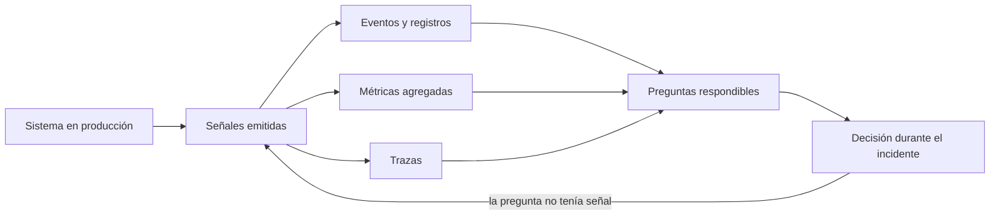

# SE-421 — Señales, eventos y observabilidad útil

[← SE-420 — Proyecto: camino a producción con rollback](https://github.com/vladimiracunadev-create/modern-software-engineering-program/blob/main/classes/part-34-ci-cd-iac-y-platform-engineering/se-420-proyecto-camino-a-produccion-con-rollback/README.md) · [↑ Parte 35](https://github.com/vladimiracunadev-create/modern-software-engineering-program/blob/main/classes/part-35-observabilidad-sre-e-incidentes/README.md) · [📚 Índice completo](https://github.com/vladimiracunadev-create/modern-software-engineering-program/blob/main/classes/README.md) · [🌐 Portal](https://vladimiracunadev-create.github.io/modern-software-engineering-program/classes/SE-421.html) · [SE-422 — Logs estructurados y correlación →](https://github.com/vladimiracunadev-create/modern-software-engineering-program/blob/main/classes/part-35-observabilidad-sre-e-incidentes/se-422-logs-estructurados-y-correlacion/README.md)

## Punto profesional y fundamento pedagógico

**Punto profesional.** La clase existe para que distingas lo que un sistema emite (señales) de lo que una persona puede preguntarle durante un incidente (observabilidad), para que elijas qué señal responde qué pregunta y para que sepas cuándo un panel que parece completo deja una falla sin explicar. Un equipo que instrumenta «todo» y no puede localizar una lentitud tiene datos, no observabilidad.

**Por qué aparece aquí.** Sigue al proyecto de **camino a producción con rollback** (`SE-420`): el código ya llega a producción y se puede revertir, pero revertir es una decisión que necesita evidencia. Esta clase abre la Parte 35 con la pregunta previa a cualquier alerta, objetivo o guardia: ¿qué señales hacen falta para decidir qué hacer? El caso conductor es la API de entregas de la plataforma educativa, ahora operada en producción.

**Error conceptual que debe corregir.** Creer que observabilidad es tener las tres herramientas (registros, métricas y trazas) o muchos paneles. Lo que importa es qué preguntas puedes responder con lo que se emitió, incluidas las que no previste.

**Secuencia de aprendizaje.** Antes de ver los resultados predices con qué frecuencia localiza una lentitud cada conjunto de señales, qué fracción de una falla total de un solo cliente verá un umbral global y cuántas preguntas posteriores a un incidente responden unas métricas con tres dimensiones. Después contrastas la predicción con tres experimentos y escribes qué señal añadirías. La secuencia usa predicción, explicación propia, contraste y recuperación. [ICAP](https://icap.education.asu.edu/research) distingue participación de construcción de conocimiento; [How People Learn II](https://nap.nationalacademies.org/catalog/24783/how-people-learn-ii-learners-contexts-and-cultures) respalda diseñar la práctica con contextos reales y retroalimentación.

**Evidencia de aprendizaje.** `observabilidad-log.md` con la predicción, las tres figuras reproducidas, una tabla «pregunta → señal que la responde → señal que falta» para la API de entregas y una nota que separe lo que el experimento muestra de lo que habría que comprobar en un sistema real.

**Límite de la conclusión.** Los servicios, las latencias, los clientes y las preguntas son sintéticos y con semilla fija. No se instrumentó ningún sistema real ni se usó ninguna herramienta de observabilidad; las cifras muestran un mecanismo, no la frecuencia con que ocurre en tu sistema.

### Trazabilidad fuente → afirmación

| Fuente primaria u oficial | Afirmación que respalda | Lo que no prueba |
|---|---|---|
| [Google SRE: Monitoring Distributed Systems](https://sre.google/sre-book/monitoring-distributed-systems/) | Distingue monitoreo de caja negra y de caja blanca y propone las cuatro señales de oro (latencia, tráfico, errores, saturación). | No fija qué señales necesita tu servicio. |
| [OpenTelemetry: Signals](https://opentelemetry.io/docs/concepts/signals/) | Define trazas, métricas, registros y baggage como señales con un modelo de datos común. | No dice cuántas ni cuáles instrumentar. |
| [Sigelman et al., «Dapper» (Google, 2010)](https://research.google/pubs/dapper-a-large-scale-distributed-systems-tracing-infrastructure/) | Describe una infraestructura de trazado distribuido de bajo coste y las decisiones de muestreo y propagación que la hicieron viable. | No mide la latencia de tu sistema. |
| [Prometheus: modelo de datos](https://prometheus.io/docs/concepts/data_model/) | Una serie temporal queda identificada por el nombre de la métrica y el conjunto de etiquetas; cada combinación nueva crea una serie. | No fija un límite de series. |

## Antes de empezar

Recupera lo aprendido en la Parte 34: una versión llega a producción por un camino con compuertas y se puede revertir. La pregunta activa es: **cuando la API de entregas se vuelve lenta un martes a las 14:00, ¿qué tienes que haber emitido antes para saber en cuánto tiempo, dónde y a quién afecta?**

## Prerrequisitos

- Haber completado `SE-420` o poder explicar qué es una versión desplegada y cómo se revierte.
- Python 3.11 o posterior; los experimentos usan solo la biblioteca estándar (`random`, `json`, `math`, `functools`).
- Nociones de percentil (vistas en `SE-373` y `SE-376`) y de dimensión de una métrica (etiqueta).

## Problema auténtico

La plataforma educativa vuelve a abrir el plazo de entregas y a las 14:03 el p99 de «subir entrega» pasa de 600 ms a 4 s. El panel de la pasarela muestra la lentitud, el de la API también y el de la base de datos, otra vez. La guardia abre los tres, ve que los tres suben y debe decidir a quién despertar. Veinte minutos después alguien descubre que el servicio de almacenamiento de archivos había cambiado de proveedor. Nada estaba roto en la pasarela, pero la pasarela es la que más tarda en la medida porque incluye a todas las demás. En paralelo, un cliente pequeño (0,58 % del tráfico) llama diciendo que nada funciona desde hace una hora y el panel global muestra un 0,1 % de errores. La clase enseña por qué las dos situaciones son la misma: las señales emitidas no responden la pregunta que la persona necesita hacer.

## Objetivos observables

Al terminar podrás:

1. diferenciar señal, evento, métrica, registro, traza y observabilidad, y decir qué pregunta responde cada una;
2. explicar por qué la duración que ve un servicio incluye la de lo que llama y cómo eso desplaza la atribución;
3. calcular qué fracción de una falla localizada en un cliente pequeño detecta un umbral global y por qué una sonda fija no la detecta;
4. contar qué preguntas posteriores a un incidente puede responder un conjunto de métricas y qué cuesta responder todas;
5. escribir una tabla pregunta → señal para un servicio propio y detectar sus huecos.

## Mapa conceptual



El mapa separa lo **emitido** de lo **respondible**: las señales son una decisión de diseño previa al incidente y las preguntas son lo que el incidente exige. Cuando una pregunta no tiene señal, el ciclo se cierra en la instrumentación y no en el panel.

## Temas y por qué importan

| Tema | Por qué cambia una decisión profesional | Evidencia mínima |
|---|---|---|
| Señales, eventos y telemetría | Cada tipo de señal responde preguntas distintas y cuesta distinto. | Predicción, traza causal y contraejemplo de **Señales, eventos y telemetría** en `observabilidad-log.md` |
| Observabilidad frente a monitoreo | Monitorear responde preguntas conocidas; observar permite hacer preguntas nuevas. | Predicción, traza causal y contraejemplo de **Observabilidad frente a monitoreo** en `observabilidad-log.md` |
| Localizar con señales inclusivas | La duración inclusiva desplaza la culpa hacia el borde. | Predicción, traza causal y contraejemplo de **Localizar con señales inclusivas** en `observabilidad-log.md` |
| Segmentos y cola larga | Un promedio global esconde una falla total en un grupo pequeño. | Predicción, traza causal y contraejemplo de **Segmentos y cola larga** en `observabilidad-log.md` |
| Preguntas, coste y privacidad | Más campos responden más preguntas y exponen más datos. | Predicción, traza causal y contraejemplo de **Preguntas, coste y privacidad** en `observabilidad-log.md` |

## Conceptos y decisiones

### 1. Señales, eventos y telemetría

Una **señal** es cualquier dato que un sistema emite sobre su propio comportamiento. Las clases habituales son los **registros** (un evento discreto con contexto: «entrega 123 aceptada en 83 ms»), las **métricas** (un número agregado en el tiempo: «peticiones por segundo por endpoint»), las **trazas** (el recorrido de una petición por varios servicios, formado por tramos llamados spans) y los **perfiles** (dónde gasta tiempo o memoria el código). Un **evento ancho** es un registro estructurado con muchos campos (versión, cliente, curso, duración, identificador de traza) escrito una vez por unidad de trabajo. La **telemetría** es el conjunto de lo que se recoge y se envía fuera del proceso. Cada clase de señal sacrifica algo: la métrica es barata y pierde el detalle, el evento conserva el detalle y cuesta almacenamiento, la traza muestra relaciones y exige propagar contexto.

### 2. Observabilidad frente a monitoreo

El **monitoreo** comprueba condiciones que ya sabías que podían fallar: «el uso de disco supera el 90 %», «la tasa de errores pasa del 1 %». La **observabilidad** es la propiedad de un sistema que permite explicar su comportamiento interno a partir de lo que emite, incluidas preguntas que nadie previó. Hereda la idea de la teoría de control, donde un sistema es observable si su estado interno se deduce de sus salidas, y la ingeniería de software la usa en sentido práctico: puedes responder «¿qué tienen en común las peticiones lentas de las 14:03?» sin desplegar código nuevo para poder preguntarlo. El criterio de verificación es empírico: la pregunta que se te ocurre durante un incidente, ¿tiene respuesta con lo que ya se emitió? Las cuatro señales de oro del libro de SRE (latencia, tráfico, errores y saturación) son un buen mínimo de monitoreo; no garantizan observabilidad.

La distinción entre **caja negra** y **caja blanca** ordena el diseño. Una sonda de caja negra se comporta como una persona usuaria: llama al endpoint y mide lo que recibe, de modo que detecta síntomas con independencia de la causa. La instrumentación de caja blanca mira el interior: colas, caches, errores internos. La primera detecta lo que importa a quien usa el servicio; la segunda explica lo que ocurrió. Necesitas las dos, y en la secuencia de un incidente la primera suele despertar a alguien y la segunda le deja decidir.

### 3. Localizar con señales inclusivas

Cuando un servicio A llama a B y B llama a C, la duración que mide A incluye la de B y la de C. Esa duración **inclusiva** es la que casi toda instrumentación simple registra, porque es la que se ve desde el cliente de cada llamada. Si C se vuelve lenta, la duración de B sube, la de A sube y la de la pasarela, que está en el borde, sube más que ninguna. Quien mira «¿qué servicio es el más lento?» elegirá siempre la pasarela, que es inocente. Hay dos maneras de salir de la trampa. La primera es comparar cada servicio **con su propia línea base**: lo que importa es cuánto creció en proporción, y el servicio culpable es aquel cuya duración inclusiva crece más en relativo, porque lo que suma lo sano es una constante. La segunda es medir tiempo **propio** (la duración menos la de las llamadas), que exige trazas o instrumentación explícita de cada llamada. La primera es más fácil de obtener y falla si falta una línea base o un servicio; la segunda es más precisa y requiere propagar contexto.

### Localizar la lentitud en una cadena de cuatro servicios

Se simula una cadena pasarela → API → base de datos + almacenamiento con duraciones propias lognormales (6, 18, 30 y 40 ms de mediana), 400 peticiones de línea base y 200 incidentes en los que un servicio al azar se vuelve 3 a 8 veces más lento. En cada incidente se intenta localizar al culpable con cuatro conjuntos de señales.

```python
inclusive["api"] = own["api"] + own["base"] + own["almacén"]
inclusive["pasarela"] = own["pasarela"] + inclusive["api"]
rel = {s: p99[s] / base_p99[s] for s in SERVICES}      # aumento relativo frente a la línea base
```

| Señales disponibles | Localizaciones correctas |
|---|---:|
| Solo la latencia del borde (adivinar entre cuatro) | 49 de 200 |
| p99 absoluto de la duración que ve cada servicio | 50 de 200 |
| Aumento relativo del p99 frente a su línea base | 196 de 200 |
| Lo mismo con un servicio sin instrumentar | 150 de 200 |


**Cómo leer la figura.** Cada barra es un conjunto de señales y su largo cuenta los incidentes, de los simulados, en que ese conjunto localiza bien el servicio lento; la línea discontinua es el total de incidentes. Mirar solo el borde acierta lo mismo que adivinar entre cuatro (49 de 200) porque no dice dónde, el p99 absoluto acusa siempre a la pasarela porque incluye a todos los demás, y solo el aumento relativo frente a la línea base se acerca al total. Si falta un servicio instrumentado, el método culpa al vecino que sí se ve y pierde aciertos. **Dónde deja de valer:** el servicio sin instrumentar no apaga la alarma, la desplaza al vecino visible y por eso un hueco de instrumentación se parece a una conclusión. La cadena es lineal; con llamadas paralelas o con colas intermedias la duración inclusiva se comporta distinto (`SE-424` lo trata con la ruta crítica). Los factores de lentitud de 3 a 8 son supuestos del autor.

### 4. Segmentos y cola larga

Un promedio global es una suma ponderada por tráfico. Un cliente que aporta el 0,58 % de las peticiones puede estar caído por completo y mover la tasa global de errores menos que el ruido normal. La asimetría es una propiedad del reparto del tráfico: en la plataforma educativa un puñado de universidades concentra casi todas las entregas y cientos de instituciones pequeñas generan una fracción mínima cada una. Una **sonda sintética** que prueba un solo cliente es una pregunta sobre ese cliente y nada más; una sonda que rota por todos detecta a todos con el retraso de una vuelta completa. Una tercera vía es agrupar métricas por segmento (cliente, plan) y alertar por segmento, a un coste de cardinalidad que se verá en `SE-423`.

### Una falla que no mueve el promedio

Se simulan 40 clientes con tráfico proporcional a 1/k, 2 000 peticiones por minuto, un 0,1 % de errores basales y una falla total en un cliente concreto. Se compara el umbral global del 1 % en 5 minutos con una sonda fija en el cliente 1 y con una sonda rotativa que prueba un cliente por minuto, durante 60 minutos y 300 repeticiones.

```python
window.append(poisson(rng, rpm * 0.001) + poisson(rng, rpm * share[idx]))
if sum(window[-5:]) / (rpm * len(window[-5:])) > 0.01: detectado
```

| Cliente afectado | Cuota de tráfico | Tasa global > 1 % | Sonda fija | Sonda rotativa |
|---|---:|---:|---:|---:|
| Cliente grande (puesto 1) | 23,37 % | 100 % | 100 % | 100 % |
| Cliente mediano (puesto 10) | 2,34 % | 100 % | 0 % | 100 % |
| Cliente pequeño (puesto 40) | 0,58 % | 8,7 % | 0 % | 100 % |


**Cómo leer la figura.** Cada fila es un cliente que falla por completo (entre paréntesis, su cuota de tráfico) y cada columna una señal; el número y el color de cada celda son el porcentaje de intentos en que esa señal detecta la falla en una hora, y cuanto más oscuro, más detecta. La tasa global detecta siempre al cliente grande y al mediano y solo en 8,7 por ciento de los intentos al pequeño; la sonda fija solo ve al cliente grande; la rotativa recorre a los 40 clientes y detecta a todos en 40 minutos como máximo. **Dónde deja de valer:** la sonda rotativa encuentra al cliente pequeño pero tarda hasta 40 minutos en volver a él, y mientras tanto el cliente lo sufre; el reparto 1/k y los 40 clientes son un supuesto del autor, y un reparto más plano acerca el cliente pequeño al umbral.

### 5. Preguntas, coste y privacidad

Una forma sana de decidir qué emitir es listar las **preguntas** que se querrán responder después de un incidente y ver qué señal responde cada una. «¿La lentitud afecta a una versión concreta?» necesita la versión como dimensión. «¿Solo a un tipo de dispositivo?» necesita el dispositivo. Una métrica con tres dimensiones previstas responde las preguntas que usan solo esas tres; para responder cualquier combinación de ocho dimensiones sería necesario crear una serie por cada combinación, y su número es el producto de las cardinalidades. Un evento ancho evita ese producto porque guarda los valores en bruto y calcula la combinación cuando se pregunta, a cambio de más bytes. Cada campo del evento puede ser además un dato personal (un identificador de cliente, un correo): más preguntas respondibles significan más datos que proteger y que borrar.

### Preguntas que no previste

Se generan 60 preguntas posteriores a un incidente, cada una combinando de 1 a 3 de ocho dimensiones del servicio (endpoint, estado, región, curso, cliente, versión, dispositivo, plan). Las métricas previstas usan endpoint, estado y región; el evento ancho guarda las ocho.

```python
answerable = sum(1 for q in questions if q <= metrics_dims)
series_all = math.prod(dims.values())          # 5·3·3·30·40·4·3·2
```

| Diseño | Preguntas respondidas | Coste |
|---|---:|---|
| Métricas con 3 dimensiones previstas | 6 de 60 | 45 series |
| Eventos anchos con todos los campos | 60 de 60 | 268 bytes por evento: 268 MB al día con un millón de peticiones |
| Métricas con todas las combinaciones | 60 de 60 | 1 296 000 series |


**Cómo leer la figura.** Cada barra es un diseño de señales y su largo, las preguntas que puede responder de las sesenta que surgen después de un incidente; entre paréntesis va su costo en series o en megabytes al día. Las métricas con tres dimensiones previstas responden solo las que se previeron; los eventos anchos responden todas porque guardan todos los campos de cada petición; las métricas con todas las combinaciones también responden todas, pero necesitan un número de series que ningún almacén de métricas aguanta. **Dónde deja de valer:** las 60 preguntas son combinaciones al azar, no las que haría un equipo con experiencia, que suelen concentrarse en pocas dimensiones; 268 bytes por evento es el tamaño de un evento de ejemplo y no incluye compresión ni índices. Los eventos tampoco son gratis: se muestrean, se retienen poco tiempo y se protegen.

## Definiciones de trabajo

- **señal:** dato que un sistema emite sobre su comportamiento, en forma de registro, métrica, traza o perfil.
- **evento ancho:** registro estructurado con muchos campos, escrito una vez por unidad de trabajo.
- **observabilidad:** capacidad de explicar el comportamiento de un sistema a partir de lo que emite, incluidas preguntas no previstas.
- **duración inclusiva:** tiempo que mide un servicio para una llamada, que incluye el de las llamadas que a su vez hace.
- **sonda sintética:** petición programada que imita a una persona usuaria para medir el servicio desde fuera.

Las definiciones son operativas para la API de entregas. No convierten términos con una historia más amplia en sinónimos y deben contrastarse con la documentación primaria enlazada al final.

## Ejemplo mínimo

El fragmento escribe un evento ancho como una línea de JSON. Antes de ejecutarlo, predice cuántos bytes ocupa.

```python
import json
event = {"ts": "2026-11-15T14:03:22.114Z", "service": "api", "endpoint": "POST /entregas", "status": 201,
         "region": "sa-east", "course_id": 17, "tenant_id": 23, "version": "2026.11.2", "device": "movil",
         "plan": "pro", "duration_ms": 83, "trace_id": "4bf92f3577b34da6a3ce929d0e0e4736", "bytes": 18211}
print(len(json.dumps(event, ensure_ascii=False, separators=(",", ":"))))
```

Imprime 268. Con un millón de peticiones al día son 268 MB sin comprimir. Registra versión de Python, comando y salida; luego quita tres campos y decide qué preguntas dejas de poder responder.

## Ejemplo profesional

Supón, como caso hipotético de la plataforma y no como medición, que el equipo revisa el incidente de las 14:03 y escribe una tabla de preguntas para la API de entregas: «¿qué servicio es el más lento respecto de su normalidad?» (duración por servicio y línea base semanal), «¿afecta a un cliente o a todos?» (evento con `tenant_id` y una métrica por segmento para los diez mayores), «¿cambió algo?» (`version` en cada evento y marcador de despliegue), «¿qué dependencia externa responde peor?» (duración de cada llamada saliente) y «¿la persona usuaria lo siente?» (sonda de caja negra que sube una entrega de prueba cada minuto, rotando entre cinco clientes sintéticos). Cada fila lleva el coste estimado y su dato personal: el `tenant_id` es un identificador de institución, no de persona, y se acepta; el correo de quien entrega no se emite. La tabla muestra tres huecos: no hay línea base por servicio, no hay marcador de despliegue y la sonda prueba un solo cliente. Se corrige el primero y el segundo esta semana, y el tercero queda como deuda con una fecha y un responsable.

## Práctica guiada

1. Predice, por escrito, cuántas de las 200 localizaciones acertará cada uno de los cuatro conjuntos de señales.
2. Ejecuta `python scripts/experiments_part35_a.py e421` y compara; anota la mayor diferencia con tu predicción.
3. Cambia el factor de lentitud de `uniform(3, 8)` a `uniform(1.2, 1.6)` y mide cuánto cae el acierto del aumento relativo.
4. Cambia la cuota del cliente pequeño en `e421_segmento` y encuentra a partir de qué cuota el umbral global lo detecta la mitad de las veces.
5. Escribe tu tabla «pregunta → señal que la responde → señal que falta» para un servicio propio con diez preguntas.
6. Entrega `observabilidad-log.md` y pide a otra persona que formule una pregunta que tu tabla no pueda responder.

## Ejercicios

1. **Señales:** clasifica seis datos de la API (una línea «entrega aceptada», el contador de peticiones, la duración de una llamada a almacenamiento, el uso de CPU, el recorrido de una petición y un volcado de memoria) como registro, métrica, traza o perfil y di qué pregunta responde cada uno.
2. **Inclusiva:** en una cadena A → B → C con duraciones propias de 10, 20 y 30 ms, calcula la duración inclusiva de cada uno antes y después de que C pase a 90 ms y di cuál aumenta más en relativo.
3. **Segmento:** un cliente con el 1,5 % del tráfico cae por completo con un 0,1 % de errores basal; calcula la tasa global y di si un umbral del 1 % la ve.
4. **Cardinalidad:** una métrica con endpoint (6), estado (4), región (3) y versión (5) añade «curso» con 80 valores; calcula el factor de aumento de series y decide si lo aceptas.

## Reto verificable

Entrega `observabilidad-log.md` con la predicción, las tres tablas de resultados reproducidas con las mismas semillas, la tabla pregunta → señal de tu servicio con al menos diez preguntas y los tres huecos más costosos ordenados por riesgo. Se aprueba si otra persona ejecuta el código desde un checkout limpio, obtiene los mismos números y encuentra una pregunta de incidente real que tu tabla no responde. No se aprueba por listar herramientas ni por afirmar que «con trazas se ve todo».

## Caso conductor

La API de entregas es el caso conductor de la Parte 35. Esta clase deja el primer artefacto: una tabla de preguntas con sus señales y huecos. `SE-422` pregunta cómo escribir los registros para que se puedan consultar y correlacionar, y `SE-423` cómo agregar métricas sin que el número de series estalle. Cambia después un solo dato de la tabla, la cuota del cliente pequeño, y observa a partir de qué punto deja de ser invisible.

## Preguntas frecuentes

### ¿Observabilidad es lo mismo que monitoreo con más datos?

No. El monitoreo comprueba condiciones previstas y más datos del mismo tipo no cambian eso. La observabilidad se mide por la capacidad de responder preguntas nuevas con lo ya emitido, lo que exige señales de alta dimensionalidad (eventos con muchos campos) y la posibilidad de agruparlas y filtrarlas a posteriori.

### ¿Hacen falta las tres señales (registros, métricas y trazas)?

Cada una cubre una pregunta: las métricas dicen que algo cambió y cuánto, las trazas dicen dónde y los registros dicen qué pasó con detalle. Un servicio pequeño puede empezar con métricas de las cuatro señales de oro y eventos estructurados con identificador de petición, y añadir trazas cuando haya varios servicios que se llaman entre sí. Lo que no se puede es decidir sin saber qué pregunta se quiere responder.

### ¿Por qué no emitir todo con todos los campos?

Por coste y por privacidad. Más campos significan más almacenamiento, más tiempo de consulta y más datos personales que proteger, retener y borrar. La decisión sana es emitir el contexto que responde preguntas probables, muestrear lo repetitivo y no emitir lo que no se vaya a usar nunca.

### ¿La sonda sintética no sustituye al resto?

No. Una sonda dice que algo falla desde fuera y con qué retraso, pero prueba lo que su guion cubre: un cliente, un camino, un tipo de petición. Detecta síntomas con independencia de la causa; no explica nada.

## Fallo controlado y diagnóstico

Reproduce el fallo clásico de la clase: **atribuir la lentitud al servicio con la mayor duración absoluta**. Calcula en cada incidente qué servicio tiene el p99 más alto y compáralo con el servicio realmente degradado.

Registra síntoma, entrada mínima, hipótesis, observación que descarta cada hipótesis, causa, corrección y prueba de regresión. **Síntoma:** la guardia despierta al equipo de la pasarela y el servicio degradado es el de almacenamiento. **Hipótesis rivales:** (a) la pasarela tiene un defecto; (b) la red entre pasarela y API está degradada; (c) la pasarela mide una duración que incluye a todos. **Prueba:** compara el p99 de cada servicio con su línea base; si el aumento relativo mayor está en el almacenamiento y la pasarela solo suma una constante, la hipótesis (c) explica la señal. **Conclusión:** una duración inclusiva sube por el servicio más profundo de la cadena. **Regresión:** añade una prueba que reproduzca la cadena, degrade cada servicio por turno y compruebe que el procedimiento de atribución lo localiza. No cambies a la vez la instrumentación y el procedimiento.

## Errores comunes y cómo corregirlos

| Síntoma | Causa probable | Corrección |
|---|---|---|
| Todos los paneles se ven mal a la vez | Duración inclusiva: todos incluyen al servicio lento | Comparar con la línea base de cada servicio o medir el tiempo propio |
| El panel global está sano y un cliente protesta | Promedio dominado por los clientes grandes | Agrupar por segmento o usar una sonda rotativa |
| La pregunta del incidente no tiene respuesta | Se emitió lo que era fácil, no lo que se preguntaría | Escribir la tabla de preguntas antes del incidente |
| Hay muchos campos y nadie los consulta | Se emitió «por si acaso» | Retirar los campos sin pregunta asociada |
| La traza no muestra al servicio que falló | Un servicio no propagó contexto o no está instrumentado | Auditar la propagación en cada frontera (`SE-424`) |

## Entorno y archivos clave

```text
work/SE-421/
├── README.md
├── observabilidad/
│   ├── cadena.py
│   ├── segmentos.py
│   └── preguntas.py
├── tests/test_observabilidad.py
└── evidence/observabilidad-log.md
```

El `README` declara plataforma, versión de Python, semillas y comandos. Los experimentos usan solo la biblioteca estándar y se ejecutaron con CPython 3.12.9 en Windows 11 y 3.12.3 en Ubuntu bajo WSL2 con resultados idénticos, porque el tiempo es virtual y el generador es `random.Random` con semilla fija. Para recuperar el estado, borra `work/SE-421/` y vuelve a ejecutar los scripts. Si añades una dependencia, fija procedencia y versión.

## Seguridad, ética y accesibilidad

- cada campo de un evento puede ser un dato personal: no emitas correos, nombres ni contenido de las entregas y decide cuánto se retiene cada campo;
- un identificador de institución o de petición es útil para correlacionar; un identificador de persona es un dato personal y exige base legal y borrado;
- las sondas sintéticas usan cuentas de prueba y no datos reales de estudiantes;
- documenta las tablas y las figuras con texto alternativo y en un formato que un lector de pantalla pueda recorrer;
- respeta las licencias de los libros y artículos y atribuye lo adaptado.

## Puente hacia el trabajo con agentes

Un agente al que se le pide «añade observabilidad al servicio» tenderá a insertar un registro al principio y al final de cada función y a importar una biblioteca de métricas con dimensiones elegidas por reflejo (usuario, correo, ruta completa). Pídele en cambio que parta de la tabla de preguntas, que justifique cada campo con la pregunta que responde, que declare el coste de cardinalidad y el dato personal de cada dimensión y que escriba una prueba que degrade un servicio sintético y compruebe que el procedimiento de atribución lo localiza. Revisa especialmente si propone identificadores de persona como etiqueta de métrica y si cada llamada saliente mide su propia duración.

## Transferencia

Traslada el análisis a otro servicio (por ejemplo, un procesador de pagos o un buscador): lista las diez preguntas más probables de un incidente, asigna una señal a cada una y busca los huecos. La transferencia está lograda cuando puedes decir qué pregunta no se podría responder y qué señal habría que añadir, no cuando el servicio tiene un panel.

## Evaluación y evidencia

| Criterio | Evidencia para aprobar |
|---|---|
| comprensión | explicación de la duración inclusiva y de la diferencia entre monitoreo y observabilidad |
| corrección | tablas de atribución, de segmento y de preguntas reproducibles con las mismas semillas |
| diseño | tabla pregunta → señal con coste, dato personal y huecos priorizados |
| diagnóstico | reproducción del fallo «atribuir por duración absoluta» con regresión |
| incertidumbre | declaración de que los servicios, el reparto de clientes y las preguntas son sintéticos |
| reproducibilidad | versiones, comandos, salida y límites declarados |

## Fuentes

- [Google SRE: Monitoring Distributed Systems](https://sre.google/sre-book/monitoring-distributed-systems/) — monitoreo de caja negra y blanca y señales de oro; autoridad: libro de ingeniería de confiabilidad de Google.
- [OpenTelemetry: Signals](https://opentelemetry.io/docs/concepts/signals/) — definición de trazas, métricas y registros; autoridad: proyecto OpenTelemetry (CNCF).
- [Sigelman et al., «Dapper»](https://research.google/pubs/dapper-a-large-scale-distributed-systems-tracing-infrastructure/) — trazado distribuido de bajo coste; autoridad: informe técnico de Google Research.
- [Prometheus: modelo de datos](https://prometheus.io/docs/concepts/data_model/) — identidad de una serie por nombre y etiquetas; autoridad: documentación del proyecto Prometheus.
- [Python: json](https://docs.python.org/3/library/json.html) — serialización usada en el ejemplo mínimo; autoridad: documentación de Python.

Cada fuente respalda el mecanismo indicado; ninguna demuestra que 196 de 200 localizaciones, un 8,7 % de detección o 268 MB al día se observen en un sistema real. Esa afirmación depende del servicio, del tráfico y de la instrumentación.

## Límites y siguiente paso

Se ejecutaron tres experimentos con tiempo virtual y semillas fijas en Windows y Ubuntu (WSL2) con resultados idénticos. No se instrumentó ningún sistema real; los cuatro servicios, sus duraciones, el reparto de 40 clientes, las 60 preguntas y el evento de ejemplo son construcciones del autor, y el procedimiento de atribución se afinó con los mismos incidentes que lo evalúan. La siguiente clase pregunta cómo escribir los registros para que respondan estas preguntas sin convertirse en texto libre imposible de consultar.

## Glosario

- **señal:** dato que un sistema emite sobre su comportamiento, en forma de registro, métrica, traza o perfil.
- **evento ancho:** registro estructurado con muchos campos, escrito una vez por unidad de trabajo.
- **observabilidad:** capacidad de explicar el comportamiento de un sistema a partir de lo que emite, incluidas preguntas no previstas.
- **duración inclusiva:** tiempo que mide un servicio para una llamada, que incluye el de las llamadas que a su vez hace.
- **sonda sintética:** petición programada que imita a una persona usuaria para medir el servicio desde fuera.

---

[← SE-420 — Proyecto: camino a producción con rollback](https://github.com/vladimiracunadev-create/modern-software-engineering-program/blob/main/classes/part-34-ci-cd-iac-y-platform-engineering/se-420-proyecto-camino-a-produccion-con-rollback/README.md) · [↑ Parte 35](https://github.com/vladimiracunadev-create/modern-software-engineering-program/blob/main/classes/part-35-observabilidad-sre-e-incidentes/README.md) · [📚 Índice completo](https://github.com/vladimiracunadev-create/modern-software-engineering-program/blob/main/classes/README.md) · [🌐 Portal](https://vladimiracunadev-create.github.io/modern-software-engineering-program/classes/SE-421.html) · [SE-422 — Logs estructurados y correlación →](https://github.com/vladimiracunadev-create/modern-software-engineering-program/blob/main/classes/part-35-observabilidad-sre-e-incidentes/se-422-logs-estructurados-y-correlacion/README.md)
