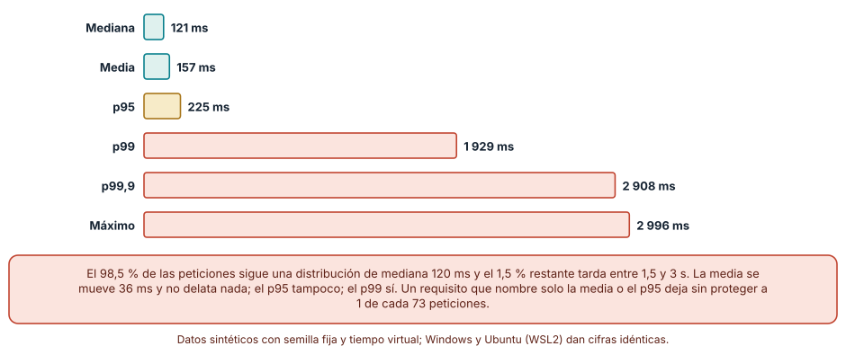

# SE-433 — Modelos de calidad y atributos medibles

[← SE-432 — Proyecto: estrategia ejecutable por riesgo](https://github.com/vladimiracunadev-create/modern-software-engineering-program/blob/main/classes/part-35-estrategia-y-tecnicas-de-prueba/se-432-proyecto-estrategia-ejecutable-por-riesgo/README.md) · [↑ Parte 36](https://github.com/vladimiracunadev-create/modern-software-engineering-program/blob/main/classes/part-36-calidad-rendimiento-y-resiliencia/README.md) · [📚 Índice completo](https://github.com/vladimiracunadev-create/modern-software-engineering-program/blob/main/classes/README.md) · [🌐 Portal](https://vladimiracunadev-create.github.io/modern-software-engineering-program/classes/SE-433.html) · [SE-434 — Revisión, análisis estático y quality gates →](https://github.com/vladimiracunadev-create/modern-software-engineering-program/blob/main/classes/part-36-calidad-rendimiento-y-resiliencia/se-434-revision-analisis-estatico-y-quality-gates/README.md)

## Punto profesional y fundamento pedagógico

**Punto profesional.** La clase existe para que conviertas una palabra como «rápido», «fiable» o «usable» en una promesa que se pueda comprobar: qué atributo de calidad importa, en qué situación, con qué estadístico, sobre qué ventana y con qué umbral. La habilidad profesional no es conocer la lista de atributos sino saber qué número, medido cómo, permite decir «cumple» o «no cumple» sin que dos personas lleguen a conclusiones opuestas.

**Por qué aparece aquí.** Abre la **[Parte 36](../README.md)** después de **Proyecto: estrategia ejecutable por riesgo**: la [Parte 35](../../part-35-estrategia-y-tecnicas-de-prueba/README.md) decidió qué pruebas ejecutar según el riesgo; ahora hace falta decir contra qué se compara el resultado de esas pruebas. Una prueba sin criterio de aceptación produce un número y ninguna decisión. El caso conductor de la parte es la **API de entregas de la plataforma educativa**: subir una entrega, listar las entregas de un curso y consultar una calificación, con picos de uso en los cierres de plazo.

**Error conceptual que debe corregir.** Creer que la calidad es una propiedad del software que se «tiene» o «no tiene» y que un promedio la resume: la calidad es una relación entre un atributo, una situación de uso y un criterio de aceptación, y el mismo sistema cumple con una definición del objetivo y falla con otra.

**Secuencia de aprendizaje.** Antes de mirar los resultados, predices si una API con latencia media de 157 ms cumple un objetivo de «p95 ≤ 300 ms» y qué tarda la petición más lenta de cada cien; después reproduces el mismo mes de datos con seis definiciones distintas del objetivo y ejecutas un verificador de escenarios contra mutaciones que cambian el sentido sin cambiar la forma. La secuencia usa predicción, explicación propia, contraste y recuperación. [ICAP](https://icap.education.asu.edu/research) distingue participación de construcción de conocimiento; [How People Learn II](https://nap.nationalacademies.org/catalog/24783/how-people-learn-ii-learners-contexts-and-cultures) respalda diseñar la práctica con contextos reales y retroalimentación.

**Evidencia de aprendizaje.** `calidad-log.md` con la predicción, las tres figuras reproducidas, un escenario de calidad por cada una de las tres características elegidas para la plataforma (cada uno con sus seis partes y su medida) y una nota que separe qué parte de cada conclusión es medida, cuál inferida y cuál supuesta.

**Límite de la conclusión.** Las latencias y los meses son sintéticos, generados con semilla fija desde una distribución elegida por el autor; los diez escenarios base y los nueve operadores de mutación son construcciones del autor. No se midió ninguna API real, ningún usuario real ni ningún sistema de producción, y la norma ISO/IEC 25010 es de pago: la clase se apoya en su descripción pública y no reproduce su texto.

### Trazabilidad fuente → afirmación

| Fuente primaria u oficial | Afirmación que respalda | Lo que no prueba |
|---|---|---|
| [ISO/IEC 25010:2023 — modelo de calidad del producto](https://www.iso.org/standard/78176.html) | Define un modelo de calidad del producto con nueve características que sirven como lista de atributos a decidir; la edición 2023 sustituye «usabilidad» por «capacidad de interacción», «portabilidad» por «flexibilidad» e incorpora «seguridad física» (safety). | No dice qué atributos importan para una API de entregas ni qué umbral es aceptable; el texto completo no se reproduce aquí. |
| [Google SRE: Service Level Objectives](https://sre.google/sre-book/service-level-objectives/) | Distingue indicador, objetivo y acuerdo, y explica por qué se prefieren percentiles a medias y por qué la agregación debe declararse. | No fija valores para ningún servicio ajeno ni demuestra que 300 ms sea el umbral correcto aquí. |
| [Bass, Clements y Kazman, «Software Architecture in Practice»](https://www.sei.cmu.edu/library/software-architecture-in-practice-fourth-edition/) | Propone describir un requisito de calidad como escenario con fuente, estímulo, artefacto, entorno, respuesta y medida de la respuesta. | No es una norma: los seis campos son una convención de trabajo, no un contrato legal. |
| [Python: módulo statistics](https://docs.python.org/3/library/statistics.html) | Documenta la media, la mediana y los cuantiles que usan los experimentos, y advierte de que cada estadístico responde una pregunta distinta. | No decide qué definición de percentil usar en una herramienta de observabilidad ajena. |

## Antes de empezar

Recupera lo aprendido en la [Parte 35](../../part-35-estrategia-y-tecnicas-de-prueba/README.md) sobre riesgo: una prueba se justifica por el riesgo que reduce. La pregunta activa es: **¿qué promesa de calidad le hace la plataforma a quien entrega una tarea el día del cierre, y qué medida permitiría decir, sin discutir, que se cumplió?**

## Prerrequisitos

- Haber completado `SE-432` o poder explicar cómo se priorizó una prueba por riesgo.
- Python 3.11 o posterior; los experimentos usan solo la biblioteca estándar (`random`, `statistics`, `re`).
- Saber qué es un percentil y leer una distribución en una tabla.

## Problema auténtico

La API de entregas tenía un requisito en una frase: «la plataforma debe responder rápido». Durante el mes de pruebas la media de latencia fue de 161 ms y el informe mensual dijo «cumple». Una coordinadora, sin embargo, había recibido quejas el día 17: durante tres horas, la lista de entregas de un curso tardaba varios segundos. Nadie mintió: la frase «rápido» admitía la media, el p95 del mes, el p95 de cada día y el p99, y cada definición daba una respuesta. Cuando el equipo escribió un escenario con estímulo, entorno y medida («la lista de 300 entregas se muestra en p95 ≤ 300 ms durante cada día laboral con 50 consultas por segundo»), el día 17 pasó a ser un incumplimiento visible. La clase enseña a escribir esa frase y a comprobar que está bien formada y que tiene sentido.

## Objetivos observables

Al terminar podrás:

1. nombrar las nueve características del modelo de calidad del producto y decir para cada una qué evidencia mediría la plataforma;
2. escribir un requisito de calidad como escenario de seis partes con una medida comprobable;
3. calcular y explicar por qué la media, la mediana y los percentiles 95, 99 y 99,9 de una misma muestra dan conclusiones distintas;
4. aplicar varias definiciones del mismo objetivo a una ventana y mostrar cuál oculta un incidente;
5. separar lo que un verificador de forma detecta de lo que solo una persona puede juzgar.

## Mapa conceptual

![Diagrama de flujo con 6 pasos. Recorrido: «Necesidad de la persona usuaria»; luego «Atributo de calidad»; luego «Escenario: fuente, estímulo, artefacto, entorno, respuesta, medida»; luego «Indicador: estadístico, ventana, alcance»; luego «Objetivo: umbral y margen»; luego «Evidencia: sintética, de laboratorio o de campo». Retornos: «Evidencia: sintética, de laboratorio o de campo» lleva a «Escenario: fuente, estímulo, artefacto, entorno, respuesta, medida» (el resultado contradice la queja); «Evidencia: sintética, de laboratorio o de campo» lleva a «Atributo de calidad» (los atributos chocan).](../../../site/assets/figures/mermaid-f64c500ad9.svg)

El mapa separa la **necesidad** (lo que alguien espera), el **escenario** (la situación concreta), el **indicador** (cómo se resume) y el **objetivo** (el umbral). Un desacuerdo casi nunca está en el umbral: suele estar en la ventana, en el estadístico o en el alcance que cada persona suponía.

## Temas y por qué importan

| Tema | Por qué cambia una decisión profesional | Evidencia mínima |
|---|---|---|
| Qué es calidad y qué dice el modelo | Sin una lista de atributos se optimiza el que se ve y se olvida el que se rompe en silencio. | Tabla de las nueve características con el atributo elegido para la plataforma |
| Escenarios de calidad | Convierte «rápido» en una situación con medida que dos personas leen igual. | Un escenario por atributo con sus seis partes |
| Indicadores y estadísticos | La media oculta la cola y la ventana oculta los incidentes. | Predicción y resultado de las figuras 1 y 2 |
| Conflictos entre atributos | Mejorar uno suele empeorar otro; decidirlo antes evita sorpresas en producción. | Una decisión escrita con el atributo sacrificado |
| Evidencia y validez de la medida | Un número de laboratorio no es un número de campo y un indicador se corrompe cuando se vuelve meta. | Declaración del tipo de evidencia de cada medida |

## Conceptos y decisiones

### 1. Qué es calidad y qué dice el modelo

La calidad de un producto de software es el grado en que satisface las necesidades declaradas e implícitas de quienes lo usan en un contexto determinado. La definición importa por lo que excluye: no existe calidad «en abstracto»; existe calidad para una persona haciendo una tarea en una situación. El modelo de calidad del producto de ISO/IEC 25010 organiza esas necesidades en nueve características: adecuación funcional, eficiencia de desempeño, compatibilidad, capacidad de interacción, fiabilidad, seguridad, mantenibilidad, flexibilidad y seguridad física (safety). La edición de 2023 cambió algunos nombres de la anterior (usabilidad pasó a capacidad de interacción y portabilidad a flexibilidad) y añadió safety; lo que no cambió es la función del modelo: es una lista para no olvidar atributos, no una receta. Cada característica se subdivide en subcaracterísticas y ninguna se mide con un solo número. Para la API de entregas, la eficiencia de desempeño se concreta en latencia al listar entregas, la fiabilidad en no perder una entrega aunque falle un nodo, la compatibilidad en que un cliente antiguo siga funcionando y la capacidad de interacción en que una persona con lector de pantalla pueda entregar. Elegir tres o cuatro atributos prioritarios y decir cuáles quedan fuera es parte del diseño, no una omisión.

### 2. Escenarios de calidad

Un requisito como «el sistema debe ser seguro» no se puede probar. Un **escenario de calidad** lo vuelve comprobable con seis partes: la **fuente** del estímulo (una persona, otro sistema, un fallo), el **estímulo** (qué ocurre), el **artefacto** afectado (qué parte del sistema), el **entorno** (en qué condiciones: carga, datos, modo de operación), la **respuesta** esperada y la **medida de la respuesta**, que es lo que permite decidir. Cada parte elimina una ambigüedad: sin entorno, «p95 ≤ 300 ms» se cumple con un usuario y se rompe con doscientos; sin estadístico, «300 ms» puede significar media o máximo; sin unidad, el 300 puede ser milisegundos o segundos. La medida no tiene que ser un solo número: puede ser un par (p95 ≤ 300 ms y p99 ≤ 1,5 s) o un porcentaje dentro de un presupuesto (el 99,5 % de las peticiones por debajo de 500 ms en el mes). Lo que no puede faltar es que quien mide y quien exige lean lo mismo. Un escenario bien escrito también declara la **evidencia** esperada: una prueba sintética, una medición en un entorno de ensayo o datos de campo, porque cada una dice cosas distintas.

### 3. Indicadores y estadísticos

Un **indicador** resume un conjunto de mediciones en un número: una media, una mediana, un percentil, una tasa de errores. Cada estadístico responde una pregunta. La **media** responde «cuánto tarda en promedio» y la domina el cuerpo de la distribución; la **mediana** responde cuánto tarda la petición típica; el **percentil 95** responde cuánto tarda la peor de cada veinte y el **percentil 99** la peor de cada cien. Cuando una pequeña fracción de las peticiones es mucho más lenta, la media se desplaza poco y el percentil alto cambia de orden de magnitud. El mismo problema aparece con la **ventana**: un percentil sobre todo el mes diluye un incidente de tres horas porque 59 de cada 60 peticiones fueron normales, mientras que un percentil por día lo expone. Y con el **alcance**: el 95 % de todas las peticiones puede cumplirse mientras el 100 % de las peticiones de un curso cumple solo el 80 %. Fijar estadístico, ventana y alcance es la mitad del requisito.

### 4. Conflictos entre atributos

Los atributos compiten por los mismos recursos. Más validación de las entregas mejora la seguridad y la fiabilidad y añade latencia; más réplicas mejoran la disponibilidad y cuestan consistencia o dinero; cifrar mejora la confidencialidad y obliga a gestionar claves; una interfaz más sencilla puede resultar menos flexible. Un **árbol de utilidad** ordena los escenarios por importancia para el negocio y por dificultad técnica, y obliga a escribir cuál se sacrifica cuando chocan. Decidirlo antes tiene un valor concreto: durante un incidente nadie debería descubrir, discutiendo, que la disponibilidad y la consistencia no podían ser ambas prioridad uno. La decisión debe quedar escrita con su fecha, su dueño y la condición que la revisaría.

### 5. Evidencia y validez de la medida

Una medida es válida si mide lo que se dice que mide. Un tiempo medido desde el cliente incluye red, navegador y sistema operativo; desde el servidor excluye todo eso; una prueba en un portátil no dice nada sobre un teléfono. Por eso cada escenario nombra el **tipo de evidencia**: sintética (datos generados), de laboratorio (entorno controlado) o de campo (usuarios reales). Existe además una trampa clásica: cuando un indicador se convierte en meta, deja de ser un buen indicador, porque la gente optimiza el indicador y no la necesidad. Un equipo que reduce el p95 descartando las peticiones más lentas cumple el número y rompe la promesa. La defensa es combinar indicadores que no se puedan mejorar todos a la vez con una misma trampa y revisar de vez en cuando si el indicador sigue contando lo que importa.

### La media oculta la cola

Se generan 20 000 latencias sintéticas con semilla fija: el 98,5 % sigue una distribución lognormal de mediana 120 ms y el 1,5 % restante tarda entre 1,5 y 3 s, como un bloqueo ocasional en la base de datos.

```python
r = random.Random(373)
xs = [r.uniform(1500, 3000) if r.random() < 0.015 else r.lognormvariate(4.787, 0.35) for _ in range(20000)]
print(statistics.mean(xs), pct(xs, 50), pct(xs, 95), pct(xs, 99), pct(xs, 99.9))
```

| Estadístico | Valor |
|---|---:|
| Mediana | 121 ms |
| Media | 157 ms |
| p95 | 225 ms |
| p99 | 1 929 ms |
| p99,9 | 2 908 ms |
| Máximo | 2 996 ms |

El 1,36 % de las peticiones tarda más de 1 s, 1 de cada 73. La media (157 ms) solo se aleja 36 ms de la mediana y el p95 (225 ms) sigue por debajo de 300 ms: un requisito que nombre solo la media o el p95 considera sano un servicio donde una persona de cada 73 espera más de un segundo.



**Cómo leer la figura.** Cada barra es el mismo conjunto de datos resumido con un estadístico distinto; el salto está entre el p95 y el p99. **Dónde deja de valer:** la proporción de lentas (1,5 %) y su rango son elecciones del autor; con una cola del 0,3 % el p99 ya no la vería. Con una distribución sin cola, los seis números casi coincidirían y la media bastaría.

### Un mes, seis definiciones del mismo objetivo

Se simulan 30 días de 2 000 peticiones diarias; el día 17 un incidente de tres horas hace que el 60 % de las 250 peticiones afectadas tarde entre 0,9 y 4 s. El objetivo se escribe «p95 ≤ 300 ms» y se aplica de seis maneras.

| Definición | Valor | Veredicto |
|---|---:|---|
| Media de las medias diarias | 161 ms | Cumple |
| p95 de todas las peticiones del mes | 227 ms | Cumple |
| p95 de cada día (se exige en los 30) | 29 de 30 días | No cumple: falla el día 17 |
| p95 del día 17 | 2 294 ms | No cumple |
| Fracción del mes por encima de 300 ms | 2,00 % | Cumple si el margen es 5 % |
| p99 del mes | 2 057 ms | Sin objetivo: nadie lo pidió |

Los datos son idénticos y las conclusiones se oponen. La ventana mensual deja pasar un día entero de mal servicio porque la fracción de peticiones afectadas es pequeña. Una definición que exige el objetivo «en cada día laboral» o «en cada ventana de una hora» pone el incidente a la vista y es la que la coordinadora de la plataforma tenía en mente sin escribirla.


**Cómo leer la figura.** Cada barra es una definición de «p95 ≤ 300 ms» aplicada al mismo mes y su longitud, el valor que esa definición compara con el objetivo, marcado con la línea discontinua de 300 ms. Mira primero que la media de las medias diarias y el p95 del mes quedan bajo la línea y que el p99 del mes y el p95 del día 17 la superan por mucho. **Dónde deja de valer:** un objetivo diario exige cientos de peticiones por día para estimar un p95 estable; con 20 peticiones diarias el percentil es ruido. Además, un presupuesto de error mensual (el 5 % de peticiones lentas permitido) puede ser la formulación correcta cuando lo que se protege es el conjunto del mes.

### Un verificador de escenarios frente a mutaciones

Se escriben diez escenarios base bien formados (estudiante que sube una entrega, docente que lista, caída de un nodo, restauración de una copia, consulta de auditoría, reintento tras un corte, cambio de una regla, ataque de acceso, uso con lector de pantalla y carga en red lenta). Un verificador comprueba que la medida tenga un estadístico, una cifra y una unidad y que el entorno contenga una cifra. Se generan 180 mutaciones, 20 de cada uno de nueve operadores.

```python
MED = re.compile(r"^(p\d+|maximo|media|mediana|duplicados|tareas completadas|modulos tocados|bloqueo en)\s*(<=|>=|=)\s*\d+([.,]\d+)?\s*(ms|s|min|%|intentos|)?$")
def lint(s):
    f = []
    if not MED.match(s["medida"].strip()): f.append("medida")
    if not re.search(r"\d", s["entorno"]): f.append("entorno")
    return f
```

| Operador | Detectadas |
|---|---:|
| quitar el número, poner «rápido», quitar el estadístico, entorno vacío, entorno vago | 20 de 20 cada uno |
| cambiar la unidad (ms por s) | 6 de 20 |
| umbral igual a 0, percentil p50, estímulo de otro escenario | 0 de 20 cada uno |

Detecta 106 de 180 (59 %), y todo lo que detecta es forma. Las 74 que se escapan tienen la forma correcta y el contenido equivocado: un umbral mil veces más laxo, un percentil que no protege la cola, un estímulo ajeno. Cambiar milisegundos por segundos es el caso más peligroso porque el escenario sigue pareciendo medido. Un buen verificador evita el error de omisión; el error de juicio solo lo ve quien conoce el sistema.


**Cómo leer la figura.** Cada barra es un operador de mutación y sus 20 casos: en verde los que el verificador detecta y en rojo los que deja pasar. Mira primero que las barras son enteras de un color salvo el cambio de unidad: los errores de forma se detectan siempre y los de contenido nunca. **Dónde deja de valer:** los diez escenarios base y los operadores son del autor y se escribieron sabiendo qué buscaba el verificador, de modo que el 59 % no es una tasa de detección estimable; muestra la frontera entre forma y juicio, no una cifra para citar.

## Definiciones de trabajo

- **característica de calidad:** categoría de necesidades del modelo de calidad del producto, como eficiencia de desempeño o fiabilidad.
- **escenario de calidad:** descripción de un requisito de calidad con fuente, estímulo, artefacto, entorno, respuesta y medida.
- **indicador:** resumen numérico de una medición con un estadístico, una ventana y un alcance declarados.
- **percentil:** valor por debajo del cual queda una proporción dada de las mediciones; el p95 deja por debajo el 95 %.
- **medida de la respuesta:** criterio con número y unidad que permite decidir si un escenario se cumple.

Las definiciones son operativas para la API de entregas. No convierten términos con una historia más amplia en sinónimos y deben contrastarse con la documentación primaria enlazada al final.

## Ejemplo mínimo

El fragmento muestra que la media no delata una cola. Antes de ejecutarlo, predice si la media de la lista queda por debajo de 200 ms.

```python
import statistics
xs = [100] * 98 + [3000, 3000]
print(statistics.mean(xs), sorted(xs)[97], sorted(xs)[98])
```

La media es 158 ms (por debajo de 200) mientras que 2 de cada 100 peticiones tardan 3 s: el percentil 98 ya vale 100 y el 99 vale 3 000. Registra versión de Python, comando y salida; después añade un percentil 99 al criterio y comprueba que el objetivo deja de cumplirse.

## Ejemplo profesional

El equipo de la plataforma elige cuatro atributos para el cierre de plazos: eficiencia de desempeño, fiabilidad, compatibilidad y capacidad de interacción. Para cada uno escribe un escenario completo. El de eficiencia dice: *fuente:* docente; *estímulo:* abre la lista de 300 entregas de un curso; *artefacto:* endpoint de listado; *entorno:* día laboral con 50 consultas por segundo y datos de producción del último mes; *respuesta:* se muestra la primera página; *medida:* p95 ≤ 400 ms y p99 ≤ 1,5 s en cada ventana de una hora, con un máximo del 0,5 % de las peticiones por encima de 1,5 s. Declara evidencia de laboratorio (prueba de carga con datos sintéticos) y de campo (percentiles de producción por hora). El de fiabilidad dice que ninguna entrega aceptada se pierde si falla un nodo. Al escribir el árbol de utilidad descubren que el objetivo de latencia choca con la validación de archivos adjuntos: deciden validar de forma asíncrona y aceptar la entrega con estado «en revisión», y lo registran con su fecha y su dueño. Compara con la frase original «responder rápido»: ahora existe una consulta que, ejecutada cada hora, dice «cumple» o «no cumple».

## Práctica guiada

1. Escribe cuatro escenarios de calidad para la API de entregas con las seis partes y una medida con estadístico, cifra y unidad.
2. Predice la media, la mediana y el p99 de 20 000 latencias con una cola del 1,5 % y escribe los números antes de medir.
3. Genera la muestra con semilla fija y reproduce la tabla de estadísticos; cambia la proporción de la cola a 0,3 % y observa qué percentil la ve.
4. Simula 30 días de 2 000 peticiones con un incidente de tres horas y aplica las seis definiciones del objetivo.
5. Ejecuta el verificador sobre tus cuatro escenarios y sobre una versión mutada de cada uno; anota qué no detecta.
6. Escribe un árbol de utilidad con tres escenarios y decide cuál se sacrifica si dos chocan.
7. Entrega `calidad-log.md` y pide a otra persona que encuentre un escenario que el verificador acepte y que ella consideraría falso.

## Ejercicios

1. **Estadístico:** una API tiene 10 000 peticiones diarias; la media es 120 ms y el p99 es 2 s. Escribe dos objetivos diferentes y explica qué grupo de usuarios protege cada uno.
2. **Ventana:** calcula cuántas peticiones lentas puede tener un día para que un objetivo mensual de «99 % por debajo de 500 ms» se cumpla aunque un día tenga el 20 % de peticiones lentas.
3. **Atributos en conflicto:** elige dos atributos de la plataforma que choquen y redacta la decisión: qué se sacrifica, quién lo decide y qué dato la revisaría.
4. **Validez:** propón tres formas de cumplir «p95 ≤ 300 ms» sin mejorar la experiencia de nadie y una medida complementaria que las exponga.

## Reto verificable

Entrega `calidad-log.md` con la predicción, las tres tablas de resultados, cuatro escenarios completos, el árbol de utilidad y la declaración del tipo de evidencia de cada medida. Se aprueba si otra persona ejecuta el código desde un checkout limpio, obtiene los mismos números con las mismas semillas y puede decir qué definición del objetivo fijarías para el día 17 y por qué. No se aprueba por listar las nueve características sin medir ninguna ni por afirmar que el objetivo «se cumple» sin decir con qué estadístico, ventana y alcance.

## Caso conductor

La API de entregas de la plataforma educativa es el caso conductor de la [Parte 36](../README.md). Esta clase deja el primer artefacto: los escenarios de calidad con sus medidas. `SE-434` preguntará cómo se comprueba la calidad del código y del cambio antes de que llegue a producción, y `SE-435` ejecutará la carga que pone a prueba el escenario de eficiencia. Cambia después un solo dato, la proporción de peticiones lentas, y observa qué definición del objetivo deja de ver la cola.

## Preguntas frecuentes

### ¿Hay que escribir escenarios para las nueve características?

No. Para cada sistema se eligen las pocas que, si fallan, cuestan más, y se declara cuáles quedan fuera. Una lista de nueve escenarios que nadie va a medir es peor que cuatro que se ejecutan cada hora; lo que sí conviene es registrar la exclusión para que alguien pueda discutirla.

### ¿Por qué no usar siempre el máximo, ya que es lo más exigente?

Porque el máximo de una muestra crece con su tamaño y depende de un solo evento: con 20 000 peticiones el máximo (2 996 ms) está determinado por una única petición. Sirve para detectar casos extremos, no como objetivo estable. El p99 o el p99,9 resumen la cola con menos ruido.

### ¿Un objetivo de latencia es lo mismo que un SLO?

No exactamente. Un objetivo de nivel de servicio (SLO) es un objetivo sobre un indicador durante un periodo, normalmente con un margen de error permitido; un escenario de calidad es una descripción más amplia que puede ser de latencia, de recuperación o de seguridad. Un escenario de latencia bien escrito se puede convertir en un SLO.

### ¿Se puede medir la capacidad de interacción o la seguridad con un número?

En parte. Algunas medidas son numéricas (tareas completadas con teclado, tiempo hasta completar una entrega) y otras son listas de comprobación o revisiones. El modelo no exige que todo sea un número, exige que el criterio de aceptación sea lo bastante claro como para que dos personas lleguen al mismo veredicto.

## Fallo controlado y diagnóstico

Reproduce el fallo clásico de la clase: **un objetivo que se cumple en el informe mensual mientras un día lo viola**. Simula el mes con el incidente del día 17 y calcula la media y el p95 del mes.

Registra síntoma, entrada mínima, hipótesis, observación que descarta cada hipótesis, causa, corrección y prueba de regresión. **Síntoma:** el informe dice «cumple» y la coordinadora recibió quejas el día 17. **Hipótesis rivales:** (a) las quejas son anécdotas; (b) la medición del día 17 falló; (c) la definición del objetivo agrega tanto que diluye el incidente. **Prueba:** calcula el p95 por día y el porcentaje de peticiones por encima de 300 ms por hora; si el día 17 muestra un p95 de 2 294 ms, la causa es la ventana. **Conclusión:** el p95 mensual (227 ms) es correcto y responde una pregunta que nadie hizo. **Regresión:** reescribe el escenario con una ventana de una hora y añade una prueba que simule un incidente de tres horas y exija que el informe diga «no cumple». No cambies a la vez el umbral y la ventana.

## Errores comunes y cómo corregirlos

| Síntoma | Causa probable | Corrección |
|---|---|---|
| El informe dice «cumple» y hay quejas | Ventana demasiado amplia o media como estadístico | Medir por ventana corta y con percentil |
| Dos personas discuten si «300 ms» se cumple | Falta estadístico, entorno o unidad | Escribir el escenario con las seis partes |
| El objetivo se cumple y la experiencia no mejora | El indicador se volvió meta | Añadir un indicador complementario y revisar su validez |
| Se pide «p99.99» sin datos suficientes | El percentil no se puede estimar con pocas muestras | Calcular cuántas peticiones hacen falta para estimarlo |
| Todos los atributos son «prioridad uno» | No hay árbol de utilidad ni sacrificio escrito | Ordenar por importancia y decidir qué se sacrifica |

## Entorno y archivos clave

```text
work/SE-433/
├── README.md
├── calidad/
│   ├── escenarios.md
│   ├── estadisticos.py
│   └── verificador.py
├── tests/test_calidad.py
└── evidence/calidad-log.md
```

El `README` declara plataforma, versión de Python, semillas y comandos. Los experimentos usan solo la biblioteca estándar (`random`, `statistics`, `re`) y se ejecutaron con CPython 3.12.9 en Windows 11 y 3.12.3 en Ubuntu bajo WSL2: las salidas fueron idénticas. Si añades una dependencia, fija procedencia y versión.

## Seguridad, ética y accesibilidad

- los datos son sintéticos: no uses tiempos de peticiones reales de personas sin anonimizar y sin permiso, porque el patrón de uso de una persona puede identificarla;
- un objetivo mal definido tiene consecuencias para las personas: una media que oculta la cola deja sin servicio justo a quienes tienen peor conexión o dispositivos más lentos;
- la accesibilidad es un atributo de calidad con su propia medida: incluye al menos un escenario de capacidad de interacción con teclado y lector de pantalla;
- documenta los escenarios y las tablas en un formato que un lector de pantalla pueda recorrer, con el texto alternativo de cada figura;
- la norma ISO/IEC 25010 está protegida por derechos de autor: cita su estructura, no copies su texto.

## Puente hacia el trabajo con agentes

Un agente al que se le pide «define los requisitos de calidad del sistema» producirá una lista de nueve características con frases como «el sistema será rápido y escalable». Pídele en cambio que entregue por cada atributo elegido un escenario de seis partes con medida, estadístico, ventana y alcance; que diga qué tipo de evidencia lo respalda; y que ejecute un verificador de forma sobre sus propios escenarios, con los resultados a la vista. Revisa especialmente si el umbral tiene una razón o está copiado de un ejemplo, y si los escenarios dejan entrar objetivos que se cumplen con la media y se rompen con el p99: son los dos defectos que esta clase mostró sin aviso.

## Transferencia

Traslada el análisis a otro dominio (por ejemplo, una aplicación de reservas de un taller): cambia el artefacto y los atributos prioritarios y conserva el procedimiento de escribir el escenario con seis partes, fijar estadístico, ventana y alcance, y probar el escenario contra una muestra con cola. La transferencia está lograda cuando puedes decir qué definición del objetivo protege a quién y qué incidente dejaría pasar, no cuando el escenario se parece al de la plataforma.

## Evaluación y evidencia

| Criterio | Evidencia para aprobar |
|---|---|
| comprensión | explicación de qué responde cada estadístico y de qué cambia con la ventana y el alcance |
| corrección | tablas de estadísticos, de las seis definiciones y del verificador reproducibles con las mismas semillas |
| diseño | cuatro escenarios completos con medida y un árbol de utilidad con un sacrificio decidido |
| diagnóstico | reproducción del fallo «cumple en el mes, falla el día 17» con regresión |
| incertidumbre | declaración de que los datos, las proporciones y los escenarios base son sintéticos o del autor |
| reproducibilidad | versiones, comandos, salida y límites declarados |

## Fuentes

- [ISO/IEC 25010:2023](https://www.iso.org/standard/78176.html) — modelo de calidad del producto con nueve características; autoridad: organismo de normalización (texto completo de pago).
- [Google SRE: Service Level Objectives](https://sre.google/sre-book/service-level-objectives/) — indicadores, objetivos y percentiles; autoridad: Google, libro de ingeniería de confiabilidad.
- [Bass, Clements y Kazman, «Software Architecture in Practice»](https://www.sei.cmu.edu/library/software-architecture-in-practice-fourth-edition/) — escenarios de calidad y árbol de utilidad; autoridad: Software Engineering Institute.
- [Python: statistics](https://docs.python.org/3/library/statistics.html) — media, mediana y cuantiles usados en los experimentos; autoridad: documentación de Python.
- [Python: random](https://docs.python.org/3/library/random.html) — generador con semilla para reproducir las muestras; autoridad: documentación de Python.

Cada fuente respalda el mecanismo indicado; ninguna demuestra que la media de 157 ms, el p99 de 1 929 ms o el día 17 se observen en una API real. Esa afirmación depende de la distribución de los datos, de la carga y de la ventana de medición.

## Límites y siguiente paso

Se ejecutaron tres experimentos con datos sintéticos en Windows y Ubuntu (WSL2) con resultados idénticos. No se midió ninguna API real, ningún usuario ni ningún sistema de producción; la proporción de peticiones lentas, el incidente del día 17, los diez escenarios base y los operadores de mutación son construcciones del autor, el verificador se escribió conociendo las mutaciones que lo evalúan y el texto de la norma no se reprodujo. La siguiente clase pregunta cómo se comprueba la calidad del código y del cambio antes de que llegue a producción.

## Glosario

- **característica de calidad:** categoría de necesidades del modelo de calidad del producto, como eficiencia de desempeño o fiabilidad.
- **escenario de calidad:** descripción de un requisito de calidad con fuente, estímulo, artefacto, entorno, respuesta y medida.
- **indicador:** resumen numérico de una medición con un estadístico, una ventana y un alcance declarados.
- **percentil:** valor por debajo del cual queda una proporción dada de las mediciones; el p95 deja por debajo el 95 %.
- **medida de la respuesta:** criterio con número y unidad que permite decidir si un escenario se cumple.

---

[← SE-432 — Proyecto: estrategia ejecutable por riesgo](https://github.com/vladimiracunadev-create/modern-software-engineering-program/blob/main/classes/part-35-estrategia-y-tecnicas-de-prueba/se-432-proyecto-estrategia-ejecutable-por-riesgo/README.md) · [↑ Parte 36](https://github.com/vladimiracunadev-create/modern-software-engineering-program/blob/main/classes/part-36-calidad-rendimiento-y-resiliencia/README.md) · [📚 Índice completo](https://github.com/vladimiracunadev-create/modern-software-engineering-program/blob/main/classes/README.md) · [🌐 Portal](https://vladimiracunadev-create.github.io/modern-software-engineering-program/classes/SE-433.html) · [SE-434 — Revisión, análisis estático y quality gates →](https://github.com/vladimiracunadev-create/modern-software-engineering-program/blob/main/classes/part-36-calidad-rendimiento-y-resiliencia/se-434-revision-analisis-estatico-y-quality-gates/README.md)
