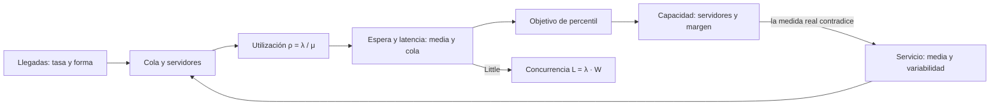

# SE-436 — Latencia, throughput, saturación y capacidad

[← SE-435 — Carga, estrés, picos y endurance](https://github.com/vladimiracunadev-create/modern-software-engineering-program/blob/main/classes/part-36-calidad-rendimiento-y-resiliencia/se-435-carga-estres-picos-y-endurance/README.md) · [↑ Parte 36](https://github.com/vladimiracunadev-create/modern-software-engineering-program/blob/main/classes/part-36-calidad-rendimiento-y-resiliencia/README.md) · [📚 Índice completo](https://github.com/vladimiracunadev-create/modern-software-engineering-program/blob/main/classes/README.md) · [🌐 Portal](https://vladimiracunadev-create.github.io/modern-software-engineering-program/classes/SE-436.html) · [SE-437 — Perfiles, benchmarks y errores de medición →](https://github.com/vladimiracunadev-create/modern-software-engineering-program/blob/main/classes/part-36-calidad-rendimiento-y-resiliencia/se-437-perfiles-benchmarks-y-errores-de-medicion/README.md)

## Punto profesional y fundamento pedagógico

**Punto profesional.** La clase existe para que expliques con un modelo por qué la latencia crece tanto cuando un servidor se acerca a la saturación, para que distingas qué magnitudes se pueden sumar o promediar (rendimiento, concurrencia, tiempos medios) de las que no (percentiles), y para que planifiques la capacidad desde un objetivo de cola y no desde una utilización «razonable» heredada. Con la teoría de colas, una curva que parece una sorpresa deja de serlo.

**Por qué aparece aquí.** Sigue a **Carga, estrés, picos y endurance**: aquella clase mostró el codo, el colapso y la recuperación como observaciones; esta los explica y los predice. La capacidad se decide con tres cosas que aquí se miden: la utilización, la variabilidad del servicio y el estadístico del objetivo. El caso conductor sigue siendo la API de entregas durante el cierre de un plazo.

**Error conceptual que debe corregir.** Creer que la latencia crece de forma proporcional a la carga y que una utilización del 80 % «deja margen del 20 %»: la espera crece de forma hiperbólica cerca de la saturación, depende de la variabilidad del servicio y se agrega mal.

**Secuencia de aprendizaje.** Antes de leer los resultados, predices cuánto crece la latencia media al pasar de 90 % a 99 % de utilización y cuántos servidores hacen falta para 1 000 solicitudes por segundo con un objetivo de p99; después comparas una simulación con la fórmula de una cola M/M/1, cambias solo la variabilidad del servicio manteniendo el promedio y agregas percentiles de ocho servidores de tres maneras. La secuencia usa predicción, explicación propia, contraste y recuperación. [ICAP](https://icap.education.asu.edu/research) distingue participación de construcción de conocimiento; [How People Learn II](https://nap.nationalacademies.org/catalog/24783/how-people-learn-ii-learners-contexts-and-cultures) respalda diseñar la práctica con contextos reales y retroalimentación.

**Evidencia de aprendizaje.** `capacidad-log.md` con la predicción, las tres figuras reproducidas, un modelo de capacidad de la API con su objetivo de cola, el cálculo del número de servidores y una nota que separe lo que el modelo predice de lo que habría que medir.

**Límite de la conclusión.** Las colas son simuladas con llegadas de Poisson y servicio de distribución elegida por el autor; no se midió ningún servidor real, y los sistemas reales tienen dependencias, ráfagas y servicio correlacionado que estos modelos no tienen. Las fórmulas son aproximaciones que valen en el régimen que se declara, y cerca del 100 % de utilización la simulación de 400 000 llegadas no llega al régimen estable.

### Trazabilidad fuente → afirmación

| Fuente primaria u oficial | Afirmación que respalda | Lo que no prueba |
|---|---|---|
| [Little, «A proof for the queuing formula: L = λW» (1961)](https://doi.org/10.1287/opre.9.3.383) | Demuestra que el número medio de elementos en un sistema estable es la tasa de llegadas por el tiempo medio de estancia, sin suponer una distribución concreta. | No dice qué valor tomará W en un sistema dado. |
| [Harchol-Balter, «Performance Modeling and Design of Computer Systems»](https://www.cs.cmu.edu/~harchol/PerformanceModeling/book.html) | Desarrolla las colas M/M/1 y M/G/1, la fórmula de Pollaczek–Khinchine y su lectura para el diseño de sistemas. | No sustituye la medición de un sistema real. |
| [Dean y Barroso, «The tail at scale» (2013)](https://doi.org/10.1145/2408776.2408794) | Explica por qué la latencia de cola domina en sistemas con muchos componentes y cómo se amplifica con la fan-out. | No da cifras de este simulador. |
| [Google SRE: Monitoring Distributed Systems](https://sre.google/sre-book/monitoring-distributed-systems/) | Propone las cuatro señales de oro (latencia, tráfico, errores, saturación) y recomienda distribuciones en lugar de promedios. | No fija umbrales de saturación. |

## Antes de empezar

Recupera lo aprendido en `SE-435`: una rampa muestra un codo y un colapso, y un pico deja una recuperación larga. La pregunta activa es: **¿qué fórmula simple explica ese codo, qué la rompe y qué número de servidores sale de un objetivo de p99 en lugar de uno de utilización?**

## Prerrequisitos

- Haber completado `SE-435` o poder explicar qué mide una prueba de estrés y de pico.
- Python 3.11 o posterior; los experimentos usan solo la biblioteca estándar (`random`, `heapq`, `math`, `statistics`).
- Álgebra básica: una fracción de la forma 1/(1 − x) y su comportamiento cuando x se acerca a 1.

## Problema auténtico

Para el cierre del cuatrimestre, el equipo de la plataforma dimensionó la flota con una regla heredada: «no pasar del 80 % de CPU». Con esa regla, 1 000 solicitudes por segundo necesitaban 63 servidores y el presupuesto estaba aprobado. En la prueba, el p99 salió a 1,1 s en cada servidor al 80 % y el escenario de calidad pedía 300 ms. Al revisar el cálculo, el equipo descubrió dos cosas: la regla del 80 % era una regla sobre la media, y el objetivo era sobre el p99. Con la fórmula de la cola, un p99 de 300 ms exige una utilización cercana al 23 % para este servicio y 216 servidores. Nadie había hecho mal una cuenta: habían usado el estadístico equivocado para planificar. Además, el panel de observabilidad calculaba el p99 «global» promediando los p99 de cada servidor, y mostraba 345 ms cuando el valor real era 323 ms. La clase enseña a evitar los dos errores.

## Objetivos observables

Al terminar podrás:

1. explicar la relación entre utilización y latencia con la fórmula de una cola M/M/1 y contrastarla con una simulación;
2. cuantificar cuánto sube la espera al aumentar la variabilidad del servicio con el mismo promedio;
3. aplicar la ley de Little para comprobar la coherencia de una instrumentación;
4. mostrar por qué no se puede promediar ni sumar percentiles y calcular el correcto con muestras o histogramas;
5. calcular el número de servidores a partir de un objetivo de percentil y compararlo con uno basado en la media.

## Mapa conceptual



El mapa separa los **insumos** (llegadas y servicio), la **cola** como mecanismo, y la **salida** (latencia, concurrencia, servidores). Un error de capacidad suele estar en un insumo que se supuso (la variabilidad) o en el estadístico del objetivo.

## Temas y por qué importan

| Tema | Por qué cambia una decisión profesional | Evidencia mínima |
|---|---|---|
| Utilización y espera | La latencia crece hiperbólicamente: el último 10 % de utilización cuesta más que el primero 90 %. | Predicción, traza causal y contraejemplo de **Utilización y espera** en `capacidad-log.md` |
| Variabilidad del servicio | Dos servicios con el mismo promedio pueden tener esperas muy distintas. | Predicción, traza causal y contraejemplo de **Variabilidad del servicio** en `capacidad-log.md` |
| Ley de Little | Relaciona concurrencia, tasa y tiempo y sirve para comprobar instrumentos. | Predicción, traza causal y contraejemplo de **Ley de Little** en `capacidad-log.md` |
| Percentiles y su agregación | Los percentiles no se promedian ni se suman. | Predicción, traza causal y contraejemplo de **Percentiles y su agregación** en `capacidad-log.md` |
| Capacidad desde un objetivo | El estadístico del objetivo decide cuántos servidores hacen falta. | Predicción, traza causal y contraejemplo de **Capacidad desde un objetivo** en `capacidad-log.md` |

## Conceptos y decisiones

### 1. Utilización y espera

La **utilización** de un servidor es la fracción del tiempo que está ocupado: ρ = λ/μ, donde λ es la tasa de llegadas y μ la de servicio. En una cola M/M/1 (llegadas de Poisson, servicio exponencial, un servidor) el tiempo medio en el sistema es 1/(μ − λ). Con μ = 20 solicitudes por segundo (50 ms de servicio medio), la latencia media es 100 ms al 50 % de utilización, 250 ms al 80 %, 500 ms al 90 %, 1 s al 95 % y 5 s al 99 %. La razón es que la espera tiene la forma 1/(1 − ρ): cada punto de utilización cobra más que el anterior. El tiempo de respuesta de una M/M/1 sigue además una distribución exponencial con tasa μ − λ, así que su percentil 99 vale ln(100)/(μ − λ) ≈ 4,6 veces la media. La consecuencia práctica es doble: no hay margen lineal en el último tramo, y el límite útil de utilización lo fija el objetivo de latencia, no la CPU libre.

### 2. Variabilidad del servicio

La fórmula M/M/1 supone un servicio exponencial, que tiene un coeficiente de variación al cuadrado (cv²) de 1. Los servicios reales pueden ser más regulares (un cálculo fijo) o mucho más irregulares (una consulta que a veces toca disco). La fórmula de **Pollaczek–Khinchine** para una cola M/G/1 dice que la espera media es proporcional a (1 + cv²)/2: con el mismo promedio de servicio y la misma utilización, la espera se duplica de servicio constante (cv² = 0) a exponencial (cv² = 1) y se multiplica por 13 con una mezcla de 95 % de peticiones rápidas y 5 % lentas. La variabilidad entra porque una petición larga bloquea a todas las que esperan detrás. La consecuencia es que reducir la variabilidad (acotar tiempos de consulta, separar peticiones largas y cortas en colas distintas) puede rendir más que añadir un servidor.

### 3. Ley de Little

La ley de Little afirma que, en un sistema estable, el número medio de elementos dentro es L = λ·W, con λ la tasa de llegadas y W el tiempo medio de estancia. Es una identidad que no depende de la distribución de llegadas ni del servicio ni de la disciplina de la cola, y por eso se usa para comprobar la coherencia de una instrumentación: si el panel dice 50 solicitudes en vuelo, 100 por segundo y 300 ms de latencia media (50 ≠ 30), alguno de los tres números está midiendo otra cosa. También sirve para dimensionar: un servicio de 200 solicitudes por segundo con 500 ms de estancia media necesita soportar 100 solicitudes concurrentes, y un pool de 50 conexiones es insuficiente. Lo que la ley no hace es predecir: no dice qué valdrá W.

### 4. Percentiles y su agregación

Un percentil resume una distribución y no se puede reconstruir a partir de otros percentiles. El promedio de los p99 de varios servidores no es el p99 del conjunto: pesa igual a un servidor con mil peticiones y a otro con doce mil. El máximo de los p99 es una cota, no un valor. El resultado correcto sale de combinar las muestras o, cuando son demasiadas, los histogramas con cubetas compatibles (un histograma permite sumar contadores por cubeta y calcular el percentil del conjunto con un error acotado por el ancho de cubeta). La misma trampa aparece con el tiempo: promediar el p99 de cada minuto no da el p99 de la hora. Por eso las herramientas serias exportan histogramas o sketches y calculan el percentil al final, no antes.

### 5. Capacidad desde un objetivo

Planificar con la media y planificar con un percentil dan flotas distintas. Para una cola M/M/1, un objetivo de p99 ≤ T exige ln(100)/(μ − λ) ≤ T, es decir, λ ≤ μ − ln(100)/T. Con μ = 20 y T = 300 ms, λ ≤ 4,65 solicitudes por segundo por servidor, una utilización del 23 %: para 1 000 solicitudes por segundo hacen falta 216 servidores, frente a 63 al planificar con el 80 % de utilización media. Con T = 1 s la utilización admisible es del 77 % y bastan 65. La conclusión no es «usa 216» sino «el objetivo de cola cuesta lo que cuesta»: la decisión legítima puede ser relajar el objetivo a 1 s, reducir la variabilidad del servicio o repartir el tráfico crítico en un grupo con más margen.

### Latencia simulada frente a la fórmula

Se simula una cola de un servidor con 50 ms de servicio exponencial, 400 000 llegadas de Poisson y semilla fija para seis utilizaciones, y se compara con 1/(μ − λ) y con ln(100)/(μ − λ).

```python
res = run(arr, lambda i, t: r.expovariate(MU), 1)
L = [e - a for a, s, e, k in res]
teo_mean = 1 / (MU - lam); teo_p99 = math.log(100) / (MU - lam)
```

| Utilización | Media simulada / teoría | p95 simulado | p99 simulado / teoría |
|---:|---|---:|---|
| 50 % | 99 / 100 ms | 297 ms | 454 / 461 ms |
| 70 % | 165 / 167 ms | 496 ms | 754 / 768 ms |
| 80 % | 246 / 250 ms | 733 ms | 1 132 / 1 151 ms |
| 90 % | 481 / 500 ms | 1 436 ms | 2 098 / 2 303 ms |
| 95 % | 973 / 1 000 ms | 2 901 ms | 4 165 / 4 605 ms |
| 99 % | 6 115 / 5 000 ms | 17 175 ms | 24 286 / 23 026 ms |

Entre el 50 y el 80 % la simulación coincide con la fórmula. Del 90 al 99 % de utilización la media pasa de 481 ms a 6 115 ms, una multiplicación por 12,7. Cerca del 100 %, la simulación se separa porque 400 000 llegadas no bastan para alcanzar el régimen estable: el sistema tarda en olvidar su estado inicial, y esa lentitud es una propiedad del sistema, no un defecto de la herramienta.


**Cómo leer la figura.** El eje horizontal es la utilización del servidor y el vertical, en escala logarítmica, la latencia; las dos líneas inferiores son la media y las dos superiores el percentil 99, cada par con la simulación y la teoría. Mira primero que las líneas casi se superponen hasta el 80 % y que todas se disparan al acercarse al 100 %. **Dónde deja de valer:** las llegadas de Poisson y el servicio exponencial son supuestos de modelo; un tráfico en ráfagas (como el del cierre de plazo) tiene colas más largas con la misma utilización media. Una cola de 4 servidores (M/M/4) se comporta mejor que cuatro de un servidor al mismo nivel de utilización, de modo que la cifra de un servidor es pesimista para un grupo.

### Misma media, otra variabilidad

Se fija la utilización en el 80 % con 600 000 llegadas y se cambia solo la distribución del servicio, manteniendo el promedio de 50 ms: constante, exponencial, lognormal con cv² = 4 y una mezcla bimodal (95 % de 10 ms y 5 % de 810 ms). Se mide la espera media, la comparan con Pollaczek–Khinchine y se comprueba la ley de Little.

```python
Wq_teo = (rho / (1 - rho)) * (1 + c2) / 2 * m           # Pollaczek-Khinchine, c2 observado
L_medio = area_bajo_N_de_t / T;   lam_W = lam_observada * W
```

| Distribución del servicio | cv² observado | Espera media simulada / teoría | p99 de la latencia | L / λ·W |
|---|---:|---|---:|---|
| Determinista | 0,00 | 101 / 100 ms | 573 ms | 2,42 / 2,42 |
| Exponencial | 1,00 | 203 / 200 ms | 1 160 ms | 4,06 / 4,06 |
| Lognormal | 3,94 | 502 / 495 ms | 3 617 ms | 8,85 / 8,85 |
| Bimodal | 12,13 | 1 364 / 1 317 ms | 7 053 ms | 22,67 / 22,67 |

El promedio de servicio es el mismo en las cuatro filas y la espera pasa de 101 ms a 1 364 ms. La fórmula acierta en todas, y el p99 se multiplica por 12 entre la primera y la última. Con un 5 % de peticiones largas (810 ms), 22,7 solicitudes están de media en el sistema frente a 2,4 con servicio constante. La ley de Little se cumple en las cuatro, como una identidad: sirve para validar mediciones, no para explicar la diferencia.


**Cómo leer la figura.** El eje horizontal es el cuadrado del coeficiente de variación del servicio (0 constante, 1 exponencial, 3,94 lognormal, 12,13 la mezcla) y el vertical, la latencia en milisegundos; las dos líneas inferiores son la espera media simulada y teórica y la superior, el percentil 99. Mira primero que la espera crece casi en línea recta con el cv² aunque el promedio de servicio no cambie. **Dónde deja de valer:** la fórmula de Pollaczek–Khinchine requiere un servidor y llegadas de Poisson; con varios servidores el efecto de una petición larga se atenúa porque las demás pueden pasar por otro. La mezcla del 5 % lento es un ejemplo del autor, no una medida de ninguna consulta.

### Agregar percentiles y planificar la capacidad

Se simulan 8 servidores con latencias lognormales (mediana 100 ms, σ = 0,4) y 12 000 peticiones, excepto uno con mediana de 400 ms y 1 000 peticiones. Se calcula el p99 de cada servidor, se agrega de cuatro maneras y se planifica la capacidad para 1 000 solicitudes por segundo con distintos objetivos.

```python
p99s = [pct(x, 99) for x in servers]; ns = [len(x) for x in servers]
unidas = [v for x in servers for v in x]            # el correcto: percentil de las muestras unidas
```

| Cálculo | Resultado |
|---|---:|
| Promedio simple de los 8 p99 | 345 ms |
| Promedio ponderado por peticiones | 262 ms |
| Máximo de los 8 p99 | 983 ms |
| p99 de las muestras unidas | 323 ms |
| Objetivo p99 ≤ 300 ms: utilización máxima / servidores | 23 % / 216 |
| Objetivo p99 ≤ 500 ms | 54 % / 93 |
| Objetivo p99 ≤ 1 s | 77 % / 65 |
| Objetivo p99 ≤ 2 s | 88 % / 57 |
| Objetivo por media, 80 % de utilización | 63 servidores |

El promedio simple (345 ms) sobreestima el valor real (323 ms) porque da el mismo peso al servidor lento con mil peticiones, y el ponderado (262 ms) lo subestima: ninguno de los dos es un percentil. Pasar de un objetivo de media (63 servidores) a uno de p99 de 300 ms multiplica la flota por 3,4.


**Cómo leer la figura.** Cada barra es un objetivo de cola y su longitud, los servidores que exige para 1 000 solicitudes por segundo; entre paréntesis va la utilización que permite. Mira primero la barra de p99 ≤ 300 ms (216) frente a la de planificar con la media (63): el estadístico elegido decide el costo. **Dónde deja de valer:** el cálculo de servidores usa la fórmula de una cola por servidor, sin dependencias, sin ráfagas y sin servicio variable; un diseño real añade margen para fallos y despliegues. Los ocho servidores son sintéticos y la diferencia entre 345 y 323 depende de cuánto pesa el lento.

## Definiciones de trabajo

- **utilización:** fracción del tiempo que un servidor está ocupado, igual a la tasa de llegadas dividida por la tasa de servicio.
- **saturación:** estado en que la utilización se acerca a 1 y la cola crece sin que aumente el trabajo útil.
- **ley de Little:** en un sistema estable, el número medio de elementos dentro es la tasa de llegadas por el tiempo medio que cada uno permanece.
- **coeficiente de variación:** desviación estándar dividida por la media; su cuadrado mide la variabilidad relativa del servicio.
- **latencia de cola:** latencia de las peticiones más lentas, resumida con percentiles altos como el p99.

Las definiciones son operativas para la API de entregas. No convierten términos con una historia más amplia en sinónimos y deben contrastarse con la documentación primaria enlazada al final.

## Ejemplo mínimo

El fragmento calcula la latencia media de una cola M/M/1 con la fórmula. Antes de ejecutarlo, predice cuánto crece al pasar de 90 % a 99 %.

```python
mu = 20.0
for rho in (0.9, 0.99):
    print(rho, 1 / (mu - rho * mu))
```

La media pasa de 0,5 s a 5 s: diez veces más con solo nueve puntos más de utilización. Registra versión de Python, comando y salida; después añade la fórmula del percentil 99 (`math.log(100) / (mu - lam)`) y comprueba que vale 4,6 veces la media.

## Ejemplo profesional

El equipo recalcula la flota para el cierre. Parte del escenario de `SE-433`: p99 ≤ 1,5 s con 1 000 solicitudes por segundo. Supón, como dato hipotético de la plataforma y no como medición, que el servicio de listado tiene 50 ms de media y un cv² de 2,1 por una consulta con cursos grandes: con la fórmula de Pollaczek–Khinchine estimaría que a una utilización del 70 % el p99 se acerca a 1,5 s, y fijaría el 70 % como límite de planificación en lugar del 80 %. Paginar los cursos de 300 entregas bajaría el cv² a un valor cercano a 1 y devolvería parte del margen, una hipótesis que el equipo debe medir antes de ahorrar un solo servidor. Instrumenta histogramas por servidor, suma los contadores en el panel y calcula el p99 al final; añade una alerta que compare λ·W con la concurrencia medida para detectar instrumentación incoherente. Compara con el cálculo original: ahora la flota sale del objetivo de cola y no de una regla de CPU.

## Práctica guiada

1. Simula una cola M/M/1 de 50 ms con 400 000 llegadas para seis utilizaciones y compara con 1/(μ − λ).
2. Predice cuánto crece la latencia media entre 90 % y 99 % y escribe el número antes de medir.
3. Cambia la distribución del servicio manteniendo el promedio y mide la espera frente a Pollaczek–Khinchine.
4. Calcula L con el área bajo N(t) y compáralo con λ·W en cada una de las cuatro formas de servicio.
5. Genera ocho servidores, calcula sus p99 y agrégalos de cuatro maneras; identifica cuál es correcta.
6. Calcula los servidores necesarios para 1 000 solicitudes por segundo con objetivos de p99 de 300 ms, 500 ms, 1 s y 2 s.
7. Entrega `capacidad-log.md` y pide a otra persona que encuentre un supuesto de tu modelo que no se cumpliría en la API.

## Ejercicios

1. **Fórmula:** un servicio con 100 ms de servicio medio llega al 85 % de utilización; calcula la latencia media y el p99 con M/M/1 y explica por qué el segundo es el que debería figurar en un acuerdo.
2. **Little:** un servicio recibe 300 solicitudes por segundo con latencia media de 120 ms; calcula cuántas solicitudes en vuelo hay de media y qué tamaño mínimo debe tener un pool de conexiones.
3. **Variabilidad:** compara la espera con cv² = 0, 1 y 9 al 75 % de utilización y decide si dividir el servicio en dos colas (corto y largo) mejoraría el resultado.
4. **Agregación:** tres servidores tienen p99 de 200, 300 y 900 ms con 5 000, 5 000 y 100 peticiones; di si puedes calcular el p99 del conjunto y qué necesitas.

## Reto verificable

Entrega `capacidad-log.md` con la predicción, las tres tablas de resultados, el cálculo de servidores con objetivo de media y con objetivo de p99, y la lista de supuestos del modelo con su efecto. Se aprueba si otra persona ejecuta el código desde un checkout limpio, obtiene los mismos números con las mismas semillas y puede decir por qué 216 servidores y 63 no son contradictorios. No se aprueba por copiar las fórmulas sin simular ni por afirmar que «el 80 % deja margen».

## Caso conductor

La API de entregas es el caso conductor de la Parte 36. Esta clase deja el cuarto artefacto: un modelo de capacidad con su objetivo de cola. `SE-437` preguntará cómo se mide el tiempo de verdad, con relojes, perfiles y benchmarks, y qué errores comete esa medición. Cambia después un solo parámetro, la variabilidad del servicio, y observa cuántos servidores te ahorra.

## Preguntas frecuentes

### ¿Por qué la latencia sube tanto cerca del 100 %?

Porque cuando la utilización se acerca a 1, el sistema casi no tiene margen para absorber una ráfaga: cada llegada extra encuentra una cola que no se vacía. La espera es proporcional a ρ/(1 − ρ), que crece sin límite cuando ρ tiende a 1.

### ¿Sirve la fórmula de M/M/1 para varios servidores?

Como aproximación pesimista, sí; para un cálculo exacto se usa la fórmula de Erlang C (M/M/c). Con varios servidores y una cola compartida, la latencia al mismo nivel de utilización es menor que con colas separadas, y por eso se agrupa el tráfico cuando se puede.

### ¿Se puede calcular el p99 de la hora a partir de los p99 de cada minuto?

No. Hace falta el histograma o las muestras. El p99 de la hora es el valor bajo el cual queda el 99 % de todas las peticiones de la hora; el promedio o el máximo de 60 percentiles no lo reproduce, y depende de cuántas peticiones hubo en cada minuto.

### ¿Es la ley de Little una ley de la física?

No. Es un resultado matemático para sistemas estables que se cumple por definición de los promedios; por eso es robusto, y por eso no explica nada. Si una medición no la cumple, o el sistema no es estable en la ventana o uno de los tres números mide otra cosa.

## Fallo controlado y diagnóstico

Reproduce el fallo clásico de la clase: **planificar con la media un objetivo que es de cola**. Dimensiona 1 000 solicitudes por segundo al 80 % de utilización y mide el p99.

Registra síntoma, entrada mínima, hipótesis, observación que descarta cada hipótesis, causa, corrección y prueba de regresión. **Síntoma:** con 63 servidores al 80 % de CPU, el p99 es 1,1 s y el escenario pide 300 ms. **Hipótesis rivales:** (a) hay un servidor defectuoso; (b) la carga está mal repartida; (c) el modelo de capacidad usó el estadístico equivocado. **Prueba:** simula una cola M/M/1 al 80 % y compara el p99 con 300 ms; si coincide con 1,15 s, el sistema funciona como el modelo dice. **Conclusión:** una utilización del 80 % no puede dar un p99 de 300 ms con este servicio. **Regresión:** añade una prueba que calcule la utilización máxima admisible desde el objetivo de p99 y falle si la flota planificada la supera. No cambies a la vez el objetivo y la flota.

## Errores comunes y cómo corregirlos

| Síntoma | Causa probable | Corrección |
|---|---|---|
| La latencia se dispara con una utilización «razonable» | Se planificó con la media | Calcular la utilización máxima desde el objetivo de percentil |
| La espera es mayor de lo que predice la fórmula | Servicio más variable que el exponencial | Medir cv² y usar Pollaczek–Khinchine |
| El p99 global del panel no coincide con la muestra | Se promediaron percentiles | Combinar histogramas o muestras |
| La concurrencia medida no cuadra con λ·W | Instrumentación inconsistente o sistema no estable | Revisar qué mide cada número y la ventana |
| La simulación no converge al 99 % | Pocas llegadas para el régimen estable | Alargar o usar la fórmula |

## Entorno y archivos clave

```text
work/SE-436/
├── README.md
├── capacidad/
│   ├── cola.py
│   ├── variabilidad.py
│   └── agregacion.py
├── tests/test_capacidad.py
└── evidence/capacidad-log.md
```

El `README` declara plataforma, versión de Python, semillas y comandos. Los experimentos usan solo la biblioteca estándar (`random`, `heapq`, `math`, `statistics`) y se ejecutaron con CPython 3.12.9 en Windows 11 y 3.12.3 en Ubuntu bajo WSL2: las salidas fueron idénticas porque el tiempo es virtual. Si añades una dependencia, fija procedencia y versión.

## Seguridad, ética y accesibilidad

- una capacidad planificada al límite deja a las personas sin margen cuando ocurre algo imprevisto: documenta qué servicio se degrada primero y a quién afecta;
- los percentiles altos suelen corresponder a las personas con peores conexiones y dispositivos: un objetivo solo de media es un objetivo que las excluye;
- los datos son sintéticos: no uses tiempos de peticiones reales sin anonimizar;
- documenta las tablas y las figuras con texto alternativo y en un formato que un lector de pantalla pueda recorrer;
- respeta las licencias de los libros y artículos y atribuye lo adaptado.

## Puente hacia el trabajo con agentes

Un agente al que se le pide «calcula cuántos servidores necesitamos» dividirá la carga entre la capacidad por servidor y añadirá un margen del 20 % o del 30 %. Pídele en cambio que parta del escenario de calidad, que declare el estadístico y el objetivo, que mida o pida la variabilidad del servicio, que calcule la utilización máxima desde el percentil y que agregue los percentiles con histogramas y no con promedios. Revisa especialmente si el cálculo usa la media para un objetivo de cola y si su panel promedia percentiles: son los dos defectos que esta clase mostró sin aviso.

## Transferencia

Traslada el análisis a otro recurso con cola (por ejemplo, un pool de conexiones a la base de datos o una cola de trabajos): cambia el servidor y el servicio y conserva el procedimiento de modelar la cola, medir la variabilidad, comprobar con Little y derivar la capacidad del objetivo de percentil. La transferencia está lograda cuando puedes decir qué supuesto del modelo no se cumpliría en ese recurso, no cuando la fórmula da un número.

## Evaluación y evidencia

| Criterio | Evidencia para aprobar |
|---|---|
| comprensión | explicación de la relación hiperbólica entre utilización y espera y del efecto de la variabilidad |
| corrección | tablas de la cola, de la variabilidad y de la agregación reproducibles con las mismas semillas |
| diseño | cálculo de servidores desde un objetivo de percentil con sus supuestos declarados |
| diagnóstico | reproducción del fallo «planificar con la media un objetivo de cola» con regresión |
| incertidumbre | declaración de que las llegadas, el servicio y los servidores son sintéticos |
| reproducibilidad | versiones, comandos, salida y límites declarados |

## Fuentes

- [Little, «A proof for the queuing formula: L = λW»](https://doi.org/10.1287/opre.9.3.383) — ley de Little; autoridad: artículo original, Operations Research 1961.
- [Harchol-Balter, «Performance Modeling and Design of Computer Systems»](https://www.cs.cmu.edu/~harchol/PerformanceModeling/book.html) — colas M/M/1, M/G/1 y Pollaczek–Khinchine; autoridad: autora del libro.
- [Dean y Barroso, «The tail at scale»](https://doi.org/10.1145/2408776.2408794) — latencia de cola en sistemas distribuidos; autoridad: Communications of the ACM, 2013.
- [Google SRE: Monitoring Distributed Systems](https://sre.google/sre-book/monitoring-distributed-systems/) — señales de oro y distribuciones; autoridad: Google, libro de ingeniería de confiabilidad.
- [Python: statistics](https://docs.python.org/3/library/statistics.html) — media y cuantiles usados en los experimentos; autoridad: documentación de Python.

Cada fuente respalda el mecanismo indicado; ninguna demuestra que los 216 servidores, el p99 de 323 ms o el factor 13 de la variabilidad se observen en un sistema real. Esa afirmación depende del servicio, de la carga y de la instrumentación.

## Límites y siguiente paso

Se ejecutaron tres experimentos con tiempo virtual y semillas fijas en Windows y Ubuntu (WSL2) con resultados idénticos en ambos sistemas. No se midió ningún servidor real; las llegadas de Poisson, los servicios exponencial, lognormal y bimodal, los ocho servidores y la fórmula de un solo servidor son modelos del autor, no hay dependencias ni ráfagas, y cerca del 100 % de utilización la simulación no alcanza el régimen estable. La siguiente clase pregunta cómo se mide el tiempo con relojes, perfiles y benchmarks, y qué errores comete esa medición.

## Glosario

- **utilización:** fracción del tiempo que un servidor está ocupado, igual a la tasa de llegadas dividida por la tasa de servicio.
- **saturación:** estado en que la utilización se acerca a 1 y la cola crece sin que aumente el trabajo útil.
- **ley de Little:** en un sistema estable, el número medio de elementos dentro es la tasa de llegadas por el tiempo medio que cada uno permanece.
- **coeficiente de variación:** desviación estándar dividida por la media; su cuadrado mide la variabilidad relativa del servicio.
- **latencia de cola:** latencia de las peticiones más lentas, resumida con percentiles altos como el p99.

---

[← SE-435 — Carga, estrés, picos y endurance](https://github.com/vladimiracunadev-create/modern-software-engineering-program/blob/main/classes/part-36-calidad-rendimiento-y-resiliencia/se-435-carga-estres-picos-y-endurance/README.md) · [↑ Parte 36](https://github.com/vladimiracunadev-create/modern-software-engineering-program/blob/main/classes/part-36-calidad-rendimiento-y-resiliencia/README.md) · [📚 Índice completo](https://github.com/vladimiracunadev-create/modern-software-engineering-program/blob/main/classes/README.md) · [🌐 Portal](https://vladimiracunadev-create.github.io/modern-software-engineering-program/classes/SE-436.html) · [SE-437 — Perfiles, benchmarks y errores de medición →](https://github.com/vladimiracunadev-create/modern-software-engineering-program/blob/main/classes/part-36-calidad-rendimiento-y-resiliencia/se-437-perfiles-benchmarks-y-errores-de-medicion/README.md)
