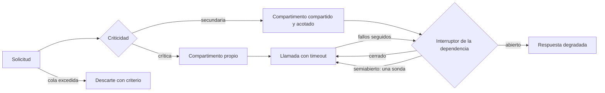

# SE-439 — Circuit breakers, bulkheads y degradación

[← SE-438 — Timeouts, retries, backoff y jitter](https://github.com/vladimiracunadev-create/modern-software-engineering-program/blob/main/classes/part-36-calidad-rendimiento-y-resiliencia/se-438-timeouts-retries-backoff-y-jitter/README.md) · [↑ Parte 36](https://github.com/vladimiracunadev-create/modern-software-engineering-program/blob/main/classes/part-36-calidad-rendimiento-y-resiliencia/README.md) · [📚 Índice completo](https://github.com/vladimiracunadev-create/modern-software-engineering-program/blob/main/classes/README.md) · [🌐 Portal](https://vladimiracunadev-create.github.io/modern-software-engineering-program/classes/SE-439.html) · [SE-440 — Disponibilidad, durabilidad y recuperación →](https://github.com/vladimiracunadev-create/modern-software-engineering-program/blob/main/classes/part-36-calidad-rendimiento-y-resiliencia/se-440-disponibilidad-durabilidad-y-recuperacion/README.md)

## Punto profesional y fundamento pedagógico

**Punto profesional.** La clase existe para que decidas cómo se comporta un servicio cuando una de sus dependencias falla o se vuelve lenta y no se recupera pronto: cuándo dejar de llamarla (interruptor de circuito), cómo evitar que arrastre al resto (mamparos) y qué respuesta más barata y menos completa ofrecer mientras tanto (degradación). La habilidad es diseñar la falla parcial, no el éxito: un sistema que cae entero porque una dependencia secundaria se colgó no tiene resiliencia, tiene suerte.

**Por qué aparece aquí.** Sigue a **Timeouts, retries, backoff y jitter**: aquella clase limitó el daño de un cliente que insiste; esta limita el daño de una dependencia que no responde, desde el lado del llamador. Las dos se combinan: el timeout decide cuándo una llamada falló, el reintento decide si repetirla y el interruptor decide si volver a intentarlo en absoluto. El caso conductor es la API de entregas con sus dependencias de base de datos, almacenamiento de archivos y notificaciones.

**Error conceptual que debe corregir.** Creer que un interruptor o un mamparo «hacen el sistema más disponible» sin coste: protegen contra el fallo en cascada a cambio de rechazar solicitudes que quizá habrían tenido éxito, de capacidad ociosa y de una respuesta degradada que alguien tiene que haber decidido de antemano.

**Secuencia de aprendizaje.** Antes de leer los resultados, predices cuántas llamadas llegan a una dependencia caída con y sin interruptor y qué porcentaje de las solicitudes de la dependencia sana pierde un pool compartido cuando la otra se vuelve lenta; después simulas el interruptor con distintos parámetros, cuatro repartos de un pool y cuatro políticas bajo una sobrecarga del doble. La secuencia usa predicción, explicación propia, contraste y recuperación. [ICAP](https://icap.education.asu.edu/research) distingue participación de construcción de conocimiento; [How People Learn II](https://nap.nationalacademies.org/catalog/24783/how-people-learn-ii-learners-contexts-and-cultures) respalda diseñar la práctica con contextos reales y retroalimentación.

**Evidencia de aprendizaje.** `degradacion-log.md` con la predicción, las tres figuras reproducidas, un mapa de dependencias de la API con su política de interruptor, su compartimento y su respuesta degradada, y una nota que separe lo medido de lo supuesto.

**Límite de la conclusión.** Todo ocurre en un simulador de tiempo virtual: 100 solicitudes por segundo contra una dependencia que se cuelga entre los 60 y 120 s, dos dependencias de 80 y 20 solicitudes por segundo en un pool de 20, y una sobrecarga de 160 solicitudes por segundo sobre una capacidad de 80. No se midió ninguna biblioteca de interruptores, ningún servicio ni ninguna red, y el costo de 5 ms de una respuesta degradada es un supuesto del autor.

### Trazabilidad fuente → afirmación

| Fuente primaria u oficial | Afirmación que respalda | Lo que no prueba |
|---|---|---|
| [Fowler, «CircuitBreaker»](https://martinfowler.com/bliki/CircuitBreaker.html) | Describe el interruptor con sus estados cerrado, abierto y semiabierto y su función de fallar rápido y dar tiempo a que la dependencia se recupere. | No fija umbrales ni tiempos de apertura para ningún servicio. |
| [Microsoft Azure Architecture: patrón Bulkhead](https://learn.microsoft.com/en-us/azure/architecture/patterns/bulkhead) | Explica el aislamiento de recursos en compartimentos para que el fallo de uno no consuma los de los demás. | No da el tamaño adecuado de cada compartimento. |
| [AWS Builders' Library: Using load shedding to avoid overload](https://aws.amazon.com/builders-library/using-load-shedding-to-avoid-overload/) | Describe el descarte de solicitudes bajo sobrecarga para proteger el trabajo útil y la importancia de elegir qué descartar. | No dice qué política conviene a este servicio. |
| [Google SRE: Handling Overload](https://sre.google/sre-book/handling-overload/) | Trata la degradación elegante, la criticidad de las solicitudes y los límites por cliente. | No decide qué solicitudes son críticas en la plataforma. |

## Antes de empezar

Recupera lo aprendido en `SE-438`: reintentar sin límite sostiene la sobrecarga y un timeout decide cuándo una llamada se considera fallida. La pregunta activa es: **cuando una dependencia lleva un minuto sin responder bien, ¿qué debería dejar de hacer mi servicio, qué debería seguir haciendo y qué respuesta más pobre pero útil puede dar?**

## Prerrequisitos

- Haber completado `SE-438` o poder explicar qué es un presupuesto de reintentos y un plazo propagado.
- Python 3.11 o posterior; los experimentos usan solo la biblioteca estándar (`random`, `heapq`, `collections`).
- Saber qué es un pool de trabajadores o de conexiones y qué ocurre cuando se agota.

## Problema auténtico

La API de entregas llamaba a un servicio de miniaturas de archivos para mostrar una vista previa. Una tarde, ese servicio empezó a tardar dos segundos en responder: no devolvía error, se colgaba. Cada solicitud de la API que necesitaba una miniatura retenía un trabajador durante dos segundos; con cien solicitudes por segundo, la API consumió sus 150 trabajadores en un segundo y medio y dejó de atender también las solicitudes que no usaban miniaturas, como entregar una tarea. Una dependencia secundaria tumbó la función más importante. La corrección tuvo tres piezas: dejar de llamar al servicio tras unos fallos seguidos, reservar trabajadores propios para las entregas y mostrar un icono genérico en lugar de la vista previa mientras el servicio no respondía. La clase mide el efecto de cada una.

## Objetivos observables

Al terminar podrás:

1. describir los tres estados de un interruptor de circuito y qué parámetros los gobiernan;
2. medir cuántas llamadas a una dependencia caída evita un interruptor y cuánto retrasa la recuperación;
3. dimensionar mamparos para una dependencia lenta y calcular lo que cuestan en capacidad ociosa;
4. comparar cuatro políticas de sobrecarga por las respuestas útiles que producen y por a quién protegen;
5. escribir una política de degradación que dependa de la criticidad y deje claro qué respuesta degradada se ofrece.

## Mapa conceptual



El mapa muestra tres defensas con funciones distintas: el **interruptor** decide si llamar, el **mamparo** limita cuántos recursos puede consumir la llamada y el **descarte** decide a quién se atiende cuando no cabe todo.

## Temas y por qué importan

| Tema | Por qué cambia una decisión profesional | Evidencia mínima |
|---|---|---|
| Interruptor de circuito | Deja de llamar a lo que no responde y protege los recursos propios. | Predicción, traza causal y contraejemplo de **Interruptor de circuito** en `degradacion-log.md` |
| Mamparos | Confina el fallo de una dependencia a su compartimento. | Predicción, traza causal y contraejemplo de **Mamparos** en `degradacion-log.md` |
| Descarte de carga | Bajo sobrecarga hay que elegir qué se atiende. | Predicción, traza causal y contraejemplo de **Descarte de carga** en `degradacion-log.md` |
| Degradación elegante | Una respuesta pobre pero útil vale más que un error. | Predicción, traza causal y contraejemplo de **Degradación elegante** en `degradacion-log.md` |
| Coste y riesgos de la protección | Cada defensa rechaza solicitudes y requiere decisiones previas. | Predicción, traza causal y contraejemplo de **Coste y riesgos de la protección** en `degradacion-log.md` |

## Conceptos y decisiones

### 1. Interruptor de circuito

Un **interruptor de circuito** envuelve las llamadas a una dependencia y observa su resultado. Tiene tres estados. En **cerrado**, las llamadas pasan y se cuentan los fallos; cuando se supera un criterio (cinco fallos seguidos, o una fracción de fallos en una ventana) pasa a **abierto**. En abierto, las llamadas fallan al instante sin tocar la dependencia (o devuelven una respuesta de respaldo) y se espera un tiempo. Tras ese tiempo pasa a **semiabierto**: deja pasar una llamada de prueba; si tiene éxito, vuelve a cerrado; si falla, vuelve a abierto. Los parámetros hacen compromisos medibles: abrir pronto protege más y se equivoca más con fallos aleatorios aislados; un tiempo abierto largo reduce la carga sobre la dependencia que se recupera y retrasa la vuelta a la normalidad. Un interruptor no vale para todo: una dependencia con el 3 % de fallos aleatorios no debería abrirlo nunca, y uno con el 40 % puede abrirlo y cerrarlo continuamente.

### 2. Mamparos

El nombre viene de los compartimentos estancos de un barco. Un **mamparo** reparte un recurso finito (hilos, conexiones, memoria) en compartimentos, uno por dependencia o por clase de solicitud, de manera que la lentitud de una no pueda consumirlo todo. Si todas las llamadas comparten un único pool de 20 trabajadores y una de las dependencias tarda un segundo en lugar de 50 ms, sus llamadas ocupan los trabajadores mucho más tiempo y dejan sin ellos a las demás. Con pools separados, la dependencia lenta agota su compartimento y las demás siguen. El mamparo no arregla la dependencia lenta: la confina. Su costo es capacidad ociosa (un compartimento con trabajadores libres no puede prestarlos a otro) y la necesidad de dimensionar cada uno, lo que exige conocer el tráfico y la latencia de cada dependencia.

### 3. Descarte de carga

Cuando la carga supera la capacidad, algo no se va a atender. La pregunta es qué. Sin control, el sistema atiende todo con colas crecientes y casi nada llega a tiempo, y además trabaja para clientes que ya se fueron. Una **cola acotada** rechaza lo que excede un límite y protege la latencia de lo que entra, pero no distingue entre solicitudes. Un **descarte por prioridad** atiende primero lo crítico (entregar una tarea) y rechaza antes lo secundario (listar el historial). El descarte requiere dos decisiones previas: quién clasifica las solicitudes (el cliente o el servidor) y qué hace el rechazo visible para la persona usuaria; una respuesta «reintenta en un momento» con una cabecera de espera es mejor que un error genérico. Descartar con criterio también obliga a rechazar con rapidez: un rechazo que tarda tanto como la atención no libera nada.

### 4. Degradación elegante

Una **respuesta degradada** es una respuesta más barata y menos completa que sigue siendo útil: una miniatura genérica en lugar de la vista previa, la lista de entregas de la última caché con una marca de «actualizada hace 5 min», un resumen sin las estadísticas de la semana. Convierte un error en un servicio reducido. Tiene condiciones: debe ser mucho más barata que la respuesta completa (si cuesta casi lo mismo, no libera capacidad), debe ser honesta (la persona debe poder saber que está viendo algo degradado) y debe haberse decidido de antemano con producto, no improvisado durante el incidente. Y tiene riesgos: servir datos viejos puede ser inaceptable para una calificación y aceptable para un historial, y esa frontera es una decisión de negocio que hay que escribir.

### 5. Coste y riesgos de la protección

Cada defensa tiene un precio. El interruptor rechaza solicitudes que quizá habrían funcionado y añade un estado que puede estar mal configurado: un interruptor atascado en abierto convierte una caída corta en una larga. Los mamparos dejan capacidad ociosa y una dimensión equivocada convierte un compartimento pequeño en un cuello de botella permanente. El descarte rechaza personas y exige que la clasificación de criticidad sea correcta. La degradación puede esconder un fallo: un sistema que responde siempre «bien» con datos viejos puede estar roto durante horas sin que nadie lo note, de modo que cada defensa necesita su propia señal observable (cuántas veces se abrió, cuántas respuestas degradadas se sirvieron, cuántos rechazos hubo) y una alerta sobre ella.

### Un interruptor frente a una dependencia colgada

Una API recibe 100 solicitudes por segundo y llama a una dependencia que responde en 50 ms; entre los 60 y los 120 s se cuelga y cada llamada tarda 2 s en fallar. El cliente tiene un pool de 150 llamadas simultáneas. Se compara sin interruptor y con cuatro configuraciones: cinco fallos seguidos con apertura de 2, 10 y 30 s, y una apertura por el 50 % de fallos en las últimas 20 llamadas con apertura de 10 s. La recuperación se mide como el tiempo entre que la dependencia sana y el interruptor se cierra, promediada sobre diez momentos de sanación.

```python
if estado == "abierto" and a >= abre_hasta: estado = "semiabierto"       # una llamada de prueba
if estado == "abierto" or (estado == "semiabierto" and sonda): respaldo()   # no se toca la dependencia
```

| Configuración | Llamadas a la dependencia durante la falla | Respuestas de respaldo | Rechazadas por pool agotado | p99 del usuario | Recuperación media / máx |
|---|---:|---:|---:|---:|---|
| Sin interruptor | 4 430 | 0 | 1 637 | 2 000 ms | — |
| 5 fallos seguidos, abierto 2 s | 165 | 5 860 | 59 | 50 ms | 2,2 s / 4,0 s |
| 5 fallos seguidos, abierto 10 s | 155 | 5 859 | 59 | 50 ms | 6,5 s / 11,4 s |
| 5 fallos seguidos, abierto 30 s | 152 | 6 270 | 59 | 50 ms | 11,6 s / 31,8 s |
| 50 % de 20 llamadas, abierto 10 s | 160 | 5 861 | 59 | 50 ms | 6,6 s / 11,5 s |

Sin interruptor, 4 430 llamadas se hacen a una dependencia que no va a responder, 1 637 solicitudes se rechazan porque el pool se agota y el p99 de la persona usuaria es de 2 s. Con interruptor las llamadas bajan a unas 150, y el p99 a 50 ms porque la respuesta de respaldo es inmediata. Aun así se pagan 59 rechazos: detectar cinco fallos de 2 s lleva 2 s, y en ese tiempo entran unas 200 solicitudes a un pool de 150. La recuperación cuesta casi lo que dura la apertura: con 30 s, hasta 31,8 s de servicio degradado tras sanar la dependencia. Con una dependencia que falla el 3 % de las veces de forma aleatoria, ninguno de los tres interruptores se abre en una hora (360 683 solicitudes); con una que falla el 40 %, el de 2 s se abre 133 veces y sirve respaldo al 65 % de las solicitudes, y el de 10 s se abre 31 veces y sirve respaldo al 92 %, aunque el 60 % de las llamadas habría salido bien.


**Cómo leer la figura.** Cada grupo es una configuración del mismo escenario; la barra roja son las llamadas que llegan a la dependencia y la dorada las solicitudes rechazadas por pool agotado, en escala logarítmica. Mira primero la diferencia entre el grupo sin interruptor y los demás, y que entre las configuraciones con interruptor las barras casi no cambian. **Dónde deja de valer:** el fallo es una colgada total y limpia (todas las llamadas tardan 2 s y fallan), el pool de 150 es un supuesto y la respuesta de respaldo cuesta 1 ms; con una dependencia lenta pero no caída, los fallos no se acumulan igual y el interruptor por fallos seguidos no se abriría.

### Mamparos y una dependencia lenta

Dos dependencias, A con 80 solicitudes por segundo y 50 ms de servicio medio y B con 20 solicitudes por segundo, comparten 20 trabajadores. Cuando B pasa de 50 ms a 1 s, sus llamadas ocupan trabajadores veinte veces más. Se compara un pool compartido con tres repartos: A 15 y B 5, A 10 y B 10, A 18 y B 2. Se mide el porcentaje de solicitudes atendidas de cada una.

```python
lista = ocup.setdefault(tag if partes else "X", [])         # un compartimento por dependencia, o uno compartido
if len(lista) >= (partes[tag] if partes else pool): rechazada()
```

| Reparto de trabajadores | B sana (50 ms): A / B | B lenta (1 s): A / B |
|---|---|---|
| Un pool compartido de 20 | 100,0 % / 100,0 % | 74,3 % / 73,6 % |
| A 15 y B 5 | 100,0 % / 99,6 % | 100,0 % / 23,1 % |
| A 10 y B 10 | 99,5 % / 100,0 % | 99,6 % / 45,0 % |
| A 18 y B 2 | 100,0 % / 79,6 % | 100,0 % / 9,3 % |

Con un pool compartido, la lentitud de B arrastra a A, que pasa de 100 % a 74,3 %: el 25,7 % de las solicitudes de una dependencia sana falla por culpa de otra. Con mamparos A queda al 100 % y B atiende entre el 9,3 % y el 45 % según su tamaño. Con B sana, la partición 18 + 2 rechaza el 20,4 % de las solicitudes de B porque su compartimento es demasiado pequeño: el costo de dimensionar mal. No hay un reparto que deje ambos al 100 % en la situación degradada.


**Cómo leer la figura.** Cada grupo es un reparto de los 20 trabajadores y cada barra, el porcentaje de solicitudes atendidas de A o de B con B sana o lenta. Mira primero las barras azul y roja del grupo compartido (A cae a 74,3 %) y cómo con pools separados la azul vuelve a 100 % mientras la roja se queda baja. **Dónde deja de valer:** las llegadas son de Poisson, los servicios exponenciales, no hay cola (lo que no cabe se rechaza) y B se vuelve lenta durante todo el experimento. Con cola y reintentos el efecto de arrastre sería mayor.

### Sobrecarga del doble y respuestas degradadas

Un sistema con cuatro trabajadores y 50 ms de servicio (capacidad de 80 por segundo) recibe 160 por segundo durante 60 s; el 20 % de las solicitudes son críticas (entregas) y el resto secundarias (consultas). Los clientes se rinden a los 2 s. Se comparan cuatro políticas: sin control (el servidor no descarta nada), cola acotada a 50, prioridad a las críticas con descarte de las secundarias cuando la cola supera 20, y esa misma prioridad con una respuesta degradada (5 ms) para las secundarias en lugar de rechazarlas.

| Política | Críticas a tiempo | No críticas a tiempo | Respuestas útiles por segundo |
|---|---:|---:|---:|
| Sin control | 3,0 % (p99 1 989 ms) | 3,7 % | 5,6 |
| Cola acotada a 50 | 53,9 % (p99 930 ms) | 52,3 % | 82,0 |
| Prioridad a las críticas | 100,0 % (p99 271 ms) | 40,3 % | 81,6 |
| Prioridad y respuesta degradada | 100,0 % (p99 243 ms) | 100,0 % (4 919 degradadas) | 155,9 |

Sin control, el sistema ocupa el 100 % de sus trabajadores y entrega 5,6 respuestas útiles por segundo: casi todo el trabajo es para clientes que ya se fueron. La cola acotada recupera 82 por segundo pero reparte el daño sin distinguir y solo el 53,9 % de las críticas llega a tiempo. La prioridad protege todas las críticas. La respuesta degradada atiende a todos con 155,9 respuestas útiles por segundo, casi el doble de la capacidad nominal, a condición de que degradar cueste de verdad un diez por ciento de lo normal.


**Cómo leer la figura.** Cada grupo es una política bajo sobrecarga y cada barra, el porcentaje de solicitudes críticas (verde) o no críticas (dorado) atendidas dentro de 2 s. Mira primero cómo la barra verde llega a 100 % con prioridad y cómo solo la respuesta degradada sube también la dorada. **Dónde deja de valer:** la criticidad es un dato conocido y fiable en el modelo (en la práctica hay que clasificar), el costo de 5 ms de la respuesta degradada es un supuesto y los clientes no reintentan; con reintentos, los rechazados volverían y la carga efectiva sería mayor.

## Definiciones de trabajo

- **circuit breaker:** componente que deja de llamar a una dependencia tras cierto número o fracción de fallos y la vuelve a probar tras un tiempo.
- **bulkhead (mamparo):** reparto de un recurso finito en compartimentos para que el fallo de un uso no consuma el de los demás.
- **descarte de carga (load shedding):** rechazo deliberado de solicitudes cuando la demanda supera la capacidad.
- **degradación elegante:** respuesta reducida pero útil que se ofrece cuando la respuesta completa no es posible.
- **criticidad:** importancia relativa de una solicitud para el negocio, usada para decidir a quién se atiende primero.

Las definiciones son operativas para la API de entregas. No convierten términos con una historia más amplia en sinónimos y deben contrastarse con la documentación primaria enlazada al final.

## Ejemplo mínimo

El fragmento calcula cuántas solicitudes llegan a una dependencia caída durante el tiempo que tarda un interruptor en abrirse. Antes de ejecutarlo, predice si entran más de 100.

```python
tasa, timeout, fallos_para_abrir = 100, 2.0, 5
detectar = timeout                        # los cinco primeros fallos tardan 2 s en conocerse
print(tasa * detectar)
```

Entran unas 200 solicitudes antes de que el interruptor tenga cinco fallos conocidos, porque los fallos se conocen cuando vence el timeout y no cuando se envía la llamada. Registra versión de Python, comando y salida; después reduce el timeout a 500 ms y comprueba cuántas entran.

## Ejemplo profesional

El equipo hace un mapa de las dependencias de la API de entregas. Para la base de datos (crítica), no hay interruptor con respaldo posible: se reserva un pool propio de trabajadores para entregar tareas y se acota la cola; si la base cae, la API responde con un error claro. Para el servicio de miniaturas (secundario) se pone un interruptor con apertura por cinco fallos seguidos y 10 s abierto, un compartimento de 5 trabajadores y una respuesta degradada (un icono genérico) marcada con una cabecera. Para las notificaciones por correo (asíncronas), los envíos fallidos pasan a una cola con reintento diferido. Cada defensa expone un contador: aperturas del interruptor, respuestas degradadas y rechazos, con una alerta si las respuestas degradadas superan el 5 % durante 10 minutos. Compara con el estado anterior: un pool compartido, sin interruptor y con la miniatura bloqueando las entregas.

## Práctica guiada

1. Implementa un interruptor con tres estados y pruébalo con una dependencia que se cuelga entre los 60 y 120 s.
2. Predice cuántas llamadas llegarán a la dependencia con y sin interruptor y escríbelo antes de medir.
3. Cambia la apertura a 2, 10 y 30 s y mide la recuperación media y máxima sobre diez momentos de sanación.
4. Simula dos dependencias en un pool de 20 y compara el pool compartido con tres repartos, con B sana y con B lenta.
5. Simula la sobrecarga del doble con las cuatro políticas y cuenta críticas y no críticas a tiempo.
6. Redacta el mapa de dependencias de la API con criticidad, compartimento, interruptor y respuesta degradada de cada una.
7. Entrega `degradacion-log.md` y pide a otra persona que encuentre una respuesta degradada que la plataforma no podría ofrecer sin daño.

## Ejercicios

1. **Parámetros:** una dependencia falla el 20 % de las veces de forma aleatoria; calcula la probabilidad de que cinco fallos seguidos abran el interruptor en 1 000 llamadas y decide si la regla es adecuada.
2. **Dimensión:** con A de 80 solicitudes por segundo y 50 ms, calcula el mínimo de trabajadores que necesita su compartimento para no rechazar más del 1 % y compáralo con el 15 de la clase.
3. **Descarte:** propón la clasificación de criticidad de las seis operaciones principales de la API y decide cuáles se rechazan primero.
4. **Degradación:** para el listado de entregas de un curso, diseña tres respuestas degradadas y di cuál es inaceptable para una calificación.

## Reto verificable

Entrega `degradacion-log.md` con la predicción, las tres tablas de resultados, el mapa de dependencias con criticidad, compartimento, interruptor y respuesta degradada, y los contadores y las alertas de cada defensa. Se aprueba si otra persona ejecuta el código desde un checkout limpio, obtiene los mismos números con las mismas semillas y puede decir qué defensa empeora la situación con una dependencia que falla el 40 % de las veces. No se aprueba por añadir un interruptor sin medir ni por afirmar que el sistema «se degrada con elegancia» sin una respuesta degradada concreta.

## Caso conductor

La API de entregas es el caso conductor de la [Parte 36](../README.md). Esta clase deja el séptimo artefacto: un mapa de dependencias con sus defensas y sus señales. `SE-440` formulará con números qué disponibilidad se alcanza con estas defensas y qué pasa con los datos cuando algo se pierde. Cambia después un solo parámetro, el tiempo de apertura, y observa el compromiso entre protección y recuperación.

## Preguntas frecuentes

### ¿Un interruptor sustituye a un timeout?

No: lo necesita. El interruptor decide con los resultados de las llamadas, y sin timeout una llamada colgada nunca produce un resultado. El timeout acota la espera de cada llamada y el interruptor, el número de llamadas que se intentan.

### ¿Cuántos trabajadores debe tener cada compartimento?

Los que la dependencia necesita en su tráfico esperado con su latencia sana (por la ley de Little: llegadas por tiempo de servicio) más un margen para picos, y se confirma midiendo cuántas solicitudes rechaza en funcionamiento normal. Un compartimento que rechaza con la dependencia sana está mal dimensionado.

### ¿Puede degradarse una escritura?

Con mucho cuidado. Una lectura degradada devuelve datos viejos o incompletos; una escritura degradada puede perder datos o aceptar algo que no se podrá cumplir. La opción habitual es aceptar la escritura en una cola duradera y confirmar «recibida», no «procesada», y decirlo así a la persona usuaria.

### ¿Cómo sé que mis defensas funcionan antes del incidente?

Inyectando el fallo: una dependencia que se cuelga, una que falla a ratos, una sobrecarga, y comprobando contadores y comportamiento. `SE-443` ejecuta ese ensayo. Una defensa sin una prueba de fallo es una hipótesis.

## Fallo controlado y diagnóstico

Reproduce el fallo clásico de la clase: **una dependencia secundaria que arrastra a la función principal**. Ejecuta las dos dependencias en un pool compartido con B lenta.

Registra síntoma, entrada mínima, hipótesis, observación que descarta cada hipótesis, causa, corrección y prueba de regresión. **Síntoma:** las entregas (A) se rechazan el 25,7 % de las veces y A no ha cambiado. **Hipótesis rivales:** (a) A tiene un defecto; (b) el tráfico de A creció; (c) B consume los trabajadores que A necesita. **Prueba:** mide trabajadores ocupados por dependencia; si B ocupa casi todo el pool mientras sus llamadas tardan 1 s, la causa es el recurso compartido. **Conclusión:** un recurso compartido propaga la lentitud. **Regresión:** separa los pools, añade una prueba que haga lenta a B y exija que A atienda más del 99 % y otra que mida que con B sana ningún compartimento rechaza. No cambies a la vez el reparto y los tiempos de B.

## Errores comunes y cómo corregirlos

| Síntoma | Causa probable | Corrección |
|---|---|---|
| Una dependencia secundaria tumba la función principal | Pool compartido | Mamparos por dependencia o por criticidad |
| El interruptor se abre y cierra sin parar | Umbral demasiado bajo para fallos aleatorios | Subir el umbral o usar una ventana con fracción de fallos |
| El servicio tarda mucho en volver tras sanar | Tiempo abierto demasiado largo | Reducirlo y usar sondas en el semiabierto |
| Todo funciona y los datos son viejos | La respuesta degradada oculta un fallo | Contadores y alertas de respuestas degradadas |
| Se rechaza a quien no debía | Criticidad mal clasificada | Definir la criticidad con negocio y probarla |

## Entorno y archivos clave

```text
work/SE-439/
├── README.md
├── resiliencia/
│   ├── interruptor.py
│   ├── mamparos.py
│   └── sobrecarga.py
├── tests/test_resiliencia.py
└── evidence/degradacion-log.md
```

El `README` declara plataforma, versión de Python, semillas y comandos. Los experimentos usan solo la biblioteca estándar (`random`, `heapq`, `collections`) y se ejecutaron con CPython 3.12.9 en Windows 11 y 3.12.3 en Ubuntu bajo WSL2: las salidas fueron idénticas porque el tiempo es virtual. Si añades una dependencia, fija procedencia y versión.

## Seguridad, ética y accesibilidad

- descartar solicitudes decide quién recibe el servicio: una criticidad basada en quién paga o en quién grita es una decisión ética que debe escribirse y revisarse;
- una respuesta degradada con datos viejos puede perjudicar a una persona (una nota que ya cambió): márcala y limita dónde se permite;
- un interruptor abierto que oculta un fallo de seguridad (por ejemplo, un servicio de autorización) puede dejar acceso abierto: ante la duda, falla cerrado;
- documenta las políticas y las figuras con texto alternativo y en un formato que un lector de pantalla pueda recorrer;
- respeta las licencias de las bibliotecas de resiliencia y atribuye lo adaptado.

## Puente hacia el trabajo con agentes

Un agente al que se le pide «hazlo tolerante a fallos» envolverá todas las llamadas con la misma biblioteca de interruptor, con los valores por defecto, en un pool compartido y sin respuesta degradada. Pídele en cambio que clasifique las dependencias por criticidad, que separe los recursos, que explique qué respuesta degradada ofrece cada una y qué dato envejece, que añada contadores y alertas y que demuestre cada defensa inyectando un fallo. Revisa especialmente si usa el mismo interruptor para una dependencia con fallos aleatorios y si su respuesta degradada puede perjudicar a una persona: son los dos defectos que esta clase mostró sin aviso.

## Transferencia

Traslada el análisis a otro sistema (por ejemplo, una tienda con pasarela de pago y recomendador): cambia las dependencias y la criticidad y conserva el procedimiento de medir el interruptor, separar los recursos, elegir qué se descarta y definir la respuesta degradada. La transferencia está lograda cuando puedes decir qué solicitud se rechaza primero y por qué, no cuando la biblioteca tiene los mismos parámetros.

## Evaluación y evidencia

| Criterio | Evidencia para aprobar |
|---|---|
| comprensión | explicación de qué hace cada defensa, qué cuesta y qué señal expone |
| corrección | tablas del interruptor, los mamparos y la sobrecarga reproducibles con las mismas semillas |
| diseño | mapa de dependencias con criticidad, compartimento, interruptor y respuesta degradada |
| diagnóstico | reproducción del fallo «dependencia secundaria que arrastra a la principal» con regresión |
| incertidumbre | declaración de que el simulador, el costo de 5 ms y las dependencias son supuestos |
| reproducibilidad | versiones, comandos, salida y límites declarados |

## Fuentes

- [Fowler, «CircuitBreaker»](https://martinfowler.com/bliki/CircuitBreaker.html) — interruptor de circuito y sus estados; autoridad: autor del texto.
- [Microsoft Azure Architecture: patrón Bulkhead](https://learn.microsoft.com/en-us/azure/architecture/patterns/bulkhead) — aislamiento de recursos; autoridad: documentación de Microsoft.
- [AWS Builders' Library: Using load shedding to avoid overload](https://aws.amazon.com/builders-library/using-load-shedding-to-avoid-overload/) — descarte de carga; autoridad: Amazon Web Services.
- [Google SRE: Handling Overload](https://sre.google/sre-book/handling-overload/) — sobrecarga, criticidad y degradación; autoridad: Google, libro de ingeniería de confiabilidad.
- [Microsoft Azure Architecture: patrón Circuit Breaker](https://learn.microsoft.com/en-us/azure/architecture/patterns/circuit-breaker) — estados y parámetros del interruptor; autoridad: documentación de Microsoft.

Cada fuente respalda el mecanismo indicado; ninguna demuestra que las 4 430 llamadas, el 74,3 % del pool compartido o las 155,9 respuestas útiles por segundo se observen en un sistema real. Esa afirmación depende de la dependencia, del tráfico y de la respuesta degradada.

## Límites y siguiente paso

Se ejecutaron tres experimentos con tiempo virtual y semillas fijas en Windows y Ubuntu (WSL2) con resultados idénticos. No se midió ninguna biblioteca de interruptores, ningún servicio ni ninguna red; el fallo limpio de la dependencia, el pool de 150, los dos servicios del experimento de los mamparos, la sobrecarga del doble, el costo de 5 ms de la respuesta degradada y la criticidad conocida son supuestos del autor, y no hay reintentos de los clientes. La siguiente clase formula con números la disponibilidad que se alcanza con estas defensas y qué ocurre con los datos cuando se pierde una réplica.

## Glosario

- **circuit breaker:** componente que deja de llamar a una dependencia tras cierto número o fracción de fallos y la vuelve a probar tras un tiempo.
- **bulkhead (mamparo):** reparto de un recurso finito en compartimentos para que el fallo de un uso no consuma el de los demás.
- **descarte de carga (load shedding):** rechazo deliberado de solicitudes cuando la demanda supera la capacidad.
- **degradación elegante:** respuesta reducida pero útil que se ofrece cuando la respuesta completa no es posible.
- **criticidad:** importancia relativa de una solicitud para el negocio, usada para decidir a quién se atiende primero.

---

[← SE-438 — Timeouts, retries, backoff y jitter](https://github.com/vladimiracunadev-create/modern-software-engineering-program/blob/main/classes/part-36-calidad-rendimiento-y-resiliencia/se-438-timeouts-retries-backoff-y-jitter/README.md) · [↑ Parte 36](https://github.com/vladimiracunadev-create/modern-software-engineering-program/blob/main/classes/part-36-calidad-rendimiento-y-resiliencia/README.md) · [📚 Índice completo](https://github.com/vladimiracunadev-create/modern-software-engineering-program/blob/main/classes/README.md) · [🌐 Portal](https://vladimiracunadev-create.github.io/modern-software-engineering-program/classes/SE-439.html) · [SE-440 — Disponibilidad, durabilidad y recuperación →](https://github.com/vladimiracunadev-create/modern-software-engineering-program/blob/main/classes/part-36-calidad-rendimiento-y-resiliencia/se-440-disponibilidad-durabilidad-y-recuperacion/README.md)
