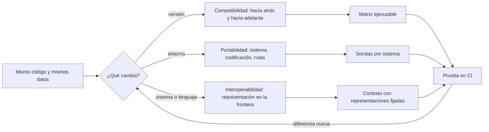

# SE-441 — Compatibilidad, portabilidad e interoperabilidad

[← SE-440 — Disponibilidad, durabilidad y recuperación](https://github.com/vladimiracunadev-create/modern-software-engineering-program/blob/main/classes/part-36-calidad-rendimiento-y-resiliencia/se-440-disponibilidad-durabilidad-y-recuperacion/README.md) · [↑ Parte 36](https://github.com/vladimiracunadev-create/modern-software-engineering-program/blob/main/classes/part-36-calidad-rendimiento-y-resiliencia/README.md) · [📚 Índice completo](https://github.com/vladimiracunadev-create/modern-software-engineering-program/blob/main/classes/README.md) · [🌐 Portal](https://vladimiracunadev-create.github.io/modern-software-engineering-program/classes/SE-441.html) · [SE-442 — Calidad de experiencia y presupuestos →](https://github.com/vladimiracunadev-create/modern-software-engineering-program/blob/main/classes/part-36-calidad-rendimiento-y-resiliencia/se-442-calidad-de-experiencia-y-presupuestos/README.md)

## Punto profesional y fundamento pedagógico

**Punto profesional.** La clase existe para que sepas en qué se diferencia el mismo programa cuando corre en dos sistemas, cuando lo leen dos versiones y cuando lo consumen dos lenguajes, y para que conviertas esas diferencias en una matriz de compatibilidad que se ejecuta y no en una esperanza. Compatibilidad, portabilidad e interoperabilidad parecen palabras próximas y fallan de manera distinta: la primera es sobre versiones, la segunda sobre entornos y la tercera sobre fronteras entre sistemas.

**Por qué aparece aquí.** Sigue a **Disponibilidad, durabilidad y recuperación**: aquella clase asumía que lo que se restaura o se conmuta funciona igual; esta pregunta cuándo no es así. Cubre tres de las características de calidad que `SE-433` nombró (compatibilidad, flexibilidad y, en parte, interacción) con medidas ejecutables. El caso conductor es el mensaje de «entrega» que la API envía a otros sistemas y los scripts que corren en máquinas de docentes con Windows y en servidores con Linux.

**Error conceptual que debe corregir.** Creer que «funciona en mi máquina» y «es un formato estándar» garantizan que funciona en otras: los valores por defecto del sistema (codificación, fin de línea, separador de ruta, límites), la representación de los números y las diferencias entre lectores estrictos y tolerantes cambian el resultado sin lanzar una sola excepción.

**Secuencia de aprendizaje.** Antes de leer los resultados, predices cuántas de doce sondas de comportamiento del mismo script difieren entre Windows y Ubuntu y qué fracción de identificadores de 63 bits sobrevive a un lector que usa decimales de 64 bits; después ejecutas las sondas en los dos sistemas, mides cuatro fronteras de datos y construyes la matriz de compatibilidad de cinco versiones con lectores estrictos y tolerantes. La secuencia usa predicción, explicación propia, contraste y recuperación. [ICAP](https://icap.education.asu.edu/research) distingue participación de construcción de conocimiento; [How People Learn II](https://nap.nationalacademies.org/catalog/24783/how-people-learn-ii-learners-contexts-and-cultures) respalda diseñar la práctica con contextos reales y retroalimentación.

**Evidencia de aprendizaje.** `compat-log.md` con la predicción, las tres figuras reproducidas, un contrato de interoperabilidad del mensaje de entrega con sus representaciones fijadas, una matriz de versiones ejecutable y una nota que separe lo observado en cada sistema de lo supuesto.

**Límite de la conclusión.** Las sondas son reales y se ejecutaron en un equipo con Windows 11 (CPython 3.12.9) y en Ubuntu 24.04 bajo WSL2 (3.12.3); el resultado depende de esa configuración (por ejemplo, rutas largas deshabilitadas) y no se probó macOS ni otras versiones de Python. Las fronteras de datos y la matriz son modelos de cinco versiones del autor y no representan ningún sistema real.

### Trazabilidad fuente → afirmación

| Fuente primaria u oficial | Afirmación que respalda | Lo que no prueba |
|---|---|---|
| [RFC 8259: JSON](https://www.rfc-editor.org/rfc/rfc8259) | Advierte de que los números se interpretan con el rango y la precisión de cada implementación y de que los enteros fuera del rango de un decimal de 64 bits no son interoperables. | No dice qué lectores de la plataforma usan decimales de 64 bits. |
| [Unicode UAX #15: formas de normalización](https://unicode.org/reports/tr15/) | Define las formas NFC y NFD y explica que secuencias distintas pueden representar el mismo texto. | No dice cuándo se debe normalizar en una base concreta. |
| [Microsoft: nombres de archivo, rutas y espacios de nombres](https://learn.microsoft.com/en-us/windows/win32/fileio/naming-a-file) | Documenta caracteres y nombres reservados y la convención de rutas de Windows. | No describe el comportamiento de otros sistemas de archivos. |
| [Fowler, «TolerantReader»](https://martinfowler.com/bliki/TolerantReader.html) | Describe el patrón del lector que ignora lo que no necesita para tolerar cambios aditivos. | No dice que ser tolerante sea siempre seguro. |
| [Python: multiprocessing, métodos de inicio](https://docs.python.org/3/library/multiprocessing.html#contexts-and-start-methods) | Documenta que el método de arranque por defecto depende de la plataforma (spawn en Windows). | No cubre otras versiones de Python con otros valores por defecto. |

## Antes de empezar

Recupera lo aprendido en `SE-440`: una réplica protege del fallo independiente y no de lo que comparte. La pregunta activa es: **¿qué comparten dos sistemas, dos versiones o dos lenguajes que creemos iguales, y qué comparten solo en apariencia?**

## Prerrequisitos

- Haber completado `SE-440` o poder explicar qué comparten las réplicas y por qué importa.
- Python 3.11 o posterior; los experimentos usan solo la biblioteca estándar (`os`, `json`, `unicodedata`, `tempfile`, `multiprocessing`).
- Acceso a dos sistemas (por ejemplo, Windows y Ubuntu bajo WSL2); con uno solo se hace la parte de datos y de versiones.

## Problema auténtico

Un docente escribió un script que lee un CSV de entregas, lo procesa y escribe un informe. En su portátil con Windows funcionaba; en el servidor Linux de la plataforma, el mismo archivo dejaba nombres como «José» y el informe de un curso aparecía duplicado. Detrás había tres diferencias acumuladas: la codificación por defecto al abrir archivos (cp1252 en el portátil y UTF-8 en el servidor), la normalización del nombre (una exportación de macOS guardaba la eñe con una marca combinada) y un identificador de 18 cifras que una hoja de cálculo había convertido a decimal. Ninguna produjo un error; los tres produjeron datos distintos. La clase mide esas diferencias en vez de memorizarlas.

## Objetivos observables

Al terminar podrás:

1. distinguir compatibilidad, portabilidad e interoperabilidad con un ejemplo y un contraejemplo de la plataforma;
2. ejecutar un conjunto de sondas de comportamiento en dos sistemas y clasificar cada diferencia;
3. medir cuántos datos cambian de significado al cruzar una frontera de representación (enteros, texto, dinero, fechas);
4. construir y ejecutar una matriz de compatibilidad de versiones con lectores estrictos y tolerantes;
5. escribir un contrato de interoperabilidad que fije las representaciones y declare qué se prueba.

## Mapa conceptual



El mapa separa las **tres causas** de que el mismo software se comporte distinto. Cada una tiene su instrumento (matriz, sondas, contrato) y todas terminan en una prueba que se repite.

## Temas y por qué importan

| Tema | Por qué cambia una decisión profesional | Evidencia mínima |
|---|---|---|
| Compatibilidad entre versiones | Decide cuándo un cambio rompe a quien no cambió. | Predicción, traza causal y contraejemplo de **Compatibilidad entre versiones** en `compat-log.md` |
| Portabilidad entre sistemas | Los valores por defecto del entorno cambian el resultado sin error. | Predicción, traza causal y contraejemplo de **Portabilidad entre sistemas** en `compat-log.md` |
| Interoperabilidad y representación | Un dato válido para un lenguaje puede cambiar en otro. | Predicción, traza causal y contraejemplo de **Interoperabilidad y representación** en `compat-log.md` |
| Lectores estrictos y tolerantes | Qué se ignora y qué se rechaza define qué cambios son seguros. | Predicción, traza causal y contraejemplo de **Lectores estrictos y tolerantes** en `compat-log.md` |
| Contratos y pruebas de compatibilidad | Una matriz que no se ejecuta es una opinión. | Predicción, traza causal y contraejemplo de **Contratos y pruebas de compatibilidad** en `compat-log.md` |

## Conceptos y decisiones

### 1. Compatibilidad entre versiones

Un cambio es **compatible hacia atrás** si los consumidores existentes siguen funcionando con la nueva versión del productor, y **compatible hacia adelante** si los consumidores nuevos pueden leer lo que produce una versión anterior (o los antiguos leer lo nuevo). Añadir un campo opcional suele ser compatible hacia atrás; quitar un campo, renombrarlo o cambiar su tipo no lo es. Pero la respuesta depende del lector: si el consumidor rechaza los campos desconocidos, añadir un campo lo rompe. De ahí que la compatibilidad no sea una propiedad del cambio sino del par productor-consumidor y de la política de lectura. Los números de versión (por ejemplo, el versionado semántico) comunican una intención, y la intención no sustituye a la prueba: un cambio de versión menor que renombra un campo sigue rompiendo.

### 2. Portabilidad entre sistemas

La **portabilidad** es la capacidad de ejecutar el mismo software en otro entorno con el mismo resultado. Los valores por defecto del entorno son la fuente habitual de diferencias: la codificación de texto cuando no se especifica, el fin de línea, el separador de ruta, si los nombres distinguen mayúsculas, los caracteres y nombres prohibidos en un archivo, la longitud máxima de una ruta, qué ocurre al renombrar sobre un archivo existente o al borrar un archivo abierto, el rango de fechas que admite el reloj, el método con que se crea un proceso. Python esconde muchas diferencias y expone otras; las expuestas lanzan una excepción (`PermissionError`) y las escondidas cambian el resultado. Las segundas son las peligrosas: un texto escrito con la codificación por defecto tiene bytes distintos en cada sistema aunque el programa sea idéntico.

### 3. Interoperabilidad y representación

La **interoperabilidad** es la capacidad de que dos sistemas intercambien datos con el mismo significado. Un formato estándar fija la sintaxis y deja libres cosas que importan: JSON dice que un número es una secuencia de dígitos, y cada implementación decide su rango y su precisión. Un identificador de 64 bits que un lector convierte a decimal de doble precisión pierde los dígitos bajos si supera 2⁵³. El texto tiene el mismo problema con las formas de normalización (la «é» puede ser un solo carácter o una «e» más una marca combinada: se ven igual y no son iguales). El dinero guardado como decimal binario acumula errores de representación. Una fecha «03/04» se lee de dos formas según la región. La defensa es fijar en el contrato la **representación** de cada tipo, no solo su sintaxis: identificadores como cadenas, texto normalizado, importes en centavos enteros, fechas en ISO 8601 con zona.

### 4. Lectores estrictos y tolerantes

Un **lector estricto** rechaza cualquier mensaje que no coincide exactamente con el esquema que conoce; un **lector tolerante** extrae lo que necesita e ignora el resto. El tolerante permite evolucionar un productor sin coordinar con todos los consumidores: añadir un campo no los rompe. Pero la tolerancia tiene un costo: puede ocultar un error (un campo mal escrito se ignora y el valor falta sin aviso) y no resuelve los cambios que alteran lo que el lector necesita (renombrar o cambiar el tipo). Elegir uno u otro es decidir qué fallo se prefiere: fallar pronto y visible, o seguir funcionando con menos información. En un sistema con muchos consumidores independientes, el tolerante suele ser la elección razonable para los campos que no se usan, y la validación estricta se reserva para los que sí.

### 5. Contratos y pruebas de compatibilidad

Una **matriz de compatibilidad** enumera las combinaciones de versión de productor y de consumidor y marca cuáles funcionan. Si se construye leyendo la documentación, es una opinión; si se construye ejecutando los lectores contra mensajes generados por cada versión, es evidencia. El mismo principio vale para la portabilidad: un conjunto de sondas que se ejecuta en cada sistema objetivo en la integración continua detecta la diferencia nueva el día que aparece. Una **prueba de contrato** fija el mensaje que espera el consumidor y la comprueba contra el productor sin necesidad de levantar ambos. Lo que ninguna matriz ve son los consumidores desconocidos: quien usa un campo no documentado, o depende del orden de los campos, acaba formando parte del contrato aunque nadie lo haya escrito.

### Doce sondas de portabilidad

El mismo script de Python se ejecuta en Windows 11 y en Ubuntu bajo WSL2 y anota doce comportamientos. Cada sonda crea archivos en un directorio temporal del propio sistema (NTFS en Windows y ext4 en Ubuntu).

```python
def sonda(nombre, f):
    try: v = f()
    except Exception as e: v = type(e).__name__
    print("A | %s | %s" % (nombre, v))
sonda("os.rename sobre un archivo existente", renombrar)       # FileExistsError o sobrescribe
sonda("datetime.fromtimestamp(-1)", lambda: datetime.datetime.fromtimestamp(-1).year)
```

| Sonda | Windows 11 | Ubuntu (WSL2) |
|---|---|---|
| Separador de ruta y fin de línea | `\` y `\r\n` | `/` y `\n` |
| Codificación por defecto de `open()` sin `encoding` | cp1252 | UTF-8 |
| Bytes de «a», «ñ», «o» y salto de línea en modo texto | `61 f1 6f 0d 0a` | `61 c3 b1 6f 0a` |
| `archivo.txt` existe tras crear `Archivo.TXT` | Sí | No |
| Crear un archivo llamado `a:b` | Error | Sí |
| 8 directorios anidados de 50 caracteres | Falla en el 4.º (252 caracteres) | 8 niveles (428 caracteres) |
| `os.rename` sobre un archivo existente | `FileExistsError` | Sobrescribe sin error |
| Borrar un archivo que sigue abierto | `PermissionError` | Borra |
| `datetime.fromtimestamp(-1)` | `OSError` | 1969 |
| `time.strftime` con `%-d` | `ValueError` | 5 |
| `os.getuid()` | `AttributeError` | Un entero |
| Método de arranque de `multiprocessing` | spawn | fork |

Las doce sondas difieren. El texto «año» ocupa 5 bytes con el salto de línea en los dos sistemas y los bytes son distintos (`61 f1 6f 0d 0a` frente a `61 c3 b1 6f 0a`): el tamaño del archivo no delata la diferencia, y un script que compruebe solo el tamaño la aprobaría. Siete de las doce lanzan una excepción en un sistema y no en el otro, y esas se descubren al primer uso; las otras cinco (separador y fin de línea, codificación, bytes, mayúsculas y método de arranque) cambian el resultado en silencio.


**Cómo leer la figura.** Cada barra es un área de comportamiento y su longitud, cuántas de las doce sondas dan un resultado distinto en Windows y en Ubuntu. Mira primero que las diferencias no se concentran en un solo sitio: texto, nombres de archivo, funciones de la plataforma y procesos están afectados. **Dónde deja de valer:** la ruta de Windows falla por el límite de 260 caracteres con la configuración de este equipo (rutas largas deshabilitadas); con la opción activada y un manifiesto adecuado no fallaría. El método de arranque por defecto cambió entre versiones de Python y cambiará de nuevo. Las sondas no cubren macOS, otro sistema de archivos ni otras versiones.

### Datos que cambian de significado

Se miden cuatro fronteras con datos sintéticos y semillas fijas.

```python
mal = sum(1 for x in ids if int(float(x)) != x)                              # identificador que pasa por un decimal de 64 bits
dist = sum(1 for a, b in zip(fuente_a, fuente_b) if a != b)                  # mismo nombre en NFC y NFD
mal = sum(1 for c in range(1, 100000) if int((c / 100) * 100) != c)           # importe en centavos
```

| Frontera y dato | Medida | Lectura |
|---|---|---|
| Identificadores de 40 y de 53 bits convertidos a decimal de 64 bits | 0 de 100 000 cambian | Caben exactos |
| Identificadores de 54 bits | 49 896 de 100 000 cambian (49,9 %) | Superan 2⁵³ |
| Identificadores de 63 bits | 99 886 de 100 000 cambian (99,9 %) | Casi todos |
| «José» en NFC y NFD de dos fuentes (2 000 pares) | 1 026 distintos con `==`; 0 tras normalizar a NFC | Longitud 4 frente a 5 |
| Precios de 1 a 99 999 centavos con `int(precio * 100)` | 4 586 de 99 999 cambian (4,6 %) | 0 con `round()` |
| Fechas de 2026 que se leen distinto como día/mes y mes/día | 132 de 365 (36,2 %) | ISO 8601 sin ambigüedad |

Ninguno de estos fallos lanza una excepción: el dato llega y es otro. Un identificador generado con la hora y un contador supera con facilidad los 2⁵³ y se corrompe en un lector que use decimales de doble precisión; una comparación de nombres entre una fuente que normaliza y otra que no discrepa en la mitad de los casos; el redondeo a la baja de un importe resta un centavo en una de cada veintidós conversiones. La corrección es la misma en cada caso: elegir una representación sin pérdida (cadena, NFC, entero en centavos, ISO 8601) y comprobarla en el borde.


**Cómo leer la figura.** Cada barra es una frontera de datos y su longitud, el porcentaje de casos que cambian de significado al cruzarla. Mira primero la escalera de los identificadores (0, 49,9 y 99,9 %) y que ninguna de estas barras corresponde a un error visible. **Dónde deja de valer:** los identificadores son uniformes en el rango de sus bits (los reales tienen estructura), los nombres son quince y el 50 % en NFD es un supuesto; el cálculo de dinero con decimales binarios depende del lenguaje y de cómo se redondee (con `round` el número de errores es cero en este rango).

### Matriz de compatibilidad

Se definen cinco versiones de un mensaje: v1 con identificador, estudiante y nota numérica; v2 añade un comentario opcional; v3 renombra «estudiante» a «alumno»; v4 cambia la nota a texto; v5 añade un estado. Cada versión tiene un productor y un lector. Un lector estricto exige exactamente los campos de su versión y rechaza los desconocidos y los estados que no conoce; uno tolerante exige solo los campos que necesita e ignora los demás. Se ejecutan los 25 pares con mensajes producidos de verdad.

```python
def lee(v, msg, estricto):
    campos, opc = requisitos(v)
    for k, t in campos.items():
        if k not in msg or not isinstance(msg[k], t): return False
    if estricto and set(msg) - set(campos) - set(opc): return False
```

| Productor | Lector estricto: v1 · v2 · v3 · v4 · v5 | Lector tolerante: v1 · v2 · v3 · v4 · v5 |
|---|---|---|
| v1: id, estudiante, nota | sí · sí · — · — · — | sí · sí · — · — · — |
| v2: añade comentario opcional | — · sí · — · — · — | sí · sí · — · — · — |
| v3: renombra estudiante a alumno | — · — · sí · — · — | — · — · sí · — · — |
| v4: la nota pasa de número a texto | — · — · — · sí · sí | — · — · — · sí · sí |
| v5: añade el campo estado | — · — · — · — · sí | — · — · — · sí · sí |

El lector estricto es compatible en 7 pares de 25 y el tolerante en 9. El tolerante gana dos: leer un mensaje v2 con un lector v1 (campo añadido) y leer un v5 con un lector v4. Los cambios v3 (renombrar) y v4 (cambiar el tipo) rompen con los dos tipos de lector: la tolerancia absorbe lo aditivo y no lo destructivo. Para una evolución sin ruptura, un renombrado necesita el patrón expandir-contraer de `SE-354`: durante un periodo el productor emite los dos nombres y los lectores migran antes de quitar el viejo.


**Cómo leer la figura.** Cada grupo es la versión que produce el mensaje y cada barra, cuántos de los cinco lectores lo aceptan: en rojo con lector estricto y en verde con tolerante. Mira primero en qué grupos la barra verde supera a la roja: solo en los cambios aditivos. **Dónde deja de valer:** son cinco versiones sintéticas con cuatro cambios elegidos para ilustrar cada clase; un esquema real tiene campos anidados, valores por defecto, enumeraciones que crecen y consumidores que dependen del orden. Un lector tolerante que ignora un campo requerido en secreto pasaría esta matriz sin avisar.

## Definiciones de trabajo

- **compatibilidad hacia atrás:** los consumidores existentes siguen funcionando con la nueva versión del productor.
- **portabilidad:** capacidad de ejecutar el mismo software en otro entorno con el mismo resultado.
- **interoperabilidad:** capacidad de dos sistemas de intercambiar datos conservando su significado.
- **lector tolerante:** consumidor que extrae lo que necesita de un mensaje e ignora los campos que no conoce.
- **normalización Unicode:** conversión de un texto a una forma canónica (por ejemplo, NFC) para que secuencias equivalentes se comparen como iguales.

Las definiciones son operativas para el mensaje de entrega de la plataforma. No convierten términos con una historia más amplia en sinónimos y deben contrastarse con la documentación primaria enlazada al final.

## Ejemplo mínimo

El fragmento muestra que dos cadenas que se ven iguales no lo son. Antes de ejecutarlo, predice si la comparación da verdadero.

```python
import unicodedata
a = "José"
b = unicodedata.normalize("NFD", a)
print(a == b, len(a), len(b), unicodedata.normalize("NFC", b) == a)
```

La comparación es falsa, las longitudes son 4 y 5 y la comparación tras normalizar es verdadera. Registra versión de Python, comando y salida; después busca en tus datos si alguna fuente (un nombre de archivo de macOS, una exportación) llega en NFD.

## Ejemplo profesional

El equipo escribe el contrato del mensaje de entrega que consumen el portal, el sistema de calificaciones y un script de los docentes. El contrato fija: identificadores como cadenas, texto en UTF-8 normalizado a NFC en el borde, nota como entero en décimas, fechas en ISO 8601 con zona, `schema_version` en cada mensaje y la política de lectura: los consumidores ignoran campos desconocidos y rechazan estados que no conocen con un valor por defecto «desconocido». El productor emite siempre el campo viejo y el nuevo durante dos versiones. En integración continua corre la matriz de compatibilidad con los lectores de las cuatro versiones vigentes y las doce sondas de portabilidad en un ejecutor de Windows y uno de Ubuntu, y un script comprueba que todos los archivos se abren con `encoding="utf-8"` y `newline=""` cuando corresponde. Compara con el estado anterior: cada sistema leía lo que podía y los fallos aparecían en producción.

## Práctica guiada

1. Ejecuta las doce sondas en dos sistemas y anota cuáles lanzan excepción y cuáles cambian el resultado en silencio.
2. Predice cuántas de las doce difieren y escríbelo antes de medir.
3. Escribe un archivo con una eñe en modo texto sin `encoding` y compara los bytes en los dos sistemas.
4. Mide cuántos identificadores de 54 y 63 bits cambian al pasar por `float` y propón una representación segura.
5. Compara 2 000 nombres de dos fuentes con `==` y tras normalizar a NFC.
6. Implementa los lectores estricto y tolerante de cinco versiones del mensaje y completa la matriz de 25 pares.
7. Entrega `compat-log.md` y pide a otra persona que encuentre un par que tu matriz marque compatible y que no lo sea.

## Ejercicios

1. **Sonda:** añade una decimotercera sonda sobre el orden en que `os.listdir` devuelve los archivos y compara los dos sistemas.
2. **Identificadores:** calcula a partir de qué número un entero deja de ser representable de forma exacta como decimal de 64 bits y decide si el identificador de la plataforma debe ser cadena.
3. **Versión:** propón la secuencia de tres versiones que renombra «estudiante» a «alumno» sin romper a ningún lector estricto ni tolerante.
4. **Contrato:** escribe cuatro reglas de representación para fechas, importes, texto e identificadores y una prueba que las compruebe.

## Reto verificable

Entrega `compat-log.md` con la predicción, las tres tablas de resultados, el contrato de interoperabilidad del mensaje, la matriz de compatibilidad ejecutable y la lista de sondas con su resultado en cada sistema. Se aprueba si otra persona ejecuta el código en sus sistemas, obtiene resultados equivalentes y puede decir qué diferencia no lanza una excepción. No se aprueba por afirmar «es multiplataforma» sin ejecutar ninguna sonda ni por una matriz construida leyendo la documentación.

## Caso conductor

El mensaje de entrega de la plataforma es el caso conductor de la [Parte 36](../README.md). Esta clase deja el noveno artefacto: un contrato de interoperabilidad y una matriz ejecutable. `SE-442` preguntará cómo se mide la experiencia de quien usa el producto en dispositivos distintos y con presupuestos explícitos. Cambia después un solo dato, la política de lectura (estricta o tolerante), y observa cuántos pares dejan de ser compatibles.

## Preguntas frecuentes

### ¿Es Python portable por sí mismo?

Mucho, pero no del todo: el intérprete oculta la mayoría de las diferencias y deja expuestas otras, como las que midieron las sondas. Python es portable cuando el programa evita depender de los valores por defecto del entorno (codificación, fin de línea, método de arranque), no por magia del lenguaje.

### ¿Conviene siempre un lector tolerante?

No. Es útil para evolucionar sin coordinar, pero oculta errores (un campo mal escrito se ignora) y no ayuda con renombrados ni cambios de tipo. Los campos obligatorios deben validarse y fallar de forma visible; los demás se toleran.

### ¿Por qué no usar un número para los identificadores?

Porque algunos lenguajes y herramientas leen todos los números como decimales de 64 bits y corrompen los enteros mayores de 2⁵³ sin avisar. Una cadena es opaca y se compara exactamente; si hace falta ordenar, se ordena en el servidor.

### ¿Cómo se prueban los consumidores que no conocemos?

No se prueban: se limita su superficie. Se documenta el contrato, se evita cambiar lo que no está documentado sin un periodo de aviso, se mira quién llama a qué campo si hay trazas y se emite lo viejo junto a lo nuevo durante un tiempo. Cualquier comportamiento observable acaba siendo usado por alguien.

## Fallo controlado y diagnóstico

Reproduce el fallo clásico de la clase: **un identificador de 63 bits que cambia al cruzar un lector con decimales de 64 bits**. Genera 100 000 identificadores y pásalos por `float`.

Registra síntoma, entrada mínima, hipótesis, observación que descarta cada hipótesis, causa, corrección y prueba de regresión. **Síntoma:** el portal muestra entregas de otros estudiantes al abrir una entrega. **Hipótesis rivales:** (a) hay una colisión de identificadores en el servidor; (b) un error de permisos; (c) el lector convirtió el identificador a decimal y perdió los dígitos bajos. **Prueba:** compara el identificador enviado con el leído; si difieren solo en los dígitos finales y el 99,9 % de los de 63 bits cambian, la causa es la representación. **Conclusión:** dos identificadores distintos colapsan en el mismo decimal. **Regresión:** cambia el identificador a cadena en el contrato, añade una prueba que envíe un identificador de 63 bits y compruebe que llega idéntico y otra que falle si un esquema declara un entero de más de 53 bits. No cambies a la vez el tipo y la base de datos.

## Errores comunes y cómo corregirlos

| Síntoma | Causa probable | Corrección |
|---|---|---|
| Acentos rotos en un sistema y no en otro | Codificación por defecto distinta | Especificar `encoding="utf-8"` siempre |
| Un archivo difiere de bytes y tiene el mismo tamaño | Fin de línea o codificación distintos | Fijar `newline` y `encoding` y comparar hashes |
| Dos nombres iguales no se reconocen | Formas de normalización distintas | Normalizar a NFC en el borde |
| Un cambio «menor» rompe a un consumidor | Lector estricto o renombrado | Expandir y contraer; probar la matriz |
| Funciona en el portátil y no en el servidor | Diferencia de sistema no probada | Sondas en CI en ambos sistemas |

## Entorno y archivos clave

```text
work/SE-441/
├── README.md
├── compat/
│   ├── sondas.py
│   ├── fronteras.py
│   └── matriz.py
├── tests/test_compat.py
└── evidence/compat-log.md
```

El `README` declara plataforma, versión de Python, sistema de archivos y comandos. Los experimentos usan solo la biblioteca estándar (`os`, `json`, `unicodedata`, `tempfile`, `multiprocessing`, `datetime`) y se ejecutaron con CPython 3.12.9 en Windows 11 y 3.12.3 en Ubuntu bajo WSL2: las sondas difieren por diseño; las fronteras y la matriz fueron idénticas. Si añades una dependencia, fija procedencia y versión.

## Seguridad, ética y accesibilidad

- las diferencias de normalización y de mayúsculas en nombres de archivo son una fuente de vulnerabilidades (dos nombres que se ven igual y apuntan a archivos distintos): valida y normaliza antes de comparar;
- un identificador secuencial o que exponga su estructura puede permitir enumerar datos; la representación debe elegirse también por lo que revela;
- las personas con nombres con caracteres no ASCII son las primeras en sufrir los defectos de codificación: probar con nombres reales de la comunidad (sintéticos en los ensayos) es una cuestión de equidad;
- documenta las tablas y las figuras con texto alternativo y en un formato que un lector de pantalla pueda recorrer;
- respeta las licencias de las especificaciones y atribuye lo adaptado.

## Puente hacia el trabajo con agentes

Un agente al que se le pide «hazlo multiplataforma» sustituirá las barras de las rutas por `os.path.join`, probablemente no tocará la codificación de los archivos y declarará la tarea completa tras ejecutar las pruebas en un solo sistema. Pídele en cambio que enumere los valores por defecto del entorno de los que depende el código, que fije la codificación y el fin de línea en cada apertura de archivo, que ejecute las sondas en los dos sistemas, que escriba el contrato con las representaciones y que ejecute la matriz de versiones. Revisa especialmente si da por buena una prueba que solo corrió en un sistema y si trata los identificadores largos como números: son los dos defectos que esta clase mostró sin aviso.

## Transferencia

Traslada el análisis a otra frontera (por ejemplo, un archivo de calificaciones que exportan las hojas de cálculo): cambia el formato y conserva el procedimiento de ejecutar sondas por sistema, fijar las representaciones y construir una matriz ejecutable de versiones. La transferencia está lograda cuando puedes decir qué diferencia no produciría una excepción, no cuando el archivo se abre en ambos sistemas.

## Evaluación y evidencia

| Criterio | Evidencia para aprobar |
|---|---|
| comprensión | explicación de la diferencia entre compatibilidad, portabilidad e interoperabilidad con ejemplos |
| corrección | tablas de sondas, fronteras y matriz reproducibles; las sondas con los dos sistemas |
| diseño | contrato con representaciones fijadas y política de lectura |
| diagnóstico | reproducción del fallo «identificador de 63 bits que cambia» con regresión |
| incertidumbre | declaración de que los sistemas probados son dos y las versiones del mensaje son sintéticas |
| reproducibilidad | versiones, comandos, salida y límites declarados |

## Fuentes

- [RFC 8259: JSON](https://www.rfc-editor.org/rfc/rfc8259) — números y su interoperabilidad; autoridad: IETF.
- [Unicode UAX #15](https://unicode.org/reports/tr15/) — formas de normalización; autoridad: Unicode Consortium.
- [Microsoft: nombres de archivo, rutas y espacios de nombres](https://learn.microsoft.com/en-us/windows/win32/fileio/naming-a-file) — reglas de nombres en Windows; autoridad: documentación de Microsoft.
- [Fowler, «TolerantReader»](https://martinfowler.com/bliki/TolerantReader.html) — lector que tolera cambios aditivos; autoridad: autor del texto.
- [Python: multiprocessing](https://docs.python.org/3/library/multiprocessing.html#contexts-and-start-methods) — métodos de inicio por plataforma; autoridad: documentación de Python.

Cada fuente respalda el mecanismo indicado; ninguna demuestra que el 49,9 %, el 36,2 % o los 7 pares compatibles se observen en otro sistema. Esa afirmación depende de las implementaciones y de los datos.

## Límites y siguiente paso

Se ejecutaron tres experimentos, uno de ellos con sondas reales en Windows 11 y Ubuntu 24.04 bajo WSL2 y los otros con datos sintéticos y semillas fijas con resultados idénticos. No se probó macOS, otro sistema de archivos, otras versiones de Python ni ningún lector en otro lenguaje; la ruta larga de Windows depende de la configuración del equipo, los nombres son quince, el 50 % en NFD y los cinco mensajes son construcciones del autor y la matriz no ve consumidores desconocidos. La siguiente clase mide la experiencia de quien usa el producto y fija presupuestos de rendimiento.

## Glosario

- **compatibilidad hacia atrás:** los consumidores existentes siguen funcionando con la nueva versión del productor.
- **portabilidad:** capacidad de ejecutar el mismo software en otro entorno con el mismo resultado.
- **interoperabilidad:** capacidad de dos sistemas de intercambiar datos conservando su significado.
- **lector tolerante:** consumidor que extrae lo que necesita de un mensaje e ignora los campos que no conoce.
- **normalización Unicode:** conversión de un texto a una forma canónica (por ejemplo, NFC) para que secuencias equivalentes se comparen como iguales.

---

[← SE-440 — Disponibilidad, durabilidad y recuperación](https://github.com/vladimiracunadev-create/modern-software-engineering-program/blob/main/classes/part-36-calidad-rendimiento-y-resiliencia/se-440-disponibilidad-durabilidad-y-recuperacion/README.md) · [↑ Parte 36](https://github.com/vladimiracunadev-create/modern-software-engineering-program/blob/main/classes/part-36-calidad-rendimiento-y-resiliencia/README.md) · [📚 Índice completo](https://github.com/vladimiracunadev-create/modern-software-engineering-program/blob/main/classes/README.md) · [🌐 Portal](https://vladimiracunadev-create.github.io/modern-software-engineering-program/classes/SE-441.html) · [SE-442 — Calidad de experiencia y presupuestos →](https://github.com/vladimiracunadev-create/modern-software-engineering-program/blob/main/classes/part-36-calidad-rendimiento-y-resiliencia/se-442-calidad-de-experiencia-y-presupuestos/README.md)
