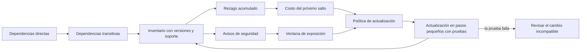
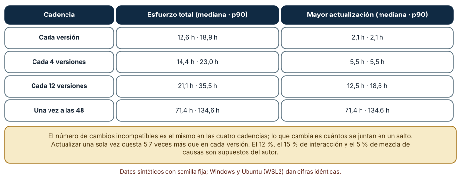
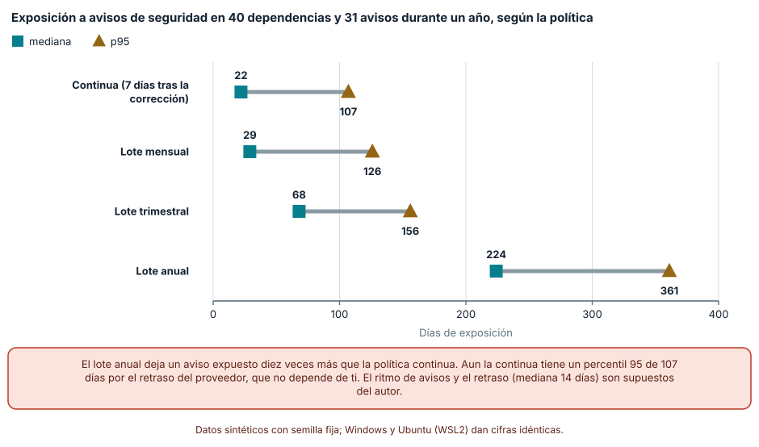
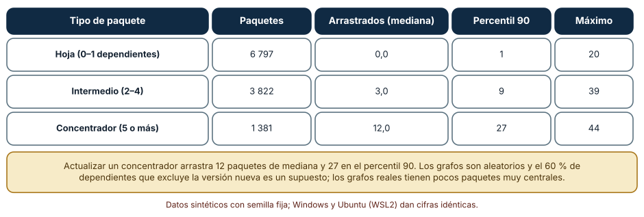

# SE-436 — Dependencias obsoletas y riesgo acumulado

[← SE-435 — Pruebas de caracterización y seams](https://github.com/vladimiracunadev-create/modern-software-engineering-program/blob/main/classes/part-36-mantenimiento-y-modernizacion-legacy/se-435-pruebas-de-caracterizacion-y-seams/README.md) · [↑ Parte 36](https://github.com/vladimiracunadev-create/modern-software-engineering-program/blob/main/classes/part-36-mantenimiento-y-modernizacion-legacy/README.md) · [📚 Índice completo](https://github.com/vladimiracunadev-create/modern-software-engineering-program/blob/main/classes/README.md) · [🌐 Portal](https://vladimiracunadev-create.github.io/modern-software-engineering-program/classes/SE-436.html) · [SE-437 — Strangler, branch by abstraction y anticorruption →](https://github.com/vladimiracunadev-create/modern-software-engineering-program/blob/main/classes/part-36-mantenimiento-y-modernizacion-legacy/se-437-strangler-branch-by-abstraction-y-anticorruption/README.md)

## Punto profesional y fundamento pedagógico

**Punto profesional.** La clase existe para que trates las dependencias desactualizadas como un riesgo que se acumula con el tiempo y se puede medir, no como una tarea pendiente más. El módulo de calificaciones usa bibliotecas que alguien eligió hace años; cada versión que pasa sin actualizar aumenta el costo del salto y alarga la ventana en la que una vulnerabilidad conocida puede ser explotada. La habilidad es decidir una política de actualización, estimar su costo y su exposición, y entender qué parte del riesgo vive en las dependencias que ni siquiera declaraste.

**Por qué aparece aquí.** Sigue a **Pruebas de caracterización y seams**: con el comportamiento de `nota_final` fijado, actualizar una dependencia deja de ser un salto a ciegas y pasa a ser un cambio que una prueba puede validar. El caso conductor es el **módulo legado de calificaciones**, que depende de una biblioteca de fechas, otra de exportación y una tercera de acceso a datos, cada una con sus propias dependencias.

**Error conceptual que debe corregir.** Creer que no actualizar es la opción segura porque «funciona». Mantener una versión fija no detiene el paso del tiempo: el entorno cambia, los avisos de seguridad se acumulan y el costo del salto crece más rápido que linealmente, de modo que la decisión de esperar es una apuesta con interés compuesto, no una abstención.

**Secuencia de aprendizaje.** Antes de mirar los resultados, predices cuántas horas más cuesta actualizar una vez cada 48 versiones que hacerlo en cada versión, aunque el número de cambios incompatibles sea el mismo; después simulas cuatro cadencias de actualización, calculas cuántos días permanece expuesto un aviso de seguridad según la política y mides cuántos paquetes arrastra la actualización de una biblioteca en un grafo de dependencias. La secuencia usa predicción, explicación propia, contraste y recuperación. [ICAP](https://icap.education.asu.edu/research) distingue participación de construcción de conocimiento; [How People Learn II](https://nap.nationalacademies.org/catalog/24783/how-people-learn-ii-learners-contexts-and-cultures) respalda diseñar la práctica con contextos reales y retroalimentación.

**Evidencia de aprendizaje.** `dependencias-log.md` con la predicción, las tres figuras reproducidas, un inventario de las dependencias directas y transitivas del módulo con su versión, su antigüedad y su estado de soporte, una política de actualización con su ventana de exposición y una nota que separe qué es medido, qué inferido y qué supuesto.

**Límite de la conclusión.** La probabilidad de cambio incompatible, la fórmula del esfuerzo, el ritmo de avisos, el retraso de los proveedores y el grafo de dependencias son sintéticos y escritos por el autor con semilla fija. No se consultó ningún repositorio de paquetes, ninguna base de vulnerabilidades ni ninguna biblioteca real; los números muestran un mecanismo, no el costo de actualizar tu sistema.

### Trazabilidad fuente → afirmación

| Fuente primaria u oficial | Afirmación que respalda | Lo que no prueba |
|---|---|---|
| [Versionado semántico 2.0.0](https://semver.org/) | Define un esquema donde un cambio de versión mayor señala cambios incompatibles de la API pública. | Es una convención declarada por quien publica; no garantiza que se cumpla ni que un cambio menor no rompa a un consumidor concreto. |
| [OSV: base de datos abierta de vulnerabilidades](https://osv.dev/) | Es un registro abierto que relaciona vulnerabilidades con versiones de paquetes de distintos ecosistemas. | No dice si la vulnerabilidad es explotable en tu uso concreto. |
| [CISA: catálogo de vulnerabilidades explotadas conocidas](https://www.cisa.gov/known-exploited-vulnerabilities-catalog) | Lista vulnerabilidades con evidencia de explotación activa, útil para priorizar. | No es exhaustivo: una vulnerabilidad ausente no es inofensiva. |
| [NIST SP 800-218, Secure Software Development Framework](https://csrc.nist.gov/pubs/sp/800/218/final) | Incluye prácticas para gestionar componentes de terceros y responder a vulnerabilidades. | No fija una cadencia de actualización. |
| [Google, «Software Engineering at Google»: gestión de dependencias](https://abseil.io/resources/swe-book/html/ch21.html) | Explica por qué la gestión de dependencias es difícil: versiones en conflicto, dependencias transitivas y el costo del salto. | Describe el contexto de una empresa muy grande; no es un procedimiento para el tuyo. |

## Antes de empezar

Recupera lo aprendido en `SE-435`: una prueba de caracterización permite cambiar con red de seguridad. La pregunta activa es: **¿qué dependencias de tu sistema llevan más de dos años sin actualizarse y qué prueba te avisaría si una actualización cambiara un comportamiento del que dependes?**

## Prerrequisitos

- Haber completado `SE-435` o poder explicar qué fija una prueba de caracterización.
- Python 3.11 o posterior; los experimentos usan solo la biblioteca estándar (`random`, `math`, `statistics`).
- Saber qué es una dependencia directa y una transitiva y leer un archivo de requisitos con versiones.

## Problema auténtico

El módulo de calificaciones usaba una biblioteca de exportación en una versión de hace seis años. Cuando el equipo intentó actualizarla porque un aviso de seguridad lo exigía, descubrió que entre su versión y la actual habían ocurrido cinco cambios incompatibles, que la nueva versión necesitaba una versión más reciente de la biblioteca de fechas y que esta, a su vez, ya no soportaba el runtime del módulo. Lo que habría sido un cambio de media hora si se hubiera hecho cada año se convirtió en un proyecto de dos meses, y durante esos dos meses el aviso siguió abierto. La clase enseña a medir ese crecimiento, a definir cuánto tiempo puede estar expuesto un aviso y a ver el grafo completo antes de decidir.

## Objetivos observables

Al terminar podrás:

1. inventariar las dependencias directas y transitivas de un sistema con su versión, su antigüedad y su estado de soporte;
2. explicar por qué el costo de una actualización crece más rápido que el número de versiones omitidas;
3. calcular la ventana de exposición a un aviso de seguridad bajo distintas políticas de actualización;
4. estimar el radio de impacto de actualizar una dependencia a partir de su posición en el grafo;
5. redactar una política de actualización que combine cadencia, prioridad por explotación y condición de reversa.

## Mapa conceptual



El mapa separa dos riesgos que crecen con el rezago: el **costo** del salto, que sube con cada versión omitida, y la **exposición**, que sube con cada aviso sin atender. La política consiste en decidir cuánto de cada uno se acepta.

## Temas y por qué importan

| Tema | Por qué cambia una decisión profesional | Evidencia mínima |
|---|---|---|
| Qué significa que una dependencia esté obsoleta | Distingue «vieja» de «sin soporte» y de «vulnerable». | Inventario con tres estados por dependencia |
| El costo creciente del salto | Esperar para actualizar de una sola vez multiplica el esfuerzo. | Simulación del esfuerzo por cadencia |
| Ventana de exposición | La política determina cuántos días un aviso queda abierto. | Mediana y p95 de exposición por política |
| Dependencias transitivas y grafo | El riesgo vive en lo que no declaraste. | Radio de impacto por tipo de paquete |
| Política de actualización | Sin política, se actualiza solo cuando algo falla. | Documento con cadencia, prioridad y reversa |

## Conceptos y decisiones

### 1. Qué significa que una dependencia esté obsoleta

«Obsoleta» mezcla tres cosas distintas. Una dependencia puede estar **atrasada** (hay versiones nuevas), **sin soporte** (su mantenedor ya no publica correcciones, ni de seguridad) o **vulnerable** (existe un aviso que afecta a la versión usada). Son estados independientes: una versión puede estar atrasada y segura, sin soporte pero sin avisos hasta ahora, o vulnerable aunque sea la última. Cada estado pide una respuesta distinta: el rezago pide una cadencia, la falta de soporte pide un reemplazo o una decisión de asumir el mantenimiento, la vulnerabilidad pide una actuación con plazo. El inventario debe registrar los tres por separado, además de si la dependencia es directa o transitiva, porque la acción posible no es la misma: una dependencia directa se actualiza o reemplaza, una transitiva se influye a través de la que la trae.

### 2. El costo creciente del salto

Actualizar una dependencia se hace con una versión por vez o con un salto. Cada cambio incompatible entre dos versiones exige leer qué cambió, adaptar el código y volver a probar. Si se actualiza en cada versión, los cambios llegan de uno en uno y se aíslan con facilidad: si algo falla, el culpable es el último cambio. Si se espera, los cambios se acumulan y aparecen dos efectos que el esfuerzo suma. Los cambios interactúan, porque uno de ellos modifica lo que otro cambia y adaptarse a ambos cuesta más que la suma de adaptarse a cada uno; y cuando algo falla, la causa se mezcla entre muchas posibles y la depuración cuesta más. El resultado es un esfuerzo superlineal en el tamaño del salto. Hay además un efecto que el cálculo no captura: quien actualiza cada versión conoce la dependencia; quien actualiza una vez cada cinco años la redescubre cada vez.

### 3. Ventana de exposición

Cuando se publica un aviso de seguridad sobre una dependencia, el tiempo hasta que tu sistema deje de usar la versión afectada tiene tres tramos: hasta que el proveedor publica una versión corregida, hasta que tu política decide aplicarla y hasta que el cambio llega a producción. El primer tramo no depende de ti; los otros dos, sí. Una política **continua** (actualizar en cuanto hay corrección, tras una breve verificación) reduce el segundo tramo a días; una por **lotes** (mensual, trimestral, anual) lo ata al calendario: en promedio, un aviso espera a la mitad del periodo y, en el peor caso, al periodo completo. La política puede combinarse con prioridad: avisos con explotación activa conocida (como los de un catálogo de vulnerabilidades explotadas) se atienden fuera del lote. Medir la ventana con mediana y percentil 95 evita que un buen promedio oculte los avisos que esperaron casi un año.

### 4. Dependencias transitivas y radio de impacto

Un sistema depende de sus dependencias directas y de lo que estas traen. El grafo de dependencias es un grafo dirigido y la actualización de un nodo puede obligar a actualizar a quienes lo requieren con un rango de versiones que ya no admite la nueva. Ese **radio de impacto** depende de la posición del nodo: una hoja (nadie más la usa) se actualiza sola; un paquete intermedio arrastra a sus dependientes; un concentrador (un paquete del que dependen muchos) puede obligar a revisar una porción grande del grafo, y a la vez es el que más conviene mantener actualizado porque un aviso en él afecta a muchos. Los conflictos de versiones (dos dependientes que piden rangos incompatibles de un tercero) son la causa más frecuente de que una actualización «sencilla» no pueda hacerse sin tocar a otros. Los archivos de bloqueo (lockfiles) fijan las versiones exactas que se probaron y hacen la instalación repetible, pero no actualizan: sin una política, un lockfile preserva el rezago.

### 5. Política de actualización

Una política concreta responde cinco preguntas. **Cadencia**: con qué frecuencia se revisan y aplican las actualizaciones (por ejemplo, cada mes para menores y parches, cada trimestre para mayores). **Prioridad**: qué avisos saltan la cadencia (explotación conocida, alto impacto en tu uso). **Verificación**: qué pruebas deben pasar (por eso `SE-435` precede a esta clase). **Reversa**: cómo se vuelve atrás si algo falla en producción. **Responsable**: quién decide qué se pospone y por cuánto tiempo, porque posponer es una decisión que debe tener dueño y fecha. La política se escribe, se revisa con datos (ventana de exposición real, rezago medio) y admite excepciones documentadas, como una dependencia que se mantiene en una versión por razones de compatibilidad con un sistema externo.

### El costo de esperar, por cadencia

Se simulan 48 versiones de una dependencia. Cada versión tiene una probabilidad del 12 % de traer un cambio incompatible que afecta al código. Cada cambio cuesta 2 horas, y cuando varios se acumulan en el mismo salto el costo sube un 15 % por cada cambio adicional y un 5 % por cada versión omitida (la causa se mezcla). Se compara actualizar cada 1, 4, 12 y 48 versiones con 2 000 historias de semilla distinta.

```python
esf = k * 2.0 * (1 + 0.15 * (k - 1)) * (1 + 0.05 * len(tramo))
```

| Cadencia | Esfuerzo total (mediana · p90) | Mayor actualización (mediana · p90) |
|---|---|---|
| Cada versión | 12,6 h · 18,9 h | 2,1 h · 2,1 h |
| Cada 4 versiones | 14,4 h · 23,0 h | 5,5 h · 5,5 h |
| Cada 12 versiones | 21,1 h · 35,5 h | 12,5 h · 18,6 h |
| Una vez a las 48 | 71,4 h · 134,6 h | 71,4 h · 134,6 h |

El número de cambios incompatibles es el mismo en las cuatro cadencias; lo que cambia es cuántos se juntan en cada salto. Actualizar una vez al final cuesta 71,4 horas de mediana frente a 12,6 horas actualizando en cada versión, 5,7 veces más, y la peor historia del percentil 90 llega a 134,6 horas en un solo salto, en el que además el aviso de seguridad espera. Con cadencia anual (12 versiones) el costo ya es 1,7 veces el del paso continuo. La conclusión no es «actualiza siempre cada versión» sino que la cadencia es una palanca con un efecto cuantificable.



**Cómo leer la figura.** Cada fila es una cadencia de actualización y su tramo gris va de la mediana al percentil 90 del esfuerzo total. Mira primero cómo el tramo se desplaza y se ensancha hacia la derecha: actualizar una sola vez cuesta 5,7 veces más que hacerlo en cada versión y con mucha más dispersión. **Dónde deja de valer:** el 12 % de cambios incompatibles, el 15 % de interacción y el 5 % de mezcla de causas son supuestos del autor; con una biblioteca estable el costo de esperar es menor, y con una que cambia su API en cada versión mayor, la cadencia continua tampoco evita un trabajo grande por versión. El modelo no incluye el costo de coordinar cada actualización, que penaliza la cadencia frecuente.

### Cuánto tiempo queda expuesto un aviso

Se simulan 40 dependencias durante un año con 0,8 avisos de seguridad por dependencia (31 avisos). El proveedor publica la corrección tras un retraso lognormal de mediana 14 días. Cada política aplica la corrección en un momento distinto: la continua 7 días después de que existe; la mensual, trimestral y anual en la siguiente fecha de lote a partir de la corrección más 3 días de verificación.

| Política | Avisos | Exposición mediana | Percentil 95 |
|---|---:|---:|---:|
| Continua (7 días tras la corrección) | 31 | 22 días | 107 días |
| Lote mensual | 31 | 29 días | 126 días |
| Lote trimestral | 31 | 68 días | 156 días |
| Lote anual | 31 | 224 días | 361 días |

La política continua deja un aviso expuesto 22 días de mediana; la anual, 224, diez veces más. Aun la política continua tiene un percentil 95 de 107 días: la causa no es la política sino el retraso del proveedor, que tiene cola. Por eso conviene separar la exposición debida al proveedor (que se atenúa con mitigaciones: desactivar una función, filtrar una entrada) de la debida a tu cadencia.



**Cómo leer la figura.** Cada fila es una política de actualización y su tramo gris va de la exposición mediana a la del percentil 95, en días. Mira primero la distancia entre la política continua y el lote anual, y que incluso la continua llega a 107 días en el percentil 95. **Dónde deja de valer:** el ritmo de avisos, la mediana de 14 días del proveedor y el margen de 3 y 7 días son supuestos del autor, y la simulación trata todos los avisos como igual de graves: en la práctica un aviso crítico con explotación conocida se atiende fuera del lote. Con 31 avisos las cifras del percentil 95 se apoyan en pocas observaciones.

### Cuántos paquetes arrastra actualizar uno

Se generan 200 grafos de 60 paquetes con cero a cuatro dependencias por paquete. Al subir un paquete a una versión mayor, el 60 % de sus dependientes declara un rango que la excluye y debe actualizarse, y eso se propaga a sus propios dependientes con la misma probabilidad. Se cuenta cuántos paquetes quedan afectados según cuántos dependientes directos tiene el paquete.

| Tipo de paquete | Paquetes | Arrastrados (mediana) | Percentil 90 | Máximo |
|---|---:|---:|---:|---:|
| Hoja (0–1 dependientes) | 6 797 | 0,0 | 1 | 20 |
| Intermedio (2–4) | 3 822 | 3,0 | 9 | 39 |
| Concentrador (5 o más) | 1 381 | 12,0 | 27 | 44 |

Actualizar una hoja no arrastra ningún paquete en la mediana; un concentrador arrastra 12 y, en el percentil 90, 27 de 60. La mediana engaña en las hojas: el máximo de 20 muestra que una hoja que cuelga de una cadena larga también puede propagar. El radio de impacto se conoce con el grafo; sin él, la estimación de cuánto cuesta «solo actualizar esto» es una conjetura.



**Cómo leer la figura.** Cada fila es un tipo de paquete y su tramo gris va de la mediana al máximo de paquetes arrastrados, con marcas en el percentil 90. Mira primero cómo el tramo de los concentradores es el más largo y empieza a la derecha del de las hojas. **Dónde deja de valer:** los grafos son aleatorios y acíclicos por construcción, el 60 % de exclusión es un supuesto y los grafos reales tienen estructura (pocos paquetes muy centrales); los resultados indican la forma, no el número de tu proyecto.

## Definiciones de trabajo

- **dependencia atrasada:** dependencia para la cual existe una versión más reciente que la usada.
- **dependencia sin soporte:** dependencia cuyo mantenedor ya no publica correcciones, incluidas las de seguridad.
- **ventana de exposición:** tiempo transcurrido entre la publicación de un aviso de seguridad y el momento en que el sistema deja de usar la versión afectada.
- **radio de impacto:** número de paquetes que deben cambiar como consecuencia de actualizar uno.
- **archivo de bloqueo:** archivo que fija las versiones exactas de todas las dependencias para repetir una instalación.

Las definiciones son operativas para el módulo de calificaciones. No convierten términos con una historia más amplia en sinónimos y deben contrastarse con la documentación primaria enlazada al final.

## Ejemplo mínimo

El fragmento muestra que el mismo número de cambios cuesta más al juntarse. Antes de ejecutarlo, predice cuál de las dos cadencias cuesta menos.

```python
def esfuerzo(k, versiones): return 0 if k == 0 else k * 2.0 * (1 + 0.15 * (k - 1)) * (1 + 0.05 * versiones)
print(esfuerzo(1, 1) * 4, esfuerzo(4, 4))
```

Imprime `8.4` y `13.92`: cuatro saltos de un cambio cuestan 8,4 horas; un salto con los mismos cuatro cambios cuesta 13,92. Registra versión de Python, comando y salida; después cambia la interacción de 0,15 a 0 y comprueba cuánto de la diferencia se debe a ella.

## Ejemplo profesional

Escenario hipotético, construido para la clase y sin datos reales. El equipo hace el inventario del módulo: 14 dependencias directas y 61 transitivas. De las directas, 4 llevan más de tres años sin actualizar, 1 no tiene soporte (la biblioteca de exportación) y 2 tienen avisos abiertos. Con el grafo, descubren que la biblioteca de fechas es un concentrador: de ella dependen 9 paquetes. La política resultante: revisión mensual de menores y parches con las pruebas de caracterización de `SE-435`; revisión trimestral de mayores; los avisos con explotación conocida en el catálogo de la agencia de ciberseguridad se atienden en siete días fuera de calendario; la biblioteca sin soporte se reemplaza en un proyecto aparte, con fecha. Cada excepción se registra con dueño, motivo y fecha de revisión. Las medidas que el equipo se compromete a publicar a los tres meses son la mediana y el percentil 95 de exposición de sus avisos reales y el rezago medio; la simulación sugiere pasar de un orden de 224 días a uno de 29, y el dato real dirá si ocurre. Compara con el estado inicial: antes se actualizaba cuando algo fallaba; ahora se actualiza con una cadencia y se puede decir cuánto tiempo queda abierto cada aviso.

## Práctica guiada

1. Haz el inventario de las dependencias directas de un proyecto propio con versión, antigüedad y estado de soporte.
2. Predice el esfuerzo de actualizar una vez cada 48 versiones frente a cada versión y escribe el número antes de simular.
3. Reproduce la tabla de cadencias con las semillas fijadas en el código; cambia la probabilidad de cambio incompatible a 3 % y a 30 % y observa cuándo la cadencia deja de importar.
4. Simula la exposición a avisos con las cuatro políticas y calcula la mediana y el percentil 95.
5. Genera 200 grafos de 60 paquetes y calcula el radio de impacto por tipo de paquete.
6. Escribe una política de actualización con cadencia, prioridad, verificación, reversa y responsable.
7. Entrega `dependencias-log.md` y pide a otra persona que encuentre un caso en el que tu política deje un aviso abierto más tiempo del que admite.

## Ejercicios

1. **Cadencia:** con un 3 % de versiones incompatibles, ¿cuánto cuesta esperar a actualizar una vez al final? Explica por qué la política de actualizar cada versión puede dejar de valer la pena.
2. **Exposición:** diseña una política que combine lote trimestral y prioridad para avisos con explotación conocida y estima su exposición con la simulación.
3. **Grafo:** explica por qué un paquete con muchos dependientes es a la vez el más arriesgado de actualizar y el más importante de mantener actualizado.
4. **Excepción:** redacta la excepción documentada para una dependencia que debe quedarse en una versión antigua porque un sistema externo la exige: dueño, motivo, mitigación y fecha de revisión.

## Reto verificable

Entrega `dependencias-log.md` con la predicción, las tres tablas, el inventario con tres estados por dependencia, la política con sus cinco respuestas y las excepciones con dueño y fecha. Se aprueba si otra persona ejecuta el código desde un checkout limpio, obtiene los mismos números con las mismas semillas y puede decir cuántos días queda expuesto un aviso en tu política y qué cambiaría para reducirlo. No se aprueba por mantener un lockfile sin cadencia ni por declarar «actualizado» sin decir contra qué fecha.

## Caso conductor

El módulo de calificaciones es el caso conductor de la Parte 36. Esta clase deja el cuarto artefacto: el inventario y la política de actualización. `SE-437` preguntará cómo se reemplaza el módulo por partes sin interrumpir su uso, y `SE-438` cómo se migra el runtime que sostiene todo. Cambia después un solo dato, la probabilidad de cambio incompatible, y observa en qué punto esperar deja de costar más.

## Preguntas frecuentes

### ¿Es mejor fijar versiones exactas o usar rangos?

Fijar versiones exactas en un archivo de bloqueo hace la instalación repetible y evita sorpresas; los rangos en la declaración permiten que el gestor encuentre una combinación compatible. Se combinan: rangos declarados para compatibilidad, bloqueo para repetibilidad y una política para moverlo.

### ¿Por qué no actualizar todo automáticamente en cuanto sale una versión?

Porque una actualización automática sin pruebas que la validen traslada el riesgo a producción. Las herramientas de propuesta automática de cambios ayudan a la cadencia, pero la decisión de aplicar depende de las pruebas y de la política.

### ¿Un aviso de seguridad obliga siempre a actualizar?

No siempre en el mismo plazo. Depende de si la función afectada se usa, de si hay explotación conocida y de si existe una mitigación. La decisión se documenta; ignorar un aviso sin registrar por qué es la práctica que conviene evitar.

### ¿Y si la dependencia ya no tiene mantenedor?

Hay cuatro caminos: reemplazarla, asumir el mantenimiento de una copia, aislarla detrás de una interfaz para poder sustituirla después (`SE-437`) o aceptar el riesgo con dueño y fecha. Lo que no es un camino es no decidir.

## Fallo controlado y diagnóstico

Reproduce el fallo clásico de la clase: **posponer una actualización «de bajo riesgo» hasta que se convierte en un proyecto**. Simula la cadencia de una sola vez frente a la continua con la misma semilla.

Registra síntoma, entrada mínima, hipótesis, observación que descarta cada hipótesis, causa, corrección y prueba de regresión. **Síntoma:** una actualización estimada en una hora lleva semanas y el aviso de seguridad sigue abierto. **Hipótesis rivales:** (a) la nueva versión es especialmente mala; (b) el equipo subestimó el trabajo; (c) el salto acumuló varios cambios incompatibles que interactúan. **Prueba:** cuenta los cambios incompatibles entre la versión usada y la objetivo y calcula el esfuerzo con la fórmula de interacción; si el salto reúne cuatro cambios, la causa es la acumulación. **Conclusión:** el mismo número de cambios cuesta 13,92 horas en un salto y 8,4 en cuatro. **Regresión:** añade al flujo una comprobación mensual que falle cuando el rezago de una dependencia directa supere tres versiones. No cambies a la vez la cadencia y la versión objetivo.

## Errores comunes y cómo corregirlos

| Síntoma | Causa probable | Corrección |
|---|---|---|
| La actualización «de una hora» dura semanas | Se acumularon cambios incompatibles | Actualizar en pasos pequeños con una cadencia |
| Un aviso queda abierto meses | Política por lotes sin prioridad | Añadir un carril rápido para avisos con explotación conocida |
| Se actualiza una dependencia y se rompe otra | No se miró el grafo | Calcular el radio de impacto antes de decidir |
| Un lockfile da seguridad falsa | Preserva el rezago | Combinar el bloqueo con una cadencia de revisión |
| Nadie sabe qué versión está en producción | No hay inventario | Generar el inventario desde el artefacto desplegado |

## Entorno y archivos clave

```text
work/SE-436/
├── README.md
├── dependencias/
│   ├── cadencias.py
│   ├── exposicion.py
│   └── grafo.py
├── inventario.csv
├── POLITICA-ACTUALIZACION.md
├── tests/test_dependencias.py
└── evidence/dependencias-log.md
```

El `README` declara plataforma, versión de Python, semillas y comandos. Los experimentos usan solo la biblioteca estándar (`random`, `math`, `statistics`) y se ejecutaron con CPython 3.12.9 en Windows 11 y 3.12.3 en Ubuntu bajo WSL2: las salidas fueron idénticas. Si añades una dependencia, fija procedencia y versión.

## Seguridad, ética y accesibilidad

- un inventario de dependencias con versiones es información sensible para un atacante: no lo publiques sin revisar qué revela de tu superficie;
- posponer una actualización de seguridad traslada el riesgo a las personas cuyos datos maneja el sistema; el dueño de la excepción debe ser alguien que pueda aceptarlo;
- al instalar una actualización, verifica su procedencia (firma o suma de verificación) para no abrir una vía de ataque a la cadena de suministro;
- las tablas y figuras deben tener texto alternativo y no depender del color;
- las bases de vulnerabilidades tienen licencias y condiciones de uso: respétalas al almacenar copias.

## Puente hacia el trabajo con agentes

Un agente al que se le pide «actualiza las dependencias» subirá todo a la última versión y dirá que las pruebas pasan, a menudo sin saber cuántas pruebas hay. Pídele en cambio que proponga cambios pequeños por dependencia, que indique el número de cambios incompatibles entre las versiones, que ejecute las pruebas de caracterización y reporte cuáles cubren la dependencia, y que liste lo que no pudo verificar. Revisa especialmente las dependencias que el agente «eliminó» por no verlas referenciadas y las que subió a una versión mayor sin leer sus notas de cambio.

## Transferencia

Traslada el análisis a otro dominio (por ejemplo, una aplicación móvil con bibliotecas de pago y mapas): cambia el inventario y los plazos de soporte y conserva el procedimiento de medir rezago, estimar el costo del salto, calcular la ventana de exposición y mirar el grafo. La transferencia está lograda cuando puedes decir qué dependencia es el concentrador y cuál sería tu cadencia, no cuando la tabla se parece a la del módulo de calificaciones.

## Evaluación y evidencia

| Criterio | Evidencia para aprobar |
|---|---|
| comprensión | explicación de la diferencia entre atrasada, sin soporte y vulnerable y de por qué el salto cuesta más que la suma |
| corrección | tablas de cadencia, de exposición y de radio de impacto reproducibles con las mismas semillas |
| diseño | política con cadencia, prioridad, verificación, reversa y responsable |
| diagnóstico | reproducción del fallo «la actualización de una hora que dura semanas» con regresión |
| incertidumbre | declaración de que probabilidades, fórmula y grafos son del autor |
| reproducibilidad | versiones, comandos, salida y límites declarados |

## Fuentes

- [Versionado semántico 2.0.0](https://semver.org/) — convención de versiones con cambios incompatibles en la mayor; autoridad: especificación de la comunidad.
- [OSV](https://osv.dev/) — registro abierto de vulnerabilidades por paquete y versión; autoridad: proyecto abierto respaldado por Google.
- [CISA: Known Exploited Vulnerabilities Catalog](https://www.cisa.gov/known-exploited-vulnerabilities-catalog) — vulnerabilidades con explotación conocida; autoridad: agencia de ciberseguridad de Estados Unidos.
- [NIST SP 800-218, SSDF](https://csrc.nist.gov/pubs/sp/800/218/final) — prácticas para componentes de terceros y respuesta a vulnerabilidades; autoridad: NIST.
- [Google, «Software Engineering at Google»: Dependency Management](https://abseil.io/resources/swe-book/html/ch21.html) — por qué es difícil gestionar dependencias; autoridad: libro de ingeniería de Google.
- [pip: instalaciones repetibles](https://pip.pypa.io/en/stable/topics/repeatable-installs/) — fijar versiones para repetir una instalación; autoridad: documentación de pip.

Cada fuente respalda el mecanismo indicado; ninguna demuestra que las 71,4 horas, los 224 días o los 12 paquetes arrastrados se observen en tu sistema. Esa afirmación depende de las bibliotecas, del ritmo de avisos y del grafo real.

## Límites y siguiente paso

Se ejecutaron tres experimentos con datos sintéticos en Windows y Ubuntu (WSL2) con resultados idénticos. No se consultó ningún repositorio de paquetes, base de vulnerabilidades ni biblioteca real; la probabilidad de cambio incompatible, la fórmula de interacción, el ritmo de avisos, el retraso del proveedor y los grafos aleatorios son construcciones del autor, y las políticas de la simulación son versiones simplificadas de las reales. La siguiente clase pregunta cómo se reemplaza un módulo por partes sin interrumpir su uso.

## Glosario

- **dependencia atrasada:** dependencia para la cual existe una versión más reciente que la usada.
- **dependencia sin soporte:** dependencia cuyo mantenedor ya no publica correcciones, incluidas las de seguridad.
- **ventana de exposición:** tiempo transcurrido entre la publicación de un aviso de seguridad y el momento en que el sistema deja de usar la versión afectada.
- **radio de impacto:** número de paquetes que deben cambiar como consecuencia de actualizar uno.
- **archivo de bloqueo:** archivo que fija las versiones exactas de todas las dependencias para repetir una instalación.

---

[← SE-435 — Pruebas de caracterización y seams](https://github.com/vladimiracunadev-create/modern-software-engineering-program/blob/main/classes/part-36-mantenimiento-y-modernizacion-legacy/se-435-pruebas-de-caracterizacion-y-seams/README.md) · [↑ Parte 36](https://github.com/vladimiracunadev-create/modern-software-engineering-program/blob/main/classes/part-36-mantenimiento-y-modernizacion-legacy/README.md) · [📚 Índice completo](https://github.com/vladimiracunadev-create/modern-software-engineering-program/blob/main/classes/README.md) · [🌐 Portal](https://vladimiracunadev-create.github.io/modern-software-engineering-program/classes/SE-436.html) · [SE-437 — Strangler, branch by abstraction y anticorruption →](https://github.com/vladimiracunadev-create/modern-software-engineering-program/blob/main/classes/part-36-mantenimiento-y-modernizacion-legacy/se-437-strangler-branch-by-abstraction-y-anticorruption/README.md)
