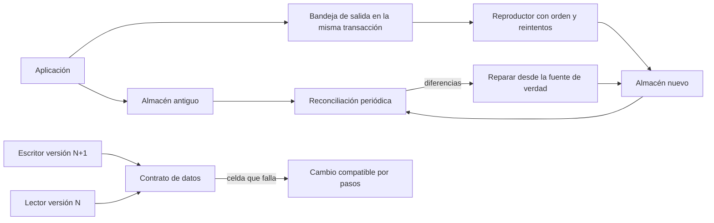

# SE-440 — Compatibilidad, coexistencia y doble escritura

[← SE-439 — Migraciones de datos sin interrupción](https://github.com/vladimiracunadev-create/modern-software-engineering-program/blob/main/classes/part-36-mantenimiento-y-modernizacion-legacy/se-439-migraciones-de-datos-sin-interrupcion/README.md) · [↑ Parte 36](https://github.com/vladimiracunadev-create/modern-software-engineering-program/blob/main/classes/part-36-mantenimiento-y-modernizacion-legacy/README.md) · [📚 Índice completo](https://github.com/vladimiracunadev-create/modern-software-engineering-program/blob/main/classes/README.md) · [🌐 Portal](https://vladimiracunadev-create.github.io/modern-software-engineering-program/classes/SE-440.html) · [SE-441 — Retiro, archivado y disposición de sistemas →](https://github.com/vladimiracunadev-create/modern-software-engineering-program/blob/main/classes/part-36-mantenimiento-y-modernizacion-legacy/se-441-retiro-archivado-y-disposicion-de-sistemas/README.md)

## Punto profesional y fundamento pedagógico

**Punto profesional.** La clase existe para que puedas mantener dos versiones de un sistema, o dos almacenes de datos, funcionando a la vez durante una migración sin que se contradigan. La coexistencia es el periodo más largo y más frágil de cualquier modernización: la mayor parte de las migraciones no fallan en el corte sino en los meses en que dos sistemas contienen «la misma» información. La habilidad es entender por qué escribir en dos sitios no es una operación atómica, qué patrones la hacen fiable, cómo detectar la divergencia y cómo evolucionar los formatos para que lectores y escritores de versiones distintas se entiendan.

**Por qué aparece aquí.** Sigue a **Migraciones de datos sin interrupción**: esa clase planteó la doble escritura como una fase; esta examina qué ocurre cuando una de las dos escrituras falla, cuándo llegan desordenadas y cómo se detecta. El caso conductor es el **módulo legado de calificaciones** durante la migración de su tabla de notas: el módulo viejo y el nuevo escriben cada nota, y el exportador al ministerio lee de uno u otro según el día.

**Error conceptual que debe corregir.** Creer que dos escrituras seguidas dejan dos copias iguales. Entre la primera y la segunda puede fallar el proceso, la red, el segundo almacén, o llegar antes la escritura posterior de otro proceso; sin un mecanismo que lo repare, cada fallo deja una divergencia permanente que nadie ve hasta que alguien compara.

**Secuencia de aprendizaje.** Antes de mirar los resultados, predices cuántas claves quedan distintas en el segundo almacén si la segunda escritura falla el 1 % de las veces y no se reintenta, y si los reintentos bastan; después simulas tres estrategias de doble escritura, comparas tres formas de detectar la divergencia por filas leídas y ciclos, y ejecutas una matriz de compatibilidad entre un lector estricto y uno tolerante frente a seis cambios de esquema. La secuencia usa predicción, explicación propia, contraste y recuperación. [ICAP](https://icap.education.asu.edu/research) distingue participación de construcción de conocimiento; [How People Learn II](https://nap.nationalacademies.org/catalog/24783/how-people-learn-ii-learners-contexts-and-cultures) respalda diseñar la práctica con contextos reales y retroalimentación.

**Evidencia de aprendizaje.** `coexistencia-log.md` con la predicción, las tres figuras reproducidas, el diseño de la doble escritura con su mecanismo de reparación, la estrategia de detección con su costo en filas leídas y la matriz de compatibilidad del contrato con una decisión para cada celda que falla.

**Límite de la conclusión.** Los almacenes son diccionarios en memoria, los fallos son aleatorios con probabilidad fija, el desorden se modela con una probabilidad por escritura y el lector es un programa de pocas líneas. No se usó ninguna base de datos, cola de mensajes ni servicio real, y no hay concurrencia verdadera: el tiempo y el orden se simulan. La matriz de compatibilidad ejecuta sus lectores de verdad, pero sobre un registro de tres campos escrito por el autor.

### Trazabilidad fuente → afirmación

| Fuente primaria u oficial | Afirmación que respalda | Lo que no prueba |
|---|---|---|
| [Kleppmann, «Designing Data-Intensive Applications»](https://dataintensive.net/) | Explica por qué escribir en dos sistemas sin una transacción común produce divergencias, los problemas de orden y las alternativas basadas en registros de cambios. | No dice qué tasa de divergencia tendrá tu sistema. |
| [Patrón Transactional Outbox](https://microservices.io/patterns/data/transactional-outbox.html) | Describe guardar el evento en la misma transacción que el cambio y publicarlo después con reintentos. | No resuelve el orden entre eventos de claves distintas ni la duplicación aguas abajo. |
| [Fowler, «TolerantReader»](https://martinfowler.com/bliki/TolerantReader.html) | Describe leer solo lo necesario e ignorar lo desconocido para que los cambios de formato no rompan al lector. | Tolerar no equivale a interpretar bien: un campo ausente puede ocultar un dato perdido. |
| [Hyrum's Law](https://www.hyrumslaw.com/) | Enuncia que, con suficientes consumidores, cualquier comportamiento observable acabará siendo usado por alguien. | Es una observación, no una medida de cuántos consumidores dependen de qué. |
| [RFC 8594: cabecera Sunset](https://www.rfc-editor.org/rfc/rfc8594) y [RFC 9745: cabecera Deprecation](https://www.rfc-editor.org/rfc/rfc9745) | Definen cabeceras HTTP para anunciar que un recurso será retirado o está en desuso. | No garantizan que los consumidores las lean ni obligan a retirar en esa fecha. |
| [Python: json](https://docs.python.org/3/library/json.html) y [hashlib](https://docs.python.org/3/library/hashlib.html) | Documentan la serialización y las sumas usadas en los experimentos. | No definen un contrato de datos para tu sistema. |

## Antes de empezar

Recupera lo aprendido en `SE-439`: la doble escritura es una fase, no una garantía. La pregunta activa es: **si la segunda escritura falla ahora mismo y nadie lo ve, ¿cuánto tiempo pasaría hasta que alguien lo notara y cómo lo notaría?**

## Prerrequisitos

- Haber completado `SE-439` o poder explicar las fases expandir, rellenar y contraer.
- Python 3.11 o posterior; los experimentos usan solo la biblioteca estándar (`random`, `hashlib`, `json`, `statistics`).
- Saber qué es una transacción y qué significa idempotencia.

## Problema auténtico

Durante la migración de la tabla de notas, el módulo nuevo escribía cada nota en el almacén antiguo y, a continuación, en el nuevo. Un fin de semana el almacén nuevo estuvo inaccesible unos minutos y la segunda escritura falló sin lanzar una excepción visible: el código registraba el error y seguía. Meses después, al cambiar la lectura al almacén nuevo, 312 notas aparecían con su valor anterior. Nadie había comparado los dos almacenes. A la vez, el exportador al ministerio había empezado a recibir un campo nuevo que su lector estricto rechazaba, y tuvo que tolerar campos desconocidos con prisa; al hacerlo, empezó a aceptar sin quejarse registros en los que faltaba la nota. La clase enseña a diseñar la doble escritura para que se pueda reparar, a detectar la divergencia con un costo conocido y a cambiar los formatos de manera que los lectores sigan entendiendo sin tragarse la pérdida de datos.

## Objetivos observables

Al terminar podrás:

1. explicar por qué dos escrituras seguidas no son atómicas y qué fallos producen divergencia y desorden;
2. comparar escritura de mejor esfuerzo, con reintentos y con bandeja de salida (outbox) según las divergencias que dejan;
3. diseñar una reconciliación periódica y calcular su costo en filas leídas y su tiempo de detección;
4. construir una matriz de compatibilidad entre lectores y escritores de versiones distintas y decidir cada celda;
5. distinguir tolerar un cambio de formato de aceptar que un dato se pierda.

## Mapa conceptual



El mapa separa dos problemas de coexistencia. A la izquierda, **dos copias del mismo dato** y cómo mantenerlas alineadas: bandeja de salida, reproducción ordenada y reconciliación. A la derecha, **dos versiones del formato** y cómo leerse entre sí: un contrato con celdas de compatibilidad explícitas.

## Temas y por qué importan

| Tema | Por qué cambia una decisión profesional | Evidencia mínima |
|---|---|---|
| Por qué la doble escritura diverge | Sin entenderlo se confía en una operación que no es atómica. | Recuento de divergencias por tasa de fallo |
| Bandeja de salida y reproducción | Convierte una escritura frágil en una reparable y ordenada. | Divergencias finales con y sin bandeja |
| Detección y reconciliación | La divergencia que no se mide no se corrige. | Filas leídas y ciclos hasta detectar |
| Contrato de datos y compatibilidad | Define qué cambios de formato son seguros. | Matriz de lectores por escritores |
| Tolerancia frente a pérdida silenciosa | Tolerar demasiado oculta datos perdidos. | Celdas que pasan sin conservar el dato |

## Conceptos y decisiones

### 1. Por qué la doble escritura diverge

Escribir en dos sistemas sin una transacción que los abarque son dos operaciones independientes, y entre ellas ocurren tres clases de fallo. La segunda puede **fallar**: el almacén no responde, expira el tiempo o el proceso muere tras la primera; el resultado es un dato presente en un lugar y ausente o antiguo en el otro. Las escrituras pueden **llegar desordenadas**: dos actualizaciones de la misma clave salen del mismo proceso en orden, pero una pasa por una ruta más lenta y se aplica la vieja después de la nueva; el almacén queda con el valor viejo como si fuera el último. Y la escritura puede **duplicarse** cuando un reintento ocurre tras una respuesta perdida. Ninguna de las tres deja un error visible: cada almacén, mirado solo, es consistente. Cuando existen dos fuentes de verdad, la divergencia silenciosa es el estado natural, no una anomalía.

### 2. Reintentos, bandeja de salida y orden

Los **reintentos** reparan el primer tipo de fallo (el almacén responde la tercera vez) y no el segundo: reintentar no restablece el orden y puede empeorarlo si el reintento de una escritura vieja llega tras una nueva. Una **bandeja de salida** (outbox) cambia la estructura: la aplicación escribe en una sola base, y en la misma transacción registra el cambio en una tabla de eventos; un proceso aparte lee esa tabla y aplica los cambios al segundo almacén, con reintentos hasta que lo logre. Como el registro y el dato se confirman juntos, no hay estado en que uno exista sin el otro. Si cada evento lleva un **número de secuencia** por clave y el reproductor aplica solo si el número es mayor que el último visto, se resuelve también el desorden y la duplicación: aplicar dos veces o fuera de orden es inofensivo. El precio es una latencia entre las dos copias (la segunda se retrasa) y la necesidad de operar el reproductor.

### 3. Detectar la divergencia

Mientras se mantengan dos copias, la pregunta es cuánto se parecen. Comparar todas las filas es exacto y caro. Hay tres estrategias con costos distintos. El **muestreo** lee una fracción de las claves en cada ciclo: barato por ciclo, pero la probabilidad de encontrar una divergencia rara en un ciclo es pequeña y puede requerir cientos de ciclos. Las **sumas por rango** calculan una huella de cada bloque de claves en ambos almacenes y compara las huellas: se lee casi nada si coinciden y, si difieren, se baja a los bloques distintos hasta encontrar las filas. La **comparación total** lee todo y encuentra todo. La elección depende de la tasa esperada de divergencia: cuando es muy baja (una entre cien mil), las sumas por rango la encuentran en un ciclo con una pequeña parte del costo; cuando es alta (cien entre cien mil), casi todos los bloques difieren y el método pierde ventaja.

### 4. Contrato de datos y compatibilidad

Los datos que dos sistemas intercambian tienen un formato implícito o escrito: campos, tipos, valores permitidos. Cambiarlo con ambas versiones en producción plantea dos preguntas. **Compatibilidad hacia atrás**: ¿puede un lector nuevo entender datos escritos por un escritor viejo? **Compatibilidad hacia adelante**: ¿puede un lector viejo entender lo que escribe uno nuevo? Los cambios se clasifican. Añadir un campo opcional es compatible si los lectores viejos ignoran lo desconocido. Quitar un campo rompe a los lectores que lo necesitan. Renombrar equivale a quitar y añadir. Cambiar el tipo rompe en ambas direcciones. Ampliar los valores permitidos de una enumeración rompe a los lectores que no esperaban el valor nuevo. Un **lector estricto** exige exactamente el formato esperado y falla ante cualquier diferencia; un **lector tolerante** ignora lo desconocido y usa valores por defecto para lo que falta. La regla práctica de los formatos evolucionables es escribir con el contrato nuevo y leer con tolerancia, y cambiar en dos pasos (añadir lo nuevo, migrar a los lectores, retirar lo viejo).

### 5. Tolerar sin perder datos

La tolerancia tiene un riesgo que el formato no muestra: un lector que usa un valor por defecto para un campo ausente no distingue «el campo no existe en esta versión» de «el dato se perdió por el camino». En el caso de un campo renombrado, el lector nuevo que lee un dato viejo no falla; simplemente recibe la nota como ausente y la sustituye por el valor por defecto. Eso es compatibilidad en el sentido de que no se produce un error, y es una pérdida de datos en el sentido de que una nota desaparece. Por eso, a cada celda que «pasa» hay que añadir una comprobación del **contenido**: ¿el dato que salió es el que entró? Y por eso los valores por defecto de campos esenciales deberían ser un error y no un valor silencioso, y los campos ausentes deben quedar registrados para que alguien pueda contarlos.

### Tres formas de escribir en dos sitios

Se simulan 100 000 escrituras sobre 20 000 claves. El primer almacén siempre acepta; el segundo falla con probabilidad p. Con una probabilidad del 0,5 % la escritura anterior de la misma clave llega después de la nueva. Se comparan tres estrategias y se cuentan las claves que difieren al final.

```python
# bandeja de salida: se registra con el dato y el reproductor aplica solo si la secuencia es mayor
if k not in b or b[k][0] < v[0]: b[k] = v
```

| Estrategia | p = 0,1 % | p = 1 % | p = 5 % |
|---|---:|---:|---:|
| Mejor esfuerzo (sin reintento) | 110 | 292 | 1 069 |
| Hasta tres intentos | 88 | 84 | 76 |
| Bandeja de salida con secuencia | 0 | 0 | 0 |

Con el mejor esfuerzo, las divergencias crecen con la tasa de fallo: 110, 292 y 1 069 de 20 000 claves. Tres intentos las reducen a unas 80 y las dejan casi constantes, porque lo que queda ya no son fallos sino el desorden (0,5 % de las escrituras que se cruzan), que los reintentos no corrigen. La bandeja con secuencia deja cero en las tres tasas porque aplica los eventos con orden y reintenta hasta lograrlo.


**Cómo leer la figura.** El eje horizontal es la tasa de fallo del segundo almacén (escala logarítmica) y el vertical, las claves distintas; cada línea es una estrategia. Mira primero cómo el mejor esfuerzo sube con la tasa, los reintentos no bajan de unas 80 por el desorden y la bandeja se queda en cero. **Dónde deja de valer:** el 0,5 % de desorden, la tasa de fallo constante y la ausencia de caídas del reproductor son supuestos del autor; la bandeja del experimento reintenta sin límite y no modela su propia caída ni el retraso entre copias, durante el cual ambos almacenes difieren legítimamente.

### Cuánto cuesta ver una divergencia

Se inyectan d claves divergentes entre 100 000 y se mide cuántos ciclos y cuántas filas se leen hasta detectar al menos una con tres estrategias: muestrear el 1 % de las claves en cada ciclo, muestrear el 10 % y comparar sumas por 100 rangos de 1 000 claves, bajando solo a los rangos distintos. Cada valor es la media de 300 corridas.

| Divergentes en 100 000 | Muestra del 1 % (ciclos · filas) | Muestra del 10 % (ciclos · filas) | Sumas por rangos (ciclos · filas) |
|---:|---|---|---|
| 1 | 108,5 · 108 490 | 10,5 · 105 400 | 1,0 · 1 100 |
| 10 | 10,9 · 10 947 | 1,5 · 14 867 | 1,0 · 9 667 |
| 100 | 1,6 · 1 583 | 1,0 · 10 000 | 1,0 · 63 483 |

Con una sola divergencia, el muestreo necesita en promedio más de cien ciclos y leer más de cien mil filas, más que la tabla entera, mientras que las sumas la encuentran en un ciclo leyendo 1 100. Con cien divergencias la situación se invierte: el muestreo del 1 % las halla en 1,6 ciclos leyendo 1 583 filas y las sumas deben bajar a casi todos los rangos y leen 63 483. La estrategia correcta depende de la tasa de divergencia que se espera, y cuando se desconoce conviene combinar sumas por rangos con un muestreo.


**Cómo leer la figura.** El eje horizontal son las filas divergentes y el vertical, las filas leídas hasta detectarlas, ambos en escala logarítmica; cada línea es un método. Mira primero el cruce: las sumas por rangos ganan con pocas divergencias y el muestreo del 1 % gana con muchas. **Dónde deja de valer:** las divergencias se reparten al azar y de forma uniforme, mientras que las reales suelen agruparse por rango de tiempo o de clave; el rango de 1 000 filas y la lectura de un solo extremo son decisiones del autor. Los costos no incluyen el cálculo de las sumas ni la red.

### Una matriz de compatibilidad ejecutable

Se define un registro `{id, nota, estado}` y seis cambios de esquema: añadir un campo opcional, añadir uno obligatorio, quitar `estado`, renombrar `nota` a `calificacion`, cambiar el tipo de `nota` de entero a texto y ampliar los valores de `estado`. Para cada cambio se ejecutan cuatro lecturas: el lector viejo ante datos nuevos y el lector nuevo ante datos viejos, cada uno en versión estricta y tolerante.

| Cambio | Viejo lee dato nuevo (estricto · tolerante) | Nuevo lee dato viejo (estricto · tolerante) |
|---|---|---|
| Añadir campo opcional | falla · pasa | falla · pasa |
| Añadir campo obligatorio | falla · pasa | falla · falla |
| Quitar campo | falla · pasa | falla · pasa |
| Renombrar campo | falla · falla | falla · pasa |
| Cambiar el tipo | falla · falla | falla · falla |
| Ampliar valores permitidos | falla · pasa | pasa · pasa |

El lector estricto falla en 11 de las 12 celdas; el tolerante, en 4 de las 12. Cambiar el tipo rompe a ambos en las dos direcciones. Dos celdas de «pasa» son engañosas: el lector tolerante que lee un dato antiguo tras renombrar `nota` a `calificacion` devuelve el registro sin error y con la nota ausente, y el lector viejo tolerante que recibe un dato nuevo sin `estado` le asigna un valor por defecto sin avisar. «Pasa» significa que no hubo excepción, no que el contenido llegó.


**Cómo leer la figura.** Es un mapa de calor: cada fila es un cambio de esquema, cada columna una combinación de lector y dato, y un recuadro oscuro («falla») es una excepción. Mira primero que la columna del lector estricto está casi toda oscura y que cambiar el tipo falla en las cuatro. **Dónde deja de valer:** el registro de tres campos, los valores por defecto del lector tolerante y las comprobaciones de tipo son una construcción del autor; los formatos reales (JSON con esquema, protocolos binarios con campos numerados) tienen reglas propias, y la matriz solo verifica que haya o no excepción, no la equivalencia del contenido.

## Definiciones de trabajo

- **doble escritura:** escritura del mismo dato en dos almacenes mediante operaciones independientes.
- **bandeja de salida (outbox):** tabla de eventos que se confirma en la misma transacción que el dato y que un proceso aparte aplica a otro sistema.
- **reconciliación:** comparación de dos copias para encontrar y reparar diferencias.
- **compatibilidad hacia atrás y hacia adelante:** capacidad de un lector nuevo de leer datos viejos y de un lector viejo de leer datos nuevos.
- **lector tolerante:** lector que ignora lo desconocido y aplica valores por defecto a lo ausente.

Las definiciones son operativas para el módulo de calificaciones. No convierten términos con una historia más amplia en sinónimos y deben contrastarse con la documentación primaria enlazada al final.

## Ejemplo mínimo

El fragmento muestra que un reintento sin orden puede dejar el valor viejo. Antes de ejecutarlo, predice el valor final de la clave.

```python
b = {}
eventos = [(1, "5,5"), (2, "6,0")]            # (secuencia, valor): la 2 es la última
for seq, v in [eventos[1], eventos[0]]:       # llegan en orden inverso
    b["a1"] = (seq, v)
print(b["a1"])
for seq, v in [eventos[1], eventos[0]]:       # con secuencia: solo se aplica lo mayor
    if "a2" not in b or b["a2"][0] < seq: b["a2"] = (seq, v)
print(b["a2"])
```

Imprime `(1, '5,5')` y `(2, '6,0')`: sin secuencia gana lo último que llega; con secuencia gana lo último que ocurrió. Registra versión de Python, comando y salida.

## Ejemplo profesional

Escenario hipotético, construido para la clase y sin datos reales. El equipo sustituye la doble escritura de mejor esfuerzo por una bandeja de salida: la aplicación escribe la nota y, en la misma transacción, un evento con la clave y un número de secuencia; un reproductor aplica los eventos al almacén nuevo con reintentos y descarta los de secuencia menor. Mientras tanto, una reconciliación nocturna calcula sumas por bloques de 1 000 claves en los dos almacenes: con una tasa esperada de divergencia de unas diez entre cien mil, el costo ronda las diez mil filas por noche (lo medido en la tabla), y se complementa con una muestra aleatoria del 1 % que vigila los casos fuera de los bloques. Para el contrato con el exportador, añade el campo `ponderacion` como opcional, exige que el exportador ignore campos desconocidos y registra una métrica con el número de registros sin nota: así la tolerancia no oculta una pérdida. El retiro del campo antiguo tendrá cabeceras de aviso de retirada y una fecha publicada. Compara con la situación inicial: antes se descubrían 312 notas distintas meses después; ahora la divergencia máxima es la latencia del reproductor y se mide cada noche.

## Práctica guiada

1. Dibuja el flujo de una escritura con dos almacenes y marca dónde puede fallar, desordenarse o duplicarse.
2. Predice cuántas claves difieren con mejor esfuerzo y p = 1 % y escribe el número antes de simular.
3. Reproduce la tabla con las semillas fijadas en el código; cambia el desorden de 0,5 % a 0 y comprueba qué estrategia deja de ser inferior a la bandeja.
4. Implementa la bandeja con secuencia y comprueba que aplicar dos veces y fuera de orden es inofensivo.
5. Calcula el costo de detección con sumas por rangos para 1, 10 y 100 divergencias y compara con el muestreo.
6. Construye la matriz de compatibilidad para el formato de tu proyecto y añade una comprobación de contenido a cada celda.
7. Entrega `coexistencia-log.md` y pide a otra persona que encuentre un cambio de formato que tu matriz marque «pasa» y que pierda un dato.

## Ejercicios

1. **Orden:** dos escrituras de la misma clave salen del mismo proceso en orden y llegan invertidas. Explica por qué un reintento puede empeorarlo y qué campo del evento lo evita.
2. **Detección:** con 10 divergencias entre 1 000 000 de filas, estima los ciclos del muestreo del 1 % y compara con las sumas por rangos de 1 000 filas.
3. **Contrato:** clasifica estos cambios como compatibles hacia atrás, hacia adelante, ambas o ninguna: añadir un campo con valor por defecto, ampliar un rango numérico, cambiar el formato de una fecha.
4. **Tolerancia:** diseña una métrica que haga visible cuándo un lector tolerante está usando un valor por defecto para un campo esencial.

## Reto verificable

Entrega `coexistencia-log.md` con la predicción, las tres tablas, el diseño de la doble escritura con su mecanismo de reparación, la estrategia de reconciliación con su costo, la matriz de compatibilidad con la comprobación de contenido en cada celda y una decisión escrita para cada celda que falla. Se aprueba si otra persona ejecuta el código desde un checkout limpio, obtiene los mismos números con las mismas semillas y puede decir cuántas claves quedarían distintas si el reproductor aplicara sin secuencia. No se aprueba por afirmar que los almacenes «están sincronizados» sin una comparación de contenido ni por declarar compatible un cambio porque «no lanza error».

## Caso conductor

El módulo de calificaciones es el caso conductor de la Parte 36. Esta clase deja el octavo artefacto: el diseño de coexistencia con su reconciliación y su contrato. `SE-441` preguntará cómo se retira el sistema antiguo cuando la coexistencia termine, y `SE-442` cuándo conviene reescribir en vez de seguir evolucionando. Cambia después un solo dato, la tasa de fallo del segundo almacén de 1 % a 0,01 %, y observa si los reintentos bastan.

## Preguntas frecuentes

### ¿Por qué no usar una transacción distribuida entre los dos almacenes?

Existe (confirmación en dos fases), pero acopla la disponibilidad de ambos sistemas, es lenta, no la soportan todos los almacenes y deja bloqueado el sistema si el coordinador cae. La bandeja de salida acepta una pequeña latencia entre copias a cambio de independencia.

### ¿La bandeja de salida garantiza que el segundo almacén nunca diverge?

Garantiza que, si el reproductor funciona, la divergencia es transitoria. Si el reproductor se detiene, el retraso crece; si un bug aplica mal un evento, la copia queda distinta. Por eso la reconciliación sigue haciendo falta.

### ¿Cuál es la fuente de verdad durante la coexistencia?

Debe ser una sola, declarada y por dato. La copia se rige por la fuente: cuando difieren, se repara la copia. Dos fuentes de verdad para el mismo dato requieren reglas de resolución de conflictos, que es otro problema más difícil.

### ¿Cómo se comunica el retiro de un campo a consumidores desconocidos?

Con avisos publicados y legibles por máquina (cabeceras de retirada y de fecha de fin), con registros del uso real de cada campo y con un periodo de convivencia lo bastante largo. Aun así, algunos consumidores solo se enterarán al romperse; la ley de Hyrum explica por qué.

## Fallo controlado y diagnóstico

Reproduce el fallo clásico de la clase: **dos almacenes que se declaran sincronizados y difieren en cientos de claves**. Ejecuta la doble escritura de mejor esfuerzo con p = 1 % y compara los recuentos y el contenido.

Registra síntoma, entrada mínima, hipótesis, observación que descarta cada hipótesis, causa, corrección y prueba de regresión. **Síntoma:** al pasar la lectura al almacén nuevo, 292 de 20 000 claves muestran un valor antiguo y los recuentos coinciden. **Hipótesis rivales:** (a) el relleno inicial falló; (b) la conversión del valor es incorrecta; (c) la segunda escritura falló o llegó desordenada y nadie la reparó. **Prueba:** cuenta cuántas claves difieren por fallo (la segunda escritura no ocurrió) y cuántas por orden (el valor está presente pero es antiguo); si el reintento reduce las primeras y no las segundas, la causa es la doble escritura sin reparación. **Conclusión:** tres intentos dejan 84 claves por desorden. **Regresión:** añade una prueba que simule fallos y desorden y exija cero divergencias con la bandeja y la secuencia, y programa la reconciliación nocturna. No cambies a la vez la estrategia de escritura y la de detección.

## Errores comunes y cómo corregirlos

| Síntoma | Causa probable | Corrección |
|---|---|---|
| Los almacenes difieren sin errores en los registros | La segunda escritura falla y se ignora | Bandeja de salida con reintentos y métrica de retraso |
| Reintentar deja el valor viejo | Las escrituras llegan desordenadas | Número de secuencia por clave y aplicación condicional |
| La reconciliación tarda horas | Compara todo siempre | Sumas por rangos y bajar solo a los distintos |
| Un cambio «compatible» pierde datos | El lector tolerante usa valores por defecto | Comprobar contenido y registrar los campos ausentes |
| Un consumidor se rompe al retirar un campo | Dependía de un comportamiento no documentado | Medir uso, avisar con cabeceras y esperar un periodo de convivencia |

## Entorno y archivos clave

```text
work/SE-440/
├── README.md
├── coexistencia/
│   ├── doble_escritura.py
│   ├── deteccion.py
│   └── matriz_compatibilidad.py
├── CONTRATO-DE-DATOS.md
├── tests/test_coexistencia.py
└── evidence/coexistencia-log.md
```

El `README` declara plataforma, versión de Python, semillas y comandos. Los experimentos usan solo la biblioteca estándar (`random`, `hashlib`, `json`, `statistics`) y se ejecutaron con CPython 3.12.9 en Windows 11 y 3.12.3 en Ubuntu bajo WSL2: las salidas fueron idénticas. Si añades una dependencia, fija procedencia y versión.

## Seguridad, ética y accesibilidad

- una réplica de datos personales en un segundo almacén duplica la superficie de exposición y el derecho de las personas a la corrección o al borrado: ambas copias deben respetarlo;
- una divergencia en notas no es un problema técnico abstracto: afecta a personas concretas; la reconciliación es una obligación hacia ellas;
- el reproductor y la bandeja son componentes con credenciales de escritura: aplica el principio de mínimo privilegio;
- las tablas y figuras deben tener texto alternativo y no depender del color;
- los avisos de retirada deben ser accesibles para quienes consumen el servicio, no solo para quien administra el sistema.

## Puente hacia el trabajo con agentes

Un agente al que se le pide «mantén sincronizados los dos almacenes» escribirá dos `INSERT` seguidos y dirá que funciona. Pídele en cambio que identifique la fuente de verdad, que diseñe la bandeja con número de secuencia, que escriba la reconciliación con su costo en filas leídas y que genere una matriz de compatibilidad con comprobación de contenido. Revisa especialmente los `try/except` que registran un fallo y continúan, y cualquier valor por defecto en un campo esencial: ambos son lugares donde un dato se pierde sin ruido.

## Transferencia

Traslada el análisis a otro dominio (por ejemplo, un catálogo de productos que se replica a un buscador): cambia las claves y los almacenes y conserva el procedimiento de reconocer los tres fallos, usar bandeja con secuencia, reconciliar con sumas por rangos y probar la compatibilidad del formato con comprobación de contenido. La transferencia está lograda cuando puedes decir qué fuente manda y cuánto retraso aceptas entre copias, no cuando el diseño se parece al de las notas.

## Evaluación y evidencia

| Criterio | Evidencia para aprobar |
|---|---|
| comprensión | explicación de por qué la doble escritura diverge y de la diferencia entre tolerar y perder |
| corrección | tablas de estrategias, de detección y de compatibilidad reproducibles con las mismas semillas |
| diseño | bandeja con secuencia, reconciliación con costo calculado y contrato con celdas decididas |
| diagnóstico | reproducción del fallo «almacenes que difieren sin errores» con regresión |
| incertidumbre | declaración de que los fallos, el desorden y los registros son del autor |
| reproducibilidad | versiones, comandos, salida y límites declarados |

## Fuentes

- [Kleppmann, «Designing Data-Intensive Applications»](https://dataintensive.net/) — consistencia, orden y registros de cambios; autoridad: libro de referencia (ISBN 9781449373320).
- [Patrón Transactional Outbox](https://microservices.io/patterns/data/transactional-outbox.html) — evento confirmado con el dato; autoridad: catálogo de patrones de microservicios.
- [Fowler, «TolerantReader»](https://martinfowler.com/bliki/TolerantReader.html) — lectura tolerante a cambios de formato; autoridad: autor del texto.
- [Hyrum's Law](https://www.hyrumslaw.com/) — dependencia de comportamientos observables; autoridad: autor de la observación.
- [RFC 8594](https://www.rfc-editor.org/rfc/rfc8594) y [RFC 9745](https://www.rfc-editor.org/rfc/rfc9745) — cabeceras de retirada y de desuso; autoridad: IETF.
- [Python: json](https://docs.python.org/3/library/json.html) y [hashlib](https://docs.python.org/3/library/hashlib.html) — serialización y sumas de verificación; autoridad: documentación de Python.

Cada fuente respalda el mecanismo indicado; ninguna demuestra que las 292 claves distintas, las 108 490 filas o las 11 celdas que fallan se observen en tu sistema. Esa afirmación depende de tus almacenes, de tu tasa de fallo y de tu formato.

## Límites y siguiente paso

Se ejecutaron tres experimentos con datos sintéticos en Windows y Ubuntu (WSL2) con resultados idénticos. Los almacenes son diccionarios, la concurrencia y el orden se simulan con probabilidades, los fallos son independientes y de tasa constante, la bandeja reintenta sin límite y no se modela su caída; la matriz de compatibilidad usa un registro de tres campos y lectores de pocas líneas escritos por el autor. No se usó ninguna base de datos ni cola real. La siguiente clase pregunta cómo se retira un sistema cuando la coexistencia termina.

## Glosario

- **doble escritura:** escritura del mismo dato en dos almacenes mediante operaciones independientes.
- **bandeja de salida (outbox):** tabla de eventos que se confirma en la misma transacción que el dato y que un proceso aparte aplica a otro sistema.
- **reconciliación:** comparación de dos copias para encontrar y reparar diferencias.
- **compatibilidad hacia atrás y hacia adelante:** capacidad de un lector nuevo de leer datos viejos y de un lector viejo de leer datos nuevos.
- **lector tolerante:** lector que ignora lo desconocido y aplica valores por defecto a lo ausente.

---

[← SE-439 — Migraciones de datos sin interrupción](https://github.com/vladimiracunadev-create/modern-software-engineering-program/blob/main/classes/part-36-mantenimiento-y-modernizacion-legacy/se-439-migraciones-de-datos-sin-interrupcion/README.md) · [↑ Parte 36](https://github.com/vladimiracunadev-create/modern-software-engineering-program/blob/main/classes/part-36-mantenimiento-y-modernizacion-legacy/README.md) · [📚 Índice completo](https://github.com/vladimiracunadev-create/modern-software-engineering-program/blob/main/classes/README.md) · [🌐 Portal](https://vladimiracunadev-create.github.io/modern-software-engineering-program/classes/SE-440.html) · [SE-441 — Retiro, archivado y disposición de sistemas →](https://github.com/vladimiracunadev-create/modern-software-engineering-program/blob/main/classes/part-36-mantenimiento-y-modernizacion-legacy/se-441-retiro-archivado-y-disposicion-de-sistemas/README.md)
