# Parte 37 — Gestión, liderazgo y práctica profesional

La Parte 36 dejó un sistema que se puede mantener y transformar sin detenerlo. La pregunta cambia de «¿cómo se modifica con seguridad lo que otras personas escribieron?» a «¿cómo se consigue que un equipo decida bien, reparta lo que sabe, se comunique sin perder lo acordado, crezca, prometa lo que puede cumplir, compre sin quedar atrapado, respete lo que no es suyo y pueda defender todo eso ante quien no estuvo?». Esta parte trabaja sobre **el equipo de plataforma educativa**, un caso sintético: ocho personas que mantienen el módulo de calificaciones y otros servicios, una ingeniera sénior sin cargo de jefatura, una dirección académica que pide fechas, un ministerio que cambia un formato y un proveedor de almacenamiento que hay que elegir. Cada clase mira al mismo equipo con una lente más exigente: cómo se lidera sin autoridad formal, cómo se diseñan los equipos y la propiedad del código, cómo se conversa y se resuelve un conflicto, cómo se acompaña el crecimiento de otra persona, cómo se estima y se compromete, cómo se gestionan los riesgos y se presentan decisiones, cómo se evalúa a un proveedor, qué obligaciones legales y éticas acompañan al trabajo, cuánto cuesta el software a lo largo de su vida, cómo se presenta y se defiende una trayectoria, cómo se conduce una revisión adversarial y cómo se reúne todo en un dossier comprobable.

## Pregunta rectora

> ¿Qué decisión puedes sostener ante personas que no comparten tu contexto, con qué evidencia, qué te cuesta equivocarte y qué parte de tu conclusión es observación, cuál es inferencia y cuál es suposición?

## Antes del recorrido clase por clase

Esta parte no enseña un marco de gestión ni una certificación. Enseña a diseñar la ruta de adopción de una práctica y a repartir la autoridad de aprobación con criterios, a medir cuántas personas deben irse para que el conocimiento quede huérfano y cuántos relevos cruza un cambio, a dejar una decisión por escrito con cinco campos y a clasificar un desacuerdo antes de tratarlo, a asignar tareas que estiren y a dar retroalimentación a tiempo, a comunicar un compromiso con su probabilidad, a calcular el valor esperado de un riesgo y el valor de la información, a probar la sensibilidad de una matriz de proveedores, a leer una expresión de licencia y verificar la procedencia de una contribución, a descontar y priorizar por costo de demora, a presentar un portafolio comprobable y defenderlo declarando los límites, a revisar una decisión por su proceso y no solo por su resultado, y a armar un dossier cuyas afirmaciones, evidencias y cifras se pueden verificar con un script y una hora de revisión.

```mermaid
flowchart LR
    A[Liderazgo técnico sin autoridad formal] --> B[Equipos y ownership]
    B --> C[Comunicación, facilitación y conflicto]
    C --> D[Mentoría, feedback y crecimiento]
    D --> E[Estimación y compromisos]
    E --> F[Riesgos y decisiones ejecutivas]
    F --> G[Compras y evaluación de proveedores]
    G --> H[Propiedad intelectual, contratos y ética]
    H --> I[Economía y costo total]
    I --> J[Portafolio, entrevistas y defensa]
    J --> K[Taller: revisión de una decisión difícil]
    K --> L[Proyecto: dossier profesional defendible]
    L -->|hallazgo de la revisión| A
```

El diagrama se lee de izquierda a derecha y no es un proceso obligatorio. El retorno indica que un hallazgo de la revisión de una decisión o del dossier reabre la propuesta inicial: la práctica profesional se revisa, no se termina.

## Resultados acumulativos

Podrás simular la adopción de una práctica en una red de treinta personas según a quién se siembra, medir la espera de una decisión cuando una sola persona aprueba y cuántas decisiones se revierten según cuántas personas las leyeron antes; calcular el factor de camión con una definición explícita, contar cuántos equipos cruza un cambio con equipos por capa y por dominio y medir la carga de una guardia según el tamaño de la rotación; medir cuánto distorsiona hablar en orden una estimación de grupo, cuántos campos de una decisión sobreviven a los relevos en tres formatos y cómo le va a la reciprocidad con malentendidos;

comparar el crecimiento según la dificultad de las tareas, el costo de esperar la retroalimentación y el ruido de una evaluación con y sin rúbrica; mostrar por qué la suma de medianas no se cumple, pronosticar una fecha con el historial de entrega y ver cómo crece el tiempo de ciclo con la carga; comparar una matriz de riesgos con el valor esperado, calcular el valor de la información y el costo de escalar todo; medir cuánto depende un ganador de los pesos, el costo a cinco años de comprar o construir y la disponibilidad de una cadena de proveedores; clasificar sesenta licencias con un analizador de expresiones, verificar el pie de firma de 2 000 commits y simular un flujo de cancelación escondido;

ordenar iniciativas por costo de demora, comparar proyectos con valor presente a varias tasas, hallar el cruce entre inversión y gasto operativo y el equilibrio por usuario; comparar procedimientos de entrevista, verificar entradas de portafolio y medir la impresión de dos estrategias de defensa; comparar juicio por resultado y por proceso, la cobertura de paneles de revisión y la calibración de las probabilidades declaradas; y verificar seis dossiers con un script, calcular la probabilidad de que una revisora encuentre una afirmación sin respaldo y medir cuántas afirmaciones se comprueban en una hora. Al finalizar podrás entregar un dossier con afirmaciones numeradas, evidencia con huellas, cifras etiquetadas, límites declarados y una defensa ensayada, e indicar qué parte de tu conclusión es observación, cuál es inferencia y cuál es suposición.

## Prerrequisitos enlazados

- [Parte 17 — Documentación y conocimiento técnico](https://github.com/vladimiracunadev-create/modern-software-engineering-program/blob/main/classes/part-17-documentacion-y-conocimiento-tecnico/): registros de decisión y documentación mantenible.
- [Parte 24 — Diseño, patrones y refactorización](https://github.com/vladimiracunadev-create/modern-software-engineering-program/blob/main/classes/part-24-diseno-patrones-y-refactorizacion/): fronteras, interfaces y costos de cambio.
- [Parte 31 — Calidad, rendimiento y resiliencia](https://github.com/vladimiracunadev-create/modern-software-engineering-program/blob/main/classes/part-31-calidad-rendimiento-y-resiliencia/): percentiles, disponibilidad y escenarios de calidad.
- [Parte 32 — Seguridad, privacidad y cumplimiento](https://github.com/vladimiracunadev-create/modern-software-engineering-program/blob/main/classes/part-32-seguridad-privacidad-y-cumplimiento/): datos personales, licencias y obligaciones.
- [Parte 35 — Observabilidad, SRE e incidentes](https://github.com/vladimiracunadev-create/modern-software-engineering-program/blob/main/classes/part-35-observabilidad-sre-e-incidentes/): guardias, análisis posterior y objetivos de servicio.
- [Parte 36 — Mantenimiento y modernización legacy](https://github.com/vladimiracunadev-create/modern-software-engineering-program/blob/main/classes/part-36-mantenimiento-y-modernizacion-legacy/): migraciones, economía de reescribir y retiro.
- Python 3.11+ y terminal; los experimentos usan solo la biblioteca estándar y datos sintéticos, salvo el analizador de licencias, la verificación de firmas, el verificador de portafolio y el de dossier, que son ejecuciones reales de código propio sobre datos sintéticos.

## Bloques y progresión

1. **Liderar y organizar:** las clases 445 y 446 diseñan la ruta de adopción de una práctica y reparten la propiedad, las fronteras y la guardia del equipo.
2. **Conversar y crecer:** las clases 447 y 448 conducen la comunicación y el conflicto, y acompañan el crecimiento con tareas que estiran y retroalimentación a tiempo.
3. **Prometer y decidir:** las clases 449 y 450 comunican compromisos con probabilidad y gestionan riesgos con valor esperado y escalamiento.
4. **Comprar, cumplir y calcular:** las clases 451 a 453 evalúan proveedores, atienden licencias, contratos y ética, y calculan el costo total.
5. **Defender e integrar:** las clases 454 a 456 presentan el trabajo como trayectoria, revisan una decisión difícil y reúnen todo en un dossier.

## Evidencia medida y límites

Las figuras y los ejemplos de esta parte usan experimentos ejecutados con CPython 3.12.9 en Windows 11 y repetidos con CPython 3.12.3 en Ubuntu bajo WSL2. Los datos son **sintéticos**, las semillas están fijadas y todas las salidas de `scripts/experiments_part37_a.py` y `scripts/experiments_part37_b.py` fueron idénticas en ambos sistemas, cifra por cifra, sin excepciones. Hay ejecuciones de código propio sobre datos sintéticos que no son simulaciones: el analizador de expresiones de licencia de `SE-452` y la verificación estricta de pies de firma de 2 000 mensajes, el verificador de seis reglas de `SE-454` sobre cuatro entradas escritas por el autor, y el verificador de dossier de `SE-456`, que crea sus seis variantes en un directorio temporal y calcula huellas SHA-256 reales. Ninguna lectura de reloj entra en las cifras: todos los tiempos son de tiempo virtual o de recuento.

Los experimentos son: la adopción en 2 000 redes de 30 personas según la siembra, la espera de 40 000 decisiones ante una sola persona aprobadora y las reversiones de 6 000 decisiones según las personas que las leen antes (`SE-445`); el factor de camión de 200 repositorios de 300 archivos, los equipos que cruza cada uno de 5 000 cambios y la carga de una guardia en 3 000 años (`SE-446`); la estimación de grupo en 5 000 ensayos, los campos que sobreviven a los relevos de 6 000 mensajes por celda y el pago de cuatro estrategias de reciprocidad con 5 % de malentendidos (`SE-447`); el crecimiento de 1 000 personas durante 52 semanas, los errores repetidos de 4 000 personas según el momento de la retroalimentación y el acuerdo de 300 grupos de 200 personas evaluadas (`SE-448`); el cumplimiento de la suma de medianas en 20 000 proyectos, el pronóstico de 60 elementos con 200 historiales y la cola de un servidor con 60 000 elementos por carga (`SE-449`); la cobertura de 400 carteras de 30 riesgos, el valor de la información con 200 000 simulaciones por fila y el costo de tres políticas de escalamiento en 3 000 trimestres (`SE-450`); cinco proveedores con 20 000 combinaciones de pesos, el costo a cinco años de 10 000 casos y la disponibilidad de cadenas de proveedores en 600 años (`SE-451`); sesenta dependencias, 2 000 commits y doce meses de dos flujos de suscripción (`SE-452`); 3 000 carteras de doce iniciativas, tres proyectos a cuatro tasas y el cruce entre servidores propios y nube con el equilibrio por usuario (`SE-453`); 8 000 procesos de selección, cuatro entradas de portafolio y seis mil repeticiones de dos estrategias de defensa (`SE-454`); 4 000 comparaciones por tamaño entre juicio por resultado y por proceso, 5 000 revisiones de 30 modos de fallo y 500 pronósticos por persona (`SE-455`); y seis dossiers verificados, la probabilidad de muestreo con 20 000 simulaciones por celda y 5 000 revisiones de una hora (`SE-456`).

Los parámetros (la densidad de vínculos y los umbrales, la llegada y el tiempo de revisión de las decisiones, la probabilidad de preocupaciones graves, el reparto del conocimiento, el costo de 3 días por relevo, los avisos fuera de horario, el peso de la influencia social, la pérdida por relevo, los pagos de la reciprocidad, la curva de aprendizaje, la tasa de error de un hábito, la indulgencia de las evaluadoras, la dispersión de las tareas y el factor común, el historial de entrega, las distribuciones de riesgo, el ruido del experimento, las probabilidades de error al escalar, los puntajes de los proveedores, las alzas y los sobrecostos, las disponibilidades, las expresiones de licencia, los porcentajes de tipos de commit, los parámetros del flujo de suscripción, los costos de demora, los flujos de los proyectos, las tasas, los costos de infraestructura, el halo de las entrevistas, las probabilidades de la defensa, la calidad de las decisiones, la detección de las revisoras y las confianzas) son supuestos del autor, y los resultados dependen de ellos. Que en una simulación gane una política (el escalamiento solo de lo irreversible, las entrevistas estructuradas, declarar el límite) es consecuencia de esos supuestos y de sus fuentes, no un hallazgo sobre equipos reales. En particular, en la simulación de `SE-452` el flujo de cancelación escondido obtiene más ingresos durante todo el año: la clase no afirma que los patrones oscuros no convengan, afirma que la métrica de ingresos no basta para detectar el daño.

Lo que **no se hizo**: no se estudió, entrevistó, evaluó ni acompañó a ningún equipo, persona, comité ni institución reales; no se revisó ningún repositorio, contrato, proveedor, dossier ni historial reales; no se consultó ninguna base de datos de licencias ni de proveedores; no se aplicó ninguna norma contable, laboral ni de datos personales a un caso, y nada de la parte es asesoría legal, contable ni de recursos humanos; el analizador de licencias cubre solo los identificadores de la tabla y no interpreta versiones ni efectos jurídicos; no se probó macOS ni otras versiones de Python; los metaanálisis y los estudios citados respaldan mecanismos, no las cifras de las simulaciones; y no se asegura revisión humana independiente de estas clases: sigue pendiente.

## Guía razonada clase por clase

El equipo de plataforma educativa mantiene un caso, un conjunto de decisiones y un paquete de artefactos estables mientras cambian las lentes. Cada clase explica qué incertidumbre reduce, qué experimento la muestra, qué no demuestra y qué evidencia permite abandonar la conclusión.

### Bloque 1 — Liderar y organizar

#### SE-445 — Liderazgo técnico sin autoridad formal

Sin poder ordenar, solo quedan el contexto, las decisiones por escrito y las coaliciones. La clase siembra una práctica en 2 000 redes de treinta personas y compara cuatro formas de empezar, mide la espera de una decisión cuando una persona aprueba todo y cuántas decisiones se revierten según cuántas personas las leyeron.

El estudiante entrega una propuesta con ruta de adopción y reglas de delegación. `SE-446` pregunta cómo se organiza el equipo para que esa autoridad no dependa de una persona.

#### SE-446 — Diseño de equipos y ownership

La estructura decide qué cambios son baratos y qué conocimiento es frágil. La clase calcula el factor de camión de cuatro formas de repartir el conocimiento, cuenta los equipos que cruza un cambio con equipos por capa y por dominio, y mide la carga de una guardia según el tamaño de la rotación.

El estudiante entrega un mapa de propiedad con segundo conocedor, un contrato de interfaz y una regla de guardia. `SE-447` pregunta cómo se conversan los desacuerdos de las fronteras.

### Bloque 2 — Conversar y crecer

#### SE-447 — Comunicación, facilitación y conflicto

Una decisión comunicada pierde campos y una reunión ancla al grupo. La clase mide el error de una estimación según el orden en que se habla, los campos de una decisión que sobreviven a los relevos en tres formatos y el pago de la reciprocidad cuando hay malentendidos.

El estudiante entrega una agenda con método de decisión y un mensaje de decisión con acuse. `SE-448` aplica esa comunicación a la conversación entre quien sabe más y quien sabe menos.

#### SE-448 — Mentoría, feedback y crecimiento

El crecimiento depende de la brecha de la tarea, del momento de la retroalimentación y del criterio de evaluación. La clase compara el nivel final según la dificultad asignada, los errores repetidos según cuándo llega el aviso y el acuerdo de evaluadoras con y sin rúbrica.

El estudiante entrega un acuerdo de mentoría, tres retroalimentaciones fechadas y una rúbrica. `SE-449` pregunta cómo se compromete trabajo con una incertidumbre honesta.

### Bloque 3 — Prometer y decidir

#### SE-449 — Estimación organizacional y compromisos

Una fecha es una afirmación con una probabilidad escondida. La clase muestra por qué la suma de medianas se cumple una vez de cada cinco, pronostica sesenta elementos con el historial de entrega y mide cómo crece el ciclo con la carga.

El estudiante entrega un compromiso con probabilidad y una regla de carga. `SE-450` pregunta qué riesgos asume ese compromiso y quién los acepta.

#### SE-450 — Gestión de riesgos y decisiones ejecutivas

Una matriz agrupa lo que debería distinguirse, y escalar todo cuesta tanto como no escalar nada. La clase compara una matriz con el valor esperado, calcula el valor de la información y el costo de tres políticas de escalamiento.

El estudiante entrega un registro de riesgos con valor esperado y una petición de decisión de una página. `SE-451` lleva una de esas decisiones, la compra, a su evaluación detallada.

### Bloque 4 — Comprar, cumplir y calcular

#### SE-451 — Compras, proveedores y evaluación técnica

Con pesos que son opiniones, un ganador por un cuarto de punto no es una conclusión. La clase sortea 20 000 combinaciones de pesos, calcula el costo a cinco años de comprar o construir y la disponibilidad de una cadena de proveedores.

El estudiante entrega una matriz en dos capas con prueba de sensibilidad y un plan de salida. `SE-452` pregunta qué obligaciones acompañan a esa compra y al software que se produce.

#### SE-452 — Propiedad intelectual, contratos y ética

Una búsqueda de «GPL» frena lo inofensivo y deja pasar lo desconocido. La clase clasifica sesenta licencias con un analizador de expresiones, verifica 2 000 pies de firma y simula doce meses de un flujo de cancelación escondido.

El estudiante entrega un inventario de licencias con política, una política de contribuciones verificable y el análisis ético de una solicitud, con la advertencia de que no es asesoría legal. `SE-453` pregunta cuánto cuesta todo esto en el ciclo de vida.

#### SE-453 — Economía del software y costo total

El orden de ejecución, la tasa de descuento y el horizonte cambian la conclusión. La clase ordena doce iniciativas por costo de demora, compara tres proyectos a cuatro tasas y calcula el cruce entre servidores propios y nube y el equilibrio por usuario.

El estudiante entrega un orden de ejecución, una comparación de proyectos por valor presente y un punto de cruce. `SE-454` pregunta cómo se presenta este trabajo como trayectoria profesional.

### Bloque 5 — Defender e integrar

#### SE-454 — Portafolio, entrevistas y defensa profesional

Un portafolio se comprueba y una defensa se descubre por profundidad. La clase compara cuatro procedimientos de entrevista, verifica cuatro entradas de portafolio con seis reglas y mide la impresión de defender todo frente a declarar el límite.

El estudiante entrega entradas comprobables, una autoevaluación por niveles y una defensa ensayada. `SE-455` convierte esa defensa en un ejercicio colectivo.

#### SE-455 — Taller: conducir una revisión de decisión difícil

Juzgar por el resultado castiga buenas decisiones y premia la suerte. El taller compara el juicio por resultado y por proceso, la cobertura de paneles según su composición y la calibración de las probabilidades declaradas.

El estudiante entrega un expediente fechado, un panel con su razón, una lista de modos de fallo, probabilidades escritas y acciones con fecha. `SE-456` reúne los artefactos de la parte.

#### SE-456 — Proyecto: dossier profesional defendible

Un dossier completo no es un dossier comprobable. El proyecto verifica seis variantes de dossier con un script, calcula la probabilidad de que una revisora encuentre una afirmación sin respaldo y mide cuántas afirmaciones se comprueban en una hora con y sin trazabilidad.

El estudiante entrega un dossier con siete archivos requeridos, evidencia con huellas, cifras etiquetadas, `LIMITES.md` y una defensa ensayada. La Parte 38 lleva la mirada al desarrollo de software asistido por IA.

## Resumen operativo del recorrido

| Clase | Núcleo profesional | Aporte acumulativo |
|---|---|---|
| [SE-445](https://github.com/vladimiracunadev-create/modern-software-engineering-program/blob/main/classes/part-37-gestion-liderazgo-y-practica-profesional/se-445-liderazgo-tecnico-sin-autoridad-formal/) | Liderazgo técnico sin autoridad formal | Entrega una propuesta con ruta de adopción y reglas de delegación |
| [SE-446](https://github.com/vladimiracunadev-create/modern-software-engineering-program/blob/main/classes/part-37-gestion-liderazgo-y-practica-profesional/se-446-diseno-de-equipos-y-ownership/) | Diseño de equipos y ownership | Entrega un mapa de propiedad con segundo conocedor, un contrato de interfaz y una regla de guardia |
| [SE-447](https://github.com/vladimiracunadev-create/modern-software-engineering-program/blob/main/classes/part-37-gestion-liderazgo-y-practica-profesional/se-447-comunicacion-facilitacion-y-conflicto/) | Comunicación, facilitación y conflicto | Entrega una agenda con método de decisión y un mensaje de decisión con acuse |
| [SE-448](https://github.com/vladimiracunadev-create/modern-software-engineering-program/blob/main/classes/part-37-gestion-liderazgo-y-practica-profesional/se-448-mentoria-feedback-y-crecimiento/) | Mentoría, feedback y crecimiento | Entrega un acuerdo de mentoría, tres retroalimentaciones fechadas y una rúbrica |
| [SE-449](https://github.com/vladimiracunadev-create/modern-software-engineering-program/blob/main/classes/part-37-gestion-liderazgo-y-practica-profesional/se-449-estimacion-organizacional-y-compromisos/) | Estimación organizacional y compromisos | Entrega un compromiso con probabilidad y una regla de carga |
| [SE-450](https://github.com/vladimiracunadev-create/modern-software-engineering-program/blob/main/classes/part-37-gestion-liderazgo-y-practica-profesional/se-450-gestion-de-riesgos-y-decisiones-ejecutivas/) | Gestión de riesgos y decisiones ejecutivas | Entrega un registro de riesgos con valor esperado y una petición de decisión de una página |
| [SE-451](https://github.com/vladimiracunadev-create/modern-software-engineering-program/blob/main/classes/part-37-gestion-liderazgo-y-practica-profesional/se-451-compras-proveedores-y-evaluacion-tecnica/) | Compras, proveedores y evaluación técnica | Entrega una matriz en dos capas con prueba de sensibilidad y un plan de salida |
| [SE-452](https://github.com/vladimiracunadev-create/modern-software-engineering-program/blob/main/classes/part-37-gestion-liderazgo-y-practica-profesional/se-452-propiedad-intelectual-contratos-y-etica/) | Propiedad intelectual, contratos y ética | Entrega un inventario de licencias con política, una política de contribuciones verificable y el análisis ético de una solicitud |
| [SE-453](https://github.com/vladimiracunadev-create/modern-software-engineering-program/blob/main/classes/part-37-gestion-liderazgo-y-practica-profesional/se-453-economia-del-software-y-costo-total/) | Economía del software y costo total | Entrega un orden de ejecución, una comparación de proyectos por valor presente y un punto de cruce |
| [SE-454](https://github.com/vladimiracunadev-create/modern-software-engineering-program/blob/main/classes/part-37-gestion-liderazgo-y-practica-profesional/se-454-portafolio-entrevistas-y-defensa-profesional/) | Portafolio, entrevistas y defensa profesional | Entrega entradas comprobables, una autoevaluación por niveles y una defensa ensayada |
| [SE-455](https://github.com/vladimiracunadev-create/modern-software-engineering-program/blob/main/classes/part-37-gestion-liderazgo-y-practica-profesional/se-455-taller-conducir-una-revision-de-decision-dificil/) | Taller: conducir una revisión de decisión difícil | Entrega un expediente fechado, un panel con su razón, una lista de modos de fallo, probabilidades escritas y acciones con fecha |
| [SE-456](https://github.com/vladimiracunadev-create/modern-software-engineering-program/blob/main/classes/part-37-gestion-liderazgo-y-practica-profesional/se-456-proyecto-dossier-profesional-defendible/) | Proyecto: dossier profesional defendible | Entrega un dossier con siete archivos requeridos, evidencia con huellas, cifras etiquetadas, `LIMITES.md` y una defensa ensayada |

## Fuentes

- [Granovetter](https://doi.org/10.1086/226707), [Watts](https://doi.org/10.1073/pnas.082090499) y [Kingman](https://doi.org/10.1017/S0305004100036094) — umbrales de adopción, cascadas en redes y espera en colas; autoridad: American Journal of Sociology, PNAS y Cambridge Philosophical Society.
- [Conway](http://www.melconway.com/Home/Committees_Paper.html), [Team Topologies](https://teamtopologies.com/key-concepts) y [Avelino et al.](https://doi.org/10.1109/ICPC.2016.7503718) — estructura de equipos, carga cognitiva y factor de camión; autoridad: artículo original, autores del marco e ICPC 2016.
- [Lorenz et al.](https://doi.org/10.1073/pnas.1008636108), [Axelrod](https://doi.org/10.1126/science.7466396) y [Edmondson](https://doi.org/10.2307/2666999) — influencia social, reciprocidad y seguridad psicológica; autoridad: PNAS, Science y Administrative Science Quarterly.
- [Ericsson et al.](https://doi.org/10.1037/0033-295X.100.3.363) y [Kluger y DeNisi](https://doi.org/10.1037/0033-2909.119.2.254) — práctica deliberada y efectos de la retroalimentación; autoridad: Psychological Review y Psychological Bulletin.
- [Buehler et al.](https://doi.org/10.1037/0022-3514.67.3.366), [Little](https://doi.org/10.1287/opre.9.3.383) y [Kanban Guide](https://kanbanguides.org/english/) — falacia de la planificación, flujo y límites de trabajo en curso; autoridad: JPSP, Operations Research y Kanban Guides.
- [Cox](https://doi.org/10.1111/j.1539-6924.2008.01030.x), [Howard](https://doi.org/10.1109/TSSC.1966.300074) y [NIST SP 800-30 Rev. 1](https://csrc.nist.gov/pubs/sp/800/30/r1/final) — matrices de riesgo, valor de la información y evaluación de riesgos; autoridad: Risk Analysis, IEEE y NIST.
- [NIST SP 800-161 Rev. 1](https://csrc.nist.gov/pubs/sp/800/161/r1/final), [SLSA](https://slsa.dev/) y [Google SRE: Service Level Objectives](https://sre.google/sre-book/service-level-objectives/) — cadena de suministro, procedencia y objetivos de servicio; autoridad: NIST, proyecto SLSA y equipo de SRE de Google.
- [SPDX](https://spdx.github.io/spdx-spec/v2.3/SPDX-license-expressions/), [Developer Certificate of Origin](https://developercertificate.org/) y [ACM Code of Ethics](https://www.acm.org/code-of-ethics) — expresiones de licencia, certificación de origen y ética profesional; autoridad: proyecto SPDX, Linux Foundation y ACM.
- [Smith](https://doi.org/10.1002/nav.3800030106), [SAFe WSJF](https://scaledagileframework.com/wsjf/) y [FinOps Framework](https://www.finops.org/framework/) — orden por costo de demora, priorización y gestión del costo de la nube; autoridad: Naval Research Logistics Quarterly, Scaled Agile y FinOps Foundation.
- [Sackett et al.](https://doi.org/10.1037/apl0000994), [Progression.fyi](https://progression.fyi/) y [SFIA](https://sfia-online.org/en) — validez de la selección, escaleras de carrera y marco de competencias; autoridad: Journal of Applied Psychology, recopilación pública y SFIA Foundation.
- [Baron y Hershey](https://doi.org/10.1037/0022-3514.54.4.569), [Klein](https://hbr.org/2007/09/performing-a-project-premortem) y [Brier](https://doi.org/10.1175/1520-0493(1950)078%3C0001:VOFEIT%3E2.0.CO;2) — sesgo del resultado, ejercicio previo al fallo y puntuación de pronósticos; autoridad: JPSP, Harvard Business Review y Monthly Weather Review.
- [Python: hashlib](https://docs.python.org/3/library/hashlib.html), [csv](https://docs.python.org/3/library/csv.html) y [tempfile](https://docs.python.org/3/library/tempfile.html) — resúmenes, tablas y directorios temporales del verificador de dossier; autoridad: Python Software Foundation.

Las fuentes se vinculan también dentro de cada clase. Definen vocabulario y mecanismos; la adecuación de las decisiones de liderazgo, compra, cumplimiento y carrera se demuestra con el caso, la evidencia trazable y la revisión de otra persona, no con la autoridad de la fuente.

## Criterios de aceptación de la parte

- cada clase conecta mecanismo, medida y límite en una conclusión revisable;
- cada medida puede reproducirse desde un checkout limpio con las mismas semillas, sin lecturas de reloj;
- ninguna afirmación sobre un equipo, una institución, una persona, un contrato o una norma reales se apoya en una simulación, y nada de la parte sustituye el consejo legal, contable o de recursos humanos;
- los límites declarados permiten a otra persona decidir qué comprobar antes de confiar.

[Volver al índice de clases](https://github.com/vladimiracunadev-create/modern-software-engineering-program/blob/main/classes/README.md)
