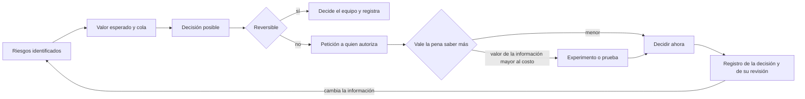
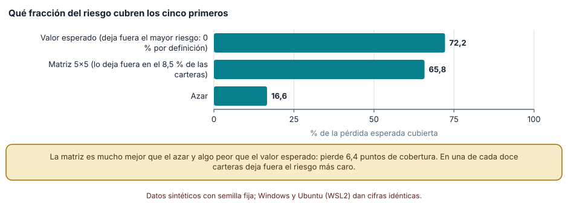
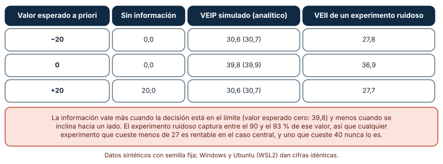
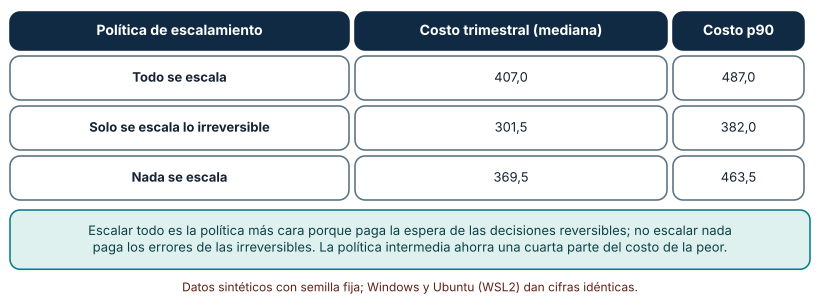

# SE-450 — Gestión de riesgos y decisiones ejecutivas

[← SE-449 — Estimación organizacional y compromisos](https://github.com/vladimiracunadev-create/modern-software-engineering-program/blob/main/classes/part-37-gestion-liderazgo-y-practica-profesional/se-449-estimacion-organizacional-y-compromisos/README.md) · [↑ Parte 37](https://github.com/vladimiracunadev-create/modern-software-engineering-program/blob/main/classes/part-37-gestion-liderazgo-y-practica-profesional/README.md) · [📚 Índice completo](https://github.com/vladimiracunadev-create/modern-software-engineering-program/blob/main/classes/README.md) · [🌐 Portal](https://vladimiracunadev-create.github.io/modern-software-engineering-program/classes/SE-450.html) · [SE-451 — Compras, proveedores y evaluación técnica →](https://github.com/vladimiracunadev-create/modern-software-engineering-program/blob/main/classes/part-37-gestion-liderazgo-y-practica-profesional/se-451-compras-proveedores-y-evaluacion-tecnica/README.md)

## Punto profesional y fundamento pedagógico

**Punto profesional.** La clase existe para que gestiones riesgos con números que sirvan a una decisión y para que presentes esa decisión a quien tiene autoridad para tomarla. Un registro de riesgos no es una lista de preocupaciones sino una herramienta para elegir en qué gastar atención y dinero; una presentación ejecutiva no es un resumen sino una petición: qué se decide, entre qué opciones, con qué costo de equivocarse y con qué plazo. La habilidad profesional es distinguir qué información cambiaría la decisión (y vale la pena comprar) de la que solo decora, y qué decisiones merecen escalar y cuáles no.

**Por qué aparece aquí.** Sigue a **Estimación organizacional y compromisos** (`SE-449`): un compromiso con probabilidad asume riesgos, y alguien con autoridad debe aceptarlos o rechazarlos. El caso conductor es **el equipo de plataforma educativa**, que debe pedir a la dirección académica una decisión sobre la adaptación al nuevo formato del ministerio: invertir en una exportación nueva, parchear la actual o esperar a que el ministerio aclare la norma.

**Error conceptual que debe corregir.** Creer que una matriz de riesgos de cinco por cinco prioriza bien y que cualquier decisión importante debe llegar a la dirección. La matriz agrupa en celdas y empata riesgos de valor muy distinto; en la simulación de la clase acierta casi siempre en lo grueso, pero deja fuera el mayor riesgo real una de cada doce veces. Y escalar todo satura a quien decide y retrasa lo reversible: el costo de la espera puede superar al del error.

**Secuencia de aprendizaje.** Antes de mirar los resultados, predices qué fracción de la pérdida esperada de 30 riesgos cubren los cinco que elige una matriz frente a los cinco que elige el valor esperado; después simulas cuánto vale la información perfecta y la de un experimento ruidoso frente a su costo, y cuánto cuesta una organización donde se escala todo, solo lo irreversible o nada. La secuencia usa predicción, explicación propia, contraste y recuperación. [ICAP](https://icap.education.asu.edu/research) distingue participación de construcción de conocimiento; [How People Learn II](https://nap.nationalacademies.org/catalog/24783/how-people-learn-ii-learners-contexts-and-cultures) respalda diseñar la práctica con contextos reales y retroalimentación.

**Evidencia de aprendizaje.** `decision-log.md` con la predicción, las tres figuras reproducidas, un registro de riesgos con probabilidad, impacto y valor esperado de al menos diez riesgos del caso, el cálculo del valor de una información concreta, una petición de decisión de una página (decisión, opciones, costo de cada una, costo de equivocarse, plazo) y una nota que separe qué es medido, qué inferido y qué supuesto.

**Límite de la conclusión.** Las probabilidades, los impactos lognormales, las distribuciones de valor, el ruido del experimento, la fracción de decisiones irreversibles y los costos de demora son sintéticos, escritos por el autor con semilla fija. No se evaluó ningún riesgo ni decisión real. Las cifras muestran la forma de cada mecanismo, no el valor en tu organización.

### Trazabilidad fuente → afirmación

| Fuente primaria u oficial | Afirmación que respalda | Lo que no prueba |
|---|---|---|
| [Cox, «What's Wrong with Risk Matrices?»](https://doi.org/10.1111/j.1539-6924.2008.01030.x) | Muestra que las matrices pueden asignar la misma categoría a riesgos de valor muy distinto y a veces invertir el orden. | No dice que toda matriz sea inútil ni qué alternativa conviene a tu organización. |
| [Howard, «Information Value Theory»](https://doi.org/10.1109/TSSC.1966.300074) | Formaliza el valor de la información como la mejora esperada de la decisión por conocerla. | No da los valores de tu decisión. |
| [NIST SP 800-30 Rev. 1](https://csrc.nist.gov/pubs/sp/800/30/r1/final) | Guía para evaluar riesgos de seguridad de la información con probabilidad e impacto, y para comunicarlos. | Es una guía para sistemas de información, no un método universal. |
| [Google SRE, «Embracing Risk»](https://sre.google/sre-book/embracing-risk/) | Presenta el riesgo como un costo que se acepta con un objetivo explícito, no como algo a eliminar. | Es la práctica de una organización concreta. |
| [Nygard, «Documenting Architecture Decisions»](https://cognitect.com/blog/2011/11/15/documenting-architecture-decisions) | Propone registrar el contexto, la decisión y las consecuencias de forma breve. | No garantiza que la decisión sea correcta. |
| [Python, módulo `math`](https://docs.python.org/3/library/math.html) | Documenta las funciones usadas en el cálculo analítico del valor de la información. | No justifica el modelo de valor. |

## Antes de empezar

Recupera lo aprendido en `SE-449`: un compromiso lleva su probabilidad y sus supuestos. La pregunta activa es: **¿cuál es el riesgo del que más se habla en tu equipo y cuánto perderías en un año, en valor esperado, si ocurriera?**

## Prerrequisitos

- Haber completado `SE-449` o poder explicar qué significa un percentil 85.
- Python 3.11 o posterior; los experimentos usan solo la biblioteca estándar (`random`, `math`, `statistics`).
- Conocer los conceptos de valor esperado y de probabilidad condicional.

## Problema auténtico

La dirección académica preguntó al equipo qué riesgos corría si el ministerio publicaba el nuevo formato con poco aviso. El equipo presentó una matriz de cinco por cinco con treinta riesgos coloreados; la dirección eligió los «rojos» y financió tres mitigaciones. Meses después, un riesgo que había quedado en «amarillo» (la pérdida de datos de actas por un fallo del proveedor de almacenamiento) ocurrió y costó más que los tres juntos: su impacto era de otra magnitud que el de los demás riesgos de su celda. En la misma temporada, el equipo había escalado a la dirección la elección de una biblioteca de fechas, una decisión que se podía revertir en una tarde, y la espera de dos semanas retrasó la entrega. La clase enseña a calcular el valor esperado de los riesgos, a decidir cuánto vale la pena averiguar antes de decidir y a escalar solo lo que lo merece.

## Objetivos observables

Al terminar podrás:

1. construir un registro de riesgos con probabilidad, impacto y valor esperado, y explicar cuándo una matriz lo distorsiona;
2. calcular el valor esperado de la información perfecta y decidir si un experimento ruidoso vale su costo;
3. distinguir decisiones reversibles e irreversibles y asignarles niveles de escalamiento;
4. redactar una petición de decisión de una página para una persona con autoridad;
5. separar lo medido, lo inferido y lo supuesto en el argumento de una decisión.

## Mapa conceptual



El mapa separa tres preguntas encadenadas: **qué riesgo pesa** (valor esperado y cola), **quién decide** (reversible o no) y **cuánto saber antes** (valor de la información). La flecha de retorno indica que una decisión registrada se revisa cuando cambia lo que se sabe.

## Temas y por qué importan

| Tema | Por qué cambia una decisión profesional | Evidencia mínima |
|---|---|---|
| Registro de riesgos | Dirige atención y dinero a lo que pesa. | Lista con probabilidad, impacto y valor esperado |
| Límites de las matrices | Pueden ocultar el riesgo mayor. | Comparación con el valor esperado |
| Valor de la información | Evita gastar en datos que no cambiarían la decisión. | Cálculo del valor frente al costo |
| Reversibilidad y escalamiento | Reduce la espera sin aumentar el daño. | Clasificación de decisiones y nivel de escalamiento |
| Petición de decisión | Convierte un informe en una acción posible. | Una página con decisión, opciones y plazo |

## Conceptos y decisiones

### 1. Riesgo como valor esperado, no como color

Un **riesgo** es la posibilidad de un evento que afecta un objetivo, con una probabilidad y un impacto. El **valor esperado** de la pérdida es probabilidad por impacto; sumado entre riesgos, da la pérdida anual esperada, y comparar riesgos por ese valor permite decidir dónde mitigar. Para un registro útil, cada fila lleva: el evento, la probabilidad anual, el impacto si ocurre (en dinero, horas o personas afectadas), el valor esperado, la mitigación posible con su costo y su efecto, y el responsable. La guía [NIST SP 800-30](https://csrc.nist.gov/pubs/sp/800/30/r1/final) sigue esta lógica de probabilidad e impacto aunque admite escalas cualitativas. La probabilidad se estima con datos cuando existen (incidentes pasados) y con rangos cuando no; un rango honesto es mejor que un número exacto inventado. El impacto tiene cola larga: la mayoría de los eventos son pequeños y unos pocos son enormes, de modo que el valor esperado lo dominan los segundos.

### 2. Por qué una matriz distorsiona

La matriz agrupa probabilidad e impacto en cinco categorías cada uno y multiplica los índices. [Cox](https://doi.org/10.1111/j.1539-6924.2008.01030.x) mostró tres problemas: riesgos de valor esperado muy distinto caen en la misma celda; el orden de las celdas puede invertir el de los riesgos; y la asignación de los cortes de las categorías, arbitraria, cambia el resultado. Con impactos de cola larga el efecto es más grave: la última categoría de impacto («más de 300») agrupa eventos de 300 y de 30 000. La matriz sirve para conversar y como filtro de primera pasada; deja de servir cuando decide una inversión. La alternativa no es abandonar la estimación sino usar números con rango y comparar por valor esperado, y mirar aparte los eventos de cola que, aunque raros, serían inaceptables por sí mismos (la pérdida de datos de actas).

### 3. Valor de la información

Antes de gastar en averiguar algo conviene saber cuánto podría valer. La **teoría del valor de la información** ([Howard](https://doi.org/10.1109/TSSC.1966.300074)) define el valor esperado de la información perfecta (VEIP) como lo que se gana, en promedio, por decidir sabiendo el resultado en vez de decidir con el conocimiento actual. Es un tope: ninguna prueba vale más. Si el VEIP es menor que el costo de averiguar, no se averigua; si es mayor, se averigua hasta donde convenga. Un experimento real es ruidoso y su valor (VEII) es menor que el VEIP; la diferencia depende de cuánto ruido tiene. La decisión suele ser sensible a unos pocos parámetros inciertos, y el valor de la información es mayor donde el balance de la decisión está cerca del límite (donde casi da igual elegir una u otra).

### 4. Reversibilidad y niveles de decisión

Las decisiones se diferencian por lo que cuesta deshacerlas. Una **reversible** (elegir una biblioteca de fechas detrás de una interfaz, activar una bandera) puede corregirse en horas o días con poco daño; la correcta es decidirla pronto, en el equipo, y registrar. Una **irreversible o muy costosa de revertir** (migrar los datos de actas a otro proveedor, firmar un contrato de cinco años, publicar una interfaz pública) merece más información, más personas y una autorización explícita. Escalar todo tiene un costo: cada decisión espera a quien tiene la agenda más cargada. Escalar nada tiene otro: errores caros sin freno. Una política razonable fija criterios: qué decisiones decide el equipo, cuáles consulta y cuáles requieren aprobación, con un plazo máximo de respuesta para cada nivel, y mide cuántas decisiones se revierten.

### 5. La petición de decisión

Presentar a una persona con autoridad no es informar sino pedir. Una buena petición cabe en una página y tiene seis partes: **la decisión** que se pide, **el contexto** mínimo necesario, **las opciones** (al menos dos, incluida «no hacer nada») con costo y riesgo de cada una, **la recomendación** con su razón, **lo que no se sabe** (y cuánto costaría saberlo) y **el plazo** con la consecuencia de no decidir. Se escribe para alguien que no leerá el anexo; los detalles van aparte y se enlazan. El argumento separa tres capas que conviene marcar: lo **medido** (con su fuente), lo **inferido** (con su razonamiento) y lo **supuesto** (con la opción que cambiaría si resultara falso). Esa separación es la defensa: permite que la persona que decide discrepe de un supuesto sin rechazar toda la propuesta.

### Qué fracción del riesgo cubren los cinco primeros

Se generan 400 carteras de 30 riesgos con probabilidad anual de mediana 8 % (con variación) e impacto lognormal de mediana 50 y dispersión 1,5 (unidades monetarias del autor). Se eligen cinco para mitigar con tres criterios: una matriz de 5×5 (cortes de probabilidad en 2, 5, 10 y 25 %; cortes de impacto en 10, 30, 100 y 300), el valor esperado y el azar. Se mide qué fracción de la pérdida esperada total cubren.

| Criterio para elegir los cinco | Pérdida esperada cubierta | Deja fuera el mayor riesgo |
|---|---:|---:|
| Valor esperado | 72,2 % | 0 % por definición |
| Matriz 5×5 | 65,8 % | 8,5 % de las carteras |
| Azar | 16,6 % | — |



**Cómo leer la figura.** Cada barra es un criterio para elegir los cinco riesgos a mitigar, con la frecuencia con que deja fuera el mayor riesgo entre paréntesis, y su longitud es el porcentaje de la pérdida esperada que cubre. Mira que la matriz queda cerca del valor esperado y muy lejos del azar, pero en una de cada doce carteras deja fuera el riesgo más caro. **Dónde deja de valer:** las distribuciones de probabilidad e impacto, los cortes de la matriz y la independencia entre riesgos son supuestos del autor; con cortes distintos la brecha cambia, y la cola larga del impacto agrava el problema. La figura no dice que una matriz sea inútil: dice cuánto cuesta decidir con ella, y que el costo se concentra en pocos casos grandes.

### Cuánto vale saber antes de decidir

Una inversión tiene un valor neto incierto con distribución normal de desviación 100 (miles de unidades). Sin información, se invierte solo si el valor esperado a priori es positivo. Con información perfecta, se invierte solo cuando el valor real es positivo. Un experimento ruidoso observa el valor con un error de desviación 40 (200 000 simulaciones por fila).

| Valor esperado a priori | Sin información | VEIP simulado (analítico) | VEII de un experimento ruidoso |
|---|---:|---:|---:|
| −20 | 0,0 | 30,6 (30,7) | 27,8 |
| 0 | 0,0 | 39,8 (39,9) | 36,9 |
| +20 | 20,0 | 30,6 (30,7) | 27,7 |



**Cómo leer la figura.** Cada grupo es un valor esperado a priori de la inversión; la barra verde azulada es el valor de la información perfecta y la dorada, el de un experimento ruidoso. Mira que ambas son máximas con valor esperado cero, cuando la decisión está en el límite, y que el experimento captura casi todo ese valor. **Dónde deja de valer:** la normalidad, la desviación de 100 y el ruido de 40 son supuestos del autor; el cálculo supone que la decisión es todo o nada y que el costo de la prueba es conocido. En una decisión real la distribución no se conoce y estimarla es la parte difícil.

### Cuánto cuesta decidir a qué nivel

Se simulan 200 decisiones por trimestre durante 3 000 trimestres. El 30 % es irreversible. Una decisión escalada se toma con más información (error 15 % frente a 25 %) y tarda 10 días en resolverse en vez de 1; la espera cuesta 0,1 por día. Un error cuesta 20 si la decisión era irreversible y 1,5 si era reversible.

| Política de escalamiento | Costo trimestral (mediana) | Costo p90 |
|---|---:|---:|
| Todo se escala | 407,0 | 487,0 |
| Solo se escala lo irreversible | 301,5 | 382,0 |
| Nada se escala | 369,5 | 463,5 |



**Cómo leer la figura.** Cada grupo es una política de escalamiento; la barra verde azulada es el costo trimestral mediano y la coral, el percentil 90. Mira que la política intermedia tiene las dos barras más bajas: escalar todo paga esperas y no escalar nada paga errores. **Dónde deja de valer:** los errores del 15 y 25 %, la espera de 10 días y los costos de 20 y 1,5 son supuestos del autor; la clasificación entre reversible e irreversible también es un juicio que se equivoca, y una decisión puede ser reversible de forma nominal pero irreversible en la práctica.

## Definiciones de trabajo

- **valor esperado:** suma de los resultados posibles ponderados por su probabilidad.
- **riesgo de cola:** evento de probabilidad baja y consecuencia alta, cuyo impacto domina el valor esperado o es inaceptable por sí mismo.
- **valor esperado de la información perfecta (VEIP):** mejora esperada de una decisión por conocer el resultado antes de decidir; tope de lo que vale cualquier prueba.
- **decisión reversible:** decisión que puede deshacerse con poco costo en un plazo corto.
- **petición de decisión:** documento breve que pide a una persona con autoridad una decisión concreta, con opciones, costos y plazo.

Las definiciones son operativas para el equipo de plataforma educativa. No convierten términos con una historia más amplia en sinónimos y deben contrastarse con las fuentes primarias enlazadas al final.

## Ejemplo mínimo

El fragmento calcula el valor esperado de tres riesgos y los ordena. Antes de ejecutarlo, predice cuál queda primero.

```python
riesgos = {"pérdida de datos de actas": (0.02, 900), "formato nuevo con poco aviso": (0.30, 60), "salida de una persona clave": (0.15, 80)}
for nombre, (p, impacto) in sorted(riesgos.items(), key=lambda kv: -kv[1][0] * kv[1][1]):
    print(f"{nombre}: {p * impacto:.1f}")
```

Imprime `pérdida de datos de actas: 18.0`, `formato nuevo con poco aviso: 18.0` y `salida de una persona clave: 12.0`. Observa el empate: la pérdida de datos es rara y enorme; el formato nuevo, frecuente y moderado. Con el mismo valor esperado, no se mitigan igual: el primero admite una inversión en prevención y respaldo, el segundo en flexibilidad y aviso. Un empate numérico no es una equivalencia de tratamiento. Registra versión de Python, comando y salida.

## Ejemplo profesional

Escenario hipotético, construido para la clase y sin datos reales. El equipo prepara una petición para la dirección académica sobre la exportación. Registra doce riesgos con rangos de probabilidad e impacto y calcula el valor esperado de cada uno; tres suman casi dos tercios de la pérdida esperada, y uno de ellos, la pérdida de datos de actas, es un evento de cola que además considera inaceptable por sí mismo. Calcula que averiguar la fecha real del ministerio mediante una consulta formal cuesta poco y que su valor de información es alto porque la decisión entre invertir ahora y esperar está cerca del límite. Clasifica sus decisiones: la elección de biblioteca de fechas es reversible y la decide el equipo; el contrato con el proveedor de almacenamiento no lo es y va a la dirección. La petición de una página pide: «autorizar hasta el 15 de febrero una exportación nueva por 30 000, con respaldo adicional de actas; opciones: parche actual (12 000, riesgo de reproceso), esperar (0, riesgo de multa por incumplimiento); recomendación: la primera; no sabemos la fecha final del ministerio y consultarla costaría dos días; si no se decide antes del 30 de enero, la opción de esperar deja de ser viable». Marca qué parte es medida (incidentes del año), inferida (impacto de actas) y supuesta (que el ministerio publique con poco aviso). Compara con la matriz de colores: la diferencia es lo que la dirección puede decidir.

## Práctica guiada

1. Registra diez riesgos del caso o de tu equipo con probabilidad, impacto y valor esperado, con rangos cuando no tengas datos.
2. Predice qué fracción de la pérdida esperada cubren los cinco primeros por matriz y por valor esperado, y escribe el número antes de simular.
3. Reproduce las tres tablas con las semillas fijadas en `scripts/experiments_part37_a.py`; cambia los cortes de la matriz y observa cuánto cambia la cobertura.
4. Calcula el valor esperado de la información perfecta de una decisión tuya (invertir o no) con tus números y compáralo con el costo de averiguar.
5. Clasifica diez decisiones recientes como reversibles o irreversibles y asigna un nivel de decisión a cada una.
6. Escribe una petición de decisión de una página con las seis partes.
7. Entrega `decision-log.md` y pide a otra persona que identifique el supuesto de tu petición que, de ser falso, cambiaría tu recomendación.

## Ejercicios

1. **Matriz:** construye dos riesgos que caigan en la misma celda con valores esperados que difieran en un factor de diez, y explica qué decisión tomaría una dirección que solo ve el color.
2. **Información:** una prueba cuesta 10 y reduce a la mitad la incertidumbre de una decisión cuyo VEIP es 25. ¿Es rentable? Explica qué información necesitas para responder con seguridad.
3. **Reversibilidad:** da un ejemplo de una decisión nominalmente reversible que en la práctica no lo es (por ejemplo, una interfaz que otros ya consumen) y propone cómo recuperar la reversibilidad.
4. **Petición:** reescribe esta frase en un formato de petición: «Hay varios riesgos con la exportación y deberíamos hablar de qué hacer».

## Reto verificable

Entrega `decision-log.md` con la predicción, las tres tablas, el registro de riesgos con valor esperado, el cálculo de la información, la clasificación de decisiones y la petición de una página. Se aprueba si otra persona ejecuta el código desde un checkout limpio, obtiene los mismos números con las mismas semillas y puede decir, a partir de tu petición, qué decisión se pide, entre qué opciones y qué pasa si no se decide a tiempo. No se aprueba por afirmar «el riesgo es alto» sin probabilidad, impacto ni qué cambiaría si lo fuera menos.

## Caso conductor

El equipo de plataforma educativa es el caso conductor de la Parte 37. Esta clase deja el sexto artefacto: un registro de riesgos con valor esperado y una petición de decisión. `SE-451` preguntará cómo se compra y se evalúa a un proveedor cuando la decisión pasa por un tercero, y `SE-453` cómo se traduce una inversión a costo total. Cambia después un solo dato, el ruido del experimento de 40 a 80, y observa cuánto del valor de la información se pierde.

## Preguntas frecuentes

### ¿Y si no tengo datos para estimar la probabilidad?

Usa rangos y justifica su origen (incidentes de equipos parecidos, opinión de expertas registrada). Un rango amplio informa que el riesgo es incierto y que quizá valga la pena averiguar; un número exacto sin base oculta esa incertidumbre. Revisa la estimación cuando ocurra un evento o pase un trimestre.

### ¿Cómo trato un riesgo que no puedo cuantificar?

Declara que no lo puedes cuantificar y qué lo haría inaceptable (la pérdida de datos de personas, un incumplimiento legal). Algunos riesgos se tratan como restricciones —no se aceptan— y no como términos de un cálculo. Documenta la restricción y quién la fijó.

### ¿Una petición de una página no simplifica demasiado?

Simplifica la lectura, no el análisis: el análisis va en anexos enlazados. Si la petición no cabe en una página, suele ser porque la decisión no está clara o hay varias decisiones mezcladas.

### ¿Quién clasifica una decisión como reversible?

Quien la propone, con revisión de quien tendría que deshacerla. La clasificación es un juicio falible; por eso se registra y se revisa cuando una «reversible» tuvo que revertirse y costó más de lo previsto.

## Fallo controlado y diagnóstico

Reproduce el fallo clásico de la clase: **una matriz de colores que deja fuera el riesgo mayor**. Genera carteras de treinta riesgos y cuenta en cuántas el riesgo de mayor valor esperado no está entre los cinco que elige la matriz.

Registra síntoma, entrada mínima, hipótesis, observación que descarta cada hipótesis, causa, corrección y prueba de regresión. **Síntoma:** un riesgo «amarillo» ocurre y cuesta más que tres «rojos» mitigados. **Hipótesis rivales:** (a) la probabilidad estaba mal estimada; (b) el impacto estaba subestimado; (c) la celda agrupó impactos de órdenes de magnitud distintos. **Prueba:** recalcula el valor esperado con rangos numéricos y ordena; si el riesgo sube al primer lugar, la causa es la agrupación. **Conclusión:** la matriz deja fuera el mayor riesgo en el 8,5 % de las carteras de la simulación. **Regresión:** exige que cada riesgo de cola tenga un impacto numérico y se revise aparte, y compara cada trimestre el orden por matriz con el orden por valor esperado. No cambies a la vez los cortes de la matriz y el criterio.

## Errores comunes y cómo corregirlos

| Síntoma | Causa probable | Corrección |
|---|---|---|
| Se mitigan riesgos que no pesan | Matriz con celdas que agrupan valores muy distintos | Ordenar por valor esperado con rangos |
| El riesgo de cola se ignora | Probabilidad baja domina el color | Tratar la cola como restricción aparte |
| Se gasta en estudios que no cambian nada | No se calculó el valor de la información | Comparar VEIP con el costo antes |
| Todo espera a la dirección | No se clasifican las decisiones | Definir niveles según reversibilidad |
| La petición no recibe respuesta | No pide una decisión ni un plazo | Redactar con las seis partes |

## Entorno y archivos clave

```text
work/SE-450/
├── README.md
├── riesgos/
│   ├── cartera.py
│   ├── valor_informacion.py
│   └── escalamiento.py
├── REGISTRO-DE-RIESGOS.md
├── PETICION-DE-DECISION.md
├── tests/test_riesgos.py
└── evidence/decision-log.md
```

El `README` declara plataforma, versión de Python, semillas y comandos. Los experimentos usan solo la biblioteca estándar (`random`, `math`, `statistics`) y se ejecutaron con CPython 3.12.9 en Windows 11 y 3.12.3 en Ubuntu bajo WSL2: las salidas fueron idénticas. Si añades una dependencia, fija procedencia y versión.

## Seguridad, ética y accesibilidad

- un registro de riesgos puede contener vulnerabilidades explotables o datos de personas: limita el acceso y no lo publiques sin revisión;
- tratar un riesgo como número no debe ocultar a quién afecta: cuando el impacto recae sobre personas (estudiantes, docentes), nómbralo y no lo reduzcas a dinero;
- presentar una decisión como técnica cuando es de valores oculta a quien debe decidir: marca explícitamente los supuestos de valor;
- las tablas y figuras deben tener texto alternativo y no depender del color;
- las fuentes citadas son textos de sus autores: cita las ideas y vincula la fuente, no copies sus textos ni diagramas.

## Puente hacia el trabajo con agentes

Un agente al que se le pide «haz una matriz de riesgos del proyecto» producirá una tabla ordenada con probabilidades e impactos que parecen razonables y no tienen base. Pídele en cambio que liste los eventos posibles y las preguntas que habría que hacer para estimarlos, que calcule el valor esperado con los rangos que tú le des y que marque cuáles son de cola. Revisa especialmente cualquier probabilidad que no cite una fuente y cualquier recomendación de mitigación sin costo. El agente puede ordenar y calcular; la estimación y la decisión de qué riesgos son inaceptables son tuyas y de quien autoriza.

## Transferencia

Traslada el análisis a otro dominio (por ejemplo, una clínica veterinaria que decide si cambia su sistema de agendas): cambia los riesgos, los impactos y las decisiones y conserva el procedimiento de calcular valor esperado con rangos, tratar la cola aparte, calcular el valor de la información y pedir una decisión con opciones y plazo. La transferencia está lograda cuando puedes decir qué riesgo de tu dominio es de cola y por qué no se decide con el mismo criterio que los demás, no cuando el registro se parece al del equipo de plataforma.

## Evaluación y evidencia

| Criterio | Evidencia para aprobar |
|---|---|
| comprensión | explicación de qué distorsiona una matriz y de qué es el valor de la información |
| corrección | tablas de cobertura, de información y de escalamiento reproducibles con las mismas semillas |
| diseño | registro con valor esperado, clasificación de decisiones y petición de una página con supuestos marcados |
| diagnóstico | reproducción del fallo «matriz sin el riesgo mayor» con regresión |
| incertidumbre | declaración de que las distribuciones, los cortes y los costos son del autor |
| reproducibilidad | versiones, comandos, salida y límites declarados |

## Fuentes

- [Cox, «What's Wrong with Risk Matrices?»](https://doi.org/10.1111/j.1539-6924.2008.01030.x) — límites de las matrices de riesgo; autoridad: Risk Analysis.
- [Howard, «Information Value Theory»](https://doi.org/10.1109/TSSC.1966.300074) — valor de la información en la decisión; autoridad: IEEE Transactions on Systems Science and Cybernetics.
- [NIST SP 800-30 Rev. 1](https://csrc.nist.gov/pubs/sp/800/30/r1/final) — guía de evaluación de riesgos; autoridad: NIST.
- [Google SRE, «Embracing Risk»](https://sre.google/sre-book/embracing-risk/) — riesgo como costo aceptado con objetivo; autoridad: equipo de SRE de Google.
- [Nygard, «Documenting Architecture Decisions»](https://cognitect.com/blog/2011/11/15/documenting-architecture-decisions) — registro breve de decisiones; autoridad: autor del texto.
- [Python, módulo `math`](https://docs.python.org/3/library/math.html) — funciones del cálculo analítico; autoridad: Python Software Foundation.

Cada fuente respalda el mecanismo indicado; ninguna demuestra que el 65,8 % de cobertura de la matriz, el VEIP de 39,8 o el ahorro de la política intermedia se observen en tu organización. Esa afirmación depende de tus riesgos, de tus decisiones y de tu costo de esperar.

## Límites y siguiente paso

Se ejecutaron tres experimentos con datos sintéticos en Windows y Ubuntu (WSL2) con resultados idénticos. No se evaluó ningún riesgo ni decisión real; las distribuciones, los cortes de la matriz, el ruido de la prueba, la fracción de decisiones irreversibles y los costos son construcciones del autor, y el modelo supone riesgos independientes y decisiones de todo o nada. La siguiente clase pregunta cómo se compra y se evalúa a un proveedor, que es una de las decisiones que más a menudo se vuelve irreversible.

## Glosario

- **valor esperado:** suma de los resultados posibles ponderados por su probabilidad.
- **riesgo de cola:** evento de probabilidad baja y consecuencia alta, cuyo impacto domina el valor esperado o es inaceptable por sí mismo.
- **valor esperado de la información perfecta (VEIP):** mejora esperada de una decisión por conocer el resultado antes de decidir; tope de lo que vale cualquier prueba.
- **decisión reversible:** decisión que puede deshacerse con poco costo en un plazo corto.
- **petición de decisión:** documento breve que pide a una persona con autoridad una decisión concreta, con opciones, costos y plazo.

---

[← SE-449 — Estimación organizacional y compromisos](https://github.com/vladimiracunadev-create/modern-software-engineering-program/blob/main/classes/part-37-gestion-liderazgo-y-practica-profesional/se-449-estimacion-organizacional-y-compromisos/README.md) · [↑ Parte 37](https://github.com/vladimiracunadev-create/modern-software-engineering-program/blob/main/classes/part-37-gestion-liderazgo-y-practica-profesional/README.md) · [📚 Índice completo](https://github.com/vladimiracunadev-create/modern-software-engineering-program/blob/main/classes/README.md) · [🌐 Portal](https://vladimiracunadev-create.github.io/modern-software-engineering-program/classes/SE-450.html) · [SE-451 — Compras, proveedores y evaluación técnica →](https://github.com/vladimiracunadev-create/modern-software-engineering-program/blob/main/classes/part-37-gestion-liderazgo-y-practica-profesional/se-451-compras-proveedores-y-evaluacion-tecnica/README.md)
