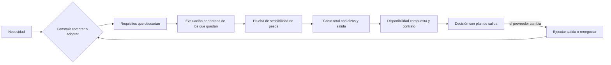
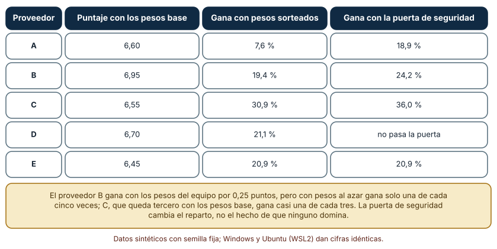
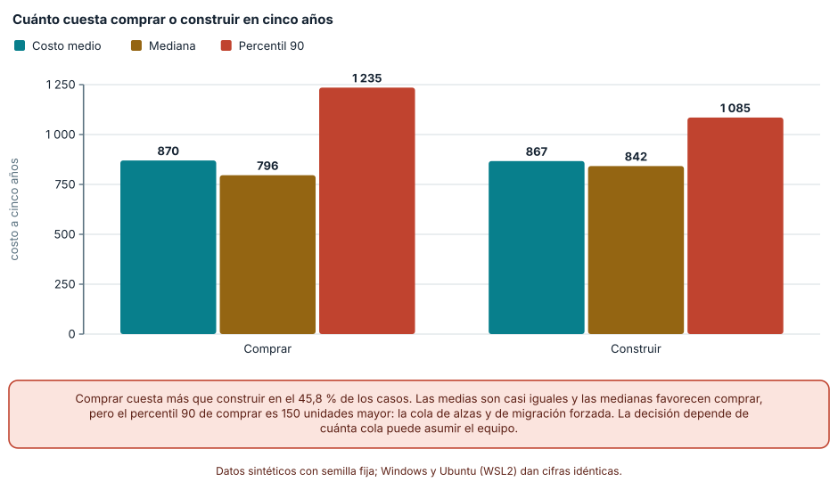
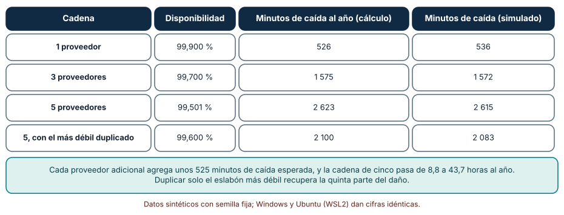

# SE-451 — Compras, proveedores y evaluación técnica

[← SE-450 — Gestión de riesgos y decisiones ejecutivas](https://github.com/vladimiracunadev-create/modern-software-engineering-program/blob/main/classes/part-37-gestion-liderazgo-y-practica-profesional/se-450-gestion-de-riesgos-y-decisiones-ejecutivas/README.md) · [↑ Parte 37](https://github.com/vladimiracunadev-create/modern-software-engineering-program/blob/main/classes/part-37-gestion-liderazgo-y-practica-profesional/README.md) · [📚 Índice completo](https://github.com/vladimiracunadev-create/modern-software-engineering-program/blob/main/classes/README.md) · [🌐 Portal](https://vladimiracunadev-create.github.io/modern-software-engineering-program/classes/SE-451.html) · [SE-452 — Propiedad intelectual, contratos y ética →](https://github.com/vladimiracunadev-create/modern-software-engineering-program/blob/main/classes/part-37-gestion-liderazgo-y-practica-profesional/se-452-propiedad-intelectual-contratos-y-etica/README.md)

## Punto profesional y fundamento pedagógico

**Punto profesional.** La clase existe para que decidas si construir, comprar o adoptar un componente con un proceso que se pueda auditar, y para que evalúes a un proveedor con evidencia en vez de con una presentación comercial. Tres decisiones concentran el error: qué criterios son requisitos que descartan y cuáles son preferencias que se ponderan, cuánto cambia el ganador si los pesos cambian y qué pasa con el costo y la continuidad si el proveedor sube precios, desaparece o falla. La habilidad profesional es convertir una comparación de proveedores en un argumento que otra persona pueda reproducir y discutir.

**Por qué aparece aquí.** Sigue a **Gestión de riesgos y decisiones ejecutivas** (`SE-450`): la petición de decisión del equipo incluía contratar un servicio de almacenamiento para las actas, una decisión difícil de revertir. El caso conductor es **el equipo de plataforma educativa**, que debe elegir entre cinco proveedores de almacenamiento y exportación documental con criterios de funcionalidad, seguridad, costo, integración, soporte y portabilidad de salida.

**Error conceptual que debe corregir.** Creer que una matriz ponderada de proveedores produce «el mejor». Con pesos que son opiniones, un ganador por 0,25 puntos sobre diez cambia con modificaciones pequeñas de los pesos: en la simulación de la clase, el proveedor que gana con los pesos del equipo gana solo una de cada cinco veces si los pesos se sortean. La matriz es una forma de explicitar el argumento, no una prueba. Y creer que un acuerdo de nivel de servicio protege: el crédito que ofrece un contrato es una fracción de la pérdida que causa una caída.

**Secuencia de aprendizaje.** Antes de mirar los resultados, predices qué proveedor gana si los pesos se sortean al azar veinte mil veces; después simulas el costo a cinco años de comprar frente a construir con alzas de precio y descontinuación, y calculas cuánto tiempo cae una cadena de proveedores cada uno al 99,9 % y cuánto cubre el crédito de un contrato. La secuencia usa predicción, explicación propia, contraste y recuperación. [ICAP](https://icap.education.asu.edu/research) distingue participación de construcción de conocimiento; [How People Learn II](https://nap.nationalacademies.org/catalog/24783/how-people-learn-ii-learners-contexts-and-cultures) respalda diseñar la práctica con contextos reales y retroalimentación.

**Evidencia de aprendizaje.** `proveedores-log.md` con la predicción, las tres figuras reproducidas, una matriz de evaluación con puertas de aprobación y pesos justificados, una prueba de sensibilidad de los pesos, un plan de salida con costo y plazo, una tabla de disponibilidad compuesta de la cadena de dependencias y una nota que separe qué es medido, qué inferido y qué supuesto.

**Límite de la conclusión.** Los cinco proveedores, sus puntajes, el rango de pesos, las alzas de precio, la probabilidad de descontinuación, los sobrecostos y las disponibilidades son sintéticos, escritos por el autor con semilla fija. No se evaluó ningún proveedor real ni se leyó contrato alguno. Las cifras muestran la forma de cada mecanismo, no el valor para tu compra.

### Trazabilidad fuente → afirmación

| Fuente primaria u oficial | Afirmación que respalda | Lo que no prueba |
|---|---|---|
| [NIST SP 800-161 Rev. 1](https://csrc.nist.gov/pubs/sp/800/161/r1/final) | Recoge prácticas de gestión de riesgos de la cadena de suministro para sistemas y organizaciones, incluidas las que dependen de proveedores. | Es una guía general; no evalúa a un proveedor concreto. |
| [OpenSSF Scorecard](https://scorecard.dev/) | Ofrece comprobaciones automatizadas de prácticas de seguridad de proyectos de código abierto. | Una puntuación alta no garantiza ausencia de vulnerabilidades. |
| [SLSA](https://slsa.dev/) | Define niveles de garantía sobre cómo se construye y distribuye un artefacto de software. | No certifica que el contenido del artefacto sea seguro. |
| [Google SRE, «Service Level Objectives»](https://sre.google/sre-book/service-level-objectives/) | Distingue indicadores, objetivos y acuerdos de nivel de servicio y su relación con la disponibilidad. | No fija qué objetivo es adecuado para tu servicio. |
| [Google SRE, «Embracing Risk»](https://sre.google/sre-book/embracing-risk/) | Relaciona el nivel de disponibilidad con su costo y con la tolerancia a riesgo del negocio. | Es la práctica de una organización concreta. |
| [Belton y Gear, «On a short-coming of Saaty's method of analytic hierarchies»](https://doi.org/10.1016/0305-0483(83)90047-6) | Muestra que añadir una alternativa puede invertir el orden de otras en un método de ponderación jerárquica. | Se refiere a un método concreto, no a toda suma ponderada. |

## Antes de empezar

Recupera lo aprendido en `SE-450`: una decisión irreversible merece más información y una autorización explícita. La pregunta activa es: **¿cuál es la dependencia externa de tu sistema que más te costaría reemplazar, y desde cuándo tienes un plan escrito para hacerlo?**

## Prerrequisitos

- Haber completado `SE-450` o poder explicar qué distingue una decisión reversible de una irreversible.
- Python 3.11 o posterior; los experimentos usan solo la biblioteca estándar (`random`, `math`, `statistics`).
- Haber leído alguna vez un contrato de servicio, una página de precios o un acuerdo de nivel de servicio.

## Problema auténtico

La dirección académica autorizó contratar un servicio de almacenamiento para las actas. El equipo hizo una matriz con cinco proveedores y seis criterios; el ganador por un cuarto de punto era el segundo más caro, y la elección se anunció como «objetiva». Dos meses después, el proveedor subió su cuota un 40 %, y al intentar exportar los datos el equipo descubrió que el formato de salida no incluía los metadatos de firma. En otro episodio, una caída de tres horas en un servicio de terceros impidió cerrar actas el día del plazo del ministerio; el contrato daba un crédito de 200 unidades, y la pérdida del equipo fue de 15 000. Una revisión posterior mostró además que, al sortear los pesos de los criterios, el ganador cambiaba casi siempre. La clase enseña a separar puertas de ponderaciones, a probar la sensibilidad de la elección, a calcular el costo con las alzas y la salida, y a calcular la disponibilidad compuesta.

## Objetivos observables

Al terminar podrás:

1. distinguir requisitos que descartan de preferencias que se ponderan y construir una matriz con ambas capas;
2. medir cuánto depende el ganador de los pesos y reportar la robustez de la elección;
3. calcular el costo a varios años de comprar y de construir con incertidumbre y reportar la cola;
4. calcular la disponibilidad compuesta de una cadena de dependencias y el valor real de un crédito de nivel de servicio;
5. redactar un plan de salida con costo, plazo y datos exportables.

## Mapa conceptual



El mapa separa cinco filtros: las **puertas** (lo que no se negocia), la **ponderación** (lo que se prefiere), la **sensibilidad** (cuánto aguanta la elección), el **costo** (con alzas y salida) y la **continuidad** (disponibilidad y contrato). La flecha de retorno indica que la compra no cierra la decisión: el plan de salida mantiene viva la alternativa.

## Temas y por qué importan

| Tema | Por qué cambia una decisión profesional | Evidencia mínima |
|---|---|---|
| Construir, comprar o adoptar | Cada opción traslada riesgo y costo de modo distinto. | Tabla de opciones con criterio de núcleo y commodity |
| Puertas y ponderación | Separa lo que descarta de lo que se prefiere. | Matriz en dos capas |
| Sensibilidad de los pesos | Mide cuánto aguanta la elección. | Porcentaje de victorias con pesos sorteados |
| Costo total y salida | El precio de lista subestima el costo con alzas y salida. | Distribución del costo a cinco años |
| Disponibilidad y contrato | La cadena es menos fiable que cada eslabón. | Cálculo compuesto y valor del crédito |

## Conceptos y decisiones

### 1. Construir, comprar o adoptar

Una primera pregunta ordena todas las demás: ¿el componente es parte del núcleo que diferencia al producto o es un servicio genérico? Lo que diferencia a la plataforma educativa (el cálculo de notas y las reglas del ministerio) suele construirse porque en ella está el conocimiento del dominio; el almacenamiento de archivos es un servicio genérico, con proveedores maduros. Hay tres opciones, no dos: **construir** (control y costo de mantenimiento), **comprar** o contratar un servicio (rapidez y dependencia) y **adoptar** código abierto (sin cuota pero con costo de operación, de actualización y de conocimiento). Cada una cambia quién carga con el riesgo. La decisión se justifica con el costo total en el horizonte (clase siguiente: `SE-453`), con la capacidad del equipo para mantener lo que construye y con el costo de cambiar de opinión.

### 2. Puertas y ponderación

Una evaluación honesta tiene dos capas. La primera son las **puertas**: requisitos que descartan al proveedor si no se cumplen (cifrado en reposo, ubicación de datos acorde a la ley, exportación completa de datos, certificación o evidencia de seguridad). Se aplican con sí o no, y se documenta la evidencia de cada una; no se ponderan, porque un proveedor muy barato no compensa un incumplimiento legal. La segunda es la **evaluación ponderada** de quienes pasan las puertas: criterios con descripción, escala con anclas, pesos justificados, puntajes basados en pruebas (una prueba de concepto con datos propios, la lectura de la documentación, referencias) y no en la presentación comercial. Para componentes de código abierto, herramientas como [OpenSSF Scorecard](https://scorecard.dev/) automatizan comprobaciones de prácticas y [SLSA](https://slsa.dev/) describe garantías sobre la construcción de artefactos; ninguna sustituye la lectura de lo que el componente hace con tus datos. Las guías de [NIST SP 800-161](https://csrc.nist.gov/pubs/sp/800/161/r1/final) enumeran riesgos de la cadena de suministro que conviene recorrer como lista de preguntas.

### 3. Sensibilidad de los pesos

Los pesos son opiniones, y una opinión cambia con quien la formula. Una suma ponderada con diferencias pequeñas entre los primeros no distingue entre los proveedores: distingue entre las opiniones sobre los pesos. La prueba de sensibilidad responde a la pregunta «¿cuánto tendría que cambiar mi opinión para que ganara otro?» de dos maneras. Una es variar cada peso y ver cuándo cambia el ganador; otra, más general, sortear los pesos muchas veces (por ejemplo con una distribución uniforme sobre todas las combinaciones que suman uno) y contar cuántas veces gana cada proveedor. Si el ganador base gana pocas veces, la decisión no se sostiene en los datos sino en los pesos, y hay que decirlo. Además, los métodos de ponderación jerárquica pueden invertir el orden al añadir una alternativa ([Belton y Gear](https://doi.org/10.1016/0305-0483(83)90047-6)): conviene probar la elección quitando y añadiendo proveedores.

### 4. Costo total, alzas y salida

El precio de lista es un solo número; el costo a cinco años es una distribución. Tiene componentes que el contrato no fija: alzas de precio a la renovación, costo de integración, costo de migrar si el proveedor deja de servir (por descontinuación, compra o cambio de condiciones) y costo de mantener un doble sistema mientras se migra. Construir tiene los suyos: el costo inicial sobre-excedido (los proyectos tienden a costar más de lo estimado), el mantenimiento que crece y el riesgo de perder a la persona que sabe. Comparar solo medias oculta la diferencia más importante, que está en la cola: una opción puede tener un costo medio parecido y un percentil 90 mucho mayor. Un **plan de salida** reduce esa cola: datos exportables en un formato abierto con sus metadatos, una prueba periódica de exportar y restaurar, una alternativa identificada y una estimación de plazo y costo de migrar.

### 5. Disponibilidad compuesta y contrato

Un servicio que depende en serie de varios servicios no puede ser más disponible que el producto de sus disponibilidades. Cinco proveedores al 99,9 % dan una cadena del 99,5 %, cercana a cuarenta y cuatro horas de caída al año. La redundancia en el eslabón más débil (dos proveedores independientes) mejora esa cifra, y su costo debe pesarse. El **acuerdo de nivel de servicio** (SLA) define un compromiso y una compensación; el **objetivo** (SLO) y el **indicador** (SLI) los distingue la práctica de [SRE](https://sre.google/sre-book/service-level-objectives/). Un crédito de nivel de servicio es una devolución parcial de la cuota, no una compensación por la pérdida: sirve como señal contractual y no sustituye la tolerancia al fallo en el diseño. La decisión de cuánta disponibilidad comprar se relaciona con el costo ([Embracing Risk](https://sre.google/sre-book/embracing-risk/)): cada nueve adicional cuesta más y solo vale si el negocio lo necesita.

### Cuánto depende el ganador de los pesos

Cinco proveedores (A–E) con puntajes de 1 a 10 en seis criterios (funcionalidad, seguridad, costo, integración, soporte, salida) y pesos base de 25, 20, 15, 15, 15 y 10 %. Se sortean 20 000 combinaciones de pesos y se cuenta quién gana. En la segunda pasada se exige seguridad de 6 o más como puerta.

| Proveedor | Puntaje con los pesos base | Gana con pesos sorteados | Gana con la puerta de seguridad |
|---|---:|---:|---:|
| A | 6,60 | 7,6 % | 18,9 % |
| B | 6,95 | 19,4 % | 24,2 % |
| C | 6,55 | 30,9 % | 36,0 % |
| D | 6,70 | 21,1 % | no pasa la puerta |
| E | 6,45 | 20,9 % | 20,9 % |



**Cómo leer la figura.** Cada grupo es un proveedor con su puntaje con los pesos base entre paréntesis; la barra verde azulada es cuántas veces gana con 20 000 pesos sorteados y la dorada, con la puerta de seguridad. Mira que B, el ganador con los pesos base, gana una de cada cinco veces y C, tercero, gana casi una de cada tres. **Dónde deja de valer:** los puntajes son inventados y los pesos se sortean de manera uniforme sobre todas las combinaciones, que incluye pesos que nadie propondría (por ejemplo, el 90 % en un solo criterio); una distribución más cercana a los pesos del equipo daría un reparto menos disperso. La figura no dice que no se pueda elegir, dice que la elección debe declarar su robustez.

### Cuánto cuesta comprar o construir en cinco años

Comprar: integración de 80, cuota inicial de 100 por año con un 30 % de probabilidad anual de alza del 40 % (que se mantiene) y un 4 % anual de que el proveedor se descontinúe, con migración de 300 (variable) más un año de doble cuota. Construir: costo inicial de 450 con sobrecosto lognormal (dispersión 0,35), mantenimiento de 70 creciente un 5 % anual y un 10 % anual de perder a una persona clave, con 60 de costo. Se simulan 10 000 casos (unidades monetarias del autor). La probabilidad de que comprar cueste más que construir en el mismo escenario es del 45,8 %.

| Opción | Costo medio | Mediana | Percentil 90 |
|---|---:|---:|---:|
| Comprar | 870 | 796 | 1 235 |
| Construir | 867 | 842 | 1 085 |



**Cómo leer la figura.** Cada grupo es una opción; las barras son el costo medio (verde azulado), la mediana (dorada) y el percentil 90 (coral). Mira que las medias casi coinciden, que la mediana favorece comprar y que el percentil 90 favorece construir: la diferencia está en la cola. **Dónde deja de valer:** todas las probabilidades, las alzas, el sobrecosto y los costos son supuestos del autor; no se modelan descuentos por volumen, costos de integración que crecen ni la posibilidad de que el servicio mejore. La figura muestra la forma del riesgo asimétrico, no cuál conviene.

### Cuánto cae una cadena de proveedores

Cada proveedor con disponibilidad del 99,9 % tiene caídas aleatorias de 45 minutos de media. Se calcula la disponibilidad como producto y se simulan 600 años por escenario, uniendo los intervalos de caída. Se compara además el valor de un crédito: uno máximo de 200 por mes equivale a 2,4 minutos de una pérdida de 5 000 por hora, y una caída de tres horas pierde 15 000.

| Cadena | Disponibilidad | Minutos de caída al año (cálculo) | Minutos de caída (simulado) |
|---|---:|---:|---:|
| 1 proveedor | 99,900 % | 526 | 536 |
| 3 proveedores | 99,700 % | 1 575 | 1 572 |
| 5 proveedores | 99,501 % | 2 623 | 2 615 |
| 5, con el más débil duplicado | 99,600 % | 2 100 | 2 083 |



**Cómo leer la figura.** Cada grupo es una cadena con su disponibilidad entre paréntesis; la barra verde azulada es el cálculo y la gris, la simulación. Mira que ambas coinciden y que cada proveedor añadido suma unos 525 minutos, mientras duplicar solo el más débil recupera apenas una quinta parte. **Dónde deja de valer:** las caídas son independientes y de 45 minutos de media; en la práctica los proveedores comparten infraestructura (un mismo servicio de nube) y fallan juntos, lo que hace la cadena mejor o peor que el producto según el caso. El valor de 5 000 por hora y el crédito de 200 son supuestos del autor.

## Definiciones de trabajo

- **puerta de aprobación:** requisito que descarta a un proveedor si no se cumple y que no se compensa con otros criterios.
- **evaluación ponderada:** puntuación de las opciones que pasan las puertas con criterios y pesos explícitos.
- **plan de salida:** conjunto de datos exportables, alternativa identificada, costo y plazo para dejar a un proveedor.
- **disponibilidad compuesta:** disponibilidad de un sistema que depende en serie de varios componentes, igual al producto de las disponibilidades.
- **crédito de nivel de servicio:** devolución parcial de la cuota que establece un contrato cuando el servicio incumple su objetivo.

Las definiciones son operativas para el equipo de plataforma educativa. No convierten términos con una historia más amplia en sinónimos y deben contrastarse con las fuentes primarias enlazadas al final.

## Ejemplo mínimo

El fragmento calcula la disponibilidad de una cadena y los minutos de caída anuales. Antes de ejecutarlo, predice si cuatro proveedores al 99,9 % superan el 99,6 %.

```python
disponibilidades = [0.999] * 4
total = 1.0
for d in disponibilidades:
    total *= d
print(round(100 * total, 3), round((1 - total) * 365 * 24 * 60))
```

Imprime `99.601` y `2099`: cuatro proveedores al 99,9 % dan 99,601 %, con unos 2 099 minutos de caída al año; es prácticamente la cifra de cinco proveedores con el más débil duplicado (99,600 % y 2 100 minutos). Observa que quitar un proveedor de la cadena y duplicarlo no es lo mismo en costo ni en riesgo, aunque la cifra coincida. Registra versión de Python, comando y salida.

## Ejemplo profesional

Escenario hipotético, construido para la clase y sin datos reales. El equipo define cuatro puertas (cifrado en reposo, almacenamiento en la región acordada, exportación completa con metadatos, evidencia de seguridad revisable); un proveedor queda fuera por la exportación. Con los cuatro restantes construye la matriz ponderada con pesos acordados con la dirección, hace una prueba de concepto con datos sintéticos que imitan las actas y puntúa a partir de ella. Corre la prueba de sensibilidad: el ganador base gana el 35 % de los sorteos, el segundo el 30 % y el tercero el 25 %; concluye que la matriz no distingue entre los tres y que el desempate debe hacerse con el costo de salida. Calcula el costo a cinco años con alzas: el proveedor más barato tiene la cola más pesada por una cláusula de renovación sin tope. Exige un tope del 10 % en la renovación y un plan de salida con exportación probada en la prueba de concepto. Calcula la disponibilidad de la cadena con el nuevo proveedor (de 99,7 % a 99,6 %) y decide aceptarla porque el cierre de actas tolera dos horas de caída. Documenta qué supuestos son suyos. Compara con la elección por «el que más puntos sacó»: la diferencia es lo que podrá defender si algo sale mal.

## Práctica guiada

1. Define cuatro puertas y seis criterios para un componente propio o para el almacenamiento del caso, con una escala anclada.
2. Predice qué proveedor gana con pesos sorteados y escribe la letra antes de simular.
3. Reproduce las tres tablas con las semillas fijadas en `scripts/experiments_part37_b.py`; cambia un puntaje de B en un punto y observa cuánto se mueve el reparto de victorias.
4. Calcula el costo a cinco años de una compra propia con una cuota, una alza posible y un costo de salida, y reporta la mediana y el percentil 90.
5. Calcula la disponibilidad compuesta de tus dependencias principales y compárala con la que prometes.
6. Redacta un plan de salida de una página: datos, formato, prueba de restauración, alternativa y plazo.
7. Entrega `proveedores-log.md` y pide a otra persona que encuentre una puerta que tu matriz tratara como preferencia.

## Ejercicios

1. **Puertas:** para el almacenamiento de actas, clasifica seis requisitos como puerta o preferencia y justifica los tres más difíciles de clasificar.
2. **Sensibilidad:** con dos proveedores y dos criterios, calcula a mano en qué peso cambia el ganador y explica qué te dice.
3. **Costo:** un proveedor ofrece cuota fija por tres años y luego libre; otro cuota variable desde el inicio. Describe cómo compararías sus costos a cinco años y qué supuestos necesitas.
4. **SLA:** un contrato ofrece 10 % de crédito si la disponibilidad mensual baja del 99,9 %. Calcula cuánto cubre frente a una caída de 4 horas con pérdida de 3 000 por hora.

## Reto verificable

Entrega `proveedores-log.md` con la predicción, las tres tablas, la matriz en dos capas con evidencia de cada puerta, la prueba de sensibilidad, el costo a cinco años con percentiles, el cálculo de disponibilidad compuesta y el plan de salida. Se aprueba si otra persona ejecuta el código desde un checkout limpio, obtiene los mismos números con las mismas semillas y puede decir, a partir de tu matriz, qué proveedor se elige, con qué robustez y qué haría falta para cambiarlo. No se aprueba por afirmar «el proveedor B es el mejor» sin decir en qué porcentaje de los pesos plausibles ganaría.

## Caso conductor

El equipo de plataforma educativa es el caso conductor de la Parte 37. Esta clase deja el séptimo artefacto: una matriz en dos capas con prueba de sensibilidad y un plan de salida. `SE-452` preguntará qué obligaciones legales, de licencia y éticas acompañan a esa compra, y `SE-453` cómo se calcula el costo total con más rigor. Cambia después un solo dato, la probabilidad anual de descontinuación de 4 % a 10 %, y observa cómo se mueve la cola de comprar.

## Preguntas frecuentes

### ¿Cuántos proveedores conviene evaluar?

Los suficientes para que la decisión no sea un trámite y pocos para que cada uno reciba una prueba de concepto real: normalmente de tres a cinco. Evaluar diez con la presentación comercial produce menos información que evaluar tres con datos propios.

### ¿Cómo asigno los pesos sin que sean arbitrarios?

Partiendo de los requisitos del negocio (qué es crítico para el cierre de actas), con las personas afectadas y registrando quién los fijó. No hay pesos «correctos»; la prueba de sensibilidad dice cuánto importa tu elección. Si la decisión cambia con pesos plausibles, los criterios que la mueven merecen más evidencia.

### ¿El código abierto no tiene proveedor?

Tiene mantenedoras, y su continuidad también es un riesgo (proyecto abandonado, cambio de licencia). Evalúa actividad, número de personas que mantienen, historial de respuesta a vulnerabilidades y alternativas de soporte. Adoptarlo traslada el costo a tu equipo: operar, actualizar y conocer el código.

### ¿Un SLA con créditos no es una garantía?

Es un compromiso contractual con una compensación limitada. El crédito suele ser una fracción de la cuota mensual y rara vez cubre la pérdida; su función es señalar prioridades del proveedor. La protección real es el diseño que tolera la caída y el plan de salida.

## Fallo controlado y diagnóstico

Reproduce el fallo clásico de la clase: **un ganador por 0,25 puntos que cambia con pesos distintos**. Sortea los pesos veinte mil veces y cuenta cuántas veces gana el proveedor que ganó con los pesos del equipo.

Registra síntoma, entrada mínima, hipótesis, observación que descarta cada hipótesis, causa, corrección y prueba de regresión. **Síntoma:** otra persona del equipo repite la evaluación con pesos propios y elige a otro proveedor. **Hipótesis rivales:** (a) los puntajes estaban mal; (b) los pesos eran arbitrarios; (c) los proveedores eran casi equivalentes. **Prueba:** mantén los puntajes y sortea los pesos; si el ganador cambia en la mayoría de los casos, la causa es la proximidad. **Conclusión:** B gana el 19,4 % de los sorteos y C el 30,9 %. **Regresión:** incluye en cada evaluación el porcentaje de victorias con pesos sorteados y exige un criterio adicional (costo de salida) cuando el primero gana menos del 50 %. No cambies a la vez los pesos y los puntajes.

## Errores comunes y cómo corregirlos

| Síntoma | Causa probable | Corrección |
|---|---|---|
| El proveedor elegido incumple un requisito legal | Requisito tratado como preferencia | Convertirlo en puerta con evidencia |
| La elección cambia con otro grupo de pesos | Diferencias pequeñas entre opciones | Prueba de sensibilidad y criterio de desempate |
| El costo real supera lo previsto | Se usó el precio de lista | Modelar alzas, integración y salida |
| No se puede dejar al proveedor | Datos sin exportación probada | Plan de salida con prueba de restauración |
| El servicio cae más de lo prometido | Se ignoró la composición | Calcular la disponibilidad de la cadena |

## Entorno y archivos clave

```text
work/SE-451/
├── README.md
├── proveedores/
│   ├── matriz.py
│   ├── costo_total.py
│   └── disponibilidad.py
├── MATRIZ-EN-DOS-CAPAS.md
├── PLAN-DE-SALIDA.md
├── tests/test_proveedores.py
└── evidence/proveedores-log.md
```

El `README` declara plataforma, versión de Python, semillas y comandos. Los experimentos usan solo la biblioteca estándar (`random`, `math`, `statistics`) y se ejecutaron con CPython 3.12.9 en Windows 11 y 3.12.3 en Ubuntu bajo WSL2: las salidas fueron idénticas. Si añades una dependencia, fija procedencia y versión.

## Seguridad, ética y accesibilidad

- una prueba de concepto con datos reales de estudiantes puede ser una transferencia no autorizada: usa datos sintéticos o anonimizados y un acuerdo de tratamiento de datos;
- las respuestas de un proveedor a un cuestionario de seguridad son declaraciones suyas: pide evidencia verificable y no las trates como pruebas;
- evaluar solo a proveedores conocidos reduce la competencia; documenta cómo se identificaron las alternativas y evita conflictos de interés (regalos, relaciones previas);
- las tablas y figuras deben tener texto alternativo y no depender del color;
- las fuentes citadas son textos de sus autores: cita las ideas y vincula la fuente, no copies sus textos ni diagramas.

## Puente hacia el trabajo con agentes

Un agente al que se le pide «compara estos cinco proveedores y elige el mejor» producirá una tabla fluida con puntajes inventados a partir de material de marketing. Pídele en cambio que extraiga de la documentación pública los datos verificables de cada criterio con su enlace, que marque los que no pudo verificar y que genere la prueba de sensibilidad con tus pesos y tus rangos. Revisa especialmente cualquier cifra de precio, certificación o disponibilidad que no cite su fuente, y cualquier afirmación sobre la salud financiera de un proveedor. El agente puede reunir y calcular; decidir qué es una puerta y qué riesgo aceptar es tuyo y de quien autoriza.

## Transferencia

Traslada el análisis a otro dominio (por ejemplo, una escuela de oficios que elige una plataforma de pagos): cambia los criterios, las puertas y las dependencias y conserva el procedimiento de separar puertas de ponderaciones, probar la sensibilidad de los pesos, calcular el costo con alzas y salida y componer la disponibilidad. La transferencia está lograda cuando puedes decir qué requisito de tu dominio es una puerta y cuánto cuesta dejar al proveedor, no cuando la matriz se parece a la del equipo de plataforma.

## Evaluación y evidencia

| Criterio | Evidencia para aprobar |
|---|---|
| comprensión | explicación de la diferencia entre puerta y preferencia y de por qué los pesos son opiniones |
| corrección | tablas de sensibilidad, de costo y de disponibilidad reproducibles con las mismas semillas |
| diseño | matriz en dos capas, costo con cola y plan de salida con prueba de exportación |
| diagnóstico | reproducción del fallo «ganador que cambia con los pesos» con regresión |
| incertidumbre | declaración de que puntajes, pesos, alzas y disponibilidades son del autor |
| reproducibilidad | versiones, comandos, salida y límites declarados |

## Fuentes

- [NIST SP 800-161 Rev. 1](https://csrc.nist.gov/pubs/sp/800/161/r1/final) — gestión de riesgos de la cadena de suministro; autoridad: NIST.
- [OpenSSF Scorecard](https://scorecard.dev/) — comprobaciones de prácticas de seguridad de proyectos abiertos; autoridad: Open Source Security Foundation.
- [SLSA](https://slsa.dev/) — niveles de garantía de construcción y distribución; autoridad: proyecto SLSA.
- [Google SRE, «Service Level Objectives»](https://sre.google/sre-book/service-level-objectives/) — indicadores, objetivos y acuerdos; autoridad: equipo de SRE de Google.
- [Google SRE, «Embracing Risk»](https://sre.google/sre-book/embracing-risk/) — disponibilidad y costo; autoridad: equipo de SRE de Google.
- [Belton y Gear, «On a short-coming of Saaty's method of analytic hierarchies»](https://doi.org/10.1016/0305-0483(83)90047-6) — inversión de orden en ponderación jerárquica; autoridad: Omega.

Cada fuente respalda el mecanismo indicado; ninguna demuestra que el 19,4 % de victorias del ganador base, el percentil 90 de 1 235 de comprar o las 43,7 horas de caída de una cadena de cinco se observen en tu compra. Esa afirmación depende de los proveedores, del contrato y de tu arquitectura reales.

## Límites y siguiente paso

Se ejecutaron tres experimentos con datos sintéticos en Windows y Ubuntu (WSL2) con resultados idénticos. No se evaluó ningún proveedor ni se leyó contrato alguno; los puntajes, los pesos sorteados, las alzas, la probabilidad de descontinuación, los sobrecostos y las disponibilidades son construcciones del autor, y el modelo supone caídas independientes. La siguiente clase pregunta qué obligaciones de propiedad intelectual, de contrato y de ética acompañan a esa compra y al software que el equipo produce.

## Glosario

- **puerta de aprobación:** requisito que descarta a un proveedor si no se cumple y que no se compensa con otros criterios.
- **evaluación ponderada:** puntuación de las opciones que pasan las puertas con criterios y pesos explícitos.
- **plan de salida:** conjunto de datos exportables, alternativa identificada, costo y plazo para dejar a un proveedor.
- **disponibilidad compuesta:** disponibilidad de un sistema que depende en serie de varios componentes, igual al producto de las disponibilidades.
- **crédito de nivel de servicio:** devolución parcial de la cuota que establece un contrato cuando el servicio incumple su objetivo.

---

[← SE-450 — Gestión de riesgos y decisiones ejecutivas](https://github.com/vladimiracunadev-create/modern-software-engineering-program/blob/main/classes/part-37-gestion-liderazgo-y-practica-profesional/se-450-gestion-de-riesgos-y-decisiones-ejecutivas/README.md) · [↑ Parte 37](https://github.com/vladimiracunadev-create/modern-software-engineering-program/blob/main/classes/part-37-gestion-liderazgo-y-practica-profesional/README.md) · [📚 Índice completo](https://github.com/vladimiracunadev-create/modern-software-engineering-program/blob/main/classes/README.md) · [🌐 Portal](https://vladimiracunadev-create.github.io/modern-software-engineering-program/classes/SE-451.html) · [SE-452 — Propiedad intelectual, contratos y ética →](https://github.com/vladimiracunadev-create/modern-software-engineering-program/blob/main/classes/part-37-gestion-liderazgo-y-practica-profesional/se-452-propiedad-intelectual-contratos-y-etica/README.md)
